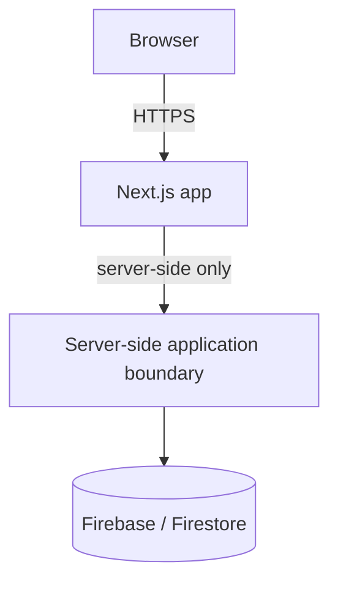
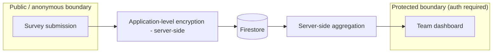

# DevPulse — Architecture

Status labels used below: **decided**, **provisional**, **open question**.

## High-level shape (decided)

- Next.js + TypeScript, Firebase, Firestore — **decided**, not to be
  re-evaluated (see `AGENTS.md` / project constraints).
- All access to Firestore for sensitive data goes through the server-side
  boundary (Next.js server code), never directly from the browser client.
- **Decided, implemented** (Phase 2): Firestore Security Rules
  (`firestore.rules`) deny all client-SDK reads/writes unconditionally, as
  defense in depth alongside the Admin-SDK-only server boundary above — see
  `docs/DEVELOPMENT.md` ("Firestore rules and indexes") for deployment
  requirements.

## Authentication and authorization

- Firebase Authentication (email/password) is **implemented** (Phase 2; see
  `docs/features/results-dashboard/SPEC.md`). SSO/OAuth providers remain
  **not yet implemented**.
- Team authorization is enforced **server-side**: a request must prove
  membership in a team before that team's protected data is returned.
  A user authorized for Team A must not thereby gain access to Team B's
  private results — **decided invariant**.
- **Current model, implemented (`docs/features/team-management/SPEC.md`)**:
  a Firestore-backed, Firebase-**uid**-keyed `teamMemberships` collection
  supporting zero/one/many teams per user, and a global app-admin role
  determined server-side from a server-only email allow-list
  (`APP_ADMIN_EMAILS`) matched against a Firebase-**verified**,
  revocation-checked identity — never a client-supplied role. The single
  authorization boundary every protected team-scoped operation must go
  through is `authorizeTeamAccess(identity, teamId)`
  (`src/features/teams/server/authorize-team-access.ts`), returning
  `"admin" | "member" | "denied"`; it re-derives the decision from
  server-side Firestore state on every call — no cached/session-based
  authorization state exists.
- **Retired model (historical, Phase 2)**: a static, server-only,
  verified-email-to-`teamId` mapping (`TEAM_ASSIGNMENTS`,
  `resolveTeamForUser`), with a single static `teamId` list
  (`ALLOWED_TEAM_IDS`) — no self-service team selection, no Firestore
  `TeamMembership` collection, at most one team per user. Fully removed in
  TASK-011 once the team-management model above was proven working
  (`get-dashboard.ts`, the old `GET /api/results` route, and
  `team-assignments.ts` no longer exist); `/results` is now a thin
  client-side compatibility redirect to `/teams`/`/teams/[teamId]`
  (`src/features/results/components/ResultsRedirect.tsx`) rather than a
  page that renders results itself. See
  `docs/features/results-dashboard/SPEC.md` for what this model
  originally implemented.
- Admin access does not automatically imply access to raw individual
  responses (see `docs/SECURITY.md`) — the app-admin role introduced by
  team-management extends *which teams'* aggregates an identity may view
  and team/membership management, not raw-response access.
- **Participation vs. viewing authorization, implemented
  (`docs/features/managed-surveys/SPEC.md`, BR-16)**: `authorizeTeamAccess`
  (`"admin" | "member" | "denied"`) remains the sole boundary for *viewing*
  a team's results, but is deliberately **not** reused to decide who may
  *answer* an `authenticated` survey — an app admin with no actual
  `teamMemberships` record for that team is `"admin"` under
  `authorizeTeamAccess` yet must still be rejected as a respondent.
  `resolveSurveyForParticipation` and `submitSurveyResponse`
  (`src/features/surveys/server/`) instead check a real
  `teamMemberships/{uid}__{teamId}` record directly, re-derived from a
  fresh read at both page-load and submit time — never trusting an earlier
  check or app-admin status alone.
- **Own-admin-status read, implemented (`docs/features/product-ux-shell/
  SPEC.md`)**: a minimal `GET /api/me` route reuses `verifyIdToken` +
  `isAppAdmin` exactly as above and returns only the caller's own
  `{isAdmin: boolean}` (no Firestore read), so the UI can show/hide the
  Admin navigation link from server-derived state only — the UI never
  evaluates `APP_ADMIN_EMAILS` or any allow-list itself.

## Member identity and team roles (decided, implemented)

Foundation for the team/personal-development work
(`docs/features/member-identity-and-team-roles/SPEC.md`, F0). Additive and
migration-free; it gives no new permission to anyone.

- **Profiles feature (`src/features/profiles/`).** `domain/` holds the
  display-name normalisation/validation and the `userProfiles` record guard;
  `server/` holds the own-profile operations (`getOwnProfile`/
  `setOwnProfile`/`deleteOwnProfile`), a `UserProfileStore` seam over
  `userProfiles/{uid}`, and the batched `getDisplayNames` reader
  (`getAll`, ≤ 100 refs per call, returns only `uid → validated name` for
  server-internal use — not a directory); `client/` + `components/` hold
  the gateway and the `/me/profile` form. The own-profile API
  (`/api/me/profile`) derives the subject only from the verified token and
  takes no `uid`. `teams` imports only the batched name reader from
  `profiles`; `profiles` never imports `teams`.
- **Team role primitives (`src/features/teams/`).** A membership may carry
  an optional `role: "lead"` (`membershipRoleOf` is the single,
  fail-safe classifier: only exactly `"lead"`). `setTeamMemberRole`
  (app-admin-only, one Firestore transaction: membership check → for a
  promotion, a fresh `active` team-status check → update) is the only writer
  and is exposed through `PATCH /api/admin/teams/[teamId]/members/[uid]`.
- **`authorizeTeamAccess` vs `resolveTeamRole`.** `authorizeTeamAccess`
  (`admin | member | denied`) is **unchanged**: every existing caller still
  sees a lead as a plain `member`. `resolveTeamRole` is a separate,
  **opt-in** primitive that wraps it and returns
  `admin | lead | member | denied` (or `read_failed`): it reuses the wrapped
  decision verbatim for `admin`/`denied`, and only for a `member` re-reads
  the caller's membership (and, for a stored lead, the team status). An app
  admin is always `admin`, even when also a lead member; a lead is never an
  admin. **No production code calls `resolveTeamRole` yet and lead grants no
  capability in F0** — later features must opt in explicitly.
- **Effective lead.** A stored `role: "lead"` is an *effective* lead only
  while the team's status is exactly `"active"`. On a disabled (or
  unreadable/malformed-status) team it resolves to `member`; the stored role
  is left untouched and becomes effective again on re-activation. The
  member-facing roster's `isLead` uses this same effective definition; the
  admin member list deliberately shows the **stored** role so an admin can
  manage it.
- **Member-facing roster boundary.** `GET /api/teams/[teamId]/members`
  (`listTeamRoster`) authorizes with `authorizeTeamAccess` and returns only
  `{displayName, isLead, isSelf}` per member (plus `truncated`), built field
  by field. It reads at most 500 memberships (limit 501 to detect
  truncation, document-id order, no composite index) and resolves names with
  batched profile reads — never Firebase Auth, never e-mail. The app-admin
  member list (`GET /api/admin/teams/[teamId]/members`) is a separate,
  admin-only contract that carries `uid`/e-mail and is never reused for
  members. The UI roster (`TeamRosterSection`) is collapsed, loads lazily on
  first expand, and makes no other request.
- **Forum anonymity constraint.** A forum `authorTag` is a pure function of
  `(teamId, authorUid)`, so no member-visible response may expose another
  member's `uid` or a value derived from it (see `docs/SECURITY.md`).
  Consequently a client-visible **member reference** must be an opaque,
  team-scoped, non-`uid`, non-authoritative reference resolved server-side
  with fresh authorization. F0 deliberately built none
  (`docs/features/member-identity-and-team-roles/SPEC.md` — "Follow-up
  constraints for A–D"); Team Skill Planning (A0) introduced it as
  `teamMemberships.memberRef` — see "Team skill planning and member
  references" below. The F0 roster itself is unchanged and still carries no
  reference.
- **Not built in F0.** No RBAC framework, no professional roles, no lead-only
  capability, no directory/search, no account-deletion flow, no feature flag
  (the exposure is opt-in: nothing is visible until a user sets a name).

## Team skill planning and member references (decided, implemented)

Feature A (`docs/features/team-skill-planning/SPEC.md`) adds team-level
roadmap *plans* for competency areas and the first client-visible member
handle. Boundaries:

- **Server-only persistence.** `roadmapItems` and `teamMemberships.memberRef`
  are read/written only through the Firebase Admin SDK; `firestore.rules`
  denies all client access. The browser uses API routes through the gateway
  `src/features/roadmap/client/roadmap-gateway.ts` (and the existing teams
  gateways); it never touches Firestore.
- **Routes.** `GET/POST /api/teams/[teamId]/roadmap-items`,
  `PATCH …/roadmap-items/[treeId]` (no DELETE), `GET
  /api/teams/[teamId]/assignable-members`, and the admin-only `POST
  /api/admin/teams/[teamId]/member-refs`. Handlers are thin: bearer
  extraction, strict allow-lists, then a server operation with injected deps.
- **Slice layout.** `src/features/roadmap/` holds pure domain helpers (item
  guard, dates, target rule, sort, form mapping), the server read/create/
  update services, the gateway, components and copy. `src/features/teams/`
  holds the member-reference primitive (`domain/member-ref.ts`), presentation
  ordinals, `materialize-member-refs` and `list-assignable-members`.
  Dependencies point `roadmap → teams/skill-trees/profiles`, never back;
  `TeamDetail` only composes.
- **Authorization is re-derived per operation.** Reads follow the existing
  team/admin access semantics (`authorizeTeamAccess`, unchanged). Writes
  require a genuine membership in an *active* team, checked inside the write
  transaction; an app admin or team lead who is not a member gets no extra
  write access (a lead is an ordinary member here; `resolveTeamRole` still has
  no production caller). `canEdit` in the read DTO is server-derived and only
  hides controls; the server re-checks every write.
- **Member reference.** `memberRef` is CSPRNG output stored on the membership,
  an opaque selector identity only — never evidence of identity or
  authorization. It is generated in `applyMembershipGrant`, or by the explicit
  admin preparation operation for legacy memberships; no GET writes. Resolving
  a ref reads the team's memberships (≤501) and matches in memory; unknown,
  stale, cross-team, malformed or duplicate refs fail closed. The
  assignable-members endpoint is a separate, privacy-minimized contract
  (`{memberRef, displayName, ordinal, isSelf}` + counts); the F0 roster DTO is
  not reused. Owner display names are resolved server-side.
- **Source-of-truth split.** Current stage stays `skillProgress`; planning is
  `roadmapItems` (one deterministic document per team + tree; the id is a
  uniqueness device, not authorization). Derived values (tracking state,
  `targetReached`, `overdue`, labels, owner name) are computed per read and
  never stored. Plans are not coupled to tracking writes: stopping tracking
  leaves the plan in place.
- **Shared client state.** One `RoadmapPlanningScope` component state in
  `TeamDetail` serves the tracked-area rows and the untracked-plans section;
  its failures are independent of the other sections.
- **Surface.** Feature A lives inside the existing *Kompetanseområder*
  section; it adds no route, tab or navigation entry. The dedicated Team
  Roadmap surface is Feature B (below). Future `teamSkillNeeds`
  and `roleDefinitions` are not part of this architecture yet; personal `skillProfiles`
  (C1) is described in "Individual skill self-assessment" below.

## Team Roadmap (Feature B, decided, implemented)

Feature B (`docs/features/team-roadmap/SPEC.md`) is a presentation surface over
Feature A's `roadmapItems`. Boundaries:

- **No new infrastructure.** No new collection, field, route method, Firestore
  rule, index, migration, backfill or Demo Team fixture; no client Firestore
  access. It uses the existing `GET/POST …/roadmap-items` and
  `PATCH …/roadmap-items/[treeId]`, the team skills read, the assignable-members
  read (lazy, as in A) and the teams overview (best-effort team name only).
  Authorization is unchanged and server-side; a lead is an ordinary member.
- **Route and navigation.** Thin `app/teams/[teamId]/roadmap/page.tsx`; logic in
  `src/features/roadmap/`. A small shared two-link nav (`Oversikt · Roadmap`,
  exact-path `aria-current`) lives in `src/features/teams/components/`;
  `TeamDetail` only gains the nav and a link. No three-tab shell.
- **Current-plan model.** One deterministic plan per team + tree, shared with A;
  replanning overwrites it. No persisted history, timeline buckets, filters or
  view state; timeline groups, filters, counts and eligibility are derived on the
  client from the loaded response by pure helpers in
  `src/features/roadmap/domain/` (`roadmap-timeline`, `roadmap-filter`). The only
  URL state is the closed `?view` enum.
- **Single canonical read.** The page loads one archived-inclusive response
  (`?archived=true`) into page state via the extracted planning hook
  (`useRoadmapPlanning`, mode `archived-inclusive`; Feature A keeps the
  `lazy-archived` mode and its request pattern). Filters, `Vis arkiverte`, view
  switch and disclosures issue no roadmap GET. After a successful mutation the
  page performs one archived-inclusive refetch; there are no optimistic updates.
  `RoadmapItemView` gained one additive derived field, `completedAt` (ISO string
  or `null`, no actor).
- **Fail-closed creation.** `Områder uten plan` = areas from the team skills
  read minus every `treeId` in the complete archived-inclusive response. When
  that read is `truncated` (501-document bound, applied before in-memory archived
  filtering), creation is withheld, because the absence of a plan cannot be
  proven from an incomplete response. This is intentional; the server's
  `already_planned` check remains a backstop, not a substitute for correct client
  eligibility.
- **Skills dependency.** Roadmap plans and the skills read are independent
  dependencies: a skills failure leaves plans readable, withholds every mutation
  control and creation, and retries only the skills read. It never implies an
  access failure. Mutation controls require `canEdit` **and** a loaded skills
  read; legacy completed plans without `completedAt` are additionally read-only
  per item. A refetch that returns `canEdit: false` removes controls while the
  roadmap stays readable (distinct from `forbidden` → no-access).
- **Privacy.** Owner presentation reuses A's privacy-safe contract; the page
  renders no UID, e-mail, `memberRef`, membership id, forum `authorTag` or
  challenge identity, and there is no roadmap–challenge link. Counts are over
  plans, not people.

## Individual skill self-assessment (Feature C1, decided, implemented)

C1 (`docs/features/individual-skill-self-assessment/SPEC.md`) adds a person-owned,
**owner-only** self-assessment. It is the only part of the Team & Personal
Development work that stores per-person skill data; team aggregation was added later by C2 (see
"Team skill needs and privacy-thresholded coverage" below). Boundaries as delivered by C1:

- **Slice and dependency direction.** `src/features/skill-profiles/` holds `domain/`
  (the 1–4 ordinal scale, record guard, sort and count helpers), `server/` (store
  seam over `skillProfiles/{uid}`, bounded catalog reader, own-profile operations),
  `client/` (gateway) and `components/` (the `/me/skills` page); copy lives in
  `copy.ts`. Dependencies point `skill-profiles → skill-trees (isValidSkillTree) / auth`,
  never back. It imports no team authorization, `skillProgress`, roadmap, membership,
  `userProfiles` or admin code.
- **Server-only persistence.** Admin SDK only; `firestore.rules` has an explicit
  deny-only `skillProfiles` block (defence in depth). The browser uses the gateway and
  never touches Firestore. Owner authorization is enforced by server API behaviour using
  the verified token, not by the rules block.
- **Owner-only API.** `GET /api/me/skills`, `PUT` and `DELETE /api/me/skills/[treeId]`,
  `DELETE /api/me/skills`. No uid in path/query/body, no admin/team/lead reader, and no
  `emailVerified` requirement for own-profile access. Role never expands access.
- **SkillTree catalog reuse.** The global SkillTree catalog supplies skill-area identity
  (`treeId`) and name; there is no personal catalog. `listSkillTrees` (admin-only) is not
  reused or changed: the catalog read is duplicated minimally in the slice. This couples
  `skillProfiles` and future `teamSkillNeeds` to the catalog: replacing or materially
  changing the global catalog model requires considering both (no migration is defined).
- **Catalog raw window.** One query, `orderBy(createdAt asc).limit(501)`: the 501st **raw**
  document is only a truncation probe; the first 500 raw documents are the candidate
  window; invalid candidates are dropped but still consume slots; there is no refill
  query; valid skills are then sorted by name for presentation (sorting never changes
  window membership). Firestore resolves equal `createdAt` by document id; the application
  adds no tie-break. `truncated` is true iff a raw 501st document exists — it does not prove
  a valid skill is hidden or that assessments were cut off; the UI says only
  "Listen kan være ufullstendig." The query needs no composite index.
- **Existence is not the catalog window.** A `PUT` validates its target SkillTree directly
  inside the write transaction, so a valid `treeId` beyond the visible catalog window can
  still be written. Catalog visibility is not existence authorization.
- **Read, write and erase semantics.** `GET` never writes or repairs. Per-skill writes are
  single-transaction per-key merges (only the requested key and `updatedAt`, plus a
  `createdAt` repair when missing/invalid); unrelated keys and unknown top-level fields are
  preserved. Different-key concurrent writes are protected by the transaction; same-key
  writes are last-write-wins. `DELETE` one is an idempotent no-write when the key or
  document is absent. `DELETE` all physically deletes the document with no timestamp
  repair. A non-object `levels` makes the profile unreadable: reads return no levels and
  `profile: "unreadable"`, per-skill writes/clears return `409 profile_unreadable` and write
  nothing, and only reset-all (physical delete) recovers it. No automatic repair or migration.
- **Client state.** The page loads one `GET`, applies server-confirmed values only (no
  optimistic state), and moves to the unreadable state on `409`, to the sign-in prompt on
  `401`, and refetches the catalog once on `404`. A state epoch invalidates responses started
  before an unreadable transition or a successful reset so they cannot restore stale
  assessment data; reset is unavailable while a row save is pending.
- **Static privacy guard.** `skill-profiles-scope-guard.test.ts` is two-dimensional:
  (1) the files that reference the `skillProfiles` collection and (2) the entry points that
  import the skill-profiles server/store modules must each equal an approved allow-list, so
  an accidental new reader or importer fails visibly. It also pins the persisted key set and
  forbids team-authorization/`skillProgress`/roadmap/membership imports in the slice. It is
  change detection, **not a security boundary**: it does not prove runtime behaviour,
  dynamic collection names or module paths, code outside `src/` and `app/`, or arbitrary
  Admin-credential access. The C2 reader deliberately edited **both** allow-lists
  under review (`docs/SECURITY.md`, invariants 31–36).
- **Not in C1 (C2 later added the opt-in thresholded subset; the rest remains undelivered):** `teamSkillNeeds`, a team skill matrix, gap
  analysis, aggregate views, privacy thresholds, inclusion/consent decisions, role
  expectations, sharing, and any team/lead/admin access to individual self-assessments.
- **No new infrastructure.** No composite index, migration, backfill, dependency or
  environment variable; no Demo Team personal profile.
- **Known limitations (as built).** A 404-triggered catalog refetch can theoretically overlap
  another successful save by the same user and briefly replace that row with an older
  snapshot (transient, same user, corrected by the next action or reload; the state epoch
  covers 409/reset transitions but not this overlap). The page reuses the generic
  `DeleteConfirmation` component from `src/features/forum/components/` (no data coupling; a
  maintainability concern only).

## Team skill needs and privacy-thresholded coverage (Feature C2, decided, implemented)

C2 (`docs/features/team-skill-needs-and-matrix/SPEC.md`) adds team-owned skill needs, a
per-team opt-in contribution, and a derived categorical coverage status. It is the only
reader of `skillProfiles` other than the owner. Boundaries:

- **Slice and dependency direction.** `src/features/team-skills/` holds `domain/` (need
  record and validation, participation rule, pure `deriveCoverageState`, and the policy
  constants), `server/` (genuine-membership check, needs list/upsert/delete, participation
  get/set/withdraw, `get-team-skill-coverage`), `client/` (gateway), `components/`
  (`TeamSkillNeedsSection`, `SkillNeedEditor`, `SkillContributionPanel`) and `copy.ts`.
  Routes are thin: `app/api/teams/[teamId]/skill-needs[/[treeId]]`, `.../skill-coverage`,
  `.../skill-contribution`. Dependencies point `team-skills → skill-trees/domain,
  teams/domain, skill-profiles (level domain and the one batch module)`, never back.
  `team-skills` imports no roadmap or `skillProgress` module.
- **Policy constants, one owner.** `SKILL_COVERAGE_MIN_CONTRIBUTORS = 5`,
  `SKILL_CONTRIBUTION_NOTICE_VERSION = 1` and `TEAM_SKILL_COHORT_SCAN_MAX = 500` live only in
  `team-skills/domain/skill-coverage-policy.ts`. No environment variable, setting, request
  parameter or UI can change them (invariant 34).
- **Genuine-membership ordering.** `authorizeTeamAccess` and `resolveTeamRole` return `admin`
  before they look at membership, and both are unchanged. Need *read* uses
  `authorizeTeamAccess` (member or admin; disabled teams readable). Coverage, need writes and
  participation use `genuine-team-membership.ts` with fresh reads in this order: verified token
  (401) → team exists with a valid status (else 403 for everyone) → the caller's own valid
  membership (else 403, without consulting app-admin status) → `active` team (else 409
  `team_disabled`) → operation-specific checks. Failed reads are 500 `read_failed`, never 403.
  Read-need, write-need and read-coverage are three separate permissions; there is no combined
  `canEdit`, and the response `viewer` hints only hide controls.
- **The one lead capability.** `PUT`/`DELETE .../skill-needs/[treeId]` re-verify in one
  transaction that the caller's genuine membership has exactly `role: "lead"` and the team is
  `active` (PUT also reads the target tree directly). This is decided from the membership, not
  through `resolveTeamRole`; a lead who is also an app admin keeps it, an admin without a lead
  membership has none, and a removed or demoted lead loses it on the next call.
- **Needs persistence.** `teamSkillNeeds/{teamId}__{treeId}`: `teamId`, `treeId`,
  `requiredLevel` (2–4), `requiredCoverage` (1–20), `createdAt`, `updatedAt`. No actor,
  archive or history fields; `DELETE` is a hard, idempotent delete. Invalid documents are
  skipped on read, never repaired. Server-only (Admin SDK) with an explicit deny-only
  `firestore.rules` block; the needs query is `where("teamId","==",…).limit(501)`, so no index.
- **Participation persistence.** Membership field `skillContribution: { noticeVersion,
  consentedAt }` (presence = opt-in, no `enabled` flag). Written only by the owner through
  `PUT`/`DELETE .../skill-contribution` in a transaction that updates only that field;
  withdrawal deletes the whole object. Effective only when the key set is exact, the version
  equals the current constant and the timestamp is valid; a version bump silently lapses all
  participation. Membership removal destroys it, a rejoin starts without it, and a re-grant of
  an existing membership is a no-op. It is never in a membership-derived DTO (roster,
  assignable members, members list, admin member list, access requests); `consentedAt` is
  never returned or used for a decision.
- **Coverage aggregation order.** Authorize (above) → list needs (≤501) → none ⇒ empty
  `available`, no profile read → list memberships (≤501; 501 ⇒ `incomplete` with no rows) →
  keep valid memberships with effective participation → `readSkillLevelsBatch(uids,
  needTreeIds)` → direct-read needed trees (invalid ⇒ `area_unavailable`) → derive →
  allow-listed DTO, `Cache-Control: no-store`. Any read failure ⇒ 500 with no partial data;
  nothing is persisted or cached (invariant 35). The route accepts no query parameter or body.
- **Pure derivation.** `deriveCoverageState` takes plain integers for one skill plus the need's
  two numbers: fewer than 5 eligible contributors ⇒ `insufficient_data`; otherwise at least
  `requiredCoverage` at or above `requiredLevel` ⇒ `covered`, else `gap` (also when
  `requiredCoverage` exceeds the cohort). The cohort is **per skill**, not team size. Only valid
  exact-tree levels (1–4) contribute; unreadable, unassessed, invalid and absent profiles are
  excluded without any count or cause, so every suppression cause is indistinguishable. The DTO
  is exactly `treeId`, `areaName`, `requiredLevel`, `requiredCoverage`, `state` per row, plus
  `availability`.
- **The single reader.** `skill-profiles/server/read-skill-levels-batch.ts` exports only
  `readSkillLevelsBatch(uids, treeIds)` and returns, per tree, a sorted array of plain
  integers 1–4 with no uid or per-person association (or `{ ok: false }`). It builds on one new
  function `readSkillProfilesBatch` inside the already approved `skill-profile-store.ts`, which is
  **not** on the `SkillProfileStore` interface, default store or in-memory fake, so C1 owner
  operations cannot call it. Only `team-skills/server/get-team-skill-coverage.ts` may import the
  batch module, and a call-site test pins the uid list passed to it.
- **Guard edits.** `skill-profiles-scope-guard.test.ts` gained module-level importer maps for
  `skill-profile-store.ts` and the batch module, exactly one added outside importer in
  `APPROVED_SERVER_IMPORTERS`, identifier and re-export scans, and negative fixtures; its
  forbidden-identifier list is unchanged. The new `team-skills-scope-guard.test.ts` pins exact
  writer sets for `teamSkillNeeds` and `skillContribution`, the coverage DTO key set, no
  Firebase client SDK, no roadmap/`skillProgress` import, and the lead-only write check. Both are
  change detection, **not security boundaries** (they do not prove dynamic paths, aliases other
  than `@/`, code outside `src/` and `app/`, or Admin-credential access).
- **Catalog read.** The member-readable bounded catalog read (500/501 raw window, the C1 rule) is
  a minimal duplicate in `team-skills/server/skill-need-catalog.ts`; `listSkillTrees` and C1's
  catalog module are neither changed nor imported.
- **Client.** `TeamSkillNeedsSection` is rendered by `TeamDetail` on Oversikt (no new route or
  navigation). It loads needs, then coverage when `viewer.canReadCoverage`; the participation panel
  loads separately. The browser uses the gateway only.
- **Independence.** C2 writes only `teamSkillNeeds` and the caller's own `skillContribution`. It never
  writes `skillProfiles`, `userProfiles`, `skillProgress` or `roadmapItems`, creates no roadmap item,
  assignment, goal or notification, and reads neither `skillProgress` nor `roadmapItems`.
- **No new infrastructure.** No composite index (`firestore.indexes.json` unchanged), dependency,
  environment variable, cache, background job, migration or Demo Team fixture. Rules deployment is a
  separate explicit step not performed by implementation.
- **Known limitations (as built).** The residual privacy risks of `docs/SECURITY.md` (invariant 36),
  including the malicious-lead need-mutation oracle; a membership scan above 500 shows `incomplete`
  rather than aggregating; no account-deletion flow, so orphaned memberships and profiles can persist;
  a Demo re-seed (full-replace membership write) resets role and participation; and the Demo cannot show
  the `covered`/`gap` states.

## Personal development goals (Feature D1, decided, implemented)

D1 (`docs/features/personal-development-goals/SPEC.md`) adds person-owned, **owner-only** development
goals. It is independent of C1 and C2 data. Boundaries as delivered:

- **Slice and dependency direction.** `src/features/personal-goals/` holds `domain/` (pure goal,
  title, target-date and limit rules), `server/` (the single store module that names the collection,
  own-goal operations, an in-memory fake for tests), `client/` (gateway) and `components/` (the
  `/me/goals` page); copy lives in `copy.ts`. It depends on `auth` token verification, generic
  `src/lib/firebase/` and `src/components/ui/` primitives, and the pure `isValidSkillTree` predicate
  only. It imports no `profiles`, `skill-profiles`, `team-skills`, `teams`, `roadmap` or
  `skill-trees/server` code and no team authorization or membership logic.
- **First subcollection pattern.** Goals live at `userDevelopment/{uid}/goals/{goalId}`; every other
  collection is top-level. The path is the ownership boundary (a foreign goal id resolves as missing
  under the caller's path), no owner field is duplicated, no composite index is needed, and a future
  erasure can target one owner subtree. No `userDevelopment/{uid}` parent document is stored. No
  `collectionGroup` goal query is permitted. The root name is reserved for later per-owner
  development data; D1 defines only `goals`.
- **Server-only persistence and owner route family.** Admin SDK only; `firestore.rules` has an
  explicit deny-only `userDevelopment/{document=**}` block placed before the catch-all (defence in
  depth; the Admin SDK bypasses client rules, so owner authorization is enforced by server
  behaviour using the verified token uid, never by the rules). Routes: `GET`/`POST /api/me/goals`,
  `PATCH`/`DELETE /api/me/goals/[goalId]`. No uid in path, query or body; no user-id, admin or team
  route; no `emailVerified` requirement; a role never widens access.
- **SkillTree reuse.** The global catalog supplies only the optional topic link (`treeId`) and the
  name resolved at read; a bounded catalog read (500/501 raw window) is duplicated minimally in the
  slice. A stored link whose tree is gone or invalid is reported as unavailable, and editing stays
  possible. D1 writes no SkillTree data and never reads `skillProfiles`.
- **Limits, read window and recovery.** At most 100 goals per owner, enforced count-then-create
  (a small overshoot under concurrent creates is accepted). The list reads a bounded window
  (newest 100 by `createdAt`); malformed or overflow documents count toward the cap, and a bounded
  `select`-only recovery scan finds malformed documents lacking `createdAt`. A malformed document
  with an addressable id is returned to the owner only as a delete-only `{ goalId }` item with no
  stored content; documents whose id is not addressable cannot be recovered in-product.
- **Shared personal navigation.** `src/components/nav/PersonalNav` renders `Ferdigheter` (`/me/skills`)
  and `Mål` (`/me/goals`) on both pages; the header entry `Min utvikling` replaces `Mine ferdigheter`
  and is active on both routes. `/me/goals` stays a static route; there is no `/me` index.
- **Static privacy guard.** `personal-goals-scope-guard.test.ts` pins the collection-name allow-list,
  importer allow-lists, forbidden imports and concepts, and DTO/persisted key sets. It is change
  detection, **not a security boundary** (same limits as the C1/C2 guards), and no C1/C2 allow-list
  was edited for D1.
- **Not in D1:** check-ins/conversations (D2), sharing, lead/admin/manager access, role profiles or
  expectations, progress history, notifications, assignments, analytics.
- **No new infrastructure.** No composite index (`firestore.indexes.json` unchanged), dependency,
  environment variable, migration, background job or Demo Team fixture. Rules deployment is a
  separate explicit step not performed by implementation.
- **Known limitations.** See `docs/SECURITY.md` (after invariant 54): no account-deletion flow,
  operator access, unencrypted titles, cap race, non-addressable ids and bounded windows.

## Submission and dashboard boundaries (decided, implemented)

- **Public/anonymous submission boundary**: accepts pulse survey answers
  without requiring the respondent's identity to be attached to the stored
  response payload.
- **Protected dashboard boundary**: requires authentication + team
  authorization; only serves aggregated results (see minimum threshold in
  `docs/SECURITY.md`), never raw individual responses, to an authorized
  team member or app admin (`authorizeTeamAccess`, enforced server-side —
  see "Authentication and authorization" above). App-admin status does not
  imply raw-response access (see invariant 17, `docs/SECURITY.md`).
- **`SurveyParticipation`, implemented, `authenticated`-mode only
  (`docs/features/managed-surveys/SPEC.md`)**: a deliberately minimal
  `surveyParticipations/{uid}__{surveyId}` document (`{uid, surveyId}`
  only — no `submittedAt` or any other field) records that one identity has
  submitted to one survey, used solely to reject a second accepted
  submission from the same `uid` (BR-21/BR-22). It carries no shared
  identifier, foreign key, or content field joining it to the specific
  `surveyResponses` document it accompanies (BR-18) — an app admin (or
  anyone else, at the application level) can see *that* a `uid` submitted
  to a survey, never *which* response is theirs. Written in the same
  Firestore transaction as the response, for exactly-once duplicate
  prevention with no race window; the resulting shared commit-timestamp
  metadata is a residual, raw-Firestore-only correlation signal this
  application itself never reads or exposes (see "Consistency vs.
  unlinkability tradeoff," `docs/features/managed-surveys/SPEC.md`). Does
  not exist for `public` surveys, which remain exactly as identity-free and
  dedup-free as Phase 1.

## Survey lifecycle (decided, implemented)

- A survey's answerability (`"scheduled" | "open" | "closed"`) is a
  **derived** value, computed identically everywhere it's used (submission
  enforcement, admin UI, team UI) from three optional timestamps
  (`openedAt`, `closedAt`, `endAt`) — never a separately stored status
  field that could drift from them (`effectiveLifecycle`,
  `src/features/surveys/domain/survey.ts`). This pattern replaces the
  now-retired calendar-period equivalent (`isPeriodClosed`), generalized
  from "is this fixed calendar period closed" to "is this survey closed,"
  including a set `endAt` closing a survey automatically and live, with no
  background job.
- **One open survey per team** is enforced via a dedicated coordination
  document (`teamSurveyState/{teamId}`, `{activeSurveyId, updatedAt}`)
  rather than a query — the same established pattern this codebase already
  uses for every other one-of-a-kind invariant (`teamMemberships/
  {uid}__{teamId}`, `teamInvitations/{teamId}__{email}`). Opening and
  closing a survey each happen inside one Firestore transaction that reads
  this document, re-derives the referenced survey's own lifecycle before
  trusting the pointer, and only then writes both documents together — so
  two concurrent "open" attempts for the same team can never both succeed,
  and a stale pointer left by a survey that auto-expired via `endAt` is
  self-corrected rather than treated as a false conflict. See
  `docs/features/managed-surveys/SPEC.md` → "One open survey per team" for
  the full mechanism.
- Every lifecycle/answerability decision uses the server's own clock
  exclusively; a client/browser-supplied timestamp is never accepted or
  compared against for any authorization or answerability decision.

## Application-level encryption boundary (decided invariant, provisional implementation)

- Sensitive survey fields are encrypted **server-side** before being written
  to Firestore, and decrypted **server-side** only when authorized
  aggregation/reporting requires it.
- Encryption keys never reach the browser, Firestore, git, or logs.
- Key management approach (e.g. Cloud KMS, Secret Manager, or another
  provider) is an **open question** — future key-management integration
  point, not yet selected.
- **Implemented (Phase 5, `docs/features/anonymous-challenges/SPEC.md`)**:
  `challenges` (Anonymous Challenges' free-text reports) is a second
  encrypted-at-rest collection alongside `surveyResponses`, reusing
  `src/lib/encryption/encryption.ts` unchanged. Its anonymity shape is
  deliberately different from a survey response's, and intentionally so, not
  an inconsistency: a survey response's *content* is never shown to anyone,
  only a threshold-gated aggregate, whereas a challenge's *content* is shown
  individually to any authorized team member/admin once decrypted — the
  guarantee this feature makes is narrower and different in kind (*never
  who*, not *never what*). No identity field is ever persisted on a
  `challenges` document, and there is no participation-tracking collection
  for it at all (unlike `SurveyParticipation`), since Anonymous Challenges
  has no duplicate-submission-detection requirement to enforce. See
  `docs/features/anonymous-challenges/SPEC.md` — "Privacy/anonymity model"
  for the full threat model.
- **Implemented (Phase 6, `docs/features/team-forum/SPEC.md`)**:
  `forumThreads`/`forumReplies` (Team Forum's attributed discussion
  threads/replies) are a third encrypted-at-rest collection pair, reusing
  `src/lib/encryption/encryption.ts` unchanged — a thread's title/body and
  a reply's body are each encrypted server-side before being written, for
  the same reason Anonymous Challenges' free text is: this content can
  easily discuss the same kind of sensitive workplace-friction material,
  regardless of whether it happens to be attributed. Team Forum's identity
  shape is different in kind from both existing encrypted collections, not
  merely a third instance of the same pattern: a survey response is never
  individually shown to anyone (only a threshold-gated aggregate); a
  challenge is individually shown but its *submitter* is never persisted or
  recoverable; a forum thread/reply is individually shown **and** its
  author's real `authorUid` is persisted — attribution itself is this
  feature's deliberate point, not something to avoid. What Team Forum still
  keeps hidden is the author's *real-world* identity: `authorUid` is never
  returned by any API response, and the only member-visible attribution is
  `authorTag`, a deterministic, one-way pseudonym computed purely from
  `(teamId, authorUid)` (`src/features/forum/domain/author-tag.ts`) — never
  an email address, display name, or the raw `uid` itself, and never
  derived from a Firebase Auth lookup. Deletion goes further than Anonymous
  Challenges too: a deleted thread is a genuine Firestore document deletion
  of the thread and every one of its replies (not an update), and a deleted
  reply has its encrypted fields physically removed from the document
  (`FieldValue.delete()`), not merely withheld from a response — deleted
  forum content is not just unauthorized to read, it no longer exists
  anywhere to decrypt. See `docs/features/team-forum/SPEC.md` —
  "Identity/attribution model" and "Encryption/content classification" for
  the full model.

## Aggregation

- Aggregated results are computed server-side from decrypted data and only
  the aggregate (not raw responses) is exposed to dashboards.
- Aggregates are suppressed below a configurable minimum response count
  (see `docs/SECURITY.md`).

## Open questions

- Key management provider and rotation strategy.
- Hosting/runtime target for the server-side boundary (not decided in this
  session; no deployment work has been done).
