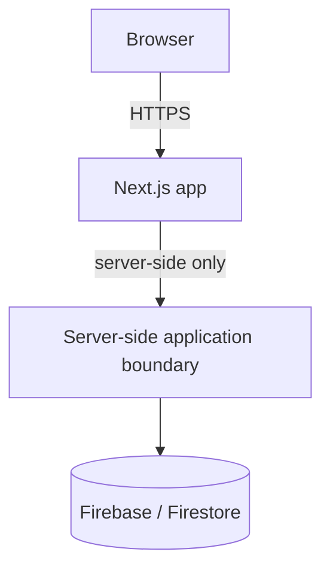
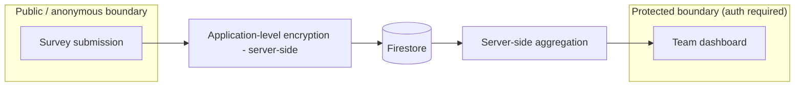

# DevPulse — Architecture

Status labels used below: **decided**, **provisional**, **open question**.

## High-level shape (decided)

- Next.js + TypeScript, Firebase, Firestore — **decided**, not to be
  re-evaluated (see `AGENTS.md` / project constraints).
- All access to Firestore for sensitive data goes through the server-side
  boundary (Next.js server code), never directly from the browser client.
- **Decided, implemented** (Phase 2): Firestore Security Rules
  (`firestore.rules`) deny all client-SDK reads/writes unconditionally, as
  defense in depth alongside the Admin-SDK-only server boundary above — see
  `docs/DEVELOPMENT.md` ("Firestore rules and indexes") for deployment
  requirements.

## Authentication and authorization

- Firebase Authentication (email/password) is **implemented** (Phase 2; see
  `docs/features/results-dashboard/SPEC.md`). SSO/OAuth providers remain
  **not yet implemented**.
- Team authorization is enforced **server-side**: a request must prove
  membership in a team before that team's protected data is returned.
  A user authorized for Team A must not thereby gain access to Team B's
  private results — **decided invariant**.
- **Current model, implemented (`docs/features/team-management/SPEC.md`)**:
  a Firestore-backed, Firebase-**uid**-keyed `teamMemberships` collection
  supporting zero/one/many teams per user, and a global app-admin role
  determined server-side from a server-only email allow-list
  (`APP_ADMIN_EMAILS`) matched against a Firebase-**verified**,
  revocation-checked identity — never a client-supplied role. The single
  authorization boundary every protected team-scoped operation must go
  through is `authorizeTeamAccess(identity, teamId)`
  (`src/features/teams/server/authorize-team-access.ts`), returning
  `"admin" | "member" | "denied"`; it re-derives the decision from
  server-side Firestore state on every call — no cached/session-based
  authorization state exists.
- **Retired model (historical, Phase 2)**: a static, server-only,
  verified-email-to-`teamId` mapping (`TEAM_ASSIGNMENTS`,
  `resolveTeamForUser`), with a single static `teamId` list
  (`ALLOWED_TEAM_IDS`) — no self-service team selection, no Firestore
  `TeamMembership` collection, at most one team per user. Fully removed in
  TASK-011 once the team-management model above was proven working
  (`get-dashboard.ts`, the old `GET /api/results` route, and
  `team-assignments.ts` no longer exist); `/results` is now a thin
  client-side compatibility redirect to `/teams`/`/teams/[teamId]`
  (`src/features/results/components/ResultsRedirect.tsx`) rather than a
  page that renders results itself. See
  `docs/features/results-dashboard/SPEC.md` for what this model
  originally implemented.
- Admin access does not automatically imply access to raw individual
  responses (see `docs/SECURITY.md`) — the app-admin role introduced by
  team-management extends *which teams'* aggregates an identity may view
  and team/membership management, not raw-response access.
- **Participation vs. viewing authorization, implemented
  (`docs/features/managed-surveys/SPEC.md`, BR-16)**: `authorizeTeamAccess`
  (`"admin" | "member" | "denied"`) remains the sole boundary for *viewing*
  a team's results, but is deliberately **not** reused to decide who may
  *answer* an `authenticated` survey — an app admin with no actual
  `teamMemberships` record for that team is `"admin"` under
  `authorizeTeamAccess` yet must still be rejected as a respondent.
  `resolveSurveyForParticipation` and `submitSurveyResponse`
  (`src/features/surveys/server/`) instead check a real
  `teamMemberships/{uid}__{teamId}` record directly, re-derived from a
  fresh read at both page-load and submit time — never trusting an earlier
  check or app-admin status alone.
- **Own-admin-status read, implemented (`docs/features/product-ux-shell/
  SPEC.md`)**: a minimal `GET /api/me` route reuses `verifyIdToken` +
  `isAppAdmin` exactly as above and returns only the caller's own
  `{isAdmin: boolean}` (no Firestore read), so the UI can show/hide the
  Admin navigation link from server-derived state only — the UI never
  evaluates `APP_ADMIN_EMAILS` or any allow-list itself.

## Member identity and team roles (decided, implemented)

Foundation for the team/personal-development work
(`docs/features/member-identity-and-team-roles/SPEC.md`, F0). Additive and
migration-free; it gives no new permission to anyone.

- **Profiles feature (`src/features/profiles/`).** `domain/` holds the
  display-name normalisation/validation and the `userProfiles` record guard;
  `server/` holds the own-profile operations (`getOwnProfile`/
  `setOwnProfile`/`deleteOwnProfile`), a `UserProfileStore` seam over
  `userProfiles/{uid}`, and the batched `getDisplayNames` reader
  (`getAll`, ≤ 100 refs per call, returns only `uid → validated name` for
  server-internal use — not a directory); `client/` + `components/` hold
  the gateway and the `/me/profile` form. The own-profile API
  (`/api/me/profile`) derives the subject only from the verified token and
  takes no `uid`. `teams` imports only the batched name reader from
  `profiles`; `profiles` never imports `teams`.
- **Team role primitives (`src/features/teams/`).** A membership may carry
  an optional `role: "lead"` (`membershipRoleOf` is the single,
  fail-safe classifier: only exactly `"lead"`). `setTeamMemberRole`
  (app-admin-only, one Firestore transaction: membership check → for a
  promotion, a fresh `active` team-status check → update) is the only writer
  and is exposed through `PATCH /api/admin/teams/[teamId]/members/[uid]`.
- **`authorizeTeamAccess` vs `resolveTeamRole`.** `authorizeTeamAccess`
  (`admin | member | denied`) is **unchanged**: every existing caller still
  sees a lead as a plain `member`. `resolveTeamRole` is a separate,
  **opt-in** primitive that wraps it and returns
  `admin | lead | member | denied` (or `read_failed`): it reuses the wrapped
  decision verbatim for `admin`/`denied`, and only for a `member` re-reads
  the caller's membership (and, for a stored lead, the team status). An app
  admin is always `admin`, even when also a lead member; a lead is never an
  admin. **No production code calls `resolveTeamRole` yet and lead grants no
  capability in F0** — later features must opt in explicitly.
- **Effective lead.** A stored `role: "lead"` is an *effective* lead only
  while the team's status is exactly `"active"`. On a disabled (or
  unreadable/malformed-status) team it resolves to `member`; the stored role
  is left untouched and becomes effective again on re-activation. The
  member-facing roster's `isLead` uses this same effective definition; the
  admin member list deliberately shows the **stored** role so an admin can
  manage it.
- **Member-facing roster boundary.** `GET /api/teams/[teamId]/members`
  (`listTeamRoster`) authorizes with `authorizeTeamAccess` and returns only
  `{displayName, isLead, isSelf}` per member (plus `truncated`), built field
  by field. It reads at most 500 memberships (limit 501 to detect
  truncation, document-id order, no composite index) and resolves names with
  batched profile reads — never Firebase Auth, never e-mail. The app-admin
  member list (`GET /api/admin/teams/[teamId]/members`) is a separate,
  admin-only contract that carries `uid`/e-mail and is never reused for
  members. The UI roster (`TeamRosterSection`) is collapsed, loads lazily on
  first expand, and makes no other request.
- **Forum anonymity constraint.** A forum `authorTag` is a pure function of
  `(teamId, authorUid)`, so no member-visible response may expose another
  member's `uid` or a value derived from it (see `docs/SECURITY.md`).
  Consequently a client-visible **member reference** must be an opaque,
  team-scoped, non-`uid`, non-authoritative reference resolved server-side
  with fresh authorization. F0 deliberately built none
  (`docs/features/member-identity-and-team-roles/SPEC.md` — "Follow-up
  constraints for A–D"); Team Skill Planning (A0) introduced it as
  `teamMemberships.memberRef` — see "Team skill planning and member
  references" below. The F0 roster itself is unchanged and still carries no
  reference.
- **Not built in F0.** No RBAC framework, no professional roles, no lead-only
  capability, no directory/search, no account-deletion flow, no feature flag
  (the exposure is opt-in: nothing is visible until a user sets a name).

## Team skill planning and member references (decided, implemented)

Feature A (`docs/features/team-skill-planning/SPEC.md`) adds team-level
roadmap *plans* for competency areas and the first client-visible member
handle. Boundaries:

- **Server-only persistence.** `roadmapItems` and `teamMemberships.memberRef`
  are read/written only through the Firebase Admin SDK; `firestore.rules`
  denies all client access. The browser uses API routes through the gateway
  `src/features/roadmap/client/roadmap-gateway.ts` (and the existing teams
  gateways); it never touches Firestore.
- **Routes.** `GET/POST /api/teams/[teamId]/roadmap-items`,
  `PATCH …/roadmap-items/[treeId]` (no DELETE), `GET
  /api/teams/[teamId]/assignable-members`, and the admin-only `POST
  /api/admin/teams/[teamId]/member-refs`. Handlers are thin: bearer
  extraction, strict allow-lists, then a server operation with injected deps.
- **Slice layout.** `src/features/roadmap/` holds pure domain helpers (item
  guard, dates, target rule, sort, form mapping), the server read/create/
  update services, the gateway, components and copy. `src/features/teams/`
  holds the member-reference primitive (`domain/member-ref.ts`), presentation
  ordinals, `materialize-member-refs` and `list-assignable-members`.
  Dependencies point `roadmap → teams/skill-trees/profiles`, never back;
  `TeamDetail` only composes.
- **Authorization is re-derived per operation.** Reads follow the existing
  team/admin access semantics (`authorizeTeamAccess`, unchanged). Writes
  require a genuine membership in an *active* team, checked inside the write
  transaction; an app admin or team lead who is not a member gets no extra
  write access (a lead is an ordinary member here; `resolveTeamRole` still has
  no production caller). `canEdit` in the read DTO is server-derived and only
  hides controls; the server re-checks every write.
- **Member reference.** `memberRef` is CSPRNG output stored on the membership,
  an opaque selector identity only — never evidence of identity or
  authorization. It is generated in `applyMembershipGrant`, or by the explicit
  admin preparation operation for legacy memberships; no GET writes. Resolving
  a ref reads the team's memberships (≤501) and matches in memory; unknown,
  stale, cross-team, malformed or duplicate refs fail closed. The
  assignable-members endpoint is a separate, privacy-minimized contract
  (`{memberRef, displayName, ordinal, isSelf}` + counts); the F0 roster DTO is
  not reused. Owner display names are resolved server-side.
- **Source-of-truth split.** Current stage stays `skillProgress`; planning is
  `roadmapItems` (one deterministic document per team + tree; the id is a
  uniqueness device, not authorization). Derived values (tracking state,
  `targetReached`, `overdue`, labels, owner name) are computed per read and
  never stored. Plans are not coupled to tracking writes: stopping tracking
  leaves the plan in place.
- **Shared client state.** One `RoadmapPlanningScope` component state in
  `TeamDetail` serves the tracked-area rows and the untracked-plans section;
  its failures are independent of the other sections.
- **Surface.** Feature A lives inside the existing *Kompetanseområder*
  section; it adds no route, tab or navigation entry. The dedicated Team
  Roadmap surface (route, timeline/list, history) is Feature B and is not
  built. Future `teamSkillNeeds`, `skillProfiles` and `roleDefinitions` are
  not part of this architecture yet.

## Submission and dashboard boundaries (decided, implemented)

- **Public/anonymous submission boundary**: accepts pulse survey answers
  without requiring the respondent's identity to be attached to the stored
  response payload.
- **Protected dashboard boundary**: requires authentication + team
  authorization; only serves aggregated results (see minimum threshold in
  `docs/SECURITY.md`), never raw individual responses, to an authorized
  team member or app admin (`authorizeTeamAccess`, enforced server-side —
  see "Authentication and authorization" above). App-admin status does not
  imply raw-response access (see invariant 17, `docs/SECURITY.md`).
- **`SurveyParticipation`, implemented, `authenticated`-mode only
  (`docs/features/managed-surveys/SPEC.md`)**: a deliberately minimal
  `surveyParticipations/{uid}__{surveyId}` document (`{uid, surveyId}`
  only — no `submittedAt` or any other field) records that one identity has
  submitted to one survey, used solely to reject a second accepted
  submission from the same `uid` (BR-21/BR-22). It carries no shared
  identifier, foreign key, or content field joining it to the specific
  `surveyResponses` document it accompanies (BR-18) — an app admin (or
  anyone else, at the application level) can see *that* a `uid` submitted
  to a survey, never *which* response is theirs. Written in the same
  Firestore transaction as the response, for exactly-once duplicate
  prevention with no race window; the resulting shared commit-timestamp
  metadata is a residual, raw-Firestore-only correlation signal this
  application itself never reads or exposes (see "Consistency vs.
  unlinkability tradeoff," `docs/features/managed-surveys/SPEC.md`). Does
  not exist for `public` surveys, which remain exactly as identity-free and
  dedup-free as Phase 1.

## Survey lifecycle (decided, implemented)

- A survey's answerability (`"scheduled" | "open" | "closed"`) is a
  **derived** value, computed identically everywhere it's used (submission
  enforcement, admin UI, team UI) from three optional timestamps
  (`openedAt`, `closedAt`, `endAt`) — never a separately stored status
  field that could drift from them (`effectiveLifecycle`,
  `src/features/surveys/domain/survey.ts`). This pattern replaces the
  now-retired calendar-period equivalent (`isPeriodClosed`), generalized
  from "is this fixed calendar period closed" to "is this survey closed,"
  including a set `endAt` closing a survey automatically and live, with no
  background job.
- **One open survey per team** is enforced via a dedicated coordination
  document (`teamSurveyState/{teamId}`, `{activeSurveyId, updatedAt}`)
  rather than a query — the same established pattern this codebase already
  uses for every other one-of-a-kind invariant (`teamMemberships/
  {uid}__{teamId}`, `teamInvitations/{teamId}__{email}`). Opening and
  closing a survey each happen inside one Firestore transaction that reads
  this document, re-derives the referenced survey's own lifecycle before
  trusting the pointer, and only then writes both documents together — so
  two concurrent "open" attempts for the same team can never both succeed,
  and a stale pointer left by a survey that auto-expired via `endAt` is
  self-corrected rather than treated as a false conflict. See
  `docs/features/managed-surveys/SPEC.md` → "One open survey per team" for
  the full mechanism.
- Every lifecycle/answerability decision uses the server's own clock
  exclusively; a client/browser-supplied timestamp is never accepted or
  compared against for any authorization or answerability decision.

## Application-level encryption boundary (decided invariant, provisional implementation)

- Sensitive survey fields are encrypted **server-side** before being written
  to Firestore, and decrypted **server-side** only when authorized
  aggregation/reporting requires it.
- Encryption keys never reach the browser, Firestore, git, or logs.
- Key management approach (e.g. Cloud KMS, Secret Manager, or another
  provider) is an **open question** — future key-management integration
  point, not yet selected.
- **Implemented (Phase 5, `docs/features/anonymous-challenges/SPEC.md`)**:
  `challenges` (Anonymous Challenges' free-text reports) is a second
  encrypted-at-rest collection alongside `surveyResponses`, reusing
  `src/lib/encryption/encryption.ts` unchanged. Its anonymity shape is
  deliberately different from a survey response's, and intentionally so, not
  an inconsistency: a survey response's *content* is never shown to anyone,
  only a threshold-gated aggregate, whereas a challenge's *content* is shown
  individually to any authorized team member/admin once decrypted — the
  guarantee this feature makes is narrower and different in kind (*never
  who*, not *never what*). No identity field is ever persisted on a
  `challenges` document, and there is no participation-tracking collection
  for it at all (unlike `SurveyParticipation`), since Anonymous Challenges
  has no duplicate-submission-detection requirement to enforce. See
  `docs/features/anonymous-challenges/SPEC.md` — "Privacy/anonymity model"
  for the full threat model.
- **Implemented (Phase 6, `docs/features/team-forum/SPEC.md`)**:
  `forumThreads`/`forumReplies` (Team Forum's attributed discussion
  threads/replies) are a third encrypted-at-rest collection pair, reusing
  `src/lib/encryption/encryption.ts` unchanged — a thread's title/body and
  a reply's body are each encrypted server-side before being written, for
  the same reason Anonymous Challenges' free text is: this content can
  easily discuss the same kind of sensitive workplace-friction material,
  regardless of whether it happens to be attributed. Team Forum's identity
  shape is different in kind from both existing encrypted collections, not
  merely a third instance of the same pattern: a survey response is never
  individually shown to anyone (only a threshold-gated aggregate); a
  challenge is individually shown but its *submitter* is never persisted or
  recoverable; a forum thread/reply is individually shown **and** its
  author's real `authorUid` is persisted — attribution itself is this
  feature's deliberate point, not something to avoid. What Team Forum still
  keeps hidden is the author's *real-world* identity: `authorUid` is never
  returned by any API response, and the only member-visible attribution is
  `authorTag`, a deterministic, one-way pseudonym computed purely from
  `(teamId, authorUid)` (`src/features/forum/domain/author-tag.ts`) — never
  an email address, display name, or the raw `uid` itself, and never
  derived from a Firebase Auth lookup. Deletion goes further than Anonymous
  Challenges too: a deleted thread is a genuine Firestore document deletion
  of the thread and every one of its replies (not an update), and a deleted
  reply has its encrypted fields physically removed from the document
  (`FieldValue.delete()`), not merely withheld from a response — deleted
  forum content is not just unauthorized to read, it no longer exists
  anywhere to decrypt. See `docs/features/team-forum/SPEC.md` —
  "Identity/attribution model" and "Encryption/content classification" for
  the full model.

## Aggregation

- Aggregated results are computed server-side from decrypted data and only
  the aggregate (not raw responses) is exposed to dashboards.
- Aggregates are suppressed below a configurable minimum response count
  (see `docs/SECURITY.md`).

## Open questions

- Key management provider and rotation strategy.
- Hosting/runtime target for the server-side boundary (not decided in this
  session; no deployment work has been done).
