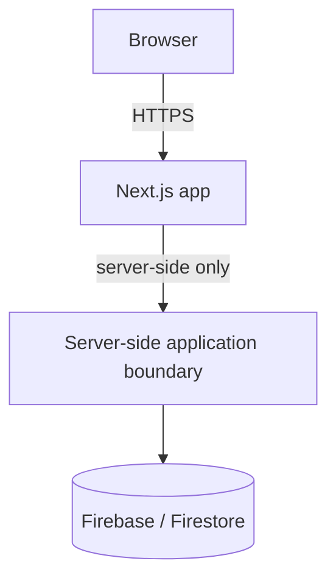
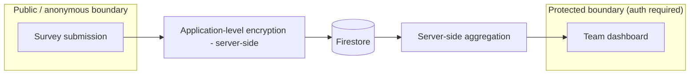

# DevPulse — Architecture

Status labels used below: **decided**, **provisional**, **open question**.

## High-level shape (decided)

- Next.js + TypeScript, Firebase, Firestore — **decided**, not to be
  re-evaluated (see `AGENTS.md` / project constraints).
- All access to Firestore for sensitive data goes through the server-side
  boundary (Next.js server code), never directly from the browser client.

## Authentication and authorization

- Firebase Authentication is planned for later phases — **decided**
  direction, **not yet implemented**.
- Team authorization is enforced **server-side**: a request must prove
  membership in a team before that team's protected data is returned.
  A user authorized for Team A must not thereby gain access to Team B's
  private results — **decided invariant**, implementation **open question**.
- Admin access does not automatically imply access to raw individual
  responses (see `docs/SECURITY.md`).

## Submission and dashboard boundaries (provisional)

- **Public/anonymous submission boundary**: accepts pulse survey answers
  without requiring the respondent's identity to be attached to the stored
  response payload.
- **Protected dashboard boundary**: requires authentication + team
  authorization; only serves aggregated results (see minimum threshold in
  `docs/SECURITY.md`), never raw individual responses, to normal team leads.
- Participation (who has submitted, for reminder/completion purposes) is
  stored separately from the anonymous response content itself — **decided
  invariant**, storage design is an **open question**.

## Application-level encryption boundary (decided invariant, provisional implementation)

- Sensitive survey fields are encrypted **server-side** before being written
  to Firestore, and decrypted **server-side** only when authorized
  aggregation/reporting requires it.
- Encryption keys never reach the browser, Firestore, git, or logs.
- Key management approach (e.g. Cloud KMS, Secret Manager, or another
  provider) is an **open question** — future key-management integration
  point, not yet selected.

## Aggregation

- Aggregated results are computed server-side from decrypted data and only
  the aggregate (not raw responses) is exposed to dashboards.
- Aggregates are suppressed below a configurable minimum response count
  (see `docs/SECURITY.md`).

## Open questions

- Firestore security rules strategy vs. server-only access (Admin SDK) for
  sensitive collections.
- Key management provider and rotation strategy.
- Exact mechanism for separating participation records from response
  records (e.g. distinct collections, hashed linkage, no linkage at all).
- Hosting/runtime target for the server-side boundary (not decided in this
  session; no deployment work has been done).
