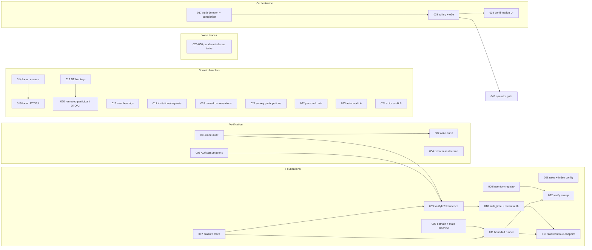

# Account erasure (AE) — Tasks

Specification: [SPEC.md](./SPEC.md) (approved 2026-10-28; decisions D1–D9 and the D2 participant-data exception are locked; the SPEC is not changed by this file)

## Status
Ready: 1 (TASK-045 operator gate)  In Progress: 0  Done: 44 of 45 (TASK-001 to TASK-044; TASK-038 Done with the owner-provided D-EMU PASS, confirmed against the current repository state; TASK-036 and TASK-037 independently reviewed 2026-11-02). PRODUCTION_HANDLERS_READY = true (code-level). Production deployment HELD until TASK-045 is recorded (owner decision 2026-11-02). The D-EMU PASS does not satisfy TASK-045.

Reconciled 2026-10-28: TASK-013 contract, A-5 identifier kinds, Auth-deleted stuck state, and D-EMU (updated: the Firestore Emulator race proof is a **manual gate** before final closeout, not an automated test; no emulator tooling in the repository). Two gates are not agent-completable: **D-EMU manual gate** (before closeout; blocked for execution only by a missing local JDK) and **TASK-045 operator gate**. Neither blocks implementation of unrelated tasks.

## Ground rules (apply to every task)

- **SPEC.md is authoritative.** Do not redesign it. If implementation shows a contradiction or an impossibility, stop and report the affected BR/SI/inventory IDs. Never weaken a `docs/SECURITY.md` invariant to pass a test.
- **Dependency gate.** `/implement-feature` and `/implement-task` take the lowest-numbered `Ready` task whose `Depends on` tasks are all `Done`. A task whose dependency is a decision gate (TASK-004) is skipped until the decision is recorded.
- **Verification records.** Verification tasks (TASK-001 to TASK-004) write their evidence to `docs/features/account-erasure/VERIFICATION.md` (created by TASK-001). They change no product behaviour. A verification finding that requires repair is not closed by the audit task. The task stays `Ready`, the finding is recorded, and the split is re-run to add an explicit repair task (SPEC BR-4(c), "a write that cannot be converted is a blocking finding").
- **Defaults are adjustable, not locked.** The recent-auth window (300 s) and the per-request budget (10 batches × 100 writes or 20 s) are named constants in TASK-005. A change must be documented in the SPEC-owned decision log, covered by tests, and must not weaken recent-auth or resumability. Do not change them silently.
- **Erasure writers and the fence.** Erasure's own step writes are not fenced by the record they belong to. Every other person-owned write transaction must read `accountErasures/{uid}` (BR-4(b)).
- **Logs.** Erasure code logs only status, step, and error code (AE-SI-12). Never log uid, email, content, ciphertext, or payload.
- **Cross-feature changes** are listed inside each task with: why erasure owns the change; the existing behaviour that must stay unchanged; the existing scope guard that may need a narrow amendment (allow-list entry only, never a broad exemption); and the regression suite that must still pass.
- **Commands** (pnpm; `package.json` is authoritative): `pnpm typecheck`, `pnpm lint`, `pnpm vitest run <path>`, `pnpm test`, `pnpm build`. Every task runs typecheck, lint, and its focused tests. TASK-041 runs the full `pnpm test` and `pnpm build`.
- **No Firebase access, deploy, seed, or migration** is done by any implementation task. Firestore TTL and indexes are repository configuration only, and their deployment is recorded as an operator action (TASK-045).
- **Task states** are only `Ready`, `In Progress`, `Done`.

## Dependency graph

Graph is simplified: the full edge list is in each task's `Depends on` line.

## Tasks

### TASK-001 — Protected-route authentication audit

**Status:** Done (2026-10-28; reopened once by independent review for the unclassified public-survey routes, repaired, and re-reviewed PASS_WITH_SUGGESTIONS; evidence in VERIFICATION.md "Route authentication" and "Protected-entry control flow")
**Covers:** BR-1 (evidence), BR-4(a) (evidence), AE-SI-1, AE-SI-3 (evidence)
**Depends on:** None

**Outcome**
`VERIFICATION.md` contains a complete register of every route handler under `app/api` (62 `route.ts` files at planning time) and of every server entry point they call. For each: authentication mechanism (verifyIdToken through which server module; intentional unauthenticated; other). The register proves whether `verifyIdToken` is sufficient as the global erasure fence.

**Implementation notes**
- Planning evidence: 46 non-test source files reference `verifyIdToken`; 58 route files do not call it directly and delegate to `src/features/**/server`. The register must trace every delegation chain to a call.
- Find bypasses: handlers that read Firestore or Admin SDK without the seam; handlers that trust a client-supplied uid, email, or team; any `getAdminAuth().verifyIdToken` call outside the seam.
- Classify intentional unauthenticated routes (for example public health or static) with a reason.
- Check whether any caller maps `ok: false` in a way that would break when new error codes are added (input to TASK-009).

**Verification**
- The register lists each of the 62 route files exactly once. A grep-based record is included so the audit can be repeated.
- No product code changes. If a bypass is found, this task stays `Ready`, the finding is recorded, and the split is re-run to add a repair task before TASK-009 can be `Done`.

**Security / privacy**
This is the authorization gate for the fence. Record each bypass as a finding; do not fix it inside this task.

**Documentation impact**
Creates `docs/features/account-erasure/VERIFICATION.md` (section "Route authentication").

**Acceptance criteria**
- [ ] Every `app/api/**/route.ts` appears in the register with a mechanism
- [ ] Every delegation chain resolves to a `verifyIdToken` call or an explicit exemption
- [ ] Bypasses, if any, are recorded and block TASK-009 (not silently accepted)
- [ ] No product code changed
- [ ] No conflict with `docs/SECURITY.md`

---

### TASK-002 — Person-owned write-surface audit (W-1 to W-18)

**Status:** Done (2026-10-28; inventory in VERIFICATION.md "Write surfaces"; independent review PASS_WITH_SUGGESTIONS, no Blocking/Important)
**Covers:** BR-4(b), BR-4(c) (evidence), AE-SI-3 (evidence)
**Depends on:** TASK-001

**Outcome**
`VERIFICATION.md` section "Write surfaces" records, for each of W-1..W-18 in the SPEC: whether the write is transactional, where the fence read would go, whether a race with erasure is possible, whether a late write can recreate erased data, and the conversion needed. The conversion tasks (TASK-025 to TASK-036) must each name the surfaces they own, and this register must show every surface is assigned to exactly one of them.

**Implementation notes**
Verified at planning time (to be re-read in this task):
- `src/features/forum/server/create-reply.ts`: the `ForumRepliesCollection.add` seam is at line 33; a second `collection.add(record)` is at line 295. Confirm which one `createReply` calls and whether any transaction wraps it.
- Plain `.delete()` calls: `src/features/profiles/server/user-profile-store.ts:65`, `src/features/skill-profiles/server/skill-profile-store.ts:85`, `src/features/personal-goals/server/goal-store.ts:129`, `src/features/role-profiles/server/role-target-store.ts:39`, `src/features/skill-trees/server/stop-team-skill-tracking.ts:26`.
- Plain `.update` outside a transaction is claimed for `report-team-skill-progress.ts:80` and `update-team-skill-progress.ts:37` (SPEC W-15). Verify.
- Admin stamp writes (W-17) and invitation resolution (W-16) need a transaction-by-transaction read.
- W-18 (demo) is assigned to TASK-036.

**Verification**
- Register lists 18 rows. Each row names its file and line, transactional status, fence placement (or "none"), and assigned task.
- No product code changed.

**Security / privacy**
A surface that can recreate erased data without a fence is a blocking finding for its conversion task. Record it; do not claim it is safe.

**Documentation impact**
`VERIFICATION.md` section "Write surfaces".

**Acceptance criteria**
- [ ] W-1..W-18 each assigned to exactly one of TASK-025..TASK-036
- [ ] `create-reply.ts` non-transactional write confirmed or refuted with the exact line of the call that performs it
- [ ] Every plain `.delete()`/`.update()` on a person-owned store is listed
- [ ] No product code changed

---

### TASK-003 — Firebase Auth assumptions (repository-verifiable part)

**Status:** Done (2026-10-28; VERIFICATION.md "Firebase Auth assumptions" sections A, A-bis, B, C; independent review: CHANGES_REQUIRED for a missing SPEC-row mapping, repaired, re-reviewed PASS_WITH_SUGGESTIONS; suggestion: SPEC "46 source files" count is stale against the 62-route register)
**Covers:** BR-3 (input), BR-6 (deleteUser availability), AE-A1 (partial), AE-SI-10 (input)
**Depends on:** None

**Outcome**
`VERIFICATION.md` section "Auth assumptions" separates two lists:
1. Verified from the installed SDK source and existing tests (firebase-admin 14.3.0, `lib/auth/base-auth.js` and related files): `checkRevoked` calls `getUser(uid)` on every verification; a deleted user rejects with `user-not-found`; a disabled user rejects with `user-disabled`; `deleteUser` exists on the Admin Auth API; `auth_time` is present on decoded tokens.
2. Requires a real environment (carried to TASK-045): `auth_time` after refresh vs fresh sign-in; uid non-reuse; `deleteUser` permission for the service account; `verifyIdToken(..., true)` behaviour on the deployed project.

**Implementation notes**
- Read installed source only. Do not access Firebase, do not call any network API.
- Confirm the exact error codes the adapter must map (`auth/user-not-found` and equivalents).
- Check whether `DecodedIdToken` typing exposes `auth_time` (input to TASK-010).

**Verification**
- Each assumption in the SPEC's "Authentication and token lifecycle" table is marked "source-verified", "environment-required", or "contradicted".
- A focused unit test is optional; if added, it must use an injected fake and must not reach Firebase.

**Security / privacy**
Any "contradicted" item blocks the fence design and must be reported before TASK-009 proceeds.

**Documentation impact**
`VERIFICATION.md` section "Auth assumptions".

**Acceptance criteria**
- [ ] Every item in the SPEC table has a recorded status with a file reference
- [ ] Environment-required items are listed for TASK-045, not claimed as proven
- [ ] No Firebase access performed

---

### TASK-004 — Transaction-fence verification plan (automated part) and manual D-EMU gate

**Status:** Done (automated part, 2026-10-29: `src/features/auth/server/erasure-write-fence.ts`, 10/10 focused tests, typecheck and lint pass). **D-EMU manual gate: NOT RUN.** Final closeout (TASK-041) stays blocked until the manual Firestore Emulator run is recorded in VERIFICATION.md.
**Covers:** BR-4(b) (automated evidence), AE-SI-3 (race evidence, automated part only; the commit-ordering race proof is the manual D-EMU gate)
**Depends on:** None

**Decision D-EMU (updated 2026-10-28).** The Firestore-specific race proof is a **manual verification gate** against the local Firestore Emulator, performed before final closeout. It is not an automated repository test.
- No Java, Firebase Emulator tooling, or emulator dev dependency is added to the repository for this.
- The D-EMU security requirement is not weakened: a transaction that begins before creation of the erasure fence must not commit a protected person-linked write after that fence is created.
- No real Firebase project is used.

**Outcome (repository-verifiable part, automated, done in this task)**
- Automated unit/integration tests, using the repository's existing test infrastructure (in-memory fakes), prove that every fenced write reads the fence inside its transaction and that a refused write does not mutate state. These tests do not claim the Firestore commit-ordering race is proven.
- A written manual procedure is recorded in `VERIFICATION.md` (section "D-EMU manual gate"): the exact emulator steps, the expected result, and the evidence fields to fill in.

**Manual D-EMU gate (not performed by this task; see the gate section below)**
Closeout is blocked until the manual Firestore Emulator run is performed successfully and its result recorded in `VERIFICATION.md`. This task must not claim that the emulator proof passed.

**Blocker status (recorded 2026-10-28, does not block other tasks):** no Java runtime is installed on the development machine. This blocks only the manual D-EMU run, not implementation.

**Verification**
- Automated: focused tests for fenced transaction helpers pass (`pnpm vitest run <path>`).
- Manual: not performed here. Recorded as the D-EMU gate.

**Security / privacy**
Without (a) or (b), TASK-041 cannot be `Done`.

**Documentation impact**
`VERIFICATION.md` section "Transaction harness"; `docs/DEVELOPMENT.md` if (a).

**Acceptance criteria**

Automated (this task's Done condition):
- [x] Decision D-EMU recorded (SPEC "Operational requirements" item 11; TASKS header)
- [x] Fence read uses the transaction's own `get` (`assertNoErasureRecordInTransaction`), at `accountErasures/{uid}`
- [x] Fence read and protected write run in the same transaction (`runFencedTransaction`); the write runs only after the admit
- [x] A plain document `get` is never used for the fence read (test asserts the spy is not called)
- [x] A refused write (any record: in_progress, auth_deleted, completed, malformed) performs no write and throws `erasure_in_progress`
- [x] A failed fence read rejects and performs no write (fail closed)
- [x] No new dependency added (`firebase-admin` types only, already a dependency)

Manual (NOT RUN; gate for TASK-041 closeout, not for this task's Done):
- [ ] Race evidence against the local Firestore Emulator, recorded in VERIFICATION.md "D-EMU manual gate" (Result: NOT RUN)

---

### TASK-005 — Erasure domain contracts and state machine

**Status:** Done (2026-10-28; `src/features/account-erasure/domain/`; `pnpm vitest run src/features/account-erasure/domain` 17/17, typecheck and lint exit 0; independent review: one Important finding (a pair-coverage test that did not check the real pairs), repaired, re-reviewed PASS)
**Covers:** BR-14 (constants), BR-15 (error enum), AE-SI-5 (record fields), state machine (SPEC "Erasure state machine")
**Depends on:** None

**Outcome**
`src/features/account-erasure/domain/` holds pure, dependency-free contracts: the status enum (`in_progress`, `auth_deleted`, `completed`); the step enum in the SPEC's order (`forum`, `memberships`, `conversations_owned`, `participant_bindings`, `locators`, `personal_data`, `survey_participations`, `actor_audit`, `verify_data`, `auth_delete`, `final_sweep`); the closed error-code enum (`payload_unreadable`, `store_unavailable`, `auth_unavailable`, `verification_failed`, `unexpected`) plus the API codes (`erasure_in_progress`, `recent_auth_required`, `confirmation_mismatch`); the erased-actor marker `"erased"`; the transition guard (forward-only, no reversal); and the named constants: recent-auth window 300 s, 10 batches, 100 writes per batch, 20 s wall budget, `expireAt` = completion + 24 h.

**Implementation notes**
- Constants are the only place the defaults live. Document that they are adjustable under the rule in the file header.
- The guard rejects `status` moving from `completed` or `auth_deleted` back to `in_progress`, and rejects a step that moves backward.
- No free-text field exists in any type (AE-SI-5).

**Verification**
- Transition table test covering every allowed and forbidden transition.
- Enum closure test: only the listed error codes exist.
- Constant-value test that fails if a default changes without updating the decision note.

**Security / privacy**
Error codes must not carry content or identifiers.

**Documentation impact**
None in this task (DATA-MODEL is TASK-042).

**Acceptance criteria**
- [ ] All transitions in the SPEC are encoded; forbidden ones rejected
- [ ] Error enum is exactly the SPEC's set
- [ ] Constants defined once
- [ ] `pnpm vitest run src/features/account-erasure/domain` passes

---

### TASK-006 — Inventory registry and allow-list guard

**Status:** Done (2026-10-29). Independent re-review PASS (VERIFICATION.md "TASK-006 narrowed invariant (2026-10-29)"; first review CHANGES_REQUIRED with no Blocking and two Important documentation findings, both repaired). Scope: the approved narrowed invariant. Re-scoped by the approved narrowed invariant (SPEC "Decision log: TASK-006 narrowed invariant"): inventory-completeness and change-control gate for the CURRENT known surfaces; it does not prove that future TypeScript cannot add an unregistered surface. The blocked state below is historical and is superseded for scope; reconciliation, RETAIN/DEMOTE/REMOVE classification and verification are in VERIFICATION.md "TASK-006 narrowed invariant (2026-10-29)". Independent review 1: CHANGES_REQUIRED, no Blocking, two Important documentation-state findings (repaired). Independent re-review pending before Done. Earlier (2026-10-28, superseded for scope): Architecture direction APPROVED (SPEC "Decision log: TASK-006 persistence boundary"; VERIFICATION.md "TASK-006 architecture decision and scope stop"): the minimum coherent boundary is a repository-wide persistence migration (75 production files, about 229 Firestore call sites), which the approval says to stop on. No production code changed; a scope decision is needed before implementation. Earlier: Final bounded cycle reviewed: CHANGES_REQUIRED with Blocking escapes (rebinding through destructuring and for-of, collection paths through aliases and wrappers, `*_COLLECTION` values); stopped per the approved condition, no further scanner patch. Architectural alternative recommended (VERIFICATION.md "TASK-006 final-cycle review: STOP"). Earlier: Round 12 review (after the approved removeLevel exception, rounds 9–11): CHANGES_REQUIRED with one Blocking (non-identifier callees bypass persistence-call detection) and one Important (exceptions keyed by method name). Two remediation cycles used; a decision is needed before a third (VERIFICATION.md "round 12"). Earlier: Round 3 and round 4 repairs applied (VERIFICATION.md "Round-4 review repairs"). Round 4 covers the modular and single-quote collection forms, identifier-suffixed owner names, and member-only scope for injected dependency names. Limitations recorded. Independent confirmation of the round-4 repairs is pending, so this task is not Done. Earlier: repair round 2 applied, fresh re-review pending. Round 1 repaired: locator-aware sweep descriptors (`sweepQueriesForRow`, `inventorySweeps`); invitation document-ID email registered as `normalizedEmail` (`location: docIdSuffix`) on I-11 and removed from the allow-list. Round 2 (review found I-7 wrong) repaired: I-7 locator is `collectionGroup` (owner-side discovery), with an exact shape test; guard scan roots now include `src/lib` and `src/components`; I-9 asserted exactly. Focused: `inventory.test.ts` 21/21. OPEN (blocking closure): the full-suite run shows 9 failing scope-guard tests in 7 files of other features (development-conversations, personal-goals, skill-profiles, team-skills, roadmap, participation-boundary). Cause: this task's registry names collections and fields (teamSkillNeeds, collectionGroup, participant fields, userDevelopment) that those guards pin to exact approved file sets; SPEC "Cross-feature static guard implications" anticipates a registry module, so each guard needs a narrow, file-exact allow-list entry (never a broad exemption). The roadmap failure is TASK-008's firestore.indexes.json (AE-IDX-1) pinned by roadmap-scope-guard's exact `fieldOverrides: []`. Team-skills' "no production code introduces D1/D2 concepts" guard is a semantic rule, not just a list; amending it needs an explicit decision (see the stop report). (Prior evidence: 28/28 focused tests.)
**Covers:** BR-5 (derivation), AE-SI-7 (registry), inventory I-1..I-15, A-1..A-12, P-1..P-6, E-1..E-4 (classification)
**Depends on:** TASK-005

**Outcome**
`src/features/account-erasure/server/inventory.ts` is the single registry: every I-row and A-row with collection, field, class, and the query shape. Allow-list entries for P-1..P-6 (preserved) and E-1..E-4 (external). A guard test fails when a collection or field containing a uid-bearing name (`uid`, `authorUid`, `participantUid`, `memberRef`, `ownerRef`, `email`, actor fields) is neither in the registry nor in the allow-list.

**Implementation notes**
- A-5 (`roadmapItems.ownerRef`) holds an opaque `memberRef`, not a uid. Mark A-5 as `valueKind: "memberRef"` so no uid equality query is generated for it. Its handling is in TASK-016 (per-membership, before deletion). Note the SPEC's per-row query claim is corrected here and in the file header.
- I-7 `participantMemberRef` and I-9 `memberRef` are also `memberRef` kinds.
- I-8 is discovery only (not a deletion target); it is registered as a query.
- The guard scans source for collection/field literals; it fails closed on an unknown name.

**Verification**
- Test: every SPEC row has exactly one registry entry.
- Test: guard fails on a synthetic unregistered uid-bearing field.
- Test: A-5 generates no uid equality query.

**Security / privacy**
The registry is the basis for the final sweep (TASK-012); a missing row means a missed sweep.

**Documentation impact**
`VERIFICATION.md` note on A-5 (SPEC correction).

**Acceptance criteria**
- [ ] Every I-, A-, P-, E- row present
- [ ] Guard test present and passing
- [ ] A-5 documented as memberRef kind
- [ ] Focused tests pass

---

### TASK-007 — `accountErasures` persistence store

**Status:** Done (2026-10-28; reopened twice by independent review and repaired: (1) `in_progress` could move directly to `final_sweep`; (2) the step guard allowed skipping steps. Both fixed to SPEC "Transitions" (one step at a time; `final_sweep` only from `auth_deleted`) with tests. Round-2 independent re-review PASS_WITH_SUGGESTIONS: 81/81 account-erasure tests. Carried suggestions for TASK-009/runner: malformed fence result must be fail-closed; `errorCode` clearing on success to be decided; Admin SDK adapter has no direct test. Prior evidence: 56/56 account-erasure tests, typecheck and lint exit 0; one typecheck error and two real transition defects were found and fixed during implementation; suggestions: the Admin SDK adapter has no direct test, TASK-009 must treat `malformed` fence results as fail-closed, `errorCode` persists after a later successful step)
**Covers:** BR-2 (one-transaction start), BR-4(b) (fence helper), BR-6 (terminal fields), BR-15 (error code), AE-SI-5 (record shape), AE-SI-6 (no content)
**Depends on:** TASK-005

**Outcome**
`src/features/account-erasure/server/erasure-store.ts` (server-only) with:
- `createErasureInTransaction(uid)`: creates the record at step `forum`, returns existing state if present (never a second record);
- `readErasureForFence(uid)` (used by writers inside their transactions): returns `none`, `in_progress`, `auth_deleted`, `completed`, or `malformed`;
- forward-only step/status update in a transaction;
- terminal write setting `completedAt` and `expireAt`.

Writes only the allowed fields: `status`, `step`, `startedAt`, `updatedAt`, `completedAt?`, `expireAt?`, `errorCode?`.

**Implementation notes**
- A malformed stored record must be reported as `malformed`, not coerced.
- A Firestore read failure is surfaced as a store error; callers fail closed.
- Uses the existing Admin-SDK access pattern (`getFirestoreDb()`), with an injected collection port for tests (same style as `create-reply.ts`).

**Verification**
- In-memory fake tests: create once; second create returns current state; malformed record → `malformed`; read failure → error; update refuses backward moves; persisted document contains only allowed keys.

**Security / privacy**
Record holds no email, team, memberRef, content, or free text (AE-SI-5). Test the key whitelist explicitly.

**Documentation impact**
None here (DATA-MODEL is TASK-042).

**Acceptance criteria**
- [ ] Only allowed keys persisted
- [ ] Malformed and failed reads are not treated as "no record"
- [ ] Forward-only updates enforced
- [ ] Focused tests pass

---

### TASK-008 — Firestore rules, TTL configuration and index config

**Status:** Done (2026-10-28; repository configuration only, no deployment claim; 26/26 deployment-config tests; independent review PASS; the Firebase CLI validation of the index file and the TTL policy are operator actions carried to TASK-045; VERIFICATION.md "Firestore rules and index configuration")
**Covers:** AE-IDX-1 (required), AE-IDX-2 (verify), BR-6 (TTL field), BR-21 items 2–3 (repository part only)
**Depends on:** TASK-005

**Outcome**
- `firestore.rules`: `match /accountErasures/{document=**} { allow read, write: if false; }` in the existing deny-block style, placed before the catch-all, with a rules test in `src/lib/firebase/firestore-deployment-config.test.ts`.
- `firestore.indexes.json`: AE-IDX-1 collection-group index on `conversations` for `participantUid` (`queryScope: COLLECTION_GROUP`).
- AE-IDX-2 verified: no field exemption exists for `uid`, `authorUid`, `participantUid`, `createdBy`, `updatedBy`, `archivedBy`, `resolvedBy`, `deletedBy`, `grantedBy`, `roleUpdatedBy`, `invitedBy`, `resolvedUid`, `email`.
- TTL on `accountErasures.expireAt` is not representable in this repository; it is recorded as an operator action (TASK-044/045).

**Implementation notes**
- Do not claim the index or TTL is deployed. Document "repository config only".
- Follow the existing rules-file comment convention.

**Verification**
- Deployment-config test asserts the new deny block and the index entry.
- Test asserts no `fieldOverrides` exempts an AE-IDX-2 field.

**Security / privacy**
Client access to `accountErasures` must stay denied (fence record is server-only).

**Documentation impact**
Note in `VERIFICATION.md`; full docs in TASK-042.

**Acceptance criteria**
- [ ] Deny block present before catch-all
- [ ] AE-IDX-1 present in `firestore.indexes.json`
- [ ] AE-IDX-2 verified by test
- [ ] No deployment claim
- [ ] Focused tests pass

---

### TASK-009 — Centralized erasure fence in `verifyIdToken`

**Status:** Done 2026-10-28 (D-AUTHFAIL approved: option (b)). Fresh independent review (`review-task-for-feature`, read-only): PASS_WITH_SUGGESTIONS, zero Blocking and zero Important; suggestions S1–S3 are optional and recorded in VERIFICATION.md "TASK-009 fresh independent review". Earlier history below is retained as written. Core fence done (`erasure-fence.ts`, fenced `verifyIdToken`). Caller propagation implemented 2026-10-28 (shared `auth-refusal.ts`; services and route mappers carry `erasure_in_progress` as 403 and `auth_unavailable` as 503; static guards and per-test fence reset added; full suite 424 files / 8338 tests, typecheck and lint exit 0). NOT Done: the independent review (2026-10-28) returned CHANGES_REQUIRED; its Blocking and Important code findings are remediated and verified, and two survey-path product decisions remain open (VERIFICATION.md "TASK-009 independent review"). Survey-path decisions APPROVED and implemented 2026-10-28 (VERIFICATION.md "TASK-009 survey-path decisions implemented"): authenticated resolve maps the fence to 403/503; public anonymous submission is amended in SPEC and covered by regression tests. The service-level representative propagation test is done (`list-skill-needs-erasure-fence.test.ts`, 5/5). The fresh independent review is done (PASS_WITH_SUGGESTIONS).
**Covers:** BR-4(a), AE-SI-3, AE-SI-1 (only the erasure endpoint bypasses), section 9 fence tests
**Depends on:** TASK-001, TASK-003, TASK-007

**Outcome**
`src/features/auth/server/erasure-fence.ts` (owned by auth; auth must not import account-erasure). `verifyIdToken` in `src/features/auth/server/verify-identity.ts`:
1. verifies with `checkRevoked: true` (unchanged);
2. reads the record through the fence module;
3. `in_progress` → `erasure_in_progress`, unless the caller passes the narrow option `allowDuringErasure: true` (only the erasure endpoint, TASK-013, may pass it; not a generic "ignore erasure" flag);
4. `auth_deleted` / `completed` → `invalid_token`;
5. `malformed` or read failure → fail closed with a generic code (no content).

**Implementation notes**
- Cross-feature: every protected caller maps `ok: false` results; the new error codes must be mapped to a 403-style response without leaking identity. TASK-001's register drives which callers need updating.
- Existing `verifyIdToken` behaviour for a user with no record must be byte-identical (same result object shape for `identity`).
- Admin and lead status must not bypass: the fence runs before any role logic.
- Unchanged behaviour: the existing `verify-identity.test.ts` cases.
- Scope guards: `src/features/auth` may gain the fence module; no existing guard should need amendment. If one does, record it as a narrow allow-list entry.

**Verification**
- Ordinary authenticated user, no record → same result as before.
- In-progress user → `erasure_in_progress` for every caller except with `allowDuringErasure`.
- `auth_deleted` and `completed` → `invalid_token`.
- Malformed record → fail-closed result.
- Firestore read failure or Auth infrastructure unavailability → `auth_unavailable` (HTTP 503), never `invalid_token`, never data access.
- Genuine rejection (invalid, revoked, disabled token) → unchanged 401 path.
- Guard: protected handlers map `auth_unavailable` to 503 and do not fall through to 401/500 default handling; public survey routes stay unauthenticated.
- App-admin and team-lead identities still denied during in-progress.
- `allowDuringErasure` is accepted only from the erasure endpoint (static test).

**Security / privacy**
This is the global fence. The added read on every authenticated request is the intentional, documented cost (SPEC authentication contract). Record it in `ARCHITECTURE.md` (TASK-042).

**Documentation impact**
`docs/ARCHITECTURE.md` (TASK-042); cross-reference in `VERIFICATION.md`.

**Acceptance criteria**
- [ ] All fence tests in Verification pass
- [ ] Existing `verify-identity.test.ts` passes unchanged
- [ ] No generic bypass flag exists
- [ ] No auth → account-erasure import
- [ ] No conflict with `docs/SECURITY.md`

---

### TASK-010 — Additive `verifiedAuthTime` and recent-auth window

**Status:** Done (2026-10-29; `src/features/auth/server/recent-auth.ts` (`isRecentAuth`, window passed in because auth must not import erasure), `verify-identity.ts` (optional `verifiedAuthTime`, key omitted when the token has no `auth_time`); tests `recent-auth.test.ts` 8/8, `verify-identity-auth-time.test.ts` 2/2; existing `verify-identity.test.ts` unchanged; `pnpm test` 429 files / 8405 tests pass; typecheck and lint exit 0). Independent review (fresh read-only reviewer, 2026-10-29): PASS_WITH_SUGGESTIONS, no Blocking or Important code finding; see VERIFICATION.md "Recent authentication (TASK-010)".
**Covers:** BR-3, AE-SI-10
**Depends on:** TASK-003, TASK-009

**Outcome**
`VerifiedIdentity` gains an optional `verifiedAuthTime` from the decoded token `auth_time`. A pure helper `isRecentAuth(verifiedAuthTime, now, windowSeconds)` uses the injected clock and the TASK-005 window constant (300 s). A missing `auth_time` is "not recent".

**Implementation notes**
- Additive and optional, so other callers are unchanged (SPEC: "optional for other callers").
- Cross-feature: callers that compare `VerifiedIdentity` by structural equality in tests may need the new key; update only those tests, narrowly.

**Verification**
- Recent token accepted; token older than window rejected; boundary at exactly 300 s (define and test: `<=` accepted); missing `auth_time` rejected; future `auth_time` rejected.
- Existing identity consumers unaffected (regression run).

**Security / privacy**
A stale bearer token must not start an erasure (AE-SI-10).

**Documentation impact**
None (ARCHITECTURE covered by TASK-042).

**Acceptance criteria**
- [ ] Old `auth_time` rejected; fresh accepted
- [ ] `verifiedAuthTime` optional and additive
- [ ] Focused and existing auth tests pass

---

### TASK-011 — Bounded, resumable erasure runner

**Status:** Done (2026-10-28; `src/features/account-erasure/server/erasure-runner.ts`; 67/67 account-erasure tests, typecheck and lint exit 0; independent review PASS_WITH_SUGGESTIONS: handlers must throw `ErasureStepFailure` for classified errors (TASK-014+); the runner hands off at `auth_delete` and does not rewind, see D-VERIFY-BACK)
**Covers:** BR-14, BR-15, state machine (step advance, retry, interruption), AE-SI-12 (log content)
**Depends on:** TASK-005, TASK-007

**Outcome**
`src/features/account-erasure/server/erasure-runner.ts`: runs the registered step handlers in order from the stored step, within a per-request budget of 10 batches of 100 writes or 20 s wall time (injected clock). A step advances only after its handler reports zero remaining matches (verification). Returns `{ status: "in_progress", step }` when the budget is exhausted. Maps failures to the fixed error enum and stores `errorCode`.

**Implementation notes**
- Handlers are injected; this task tests with fakes. Real handlers arrive in TASK-014 to TASK-024.
- Idempotent re-entry: a handler that finds nothing returns "done".
- No rollback path exists; do not add one.

**Verification**
- Budget exhaustion on batches and on wall time (both tested).
- Interruption after a batch resumes at the same step.
- Failure stores `errorCode` and does not advance.
- Step never advances while verification returns matches.
- No content in logs (status, step, code only).

**Security / privacy**
No content logged; no free text stored.

**Documentation impact**
None here.

**Acceptance criteria**
- [ ] Each budget dimension tested
- [ ] Forward-only advance enforced
- [ ] Errors stored as enum codes only
- [ ] Focused tests pass

---

### TASK-012 — Verification sweep (BR-5)

**Status:** Done (2026-10-29). Independent review 1 CHANGES_REQUIRED (one Blocking: A-8..A-11 routed to a step that cannot clear them; repaired to SPEC "Steps" actor_audit); independent re-review PASS (see VERIFICATION.md "TASK-012 verification sweep and D-VERIFY-BACK"). D-VERIFY-BACK approved: option (a), forward-only.
**Covers:** BR-5, AE-SI-7, `verify_data` and `final_sweep` steps
**Depends on:** TASK-006, TASK-011

**Outcome**
`src/features/account-erasure/server/verification-sweep.ts` re-runs every inventory query from the registry (single-field equality, or document-id prefix for memberships, access requests, participations). It returns zero or a count of remaining matches per row, without any identifier. A non-zero result does **not** move the persisted step backward: the step stays `verify_data`, the appropriate idempotent cleanup for those rows is re-run, retry/resume state is persisted, and the step advances only on zero matches. The sweep is bounded per runner iteration and never loops unboundedly inside one request.

**Implementation notes**
- A-5 is excluded from uid queries (memberRef kind); its check is per membership in TASK-016.
- Counts only; no document content is read into logs.

**Verification**
- Test: zero matches → step passes.
- Test: a single remaining match in each registry category → returns to its owning step.
- Test: result contains no uid, email, or content.

**Security / privacy**
The sweep must not expose which documents matched.

**Documentation impact**
None here.

**Acceptance criteria**
- [ ] Every registry row covered by a test
- [ ] Non-zero routes back to owning step
- [ ] No identifiers in output

---

### TASK-013 — Start and continue endpoint `POST /api/me/erasure`

**Status:** Done (2026-10-29). Implemented with the approved production-not-ready gate: `src/features/account-erasure/server/start-erasure.ts` (operation), `start-erasure-http.ts` (body and HTTP mapping), `production-erasure.ts` (`PRODUCTION_HANDLERS_READY = false`), `app/api/me/erasure/route.ts` (thin `POST`). Public code `erasure_unavailable` (HTTP 503) added to the closed API vocabulary. `allowDuringErasure` allow-list narrowed to `start-erasure.ts` (auth-refusal guard). Tests: `start-erasure.test.ts` 14, `start-erasure-http.test.ts`, `production-erasure.test.ts`. Independent review (fresh read-only reviewer, 2026-10-29): PASS_WITH_SUGGESTIONS, no Blocking; Important findings repaired. See VERIFICATION.md "Start/resume endpoint (TASK-013)". TASK-038 must flip the readiness gate in the same change that wires the real handlers.
**Covers:** BR-1, BR-2, BR-3, BR-14 (response contract), AE-SI-1, AE-SI-2, AE-SI-10, AE-SI-11
**Depends on:** TASK-005, TASK-007, TASK-009, TASK-010, TASK-011

**Outcome**
`app/api/me/erasure/route.ts` with `src/features/account-erasure/server/start-erasure.ts`. Body `{ confirmation: string }` only; any uid, email, or team field in input is rejected. Acts only on the verified caller's uid.
- No record: requires recent auth (BR-3) and a confirmation matching the normalized verified email; creates the record in one transaction; then runs the runner.
- Record `in_progress`: continues from the stored step and returns current state (no fresh sign-in, no re-typed confirmation required). Passes `allowDuringErasure: true` to the seam; no other route does.
- Record `completed`: the operation returns `{ status: "completed" }` (idempotent, no restart). Over HTTP the centralized fence refuses a terminal record earlier as `invalid_token` (401), so the route may not reach that result. This is intentional; the fence is not weakened and no terminal bypass exists (SPEC decision log, TASK-013).
- Response: `{ status, step }` or `{ status: "completed" }` or a fixed error code. No email, uid, team, or membership identifiers.
- No undo, rollback, or cancel route exists.

**Implementation notes**
- **Approved contract (2026-10-28; SPEC "Start/resume contract").** `POST /api/me/erasure` is the start-or-resume operation:
  - no record → start (recent auth and confirmation required);
  - `in_progress` → resume from the stored step and return the current state (no fresh sign-in, no confirmation);
  - `completed` → do not start another erasure; return `{ status: "completed" }`;
  - malformed or unreadable record → fail closed; never start.
- `erasure_in_progress` is the fence response for every other protected route. It is never returned by this endpoint's own start or resume.
- The `allowDuringErasure` seam bypass is granted only to this endpoint's in-progress path. No generic caller-controlled bypass.
- Confirmation comparison uses the existing normalizer (`src/features/teams/domain/normalize-email.ts`).
- Inject the runner so this task is testable before TASK-038 wires real handlers.
- Cross-feature: none; this is a new route.

**Verification**
- Rejects request with extra uid/email/team keys.
- Old `auth_time` → `recent_auth_required`; fresh → accepted.
- Mismatch → `confirmation_mismatch`.
- Second start → existing state, no second record.
- In-progress continue → state; works with an old `auth_time`.
- Completed → `{ status: "completed" }`.
- Response bodies never contain an email, uid, or team identifier (test on every branch).
- Unauthenticated → denied.
- Route has no admin or other-uid path (static test).

**Security / privacy**
This is the only erasure initiation point (AE-SI-1). It must not return content.

**Documentation impact**
None here (API contract in TASK-042 if needed).

**Acceptance criteria**
- [ ] Every test in Verification passes
- [ ] No uid accepted from input
- [ ] Response contains no identifiers
- [ ] No conflict with `docs/SECURITY.md`

---

### TASK-014 — Forum erasure: reply tombstones and thread delete-or-placeholder

**Status:** Done 2026-10-28. Fresh independent review (round 6, read-only) returned PASS with three Suggestions, all applied (zero-budget rejection, stale-thread ownership test, VERIFICATION count). The tombstone-ownership decision is approved and recorded in SPEC (forum decision rule, step 2). Prior history: reopened 2026-10-28. Both round-2 Important items are repaired (no-op on already-reached state; chunk and resume tests). The round-4 independent review found a further write-budget defect, now fixed. One open decision remains and blocks closure: whether a thread delete also removes other members' tombstones (VERIFICATION.md "Round-4 review repairs and open decision"). Not Done until decided and re-reviewed. Earlier: reopened again 2026-10-28 by fresh review (CHANGES_REQUIRED, two Important): (1) the amended "chunked forum erasure" semantics (invariant re-checked per chunk, idempotent resume) have no tests for another person's reply arriving between chunks or for an interruption after a partial chunk; (2) `tombstoneOwnReply` and `markOtherTombstone` treat an already-tombstoned or missing reply as `payload_unreadable`, but a missing thread is a no-op, and this state is reachable by a race. Repair pending. Earlier note: the SPEC contradiction was resolved by the decision below. Earlier: repaired 2026-10-28, fresh independent re-review pending. The reopen was for a SPEC contradiction ("one transaction" per thread vs chunked deletion). The human decision is recorded: SPEC "Forum tombstone semantics" → "Decision log: chunked forum erasure (approved 2026-10-28)", and the step-table forum row is amended. The code was already chunked, so no behaviour change. Focused tests 336/336 across 19 files (forum-erasure + forum). Prior evidence: 12/12 focused tests; account-erasure and forum suites 403/403; typecheck and lint exit 0; independent review PASS_WITH_SUGGESTIONS; the thread delete is chunked (Firestore 500-write limit, reply cap 500), recorded in VERIFICATION.md; Admin SDK adapter deferred to TASK-038)
**Covers:** BR-7, D3, AE-SI-6, AE-SI-7, AE-SI-8 (authorTag), AE-SI-9 (others' replies kept), inventory I-13, I-14, A-8
**Depends on:** TASK-006, TASK-007, TASK-011

**Outcome**
- `forum` step handler: for each `forumReplies` where `authorUid == uid`, converts to tombstone `{ teamId, threadId, createdAt, deletedAt, deletedBy: "erased" }` (no ciphertext, iv, authTag, keyVersion, authorUid), in one transaction per reply.
- For each `forumThreads` where `authorUid == uid`: applies the SPEC decision rule (zero other non-tombstone, non-erased replies → delete thread and its tombstone replies; at least one → erased-thread placeholder `{ teamId, createdAt, erasedAt, status: "erased" }`), in one transaction per thread. Physical delete relies only on the observable invariant.
- `isErasedForumThread` predicate, distinct from active threads; only this step may create a placeholder.
- A-8: other people's tombstones with `deletedBy == uid` set to the marker `"erased"`.

**Implementation notes**
- Forum handling never decrypts (SPEC BR-16).
- `isValidForumReply` stays unchanged (requires a non-empty string; `"erased"` satisfies it).
- Cross-feature: `src/features/forum/domain/forum-reply.ts` and `forum-thread.ts` gain predicates; existing predicates unchanged. Existing scope/guard tests for the forum may need a narrow allow-list entry for the placeholder writer only.
- Other people's replies and their `authorTag` stay (derived from their own authorship).

**Verification**
- Thread with no other replies → deleted with its tombstones.
- Thread with other replies → placeholder; others' replies keep position.
- Reply tombstone shape exact; no `authorUid` left.
- A-8 marker set on others' tombstones.
- Fail-closed on a malformed thread (handled by raw-field selection).
- Existing forum tests pass.

**Security / privacy**
No `authorTag` or `authorUid` survives on erased content (AE-SI-8).

**Documentation impact**
DATA-MODEL in TASK-042.

**Acceptance criteria**
- [ ] Both decision branches tested
- [ ] Placeholder shape exact
- [ ] Other people's replies untouched except A-8 marker
- [ ] Existing forum regression passes

---

### TASK-015 — Forum erased-content reader DTO and UI

**Status:** Done (2026-10-29). Independent review 1 CHANGES_REQUIRED (three Important, repaired); independent re-review PASS_WITH_SUGGESTIONS (its Important item was stale test counts, now corrected; its suggestions are applied or recorded as open items in VERIFICATION.md). Erased-thread copy: reviewed and approved 2026-10-29 (heading `Slettet tråd`; the previous copy is recorded in VERIFICATION.md "Erased-thread copy approval (2026-10-29)"). Implementation: `src/features/forum/server/get-thread-with-replies.ts` (placeholder branch before active validation; `readReplyViews` shared by both branches; `ErasedThreadView` `{threadId, status:"erased", createdAt}`); `src/features/forum/client/forum-gateway.ts` (parses the placeholder; rejects a missing `createdAt`); `src/features/forum/components/ThreadDetail.tsx` (erased heading, replies kept, no body, no author line, no reply form, admin-only delete); `src/features/forum/copy.ts` (`erasedThread` copy, new Norwegian text, to be reviewed against `docs/UI-UX.md`). Reply to a placeholder returns `not_found` (existing `isValidForumThread` path, now tested). Tests: `erased-thread.test.ts` 9/9, `get-thread-with-replies-refusal.test.ts` 3/3, `ThreadDetail.erased.test.tsx` 5/5, `delete-thread.test.ts` +3, `forum-thread.test.ts` +1, `forum-gateway.test.ts` +2; `pnpm vitest run src/features/forum` 21 files, 347/347; typecheck and lint exit 0. Independent review 1 (fresh read-only reviewer, 2026-10-29): CHANGES_REQUIRED, no Blocking; its three Important findings are repaired (validator rejects `status`/`erasedAt`; admin delete of a placeholder; non-vacuous UI assertions). Independent re-review (2026-10-29): PASS_WITH_SUGGESTIONS; its Important item (stale test counts) corrected. See VERIFICATION.md "Forum erased-content reader (TASK-015)".
**Covers:** BR-7 (DTO), BR-16 (degraded reads), AE-SI-2, AE-SI-8, UI
**Depends on:** TASK-014

**Outcome**
- Read DTO for a placeholder: `{ threadId, status: "erased", createdAt, replies: [...] }` with no title, body, `authorTag`, `isOwnThread`, or author identity.
- Tombstone reply DTO remains `{ body: null, authorTag: null, isOwnReply: false, isDeleted: true }` at its position.
- Client gateway and components render the placeholder ("erased thread" copy) and keep others' replies.
- Reply creation against a placeholder returns not-found (`thread_not_found` or existing equivalent).

**Implementation notes**
- Copy goes through the forum copy module; reviewed against `docs/UI-UX.md`.
- Cross-feature: forum read paths and gateway; normal non-erased threads unchanged.

**Verification**
- DTO key test: no forbidden key on a placeholder.
- Component test: placeholder renders with replies; no author text.
- Reply to placeholder → not-found.
- Existing forum read tests pass.

**Security / privacy**
DTO leakage test is mandatory (AE-SI-2).

**Documentation impact**
`docs/features/team-forum/SPEC.md` is updated in TASK-043.

**Acceptance criteria**
- [ ] DTO leak test passes
- [ ] Placeholder rendering and accessibility checked (role/heading present)
- [ ] Existing forum tests pass

---

### TASK-016 — Team membership and lead removal (I-9, A-5)

**Status:** Done (2026-10-29). Implemented: `src/features/account-erasure/server/membership-erasure.ts` (`runMembershipBatch`, `createMembershipStepHandler`) over an injected port; the Admin SDK adapter is deferred to TASK-038 (same as the forum step). Tests `membership-erasure.test.ts` 13/13 (ordering, budget-independent ordering, legacy prefix, other members untouched, uid-valued ownerRef untouched, cross-team, no memberRef, done only when none left, fail-closed on a foreign uid, a malformed field and an empty memberRef, zero-budget refusal, null ownerRef read as unowned). Focused: `pnpm vitest run src/features/account-erasure` 229/229; roadmap and teams regression 71 files, 1609/1609; typecheck and lint exit 0. Independent review 1 (fresh read-only reviewer, 2026-10-29): PASS_WITH_SUGGESTIONS, no Blocking or Important; all suggestions applied or recorded in VERIFICATION.md "Memberships erasure step (TASK-016)".
**Covers:** BR-10, D2, AE-SI-7, inventory I-9, A-5
**Depends on:** TASK-006, TASK-007, TASK-011

**Outcome**
`memberships` handler: pages `teamMemberships` by document-id prefix `uid__` and by the `uid` field (legacy documents without a `uid` field are removed by prefix). For each membership, in one transaction per membership: null every `roadmapItems.ownerRef` in that team that equals this membership's `memberRef`, then delete the membership (ends membership, lead role, and `skillContribution`).

`roadmapItems.ownerRef` is memberRef-linked data, never uid data. The relationship is handled while the membership's `memberRef` still exists. Preserved roadmap behaviour: an `ownerRef` whose membership no longer resolves is unavailable or null. No uid is written into `roadmapItems`.

**Implementation notes**
- A-5 is verified here per membership (not by uid query); the sweep excludes it (TASK-006).
- Cross-feature: `src/features/roadmap` writers and validators must accept null `ownerRef` (validator change). Reconciled 2026-10-29: no roadmap source change was needed. The roadmap reader already drops a non-string `ownerRef` to an unowned item, and the writer already clears on `ownerRef: null` (`update-roadmap-item.ts`). The reader behaviour is asserted by `membership-erasure.test.ts`.
- Team skill coverage recomputes; no stored copy to update.
- Not a self-leave route (no route is added).
- Existing team-management and roadmap tests must pass.

**Verification**
- Test: ownerRef nulled before membership deleted (ordering test).
- Test: legacy membership without `uid` field removed by prefix.
- Test: other members' memberships untouched.
- Test: null `ownerRef` accepted by roadmap reader.
- Existing roadmap and team-management regression.

**Security / privacy**
Lead status removal is the access-ending effect; it must not be bypassed.

**Documentation impact**
`docs/features/team-roadmap` and `team-management` SPECs updated in TASK-043.

**Acceptance criteria**
- [ ] Ordering test passes
- [ ] Legacy prefix test passes
- [ ] Null ownerRef tolerated by readers
- [ ] Existing roadmap/team regression passes

---

### TASK-017 — Invitations and access requests erasure (I-10, I-11, A-9, A-10)

**Status:** Done (2026-10-29). Decision approved (option (a), see the dated amendment below); the nullable-inviter read path is implemented and tested. Independent review 1: CHANGES_REQUIRED (one Blocking: a cleared `resolvedBy`/`invitedBy` made the erasure stall; repaired with regression tests). Independent review 2 (fresh, 2026-10-29): PASS_WITH_SUGGESTIONS, no Blocking or Important; its count suggestion is applied. Focused: `invitations-erasure.test.ts` 15/15 and `erased-inviter-invitations.test.ts` 12/12 (27/27). Affected suites: 84 files, 1865/1865. Earlier state, kept as history: the step was implemented and tested (`src/features/account-erasure/server/invitations-erasure.ts`, 11/11), and Done was withheld for the A-10 read-path decision. Nulling `teamInvitations.invitedBy` (A-10, SPEC "preserved for other emails") conflicts with the current read validators: `src/features/teams/domain/team-invitation.ts` (`isValidPendingInvitationFor`, `isValidPendingInvitationForTeam`) require a non-empty string `invitedBy`, and `src/features/teams/client/admin-team-detail-gateway.ts` requires it too. Those records would become unreadable (fail closed) for the inviting admin's list and for pending-invitation resolution, even though the task says the invitation read path remains unchanged. See VERIFICATION.md "Invitations and access requests (TASK-017)" for the decision needed.
**Covers:** BR-13, AE-SI-9 (others' access unchanged), inventory I-10, I-11, A-9, A-10
**Depends on:** TASK-006, TASK-011

**Outcome**
- `teamAccessRequests` where `uid` field or document-id prefix matches: deleted.
- `teamInvitations` where normalized `email` equals the erased normalized email (any status) or `resolvedUid == uid`: deleted.
- Others' `teamAccessRequests.resolvedBy` and `teamInvitations.invitedBy` equal to uid: set to null.
- Verifies the stored `email` field is normalized the same way before the query relies on it.

**Implementation notes**
- Uses existing `teamInvitations (email, status)` index for each status (AE-IDX-2 check from TASK-008).
- Historical email addresses are a documented limitation; record in `OPERATIONS.md` (TASK-044).
- Cross-feature: `src/features/teams/server` invitation read path (`get-teams-overview.ts`, `resolve-invitations.ts`) remains unchanged except the fence in TASK-030.
  - **Dated amendment (2026-10-29, approved option (a); supersedes the sentence above narrowly).** The invitation read path may change only as needed to support the approved erased-inviter state `invitedBy: null`: `TeamInvitationRecord.invitedBy` is `string | null`; `isValidPendingInvitationFor` and `isValidPendingInvitationForTeam` accept exactly `null` or a non-empty string; the admin list DTO carries `invitedBy: null` (no other inviter field); the admin gateway accepts exactly `null` or a non-empty string; `TeamMembershipRecord.grantedBy` and the grant input become `string | null` so a resolved preserved invitation records `grantedBy: null` (A-11 rule). The change does not broaden visibility or authorization: the list is still app-admin only, and a pending invitation still grants membership by its pending status and email, not by its inviter. Other malformed inviter values remain rejected. The admin UI never rendered the inviter, so no UI change was needed. Tests: `erased-inviter-invitations.test.ts` 12/12.
  - **Document-id email (approved requirement).** A preserved invitation whose document id ends in `__${normalizedEmail}` is matched and deleted even if its stored `email` field differs. The production adapter (TASK-038) must cover that match without inventing a `normalizedEmail` field; see VERIFICATION.md.
- Existing team invitation tests must pass.

**Verification**
- Matching by normalized email in each status.
- `resolvedUid` match.
- Other invitations untouched.
- A-9/A-10 nulled, record kept.

**Security / privacy**
Pending invitations are removed so a new sign-up cannot gain membership (SPEC reason).

**Documentation impact**
`docs/features/team-management/SPEC.md` supersession note in TASK-043.

Mandatory: the invitation erasure must account for the normalized email in the invitation **document ID** (`teamId__normalizedEmail`, SPEC invitation section) as well as the `email` field. A document whose ID carries the erased email is deleted even if its `email` field is absent or differs, and a test covers this case.

**Acceptance criteria**
- [ ] Email matching tests pass in every status
- [ ] No unrelated invitation deleted
- [ ] Existing invitation regression passes

---

### TASK-018 — Owned development conversations and participant-index locators (I-5, I-6)

**Status:** Done (2026-10-29). Independent review 1 (fresh read-only reviewer, 2026-10-29): PASS_WITH_SUGGESTIONS, no Blocking or Important. Wiring: the step handlers are registered by TASK-038 (they are not in the runner yet); the Admin SDK runtime test for the two new store methods is added to TASK-038 acceptance. The working-tree change to `app/api/me/conversations/[conversationId]/route.ts` is from TASK-009 (auth refusal mapping); the DELETE success path and `deleteConversation` are unchanged. Implemented: `src/features/account-erasure/server/conversations-erasure.ts` (`conversations_owned` reuses the existing `deleteConversation` core unchanged; `locators` deletes the erased person's index entries). Two additive erasure-only store methods (`listOwnerIdsForErasure`, `listParticipationIdsForErasure`; keys-only, malformed and createdAt-less documents included) in the store type, the fake, and the Admin SDK store. Tests `conversations-erasure.test.ts` 12/12; `pnpm vitest run src/features/development-conversations src/features/account-erasure` 71 files, 1818/1818; typecheck and lint exit 0. Independent review pending before Done. The production adapter for the new methods is covered by TASK-038.
**Covers:** BR-8, D4, AE-SI-6, AE-SI-9 (others' content not touched beyond participant loss), inventory I-5, I-6
**Depends on:** TASK-006, TASK-011

**Outcome**
- `conversations_owned` handler: deletes every `userDevelopment/{uid}/conversations/*` owned by the person, reusing the existing owner-delete semantics (dev-conversations BR-29, including the participant index at `userDevelopment/{participantUid}/conversationParticipations`), one transaction per conversation.
- `locators` handler: deletes the person's own `conversationParticipations/*` (I-6).

**Implementation notes**
- Cross-feature: `src/features/development-conversations/server`. Prefer calling the existing owner-delete core; if it requires a user session, extract an erasure-callable core without changing the user-facing route's behaviour.
- Participants lose access; no notification (D4).
- Existing development-conversations tests and scope guard must pass; no amendment should be needed beyond an allow-list entry for the erasure caller, if the guard requires one.

**Verification**
- Owned conversation with participant index: both removed.
- Malformed owned conversation (raw fields only): still removed.
- Orphaned index (owner document missing): removed in `locators`.
- User-facing delete route behaviour unchanged (regression).

**Security / privacy**
Owner notes and next steps removed (AE-SI-6).

**Documentation impact**
`docs/features/development-conversations/SPEC.md` supersession in TASK-043.

**Acceptance criteria**
- [ ] Owned-conversation deletion tested incl. malformed
- [ ] Orphan index removal tested
- [ ] Existing development-conversations regression passes

---

### TASK-019 — D2 participant-binding erasure exception (I-7, I-8)

**Status:** Done (2026-10-29). Independent review 1 (fresh read-only reviewer, 2026-10-29): PASS_WITH_SUGGESTIONS, no Blocking or Important; its suggestions are recorded in VERIFICATION.md (the broad catch is kept and documented; the skipped-result bound is documented; wiring belongs to TASK-038). Implemented: `src/features/account-erasure/server/participant-bindings-erasure.ts` (one store transaction per conversation; decrypt, drop `participantNotes`, re-encrypt with the production codec; clear the five binding fields; delete the erased person's index; undecryptable or malformed → `payload_unreadable`, key outage → `store_unavailable`, no partial write). Discovery (I-8) is a port: the collection-group adapter (AE-IDX-1) is a TASK-038 item, because the D2 scope guard forbids collection groups in D2 production code. Tests `participant-bindings-erasure.test.ts` 17/17; `pnpm vitest run src/features/account-erasure src/features/development-conversations`: 72 files, 1836/1836; typecheck and lint exit 0. Storage and codec findings and the reason the existing removal path was not reused as-is are in VERIFICATION.md "Participant bindings on conversations owned by others (TASK-019)". Independent review pending before Done.
**Covers:** BR-9, D2 exception, AE-SI-6, AE-SI-7, AE-SI-9, BR-16 (fail-closed), inventory I-7, I-8
**Depends on:** TASK-006, TASK-011, TASK-008

**Outcome**
`participant_bindings` handler, implemented as an **erasure-only** function (one owner-document transaction per conversation):
1. Discover through collection-group `conversations` where `participantUid == uid` (I-8; requires AE-IDX-1).
2. Verify the owner document's `participantUid == uid`; if not, skip (already changed).
3. Remove plain fields `participantUid`, `participantMemberRef`, `participantState`, `participantInvitedAt`, `participantAcceptedAt`.
4. Decrypt the payload server-side, remove `participantNotes`, re-encrypt with the current key version; owner content (title, owner notes, next steps, shared goal snapshots) kept.
5. Update the stored key-check fields to match.
6. Delete the matching `conversationParticipations` index in the erased person's subtree if it exists.
7. Undecryptable payload: whole transaction fails closed with `payload_unreadable`; step 2 is not performed; the erasure does not claim completion.

**Implementation notes**
- Cross-feature (highest risk): `src/features/development-conversations/domain/content-payload.ts`, `server/content-codec.ts`, `stored-owner-conversation.ts`, `write-participant-notes.ts`. The erasure function is the only writer allowed to clear `participantNotes` on a completed conversation (BR-20 override, SPEC BR-9).
- Other writers keep rejecting completed-conversation participant notes; no general edit or delete capability is created.
- Existing scope guards (`development-conversations-scope-guard.test.ts`, `development-conversations-cross-cutting.test.ts`) may need a narrow allow-list entry for this function only; no broad exemption.
- Owner-authored shared goal snapshots stay with the owner document.

**Verification (acceptance criteria for this task)**
- `participantNotes` removed.
- Participant identity and binding fields removed (`participantUid`, `participantMemberRef`, and the rest).
- Locator/index removed.
- No former uid or memberRef retained for attribution anywhere in the document.
- Owner content preserved (byte-for-byte in content terms).
- Unrelated conversation content preserved.
- Neutral DTO state (`{ state: "removed" }`) in TASK-020.
- Undecryptable payload → `payload_unreadable`; no completion.
- Stale binding (owner value differs) → skipped, index removed.
- Normal BR-20 immutability still rejects participant notes writes from every other path (static and behavioural test).

**Security / privacy**
Decryption happens server-side only; no plaintext logged.

**Documentation impact**
`docs/features/development-conversations/SPEC.md` supersession in TASK-043.

**Acceptance criteria**
- [ ] Every verification item above has a test
- [ ] Only the erasure function clears `participantNotes` on completed conversations
- [ ] Existing BR-20 tests pass unchanged
- [ ] No general participant edit or delete capability added

---

### TASK-020 — Neutral removed-participant DTO and UI

**Status:** Done (2026-10-29). Owner decision: option (c), recorded as the dated SPEC amendment "Decision log: TASK-020 neutral presentation amendment (approved 2026-10-29)". After erasure the owner DTO participant block is the existing neutral no-participant state `{ state: "none", displayName: null }` with the existing copy `participantStateLabel.none` ("Ingen deltaker ennå"). No marker is persisted. Implementation: `src/features/account-erasure/server/erased-participant-presentation.test.ts` (8 tests, the real TASK-019 cleanup followed by the real owner read). No production code changed. Focused: `pnpm vitest run src/features/account-erasure src/features/development-conversations`: 77 files, 1890/1890; typecheck and lint clean. Independent review (fresh read-only reviewer, 2026-10-29): PASS_WITH_SUGGESTIONS, no Blocking or Important code finding. Suggestions, not applied: compare the decrypted content key set (a stronger no-marker check); assert the raw ciphertext does not contain the erased uid or note text. Carried, unchanged: the TASK-019 boundary and the TASK-038 wiring.
**Covers:** BR-18 (neutral presentation), BR-9 (DTO), AE-SI-2, UI
**Depends on:** TASK-019

**Outcome**
After erasure, the owner's conversation DTO participant block is `{ state: "removed" }` with no uid, memberRef, notes, or invitation timestamps. The owner UI shows the participant as removed and offers the normal invite flow. No participant-facing route exposes erased data.

**Implementation notes**
- Cross-feature: `src/features/development-conversations/domain/dto-keys.ts`, `client/conversations-gateway.ts`, `components/ParticipantPanel.tsx`. Existing participant states unchanged.
- Copy reviewed against `docs/UI-UX.md`.

**Verification**
- DTO key test: `removed` block has only `state`.
- Component test: owner sees removed state; accessible text.
- Existing participant UI tests pass.

**Security / privacy**
No identifier in DTO (AE-SI-2).

**Documentation impact**
TASK-043.

**Acceptance criteria**
- [ ] DTO leak test passes
- [ ] Owner UI test passes
- [ ] Existing ParticipantPanel tests pass

---

### TASK-021 — Survey participation erasure (I-12)

**Status:** Done (2026-10-29). Implemented: `src/features/account-erasure/server/survey-participations-erasure.ts` (one participation per batch in a transaction that re-checks ownership; uid field, or a legacy record with no uid field only when its id is exactly `${uid}__${surveyId}`; malformed, foreign, or ghost → `verification_failed`). The port has no surveyResponses access. Tests `survey-participations-erasure.test.ts` 10/10 (the ownership regression test added at review 2); `pnpm vitest run src/features/account-erasure src/features/surveys`: 32 files, 600/600; typecheck and lint exit 0. Independent reviews 1–3 (2026-10-29) returned CHANGES_REQUIRED with Important items, each repaired and recorded in VERIFICATION.md. Independent review 4 (fresh, 2026-10-29): PASS_WITH_SUGGESTIONS, no Blocking or Important; its suggestions are applied (import regex covers no-space forms; the port contract documents the blocking behaviour of an unowned listed id). Done.
**Covers:** BR-11, D6, AE-SI-8 (anonymous responses kept), P-1, inventory I-12
**Depends on:** TASK-006, TASK-011

**Outcome**
`survey_participations` handler: deletes `surveyParticipations/{uid}__{surveyId}` by `uid` field, and a legacy record with no `uid` field only when its id is exactly `${uid}__${surveyId}` for its own `surveyId` (exact-id rule, not a prefix; reconciled 2026-10-29). Includes open authenticated surveys. `surveyResponses` are not read, joined, or deleted: this is shown by a compile-time check on the step's port type and a source check on its module imports, not by a runtime test.

**Implementation notes**
- Cross-feature: `src/features/surveys/server`. The response-submission fence is TASK-033.
- Existing survey response behaviour unchanged.

**Verification**
- Participation deleted by prefix and by field.
- Anonymous responses are not reachable from the step: compile-time port-type check and source import check (`survey-participations-erasure.test.ts`). No runtime "unchanged" claim is made, since a fake map cannot prove absence of access.
- Existing managed-surveys tests pass.

**Security / privacy**
No join between responses and participations (AE-SI-8).

**Documentation impact**
`docs/features/managed-surveys/SPEC.md` note in TASK-043 (optional, only if needed).

**Acceptance criteria**
- [ ] Prefix and field matches tested
- [ ] No `surveyResponses` access in the handler (test)
- [ ] Existing survey tests pass

---

### TASK-022 — Personal data erasure (I-1 to I-4)

> **Superseded in part (2026-11-11, role simplification).** The I-4 subtree was `userDevelopment/{uid}/roleTarget/*`. That subtree was
> removed from the test project by the approved legacy cleanup and no longer has an inventory row. I-4 is now the single document
> `roleAssignments/{uid}` (document id = uid), deleted by the same `personal_data` step. The shared role definition is kept. A-18
> (`createdBy` and `updatedBy` of other people's role assignments, anonymized by `actor_audit`) was added. See SPEC.md, decision log
> "formal role assignment, I-4 and A-18". The text below is the 2026-10-29 record and is historical for I-4.

**Status:** Done (2026-10-29). Implemented: `src/features/account-erasure/server/personal-data-erasure.ts` (raw, idempotent, existence-based deletion of the skill profile, user profile, role target, and goals one page per batch; the port hides store paths; the production adapter is a TASK-038 item). Tests `personal-data-erasure.test.ts` 7/7 (four stores, goal paging across pages, malformed still removed, other person untouched, idempotent re-run, empty, zero-budget refusal). Focused: `pnpm vitest run src/features/account-erasure/server/personal-data-erasure.test.ts`: 8/8 (the malformed case is a port-contract test; malformed removal against the real store is a TASK-038 adapter test); typecheck and lint exit 0. Independent review 1 (2026-10-29): one Important (I-4 is the whole roleTarget subtree), repaired by paging the subtree. Re-review 2 (2026-10-29): PASS_WITH_SUGGESTIONS; its code findings were none, and its two Important items were documentation accuracy (this Outcome line and this status line), both corrected here.
**Covers:** D1, AE-SI-6, inventory I-1, I-2, I-3, I-4
**Depends on:** TASK-006, TASK-011

**Outcome**
`personal_data` handler deletes `skillProfiles/{uid}`, `userProfiles/{uid}`, `userDevelopment/{uid}/goals/*` (paged), and the whole `userDevelopment/{uid}/roleTarget/*` subtree (I-4, paged; reconciled 2026-10-29 from the earlier `roleTarget/current` wording after review 1).

**Implementation notes**
- Owner subtree paging, bounded by the runner budget.
- Cross-feature: `src/features/profiles`, `skill-profiles`, `personal-goals`, `role-profiles` stores. Use raw deletion (no validated shape required).

**Verification**
- Each of the four stores deleted.
- Goals paging across more than one page.
- Malformed document still deleted.
- Existing store tests pass.

**Security / privacy**
Self-assessment and goal content removed (AE-SI-6).

**Documentation impact**
TASK-043 supersession notes for individual-skill-self-assessment and personal-development-goals.

**Acceptance criteria**
- [ ] All four stores covered by tests
- [ ] Paging test passes
- [ ] Existing regression passes

---

### TASK-023 — Actor audit: survey, catalogue and challenge fields (A-1, A-2, A-3, A-7)

**Status:** Done (2026-10-29). Independent review 1 (fresh read-only reviewer, 2026-10-29): PASS_WITH_SUGGESTIONS, no Blocking or Important; the authorization and scope trace is clean (no authorization decision reads these actor fields against a uid; a null fails closed in the demo-team preflight). Suggestions applied: the test title now says eight. Runner registration and the Firestore adapter are owned by TASK-038 (recorded in its acceptance). Implemented: `src/features/account-erasure/server/actor-audit-erasure.ts` (one document per batch, a closed list of eight actor fields over the four collections, each cleared to `null` in a transaction that re-checks the field; a listed document that does not match fails closed) and the validator changes the approved principle requires (the same rule as invitations, TASK-017): an actor field accepts exactly `null` or a non-empty uid, and any other value stays malformed. Changed: `surveys/domain/survey.ts`, `surveys/server/list-team-surveys.ts`, `surveys/client/admin-survey-gateway.ts` (createdBy), `skill-trees/domain/skill-tree.ts` (createdBy, updatedBy), `role-profiles/domain/role-definition.ts` (createdBy, updatedBy, archivedBy), `challenges/domain/challenge.ts` (resolvedBy, archivedBy; the timestamp is kept). Tests: `actor-audit-erasure.test.ts` 6/6; `actor-audit-validators.test.ts` 22/22. Focused: `pnpm vitest run src/features/account-erasure src/features/surveys src/features/skill-trees src/features/role-profiles src/features/challenges`: 102 files, 1648/1648; typecheck and lint exit 0. Independent review pending before Done.
**Covers:** BR-12, D5, AE-SI-7, AE-SI-8 (challenge content preserved), inventory A-1, A-2, A-3, A-7, P-2, P-4
**Depends on:** TASK-006, TASK-011

**Outcome**
Actor fields set to null (record kept): `surveys.createdBy`; `skillTrees.createdBy`, `updatedBy`; `roleDefinitions.createdBy`, `updatedBy`, `archivedBy`; `challenges.resolvedBy`, `archivedBy`. Each is a single-field equality query from the registry, one transaction per document.

**Implementation notes**
- Readers and validators of these fields must accept null (SPEC: validators must accept null for the field; no validator may accept a uid shape that could not be the marker). Each affected validator is updated and tested.
- Cross-feature: `src/features/surveys`, `skill-trees`, `role-profiles`, `challenges` domain validators. Other stored fields unchanged.
- Challenge content is anonymous; only actor fields change.

**Verification**
- Per-row test: field nulled, record and other fields unchanged.
- Validator tests accept null for each field.
- Existing regression for each feature passes.

**Security / privacy**
No replacement value derived from the uid (AE-SI-7).

**Documentation impact**
DATA-MODEL in TASK-042.

**Acceptance criteria**
- [ ] Each A-row tested
- [ ] Validators accept null
- [ ] Existing regression passes

---

### TASK-024 — Actor audit: team, roadmap and skill-progress fields (A-4, A-6, A-11, A-12)

**Status:** Done (2026-10-29). Implemented: the nullable actor fields in `src/features/roadmap/domain/roadmap-item.ts` (`createdBy`, `updatedBy`, `archivedBy`), `src/features/skill-trees/domain/skill-progress.ts` (`updatedBy`), `src/features/teams/domain/team.ts` (`createdBy`, type only, no runtime validator exists) and `src/features/teams/domain/team-membership.ts` (`roleUpdatedBy`, type only; `grantedBy` was already nullable). The seven new targets are in the closed `ACTOR_AUDIT_TARGETS` list (`inventory.ts`), so the `actor_audit` step clears them as TASK-023 does. Tests `team-roadmap-actor-audit.test.ts` 15/15. Focused: `pnpm vitest run src/features/roadmap src/features/skill-trees src/features/teams src/features/account-erasure`: 115 files, 2403/2403 (before the final test-only edit, which re-ran 15/15); typecheck and lint exit 0. Independent review 1 (fresh read-only reviewer, 2026-10-29): PASS_WITH_SUGGESTIONS, no Blocking or Important. Applied: the registration test asserts the exact target count. Noted for TASK-042 or later: `teams/server/list-teams.ts` passes the raw `createdBy` through the admin server response; the admin client drops it, so there is no UI leak.
**Covers:** BR-12, D5, AE-SI-7, inventory A-4, A-6, A-11, A-12, P-3, P-4
**Depends on:** TASK-006, TASK-011

**Outcome**
Actor fields set to null (record kept): `roadmapItems.createdBy`, `updatedBy`, `archivedBy` (A-4); `skillProgress.updatedBy` (A-6); `teamMemberships.grantedBy`, `roleUpdatedBy` on other members' memberships (A-11); `teams.createdBy` (A-12).

**Implementation notes**
- A-5 (`ownerRef`) is TASK-016, not here.
- Cross-feature: `src/features/roadmap`, `skill-trees` (progress), `teams` domain validators.
- Existing team-management and roadmap tests must pass.

**Verification**
- Per-row test.
- Validator accepts null.
- Other members' memberships unchanged.

**Security / privacy**
Other members' data is preserved (AE-SI-9).

**Documentation impact**
DATA-MODEL in TASK-042.

**Acceptance criteria**
- [ ] Each A-row tested
- [ ] Validators accept null
- [ ] Existing regression passes

---

### TASK-025 — Fence: profile and skill-profile writers (W-1 to W-3)

**Status:** Done (2026-10-29). Implemented: every `userProfiles` and `skillProfiles` writer runs in a transaction that reads `accountErasures/{uid}` first, through the existing Admin SDK fence `runFencedTransaction` in `src/features/auth/server/erasure-write-fence.ts`. This is used instead of `readErasureForFence`, which takes the erasure port type; the profile stores use Admin SDK transactions. A refused write returns `erasure_in_progress` through the new `writeRefusalFor` mapping; any other failure stays `persistence_failed`. Changed: `profiles/server/user-profile-store.ts`, `set-own-profile.ts`, `delete-own-profile.ts`; `skill-profiles/server/skill-profile-store.ts`, `set-own-skill-level.ts`, `clear-own-skill-level.ts`, `delete-own-skill-profile.ts`. Tests: `profiles/server/user-profile-store.fence.test.ts`, `profiles/server/write-fence-refusal.test.ts`, `skill-profiles/server/write-fence-refusal.test.ts`; fence cases and the one added read (`accountErasures`) in the approved `skill-profiles/server/collection-independence.test.ts`. No skill-profile scope-guard allow-list was amended by this task. Focused: 43 files, 770/770 across profiles, skill-profiles, auth and the profile/skills routes; typecheck and lint exit 0. Independent review 1: CHANGES_REQUIRED on one Blocking that concerned the skill-profile scope guard's `APPROVED_ERASURE_METADATA_COLLECTION_REFERENCES` exemption. That exemption was approved and recorded under TASK-006 (VERIFICATION.md "skill-profiles: C1 allow-list" row, 2026-10-28) and is not a TASK-025 amendment. Narrow re-review: PASS_WITH_SUGGESTIONS, no Blocking or Important. Suggestions: record in VERIFICATION.md that the reverse-independence expectation in the guard changed from ordered to sorted (an uncommitted working-tree change that predates TASK-025); the stale `Ready` status in this file is corrected here.
**Covers:** BR-4(b), BR-4(c), AE-SI-3, W-1, W-2, W-3
**Depends on:** TASK-002, TASK-009

**Outcome**
- `user-profile-store.ts`: the plain delete at line 65 becomes a transaction that reads the fence (`readErasureForFence`) and refuses with `erasure_in_progress` when a record exists. Set path keeps its transaction and adds the fence read.
- `skill-profile-store.ts`: the plain delete at line 85 becomes a transaction with the fence read; set/update transactions add the read.

**Implementation notes**
- Erasure's own deletes (TASK-022) are not routed through this fence.
- Cross-feature: `src/features/profiles` and `skill-profiles`. Behaviour for users without a record is unchanged.
- Existing scope guards (`skill-profiles-scope-guard.test.ts`) must pass; any amendment is an allow-list entry for the fence helper only.

**Verification**
- Write with no record → same result as before.
- Write with an in-progress record → `erasure_in_progress`, no mutation.
- Malformed record → fail closed.
- Existing store tests pass.

**Security / privacy**
Prevents recreating erased data by a stale in-flight request (AE-SI-3).

**Documentation impact**
None beyond TASK-042.

**Acceptance criteria**
- [ ] Each surface's fence read tested
- [ ] Existing regression passes

---

### TASK-026 — Fence: personal goals and role target writers (W-4, W-5)

**Status:** Done (2026-10-29). Implemented with the shared Admin SDK fence `runFencedTransaction` (`src/features/auth/server/erasure-write-fence.ts`). Goal create (now `tx.create`), goal update (`runTransaction`), and goal delete (`tx.delete`) in `personal-goals/server/goal-store.ts`; role-target clear (`tx.delete`) and selection (`runSelection`) in `role-profiles/server/role-target-store.ts`. Each reads `accountErasures/{uid}` first, in the same transaction, keyed by the owner or subject uid. A refused write raises `ErasureWriteRefused`. Parameters are named `owner` in the three goal-store methods to avoid a shorthand-key regex in the D1 scope guard, which is a false positive on call arguments. Tests: fence cases in `goal-store.test.ts` and `role-target-store.test.ts` (valid and malformed records); the existing call-log, subtree-only (`topLevelCollections` now exactly `accountErasures` + `userDevelopment`), PG-7 and transaction-opener expectations updated for the one fence read. No scope-guard allow-list was amended. Focused: `personal-goals` + `role-profiles` 51 files, 1082/1082; goal/role routes and account-erasure 23 files, 470/470; typecheck and lint exit 0. Independent review 1 (fresh read-only reviewer, 2026-10-29): PASS_WITH_SUGGESTIONS, no Blocking or Important. Suggestions, noted: `role-store.ts` `ref.create` and `roleRef.update` are plain writes to role definitions, outside W-4/W-5 (not person-owned); the in-memory fakes write directly, which is test-only.
**Covers:** BR-4(b), BR-4(c), AE-SI-3, W-4, W-5
**Depends on:** TASK-002, TASK-009

**Outcome**
Goal create (`goal-store` create path) and delete (line 129), role target clear (`role-target-store.ts:39`) become transactions with the fence read. Update and set paths add the read.

**Implementation notes**
- Cross-feature: `src/features/personal-goals`, `src/features/role-profiles`. The goal D1 scope guard forbids non-owner paths; this task adds only the fence import.
- Existing personal-goals and role-profiles tests must pass.

**Verification**
- Each path: no record → unchanged; in-progress → refused, no mutation; malformed → fail closed.

**Security / privacy**
AE-SI-3.

**Documentation impact**
None beyond TASK-042.

**Acceptance criteria**
- [ ] Each path tested
- [ ] Existing regression passes

---

### TASK-027 — Fence: owner development-conversation writes (W-6 owner routes)

**Status:** Done (2026-10-29). Implemented: `ConversationStore.runOwnerTransaction(ownerUid, work)` (production: `runFencedTransaction` keyed by the owner uid, the fence read first). Owner operations use it: create, invite, change participant, complete, shared goals, owner sections and delete. Participant operations (`respond-to-participation.ts`, `write-participant-notes.ts`) are unchanged and stay on `runTransaction` for TASK-028. The erasure's own owner cleanup is the only unfenced caller: `deleteConversation` takes `unfenced: true`, set only in `conversations-erasure.ts` (TASK-018, not fenced, SPEC ground rule). A refused write returns `erasure_in_progress`; any other failure stays `persistence_failed`. The approved `CONVERSATION_ERROR_STATUS` table is unchanged (a test pins it); `conversationResponseStatus` gives 403 for `erasure_in_progress` and delegates otherwise. The routes under `app/api/me/conversations` use that helper, and the response-code type widens accordingly. Tests: `development-conversations/server/owner-write-fence.test.ts` (8, one per owner route plus the unfenced erasure delete); production store fence cases in `conversation-store.test.ts` (commit with no record, refusal before any write, malformed record refuses). Conversation subject mapping (`app/api/me/conversations/_auth.ts`, 401/403/503 per D-AUTHFAIL) was already in the working tree from TASK-009 propagation; `_auth.test.ts` (4) pins it. Focused: 98 files, 2228/2228 across D2, account-erasure and `app/api/me`; typecheck and lint exit 0. Independent review 1: CHANGES_REQUIRED, one Important (the `_auth.ts` status mapping, shown to predate this task and to match D-AUTHFAIL, now pinned by a test) and one gap (no production-store test for `runOwnerTransaction`, now added). Narrow re-review: PASS_WITH_SUGGESTIONS, no Blocking or Important. Suggestions, noted: doubled blank lines in `conversation-store.ts` and `fake-conversation-store.ts` (lint passes).
**Covers:** BR-4(b), BR-4(c), AE-SI-3, W-6 (owner routes)
**Depends on:** TASK-002, TASK-009

**Outcome**
Every owner-side write route (create, patch, delete, complete, invite, change participant, shared goals, owner sections) verified and, where it is not a transaction with the fence read, converted. Each transaction reads the fence.

**Implementation notes**
- Cross-feature: `src/features/development-conversations/server/*`. Completed-conversation rules (BR-20) unchanged for these writes.
- The erasure owner-delete (TASK-018) and participant-binding override (TASK-019) are not fenced by this task.
- Existing development-conversations tests and scope guards must pass.

**Verification**
- Per route: fence refusal in progress; unchanged behaviour without record.

**Security / privacy**
AE-SI-3.

**Documentation impact**
None beyond TASK-042.

**Acceptance criteria**
- [ ] Every owner route in W-6 has a fence test
- [ ] Existing regression passes

---

### TASK-028 — Fence: participant-side conversation writes (W-6 participant routes)

**Status:** Done (2026-10-29). Implemented: `ConversationStore.runParticipantTransaction(callerUid, work)` (production: `runFencedTransaction` keyed by the acting participant uid, fence read first). Accept (`acceptInvitation`), leave (`leaveParticipation`) and participant notes (`writeParticipantNotes`) use it. Refusals return `erasure_in_progress` through `writeRefusalFor`; other failures stay `persistence_failed`. No clearing path was added; the BR-20 completed-notes rule is unchanged. Tests: `participant-write-fence.test.ts` (3, accept, leave and notes refuse and keep their state, through the fake) and production-store cases in `conversation-store.test.ts` (commit with no record; refusal before any participant write; work not run under a record). Focused: 90 files, 2025/2025 across D2, account-erasure and `app/api/me` (before the three production cases were added, which pass in `conversation-store.test.ts`, 20/20); typecheck and lint exit 0. Independent review 1: PASS_WITH_SUGGESTIONS, with one Important: the fake-based tests did not prove the production read. Remediated by the production-store cases; narrow re-review PASS_WITH_SUGGESTIONS, no Blocking or Important. Suggestions, noted: the owner document is still written by participant operations without an owner-side erasure check (owner routes are TASK-027, and a racing owner cleanup fails the update into `persistence_failed`).
**Covers:** BR-4(b), BR-4(c), AE-SI-3, W-6 (participant routes)
**Depends on:** TASK-002, TASK-009

**Outcome**
Participant notes write (`PUT`), participation accept, and respond routes read the fence in their transactions. Completed-conversation rules for participant notes unchanged.

**Implementation notes**
- Cross-feature: `write-participant-notes.ts`, `respond-to-participation.ts`. Do not add any clearing path (that is TASK-019 only).

**Verification**
- Fence refusal; unchanged behaviour without record; completed-conversation notes still rejected.

**Security / privacy**
AE-SI-3; BR-20 unchanged.

**Documentation impact**
None beyond TASK-042.

**Acceptance criteria**
- [ ] Routes tested
- [ ] BR-20 tests unchanged and passing

---

### TASK-029 — Fence: forum writes and the `create-reply` conversion (W-7 to W-9)

**Status:** Done (2026-10-29). Independent review 1 (fresh read-only): PASS_WITH_SUGGESTIONS, no Blocking; three Important items, remediated and verified by a narrow re-review (PASS, all three items; overall PASS_WITH_SUGGESTIONS). The re-review's optional gap (no direct outer-mapping test for a refusal through `createReply`) is closed by two tests in `create-reply.transaction.test.ts` (refusal → `erasure_in_progress`; other failure → `persistence_failed` without the raw error). Record below.

Record (2026-10-29). Current-vs-new transaction structure. Before: `create-reply` ran four plain reads (membership, team status, thread, count query) and then a plain `collection.add`, with no transaction and no fence. After: the reply create runs in one Firestore transaction via `runFencedTransaction` (`src/features/auth/server/erasure-write-fence.ts`), keyed by the author uid. The first operation is `tx.get` on `accountErasures/{uid}`. Membership, team status, thread and the count (`tx.get(query.count())`) are read in the same transaction, and the single write is `tx.create`. A refusal returns `erasure_in_progress` (403 via the shared mapping); a failed fence read or any other transaction failure returns `persistence_failed`. Body validation stays before the transaction; the checks keep their original order. Read errors inside the callback are thrown, not swallowed, so Firestore can retry contention. `create-thread` follows the same pattern; `add` creates with a pre-generated reference and returns its id from the committed attempt. `delete-thread` runs the thread delete and each reply batch as separate fenced transactions (each batch reads the fence, then up to 500 deletes); a refusal mid-cascade leaves the thread gone and some replies orphaned, the same partial-failure window as before the fence. `delete-reply` tombstones inside a fenced transaction that re-reads the reply and skips the write if it is already tombstoned, so a concurrent deleter's `deletedAt`/`deletedBy` is never overwritten. The thread and reply pre-reads in the delete paths stay plain by design: they supply authorization facts, and the fenced write re-checks state. The authorization rationale is: erasure rewrites a thread to a placeholder without `authorUid`; an actor's own authorship changes only through that actor's erasure, which writes `accountErasures/{uid}` first and is caught by the fence in the delete transaction. Preserved: TASK-014/015 placeholder behaviour (reply to a placeholder is `not_found`; delete of a placeholder is admin-only), authorization order, error contracts (only `erasure_in_progress` added), no new persisted or logged identity. Tests: `create-reply.transaction.test.ts` (10) and `forum-write-fence.transaction.test.ts` (8) are structural tests over recording Firestore doubles; the existing forum harnesses now drive a transaction scope over the same fakes. Forum, team-route, account-erasure and D2 suites: 122 files, 2516/2516; typecheck and lint exit 0. Independent review 1 (fresh read-only reviewer, 2026-10-29): PASS_WITH_SUGGESTIONS, no Blocking; Important items remediated: (1) the tombstone re-check was not exercised, now tested with a pre-read that disagrees with the transaction; (2) read errors were swallowed inside the transaction callbacks, now thrown; (3) the delete order assertion was a count, now per transaction. Suggestions noted: the thread-count aggregation adds contention with cascade batches on the same range (a D-EMU consideration); the count double ignores filters and `thread_full` is covered only through the seam test. Fakes do not model Firestore conflicts; that is the D-EMU gate.
**Covers:** BR-4(b), BR-4(c), AE-SI-3, W-7, W-8 (non-transactional, must convert), W-9
**Depends on:** TASK-002, TASK-009, TASK-014

**Outcome**
- `create-thread.ts`: fence read inside its write transaction (convert plain add if confirmed plain).
- `create-reply.ts`: the write is converted to a transaction that reads the membership and the fence and writes the reply atomically. This is the blocking W-8 conversion.
- Delete thread and reply: fence read.
- Reply creation to an erased-thread placeholder returns not-found.

**Implementation notes**
- Cross-feature: `src/features/forum/server`. Reply capacity check (500) stays inside the transaction.
- Existing forum tests must pass; the reply-capacity and membership checks keep their semantics.

**Verification**
- Fence refusal for thread, reply, delete.
- Race test: membership read and write atomic (fake transaction) — emulator proof per TASK-004.
- Placeholder reply → not-found.

**Security / privacy**
A late reply must not recreate erased authorship (AE-SI-3).

**Documentation impact**
TASK-043 for team-forum SPEC.

**Acceptance criteria**
- [ ] `create-reply` is transactional and fenced
- [ ] Forum regression passes

---

### TASK-030 — Fence: team membership and invitation writes (W-11, W-16)

**Status:** Done (2026-10-29). Independent review 1: PASS_WITH_SUGGESTIONS, no Blocking; its Important item (the invitation accept step was unfenced) is fenced and tested by ordering; narrow re-review: PASS (suggestion applied: the no-record test asserts the fence read is present). Open test gap, recorded: no direct test that the create-invitation accept step refuses with `erasure_in_progress` (it is reached only after the fenced grant, which refuses first for the same uid). Membership-creating writes, each keyed by the TARGET uid whose membership is created and each reading `accountErasures/{uid}` first in the same transaction (`runFencedTransaction`): access-request create (`create-access-request.ts`), access-request approval (`approve-access-request.ts`), the admin grant and create-invitation's immediate grant (`grant-team-membership.ts` `runGrant`; `grantTeamMembership` still throws `ErasureWriteRefused`, which `create-invitation.ts` maps), and invitation resolution (`resolve-invitations.ts` `resolveOne`). A refusal returns `erasure_in_progress` (resolution and overview pass it through; `get-teams-overview.ts`) or is mapped through `writeRefusalFor`. Invitation resolution for an in-progress uid creates no membership and leaves the invitation pending. Role updates and rejects (`set-team-member-role.ts`, `reject-access-request.ts`) do not create memberships and were left as they are. Tests: `membership-fence.transaction.test.ts` (4, structural, recording double). Also fenced after review 1: the invitation accept step (`create-invitation.ts` `markAccepted`, keyed by the accepted uid, runFencedTransaction), which wrote `resolvedUid` for the target during an erasure; both accept call sites map refusals. Known gap: no structural test for the access-request create or approval production transactions yet. Not part of TASK-030 and not reverted: the `FindAccount` naming and line-ending/import reformatting visible in the working tree in `create-invitation.ts`, `approve-access-request.ts`, `create-access-request.ts` and `get-teams-overview.ts` predate this task. Focused: teams, team routes, account-erasure, forum suites 110 files, 1906/1906; typecheck and lint exit 0.
**Covers:** BR-4(b), BR-4(c), AE-SI-3, BR-13 (writes), W-11, W-16
**Depends on:** TASK-002, TASK-009

**Outcome**
- Access request create (`teamAccessRequests`) reads the fence in its transaction.
- Invitation resolution on read (`resolve-invitations.ts` via `get-teams-overview.ts`) reads the fence before creating any membership. This prevents an erased person's invitation resolution from recreating a membership.

**Implementation notes**
- Cross-feature: `src/features/teams/server`. Invitation read path behaviour unchanged for users without a record.
- Existing team-management tests must pass.

**Verification**
- Access request refused in progress.
- Resolution does not create a membership for an in-progress uid.

**Security / privacy**
Prevents membership recreation (AE-SI-3).

**Documentation impact**
TASK-043.

**Acceptance criteria**
- [ ] Both paths tested
- [ ] Team regression passes

---

### TASK-031 — Fence: team skill contribution and progress writes (W-10, W-15)

**Status:** Done (2026-10-29). Implementation as recorded in the earlier entry for this task. Independent review (fresh read-only reviewer agent, 2026-10-29, covering TASK-031..035): PASS_WITH_SUGGESTIONS; its one Important finding (seed-legacy refusal reported as failed, now erasure_in_progress, with the test tightened) was repaired and re-reviewed by a narrow independent re-review: PASS. Suggestions applied (stale challenge comment; reformat). Recorded in VERIFICATION.md (owner clarification and TASK-034/035 coverage).
**Covers:** BR-4(b), BR-4(c), AE-SI-3, W-10, W-15
**Depends on:** TASK-002, TASK-009

**Outcome**
- `skill-contribution-store.ts` (already transactional): fence read added.
- `report-team-skill-progress.ts:80` and `update-team-skill-progress.ts:37` (non-transactional `.update`): converted to transactions with the fence read.
- `start-`/`stop-team-skill-tracking.ts`: fence read added to create and delete paths.

**Implementation notes**
- Cross-feature: `src/features/team-skills` and `skill-trees`. Actor stamps stay as today.
- Existing team-skills tests must pass.

**Verification**
- Each path refused in progress; no-record behaviour unchanged.

**Security / privacy**
AE-SI-3.

**Documentation impact**
TASK-043 for team-skill specs as needed.

**Acceptance criteria**
- [ ] Each converted path tested
- [ ] Team-skills regression passes

---

### TASK-032 — Fence: roadmap lead writes (W-14)

**Status:** Done (2026-10-29). Implementation as recorded in the earlier entry for this task. Independent review (fresh read-only reviewer agent, 2026-10-29, covering TASK-031..035): PASS_WITH_SUGGESTIONS; its one Important finding (seed-legacy refusal reported as failed, now erasure_in_progress, with the test tightened) was repaired and re-reviewed by a narrow independent re-review: PASS. Suggestions applied (stale challenge comment; reformat). Recorded in VERIFICATION.md (owner clarification and TASK-034/035 coverage).
**Covers:** BR-4(b), BR-4(c), AE-SI-3, W-14, A-5 race
**Depends on:** TASK-002, TASK-009

**Outcome**
`create-roadmap-item.ts` and `update-roadmap-item.ts` read the fence in their transactions, so a roadmap write cannot stamp an `ownerRef` or actor for an erasing uid after the membership step.

**Implementation notes**
- Cross-feature: `src/features/roadmap/server`. Existing roadmap behaviour unchanged for non-erasing users.

**Verification**
- Refused in progress; unchanged without record.

**Security / privacy**
Keeps the A-5 handling sound (TASK-016).

**Documentation impact**
TASK-043 for roadmap SPEC.

**Acceptance criteria**
- [ ] Both writers tested
- [ ] Roadmap regression passes

---

### TASK-033 — Fence: survey response submission and challenge creation (W-12, W-13)

**Status:** Done (2026-10-29). Implementation as recorded in the earlier entry for this task. Independent review (fresh read-only reviewer agent, 2026-10-29, covering TASK-031..035): PASS_WITH_SUGGESTIONS; its one Important finding (seed-legacy refusal reported as failed, now erasure_in_progress, with the test tightened) was repaired and re-reviewed by a narrow independent re-review: PASS. Suggestions applied (stale challenge comment; reformat). Recorded in VERIFICATION.md (owner clarification and TASK-034/035 coverage).
**Covers:** BR-4(b), BR-4(c), AE-SI-3, AE-SI-8 (no new anonymous linkage), W-12, W-13
**Depends on:** TASK-002, TASK-009

**Outcome**
- `submit-survey-response.ts`: the participation and response writes stay one transaction and add the fence read.
- Anonymous challenge creation (`POST /api/teams/[teamId]/challenges`): fence read added (fenced even though anonymous, per SPEC).

**Implementation notes**
- Cross-feature: `src/features/surveys/server` and `challenges/server`. Anonymity of stored records unchanged.

**Verification**
- Submission refused in progress; creation refused in progress; no-record unchanged.

**Security / privacy**
Anonymous content not linked to a person (AE-SI-8).

**Documentation impact**
TASK-043 as needed.

**Acceptance criteria**
- [ ] Both paths tested
- [ ] Survey and challenge regression passes

---

### TASK-034 — Fence: admin stamp writes, surveys and challenges (W-17, part 1)

**Status:** Done (2026-10-29). Implementation as recorded in the earlier entry for this task. Independent review (fresh read-only reviewer agent, 2026-10-29, covering TASK-031..035): PASS_WITH_SUGGESTIONS; its one Important finding (seed-legacy refusal reported as failed, now erasure_in_progress, with the test tightened) was repaired and re-reviewed by a narrow independent re-review: PASS. Suggestions applied (stale challenge comment; reformat). Recorded in VERIFICATION.md (owner clarification and TASK-034/035 coverage).
**Covers:** BR-4(b), BR-4(c), AE-SI-3, W-17 (surveys, challenges)
**Depends on:** TASK-002, TASK-009

**Outcome**
Admin writes that stamp the admin's uid on survey and challenge documents (open, close, create, archive, resolve) read the fence inside their transactions.

**Implementation notes**
- Cross-feature: `src/features/surveys/server`, `challenges/server`. Admin authorization unchanged.
- An erased admin is already denied at the seam (TASK-009); this is the race defence.

**Verification**
- Each stamp write refused in progress; admin behaviour without record unchanged.

**Security / privacy**
AE-SI-3; app-admin status does not bypass.

**Documentation impact**
None beyond TASK-042.

**Acceptance criteria**
- [ ] Each write tested
- [ ] Regression passes

---

### TASK-035 — Fence: admin stamp writes, skill trees, role definitions, team management (W-17, part 2)

**Status:** Done (2026-10-29). Implementation as recorded in the earlier entry for this task. Independent review (fresh read-only reviewer agent, 2026-10-29, covering TASK-031..035): PASS_WITH_SUGGESTIONS; its one Important finding (seed-legacy refusal reported as failed, now erasure_in_progress, with the test tightened) was repaired and re-reviewed by a narrow independent re-review: PASS. Suggestions applied (stale challenge comment; reformat). Recorded in VERIFICATION.md (owner clarification and TASK-034/035 coverage).
**Covers:** BR-4(b), BR-4(c), AE-SI-3, W-17 (remaining admin writes)
**Depends on:** TASK-002, TASK-009

**Outcome**
Admin writes stamping `createdBy`/`updatedBy`/`archivedBy` on skill trees and role definitions, and team-management admin writes that stamp the admin uid, read the fence in their transactions.

**Implementation notes**
- Cross-feature: `src/features/skill-trees`, `role-profiles`, `teams`. Admin authorization unchanged.

**Verification**
- Refused in progress; unchanged without record.

**Security / privacy**
AE-SI-3.

**Documentation impact**
None beyond TASK-042.

**Acceptance criteria**
- [ ] Each write tested
- [ ] Regression passes

---

### TASK-036 — Demo presenter refusal (W-18, BR-20)

**Status:** Done (2026-11-02). Implementation as recorded earlier. Independent read-only review (fresh reviewer agent, 2026-11-02): PASS. Checked: refusal order (Auth check, then erasure record, before any manifest read or batch); one preflight caller; no alternate write path; existing success tests unchanged. Suggestion (runner-level refusal test) recorded as an optional follow-up, not required for Done.
**Covers:** BR-20, AE-SI-13, W-18
**Depends on:** TASK-007

**Outcome**
The demo CLI (`src/features/demo-team/`) refuses a `--presenter-uid` that has an `accountErasures` record or no current Auth user, before any write. The refusal uses an existing code (`invalid-presenter-uid`) or a new one, chosen here and recorded.

**Implementation notes**
- Demo creates no Auth users (verified). Only a read-only Auth lookup is added.
- Cross-feature: `src/features/demo-team` guards. Existing demo tests and plan tests must pass.

**Verification**
- Refusal for erasing uid, erased uid, and missing Auth user (each tested, no write attempted).
- Normal presenter path unchanged.

**Security / privacy**
Demo data under a real uid is person-owned (SPEC note).

**Documentation impact**
`docs/features/demo-team/SPEC.md` note (TASK-043).

**Acceptance criteria**
- [ ] All three refusals tested with no write
- [ ] Demo regression passes

---

### TASK-037 — Auth deletion step and completion

**Status:** Done (2026-11-02). Independent read-only review (fresh reviewer agent, 2026-11-02): PASS_WITH_SUGGESTIONS, no Blocking or Important. Checked: deleteUser has one caller (runAuthDeletion); acts only at in_progress/auth_delete or auth_deleted; forward-only transitions; completed records are not restamped; adapter returns only deleted, not_found or unavailable and never logs. Both suggested tests (completed record no-op; status write failure then retry) were added and pass (11 tests). The production Auth adapter is NOT wired yet; wiring is TASK-038.
**Covers:** BR-6, BR-17, AE-SI-4, AE-SI-11, AE-SI-12 (logs), terminal fence
**Depends on:** TASK-003, TASK-007, TASK-011, TASK-012

**Outcome**
- `auth_delete` step: deletes the Firebase Auth user through an adapter. `user-not-found` counts as success. A transient failure stores `auth_unavailable` and stays `in_progress/auth_delete`.
- After deletion: status `auth_deleted`.
- `final_sweep`: re-runs the sweep (TASK-012); zero matches → `completed` with `completedAt` and `expireAt` (completion + 24 h).
- The step runs only after `verify_data` returns zero (ordering enforced by the runner).

**Implementation notes**
- The Auth adapter is injected; the real adapter wraps `getAdminAuth().deleteUser`.
- Known edge (see TASK-045): if `deleteUser` succeeds and the subsequent store write fails, the resume token no longer verifies. Record this for the operator procedure; do not add a workaround that breaks the fence.

**Verification**
- Ordering: `auth_delete` never runs before `verify_data` passes.
- `user-not-found` on retry → success.
- Transient error → `auth_unavailable`, step unchanged.
- `final_sweep` after deletion; non-zero → `verification_failed`, stays `auth_deleted`.
- Completion writes `expireAt` exactly 24 h after `completedAt`.
- Logs contain status, step, code only.

**Security / privacy**
Auth deletion is the last Auth-dependent step (AE-SI-4).

**Documentation impact**
`docs/ARCHITECTURE.md` (TASK-042).

**Acceptance criteria**
- [ ] Ordering and retry tests pass
- [ ] Completion criteria mechanically tested (BR-17 three conditions)
- [ ] No Firebase access in tests

---

### TASK-038 — Wire real step handlers and end-to-end orchestration tests

**Status:** Done (2026-11-02: implementation complete; both owner decisions applied; independent reviews repaired; closure review: code-level PASS; owner-provided D-EMU PASS recorded in VERIFICATION.md; evidence anchored by file hashes, owner confirmation of the run bytes is a stated residual; PRODUCTION_HANDLERS_READY = true in the reviewed state) Closeout 2026-11-02: reopened for the erasure-only transaction, final-sweep mapping, member-ref fence and invitation predicate repairs; reviewed and Done again (see VERIFICATION.md "Closeout repairs and aggregate security review").
**Covers:** BR-1 to BR-17 (integration), AE-SI-2, AE-SI-4, AE-SI-9, state machine, retry, partial failure, degraded reads (BR-16), completion
**Depends on:** TASK-013, TASK-014, TASK-016, TASK-017, TASK-018, TASK-019, TASK-021, TASK-022, TASK-023, TASK-024, TASK-037

**Outcome**
The runner registers all real handlers in the SPEC's step order and the start endpoint uses the production runner. Integration tests with in-memory fakes cover:
- happy path to `completed`;
- interruption and resume at every step;
- partial failure per step with stored error codes;
- budget exhaustion across requests;
- `payload_unreadable` stops and never reports completion;
- degraded reads during progress (others see erased data until their step, per BR-16);
- no rollback of completed steps after a later failure;
- DTO leakage on every response branch (AE-SI-2).

**Implementation notes**
- Cross-feature: none new; this composes handlers.
- No Firebase access.

**Verification**
- Full suite of erasure tests under `src/features/account-erasure` passes.

**Security / privacy**
Mechanical completion criteria: final sweep zero, Auth absent, record `completed` with `expireAt`.

**Documentation impact**
None here.

**Acceptance criteria**
- [ ] Every scenario listed above has a test
- [ ] Completion requires all three BR-17 conditions (tested)
- [ ] Erasure test suite passes
- [ ] **Production readiness (TASK-013 decision, mandatory):** `PRODUCTION_HANDLERS_READY` in `production-erasure.ts` is set to `true` in this change, and only in this change, after every real step handler and the auth step are registered. The flag must not stay `false`, and it must not become `true` before the full chain exists. The `production-erasure.test.ts` expectation is updated with it. The reviewer verifies this explicitly.
- [ ] The `allowDuringErasure` allow-list (`auth-refusal.test.ts`) still names only `start-erasure.ts`
- [ ] Production adapters exist for the port-based steps: forum (TASK-014), memberships (TASK-016), invitations and access requests (TASK-017). The invitation adapter matches the document-id email suffix (`__${normalizedEmail}`) without inventing a `normalizedEmail` field. A bounded scan or an equivalent verified approach is required, and its cost is recorded.
- [ ] Production adapter for the conversation erasure methods (`listOwnerIdsForErasure`, `listParticipationIdsForErasure`) has a runtime Admin SDK test, not only the source-text check (TASK-018 review suggestion). The `conversations_owned` and `locators` handlers are registered in the production runner by this task.
- [ ] Runner registration and Firestore adapters for the TASK-023 actor-audit step (`createActorAuditStepHandler`, `ActorAuditErasurePort`) are wired in the production composition, with runtime tests. The step is not registered anywhere yet (review 1 of TASK-023, owner: this task).
- [ ] The participant-binding discovery (TASK-019 `ParticipantBindingDiscovery`) is implemented as a collection-group query on `conversations` where `participantUid == uid`, using the approved AE-IDX-1 index, with a runtime test. It is registered only in the account-erasure composition, never in the D2 store.
- [ ] The erased person's normalized email is resolved from the Auth record before `auth_delete` (the invitations step's `normalizedEmailOf` dependency). Its failure fails closed.

---

### TASK-039 — Confirmation UI, recent-auth re-entry and completion screen

**Status:** Done (2026-11-02: implemented; independent reviews repaired; fresh narrow re-review PASS; copy reviewed against UI-UX; see VERIFICATION.md "TASK-039 closure")
**Covers:** BR-2 (UI), BR-3 (client), BR-17 (client sign-out), BR-18 (neutral screen), AE-SI-2, AE-SI-11, accessibility
**Depends on:** TASK-013, TASK-038

**Outcome**
A settings-area confirmation flow: plain-language consequences (the list in SPEC "Confirmation and recent-authentication semantics"); typed-email input; password re-entry that calls `signInWithEmailAndPassword` immediately before `POST /api/me/erasure`; progress loop that re-calls until `completed`; on completion, sign out and show a neutral "account erased" screen with no recovery offer.

**Implementation notes**
- Copy lives in a copy module, reviewed against `docs/UI-UX.md`. Must not claim deletion from provider logs (BR-19).
- No "undo" control anywhere (AE-SI-11).
- Cross-feature: a new page under `app/`; navigation entry is the only change to the shell.

**Verification**
- Component test: consequences rendered; typed-email required.
- Re-auth called before the POST; failure shows an error without leaking detail.
- Loop continues on `in_progress`, stops on `completed`.
- Neutral screen has no recovery control.
- Accessibility: labels, focus after error, live region for progress.

**Security / privacy**
No identifiers in UI error text (AE-SI-2).

**Documentation impact**
`docs/UI-UX.md` only if a new pattern is introduced (otherwise none).

**Acceptance criteria**
- [ ] Every verification item above passes
- [ ] Copy reviewed against `docs/UI-UX.md`
- [ ] No recovery or undo control

---

### TASK-040 — Static guards: writers, imports, routes and logs

**Status:** Done (2026-11-02: static guards implemented; independent review 1 CHANGES_REQUIRED, repaired; review 2 CHANGES_REQUIRED, repaired (W table, call-form fence token); owner decision approved for the D2 MEMBERSHIPS_COLLECTION exemption; fresh closure review PASS_WITH_SUGGESTIONS, Important repaired (comment accuracy); see VERIFICATION.md "TASK-040 closure review (2026-11-02)") Closeout 2026-11-02: reopened for the erasure-only transaction, final-sweep mapping, member-ref fence and invitation predicate repairs; reviewed and Done again (see VERIFICATION.md "Closeout repairs and aggregate security review").
**Covers:** AE-SI-1 (no admin erasure route), AE-SI-11, AE-SI-12, BR-22 (non-goals), BR-9 (only writer), placeholder writer, import rule, fence-read coverage
**Depends on:** TASK-006, TASK-013, TASK-014, TASK-019, TASK-025, TASK-026, TASK-027, TASK-028, TASK-029, TASK-030, TASK-031, TASK-032, TASK-033, TASK-034, TASK-035

**Outcome**
Static guard tests:
- only the erasure participant-binding function clears `participantNotes`;
- only the erasure step creates an erased-thread placeholder;
- `src/features/auth/server` does not import `account-erasure`;
- each W-1..W-18 surface reads `accountErasures` (or is listed as excluded with reason);
- no route other than `POST /api/me/erasure` touches erasure, and no route exists for self-leave, export, undo, or admin-triggered erasure (BR-22);
- erasure code does not log uid, email, content, or payload (AE-SI-12).

**Implementation notes**
- Existing scope guards (development-conversations, personal-goals, skill-profiles, roadmap, role-profiles, team-skills) receive only narrow allow-list entries. No guard is weakened.

**Verification**
- Each guard has a positive test (fails on a planted violation) and a negative test (passes on current code).

**Security / privacy**
These guards are the regression net for every invariant in this feature.

**Documentation impact**
None beyond TASK-042.

**Acceptance criteria**
- [ ] Every guard has positive and negative tests
- [ ] Only narrow allow-list entries added
- [ ] Existing scope guards still pass

---

### TASK-041 — Cross-feature regression and full repository checks

**Status:** Done (2026-11-02: automated gates run on the current tree: typecheck 0, lint 0 errors, full tests 0, build 0; TASK-004 D-EMU owner-provided PASS recorded; see VERIFICATION.md "TASK-041 final verification") Closeout 2026-11-02: reopened for the erasure-only transaction, final-sweep mapping, member-ref fence and invitation predicate repairs; reviewed and Done again (see VERIFICATION.md "Closeout repairs and aggregate security review").
**Covers:** Cross-feature regressions (all touched features), BR-22 (non-goals), gate on TASK-004
**Depends on:** TASK-039, TASK-040, TASK-004

**Outcome**
Run and record the existing suites for: development-conversations, personal-goals, team-forum, team-management, member-identity-and-team-roles, skill-profiles, role-profiles, team-skills, team-roadmap, managed-surveys, individual-skill-self-assessment, challenges, demo-team, profiles. Run full `pnpm typecheck`, `pnpm lint`, `pnpm test`, `pnpm build`. Record output summaries in `VERIFICATION.md`.

**Implementation notes**
- Any failing existing test is a finding: report it; do not weaken it.
- Final feature closeout is blocked until the manual D-EMU Firestore Emulator proof is performed and recorded in `VERIFICATION.md` (TASK-004 gate). Automated suites in this task do not replace it.

**Verification**
- Full commands run and their results recorded exactly.

**Security / privacy**
No regression in non-erasure authorization.

**Documentation impact**
`VERIFICATION.md` final section.

**Acceptance criteria**
- [ ] All listed suites pass or failures are recorded as findings
- [ ] `pnpm typecheck`, `pnpm lint`, `pnpm test`, `pnpm build` run and reported
- [ ] TASK-004 evidence recorded

---

### TASK-042 — Security, data model and architecture documentation

**Status:** Done (2026-11-02: AE-SI-1..13 in SECURITY.md, data-model and architecture updated, invariant 52 replaced; see VERIFICATION.md "TASK-042 and TASK-043 documentation closeout")
**Covers:** AE-SI-1..AE-SI-13 (durable docs), inventory and DTO documentation, architecture cost
**Depends on:** TASK-038, TASK-039

**Outcome**
- `docs/SECURITY.md`: add AE-SI-1..AE-SI-13 as numbered invariants; replace known limitation 52 ("Account erasure is a known limitation: there is no deletion flow (SI-16)", currently line 267).
- `docs/DATA-MODEL.md`: add `accountErasures`, erased-thread placeholder, erased-actor marker, removed-participant DTO.
- `docs/ARCHITECTURE.md`: record the `verifyIdToken` fence and the added `accountErasures` read as an intentional cost; record the erasure contract.

**Implementation notes**
- Do not change the account-erasure SPEC.md.
- Do not state TTL or index deployment (TASK-045).

**Verification**
- Docs links and invariant IDs are consistent with SPEC (checked by reading).

**Security / privacy**
Documentation must not promise provider-log deletion (BR-19).

**Documentation impact**
These three files.

**Acceptance criteria**
- [ ] AE-SI-1..13 present in SECURITY.md
- [ ] Known limitation replaced
- [ ] DATA-MODEL and ARCHITECTURE updated

---

### TASK-043 — Cross-feature SPEC supersession notes

**Status:** Done (2026-11-02: supersession notes and pointers in the named SPECs; one-line behaviour notes in team-management and team-roadmap; see VERIFICATION.md "TASK-042 and TASK-043 documentation closeout")
**Covers:** D2 exception supersession, BR-20 note, "no account erasure" limitations in other SPECs
**Depends on:** TASK-042

**Outcome**
Update the SPECs the SPEC lists:
- `docs/features/development-conversations/SPEC.md`: record the erasure-only override of BR-20 for participant data; supersede "no erasure flow" and "account-erasure flow" non-goal statements.
- `docs/features/individual-skill-self-assessment/SPEC.md`, `personal-development-goals/SPEC.md`, `member-identity-and-team-roles/SPEC.md`, `team-forum/SPEC.md`: supersede the "no account erasure" limitation.
- Other touched features (`team-roadmap`, `team-management`, `team-skill-*`, `managed-surveys`, `demo-team`) receive a one-line note only where their behaviour changed.

**Implementation notes**
- Edit only the supersession sentences; do not rewrite those SPECs.

**Verification**
- Each named SPEC contains a pointer to `docs/features/account-erasure/SPEC.md`.

**Security / privacy**
No requirement weakened.

**Documentation impact**
These SPEC files.

**Acceptance criteria**
- [ ] Every SPEC listed in the account-erasure SPEC "Documents to update" updated
- [ ] No other SPEC content rewritten

---

### TASK-044 — Operations runbook and deployment checklist

**Status:** Done (2026-11-02: OPERATIONS.md prepared; independent reviews 1 to 4 and narrow re-checks: CHANGES_REQUIRED findings repaired (D-EMU wording, TASK-045 gate scope, exact headings, item mapping); final narrow re-check PASS_WITH_SUGGESTIONS, next step close; see VERIFICATION.md "TASK-044 closure")
**Covers:** BR-19, BR-21 (items 1–10 documentation), E-1..E-4, AE-A1 procedure, operator procedure for stuck records
**Depends on:** TASK-008, TASK-037

**Outcome**
`docs/features/account-erasure/OPERATIONS.md` (feature-scoped; if a repo-level runbook is preferred, the path is changed under the same task and recorded). It covers:
1. Superadmin registry: verify the erased account's registry record is absent and the control count is exact (operator read-only check; no product code). Superseded 2026-11-06 from the former APP_ADMIN_EMAILS step.
2. Firestore TTL policy on `accountErasures.expireAt` (operator action).
3. Deploy AE-IDX-1 before the first erasure; verify AE-IDX-2.
4. Auth permissions: service account can call `deleteUser` per environment.
5. Token claims: `auth_time` behaviour (TASK-003 list).
6. uid non-reuse (AE-A1).
7. Request timeout exceeds the 20 s budget with margin.
8. Stuck-record procedure (SPEC Operational requirement 8, with 8a and 8b):
   - 8a: `in_progress/participant_bindings` (`payload_unreadable`). Stays stopped; never reported complete.
   - 8b: `auth_deleted`, or `in_progress/auth_delete` where `deleteUser` succeeded but the status write did not persist. Procedure: confirm Auth is absent (`user-not-found`); run the registry queries (counts only) and the approved handlers for any non-zero row; when all rows are zero, write `completed` with `completedAt` and `expireAt`. Forbidden: recreating Auth, any new product endpoint or app role, reading content, rolling back data, touching records in other states. The operator's own log may hold the record id, step, and outcome; application logs never do. Recommended: security sign-off before first use.
   - Inspect status, step, and code only in all cases.
9. Platform logs (E-1): per-environment record of uid/email content and retention.
10. Demo refusal verified before any demo against a real presenter.
11. Historical email addresses in invitations (documented limitation).

**Implementation notes**
- No procedure exposes content. No script is added to the product.

**Verification**
- Each numbered item present with an owner role and an evidence field left blank for the operator.

**Security / privacy**
No promise of provider-log deletion.

**Documentation impact**
This file.

**Acceptance criteria**
- [ ] All eleven items present
- [ ] `in_progress/auth_delete` procedure present and flagged for SPEC review
- [ ] No content exposure in procedures

---

### TASK-045 — Operational environment verification gate (operator)

**Status:** Ready
**Covers:** BR-21 (gates), AE-A1, auth_time, deleteUser permission, TTL, indexes, timeout, platform logs, demo verification
**Depends on:** TASK-041, TASK-044

**Outcome**
An operator records, in `OPERATIONS.md` evidence fields, that each environment has: `auth_time` behaviour confirmed (refresh vs fresh sign-in); uid non-reuse confirmed; `deleteUser` permitted; `verifyIdToken(..., true)` rejects deleted and disabled users; TTL configured on `accountErasures.expireAt`; AE-IDX-1 deployed; request timeout above 20 s; platform log content and retention recorded (E-1).

**Implementation notes**
- An implementation agent cannot complete this task; it is an operator gate. `/implement-feature` must leave it `Ready` and report it as pending operator action.
- Production erasure must not be enabled until this gate is recorded.

**Verification**
- Evidence recorded by an operator for each environment.

**Security / privacy**
No Firebase access by the agent; no deployment performed by the agent.

**Documentation impact**
`OPERATIONS.md` evidence.

**Acceptance criteria**
- [ ] Each environment has recorded evidence for every item
- [ ] Any gap is recorded, not assumed

---

## Coverage check

### BR → tasks

| BR | Tasks |
|---|---|
| BR-1 self-only | 013, 038, 040 |
| BR-2 start | 007, 013, 039 |
| BR-3 recent auth | 010, 013, 039 |
| BR-4 fence | 001, 002, 009, 025–035, 040 (ordered as above; TASK-004 test evidence) |
| BR-5 verification | 006, 012 |
| BR-6 Auth ordering / terminal fence | 007, 008, 037 |
| BR-7 forum | 014, 015, 029 |
| BR-8 owned conversations | 018 |
| BR-9 D2 exception | 019, 020, 040 |
| BR-10 memberships | 016, 032 |
| BR-11 surveys | 021 |
| BR-12 audit | 014 (A-8), 016 (A-5), 017 (A-9, A-10), 023, 024 |
| BR-13 invitations | 017, 030 |
| BR-14 bounded | 005, 011, 013 |
| BR-15 retry/partial failure | 005, 011, 038 |
| BR-16 degraded reads | 019 (fail closed), 038 |
| BR-17 completion | 037, 038, 039 |
| BR-18 neutral presentation | 020, 039 |
| BR-19 platform logs | 044, 040 (logs), 042 |
| BR-20 demo | 036 |
| BR-21 operations | 008, 044, 045 |
| BR-22 non-goals | 040, 041 |

### AE-SI → tasks

| AE-SI | Tasks |
|---|---|
| AE-SI-1 self-only | 001, 013, 040 |
| AE-SI-2 no cross-person exposure | 013, 015, 020, 038, 039 |
| AE-SI-3 fence | 001, 002, 009, 025–035 |
| AE-SI-4 ordering | 037, 038 |
| AE-SI-5 residual record | 005, 007 |
| AE-SI-6 content removal | 014, 018, 019, 022 |
| AE-SI-7 no retained linkage | 006, 012, 016, 023, 024 |
| AE-SI-8 anonymity | 014, 021, 023, 033 |
| AE-SI-9 no collateral deletion | 014, 018, 019, 024 |
| AE-SI-10 recent auth | 010, 013 |
| AE-SI-11 irreversible | 013, 037, 039, 040 |
| AE-SI-12 no content logging | 011, 037, 040 |
| AE-SI-13 demo isolation | 036 |

### Erasure inventory → tasks

| Row | Task | Row | Task |
|---|---|---|---|
| I-1 | 022 | A-1 | 023 |
| I-2 | 022 | A-2 | 023 |
| I-3 | 022 | A-3 | 023 |
| I-4 | 022 | A-4 | 024 |
| I-5 | 018 | A-5 | 016 (memberRef kind, 006) |
| I-6 | 018 | A-6 | 024 |
| I-7 | 019 | A-7 | 023 |
| I-8 | 019 (AE-IDX-1 via 008) | A-8 | 014 |
| I-9 | 016 | A-9 | 017 |
| I-10 | 017 | A-10 | 017 |
| I-11 | 017 | A-11 | 024 |
| I-12 | 021 | A-12 | 024 |
| I-13 | 014 | P-1..P-6 | 006 (allow-list), 021, 023, 024, 014 |
| I-14 | 014 | E-1..E-4 | 006 (allow-list), 044 |
| I-15 | 007, 008, 037 | | |

### Verification gates

| Gate | Task |
|---|---|
| Route authentication audit | 001 |
| Write-surface audit | 002 |
| Firebase Auth assumptions (source) | 003 |
| Transaction-race harness decision (D-EMU) | 004 |
| Index and rules (AE-IDX-1, AE-IDX-2) | 008 |
| Operator environment gate | 045 |

## Cross-feature change summary

| Feature | Tasks | Why erasure owns the change |
|---|---|---|
| auth / verify-identity | 009, 010 | The fence is the erasure authentication contract (SPEC) |
| member identity / userProfiles | 022, 025 | Personal data and write fence |
| team memberships and lead | 016, 024, 030 | D2 removal |
| skill profiles | 022, 023 (validators), 025 | Personal data, fence |
| personal goals | 022, 026 | Personal data, fence |
| role target | 022, 026 | Personal data, fence |
| development conversations | 018, 019, 020, 027, 028 | D4 and D2 exception |
| forum | 014, 015, 029 | D3 tombstones and placeholder |
| surveys | 021, 033, 034 | D6 and fence |
| invitations / access requests | 017, 030 | BR-13 |
| roadmap ownerRef | 016, 032 | A-5 nulling, fence |
| team-skill contribution state | 031 | Removed with membership; fence |
| actor/audit fields | 023, 024, 034, 035 | D5 nulling |

## Dependency summary (phases)

1. Verification: 001 → 002; 003; 004 (decision gate).
2. Foundations: 005 → 006, 007, 008; 009 (needs 001, 003, 007) → 010; 011 (needs 005, 007) → 012, 013.
3. Domain handlers (independent of each other after 011): 014 → 015; 016; 017; 018; 019 → 020; 021; 022; 023; 024.
4. Write fences (after 002 and 009; a few need domain tasks first): 025–036.
5. Orchestration: 037 → 038 → 039; 040 after fences and handlers; 041 after 039, 040, 004.
6. Documentation and operations: 042 → 043; 044; 045 last (operator).
