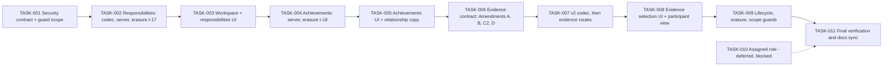

# Personal role workspace and conversation evidence — Tasks

Specification: [SPEC.md](./SPEC.md). Security packet: [SECURITY-REVIEW.md](./SECURITY-REVIEW.md) (§10 validation, §11 first-increment blockers).

**Not authorized to start.** This task plan is for review. No task is `In Progress`. Every task below carries a `Gated` line. A task must not start until its gate is recorded in `SPEC.md` (§11.8 for the first increment).

## Status
Done: TASK-001, TASK-002, TASK-003, TASK-004, TASK-005 (2026-11-11), TASK-006 (2026-11-11, documentation). In Progress: TASK-007 (step 1, the v2 codec and snapshot parser, is done and tested; step 2, owner selection routes and storage, is implemented with the E-1 version precondition and its unit and emulator tests pass; it stays In Progress until the review gate runs). Ready: TASK-008 (UI rework done; browser and accessibility gate not yet run), TASK-009 (lifecycle and scope-guard gate not yet run), TASK-011. TASK-010 remains deferred and blocked.

**Gates G1 to G3 are approved (2026-11-10), recorded in SPEC.md, Status.** TASK-003 to TASK-005 were implemented under those approvals.

**Synchronized 2026-11-10 (second pass):**
- OD-3 is approved: source `title`, `description` and `outcome` are encrypted. TASK-002 and TASK-004 no longer assume unencrypted text.
- OD-2 is approved as a product requirement: assignment history with effective dates. Its access rules are **unresolved** (C-2). Assigned-role implementation stays deferred (TASK-010).
- OD-7 is approved: the assigning administrator's identity must not be displayed to employees.
- OD-6 is approved: after completion, only whole-set clearing of evidence is permitted. TASK-009 no longer waits for a decision.
- C-5 (encryption failure handling) is an approved requirement and is applied in TASK-002, TASK-004 and TASK-007.
- C-8 (import boundary) is a documented static guard, not an access control. The guard extension and its exceptions are in TASK-001 and TASK-002.
- C-6 (BR-51 `sharedEvidence` amendment) and C-7 (first-increment erasure rows) are prepared and await approval (G1, G3).
- **The first increment is blocked** until the approvals G1 to G3 (SECURITY-REVIEW §11.8) are recorded in SPEC.md. Nothing in the first increment may start before then.

## Dependency graph

## Tasks

### TASK-001 — Apply approved personal-record security contract and guard scope

**Status:** Done (2026-11-11). Documentation was written 2026-11-10. The guard extension is in `src/features/personal-role-workspace/personal-role-workspace-repo-guard.test.ts`: scans `src`, `app`, `scripts`, `test`, `browser` for `.ts`, `.tsx`, `.js`, `.mjs`; rejects non-literal `import()` and `require()`; checks personal path strings in scripts, tests, browser and non-TypeScript files; file-exact script exceptions; `@/*` as the only tsconfig alias. Each rule has a negative fixture. The guard is a static regression check, not runtime authorization.
**Covers:** PR-SI-1, PR-SI-2 (§11.4 wording), PR-SI-4, revised PR-SI-5 (§11.1, C-5), C-8 guard scope
**Depends on:** None
**Gated:** G1 (owner approval of PR-SI-1, PR-SI-2 as worded in §11.4, PR-SI-4, PR-SI-5 as in §11.1). OD-8 is conditionally accepted for validation only; approval must be recorded in SPEC.md.

**Outcome**
`docs/SECURITY.md` contains the approved PR-SI rules as numbered rules, with the checklist items for personal records. PR-SI-2 describes the import allow-list as a static architecture guard. `docs/DATA-MODEL.md` describes the new owner-subtree collections as proposed shapes. The guard scans the paths required by §11.4, with a fixture for each rule. No application code behaviour changes.

**Implementation notes**
- Add the PR-SI rules in the document's own numbering style, after the RP-SI section. Do not renumber existing invariants.
- Do not apply Amendments A, B, C2 or D here (TASK-006).
- Extend the static guard, as a test file, to: `.js` and `.mjs` under `src` and `app`; `scripts/`; `test/`; `browser/`. Reject non-literal `import()` and `require()`. Fail on any tsconfig path alias other than `@/*`. Add the file-exact exceptions in §11.4 (`scripts/seed-demoteam-conversations.ts`, `scripts/seed-demoteam.mjs`). Each rule has a fixture that fails it.
- Record the approval date and reviewer in the SPEC status.

**Verification**
- Documentation review by reading. `pnpm lint` if markdown is linted (confirm in `package.json`).
- Guard fixture tests run with `pnpm test` (report the exact result).

**Security / privacy**
This task is the security contract itself. It must not weaken any existing invariant. Nothing may describe the static guard as runtime authorization or as bypass-proof.

**Documentation impact**
`docs/SECURITY.md`, `docs/DATA-MODEL.md`, `docs/features/personal-role-workspace/SPEC.md` (status line only).

**Acceptance criteria**
- [ ] PR-SI-1, PR-SI-2 (§11.4 wording), PR-SI-4 and PR-SI-5 (§11.1) are in `docs/SECURITY.md` as approved.
- [ ] No existing invariant number or wording is changed.
- [ ] `docs/DATA-MODEL.md` states the paths as proposed until TASK-002 and TASK-004 implement them.
- [ ] The guard scope and exceptions match §11.4; each guard rule has a failing fixture.
- [ ] No conversation invariant (A–D) is changed in this task.

---

### TASK-002 — Private responsibilities: source codec, owner CRUD, validation, erasure

**Status:** Done (2026-11-10, server part; the workspace UI is TASK-003). Evidence: `src/features/personal-role-workspace/` unit suites, `app/api/me/responsibilities` route tests, `personal-records.emulator.test.ts` (client denial, server round trip, fence refusal, erasure port without key), account-erasure suites with I-17 and I-18 (see Verification below).
**Covers:** BR-10, BR-11, BR-12, BR-13, BR-14, BR-15, BR-16 (server part), BR-60 (goal link check), BR-74, E-4, E-6; PR-SI-1, PR-SI-5; C5-1 to C5-11; E-1 to E-4, E-9 to E-11 (responsibilities); R-1, R-2, R-3, R-4; rows I-17, W-19
**Depends on:** TASK-001
**Gated:** G1 (PR-SI-5 approved), G2 (R-1 to R-4 defaults approved), G3 (rows I-17 and W-19 approved and the dated account-erasure SPEC amendment recorded), OD-4 (cap 100, provisionally approved).

**Outcome**
An authenticated owner can create, read, update, complete, reopen and delete their own responsibilities through server routes. `title` and `description` are stored encrypted. Invalid input is rejected with no write. Failure classes follow §11.1: a wrong or unavailable key never produces a deletable item. Account erasure removes all responsibilities of an erased uid without needing the key.

**Implementation notes**
- Follow the D1 pattern: `src/features/personal-role-workspace/server/` with a store, a source-record codec (R-4), a request-body parser and routes under `app/api/me/responsibilities`.
- Store at `userDevelopment/{uid}/responsibilities/{id}`. Encrypted payload holds `title` and `description`. Plain fields are the structured ones in SPEC "Responsibility". The envelope holds `ciphertext`, `iv`, `authTag`, `keyVersion`, `keyCheck` (R-4).
- Codec and failure order per §11.1: key, `keyCheck`, decrypt, parse. Create checks `keyCheck` of existing owner records (plain fields only). Update decrypts first and never overwrites from partial data. Delete is by path and does not decrypt.
- Body cap 16 KiB (R-1). Envelope cap 32 KiB (R-2), checked before the write. Ids follow R-3.
- Goal links: validate each id with the D1 owner store read by the verified uid. Unknown or foreign ids return neutral `invalid_reference`.
- Cap of 100 per person, count-then-create.
- Erasure rows I-17 (in `personal_data`) and the write fence W-19 (transaction reads `accountErasures/{uid}`), as in SECURITY-REVIEW §11.3.
- Dated amendment note in `docs/features/account-erasure/SPEC.md` for I-17 (the inventory is authoritative there).

**Verification**
- Codec tests C5-1 to C5-11 (SECURITY-REVIEW §11.1), with a test key, and the D2 `keyCheck` equality vector (R-4).
- Route contract tests with the fake store: each BR and E rule above.
- Erasure tests E-1 to E-4, E-9 to E-11 for responsibilities.
- Firestore emulator test: client read and write denied; owner server path works; cross-user access denied.
- Static guard passes with the new importers listed.
- `pnpm typecheck`, `pnpm lint`, `pnpm test`, and the emulator tests. Report exact results.

**Security / privacy**
- Owner-only (PR-SI-1). No uid from body, query or path. Neutral errors. Logs carry codes only.
- Erasure coverage: an erased uid leaves no responsibility document, and erasure needs no key.

**Documentation impact**
`docs/DATA-MODEL.md` (responsibility shape as implemented), the account-erasure SPEC dated amendment (I-17, W-19).

**Acceptance criteria**
- [ ] Owner can create, edit, complete, reopen and delete a responsibility via the API.
- [ ] Missing title, end date before start date, unknown field and oversized field are rejected with no write.
- [ ] A foreign or unknown goal id is rejected with `invalid_reference` and reveals nothing else.
- [ ] Cap of 100 is enforced.
- [ ] A wrong, missing or unavailable key never yields a deletable `malformed` item; no write occurs under a key failure (C5 tests).
- [ ] Emulator test: client access denied; no other uid can read or write.
- [ ] Erasure removes responsibilities without the key (E-4); inventory guard passes.
- [ ] Relevant tests pass; no conflict with `docs/SECURITY.md`.

---

### TASK-003 — Workspace shell and responsibilities UI

**Status:** Done (2026-11-11). Evidence: `components/RoleWorkspace.test.tsx`, `app/(app)/me/skills/page.test.tsx`, and the browser run in the final report. The view is labelled `Min rolle og mine bidrag`; the route id `rolle` is unchanged.
**Covers:** BR-1, BR-2, BR-3, BR-4, BR-5, BR-12 (UI), BR-14 (UI), BR-16 (UI); AD-1 labels; AD-3 copy
**Depends on:** TASK-002 (Done)
**Gated:** TASK-002 Done.

**Outcome**
`/me/skills` shows the view `Min rolle og mine bidrag` (route query unchanged) with: the company role section in its no-assigned-role state (BR-3); the target role section labelled as the employee's own development choice, reusing the existing role-profiles comparison as a secondary view; and the responsibilities section (`Mine ansvarsområder`) with add, edit, complete, reopen, delete with confirmation, and status filtering.

**Implementation notes**
- Rename only the displayed label in `src/features/skill-profiles/copy.ts` and the existing page test expectation. Route and `vy` identifiers unchanged.
- The company section reads nothing in this increment and renders the BR-3 state from a constant. No assignment read exists.
- Target role copy uses `Ditt utviklingsmål` (SPEC "Assigned role contract" copy rule).
- Empty states per BR-5. No comparison table when no expectations exist.
- Keep the existing `Oversikt`, `Kompetansekart`, `Deling med team` views unchanged.

**Verification**
- Component tests: section headings, no-assigned-role copy, target role label, responsibilities list order (active first), filters, delete confirmation.
- Accessibility test for forms and dialog (focus, labels).
- `pnpm typecheck`, `pnpm lint`, `pnpm test`.

**Security / privacy**
- UI only reads through TASK-002 routes. No client Firestore access.
- The no-assigned-role copy must not imply a comparison (AD-3).

**Documentation impact**
`docs/UI-UX.md` (workspace section).

**Acceptance criteria**
- [ ] The workspace shows the title, description and three role sections.
- [ ] No assignment is implied; the no-assigned-role explanation is shown.
- [ ] The target role is never labelled as an assigned role.
- [ ] Responsibilities can be created, edited, completed, reopened and deleted from the UI; deletion requires confirmation.
- [ ] Existing `/me/skills` views and tests still pass, except the updated label assertion.
- [ ] Relevant tests pass.

---

### TASK-004 — Private achievements: encrypted owner CRUD, links, erasure

**Status:** Done (2026-11-11). Server, routes, codec, erasure I-18 and emulator tests were done 2026-11-10. BR-22 missing-link marker added 2026-11-11: the achievement list returns `missingLinks` (owner-held ids that no longer resolve) on read; stored ids are unchanged. Covered by `record-operations.test.ts`, `achievements-route.test.ts`, the emulator suite and the workspace tests.
**Covers:** BR-20, BR-21, BR-22, BR-23 (server ordering), BR-24 (server filter), BR-60, BR-74, E-2, E-3, E-4, E-6; PR-SI-1, PR-SI-5; C5 tests (achievements); E-1 to E-4, E-9 to E-11 (achievements); R-1 to R-3; rows I-18, W-20
**Depends on:** TASK-002 (Done)
**Gated:** G1, G2, G3 (as TASK-002, for I-18 and W-20), OD-4 (cap 200, provisionally approved).

**Outcome**
Owner can create, read, update and delete achievements with `title`, `description` and `outcome` encrypted, plus an optional period, relationship classification and links to own goals and own responsibilities. Missing links are tolerated on read. Key failures follow §11.1.

**Implementation notes**
- `src/features/personal-role-workspace/server/` (shared with TASK-002, codec from R-4) and `app/api/me/achievements`.
- Store at `userDevelopment/{uid}/achievements/{id}`. Encrypted payload: `title`, `description`, `outcome`. Plain: period, `relationToRole`, id arrays, timestamps.
- Validate `goalIds` against the D1 owner store and `responsibilityIds` against the owner's responsibilities (R-3 grammar).
- Read path: return links that still exist and mark missing ones (BR-22) without failing the read.
- Body cap 16 KiB (R-1); envelope cap 32 KiB (R-2).
- Erasure row I-18 in `personal_data`, write fence W-20, as TASK-002.

**Verification**
- Route contract tests for BR-20–24, BR-60, E-2, E-3, E-4, E-6.
- Codec and failure tests C5-1 to C5-11 applied to achievement payloads.
- Erasure tests E-1 to E-4, E-9 to E-11 for achievements.
- Emulator test: client denied; cross-user ids rejected.
- `pnpm typecheck`, `pnpm lint`, `pnpm test`.

**Security / privacy**
- Owner-only. Linked ids are checked against the owner's records (BR-60). Linking never exposes the goal (BR-61, TASK-007).

**Documentation impact**
`docs/DATA-MODEL.md` (achievement shape as implemented), account-erasure SPEC dated amendment (I-18, W-20).

**Acceptance criteria**
- [ ] Owner can create, edit and delete an achievement via the API.
- [ ] Links to own goals and responsibilities are accepted; foreign or unknown ids are rejected with no write.
- [ ] Deleting a linked goal or responsibility leaves the achievement and returns it with a missing-link marker (no error).
- [ ] Cap of 200 is enforced. Body and envelope caps are enforced with no write when exceeded.
- [ ] Key failures never yield a deletable `malformed` item and never cause a write (C5 tests).
- [ ] Erasure removes achievements without the key; inventory guard passes.
- [ ] Relevant tests pass.

---

### TASK-005 — Achievements UI, chronology, relationship copy

**Status:** Done (2026-11-11). Covered by `components/RoleWorkspace.test.tsx` (ordering, period and relation filters, linked names, BR-22 marker after a linked record is deleted) and the browser run.
**Covers:** BR-20 (UI), BR-22 (UI marker), BR-23, BR-24 (UI), AD-3 copy, Section C of SPEC UX
**Depends on:** TASK-003, TASK-004 (Done)
**Gated:** TASK-004 Done.

**Outcome**
The workspace shows `Mine bidrag og resultater` with add, edit and delete, chronological order, period and relationship filters, linked goal and responsibility names, and the missing-link marker. Relationship labels use the self-reported copy with the no-assigned-role explanation.

**Implementation notes**
- Chronology: by period start (or date), then creation time. No score, rating or "impact" sort.
- Relationship labels `Innenfor rollen`, `Utover rollen`, `Ikke angitt`. Helper copy: `Din egen vurdering. Ikke bekreftet av arbeidsgiver.` and, when no assigned role exists, `Ingen registrert rolle er tilgjengelig å sammenligne med.`
- Link display uses only linked records the owner already has.

**Verification**
- Component tests: ordering, filters, missing-link marker, relationship copy, no score or ranking text.
- Accessibility tests for forms, list and filters.
- `pnpm typecheck`, `pnpm lint`, `pnpm test`.

**Security / privacy**
- No copy implies verification, approval or comparison (AD-3).

**Documentation impact**
`docs/UI-UX.md` (achievements section).

**Acceptance criteria**
- [ ] Achievements are shown chronologically with the stated filters.
- [ ] Missing links show `Koblet element er ikke lenger tilgjengelig`.
- [ ] No text contains a score, rating, ranking or approval claim.
- [ ] Relationship copy and no-assigned-role copy match AD-3.
- [ ] Relevant tests pass.

---

### TASK-006 — Evidence contract: Amendments A, B, C2 and D (documentation)

**Status:** Done (2026-11-11). Evidence: `docs/SECURITY.md` (PR-SI section, Amendments A, B, C2, D), the dated amendment in `docs/features/development-conversations/SPEC.md` ("Amendment 2026-11-11: evidence snapshots").
**Covers:** Amendments A, B, D; Amendment C2 (BR-51 v2, §11.2); BR-46, BR-47, BR-48 (contract)
**Depends on:** TASK-005 (Done). Must be Done before any evidence code (TASK-007).
**Gated:** G1 (owner approval of Amendments A, B, D and C2). OD-6 is approved and needs no further gate.

**Outcome**
`docs/SECURITY.md` records Amendments A, B and D as numbered D2 changes (D2-SI-5, invariant 59, D2-SI-16, invariant 70, D2-SI-9a). It records D2-SI-19 and the BR-51 six-key v2 set (C2). `docs/features/development-conversations/SPEC.md` gets a dated amendment that points to this feature, including the BR-51 change, the codec-first deployment order and the rollback rule. No code changes.

**Implementation notes**
- Amend existing invariants only as far as the approved text says. Keep the original text visible as "previous", as earlier amendments do in the repo.
- Record OD-6 (whole-set clear only after completion) explicitly.
- Record the rollback rule: deploy codec v2 before routes; no pre-v2 deployment while any conversation holds `sharedEvidence` (release gate N-E13).

**Verification**
- Documentation review. Confirm each amendment matches the SPEC and SECURITY-REVIEW text in meaning.

**Security / privacy**
- This task is the gate for all evidence code. No evidence route may be built before this task is Done.

**Documentation impact**
`docs/SECURITY.md`, `docs/features/development-conversations/SPEC.md`, `docs/DATA-MODEL.md`.

**Acceptance criteria**
- [ ] Amendments A, B, C2 and D are recorded with dates and the approving reference.
- [ ] Invariants 55–72 keep their numbers; no existing D2 rule is weakened beyond the approved amendments.
- [ ] The D2 SPEC notes the addition of evidence snapshots and the BR-51 change.

---

### TASK-007 — Encrypted evidence: v2 codec first, then owner selection and storage

**Status:** Ready
**Covers:** BR-40, BR-41, BR-42, BR-43, BR-44, BR-45, BR-50, BR-60 (evidence), E-1, E-5, E-6; Amendment C2; N-E1 to N-E13 (§11.2); E-6 (participant erasure round trip); rows W-21
**Depends on:** TASK-006 (Done), TASK-002 (Done), TASK-004 (Done)
**Gated:** G1 (C2 approved, as recorded in TASK-006), OD-5 (5 + 5 limits, provisionally approved; confirm).

**Outcome**
Step 1: the D2 codec reads v1 and v2, treats an absent `sharedEvidence` as `[]`, and preserves `sharedEvidence` on every write, with no evidence route. Step 2: the owner, while the conversation is `open`, selects responsibilities and achievements. The server copies only the allow-listed fields into the encrypted `sharedEvidence` array, replacing the whole set atomically. Validation rejects foreign ids and oversized selections with no write.

**Implementation notes**
- Step 1 lands and is tested before any route. The release gate N-E13 is recorded.
- Step 2: extend `src/features/development-conversations/server/` with a `set-shared-evidence` operation following `set-shared-goals.ts`. Use the existing helper and the CL-27 key check through the existing codec.
- Snapshot parser in `domain/` following `shared-goal-snapshot.ts` (reject extra fields, never repair).
- Read the source records only through the owner-scoped stores (Amendment B), with the verified owner uid, and only for selection.
- Respect the existing body cap (32 KiB, BR-40) and the payload cap.
- Completion: whole-set clear only (OD-6). Precedence as BR-48.
- I-7 (participant binding re-encryption, in erasure) must preserve `sharedEvidence` byte-for-byte: test E-6.

**Verification**
- Codec tests N-E9 to N-E12 and N-E13 (release gate) before routes.
- Route contract tests: selection while open; `conversation_completed` after completion (N-E8); foreign id rejection (N-E6); limit 5 + 5; atomic replacement; malformed snapshot rejected.
- Visibility and DTO tests N-E1 to N-E5, N-E7.
- Key failure: wrong key on the D2 path returns `persistence_failed`, with no ciphertext or key identifier in the response, and no write (C5-5 and C5-6 applied to conversations).
- Snapshot parser tests: allow-list, no ids, no ownership metadata.
- `pnpm typecheck`, `pnpm lint`, `pnpm test`.

**Security / privacy**
- Amendment C2: evidence is only in the encrypted payload; never a plain field or subcollection.
- Snapshots carry no source id, goal link or owner uid (BR-43, BR-61).
- Only the owner's verified uid selects evidence (D2-SI-1 pattern).

**Documentation impact**
`docs/DATA-MODEL.md` (`sharedEvidence` field, v2 payload), D2 SPEC snapshot section note.

**Acceptance criteria**
- [ ] Old conversations read `sharedEvidence` as empty; `sharedGoals` is unchanged (N-E10).
- [ ] The v2 codec is deployed before any evidence route; the release gate is recorded.
- [ ] Owner can replace the evidence set while `open`; the change is atomic.
- [ ] More than 5 responsibilities or 5 achievements is rejected with no write.
- [ ] A foreign or unknown source id is rejected with no write.
- [ ] Stored snapshots contain only the allow-listed fields; no ids.
- [ ] `sharedEvidence` is stored only inside the encrypted payload.
- [ ] Relevant tests pass.

---

### TASK-008 — Evidence selection UI and participant view

**Status:** Ready
**Covers:** BR-40 (UI), BR-45 (UI), BR-46, BR-47, BR-73 (copy), Section D of SPEC UX; visibility acceptance
**Depends on:** TASK-007 (Done)
**Gated:** TASK-007 Done.

**Outcome**
In an owned conversation, the owner selects evidence from a list of their own responsibilities and achievements, sees what is selected, and removes items. An accepted participant sees the selected snapshots. Pending participants see no evidence.

**Implementation notes**
- Selection control in the owner conversation editor; read-only section in the participant view, following the goal snapshot controls.
- Copy: removal states that the participant may already have seen the content (BR-73).
- Completion copy: after completion, only clearing the whole set is available.
- Section D of the workspace links to the conversation workspace; it does not create or share anything automatically.

**Verification**
- Component tests: selection, limits, removal copy, participant view after acceptance, pending view has no evidence, completed view.
- End-to-end test (emulator): owner selects, participant accepts, participant reads snapshot, owner removes, participant no longer reads it.
- Accessibility checks on the selection control.
- `pnpm typecheck`, `pnpm lint`, `pnpm test`.

**Security / privacy**
- Participant UI never shows source ids, goal links or any source record.

**Documentation impact**
`docs/UI-UX.md` (conversation evidence).

**Acceptance criteria**
- [ ] Owner selects and removes evidence in the conversation UI; limits shown.
- [ ] Accepted participant sees only selected snapshots.
- [ ] Pending participant sees no evidence.
- [ ] Participant UI shows no source id, goal id or link.
- [ ] Relevant tests and the E2E check pass.

---

### TASK-009 — Lifecycle, erasure of evidence, revocation and scope guards

**Status:** Ready
**Covers:** BR-46, BR-48, BR-49, BR-70, BR-71, BR-72, E-7 (deferred), E-8; Amendment D; erasure E-5, E-6, E-8, E-9 (evidence and conversations); E-12
**Depends on:** TASK-008 (Done)
**Gated:** TASK-008 Done. OD-6 is approved and needs no further gate.

**Outcome**
Tests and behaviour prove: source edits and deletes leave snapshots unchanged; removal and revocation take effect on the next read; completed conversations accept only whole-set clearing; account erasure of the owner removes evidence with the conversation; the I-7 re-encryption preserves evidence.

**Implementation notes**
- Implement the OD-6 completion rule exactly: whole-set clear only after completion.
- Extend the D1 and D2 static scope guards so evidence code does not read the D1 goal store beyond the existing selection path, and no code reads target or assigned roles from the evidence path.
- Add lifecycle tests for every row of the SPEC BR-70 to BR-74 table.
- Confirm the demo seed does not create responsibilities, achievements or evidence (E-12).

**Verification**
- Lifecycle tests against the fake and the emulator store.
- Scope guards pass (they fail if a new import appears).
- Erasure end-to-end test for an owner with responsibilities, achievements and evidence (E-5, E-9).
- Participant erasure round trip (E-6).
- `pnpm typecheck`, `pnpm lint`, `pnpm test`, emulator security tests.

**Security / privacy**
- Revocation takes effect immediately (D2-SI-8). Snapshots are not deleted by revocation (BR-72).

**Documentation impact**
`docs/SECURITY.md` (checklist items confirmed), `docs/features/personal-role-workspace/SPEC.md` acceptance boxes.

**Acceptance criteria**
- [ ] Editing or deleting a source leaves existing snapshots unchanged.
- [ ] Removing a participant, decline, withdrawal or ineligibility hides snapshots on the next read.
- [ ] Completed conversations accept only whole-set clearing; N-E8 passes.
- [ ] Scope guards pass.
- [ ] Erasure removes the owner's responsibilities, achievements and conversations (including snapshots) with no residue (E-9).

---

### TASK-010 — Assigned role contract and first implementation (deferred, blocked)

**Status:** Ready (deferred, blocked)
**Covers:** AD-1 (assigned role), PR-SI-3, BR-30, BR-31, OD-1, OD-2, OD-7; "Assigned role contract"; C-1 to C-4; C-7 (history and `assignedBy` rows)
**Depends on:** TASK-003 (for the company section). Independent of TASK-011.
**Gated:** **Not in the first increment, and blocked.** Do not start until all of the following are recorded in SPEC.md:
- C-1: history contract amended into PR-SI-3 (Amendment E);
- C-2: who may read assignment history decided (currently open);
- C-3: exact `assignedBy` audit field and its retention decided;
- C-4: RP-SI-3 amended for app-admin assignment access (Amendment F);
- C-7: erasure rows for `roleAssignments/{uid}`, `roleAssignments/{uid}/history/*` and the `assignedBy` actor row (ANONYMIZE) approved, with a retention and erasure policy for history and `assignedBy`;
- a separate security review of PR-SI-3 and PR-SI-4, and a product schedule decision.

**Outcome (when scheduled)**
An app admin can assign one active role to an employee, replace it and unassign it. History is kept with effective dates (OD-2). The employee sees their current assigned role (title and description) in the company section. No admin reads any personal record. `assignedBy` is never shown to the employee (OD-7).

**Implementation notes**
- `roleAssignments/{uid}`, Admin SDK only, `requireAppAdmin` for writes and role-management reads.
- History as an owner subtree `roleAssignments/{uid}/history/{id}`, so erasure can delete it as a subtree.
- `assignedBy` stored server-side only; not in any employee-facing or non-admin response; nulled on the administrator's erasure.
- Rules: deny-all client access for `roleAssignments` and its history.
- Replace or unassign closes the current row with an `endDate`; it does not delete it.

**Verification (when scheduled)**
- Authz matrix tests: employee, team admin, lead, superadmin, app admin on read and write.
- DTO key-set tests: no `assignedBy` in the employee response.
- Emulator rules test: client denied.
- `pnpm typecheck`, `pnpm lint`, `pnpm test`.

**Security / privacy**
- PR-SI-3 and PR-SI-4 apply. App-admin status grants no personal-record read.

**Documentation impact**
`docs/DATA-MODEL.md`, `docs/SECURITY.md` (only after approval), `docs/features/role-profiles/SPEC.md` (cross-reference only).

**Acceptance criteria**
- [ ] No assignment exists or is written in the first increment (TASK-001 to TASK-009 do not touch `roleAssignments`).
- [ ] When scheduled: assignment is writable only through `requireAppAdmin`; employee reads own; no personal-record read by admins.
- [ ] Erasure removes the assignment and its history; `assignedBy` is nulled for an erased administrator.

---

### TASK-011 — Final verification and documentation sync

**Status:** Ready
**Covers:** Phase 2F of the source spec; all acceptance criteria in SPEC.md
**Depends on:** TASK-009 (and TASK-010 only if it was scheduled and completed)
**Gated:** TASK-009 Done.

**Outcome**
All acceptance criteria in SPEC.md are verified and reported as run. Documentation matches the implementation.

**Implementation notes**
- Run the full suite: `pnpm typecheck`, `pnpm lint`, `pnpm test`, `pnpm build`, and the Firebase Auth/Firestore emulator security tests.
- Browser checks at widths 320, 360, 390, 768, 1024 and 1440 in light and dark themes, plus keyboard checks, using an isolated emulator-only environment. Do not use the server on port 3100 (per the spec's Phase 2F rule).
- Update `docs/DATA-MODEL.md`, `docs/UI-UX.md`, `docs/ROADMAP.md` status.

**Verification**
Every command run is reported with its actual result. Anything not run is reported as not run.

**Security / privacy**
Final pass against PR-SI-1 to PR-SI-5, Amendments A–D and C2, using the SPEC acceptance criteria and the negative tests in SECURITY-REVIEW §11.6.

**Documentation impact**
As listed above.

**Acceptance criteria**
- [ ] Every SPEC acceptance criterion is checked with evidence (test name, command or browser check).
- [ ] Typecheck, lint, tests, build and emulator tests have been run, and their results are recorded accurately.
- [ ] Browser checks at the six widths and both themes have been run, or are reported as not run.
- [ ] Documentation matches the implemented contract.

---

## Coverage check

| Requirement group | Tasks |
|---|---|
| BR-1–5 (workspace) | TASK-003, TASK-005 |
| BR-10–16 (responsibilities) | TASK-002, TASK-003 |
| BR-20–24 (achievements) | TASK-004, TASK-005 |
| BR-30–31 (assigned role) | TASK-010 (deferred, blocked) |
| BR-40–50 (evidence) | TASK-007, TASK-008, TASK-009 |
| BR-60–62 (links and aggregation) | TASK-002, TASK-004, TASK-007 |
| BR-70–74 (deletion, retention) | TASK-009 (and TASK-002, TASK-004 for source deletion) |
| PR-SI-1, PR-SI-2, PR-SI-4, PR-SI-5 | TASK-001 (contract), TASK-002/004 (enforcement), TASK-010 (PR-SI-3, PR-SI-4) |
| PR-SI-3 | TASK-010 only (deferred, blocked) |
| Amendments A, B, D, C2 | TASK-006 (contract), TASK-007 (implementation), TASK-009 (completion and erasure tests) |
| C-5 encryption failure handling | TASK-002, TASK-004 (source), TASK-007 (evidence path) |
| C-8 import boundary and guard scope | TASK-001 (guard scope), TASK-002 (new importers), TASK-009 (scope guards) |
| Erasure, first increment (I-17, I-18, I-5 evidence, I-7 preservation) | TASK-002, TASK-004, TASK-007, TASK-009 |
| Erasure, deferred (`roleAssignments`, history, `assignedBy`) | TASK-010 (blocked) |
| Backward compatibility | TASK-003 (label), TASK-007 (absent field, v2 codec first), TASK-010 (none written) |

Requirements intentionally not covered in the first increment: BR-30 and BR-31 (assigned role, deferred per AD-1).

## Blockers summary

| Decision or requirement | Status (2026-11-10) | Blocks |
|---|---|---|
| G1: OD-8 security text (PR-SI-1, PR-SI-2, PR-SI-4, PR-SI-5, Amendments A, B, C2, D) | **Approved** 2026-11-10 (product owner; recorded in SPEC.md, Status) | TASK-001, TASK-002, TASK-004, TASK-006, TASK-007 |
| G2: R-1 (16 KiB body), R-2 (32 KiB envelope), R-3 (id rule), R-4 (separate source codec) | **Approved** 2026-11-10 (recorded in SPEC.md, Status) | TASK-002, TASK-004 |
| G3: erasure rows I-17, I-18, write fence W-19 to W-21, account-erasure SPEC amendment | **Approved** 2026-11-10 (recorded in SPEC.md, Status) | TASK-002, TASK-004, TASK-007, TASK-009 |
| C-5 encryption failure handling | **Approved** 2026-11-10 | None (implemented in TASK-002, TASK-004, TASK-007) |
| C-8 import boundary as static guard | **Adopted** 2026-11-10 | None (guard scope in TASK-001) |
| OD-3 source records encrypted | **Approved** 2026-11-10 | None (applied in TASK-002, TASK-004) |
| OD-4 caps 100 / 200 | Provisionally approved | TASK-002, TASK-004 (confirm) |
| OD-5 evidence limits 5 + 5 | Provisionally approved | TASK-007 (confirm) |
| OD-6 completion rule (whole-set clear only) | **Approved** 2026-11-10 | None |
| OD-1 `requireAppAdmin` for assignments | Approved 2026-11-10 | TASK-010 only (needs C-4) |
| OD-2 assignment history | Approved as product requirement; **history access rules open (C-2)** | TASK-010 |
| OD-7 assigner identity not shown to employees | Approved 2026-11-10; audit field design open (C-3) | TASK-010 |

**Overall:** the first increment (TASK-001 to TASK-009, TASK-011) is **NO-GO** until G1 to G3 are recorded. Assigned role (TASK-010) remains **NO-GO**.
