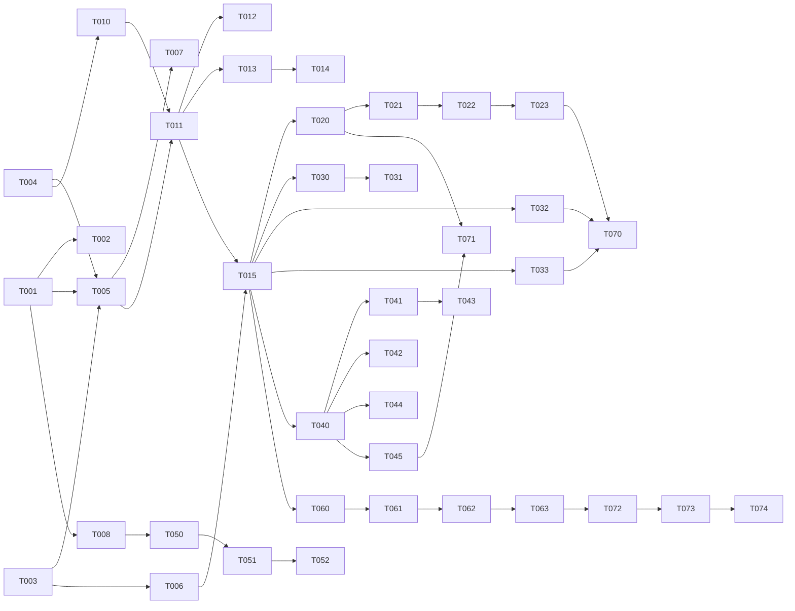

# DevPulse Product Experience — Tasks

Specification: [SPEC.md](./SPEC.md)

## Status
Ready: 3  In Progress: 0  Done: 37 (TASK-001 to TASK-008, TASK-010 to TASK-015, TASK-020 to TASK-023, TASK-030 to TASK-033, TASK-040 to TASK-045, TASK-050 to TASK-052, TASK-060 to TASK-063, TASK-070, TASK-071)

## Conventions
- **Covers** lists `BR-*` IDs. Several SPEC contracts have no BR ID; those tasks cite the SPEC section by name in *Implementation notes* and map to the nearest BR.
- Every task runs `pnpm typecheck`, `pnpm lint` and `pnpm test`. Any task that changes route or layout code also runs `pnpm build`.
- No task may change server code, DTOs, route handlers, Firestore rules, environment variables or Account Erasure files unless the task states it. None of the tasks below does.
- No task creates a new persistence path, new server field, new analytics event or new route. Route paths do not change.
- Existing copy modules and tests that protect authorization, class A copy, aggregation and anonymity are kept. Tests that assert obsolete markup or class names may change in the task that changes that markup.

## Dependency graph

## Tasks

### UX-0 — Experience foundation

### TASK-001 — Semantic token file and theme contract

**Status:** Done (2026-11-02; tests, typecheck, lint, build run; the focused review is recorded in the run log)
**Covers:** BR-4, BR-15
**Depends on:** None

**Outcome**
`app/globals.css` defines every token in the SPEC token contract for light and dark. The root sets `data-theme="light"` by default. Dark applies only when the stored choice is Mørk, or Følg enhet is stored and the operating system prefers dark. Lys is the default for every OS setting.

**Implementation notes**
- Theme section, "Token contract" and "Implementation contract". Tokens exposed to Tailwind v4 through `@theme inline`.
- A small inline script in the root layout runs before first paint. It reads one local key holding one of `lys`, `mork` or `folg`, and sets `data-theme`. Every storage access is wrapped; failure falls back to light. The script reads and writes only that key.
- Add a tiny theme module with the read, write and resolve functions, so the logic is unit-testable outside the inline script.
- No telemetry call anywhere in the theme code.

**Verification**
- Unit tests: default is light; OS dark with no stored choice stays light; stored Mørk gives dark; stored Følg enhet with OS dark gives dark; storage read or write throwing falls back to light without an error.
- Static test: the root layout's initial HTML contains `data-theme="light"`.
- Lint and typecheck.

**Security / privacy**
Single viewer-preference key, no personal data, no identifier, no network call (SPEC "Theme strategy", AD-5).

**Documentation impact**
`docs/UI-UX.md` gets a short "Theme" note pointing to this SPEC.

**Acceptance criteria**
- [ ] Light is the default with every OS setting
- [ ] Dark applies only on explicit choice (Mørk, or Følg enhet with an OS dark preference)
- [ ] Storage failure never throws and falls back to light
- [ ] No telemetry or network call in theme code
- [ ] Relevant tests pass

---

### TASK-002 — Contrast record and raw-palette guard

**Status:** Done (2026-11-02; contrast and raw-colour guard tests pass; record in VERIFICATION.md)
**Covers:** BR-4
**Depends on:** TASK-001

**Outcome**
Every text and UI pair in the token contract is measured from the implemented token file, and the results are recorded. A static test fails when app code contains a raw palette value outside the token file.

**Implementation notes**
- A script or test reads the token file, computes WCAG contrast for each pair in the SPEC's measurement list, and asserts the thresholds (4.5:1 text, 3:1 non-text).
- Record the results table in `docs/features/product-experience/VERIFICATION.md` (created by this task).
- The raw-palette guard scans `app/` and `src/` for hex values and Tailwind palette classes (`zinc-`, `red-`, `blue-` and similar). Only the token file is exempt. Existing offending classes are not fixed in this task; the guard instead lists them as an allow-list that shrinks in later phases, and the list is checked in.

**Verification**
- Contrast assertions in both themes, from the implemented file.
- Guard test passes with the allow-list; adding a new raw value fails it.

**Security / privacy**
No impact.

**Documentation impact**
Creates `VERIFICATION.md` for the feature. Records that contrast figures are not a WCAG claim.

**Acceptance criteria**
- [ ] Every pair in the contract is measured and recorded for both themes
- [ ] Pairs below threshold are fixed in the token file before this task is Done
- [ ] Raw-palette guard exists with a checked-in allow-list
- [ ] No WCAG conformance claim is written
- [ ] Relevant tests pass

---

### TASK-003 — Typography, spacing, radii, borders, elevation, focus and motion tokens

**Status:** Done (2026-11-02; token, focus and reduced-motion tests pass; build passes)
**Covers:** BR-3, BR-13
**Depends on:** None

**Outcome**
The scale and token set from the SPEC exist as tokens and as shared utility classes: typography roles, 4 px spacing scale, radii (6, 10, 14 px), 1 px borders, three elevation levels, focus outline, and motion durations with a `prefers-reduced-motion` override that disables transitions and transforms.

**Implementation notes**
- Sections "Typography", "Spacing, radii, borders, elevation", "Focus", "Motion strategy".
- Focus: a global `:focus-visible` rule with a 2 px `focus-ring` outline and 2 px offset. It must not be removed by any component.
- Reduced motion: one global rule in the stylesheet for `prefers-reduced-motion: reduce`.
- Do not restyle any page in this task. Only tokens and shared primitives' base styles.

**Verification**
- Static test: the reduced-motion rule and the focus rule exist.
- Unit test on the typography role map if one is exported.
- Lint and typecheck.

**Security / privacy**
No impact.

**Documentation impact**
`docs/UI-UX.md` gets a short section on the scale.

**Acceptance criteria**
- [ ] Typography roles, spacing, radii, borders, elevation and focus are tokenized
- [ ] Global focus-visible rule exists and is not overridden by primitives
- [ ] Reduced-motion rule disables transitions and transforms
- [ ] No page visuals changed beyond base primitives
- [ ] Relevant tests pass

---

### TASK-004 — `lucide-react` dependency, Icon wrapper and bundle record

**Status:** Done (2026-11-02; bundle gate passed with 0 byte increase; see VERIFICATION.md)
**Covers:** BR-7
**Depends on:** None

**Outcome**
`lucide-react` is installed at an exact pinned version. A single `Icon` wrapper in `src/components/ui/` renders icons with the SPEC sizes and stroke width, `aria-hidden` by default. The production client bundle is measured before and after the install and the increase is recorded.

**Implementation notes**
- Iconography section, "Dependency record" and "Usage rules". Use the version recorded as latest at install time, pinned without a range.
- Record the bundle measurement method and both sizes in `VERIFICATION.md`.
- **Gate:** if the increase is material and not explained by the icons used, stop and report. Do not proceed to TASK-005.
- No other icon package and no downloaded icons.

**Verification**
- Static test: the only icon import source is `lucide-react`; no other icon package appears in `package.json`.
- `Icon` unit test: `aria-hidden` by default; accessible name passes through when given; sizes match the SPEC.
- Bundle before and after recorded.
- `pnpm build` passes.

**Security / privacy**
No runtime network egress from the package (no runtime dependencies declared).

**Documentation impact**
`VERIFICATION.md` (bundle record); `docs/ARCHITECTURE.md` gets one line on the icon dependency.

**Acceptance criteria**
- [ ] Exact version pinned
- [ ] Icon wrapper exists with tests
- [ ] Bundle before and after recorded and explained
- [ ] No other icon family present
- [ ] `pnpm build` passes

---

### TASK-005 — Status badge and action hierarchy primitives

**Status:** Done (2026-11-02; Button, Badge and StatusBadge tests pass; affected feature suites pass with two isolated-load flakes recorded in VERIFICATION.md)
**Covers:** BR-5, BR-6, BR-3
**Depends on:** TASK-001, TASK-003, TASK-004

**Outcome**
- `StatusBadge` renders a status as icon, text label and tone (success, warning, danger, info, neutral). It never relies on colour alone.
- `Button` supports the action hierarchy: primary (filled), secondary (outlined), tertiary (text), destructive (outlined danger, dialog or danger area only). Its `pending` and `disabled` semantics are unchanged. Radius becomes 10 px.
- The existing `Badge` is replaced by `StatusBadge` where it already shows a status; its visible text is unchanged.

**Implementation notes**
- Sections "Status representation" and "Action hierarchy". Keep every existing accessible name and label.
- Existing `Button.test.tsx` and `Badge.test.tsx` are updated for the new variants and radius.

**Verification**
- Component tests: each tone renders text and icon; `aria-hidden` icon; button variants keep `type="button"` default and `aria-busy` when pending.
- Existing feature tests that find buttons by name still pass.

**Security / privacy**
No impact. Status tone is decided by the caller's existing state only.

**Documentation impact**
`docs/UI-UX.md` "Shared primitives" note updated.

**Acceptance criteria**
- [ ] StatusBadge has text, icon and tone; no colour-only status
- [ ] Button variants implement the hierarchy and keep pending semantics
- [ ] Existing button and badge names unchanged
- [ ] Relevant tests pass

---

### TASK-006 — Page header, section and container primitives

**Status:** Done (2026-11-02; PageHeader, Section and Container tests pass; no existing page switched; checkpoint 1 records load-dependent full-suite timeouts)
**Covers:** BR-3, BR-12
**Depends on:** TASK-003

**Outcome**
- `PageHeader` renders eyebrow, `h1` title, description and at most one primary action (right-aligned on desktop, below title on mobile).
- `Section` renders an `h2` with optional description and action, separated by space, not borders.
- Three named containers exist: main (1200 px max), reading (680 px), survey (560 px), and auth (420 px). They are added beside `PageShell`; existing pages are not switched yet.

**Implementation notes**
- Sections "Page composition", "Section hierarchy", "Breakpoints and containers" (AD-8).
- `PageHeader` already exists in `src/components/ui/`; extend it rather than add a second header component.

**Verification**
- Component tests: one `h1`; primary action count at most one (prop type enforces single); eyebrow is text.
- Container tests: widths via classes; no horizontal overflow at 360 px in a rendered test where feasible.

**Security / privacy**
No impact.

**Documentation impact**
`docs/UI-UX.md` gets the composition and container contract.

**Acceptance criteria**
- [ ] PageHeader and Section implemented with tests
- [ ] Three containers exist and are documented
- [ ] No existing page changed yet
- [ ] Relevant tests pass

---

### TASK-007 — Form hierarchy primitives

**Status:** Done (2026-11-02; form primitive tests pass; feature form suites run at checkpoint 2)
**Covers:** BR-5, BR-6
**Depends on:** TASK-005

**Outcome**
`TextField`, `TextArea` and `Select` follow the form hierarchy: label above, help text below, error text below help with `aria-describedby` and `aria-invalid`; "valgfritt" text for optional fields; 44 px height on mobile and 40 px on desktop. Existing validation and submission behaviour is unchanged.

**Implementation notes**
- Section "Form hierarchy". Extend the existing primitives; their validation props and tests stay.
- Radio scales (survey, access mode) stay native and are not forced into these primitives.

**Verification**
- Existing primitive tests pass; new tests cover help and error association and the optional marker.
- Accessible names unchanged for every existing feature form (checked by the existing feature test suites).

**Security / privacy**
No impact.

**Documentation impact**
`docs/UI-UX.md` form section updated.

**Acceptance criteria**
- [ ] Label, help and error association verified by test
- [ ] Optional marking is text, not asterisk-only
- [ ] Heights meet the SPEC on mobile and desktop
- [ ] Existing feature form tests still pass
- [ ] Relevant tests pass

---

### TASK-008 — Chart palette tokens and ChartFrame contract

**Status:** Done (2026-11-02; ChartFrame and contrast tests pass; palette measured in VERIFICATION.md)
**Covers:** BR-9
**Depends on:** TASK-001

**Outcome**
A `ChartFrame` component provides the chart container contract: title, legend slot, table-alternative slot and empty or insufficient-data slot. The categorical palette tokens (six colours, light and dark) exist. No existing chart is migrated.

**Implementation notes**
- Section "Chart palette" and "Chart and analytics presentation". Recharts stays the only chart library.
- The frame renders a table alternative whenever a chart is shown. Series are distinguished by a marker or line style as well as colour.
- Suppressed values are rendered as gaps and a text note, never as zero (contract tested in the frame, not in a specific chart).

**Verification**
- Component tests: frame renders title, legend, table alternative; empty slot renders instead of a chart when told there is insufficient data; no zero is inferred.
- Palette contrast added to TASK-002's record.

**Security / privacy**
The frame must never receive or compute a value the server withheld (BR-9). Tested by a check that the frame has no data-computing props beyond what the caller passes.

**Documentation impact**
`docs/UI-UX.md` chart section updated.

**Acceptance criteria**
- [ ] ChartFrame exists with table alternative and empty slot
- [ ] Six palette tokens defined for both themes and measured
- [ ] Gap semantics documented and tested at the frame level
- [ ] No existing chart changed
- [ ] Relevant tests pass

---

### UX-1 — Application shell, navigation and page composition

### TASK-010 — Route groups and signed-out top bar

**Status:** Done (2026-11-02; route-group URL and public-nav tests pass; build passes)
**Covers:** BR-1, BR-S8
**Depends on:** TASK-004

**Outcome**
Three layout groups exist: an application group for authenticated routes, a public group for signed-out routes (simple top bar: product name, Logg inn, Opprett konto), and a minimal survey group for `/survey/[surveyId]`. Route paths are unchanged. The survey group renders no navigation, sidebar or account menu.

**Implementation notes**
- Shell section, "Structure" and "Geometry". Route groups use parentheses folders so URLs do not change.
- The application group still uses the current header in this task; TASK-011 replaces it.
- Signed-out navigation keeps fail-closed behaviour before the first auth emission.

**Verification**
- Route tests: every existing URL still resolves (the URL list is checked in a test).
- Survey route renders with no navigation landmark.
- Signed-out navigation shows only Hjem, Logg inn, Opprett konto.

**Security / privacy**
The survey group must not include any identity-bearing component (BR-S8). Checked by a static test on the survey layout's imports.

**Documentation impact**
`docs/UI-UX.md` "Navigation" note: route groups added.

**Acceptance criteria**
- [ ] All existing URLs unchanged and tested
- [ ] Survey group has no navigation landmark
- [ ] Signed-out set fails closed
- [ ] Relevant tests pass

---

### TASK-011 — Desktop sidebar AppShell

**Status:** Done (2026-11-02; AppShell tests 26 of 26; build passes; below-md navigation gap closes in TASK-012)
**Covers:** BR-1, BR-2, BR-14
**Depends on:** TASK-010, TASK-005

**Outcome**
An `AppShell` renders at `md` and up: a 248 px sidebar with the groups Overview, Team (contextual), Personlig utvikling (heading "Min utvikling"), Administrasjon (only for `isAdmin`), and User (Min profil, Slett kontoen din, Logg ut). Active items use `aria-current="page"` on the exact path, and `Ferdigheter`, `Mål`, `Samtaler` and the personal group heading are the only personal entries.

**Implementation notes**
- Shell section, "Structure". Uses only existing destinations and the existing `navCopy` labels, plus the group headings "Administrasjon" and the personal heading.
- `SiteHeader` is superseded. Add a supersession note to `docs/features/product-ux-shell/SPEC.md`'s header section by pointer only (no rewrite of that SPEC). Update `SiteHeader.test.tsx` and `PersonalNav.test.tsx` to the new structure. Their assertions about `aria-current`, admin visibility and fail-closed behaviour are kept.
- Admin visibility comes only from the existing own-admin-status read, as today.

**Verification**
- Tests for every role state: signed-out, member, app admin. Admin group absent for members.
- `aria-current` exact-path test including `/me/goals` under the personal entry.
- Pointer added to `product-ux-shell` SPEC; no other change there.

**Security / privacy**
Hiding admin entries is presentation only. Admin routes still enforce server authorization (unchanged). No new destination is exposed to any role (BR-1).

**Documentation impact**
`docs/UI-UX.md` navigation section; `product-ux-shell` SPEC pointer line.

**Acceptance criteria**
- [ ] Sidebar groups exactly as the SPEC lists
- [ ] No destination added for any role
- [ ] Admin group only for the admin state
- [ ] Supersession pointer recorded
- [ ] Relevant tests pass

---

### TASK-012 — Mobile menu drawer

**Status:** Done (2026-11-03; drawer tests 15 of 15; build and typecheck pass; the manual 360 px check is NOT performed and stays open in VERIFICATION.md)
**Covers:** BR-1, BR-2, BR-13
**Depends on:** TASK-011

**Outcome**
Below `md`, a top bar shows the product name, the current page title and a "Meny" trigger. The trigger opens a dialog drawer with the same groups as the sidebar. The drawer meets the four close paths and the focus and inert rules from the SPEC.

**Implementation notes**
- Shell section, "Mobile navigation drawer". Use a native `<dialog>` element or an equivalent `role="dialog"` container (the choice is recorded in the task's PR notes).
- Open: focus moves to the `aria-current` link, otherwise the first link. Root content is `inert` and `aria-hidden`. Scroll is locked. Focus is trapped.
- Close: navigation, "Lukk meny" with an X icon, Escape, and tap or click on the scrim. Scrim is `aria-hidden` and not focusable.
- Focus return: button, Escape or scrim close returns focus to "Meny". Navigation close moves focus to the new page's `h1`.
- Drawer is not rendered at `md` and up. Slide-in 200 ms, disabled under reduced motion.

**Verification**
- Testing Library tests for each of the four close paths; focus moved on open; focus returned on close; focus to `h1` after navigation; inert and scroll-lock applied and removed on close and on unmount; Tab trapped.
- Reduced-motion test: no transition class applied.
- Manual check at 360 px recorded in `VERIFICATION.md`.

**Security / privacy**
No impact.

**Documentation impact**
`VERIFICATION.md` records the drawer check.

**Acceptance criteria**
- [ ] Four close paths work and are tested
- [ ] Focus opens, traps, returns and moves to `h1` as specified
- [ ] Background is inert and scroll is locked while open
- [ ] Desktop does not render the drawer
- [ ] Relevant tests pass

---

### TASK-013 — Team context, admin scope marker and skip link

**Status:** Done (2026-11-03; team-context, eyebrow and skip-link tests pass; build passes)
**Covers:** BR-14, BR-1
**Depends on:** TASK-011

**Outcome**
- On team routes the team name is visible in the top bar or sidebar as context.
- Every admin page shows the eyebrow "Administrasjon" through `PageHeader`.
- A skip-to-content link is the first focusable element on every layout and targets `main`.

**Implementation notes**
- Shell section, "Accessibility" (focus and skip link). The team name comes from data the team page already loads; no new fetch.
- Admin marker uses existing admin data; no new server call.

**Verification**
- Tests: skip link is first in tab order and targets `main`; admin pages render the marker; team name appears on team routes and not on signed-out pages.

**Security / privacy**
The team name is already shown on that page to the same caller. No new data.

**Documentation impact**
None expected beyond `docs/UI-UX.md` shell note.

**Acceptance criteria**
- [ ] Skip link first and functional
- [ ] Admin scope marker on every admin page
- [ ] Team context shown on team routes without a new request
- [ ] Relevant tests pass

---

### TASK-014 — Home-page privacy line (class A)

**Status:** Done (2026-11-02; verbatim class A line and absence of "anonym" tested)
**Covers:** BR-10
**Depends on:** TASK-013

**Outcome**
The home page shows the locked line from the SPEC in place of "Individuelle svar er anonyme. Bare teamets samlede trender vises, aldri individuelle poeng.":

> Svarene lagres uten navn eller e-postadresse. Individuelle svar vises aldri. Teamet ser bare samlede resultater, og først når nok personer har svart.

**Implementation notes**
- Privacy copy section, "Locked home-page privacy line". Change `app/page.copy.ts` only.
- The word "anonym" must not appear in the home privacy line.

**Verification**
- `app/page.test.tsx` asserts the exact string.
- Copy test: the old phrase is absent; the word "anonym" is absent from `homeCopy.privacyNote`.

**Security / privacy**
This is a broader-claim correction. Owner-approved wording; do not alter it further.

**Documentation impact**
Note in `docs/UI-UX.md` that the home privacy line is class A (SPEC).

**Acceptance criteria**
- [ ] Locked line appears verbatim
- [ ] Old phrase and "anonym" absent
- [ ] Relevant tests pass

---

### TASK-015 — Apply containers and page headers to existing pages

**Status:** Done (2026-11-03; PageShell maps onto containers; build passes; full-suite timing flakes recorded; 360 px overflow check NOT performed, open in VERIFICATION.md)
**Covers:** BR-3, BR-12, BR-14
**Depends on:** TASK-006, TASK-011

**Outcome**
Every existing page uses the new containers and `PageHeader` for its outer structure. Titles, descriptions and copy are unchanged. `PageShell` width values are mapped to the new containers. No page content, fetch, guard or capability logic changes.

**Implementation notes**
- Section "Page composition" and "Breakpoints and containers". Work through the 19 routes in one pass; each route's content component is untouched.
- Admin pages use the wide variant of the main container.
- Any page whose current `h1` is not the page title keeps its current heading level until its own UX phase.

**Verification**
- Existing tests pass unchanged except where they assert `PageShell` width classes.
- Each route renders with one `h1`.
- No horizontal scroll at 360 px in a rendered test on the three widest routes.

**Security / privacy**
No content or guard changed. A diff check confirms no fetch or capability code moved.

**Documentation impact**
`docs/UI-UX.md` "Responsive behavior" note on containers.

**Acceptance criteria**
- [ ] All 19 routes use the new containers
- [ ] No content, copy or guard changes
- [ ] One `h1` per route
- [ ] Relevant tests pass

---

### UX-2 — Survey participation (mobile-first)

### TASK-020 — Survey intro and locked privacy notice

**Status:** Done (2026-11-03; intro and notice tests 6 of 6; survey suites 329 of 329; keyboard disclosure check not performed in a browser)
**Covers:** BR-S1, BR-S1a
**Depends on:** TASK-015

**Outcome**
The survey route's first screen shows the survey title (or existing fallback), team name, the locked notice from the SPEC, and a "Start" action. "Mer om personvernet" is a collapsed, keyboard-operable disclosure with the five points in SPEC order.

**Implementation notes**
- Survey experience, "Locked privacy notice for the survey page". Verbatim text lives in `src/features/surveys/copy.ts`.
- The notice is mode-neutral: it must not read `accessMode` (not in the DTO) and names no threshold number.
- Disclosure uses native `
` and `
` unless the implementer records a reason to use the existing disclosure pattern.
- The survey page gets no new fetch and no new DTO field.

**Verification**
- Copy test: notice and the five disclosure points match the SPEC verbatim; the word "anonym" does not appear in the notice; no digit threshold appears.
- Component test: disclosure collapsed by default and opens with keyboard.

**Security / privacy**
Notice is class A. No identity-bearing state is added. The survey page still receives no `accessMode` or `minimumResponses`.

**Documentation impact**
`docs/features/managed-surveys/SPEC.md` is not changed. `VERIFICATION.md` records the notice verification against BR-17, BR-21–27.

**Acceptance criteria**
- [ ] Notice and disclosure verbatim
- [ ] Mode-neutral, no threshold number, no "anonym"
- [ ] Disclosure keyboard-operable and collapsed by default
- [ ] No new fetch or DTO field
- [ ] Relevant tests pass

---

### TASK-021 — One-question stepper with progress and Back/Next

**Status:** Done (2026-11-03; stepper, storage guard and survey suites pass; 360 px check not performed)
**Covers:** BR-8, BR-S2, BR-S3, BR-S5
**Depends on:** TASK-020

**Outcome**
The three questions are shown one per screen at every width, with "Spørsmål N av 3" progress and a visible bar that also has text. Back and Next move between questions. Answers are held in memory and kept across Back and Next. Next is disabled until the current question is answered, and the disabled state carries text. Back never clears an answer.

**Implementation notes**
- Survey experience BR-S2, BR-S3, BR-S5. Keep `SurveyResponseForm`'s answer state shape; move navigation into a small stepper in the same feature.
- No storage API of any kind. Answers do not survive reload (BR-S9, decided).
- Desktop uses the same flow in the survey column (560 px).

**Verification**
- Component tests: progress text; Back keeps answers; Next disabled until answered with the text message; navigating forward and back preserves all three values.
- Grep test: no `localStorage`, `sessionStorage`, `indexedDB` or cookie write in the survey feature.

**Security / privacy**
No new persistence (decided). The storage grep test enforces it.

**Documentation impact**
None expected.

**Acceptance criteria**
- [ ] One question per screen at 360 px and desktop widths
- [ ] Progress text and bar present
- [ ] Answers kept across Back and Next; Back never clears
- [ ] Next disabled with text until answered
- [ ] No storage API in survey code
- [ ] Relevant tests pass

---

### TASK-022 — Answer controls, review and unchanged submission

**Status:** Done (2026-11-03; control, review and payload tests pass)
**Covers:** BR-S4, BR-S6, BR-8
**Depends on:** TASK-021

**Outcome**
Each question's five answer controls are at least 44×44 px on mobile, labelled by number, with a visible selected state (border and text) inside a keyboard-operable radio group. A review screen lists the three answers as text with the submit action. Submission sends exactly the payload it sends today.

**Implementation notes**
- Survey experience BR-S4, BR-S6. The scale wording is unchanged; no descriptors added.
- Submission gateway, token rule (sent only for authenticated surveys) and outcome handling are unchanged.
- Pending state, `already_submitted` and error alerts keep their current copy.

**Verification**
- Existing `SurveyResponseForm.test.tsx` and `submit-survey-response-gateway.test.ts` pass, with markup assertions updated where they assert the old horizontal row.
- Payload test: the submitted array equals `[flow, stress, fun]` as today.
- Target size test on mobile breakpoint class.
- Keyboard test: arrow keys move through the radio group.

**Security / privacy**
Payload and token behaviour unchanged. Public survey still sends no token.

**Documentation impact**
None expected.

**Acceptance criteria**
- [ ] Answer targets at least 44 px on mobile
- [ ] Selected state uses border and text
- [ ] Review lists answers as text
- [ ] Payload and token behaviour identical
- [ ] Relevant tests pass

---

### TASK-023 — Completion state, minimal chrome and reload behaviour

**Status:** Done (2026-11-03; security-review PASS WITH RISKS, no open blocking finding, recorded in VERIFICATION.md; 360 px reload check NOT performed)
**Covers:** BR-S7, BR-S8, BR-S9
**Depends on:** TASK-022

**Outcome**
After successful submission the survey shows a calm completion state with the existing success copy. The survey route shows no navigation, sidebar or account menu at any width. Reload or navigation starts the survey again, as today, and the notice (TASK-020) already says so.

**Implementation notes**
- Survey experience BR-S7 to BR-S9. Completion copy stays `surveysCopy.form.success`. The "already submitted" outcome keeps its info copy.
- The completion illustration is not part of this task; it is added in TASK-070.

**Verification**
- Tests: success replaces the stepper; already_submitted shows info; survey route has no navigation landmark.
- Manual check of reload at 360 px recorded in `VERIFICATION.md` (reload restarts; no answer stored).

**Security / privacy**
Requires `security-review` of the whole survey feature before this task is marked Done. Record the review result in `VERIFICATION.md`.

**Documentation impact**
`VERIFICATION.md` (survey review record).

**Acceptance criteria**
- [ ] Completion state uses existing copy
- [ ] No navigation on the survey route
- [ ] Reload behaviour verified and recorded
- [ ] `security-review` of survey feature recorded with no open blocking finding
- [ ] Relevant tests pass

---

### UX-3 — Personal development

### TASK-030 — Ferdigheter overview: private completion

**Status:** Done (2026-11-03; summary-order and count tests pass; skill-profile suites 433 of 433)
**Covers:** BR-3, BR-5, BR-10
**Depends on:** TASK-015

**Outcome**
`/me/skills` leads with a private completion summary: "Du har vurdert N av M ferdigheter." (the count is the default), and an optional completion bar with a percentage shown only where it helps. Skill rows are grouped by skill tree. Level shown as text. The C1 privacy notice and role-comparison notice stay verbatim, placed after the summary.

**Implementation notes**
- Progress section, "Allowed". Percentage is private completion only, never a score. No ranking, no total score.
- `skillProfileCopy` strings are class A; do not alter them.
- Preserve the immediate-save behaviour and unreadable-profile recovery (C1 SPEC) exactly.

**Verification**
- Existing `SkillProfilePage.test.tsx` and `skill-profiles-cross-cutting.test.ts` pass.
- New test: summary counts match the list; percentage is absent when the summary is count-only.
- Forbidden-term check on the new summary copy (no "score", "poeng", "ranking").

**Security / privacy**
Owner-only data stays owner-only. No team or admin read added.

**Documentation impact**
None expected.

**Acceptance criteria**
- [ ] Count summary present and correct
- [ ] Class A notices verbatim
- [ ] No score or ranking wording
- [ ] Immediate save and recovery behaviour unchanged
- [ ] Relevant tests pass

---

### TASK-031 — Target-role comparison as visual rows

**Status:** Done (2026-11-03; status and icon tests pass; role-profile suites 364 of 364)
**Covers:** BR-3, BR-5
**Depends on:** TASK-030

**Outcome**
The role-expectation section shows comparison rows with a visible state icon and text label (*Møter forventningen*, *Utviklingsmulighet*, *Ikke vurdert ennå*, *Ikke tilgjengelig*), in the role's order. A development-opportunity row offers *Opprett mål* as today.

**Implementation notes**
- Progress section "Allowed" (target-role development opportunities). Labels and notices are class A/B per the role-profiles SPEC; do not change their text.
- Owner-only: nothing here is shown on a team or admin surface.

**Verification**
- Existing `ComparisonRows.test.tsx` and `role-profiles/copy.test.ts` pass.
- Test: each state has text and icon; no totals or sorting.

**Security / privacy**
Role target and comparison remain owner-only. No new read.

**Documentation impact**
None expected.

**Acceptance criteria**
- [ ] Each state has text and icon
- [ ] No totals, counts or sorting added
- [ ] Owner-only behaviour unchanged
- [ ] Relevant tests pass

---

### TASK-032 — Mål: status cards, completion node, inline editor

**Status:** Done (2026-11-03; completion-node tests pass; personal-goals suites 729 of 729; editor-as-disclosure gap recorded)
**Covers:** BR-3, BR-13, BR-10
**Depends on:** TASK-015

**Outcome**
`/me/goals` shows active goals as cards with status text (*Aktivt* / *Fullført*), a completion node that fills when a goal is completed (state change, 300 ms, disabled under reduced motion), completed goals in a collapsed group, and the goal editor opening inline as a disclosure. No progress percentage.

**Implementation notes**
- Progress section and "Goals model check": the D1 model has status only; goal percentages are not introduced.
- Creation remains behind an explicit action; the form is not the first element of the page.
- Empty state text is existing copy; the illustration is added in TASK-070.
- Privacy notice (class A) stays visible at the top.

**Verification**
- Existing `GoalsPage*.test.tsx` and `personal-goals-cross-cutting.test.ts` pass with markup updates only.
- Test: no percentage or "%" text in the goals page; completion node state has text.
- Reduced-motion test.

**Security / privacy**
Goals stay owner-only. No team or lead read.

**Documentation impact**
None expected.

**Acceptance criteria**
- [ ] Status cards with text status
- [ ] No progress percentage
- [ ] Completion state has a text equivalent
- [ ] Editor inline; form not first
- [ ] Relevant tests pass

---

### TASK-033 — Samtaler: grouped list, split layout, form disclosure

**Status:** Done (2026-11-03; grouping, form and split-layout tests pass; D2 suite 1516 of 1516; 1280 px browser check not performed)
**Covers:** BR-3, BR-6, BR-12
**Depends on:** TASK-015

**Outcome**
`/me/conversations` lists conversations grouped by state (invitations, open, completed), with the create form behind "Ny samtale". At `xl` and up the conversation detail uses a split layout: main conversation left, context panel right (shared goals, participant state, metadata). Below `xl` the context becomes a section below the main content.

**Implementation notes**
- Progress section "Development conversation redesign". Consequence statements before confirmation are class B and their meaning stays; keep the existing dialogs.
- No owner-private notes, participant, lead or admin view, notification or new field (SPEC out of scope).
- Keep every existing accessible name and the D2 forbidden-term rules.

**Verification**
- Existing `development-conversations` component and regression tests pass with markup updates only.
- Test: form absent until "Ny samtale" pressed; split layout class at `xl`; context section present below `xl`.
- `conversations-ui-regression.test.tsx` forbidden-term and no-`dangerouslySetInnerHTML` checks pass unchanged.

**Security / privacy**
D2 encryption and participant boundaries unchanged. No change to the write path.

**Documentation impact**
None expected.

**Acceptance criteria**
- [ ] Grouped list and disclosure form
- [ ] Split layout at `xl`, section below
- [ ] Consequence statements unchanged
- [ ] D2 regression suite passes
- [ ] Relevant tests pass

---

### UX-4 — Team experience

### TASK-040 — Team overview summary strip and section order

**Status:** Done (2026-11-03; strip, order and team suites pass; change, attention and working-toward items omitted, recorded)
**Covers:** BR-3, BR-11
**Depends on:** TASK-015

**Outcome**
The team overview opens with a summary strip built from data the page already loads: latest pulse state, change since the last published survey, attention items, and what the team is working toward. Sections are ordered: Pulse, Competency, Needs and coverage, Roadmap summary, Forum and challenges, Members. Each section keeps its own loading, error and empty state.

**Implementation notes**
- Team experience section. No new fetch and no new metric; if a summary value is not already loaded, it is omitted.
- Results are not shown for an open survey (BR-27 of managed-surveys is server-enforced; the strip uses only the existing results response).
- Failure isolation is verified by existing tests.

**Verification**
- Existing `TeamDetail.test.tsx` passes with ordering assertions updated.
- Test: an error in one section does not hide the others; the strip is absent when its data is absent (not shown as zero).

**Security / privacy**
No new data. No individual data. Team-level only.

**Documentation impact**
None expected.

**Acceptance criteria**
- [ ] Summary strip uses only existing data
- [ ] Section order as specified
- [ ] Failure isolation preserved
- [ ] Relevant tests pass

---

### TASK-041 — Competency progress paths and plan lines

**Status:** Done (2026-11-03; path tokens, stage select grouping and chips; skill-tree suites 449 of 449)
**Covers:** BR-5, BR-6
**Depends on:** TASK-040

**Outcome**
`SkillProgressPath` is restyled as a milestone path with completed, current, next and target states named in text. Plan lines show target, priority, period, owner and status as text chips. The action hierarchy is applied: "Planlegg" secondary, "Lagre" primary, and "Sett stadium" with its control grouped under the path.

**Implementation notes**
- Progress and "Team experience" sections. `aria-current` and the positional-state text rule are kept.
- Owner names stay "Ansvarlig" and planning-marker copy (class B).

**Verification**
- Existing `SkillProgressPath` and skill-tree tests pass with markup updates.
- Test: the current stage has `aria-current="step"` and visible text; no colour-only state.

**Security / privacy**
Owner shown as name and planning marker only, as today.

**Documentation impact**
None expected.

**Acceptance criteria**
- [ ] Path states named in text
- [ ] Plan line uses text chips
- [ ] Action hierarchy applied
- [ ] Relevant tests pass

---

### TASK-042 — Needs and coverage table with privacy disclosure

**Status:** Done (2026-11-03; structure verified, existing a11y and need suites; "short primary notice" deliberately not introduced, recorded)
**Covers:** BR-5, BR-6, BR-12
**Depends on:** TASK-040

**Outcome**
The needs and coverage table keeps its semantics and categorical coverage states verbatim, with a clearer structure: a short primary notice with its approved points visible, and "Slik fungerer personvernet" as a collapsed disclosure carrying the longer points. Below `sm` rows are stacked cards with the same text. The participation control is one clear action.

**Implementation notes**
- Team experience section and privacy classes A and B. The approved two-layer participation notice keeps every claim and limit (class A substrings tested). Do not state absolute anonymity.
- The four coverage states, the members-only and disabled-team lines stay verbatim.

**Verification**
- Existing `team-skills-cross-cutting.test.ts`, `TeamSkillNeedsSection.manage.test.tsx` and `SkillContributionPanel.test.tsx` pass.
- Test: the coverage states render as text; stacked cards at 360 px carry the same text.

**Security / privacy**
No individual level, count or person row added. Coverage remains categorical.

**Documentation impact**
None expected.

**Acceptance criteria**
- [ ] Coverage states verbatim and categorical
- [ ] Privacy points preserved; no absolute anonymity claim
- [ ] Stacked cards carry the same text
- [ ] Relevant tests pass

---

### TASK-043 — Roadmap cards, milestones and stage transition

**Status:** Done (2026-11-03; stage transition and roadmap suites pass)
**Covers:** BR-5, BR-12, BR-13
**Depends on:** TASK-041

**Outcome**
The roadmap list shows status-led cards with priority and target-quarter text; the timeline groups keep their order. A plan's stage transition (from *Kommende* to *Nåværende*) animates for 300 ms and is disabled under reduced motion. Filters, the view switch and the archive toggle are unchanged.

**Implementation notes**
- Team Roadmap and progress boundary. No drag-and-drop, Kanban, Gantt, history or dependency (SPEC out of scope).
- The view switch keeps `aria-pressed` buttons and `?view=timeline`.

**Verification**
- Existing `RoadmapPage*.test.tsx` pass with markup updates.
- Reduced-motion test.
- Test: status and priority have text.

**Security / privacy**
No owner exposed; no UID or member reference in new markup (existing rule).

**Documentation impact**
None expected.

**Acceptance criteria**
- [ ] Status-led cards with text
- [ ] View switch, filters and archive toggle unchanged
- [ ] Stage transition motion disabled under reduced motion
- [ ] Relevant tests pass

---

### TASK-044 — Challenges and forum visual alignment

**Status:** Done (2026-11-03; forum date and author-cue checks pass; forum suite passing)
**Covers:** BR-5, BR-6
**Depends on:** TASK-040

**Outcome**
Challenge and forum lists and forms follow the form and status hierarchy: status as text chips, dates in `<time>`, one primary action per form. The anonymity copy and identity warning stay verbatim. The forum shows `authorTag` as text only.

**Implementation notes**
- Team experience section and privacy class A (challenge anonymity copy, forum erased-reply placeholder).
- Do not add avatars, colours per author, or any "you" marker on anonymous content.

**Verification**
- Existing `ChallengeSubmissionPanel.test.tsx`, forum tests and `ThreadDetail.erased.test.tsx` pass.
- Test: no avatar or per-author colour in forum markup.

**Security / privacy**
Anonymity and authorTag rules are unchanged. This task is a visual-cue regression guard.

**Documentation impact**
None expected.

**Acceptance criteria**
- [ ] Class A copy verbatim
- [ ] No author visual cue
- [ ] Status and actions per hierarchy
- [ ] Relevant tests pass

---

### TASK-045 — Remove nested cards and keep failure isolation

**Status:** Done (2026-11-03; nested Card variant applied to team item rows; suites 2180 of 2180; structure check by usage, not rendered walk)
**Covers:** BR-3, BR-11
**Depends on:** TASK-040

**Outcome**
The nested bordered cards (for example `Utfordringer` inside `Teamaktivitet`) become sections separated by space. Each team section keeps its loading, error and empty state. A visual-structure test asserts that no element with a border contains another bordered element of the same kind on the team overview.

**Implementation notes**
- Calm hierarchy principle: at most one bordered container per region.
- Only presentation changes; section components keep their data loading.

**Verification**
- Structure test on the team overview.
- Existing failure-isolation tests pass.

**Security / privacy**
No impact.

**Documentation impact**
None expected.

**Acceptance criteria**
- [ ] No nested bordered containers on the team overview
- [ ] Failure isolation preserved
- [ ] Relevant tests pass

---

### UX-5 — Pulse analytics

### TASK-050 — Results summary strip

**Status:** Done (2026-11-03; strip tests 5 of 5; team and results suites 791 of 791; 0.05 flat band flagged)
**Covers:** BR-9, BR-5
**Depends on:** TASK-008

**Outcome**
The results view opens with a summary strip: the latest published value per dimension as a metric, the change from the previous published survey as text with a direction word ("steg opp", "steg ned", "uendret"), and the survey date. Change is shown only when both values are published.

**Implementation notes**
- Chart and analytics section. Values come only from the existing results response; no client computation of withheld values.
- Insufficient results show the flat state, never a number.

**Verification**
- Tests: direction words; change absent when either value is unpublished; no zero shown for a suppressed value.

**Security / privacy**
Aggregates only, threshold respected (BR-26). No count for an insufficient survey.

**Documentation impact**
None expected.

**Acceptance criteria**
- [ ] Strip uses existing published values only
- [ ] Direction is text
- [ ] Suppressed values never shown as zero
- [ ] Relevant tests pass

---

### TASK-051 — Trend chart on ChartFrame

**Status:** Done with recorded deviations (2026-11-03; palette tokens, gaps and dash patterns; ChartFrame wrap, marker shapes and latest-point emphasis not applied; see VERIFICATION.md)
**Covers:** BR-9, BR-12
**Depends on:** TASK-050

**Outcome**
The existing Recharts trend chart renders inside `ChartFrame` with a visible legend, categorical date axis, gaps for suppressed points with a text note, a latest-point emphasis, focus and hover tooltips, and the existing table alternative. It scrolls inside its container at phone width.

**Implementation notes**
- Chart section. Recharts stays. Series use the categorical palette plus marker shape.
- The gap and insufficient text stay as they are (class B).

**Verification**
- Existing `TrendChart` and `TrendTable` tests pass.
- Test: suppressed points are gaps, not zero; the table alternative is present; series have marker differences.

**Security / privacy**
Chart receives only server values; no interpolation (BR-9).

**Documentation impact**
None expected.

**Acceptance criteria**
- [ ] Chart inside ChartFrame with table alternative
- [ ] Gaps for suppressed points
- [ ] Series distinguishable without colour
- [ ] No horizontal page scroll at 360 px
- [ ] Relevant tests pass

---

### TASK-052 — Insufficient-data and history states

**Status:** Done (2026-11-03; insufficient state without count, existing results suites)
**Covers:** BR-9, BR-11
**Depends on:** TASK-051

**Outcome**
The insufficient-responses state and the history list use the flat, non-quantified presentation with the existing threshold wording. Loading, error and empty states for the results section are scoped and distinct.

**Implementation notes**
- Results copy is class B (threshold named, never a count).

**Verification**
- Existing results tests pass.
- Test: no count appears in the insufficient state; error is not rendered as empty.

**Security / privacy**
Threshold semantics unchanged; no count leaks (BR-26, BR-27).

**Documentation impact**
None expected.

**Acceptance criteria**
- [ ] No count in insufficient state
- [ ] Error and empty distinct
- [ ] Relevant tests pass

---

### UX-6 — Administration

### TASK-060 — Admin section index on the team admin page

**Status:** Done (2026-11-03; index tests pass; team suites pass; seven top-level sections, not fourteen markers)
**Covers:** BR-14
**Depends on:** TASK-015

**Outcome**
`/admin/teams/[teamId]` has an in-page section index (links to its section anchors, sticky on desktop) so the 14 section and heading markers are navigable. The index is a list of links with visible text.

**Implementation notes**
- Admin experience and the journey baseline (J10). Anchors use existing headings; no section content moves.

**Verification**
- Test: index links match section ids; index is hidden below `lg` or collapses (recorded choice).

**Security / privacy**
Admin-only page unchanged; index is presentation.

**Documentation impact**
None expected.

**Acceptance criteria**
- [ ] Index links to every section
- [ ] No content or guard changed
- [ ] Relevant tests pass

---

### TASK-061 — Admin teams and member tables

**Status:** Done (2026-11-03; admin suites 1672 of 1672; deviations and gaps recorded in VERIFICATION.md)
**Covers:** BR-14, BR-5, BR-12
**Depends on:** TASK-060

**Outcome**
Admin team lists and member rows use the table convention: a filter toolbar, status badges with text, stacked cards below `sm` carrying the same text, and destructive actions isolated and confirmed with the consequence stated. Member row names and the "Teamlead" marker keep their text.

**Implementation notes**
- Admin experience. The promote action stays disabled on a disabled team with its hint.
- Member row shows admin identity line as today (admin-only, existing rule).

**Verification**
- Existing `AdminTeams.test.tsx` and `AdminTeamDetail.test.tsx` pass with markup updates.
- Test: stacked variant carries the same text; destructive actions require confirmation.

**Security / privacy**
Admin-only identity lines unchanged. No new admin read.

**Documentation impact**
None expected.

**Acceptance criteria**
- [ ] Filter toolbar and status text
- [ ] Stacked variant below `sm`
- [ ] Destructive confirmations unchanged in behaviour
- [ ] Relevant tests pass

---

### TASK-062 — Admin survey, challenge and skill sections

**Status:** Done (2026-11-03; admin suites 1672 of 1672; deviations and gaps recorded in VERIFICATION.md)
**Covers:** BR-14, BR-6
**Depends on:** TASK-061

**Outcome**
The survey, challenge and skill-tracking sections of the admin team page use the same tables, forms and status conventions. "Arkiver" and "Slett" are visually and textually distinct, and the survey create form uses the disclosure pattern already in use.

**Implementation notes**
- Admin experience. Survey copy (class A access-mode hints) unchanged. Archive versus delete rule (managed-surveys BR-35/36) unchanged.

**Verification**
- Existing admin survey, challenge and skill tests pass.
- Test: archive and delete have different text labels.

**Security / privacy**
No change to survey lifecycle, archive or delete rules.

**Documentation impact**
None expected.

**Acceptance criteria**
- [ ] Archive and delete distinct
- [ ] Access-mode copy verbatim
- [ ] Relevant tests pass

---

### TASK-063 — Admin skills and roles pages

**Status:** Done (2026-11-03; admin suites 1672 of 1672; deviations and gaps recorded in VERIFICATION.md)
**Covers:** BR-14
**Depends on:** TASK-062

**Outcome**
`/admin/skills` and `/admin/roles` use the admin conventions: section headings, dense tables, the existing forms behind disclosures, and the admin scope marker.

**Implementation notes**
- Admin experience. The correction form keeps its fixed row count (no add or remove rows).
- Role notice "Ikke registrer personnavn…" stays verbatim (class A).

**Verification**
- Existing `AdminSkills`, `AdminRoles` tests pass with markup updates.

**Security / privacy**
No change to authorization or write paths.

**Documentation impact**
None expected.

**Acceptance criteria**
- [ ] Admin conventions applied
- [ ] Correction form fixed row count
- [ ] Role notice verbatim
- [ ] Relevant tests pass

---

### UX-7 — Final polish

### TASK-070 — Empty states and the three illustrations

**Status:** Done (2026-11-03; three illustrations, usage and no-text tests pass; build passes; visual theme check NOT performed, outstanding)
**Covers:** BR-10
**Depends on:** TASK-032, TASK-033, TASK-023

**Outcome**
Three original SVG illustrations are added and used only in: no goals yet (`/me/goals`), no conversations yet (`/me/conversations`), and survey completion. Empty-state copy follows "what this is · why · what next". The SVGs are `aria-hidden`; the surrounding copy carries the meaning.

**Implementation notes**
- Illustration strategy and grammar: 160×120 viewbox, 1.5 px stroke, rounded caps and joins, geometric forms only, tokens only, no text in the artwork, light and dark variants from tokens.
- Each asset's origin and licence (original, DevPulse-owned) recorded in `docs/UI-UX.md` before commit.
- No illustration on any other surface.

**Verification**
- Static test: exactly three illustration references in the app; each in an allowed route.
- Test: SVG `aria-hidden`; no text nodes inside the SVG.
- Visual check in both themes recorded.

**Security / privacy**
Original artwork only; no third-party assets; no embedded external resource.

**Documentation impact**
`docs/UI-UX.md` asset record.

**Acceptance criteria**
- [ ] Exactly three illustrations, in allowed states only
- [ ] Grammar followed; no text inside artwork
- [ ] Asset record present
- [ ] Relevant tests pass

---

### TASK-071 — Motion and reduced-motion audit

**Status:** Done (2026-11-03; static motion audit 3 of 3; rendered reduced-motion check NOT performed, outstanding)
**Covers:** BR-13
**Depends on:** TASK-020, TASK-045

**Outcome**
Every transition in the app uses the SPEC durations and is disabled under reduced motion. No constant, looping or bouncing animation exists. A test asserts each state is present as text with motion disabled.

**Implementation notes**
- Motion strategy. Find every `transition`, `animate` and `transform` class and every CSS keyframe; correct any that violate the durations or allowed uses.

**Verification**
- Static test lists motion classes and fails on any not in the allowed set or missing the reduced-motion override.
- Reduced-motion rendering test on the drawer, the goal node and the survey stepper.

**Security / privacy**
No impact.

**Documentation impact**
None expected.

**Acceptance criteria**
- [ ] All motion uses allowed durations and uses
- [ ] Reduced motion disables all of it
- [ ] No constant or looping animation
- [ ] Relevant tests pass

---

### TASK-072 — Final responsive pass

**Status:** Ready — blocked on manual browser evidence (see VERIFICATION.md, final gate record)
**Covers:** BR-12
**Depends on:** TASK-063

**Outcome**
Every route is checked at 360, 768 and 1280 px with no horizontal page scroll. Wide tables scroll inside their container or switch to stacked cards. Results are recorded.

**Implementation notes**
- Responsive strategy. Include 200% zoom and 320 px reflow checks.

**Verification**
- A rendered-width test on every route at 360 px for horizontal overflow.
- Manual screenshots at the three widths recorded in `VERIFICATION.md`.

**Security / privacy**
No impact.

**Documentation impact**
`VERIFICATION.md` responsive record.

**Acceptance criteria**
- [ ] No horizontal page scroll at 360 px on any route
- [ ] Three-width record present
- [ ] Relevant tests pass

---

### TASK-073 — Final accessibility pass and evidence

**Status:** Ready — blocked on manual browser evidence (see VERIFICATION.md, final gate record)
**Covers:** BR-4, BR-5, BR-6
**Depends on:** TASK-072

**Outcome**
An automated accessibility scan runs on key routes, a keyboard walkthrough of each journey is recorded, a screen-reader spot check is recorded for the survey, drawer and coverage section, and the contrast record from TASK-002 is re-run. Any failure is fixed or recorded as a known limitation. No conformance claim is made.

**Implementation notes**
- Accessibility section. The result is evidence, not a conformance statement.

**Verification**
- Scan results and the walkthrough recorded in `VERIFICATION.md`.
- Contrast re-run passes or every failing pair is recorded.

**Security / privacy**
No impact.

**Documentation impact**
`VERIFICATION.md` accessibility record.

**Acceptance criteria**
- [ ] Automated scan run and recorded
- [ ] Keyboard walkthrough recorded
- [ ] Contrast re-run recorded
- [ ] No WCAG conformance claim

---

### TASK-074 — Documentation synchronisation and closeout

**Status:** Ready — blocked on manual browser evidence (see VERIFICATION.md, final gate record)
**Covers:** BR-4
**Depends on:** TASK-073

**Outcome**
Durable docs reflect the as-built product: `docs/UI-UX.md` describes the new system and supersession points; `docs/ROADMAP.md` marks Product Experience phases as delivered; `docs/PRODUCT.md` and `docs/ARCHITECTURE.md` changed only where a fact changed. `VERIFICATION.md` is complete.

**Implementation notes**
- Do not rewrite the SPEC of other features; use pointers only, as already done in TASK-011.

**Verification**
- Link check on the touched docs; `pnpm typecheck`, `pnpm lint`, `pnpm test`, `pnpm build` output recorded.

**Security / privacy**
Documentation must not claim conformance or deployment. Account Erasure HELD and TASK-045 Ready remain stated as they are.

**Documentation impact**
This task is the documentation impact.

**Acceptance criteria**
- [ ] Docs describe the as-built system with pointers
- [ ] ROADMAP reflects delivered phases
- [ ] No deployment or conformance claim
- [ ] All four verification commands recorded passing

---

## Coverage

Every in-scope requirement maps to at least one task.

| Requirement | Tasks |
|---|---|
| BR-1 | TASK-010, TASK-011, TASK-012 |
| BR-2 | TASK-011, TASK-012 |
| BR-3 | TASK-003, TASK-005, TASK-006, TASK-015, TASK-030, TASK-031, TASK-032, TASK-033, TASK-040, TASK-045 |
| BR-4 | TASK-001, TASK-002, TASK-008, TASK-073, TASK-074 |
| BR-5 | TASK-005, TASK-007, TASK-041, TASK-042, TASK-043, TASK-044, TASK-050, TASK-061, TASK-073 |
| BR-6 | TASK-005, TASK-007, TASK-041, TASK-044, TASK-062, TASK-073 |
| BR-7 | TASK-004 |
| BR-8 | TASK-021, TASK-022 |
| BR-9 | TASK-008, TASK-050, TASK-051, TASK-052 |
| BR-10 | TASK-014, TASK-030, TASK-032, TASK-070 |
| BR-11 | TASK-040, TASK-045, TASK-052 |
| BR-12 | TASK-006, TASK-015, TASK-033, TASK-042, TASK-043, TASK-051, TASK-072 |
| BR-13 | TASK-003, TASK-012, TASK-032, TASK-043, TASK-071 |
| BR-14 | TASK-011, TASK-013, TASK-015, TASK-060, TASK-061, TASK-062, TASK-063 |
| BR-15 | TASK-001 |
| BR-S1, BR-S1a | TASK-020 |
| BR-S2, BR-S3, BR-S5 | TASK-021 |
| BR-S4, BR-S6 | TASK-022 |
| BR-S7, BR-S8, BR-S9 | TASK-023 (BR-S8 also TASK-010) |

Contracts without a BR ID, cited by SPEC section in the tasks: privacy copy classes (TASK-014, TASK-020, TASK-030, TASK-042, TASK-044, TASK-063); drawer (TASK-012); theme implementation (TASK-001); icon dependency record (TASK-004); progress boundary and goals model check (TASK-030, TASK-031, TASK-032); illustrations (TASK-070); chart palette and gaps (TASK-008, TASK-051); container and page composition (TASK-006, TASK-015); journey baseline (no task; it is a completed audit).

## Notes for the implementer
- All tasks start `Ready`. Dependencies are expressed through `Depends on` and the graph above. Work one task at a time.
- TASK-004 has a stop gate on bundle size. If it fails, stop and report; do not continue to TASK-005.
- TASK-023 requires a `security-review` result before it can be Done.
- TASK-074 is the only documentation-synchronisation task; earlier tasks record only what they change.
- No task requires an owner decision. Non-blocking questions from the SPEC are answered inside the task that owns them and recorded in its PR notes.
