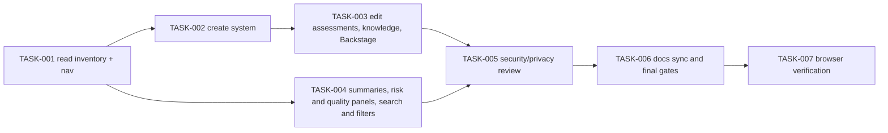

# Team system overview — Tasks

Specification: [SPEC.md](./SPEC.md)

## Status
Done: 6 of 7 implemented (TASK-001 to TASK-006). OQ-1 resolved 2026-11-05 (A-13, A-14). The 501-membership read cap is resolved (SPEC "Known limitations"). TASK-007 is **Partially verified**: read-only browser checks ran; data-dependent checks are not verified (see TASK-007). In Progress: 0. Not shipped to any environment with real personal data until the Firestore index check (SPEC "Known limitations" (b)) and the TASK-007 data-dependent checks are recorded. Verification record: [VERIFICATION.md](./VERIFICATION.md).

---

## Dependency graph

## Tasks

### TASK-001 — Team navigation and read-only system inventory

**Status:** Done
**Covers:** BR-1, BR-2, BR-3, BR-9, BR-10, BR-15, BR-17
**Depends on:** None

**Outcome**
`Systemoversikt` appears in team navigation. The route lists the team's authorized systems with qualitative assessments, attention, knowledge-risk band and Backstage link, or shows a meaningful empty, loading or error state.

**Implementation notes**
- Domain: `src/features/team-systems/domain/team-system.ts` (assessment values, bands, attention, Backstage validation).
- Server read: `src/features/team-systems/server/list-team-systems.ts`, using `authorizeTeamAccess` and the erasure-free read path.
- API: `GET /api/teams/[teamId]/systems`.
- Nav: `TeamRouteNav` gains the third destination.

**Verification**
- Domain unit tests; server read tests with in-memory store (cross-team isolation, forbidden, unauthenticated, invalid docs skipped, no identity fields in view); route tests; nav test.

**Security / privacy**
Read is team-scoped by `authorizeTeamAccess`; the view is built field by field (no spread of stored documents); no uid or audit field is exposed.

**Documentation impact**
`docs/DATA-MODEL.md` concept row added; `TeamRouteNav` test updated.

**Acceptance criteria**
- [ ] Nav shows Oversikt, Roadmap, Systemoversikt.
- [ ] Read refuses non-members and unauthenticated callers; returns only the team's systems.
- [ ] Relevant tests pass.
- [ ] No conflict with `docs/SECURITY.md`.
- [ ] Relevant documentation is updated.

---

### TASK-002 — Create a system

**Status:** Done — implemented and tested; OQ-1 resolved 2026-11-05 (A-13 and A-14 implemented)
**Covers:** BR-4, BR-7 (knowledge refs validated on create), BR-8
**Depends on:** TASK-001

**Outcome**
A genuine member on an active team can add a system with name, description and optional Backstage URL. Assessments start as `ikke_vurdert`.

**Implementation notes**
- Server write: `src/features/team-systems/server/write-team-system.ts` (`createTeamSystem`), transactional, with the erasure fence and membership read inside the transaction.
- API: `POST /api/teams/[teamId]/systems`.
- Client: add-system form (name, description, Backstage URL), in the page.

**Verification**
- Server tests: forbidden for non-member and admin non-member, team_disabled, invalid_request for unknown keys, invalid_input for bad URL/name, persisted record contains teamId from route and `ikke_vurdert` defaults, erasure refused.
- Route tests for status mapping.

**Security / privacy**
Membership and team status are re-read inside the write transaction; `teamId` from the route only; Backstage URL validated before persistence.

**Documentation impact**
None beyond SPEC.

**Acceptance criteria**
- [ ] Create succeeds only for genuine members on active teams.
- [ ] Invalid URL or name is rejected server-side.
- [ ] Relevant tests pass.
- [ ] No conflict with `docs/SECURITY.md`.

---

### TASK-003 — Edit assessments, knowledge associations and Backstage link

**Status:** Done — implemented and tested; OQ-1 resolved 2026-11-05 (A-13 and A-14 implemented)
**Covers:** BR-5, BR-6, BR-7, BR-8
**Depends on:** TASK-002

**Outcome**
A member can update a system's details, assessments with notes, knowledge associations (current memberships only) and Backstage link. Changed assessments record the time and assessor.

**Implementation notes**
- Server: `updateTeamSystem` in the same write module, transactional read-then-write, 50-association limit.
- API: `PATCH /api/teams/[teamId]/systems/[systemId]`.
- Client: edit form; knowledge selector from the team's assignable members (`memberRef` values).

**Verification**
- Server tests: traceability (changed vs unchanged assessment), cross-team `not_found`, invalid/duplicate/foreign knowledge refs rejected, uid never accepted as input, removed member ref not counted.
- Route tests.

**Security / privacy**
Membership identities are only `memberRef`; assessor uid is stored, not returned.

**Documentation impact**
None beyond SPEC.

**Acceptance criteria**
- [ ] Assessment changes are traceable; unchanged ones keep their metadata.
- [ ] Knowledge associations are validated against the team's current memberships.
- [ ] Relevant tests pass.
- [ ] No conflict with `docs/SECURITY.md`.

---

### TASK-004 — Summary cards, knowledge-risk and quality panels, search and filters

**Status:** Done
**Covers:** BR-11, BR-12, BR-13, BR-14, BR-16, BR-17
**Depends on:** TASK-001

**Outcome**
The page shows summary cards, the aggregate knowledge-risk panel, the quality explanation panel, search and filters, and responsive table/card presentation. Search and filters are client-side over the authorized list.

**Implementation notes**
- Aggregates computed in `src/features/team-systems/domain/team-system-summary.ts` from the loaded list; never persisted.
- Components: `SystemOverviewPage`, `SystemSummaryCards`, `KnowledgeRiskPanel`, `QualityPanel`, `SystemFilters`, `SystemTable` (≥ md) and `SystemCardList` (< md).

**Verification**
- Domain tests for counts and filtering; component tests for search/filter behavior, empty states, no-results state, and Backstage link attributes.

**Security / privacy**
Aggregates contain no names and no ranking.

**Documentation impact**
None beyond SPEC.

**Acceptance criteria**
- [ ] Counts match BR-11; the risk panel matches BR-12 and contains no names.
- [ ] Search and filters behave as BR-13.
- [ ] Relevant tests pass.

---

### TASK-005 — Security and privacy review

**Status:** Done — security/privacy review run 2026-11-05 on the erasure changes: no Critical, High or Medium findings; Low and review gaps recorded in VERIFICATION.md. The earlier erasure-coverage finding (OQ-1) is fixed.
**Covers:** Security and Privacy section of SPEC.md; all BR-2, BR-4 to BR-8
**Depends on:** TASK-003, TASK-004

**Outcome**
An independent reviewer (fresh subagent) checked cross-team access, unauthorized writes, member-association validation, query isolation, Backstage handling, sensitive metadata and regression risk. Confirmed findings are fixed and re-checked.

**Verification**
Recorded in the final report with the reviewer's findings and their resolution.

**Acceptance criteria**
- [ ] Review run; confirmed findings fixed or recorded.

---

### TASK-006 — Documentation synchronization and final quality gates

**Status:** Done — 2026-11-05: `pnpm test`, `pnpm typecheck`, `pnpm build` pass; `pnpm lint` has 0 errors and 3 warnings (see VERIFICATION.md). The account-erasure inventory guard passes.
**Covers:** Documentation impact of all tasks
**Depends on:** TASK-005

**Outcome**
SPEC, TASKS, DATA-MODEL, and the team-navigation docs agree with the implementation. `pnpm test`, `pnpm typecheck`, `pnpm lint`, `pnpm build` were run.

**Acceptance criteria**
- [ ] Docs synchronized.
- [ ] Final gates run and recorded (see final report).

---

### TASK-007 — Browser and visual verification

**Status:** Partially verified (read-only); data-dependent checks not verified
**Covers:** Visual verification against `docs/design/references/15-system-overview.png`; keyboard, focus, contrast, responsive widths 320/360/768/1024/1280, light and dark themes
**Depends on:** TASK-006

**Verified (ran 2026-11-05, read-only, `browser/team-systems-verify.spec.ts`)**
- Sign-in and the Systemoversikt route render; the nav shows three items and `aria-current="page"` on Systemoversikt.
- Empty state (the signed-in test team has no systems) at 320, 360, 768, 1024 and 1280 px, light and dark: no horizontal overflow, no axe WCAG 2 A/AA violations.
- Summary cards and the knowledge-risk and quality panels render at all five widths.
- Focus indicator on the Systemoversikt nav link.
- Fix made during this check: knowledge-risk tiles overflowed their box at 1280 px (the count fell outside the tile). Now a wrapping row; re-checked at 1280 px and 768 px.

**Not verified (not_verified)**
- Table and card list with real systems: needs systems in the team; creating them would write to shared data, which is forbidden.
- Search, filters, knowledge associations, Backstage links, create and edit forms, assessment editing: all need data or writes.
- Keyboard traversal of populated forms and table; reference image comparison for populated states.

**Harness note**
The first run used the dev server already on port 3000, whose routes returned 404 for this checkout. A fresh `next dev` on port 3001 served the current code. `browser/guards.ts` now accepts `DEVPULSE_VERIFY_BASE_URL` for localhost only.

**Acceptance criteria**
- [x] Empty-state layouts at 320 to 1280 px checked, light and dark: no overflow, no axe A/AA violations.
- [ ] Authenticated populated layouts (table and cards) checked. Not verified: no isolated fixture data.
- [ ] Keyboard navigation through populated forms, focus indicators and contrast checked. Not verified beyond the nav link.

---

## Round 2: seven-attribute model (corrective scope)

Specification: [SPEC.md, "Round 2"](./SPEC.md#round-2-seven-attribute-model-corrective-scope)

### TASK-008 — Domain model extension to seven attributes and legacy compatibility
**Status:** Done — implemented and tested (`pnpm test`, `pnpm typecheck`, `pnpm lint` 0 errors, `pnpm build` passed on 2026-11-05)
**Covers:** D-11, BR-18, BR-19
**Depends on:** TASK-003

**Outcome**
The domain, persistence parser, write path, gateway parser, form draft, copy and quality panel use the seven-attribute list. Legacy documents with three keys stay readable; missing new attributes read as `ikke_vurdert`.

**Implementation notes**
- `domain/team-system.ts`: `ASSESSMENT_ATTRIBUTES` (7), labels.
- `domain/team-system-record.ts`: absent key → `UNASSESSED`; malformed present key still skips the document.
- `server/write-team-system.ts`: loop over all seven; partial update keeps unspecified attributes.
- `client/team-systems-gateway.ts`: strict parse uses the shared list.

**Verification**
- `domain/team-system-record.test.ts`: legacy document preserves three values and metadata; four new attributes read as `ikke_vurdert`; malformed attribute and cross-team docs skipped; full seven-key document read.
- `domain/team-system.test.ts`: good-standing and attention rules over seven attributes.
- `components/TeamSystemsPage.test.tsx`: fixtures use seven keys.
- Run: vitest (team-systems, account-erasure, systems route) 623 passing; full `pnpm test` 9491 passed, 2 skipped.

**Acceptance criteria**
- [x] Seven attributes in the domain and API contract.
- [x] Legacy three-attribute records remain valid and preserve values.
- [x] Missing new attributes display as `ikke_vurdert`, never `god`.
- [x] Relevant tests pass; typecheck, lint (0 errors), build pass.

### TASK-009 — Compact seven-attribute matrix (desktop) — Implemented; visual check not_verified
**Covers:** Section 6 of the round-2 brief; reference 16. **Depends on:** TASK-008.
Implemented 2026-11-05: `SystemList.tsx` renders seven columns with one `AssessmentStatusIcon` per attribute (accessible name "Attribute: Status"), compact `<abbr>` headers, a compact Backstage icon action, risk badge and edit action. The stacked "Vurderinger" cell is removed. Search icon fixed in `SystemFilters.tsx` (icon is positioned against the input wrapper only). Tests: `SystemMatrix.test.tsx`. Not yet verified in a browser with populated data (see VERIFICATION.md).
Replace the vertically stacked "Vurderinger" cell with one compact indicator per attribute (icon + sr-only full name and status, e.g. "Pålitelighet: Kritisk"). Short headers with full names available. System name is a button/link to detail; no whole-row click target. Acceptance: semantic table, no color-only status, no page-level horizontal overflow at ≥ md.

### TASK-010 — Shared quality explanation dialog — Implemented; visual check not_verified
**Covers:** Section 7. **Depends on:** TASK-008.
Implemented 2026-11-05: `ExplanationDialog.tsx` (`role="dialog"`, `aria-modal`, Escape, Tab trap, focus return, scroll lock) with the shared "Forklaring" control above the matrix (all seven attributes and four statuses).
One "Forklaring" control above the table opening an accessible dialog (title, focus management, Escape, focus return, background inert). Explains all seven attributes and the four statuses; states assessments are team judgments.

### TASK-011 — System detail view — Ready
**Covers:** Section 8. **Depends on:** TASK-009.
Dedicated route or side panel showing name, description, attention state, all seven attributes with full status text, optional notes, last assessment date, Backstage link, knowledge associations, edit action when authorized. Missing data shows "Ikke vurdert"; no fabricated timestamps.

### TASK-012 — Progressive-disclosure create/edit form — Partially implemented
**Covers:** Section 9; reference 17. **Depends on:** TASK-008.
Implemented 2026-11-05: seven `AssessmentRow`s with chevron (`aria-expanded`, `aria-controls`), per-row info button (own dialog), short hint and compact status select; the note textarea appears only when expanded and values stay in the page draft. Remaining: Section A/C restyle to reference 17, "Lagre endringer" label (currently "Lagre system"), and a visual check.
Sections: system information; seven compact assessment rows with collapsible notes (entered notes preserved when collapsed); team competence. Saving without assessing every attribute must work.

### TASK-013 — Mobile system cards for seven attributes — Partially implemented
**Covers:** Section 10. **Depends on:** TASK-009, TASK-011.
Partially implemented 2026-11-05: cards show the seven attributes as a compact 7-column icon grid with abbreviated labels. Not verified at 320/360/768/1024/1280 px in either theme; the card detail action from TASK-011 is not built.
Cards below md show all seven attributes in a compact grid with text labels; verify 320, 360, 768, 1024, 1280 px in light and dark themes.

### TASK-014 — Summary cards and erasure regression for seven keys — Partially done
**Covers:** Sections 11, 14. **Depends on:** TASK-008.
Done: erasure covers `assessedBy` in all seven attribute maps (inventory, actor-audit adapter, sweep counter; closed target count 24); tests in `actor-audit-team-systems.test.ts` and `team-roadmap-actor-audit.test.ts`.
Remaining: summary tests for the seven-attribute `I god stand` rule (`team-system-summary.test.ts`).

### TASK-015 — Browser verification, accessibility and security/privacy review — Ready
**Covers:** Sections 15, 17, 19. **Depends on:** TASK-009 to TASK-014.
Playwright and axe checks against the actual page, using isolated fixtures only (no shared or production Firebase data). Any check that cannot run is recorded as not_verified. Independent security/privacy review of the round-2 changes.
