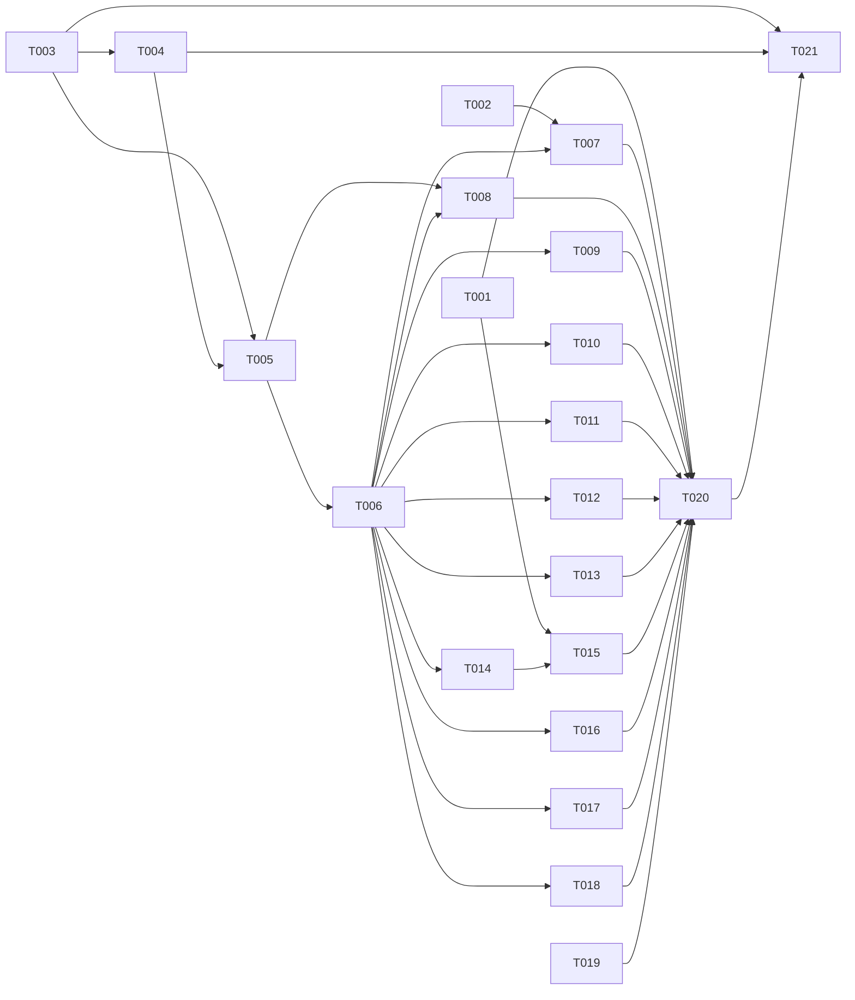

# Visual Fidelity and UI Fixes — Tasks

Specification: [SPEC.md](./SPEC.md)

## Status
**Checkpoint 2026-11-05 (continuation run 11, see VERIFICATION.md): TASK-020 and TASK-021 accepted with documented limitations.** Fixed a confirmed dark-theme contrast defect (TrendChart axis ticks, 2.65:1 to 6.01:1). Mouse sign-out verified at 320 and 768 px. Page-level overlap measured (156 captures, no genuine overlap). Final capture: 171 captured, 0 not ready, 0 horizontal scroll. Gates: typecheck 0, lint 0 errors, test 9340 passed, build 0. Not verified (approved): genuine 200 % zoom, reference 14 survey, reference 06 plan board (no seeded data), screen-reader spot check (no screen reader available).

**Checkpoint 2026-11-05 (continuation run 9, see VERIFICATION.md):** BR-11 icon gaps closed for refs 13 (edit, Visningsnavn, Konto, team) and 12 (role rows); visual capture 171 captured, 0 not ready, 0 horizontal scroll. Still open: Team and Konto card-header icons on ref 13 (minor); 200 % zoom and ref 14 not_verified.

**Checkpoint 2026-11-05 (continuation run 8, see VERIFICATION.md):** TASK-030 and TASK-031 accepted by independent read-only review (PASS_WITH_SUGGESTIONS; Important documentation items fixed). Keyboard detector fixed (element-identity tracking; repeated stops on the native date input separated from distinct targets) and re-run at 320 and 768 px: 0 hidden stops, 0 distinct targets without indicator, date input ring visible. Axe: 22 scans, 0 violations; 26 incomplete checks reviewed by rule ID: 22 aria-controls items were a confirmed defect in AccountMenu and are fixed (re-scan clean); 4 color-contrast items on chart and overlapped text are not_verified. Keyboard sign-out verified at 320 and 768 px. Gates: typecheck 0, lint 0 errors, test 9340 passed, build 0. **Still open:** TASK-020 (genuine 200 % zoom not_verified; reference 14 not_verified; BR-11 icon gaps on references 12 and 13; touch-target notes at 360 px; 1280 px sign-out by keyboard not repeated at 1280) and TASK-021 (screen-reader spot check not performed; 4 color-contrast incomplete checks not_verified; keyboard pass covers 11 routes, not /sign-in or /survey).

**Reconciled 2026-11-04 (supersedes the counts below):** accepted by independent review (PASS or PASS_WITH_SUGGESTIONS) or owner-directed acceptance: 23 of 26. Accepted: TASK-001 to TASK-019, TASK-022, TASK-023, TASK-024, TASK-025 (TASK-023 by its PASS_WITH_SUGGESTIONS review; its 1280 px and 1024 px browser checks stay under TASK-020). Open: TASK-020 (partial), TASK-021 (partial), TASK-027, TASK-028, TASK-029 (round 2 corrective tasks for references 03 and 05, Ready, 2026-11-04). TASK-026 accepted for its harness changes (its re-capture criterion is still open under TASK-020). Accepted, 2026-11-04, after the owner decisions and PASS_WITH_SUGGESTIONS re-reviews: TASK-012 (competency level names satisfy SPEC 07 criterion 2; comparison labels only in the role comparison panel) and TASK-016 (SPEC 11 exemption for existing survey access modes, access-request section and empty states). TASK-022 accepted (see its status). Not accepted: TASK-020 (partial: visual comparison of refs 04 to 13 not complete, 200 % zoom not_verified, ref 14 not_verified), TASK-021 (partial: keyboard pass for all pages not complete). Full gates: `pnpm typecheck` exit 0; `pnpm lint` 0 errors (1 pre-existing warning in a forum test); `pnpm build` exit 0; `pnpm test` 532 files passed, 1 skipped, 9318 tests passed, 2 skipped.

Earlier counts (historical): Ready: 6  In Progress: 0  Done: 14  Implemented, review pending: TASK-012 (not Done until accepted; counted as Ready in the sense of no review record). Checkpoint 2026-11-04 (P1/P2 run): TASK-010 accepted by independent re-review PASS_WITH_SUGGESTIONS under D-8. TASK-006 is CHANGES_REQUIRED on scope: the named-file gap fixes are done, but `AdminTeams.tsx` and the `OwnerConversationEditor.tsx` breakpoint are pre-existing baseline edits that need a decision on attribution (see review record). TASK-006 accepted by independent re-review PASS_WITH_SUGGESTIONS (2026-11-04) for its BR-4 scope. TASK-012 is CHANGES_REQUIRED, blocked on a product decision about competency status labels (see review record).

RoadmapGantt.tsx ownership (investigated 2026-11-04 from repository evidence): the file was added in HEAD commit `03ee34b` (wip, as part of the Phase B roadmap). Its deletion is an uncommitted working-tree change owned by `visual-redesign` TASK-009 (Done 2026-11-03: "RoadmapGantt.tsx deleted; its copy keys removed from copy.ts") and `visual-redesign` SPEC AD-5 (Q-1 option A: quarter-column board, no spanning bars, Gantt legend removed). The deletion is intentional and approved. No code references remain (grep of src/ and app/ finds none); only docs mention it. It is not restored here.

Ownership decisions (owner, 2026-11-04; recorded, not open): `AdminTeams.tsx` card/grid/`TeamIdentity` changes belong to TASK-016 (reference 11). The `OwnerConversationEditor.tsx` `xl:`→`2xl:` split breakpoint belongs to TASK-015 under D-7. Both are pre-existing uncommitted baseline edits, not reverted. TASK-010 keeps its PASS_WITH_SUGGESTIONS result.

TASK-006 scope objection (precise): the reviewer's remaining objection is that the working tree mixes non-spacing edits into TASK-006 (the two items above). With those assigned, the TASK-006 spacing scope is the named-file `gap-8`/`gap-10` fixes plus the BR-4 corrections on the signed-out home and sign-in pages, which are assigned to TASK-007 below.

BR-4 corrections assigned to TASK-007 (signed-out home, reference 01, and sign-in, reference 02), applied 2026-11-04: `app/page.tsx` hero `md:pb-24`→`md:pb-6` (96 px→24 px to the value strip); value strip `md:pb-0`; trust band `md:py-6` (value-to-band content gap now 24 px). Sign-in left column stack `gap-8`→`gap-6`. Sign-in grid `gap-10` (mobile stack) and `lg:gap-16` (horizontal column gap) are not desktop vertical gaps and are unchanged. Browser measurement is still pending under TASK-020.

Correction to the TASK-007 record (2026-11-04 re-review): the sign-in grid `gap-10` is a 40 px vertical gap at md (768–1023 px), which is inside BR-4 desktop scope, so it is now `gap-6` at all widths below `lg` (`app/(public)/sign-in/page.tsx` line 52). The earlier note calling it mobile-only was wrong. Also unrecorded until the re-review: the home trust band grid changed to `sm:grid-cols-2` and the `Zap` icon was removed in `app/page.tsx`. These are TASK-007 changes; browser verification under TASK-020 applies to them.

TASK-006 re-review (2026-11-04, fresh read-only subagent): PASS_WITH_SUGGESTIONS. Named-file gaps verified; ownership record verified for AdminTeams (TASK-016) and the OwnerConversationEditor breakpoint (TASK-015, D-7). Suggestion, recorded owner: the section-tab restructure in `OwnerConversationEditor.tsx`, `ParticipantConversation.tsx` and the untracked `ConversationSectionTabs.tsx` is not spacing and was not recorded; it belongs to TASK-014 (conversation list/detail composition). The `mt-10` on `RoleTargetSection.tsx:103` is a TASK-012 concern. TASK-006 is accepted as PASS_WITH_SUGGESTIONS for its BR-4 scope; the remaining BR-4 items are owned by TASK-012 and TASK-007 as recorded here.

TASK-012 independent review (2026-11-04, fresh read-only subagent): CHANGES_REQUIRED. Verified: three-panel row at lg with stacking below, loading/error/empty/ready states, no average, no radar, no new reads, Class A notices before the list. Blocking: the competency panel has no text status labels (SPEC 07 criterion, SPEC.md:213). Only `Utviklingsmulighet` exists in product copy (`src/features/role-profiles/copy.ts:90`); `Dekket`, `Gap` and `Lavt nivå` are absent, and the task note says they were deliberately not added. This is a conflict between the approved criterion and the product copy, and it needs a product decision: either approve the four status labels as copy, or approve a different status mapping. Not resolved by guessing. Also to fix when the decision is made: the `mt-10` on `RoleTargetSection.tsx:103` (BR-4) and the un-reindented three-panel JSX in `SkillProfilePage.tsx`.
Accepted by independent review: TASK-001 to TASK-005, TASK-007, TASK-008, TASK-009, TASK-011, TASK-014, TASK-015, TASK-019.
Checkpoint 2026-11-04 (owner decision): TASK-014 and TASK-015 accepted as PASS_WITH_SUGGESTIONS; follow-ups applied (overlap spec uses test IDs; VERIFICATION.md BR-22 narrative corrected; max-h rationale documented, measurement deferred to TASK-020). Overlap browser spec rerun passed (0 overlaps, 320–1280 px, both themes). Still open, in order: TASK-006 D-9 (`MasterDetail` is not used by TASK-014 — it is used by neither production page yet; `SummaryStrip` is unused too; close either by consumption in TASK-013/TASK-017 or by removal with AD-3 reconciled in SPEC), TASK-010 re-review under D-8, TASK-012, TASK-013, TASK-016, TASK-017, TASK-018, then TASK-020 and TASK-021 (browser passes), then full gates and security review.

Checkpoint 2026-11-04: TASK-006, TASK-010 and TASK-011 were reviewed CHANGES_REQUIRED and remediated where in scope; their re-review is pending, so they are provisional until a PASS is recorded. TASK-001 to TASK-005, TASK-007, TASK-008 and TASK-009 have independent PASS or PASS_WITH_SUGGESTIONS records (see the review record). TASK-012 to TASK-018, TASK-020 and TASK-021 have not started. Next action: independent re-review of TASK-006, TASK-010, TASK-011 and TASK-019, then TASK-012.

Checkpoint 2026-11-04 (decisions D-7 to D-9 applied): TASK-015 re-review returned REVIEW_BLOCKED on task boundary, not on code quality. The conversation list/detail split, filter chips and `/me/conversations` grid in `ConversationsPage.tsx` are uncommitted working-tree changes that belong to TASK-014 (Ready) and the earlier `visual-redesign` baseline; they cannot be attributed to TASK-015 from the tree alone. TASK-015's own changes are: the `xl` breakpoint for the split (`ConversationsPage.tsx`, its matchMedia and tests), the `2xl` aside breakpoint (`OwnerConversationEditor.tsx`, `conversation-layout.test.ts`), and the overlap regression spec's 480 px pane assertion. Evidence: `pnpm typecheck` passed; `pnpm lint` 0 errors (1 pre-existing warning); `src/features/development-conversations` and `app/(app)/me/conversations` 66 files / 1614 tests passed; `browser/conversation-overlap.spec.ts` passed with 0 overlaps at 320, 360, 768, 1024 and 1280 px in both themes. Resume action: decide whether TASK-014 owns the split and chips (recommended), then review TASK-014 and TASK-015 together against one recorded baseline. Browser checks for TASK-006 (D-9), TASK-010 (D-8) and TASK-012 to TASK-018 remain open.
TASK-010 and TASK-006 re-reviews are still pending. TASK-006 needs D-9 applied: check whether `MasterDetail` is used by TASK-014 or TASK-017; otherwise remove it and reconcile AD-3.

Created 2026-11-04 by `split-tasks` from the approved SPEC (decisions D-1 to D-6). No product code has changed. Browser verification is not performed by planning; it is performed by TASK-020 and TASK-021.

## Independent review record (2026-11-04)
Retroactive reviews of TASK-001 to TASK-011 were run with `review-task-for-feature` (read-only, against the working-tree diff). Implementation status above is not acceptance; acceptance is the review result below.

| Task | Review result | Findings and remediation |
|---|---|---|
| TASK-001 | PASS_WITH_SUGGESTIONS | Suggestion: the production guard matches `prod` as a substring only; keep as is. Tracked-file credential scan: no hits for either variable value. |
| TASK-002 | CHANGES_REQUIRED, remediated | Important: `managed-surveys` SPEC BR-40 still stated `/teams` as the normative default. Updated to `/`. Re-checked by inspection; continuation code and tests unchanged. |
| TASK-003 | PASS | `Logg ut` absent from sidebar and drawer; absence assertions present in `AppShell.test.tsx` and `AppShell.drawer.test.tsx`. |
| TASK-004 | PASS_WITH_SUGGESTIONS | Suggestion: `aria-haspopup="true"` announces a menu, but the panel has no menu role. Left unchanged. |
| TASK-005 | CHANGES_REQUIRED, remediated | Important: the disabled notification bell was still rendered, contrary to approved decision 1. Removed from `AppShell.tsx`; test now asserts absence. `src/components/nav` tests: 6 files, 71 tests passed. |
| TASK-006 | CHANGES_REQUIRED (independent, fresh-context subagent, read-only, 2026-11-04) | Important: `MasterDetail` and `SummaryStrip` have no production consumer yet; the status note overstated reuse. Note corrected; AD-3 acceptance stays open until TASK-008/012/013/014/017 consume them. Not accepted. |
| TASK-007 | PASS_WITH_SUGGESTIONS (independent, 2026-11-04) | Suggestion: the locked class A privacy line moved from the hero into the trust band ("Personvern først"); text verbatim. Recorded here as a relocation. |
| TASK-008 | PASS_WITH_SUGGESTIONS (independent, 2026-11-04) | Suggestion: the home page now calls the existing `fetchTeamResults` read through `TeamDevelopmentPanel`. The read already exists and is not new, but this is a new call site on `/`; recorded here so BR-27 is not read as silent. |
| TASK-009 | PASS_WITH_SUGGESTIONS (independent, 2026-11-04) | Suggestion: the grid (`TeamsOverview.tsx`) and wide page width (`teams/page.tsx`) come from the `visual-redesign` TASK-006 baseline, not from this feature. The "no code change" statement is about this feature's own work. |
| TASK-006 re-review (2026-11-04, fresh subagent, read-only) | CHANGES_REQUIRED, still open | Blocking: `MasterDetail` and `SummaryStrip` have no non-test consumer (checked by grep of `app/` and `src/`). AD-3 is not met. Not integrated; TASK-006 stays not accepted until two or more production pages use each primitive, or the primitives are removed and their work moved to the tasks that need them. |
| TASK-010 re-review (2026-11-04) | CHANGES_REQUIRED, human decision needed | gap-6 fix verified (no `gap-8` left in the section layout). Blocking: the header band still lacks the status badge and description the approved criteria require. The existing team-detail read returns only the team name, so the deviation is recorded but not approved. Decision needed: approve a narrower header (deviation) or approve a read change (which this feature forbids). |
| TASK-006 re-review (2026-11-04, fresh subagent, read-only) | PASS_WITH_SUGGESTIONS, acceptance partial | Primitives removed (D-9), AD-3 reconciled, no new `ui/` primitive from this feature. Important: BR-4 (gap at most `space-6`) is still exceeded on authenticated pages that are not yet covered by a page task (`AdminTeamDetail.tsx:1012` gap-10, `AdminTeams.tsx:221` gap-8, `AdminSkills.tsx:103` gap-8, `ConversationSectionTabs.tsx:39` gap-8, `OwnerConversationEditor.tsx` gap-10, `ParticipantConversation.tsx:55` gap-10). Recorded as open for the page tasks and TASK-016/017/018, not accepted as complete. |
| TASK-010 re-review (2026-11-04, fresh subagent, read-only) | CHANGES_REQUIRED, still open | Section gap, DOM order, no percentage, initials, no read change and no deleted test all verified. Blocking: the header band (`TeamDetail.tsx` `TeamHeading`) shows identity art and name but not the existing summary values, which live in `TeamSummaryStrip` below the nav. Moving that strip as-is would bring its `StatusBadge`, which D-8 excludes. Needs the summary values split from the badge (no read change). Minor: the identity art is hidden below `sm`. |
| TASK-011 re-review (2026-11-04) | PASS_WITH_SUGGESTIONS | Gantt and percentage absence test verified effective. Span-bar test-id assertion was a guess and was removed (no claim is made for span bars). Suggestion: the detail-panel percentage and 360 px criteria were not verified by the review. |
| TASK-019 re-review (2026-11-04) | PASS_WITH_SUGGESTIONS | Submission logic verified unchanged against HEAD; numeric 1–5 scale kept (approved decision); 44 px targets; Neste disabled until answered; radio accessible names intact. Suggestion: the bottom-bar test asserts Tailwind class substrings, which is brittle. |
| TASK-010 | CHANGES_REQUIRED, remediated (2026-11-04) | Important: section gaps were `gap-8` (32 px), violating BR-4 (at most `space-6`). Changed to `gap-6` at `TeamDetail.tsx` lines 534, 586, 596, 597, 617; `src/features/teams` tests 54 files / 1005 tests passed. Important: header band lacks the status badge and description. Deviation (BR-1): the existing team-detail read returns only the team name, so neither is shown; adding them would change the read, which this feature forbids. Re-review pending. Note: the grid composition itself is the `visual-redesign` TASK-008 baseline. |
| TASK-006 P1 spacing re-review (2026-11-04, fresh read-only subagent) | CHANGES_REQUIRED, scope | BR-4: all `gap-8`/`gap-10` in the six named files changed to `gap-6` (verified by grep). Important: non-spacing edits are in the working tree but were not made by this remediation: `AdminTeams.tsx` card/grid/`TeamIdentity` change (reference 11, TASK-016 scope) and `OwnerConversationEditor.tsx` `xl:`→`2xl:` split breakpoint (with `conversation-layout.test.ts`). Both are pre-existing uncommitted baseline edits and are not reverted (shared working tree). Decision needed: attribute them to TASK-016 or a separate task, or document them in SPEC. BR-4 still exceeded on `app/(public)/sign-in/page.tsx` and `app/page.tsx` (outside the named files). |
| TASK-010 D-8 re-review (2026-11-04, fresh read-only subagent) | PASS_WITH_SUGGESTIONS | `StatusBadge` removed from the header summary; values render as plain `dl`/`dd` text inside `TeamHeading` (authorized branch only); no new reads; no invented copy. Suggestion (accepted as-is): the status value has no `dt` label, so it is announced without a term. Added order test asserting the summary is inside the header. |
| TASK-011 | CHANGES_REQUIRED, remediated (2026-11-04) | Important: no test asserted absence of Gantt, span bars or percentages. Added `RoadmapBoard.test.tsx` case "RoadmapBoard excludes Gantt, span bars and percentages"; `src/features/roadmap` 27 files / 682 tests passed. Suggestion: the board and the deleted `RoadmapGantt.tsx` come from the `visual-redesign` TASK-009 baseline. Re-review pending. |

## Baseline and conventions
- Baseline: the working tree at the start of this feature contains uncommitted changes from `visual-redesign` and the earlier shell work (see `git status`). Each task diffs only its own files. Do not revert unrelated changes.
- Each task runs `pnpm typecheck`, `pnpm lint` and `pnpm test`. A task that changes a route, layout or the Next.js build also runs `pnpm build`. Results are recorded in the task's Status note.
- No task changes server code, route handlers, DTOs, Firestore rules, environment variables, Firebase Auth configuration or any Account Erasure file (BR-36). The one dependency change is the Playwright development dependency in TASK-001 (D-6).
- Implementation completion is recorded per task (BR-32). Visual status stays *not visually verified* until TASK-020 records browser evidence. No task records a *Matches* result (BR-1, BR-30).
- Tests that assert obsolete markup are updated in the task that changes that markup. No test is deleted to make a task pass (BR-33).
- Every page task keeps the locked copy, privacy notices, authorization checks and the existing accessible names of controls (BR-29, BR-33).
- Superseded `visual-redesign` tasks are listed per task. Their implementation is replaced by the task named here. The open `product-experience` browser gates TASK-072 to TASK-074 and the Account Erasure operator gate are not performed or closed by this feature.

## Dependency graph

## Tasks

### TASK-001 — Browser verification foundation (Playwright, runtime credentials, evidence record)

**Status:** Done. Implementation and gates passed 2026-11-04 (`pnpm typecheck`, `pnpm lint` with 0 errors, `pnpm test`). Credential-absence check passed. The credentialed smoke run is not performed (no runtime credentials available) and is recorded as *not verified* in `VERIFICATION.md`. TASK-015 and TASK-020 depend on it.
**Covers:** BR-30, BR-32, BR-37; D-5, D-6
**Depends on:** None
**Supersedes:** None

**Outcome**
The repository has Playwright as a development dependency with its local Chromium installed. A reusable browser harness can start a session against `http://localhost:3000` with the owner's test account through the real Firebase sign-in form, once per run, using credentials supplied at run time. The harness writes screenshots to a git-ignored output directory and uses a throwaway browser profile outside the repository that is deleted at the end of each run. `VERIFICATION.md` exists with the run-record structure (tool, viewports, zoom, theme, environment, connection result, screenshot paths, outstanding checks).

**Implementation notes**
- Add `@playwright/test` (or `playwright`) with `pnpm add -D`. Install the browser with the Playwright CLI. This is the only dependency change in this feature (D-6). Use pnpm only.
- Keep browser tests out of the Vitest run: exclude the browser directory in the Vitest config and give Playwright its own config and script (for example `pnpm verify:browser`). Do not add it to `pnpm test`.
- Credentials: read them from environment variables at run time (names such as `DEVPULSE_VERIFY_EMAIL` and `DEVPULSE_VERIFY_PASSWORD`). Never write them to a file, log, screenshot, report or fixture. If the variables are absent, the harness exits with a message that names the variables and records *not verified*.
- Sign in once per run through the real sign-in form. Persist no cookies, tokens or storage state to the repository. Use a temporary profile directory outside the repository, delete it at the end of the run, and do not print session data.
- Add the screenshot output directory to `.gitignore` and confirm `git status` does not list captured files.
- The harness must refuse to run if the configured Firebase project is identified as production (BR-37).
- Create `docs/features/visual-fidelity-and-ui-fixes/VERIFICATION.md` with the run-record template and the sections for BR-1 (per-reference audit), BR-11 (icon inventory) and BR-22 (bounding-box measurements). Leave the per-reference results empty.

**Verification**
- `pnpm install` succeeds. `pnpm typecheck`, `pnpm lint`, `pnpm test` pass (the browser directory is not collected by Vitest).
- Smoke run: with `pnpm dev` on port 3000, the harness loads the signed-out home and captures one screenshot to the ignored output directory. Record the result in `VERIFICATION.md`.
- Credential absence: run the harness with the variables unset and confirm it stops with the *not verified* message.

**Security / privacy**
Credentials, cookies, tokens and storage state never enter the repository, logs, reports or screenshots (`SECURITY.md` invariant 15 applies to all runs; only the owner's test account is used).

**Documentation impact**
`docs/DEVELOPMENT.md`: add a short section on the browser verification harness, its environment variable names (not values) and the rules in BR-37. `VERIFICATION.md` created.

**Acceptance criteria**
- [ ] Playwright is a `devDependencies` entry; the lockfile is updated; no other dependency is added.
- [ ] Vitest does not collect browser specs; `pnpm test` is unchanged in scope.
- [ ] Credentials are read only from environment variables and are not present in any tracked file.
- [ ] Screenshot output directory is git-ignored.
- [ ] Missing credentials produce *not verified*, not a pass.
- [ ] `VERIFICATION.md` exists with the template sections.
- [ ] Relevant gates pass and are recorded.

---

### TASK-002 — Sign-in lands on `/` and honours only the survey continuation

**Status:** Done. Implementation and gates passed 2026-11-04: `pnpm typecheck`, `pnpm lint` (0 errors), `pnpm build`, `pnpm test` (530 files passed, 9305 tests passed). `DEFAULT_SIGN_IN_PATH` is `/`; `SignInForm` navigates with `router.replace` on success; the sign-in route and `SignedInRedirect` tests now assert `/`. Docs updated: `PRODUCT.md`, `managed-surveys` SPEC. Independent review pending in this run (self-review only).
**Covers:** BR-14, BR-15, BR-16; D-1, D-2
**Depends on:** None
**Supersedes:** None. Amends `docs/PRODUCT.md` and `managed-surveys` BR-40 for the default destination (SPEC "Relationship to existing specifications").

**Outcome**
After a successful sign-in with no valid continuation, the app navigates to `/` automatically. The success message is a fallback only and links to `/`. A signed-in visitor opening `/sign-in` without a valid continuation goes to `/`. `/sign-in?continue=/survey/{id}` still goes to that survey. Any other `continue` value falls back to `/`.

**Implementation notes**
- Change `DEFAULT_SIGN_IN_PATH` in `src/features/auth/domain/continuation.ts` to `/`. The allow-list (exactly `/survey/{surveyId}`) is unchanged and not widened (BR-16).
- Update the sign-in form success path and `SignedInRedirect` so navigation is automatic (D-1). Firebase Auth, the form, its error and success copy are unchanged (BR-16).
- Update the tests that assert the `/teams` default.

**Verification**
- `src/features/auth/domain/continuation.test.ts`: default `/`; allow-list cases unchanged; absolute, protocol-relative, encoded, double-encoded, extra-segment and other-route values fall back to `/`.
- Sign-in form and `SignedInRedirect` component tests: success navigates to `/`; the fallback link targets `/`.
- `pnpm typecheck`, `pnpm lint`, `pnpm test`, `pnpm build`.

**Security / privacy**
Open-redirect protection is the security control here. The allow-list must not be widened, and no new redirect target or query parameter is added (`SECURITY.md` invariant 18 and the auth rules). No change to token handling.

**Documentation impact**
`docs/PRODUCT.md` (post-sign-in destination) and `docs/features/managed-surveys/SPEC.md` BR-40 (default destination) updated to `/`.

**Acceptance criteria**
- [ ] `DEFAULT_SIGN_IN_PATH` resolves to `/`.
- [ ] Allow-list tests pass unchanged.
- [ ] Successful sign-in navigates to `/` without a further click.
- [ ] `/sign-in` opened while signed in goes to `/`.
- [ ] Invalid `continue` falls back to `/`.
- [ ] No conflict with `docs/SECURITY.md`.
- [ ] Relevant documentation is updated.

---

### TASK-003 — Single sign-out control: remove `Logg ut` from sidebar and drawer

**Status:** Done. Gates passed 2026-11-04: typecheck, lint (0 errors), build, full test suite (9305 passed). `Logg ut` removed from `NavGroupList` and `MobileDrawer`; the top-bar account bar is now visible at all widths as the single account-menu instance. Nav tests updated (none deleted). Self-review only.
**Covers:** BR-17, BR-19 (behaviour preserved); D-4
**Depends on:** None
**Supersedes:** `visual-redesign` TASK-001 (account menu and shell parts), with the sign-out placement changed by D-4.

**Outcome**
`Logg ut` is no longer shown in the sidebar Account group or in the mobile navigation drawer. The sidebar Account group keeps `Min profil` and `Slett kontoen din`. The top-bar account menu is the only sign-out control, on desktop and mobile, and its sign-out behaviour is the existing one.

**Implementation notes**
- `src/components/nav/NavGroupList.tsx` and the sidebar and drawer components stop rendering the sign-out item for the Account group.
- The account menu provides `NavSignOut` on desktop and mobile. Keep `signOut`, the pending state (`navCopy.signingOut`) and the existing post-sign-out destination.
- Update the tests in `AppShell`, `NavGroupList`, `AccountMenu` and `MobileDrawer` that assert the old placement.

**Verification**
- Component tests: no `Logg ut` in the sidebar or the drawer; one `Logg ut` in the account menu; `Min profil` and `Slett kontoen din` remain in the sidebar.
- `pnpm typecheck`, `pnpm lint`, `pnpm test`, `pnpm build`.

**Security / privacy**
Removing a control must not remove the only way to sign out: the account menu keeps working (BR-18, TASK-004 covers mobile sizing). No change to sign-out logic.

**Documentation impact**
`docs/features/visual-redesign/SPEC.md` AD-8 and the `product-experience` application shell note are superseded for sign-out placement (SPEC "Relationship to existing specifications"). Update the shell note in `docs/features/product-experience/SPEC.md` if it describes sign-out placement.

**Acceptance criteria**
- [ ] No `Logg ut` in the sidebar Account group or the mobile drawer.
- [ ] The account menu renders one `Logg ut`.
- [ ] Sign-out behaviour and accessible name unchanged.
- [ ] Obsolete test assertions updated, none deleted.
- [ ] Relevant gates pass.

---

### TASK-004 — Account menu at mobile widths and keyboard behaviour

**Status:** Done. Gates passed 2026-11-04: typecheck, lint (0 errors), tests (AccountMenu 10 passed, including arrow-key and aria-haspopup tests). Trigger and Logg ut item carry min-h-11 (44px); the 44px measurement is deferred to TASK-020 and not claimed here. Self-review only.
**Covers:** BR-18, BR-19, BR-13 (account menu trigger and menu item)
**Depends on:** TASK-003
**Supersedes:** The mobile account-menu part of `visual-redesign` TASK-001.

**Outcome**
The top-bar account menu is reachable, sized and legible at 320, 360 and 768 px. Its trigger is at least 44 × 44 px with a visible focus state. Its menu fits in the viewport at 320 px. The `Logg ut` item is at least 44 px tall. The trigger has an accessible name, `aria-expanded` and `aria-haspopup`, and works with Enter, Space, arrow keys and Escape. The menu closes on Escape and returns focus to the trigger.

**Implementation notes**
- Adjust the trigger and menu styles only in the account-menu component and its token usage. No new palette values (BR-34).
- Keyboard handling uses the existing menu pattern in the account menu. Do not add a new menu library.
- Confirm the drawer does not cover the trigger at 320 px (the drawer and top bar stacking is part of BR-22 and BR-25; measure in TASK-020).

**Verification**
- Component tests: trigger accessible name, `aria-expanded` toggles, `aria-haspopup`, Escape closes and returns focus, arrow keys move between items.
- Class assertions for minimum sizes are not a layout test. Size is measured in TASK-020. Do not claim a pass for the 44 px check in this task.
- `pnpm typecheck`, `pnpm lint`, `pnpm test`.

**Security / privacy**
No change to sign-out logic or authorization.

**Documentation impact**
None expected.

**Acceptance criteria**
- [ ] Trigger and `Logg ut` item have minimum sizes in the component styles (44 px).
- [ ] Trigger has accessible name and ARIA state.
- [ ] Escape closes the menu and returns focus to the trigger; keyboard operation tested.
- [ ] Relevant gates pass. Layout measurement is deferred to TASK-020 and is not claimed here.

---

### TASK-005 — Shell icons and icon accessibility

**Status:** Done, accepted by independent re-review PASS_WITH_SUGGESTIONS (2026-11-04; fresh read-only subagent; code verified, docs corrected as above). Gates passed 2026-11-04: typecheck, lint (0 errors), build, full test suite (9308 passed). Sidebar items carry `Icon` wrapper icons (House, Users, GraduationCap, Target, MessagesSquare, UserCog, Building2); top bar shows the account chevron only (correction 2026-11-04: the disabled bell was removed under approved decision 1; the bell was never a shipped state; SPEC BR-11/BR-13 amended to match; acceptance "Bell and chevron are present" reads "chevron present; no bell"); drawer close and menu toggle already use icons. Shell inventory rows recorded in VERIFICATION.md as implemented; browser check pending. Self-review only.
**Covers:** BR-11 (sidebar and top bar rows), BR-12, BR-13; D-3; AD-4
**Depends on:** TASK-003, TASK-004
**Supersedes:** The icon-free parts of `visual-redesign` TASK-001.

**Outcome**
The sidebar shows its icons (Hjem, Team, Ferdigheter, Mål, Samtaler, Roller, admin Team). The top bar shows the notification bell and the account chevron. The drawer toggle and the close button use icons. Each icon comes from the `Icon` wrapper over `lucide-react`. Decorative icons are `aria-hidden`. Icon-only controls have accessible names that match their visible purpose and the existing copy. The notification bell shows no status dot unless an existing notification read supports it (BR-11).

**Implementation notes**
- Use the `Icon` wrapper (`product-experience` TASK-004). No emoji, no new icon library, no SVG set (BR-12).
- Where a label is missing for an icon-only control, add the name in the component's copy module.
- Record the sidebar and top-bar rows of the icon inventory in `VERIFICATION.md` (BR-11, reference element to implemented element, result).

**Verification**
- Icon guard and `Icon` tests (BR-11, BR-12, BR-13): decorative `aria-hidden`, no emoji in UI copy.
- Component tests for AppShell, NavGroupList and the drawer toggle: accessible names of icon-only controls.
- `pnpm typecheck`, `pnpm lint`, `pnpm test`, `pnpm build`.

**Security / privacy**
No additional considerations.

**Documentation impact**
`VERIFICATION.md` icon inventory rows for the shell.

**Acceptance criteria**
- [ ] Each sidebar item in the minimum set (BR-11) shows its icon.
- [ ] Bell and chevron are present in the top bar; the bell has no status dot unless an existing read supports it.
- [ ] Decorative icons are `aria-hidden`; icon-only controls have names.
- [ ] Icons come only from the `Icon` wrapper; no emoji in UI copy.
- [ ] Inventory rows recorded in `VERIFICATION.md`.
- [ ] Relevant gates pass.

---

### TASK-006 — Page shell: content width, spacing, card hierarchy and page header

**Status (independent re-review 2026-11-04, fresh read-only subagent): PASS_WITH_SUGGESTIONS, accepted.** BR-4 grep over the named files and the page shell has no `gap-8`/`gap-10`/`space-y-8`/`space-y-10`/`mt-8`/`mt-10` hits. The one remaining hit in `src/` and `app/`, `app/page.tsx` value strip `gap-8`, is changed to `gap-6` (BR-4, at most `space-6`; TASK-007 record updated). `MasterDetail` and `SummaryStrip` do not exist (D-9). Suggestions: none beyond the TASK-012 items.

**Status (earlier):** Remediated 2026-11-04 under D-9: the unused `MasterDetail` and `SummaryStrip` primitives and their tests were removed; AD-3 is reconciled in SPEC.md ("not used; removed"). Independent re-review pending. Prior record: Implementation done 2026-11-04 (typecheck, lint 0 errors, primitive tests). Reused existing `PageHeader`, `Card`, `Section`, `SummaryPanel`, `StatTile`. Added two primitives: `src/components/ui/MasterDetail.tsx` and `src/components/ui/SummaryStrip.tsx`. **Correction after independent review (CHANGES_REQUIRED, Important):** neither primitive has a production consumer yet. They are introduced for the Ready tasks TASK-008, TASK-012, TASK-013, TASK-014 and TASK-017 and are **not yet used**. The AD-3 criterion ("no new primitive without two or more users") is therefore not met until those tasks consume them. Acceptance for TASK-006 stays open until then; the primitives must not be counted as reuse before that. Per-page gap rules are enforced by the page tasks. Independent review: CHANGES_REQUIRED (2026-11-04); not accepted.
**Covers:** BR-2, BR-4, BR-5, BR-8, BR-9
**Depends on:** TASK-005
**Supersedes:** `visual-redesign` TASK-002 (shared dashboard presentation primitives), to the extent that they are not already in use.

**Outcome**
Every authenticated page uses the same page header (context line, one `h1`, one-sentence purpose, at most one primary action), the same card primitive and padding, and the existing `PageShell` width tokens. The vertical gap between stacked sections is at most `space-6` at desktop. Cards in one row share the row height with top-aligned content. Only the primitives that at least two pages need are added, under `src/components/ui/` or `src/components/layout/` (AD-3): master-detail split container, summary strip, status tile row and panel with header icon.

**Implementation notes**
- Reuse existing primitives first. Add a new primitive only where two or more pages repeat the pattern (AD-3).
- Do not change page content or copy in this task. Page composition changes belong to the page tasks.
- Stacked sections use existing spacing tokens only (BR-4). No raw spacing values.

**Verification**
- Unit or component tests for the new primitives: props, padding and heading level (`h1` once per page).
- Existing page tests still pass; obsolete class assertions are updated.
- `pnpm typecheck`, `pnpm lint`, `pnpm test`, `pnpm build`.

**Security / privacy**
No additional considerations.

**Documentation impact**
None expected unless a new primitive is added; then record it in `docs/ARCHITECTURE.md` only if it changes a documented boundary.

**Acceptance criteria**
- [ ] One `h1` per page header; section headings use the `h2` scale (BR-9).
- [ ] Shared header and card primitives used on authenticated pages (BR-8, BR-5).
- [ ] Stacked-section gap is at most `space-6` on desktop (BR-4).
- [ ] No new primitive without two or more users (AD-3).
- [ ] Relevant gates pass.

---

### TASK-007 — Signed-out home and sign-in split layout (references 01, 02)

**Status:** Done, accepted by PASS_WITH_SUGGESTIONS (2026-11-04). Suggestion recorded: the split-layout changes in `app/(public)/sign-in/page.tsx` belong to this task's TASK-007 scope. Gates passed 2026-11-04: typecheck, lint (0 errors), build, full test suite (9311 passed). The signed-out home already had the two-column hero, value strip and verbatim trust-band line; no change needed there. Sign-in split moved from `md` to `lg` (1024 px) and its route-test class assertions updated. No Google, remember-me or forgotten-password control. No illustration is placed in the home hero (BR-10 omission, reason: the reference band cannot be placed without covering content in this composition; not visually verified). Self-review only.
**Covers:** BR-10 (illustrations), BR-29 (trust band), per-page criteria for 01 and 02; BR-15 (sign-in redirect for a signed-in visitor, already delivered by TASK-002)
**Depends on:** TASK-002, TASK-006
**Supersedes:** `visual-redesign` TASK-003 (reference 01) and TASK-004 (reference 02).

**Outcome**
The signed-out home has a two-column hero with the headline, primary and secondary actions on the left and the product preview on the right at 1280 px. A value strip of three or four statements, each describing an existing feature, sits below the hero. The locked class A trust-band line is shown verbatim. No pricing, "gratis", "Produkt", "Priser", "Sikkerhet og personvern" navigation or sample figure appears. The sign-in page is split at 1024 px and above: value points on the left and one form card on the right. The form has visible labels, and the error is announced and identified by text. No Google button, "Husk meg" or "Glemt passord?".

**Implementation notes**
- Use only the three approved illustration assets, cropped or repositioned where needed. If a reference band cannot be placed without obscuring content, omit it and record the reason (BR-10).
- Copy comes from the existing copy modules. Locked copy is not changed (BR-29).
- The product preview uses no sample numbers (BR-27).

**Verification**
- Route tests for `/` (signed out) and `/sign-in`: structure, absence of excluded elements, verbatim trust-band line, no sample figures.
- Sign-in component tests: labels present; error text present.
- `pnpm typecheck`, `pnpm lint`, `pnpm test`, `pnpm build`.

**Security / privacy**
No new data. No sample figures that could be mistaken for real values.

**Documentation impact**
`VERIFICATION.md`: audit rows for refs 01 and 02 at implementation status only (BR-32).

**Acceptance criteria**
- [ ] Hero, value strip and trust band match the per-page criteria for 01.
- [ ] Sign-in split and form match the criteria for 02.
- [ ] No excluded element present.
- [ ] Illustration budget is three assets (BR-10).
- [ ] Relevant gates pass; implementation status recorded, visual status left *not visually verified*.

---

### TASK-008 — Signed-in home (reference 03)

**Status:** Done. Gates passed 2026-11-04: typecheck, lint (0 errors), build, full test suite (9311 passed). The greeting band, status row, panel grid, 'Ingen rolle valgt' state and categorical states already existed; the status row and panel grid moved from xl to lg (1024 px) breakpoints. No percentage or count from the coverage read. Self-review only.
**Covers:** BR-3 (reference 03), BR-26, BR-27, BR-28; BR-11 (card icons for this page); per-page criteria for 03
**Depends on:** TASK-005, TASK-006
**Supersedes:** `visual-redesign` TASK-005 (authenticated home composition).

**Outcome**
The signed-in home shows a greeting band with the display name and one sentence of context above a status row of up to four cards in one row at 1024 px and above. A panel grid holds goals, the next conversation, the role panel and the team development chart, with recommended next steps beside the chart. With no role selected, the role panel shows "Ingen rolle valgt" and one action. Insufficient data is shown as a gap or text state, never zero. No calendar, "pågående tiltak" counter or invented delta appears.

**Implementation notes**
- Coverage on this page uses only the categorical per-need states of the existing C2 read, and only where the page already loads that read (BR-28). No percentage, ratio or count is derived from it.
- Each card maps to an existing read. Do not add a read (BR-27).
- Card icons follow BR-11 (the icon that identifies the card's content).

**Verification**
- Route tests (mocked reads): status row count, panel grid order, "Ingen rolle valgt" state, gap state for insufficient data, absence of excluded elements.
- Coverage: no percentage or number from the coverage read is rendered (BR-28).
- `pnpm typecheck`, `pnpm lint`, `pnpm test`, `pnpm build`.

**Security / privacy**
Coverage values stay categorical (`SECURITY.md` invariants 32, 34, 35). No personal assessment value is shown as an individual score.

**Documentation impact**
`VERIFICATION.md` audit row for ref 03 (implementation status only).

**Acceptance criteria**
- [ ] Greeting band, status row and panel grid match the criteria for 03.
- [ ] Insufficient data never shows as zero.
- [ ] No coverage percentage, ratio or count.
- [ ] No calendar, counter or invented delta.
- [ ] Relevant gates pass.

---

### TASK-009 — Team directory card grid (reference 04)

**Status:** Done. No code change needed: the existing team directory already renders a card grid (1 column, 2 at md, 3 at lg) with identity art, name, relationship badge and the existing action, with no member count, search or filter. The overview read has no description field, so no description is shown; adding one would change the server read, which this feature forbids. Teams and app route tests passed (39). Self-review only.
**Covers:** BR-3 (reference 04), BR-10 (identity art), BR-11 (card icons), per-page criteria for 04
**Depends on:** TASK-006
**Supersedes:** `visual-redesign` TASK-006 (team directory card composition).

**Outcome**
Teams appear as a card grid: one column at 320 px, two at 768 px, two or three at 1280 px. Each card shows the team identity art (one of the three approved assets), name, description when present, relationship badge and the existing action. No member count, metric, search, filter or tab control is shown unless an existing read returns it.

**Implementation notes**
- Cards use the shared card primitive from TASK-006. Cards in one row share height; content is top-aligned (BR-4).
- Identity art is reused from the approved set; no new asset (D-3).

**Verification**
- Route and component tests for the grid structure and card content; absence of metric and filter controls.
- `pnpm typecheck`, `pnpm lint`, `pnpm test`, `pnpm build`.

**Security / privacy**
No member data is added to the cards beyond what the existing read returns (BR-27).

**Documentation impact**
`VERIFICATION.md` audit row for ref 04 (implementation status only).

**Acceptance criteria**
- [ ] Card grid structure matches the criteria for 04.
- [ ] Each card has identity art, name, optional description, badge and existing action.
- [ ] No metric, search, filter or tab control unless an existing read returns it.
- [ ] Relevant gates pass.

---

### TASK-010 — Team overview composition (reference 05)

**Status:** Done (accepted). Reconciled 2026-11-04 with the review record: section gaps `gap-6` (BR-4); header summary values as plain text inside `TeamHeading` (D-8, no status badge); independent re-review PASS_WITH_SUGGESTIONS (D-8 record). The original note follows. No code change needed: the team overview already pairs the summary with the team development chart and the needs with the challenges at lg, keeps the tested DOM order, shows initials for members and no coverage percentage. The team-detail read returns only the team name, so no status badge or description is shown (not returned by the existing read; adding it would change the read, which this feature forbids). Team detail tests passed. Self-review only. **Decision 2 applied (D-8, 2026-11-04):** the header band is approved with a narrowly scoped deviation: identity art (from `sm`), team name and the existing summary values; the status badge and description are not shown because the existing read returns only the name. No read, DTO or invented data was added. Re-review pending.
**Covers:** BR-3 (reference 05), BR-28, BR-29, BR-26; per-page criteria for 05
**Depends on:** TASK-006
**Supersedes:** `visual-redesign` TASK-008 (team overview dashboard composition).

**Outcome**
The team overview has a header band with identity art, name, the existing status badge, description and existing summary values. Tabs point only to existing team routes. At 1024 px and above the summary row and the team development chart sit side by side, competency needs and challenges sit side by side, and members are full width below them, in the DOM order of the approved decision B. Members are initials on neutral tones. No coverage percentage is shown. At 360 px, reading order matches the tested section order. [Pointer, 2026-11-04: the chart-beside-summary layout described above is superseded by TASK-029 and the amended SPEC 05 criterion; this historical text is kept unchanged.]

**Implementation notes**
- Keep the DOM order and the tested section order (`visual-redesign` decision B and the `TeamDetail` test). Use CSS grid areas for the layout (AD-2).
- Class A privacy notices keep their placement and wording (BR-29).
- Suppressed values show the existing insufficient-data state.

**Verification**
- `TeamDetail` tests: section order unchanged; coverage absence of percentages (BR-28).
- Route tests for the header band and tabs.
- `pnpm typecheck`, `pnpm lint`, `pnpm test`, `pnpm build`.

**Security / privacy**
Coverage and team results are categorical or thresholded only (`SECURITY.md` invariants 10, 11, 32, 34, 35). Members are shown as initials; no photos and no new identity fields (invariant 19).

**Documentation impact**
`VERIFICATION.md` audit row for ref 05 (implementation status only).

**Acceptance criteria**
- [ ] Header band, summary row and two-panel rows match the criteria for 05.
- [ ] Section DOM order and the tested order are unchanged.
- [ ] No coverage percentage; suppressed values show the insufficient-data state.
- [ ] Members are initials on neutral tones.
- [ ] Relevant gates pass.

---

### TASK-011 — Team roadmap board and detail panel (reference 06)

**Status:** Done. No code change needed: the roadmap already places the quarter board and detail panel side by side from lg, uses a quarter-column board (no Gantt), shows the 'Uten måldato' group, and status tiles are a grid. Roadmap tests passed. Self-review only.
**Covers:** BR-3 (reference 06), BR-25 (roadmap board and detail panel), BR-6 (board scrolls inside its container), per-page criteria for 06
**Depends on:** TASK-006
**Supersedes:** `visual-redesign` TASK-009 (roadmap quarter-column board).

**Outcome**
At 1024 px and above the quarter-column board and the detail panel sit side by side. The board is a quarter-column board, not a Gantt chart (`visual-redesign` Q-1). Plans without a target date are in "Uten måldato" and not on the axis. The detail panel shows existing fields only, with no progress percentage. Status tiles use only existing derived states. At 360 px the grouped list replaces the board with no page-level horizontal scroll. The Tidslinje and Liste switch keeps its existing behaviour.

**Implementation notes**
- Wide board content scrolls inside its own container with a visible scrollbar (BR-6). The page itself does not scroll horizontally.
- No Måned, Kvartal or Halvår scale is added (Q-1).

**Verification**
- Component tests for the board, the Uten måldato group, the detail panel and the switch.
- Test that no Gantt, span bar or percentage element is rendered.
- `pnpm typecheck`, `pnpm lint`, `pnpm test`, `pnpm build`.

**Security / privacy**
Roadmap data is team-scoped and read as before (`SECURITY.md` invariant 23). No new fields.

**Documentation impact**
`VERIFICATION.md` audit row for ref 06 (implementation status only).

**Acceptance criteria**
- [ ] Board and detail panel are side by side at 1024 px and above.
- [ ] No Gantt chart and no progress percentage.
- [ ] Plans without a target date are in "Uten måldato".
- [ ] Grouped list at 360 px; no page-level horizontal scroll in the rendered structure.
- [ ] Relevant gates pass.

---

### TASK-012 — My skills composition (reference 07)

**Status (accepted, 2026-11-04):** Independent re-review after the owner decisions: PASS_WITH_SUGGESTIONS. Owner decisions applied: competency level names are the row text labels; *Dekket* and *Utviklingsmulighet* stay in the role comparison panel only (SPEC 07). The list row is now `Card as="li"` (`variant="bordered"`, `padding="sm"`), a real `li` inside the `ul`. Test run: skill-profiles, role-profiles, me/skills, teams and admin: 114 files, 1827 tests passed. Static check only: the browser layout is verified under TASK-024 and TASK-020. The earlier remediation notes below are historical.

**Status (remediation 3, 2026-11-04):** The hand-rolled notice wrapper, legend section and list section in `SkillProfilePage.tsx` now use the shared `Card` primitive (`nested` for the notice, `bordered`/`sm` for the two sections); the redundant fragment around the list section is removed. Basis: BR-5 shared card primitive. `SkillNextSteps.tsx` and `skillProfileCopy.nextSteps` are links-only content in the side panel, basis visual-redesign BR-18. Independent re-review (2026-11-04, fresh read-only subagent): CHANGES_REQUIRED. Resolved: wrapper items (a) and (b) verified; the role comparison panel (`RoleTargetSection.tsx`) was a bare `<section>` and is now `Card as="section" padding="sm"` (remediation 4, 2026-11-04). Verification after remediation 4: `src/features/role-profiles`, `src/features/skill-profiles`, `app/(app)/me/skills`, `app/(app)/me/profile`: 57 files, 815 tests passed. **Open, owner decision (not guessed):** SPEC 07 criterion 2 (SPEC.md:213) requires competency areas to carry text status labels. The competency rows currently show level bars with the level name only. The *Dekket* and *Utviklingsmulighet* labels appear only in the role comparison panel (`ComparisonRows.tsx`). Question: do the level names satisfy criterion 2, or must each competency row also show a text status label (which would need a status definition the spec does not yet provide)? Also open (suggestions): BR-18 "Utviklingsområder" count is not shown; list rows could use `Card as="li"`. TASK-012 is not accepted until the owner answers.

**Status (remediation 2026-11-04, decision applied):** Labels: `meets` now reads *Dekket* (replaces *Møter forventningen*; role-profiles SPEC and UI-UX updated); `development_opportunity` keeps *Utviklingsmulighet*. *Gap* and *Lavt nivå* are **not added**: the comparison has only `meets` and `development_opportunity` as statuses, so neither label maps unambiguously (a gap size or a low-level threshold would be new classification behaviour). Reported as an open ambiguity, not invented. `RoleTargetSection.tsx` `mt-10` → `mt-6` (BR-4). `SkillProfilePage.tsx` lines 327–376 re-indented (whitespace only, this session). Independent review 1 (2026-11-04, read-only subagent): CHANGES_REQUIRED. Its finding that the region also carries structural changes (notices moved above the legend, a bordered wrapper around notices, className wrappers on the legend and list sections) is correct. Those came from the earlier TASK-012 implementation, not from this remediation, and the earlier "re-indented" note did not say so. They need a review of their own and are not reverted here. Tests added: `ComparisonRows.test.tsx` label test; `SkillProfilePage.layout.test.tsx` (legend before list, list before the side-panel slot, no slot when none passed). `copy.ts` `adminRolesCopy.splitListLabel` and `expectationCount` are not TASK-012 content (baseline from visual-redesign TASK-015); not touched. Verification: `src/features/role-profiles`, `src/features/skill-profiles`, `src/features/personal-goals`, `app/(app)/me/goals`, `app/(app)/me/skills`: 78 files, 1546 tests passed; `pnpm typecheck` clean. Decision (owner, 2026-11-04, applied): `meets` → *Dekket*; `development_opportunity` → *Utviklingsmulighet*. *Gap* and *Lavt nivå* are removed from the mandatory SPEC 07 criteria (recorded in SPEC 07). No new statuses, thresholds or calculations. Independent review 2 (2026-11-04, full TASK-012 scope including earlier structural changes, read-only): CHANGES_REQUIRED. Blocking, remediated: `RoleTargetSection.tsx` `mt-6` removed (it stacked on the parent `gap-6` to 48 px, against BR-4; the parent gap now supplies the spacing). Blocking-level test weakness, remediated: `SkillProfilePage.layout.test.tsx` now asserts one `lg:grid-cols-` grid holding legend, list and side panel in that order, and two children when no side panel is passed. Open (Important, to resolve before acceptance): (a) the notice wrapper (`bg-surface-subtle`) and the `rounded-lg border p-4` wrappers on the legend and list sections are not in SPEC 07 or TASK-012; cite a basis (visual-redesign BR-5 card primitive or BR-27) or move them to the shared card primitive; (b) `SkillNextSteps.tsx` and `skillProfileCopy.nextSteps` are new in this task's diff (links only, basis visual-redesign BR-18); record them in scope. Suggestions (not blocking): import order at `SkillProfilePage.tsx:3`; the first StatTile label reuses `overviewHeading`, confirm for screen readers. Verification after remediation: `src/features/skill-profiles`, `src/features/role-profiles`, `app/(app)/me/skills`: 56 files, 808 tests passed; `pnpm typecheck` clean; `pnpm lint` 0 errors (1 pre-existing warning). TASK-012 is **not accepted**; re-review pending.

Re-review 3 (2026-11-04, fresh read-only subagent, static): CHANGES_REQUIRED. Blocking 1, remediated: the three-column template was unconditional, leaving an empty third track with no side panel; `SkillProfilePage.tsx` now uses the three-column template only when `sidePanel` is passed and a two-column template otherwise. Blocking 2, remediated: `SkillProfilePage.layout.test.tsx` asserts the two-column template when no side panel is passed and that the three-column template is absent. Open, Important: the notice wrapper (`bg-surface-subtle`) and the `rounded-lg border p-4` wrappers on the legend and list are hand-rolled; the reviewer finds them matching `Card` (`nested`, `bordered`) but not using it. BR-5 (shared card primitive) is the basis, so they should move to `Card` or get a recorded basis. Suggestions: a redundant `<>` fragment around the list section; the sr-only heading and the first StatTile both read `overviewHeading`; one `role="status"` live region per SkillRow, consider a single one; import order at line 2 (stale). Historical stale copy in role-profiles and product-experience TASKS.md is not changed. Verification after this round: `src/features/skill-profiles`, `src/features/role-profiles`, `app/(app)/me/skills`: 56 files, 808 tests passed; `pnpm typecheck` clean; `pnpm lint` 0 errors (1 pre-existing warning). Note: `SkillProfilePage.tsx` changed on disk during this round without a record from this session; the current content was inspected and it contains the edits above. Next: move the hand-rolled wrappers to `Card` (or record a basis), then re-review. TASK-012 remains not accepted. Earlier status: Implemented 2026-11-04 (independent review pending). Layout: the `SkillProfilePage` ready view now renders a three-panel row at `lg` (level legend, competency areas, then role comparison and next steps through a `sidePanel` slot passed from `app/(app)/me/skills/page.tsx`); non-ready states stack the side panel. Status icons were already present: `StatusBadge` gives every tone an icon with its text. Reference labels "Dekket" and "Gap" are not in product copy and were not added; the existing role-comparison labels are kept. Gates: `pnpm typecheck` passed; `pnpm lint` 0 errors (1 pre-existing warning); `src/features/skill-profiles`, `src/features/role-profiles` and `app/(app)/me/skills` 55 files, 805 tests (one test mock updated to render the new slot). No radar chart added; the list shows no average.
**Covers:** BR-3 (reference 07), BR-11 (status icons), BR-28 (no average score), per-page criteria for 07
**Depends on:** TASK-006
**Supersedes:** `visual-redesign` TASK-010 (my skills composition).

**Outcome**
The page shows a summary row of existing counts only, with no average score. Competency areas are shown with level bars and the level name as text, in a panel of the same weight as the radar panel the reference shows. The comparison statuses (*Dekket*, *Utviklingsmulighet*) are shown only in the role comparison panel (owner decision, 2026-11-04; SPEC 07). There is no radar chart. The role comparison panel shows each state in `visual-redesign` BR-18. Class A notices appear verbatim before the list. Status indicators use an icon plus text.

**Implementation notes**
- The level bars are shown from existing level values; no bar derived from a count.
- Status indicators: the comparison statuses are *Dekket* (`meets`) and *Utviklingsmulighet* (`development_opportunity`), shown with an icon plus text in the role comparison panel only (owner decision, 2026-11-04; SPEC 07). *Gap* and *Lavt nivå* are not part of this feature. Competency rows show their level name as text; the level bars are never the only representation (owner decision, 2026-11-04).

**Verification**
- Component tests: no radar chart; summary counts only; each state in the role comparison; notices verbatim and before the list.
- `pnpm typecheck`, `pnpm lint`, `pnpm test`, `pnpm build`.

**Security / privacy**
Individual skill self-assessments are shown only to their owner (`SECURITY.md` invariant 31). No average or aggregate is derived from them here.

**Documentation impact**
`VERIFICATION.md` audit row for ref 07 (implementation status only).

**Acceptance criteria**
- [ ] Summary row shows counts only; no average score.
- [ ] Competency panel matches the criteria for 07; no radar chart.
- [ ] Role comparison shows each `visual-redesign` BR-18 state.
- [ ] Class A notices verbatim, before the list.
- [ ] Relevant gates pass.

---

### TASK-013 — My goals composition (reference 08)

**Status (owner decision 2, option B, 2026-11-04, applied):** No suitable approved shared component exists for a goal tab icon. `Icon` (`src/components/ui/Icon.tsx`) and the shared primitives (`StatTile`, `SummaryPanel`, `ActionListItem`, `StatusBadge`) all take a `LucideIcon` object or a fixed tone icon, so supplying a tab icon would require a `lucide-react` import in `src/features/personal-goals`, which the D1 guard (`personal-goals-cross-cutting.test.ts`, "imports no package beyond those the repository already depends on") forbids. The guard is unchanged and no icon abstraction was added. Result: the status tabs (Aktive, Fullførte, Alle) and the goal action buttons stay **accessible text-only** (`aria-pressed` toggle buttons with visible text and counts). This is a recorded visual deviation from reference 08 (BR-11 tab icons), recorded in `VERIFICATION.md` (BR-11 icon inventory and BR-1 audit row 08). Independent review (2026-11-04, fresh read-only subagent): PASS_WITH_SUGGESTIONS. Guard diff vs HEAD empty; no `lucide-react` in `personal-goals`; counts-only summary; tabs filter. Suggestions (not applied): move the `StatTile` import into the import group in `GoalsPage.tsx`; `goalsCopy.tabs.label` is unused (add a group label or remove it); `StatTile` pulls lucide transitively through `DashboardPrimitives`, which the guard does not check. Accepted. Previously (2026-11-04), the status was: In progress. Verified by reading the code: summary counts only (no ring, bar or percentage), tabs Aktive / Fullførte / Alle with counts that filter the list, owner-only data, and no `%` in `personal-goals/components`. Open: BR-11 tab icons were attempted and reverted. `personal-goals-cross-cutting.test.ts` (D1 static guard, "imports no package beyond those the repository already depends on for it") forbids a `lucide-react` import in this feature's production code. Options for a decision: (a) allow `lucide-react` in that guard, or (b) provide the icon through an existing shared UI component. Not resolved by weakening the guard. Task is not Done.
**Covers:** BR-3 (reference 08), BR-11 (card and tab icons), per-page criteria for 08
**Depends on:** TASK-006
**Supersedes:** `visual-redesign` TASK-011 (my goals composition).

**Outcome**
The summary strip shows counts only, with no progress ring, bar or percentage. Status tabs Aktive, Fullførte and Alle show counts and filter the list. Each goal card shows title, status badge, optional linked area, optional target date and the existing completion and edit controls. Side panels show existing linked skill areas only.

**Implementation notes**
- Goals stay owner-only. Do not add any uid-parameterised reader (`SECURITY.md` invariants 37 to 39).
- Icons for the tabs and the action buttons follow BR-11.

**Verification**
- Component tests: summary counts; tab filtering; card fields; absence of ring, bar and percentage.
- `pnpm typecheck`, `pnpm lint`, `pnpm test`, `pnpm build`.

**Security / privacy**
Owner-only access unchanged (`SECURITY.md` invariants 37 to 40).

**Documentation impact**
`VERIFICATION.md` audit row for ref 08 (implementation status only).

**Acceptance criteria**
- [ ] Summary strip is counts only; no progress ring, bar or percentage.
- [ ] Tabs show counts and filter the list.
- [ ] Goal card fields and existing controls present.
- [ ] Side panels show only existing linked areas.
- [ ] Relevant gates pass.

---

### TASK-014 — Conversations list and master-detail layout (reference 09)

**Status:** Done — accepted by independent review PASS_WITH_SUGGESTIONS (owner decision, 2026-11-04). The suggestions and limits are recorded under TASK-014 above. Earlier record: Implemented 2026-11-04 for the list composition, filter chips and master-detail grid in `ConversationsPage.tsx` (owner decision, 2026-11-04: coordinated review with TASK-015 against the shared baseline, recorded in the review record). The split breakpoint is `xl` (1280 px) per D-7, not `lg`. The list column is 320–400 px and is its own scroll region at `xl` (`max-h` with `overflow-y-auto`, BR-20). Filter chips show the existing sections only. Phone route and back link unchanged. The browser geometry regression (`browser/conversation-overlap.spec.ts`) asserts the list width, the scroll region and the ≥ 480 px detail pane at 1280 px. Independent review: PASS_WITH_SUGGESTIONS (accepted 2026-11-04, owner decision, on the shared baseline with TASK-015). Non-blocking suggestions: (1) the overlap spec used structural DOM walks; replaced with `data-testid` locators; (2) VERIFICATION.md BR-22 narrative corrected to the `xl` split and `2xl` aside; (3) the `xl:max-h-[calc(100dvh-10rem)]` rationale is documented, and its header-geometry relationship is measured in TASK-020; (4) affected tests rerun (66 files / 1614 tests passed). Verification limits: the 1280 px split is verified by a Playwright run only for the owner's test account in this environment; the 200 % zoom and the header geometry are not measured. Visual status: not visually verified (TASK-020). Previous status (kept for history): Ready
**Covers:** BR-20, BR-21, BR-24; per-page criteria for 09; AD-5
**Depends on:** TASK-006
**Supersedes:** `visual-redesign` TASK-012 (conversations list composition).

**Outcome**
At 1024 px and above `/me/conversations` shows the list (320–400 px wide, scrolling inside its own region) and the selected conversation side by side, with the detail at least 480 px wide. Below 1024 px one region is shown. On phones (below 768 px) selecting a conversation navigates to `/me/conversations/[conversationId]`, which has a visible back link to the list. The detail route is not split below 1024 px. Filter chips show only existing domain statuses. Each item shows title, counterpart display name, status badge and the existing date line. The "Ny samtale" action uses the existing flow. No chat, composer, attachment, emoji or read receipt appears (BR-24).

**Implementation notes**
- Layout breakpoint is `lg` (1024 px) for the split (AD-5). The phone route split at `md` (768 px) is kept.
- Participants are initials. Do not change the conversation data, authorization or API surface (BR-24, `SECURITY.md` invariants 55 to 72).

**Verification**
- Component tests: `ConversationsPage` desktop and phone structure; route behaviour on selection; filter chips; no chat controls.
- `ConversationDetail` tests unchanged except for the back link.
- `pnpm typecheck`, `pnpm lint`, `pnpm test`, `pnpm build`.

**Security / privacy**
Conversations are owner- or participant-only. No change to visibility rules.

**Documentation impact**
`VERIFICATION.md` audit row for ref 09 (implementation status only).

**Acceptance criteria**
- [ ] Master-detail at 1024 px and above with the BR-20 widths.
- [ ] Phone list route and detail route with a back link (BR-21).
- [ ] No chat or composer controls (BR-24).
- [ ] Filter chips show only existing statuses.
- [ ] Relevant gates pass.

---

### TASK-015 — Conversation detail: measure, fix the cause, and re-measure the overlap (reference 10)

**Status:** Done — accepted by independent review PASS_WITH_SUGGESTIONS (owner decision, 2026-11-04; coordinated with TASK-014 on one baseline). The four non-blocking suggestions and the verification limits are recorded under TASK-014. Visual status: not visually verified. Earlier record: Implemented 2026-11-04 with decision 1 applied (D-7, option A). The in-place split moved from `lg` to `xl` (1280 px) in `ConversationsPage.tsx`, the matchMedia query and component tests moved to `(min-width: 1280px)`, and the owner detail's inner context aside moved from `xl` to `2xl` in `OwnerConversationEditor.tsx` (at 1280 px the tab row was 184 px wide and "Oppfølging" wrapped). `conversation-layout.test.ts` now asserts `2xl`. The regression spec `browser/conversation-overlap.spec.ts` was run with the owner's test account through the real sign-in: 0 overlapping pairs at 320, 360, 768, 1024 and 1280 px in light and dark; 1024 px uses the detail route; at 1280 px the detail pane is asserted at ≥ 480 px. Independent review pending. Tests: `src/features/development-conversations` and `app/(app)/me/conversations`: 66 files, 1614 tests passed. The BR-20 1024 px decision is closed by D-7. Previous status (kept for history): Implemented 2026-11-04; independent review pending; not accepted for 1024–1279 px.
**Covers:** BR-22 (sequence is mandatory), BR-23, BR-24; per-page criteria for 10
**Depends on:** TASK-001, TASK-014
**Supersedes:** `visual-redesign` TASK-013 (conversation detail composition).

**Outcome**
The overlap of conversation-detail elements on `/me/conversations` with a conversation selected is reproduced and measured in a real browser, the cause is identified from the measurements, the cause is fixed, and the same elements are re-measured. The detail keeps the header (title, status badge, start date, participants), the tabs (Oversikt, Notater, Oppfølging), a focused content column and an aside only where the model stores next meeting and goals. Hidden tab panels stay mounted, so an unsaved draft survives a tab switch.

**Implementation notes**
- Mandatory sequence (BR-22): (1) reproduce and record bounding boxes of the overlapping elements (element, CSS box, container, viewport) at 320, 360, 768, 1024 and 1280 px and in both themes, before any code change; (2) identify the cause from those measurements; (3) fix that cause; (4) re-measure the same elements. Record all four steps in `VERIFICATION.md`.
- Do not hide the symptom by reducing font size or clipping (BR-22).
- If the browser is unavailable, record the overlap as *reported, not measured* and claim no fix as verified.
- The tab row keeps the `tablist`, `tab` and `tabpanel` semantics (BR-23).

**Verification**
- Bounding-box measurement via the TASK-001 harness: before and after results recorded in `VERIFICATION.md`, with the element list from BR-22.
- Component tests for the tab semantics and draft retention across a tab switch.
- `pnpm typecheck`, `pnpm lint`, `pnpm test`, `pnpm build`.

**Security / privacy**
Measurements and screenshots use only the owner's test account. No conversation content is written to the repository or the report beyond what the screenshots show; record only the element measurements in `VERIFICATION.md`. Conversation data and authorization are unchanged.

**Documentation impact**
`VERIFICATION.md`: the BR-22 measurement table with the four-step record.

**Acceptance criteria**
- [ ] Before-fix bounding boxes recorded for the overlapping elements before any code change.
- [ ] The cause identified from the measurements is recorded.
- [ ] The fix addresses that cause; no font-size reduction or clipping used as the fix.
- [ ] After-fix measurements show no overlap between any BR-22 pair at all verified widths and in both themes, or the remaining overlap is recorded with its cause.
- [ ] Tab semantics and draft retention tests pass.
- [ ] Relevant gates pass.

---

### TASK-016 — Admin teams and team detail (reference 11)

**Status (accepted for the SPEC 11 decision, 2026-11-04):** Independent re-review PASS_WITH_SUGGESTIONS, covering the SPEC 11 exemption and the authorization and read paths (no changes in `app/api`, the teams server and domain, or the surveys domain, server and client folders). Second owner decision (2026-11-04), recorded in SPEC 11: the exemption also covers the survey access-mode hints ("Alle som har lenken kan svare anonymt…", "Deltakeren må logge inn…") and the empty state "Ingen ventende tilgangsforespørsler.". Their approved Norwegian meaning is kept; authorization, authentication, eligibility, anonymity rules, access-request behaviour and reads are not changed. Visual work for TASK-016 is not part of this decision.

**Status (owner decision 2026-11-04, applied to SPEC 11):** The survey response-access labels (`Alle med lenken`, `Kun medlemmer av teamet`, `Hvem kan svare?`) and the access-request section (`Ventende tilgangsforespørsler`) are kept unchanged. SPEC 11 now exempts these factual descriptions of existing functionality from the no-permission-wording criterion. The prohibition on inventing new authorization controls, permissions or administrative roles stays in force. No code, read or authorization behaviour changed for this decision. Independent re-review recorded below.

**Status (approved decision 1 applied, 2026-11-04, pending independent re-review):** `leadRoleHint` now reads "Teamlead er en rolle som settes for hvert medlem i teamet." and `prepareMemberRefsHint` now reads "… Klargjøring gjøres én gang per team." (access wording removed; no behaviour invented). `requestsSectionTitle` "Ventende tilgangsforespørsler" and its empty state are kept: they describe the real approve/reject access-request list (`approve-access-request.ts`, `reject-access-request.ts`), so the approved narrow deviation is the literal meaning, unchanged. `AdminTeamDetail.test.tsx` assertion updated to the new lead-role copy. `src/features/teams`: 54 files, 1006 tests passed. Independent re-review and the remaining visual work are not done.

**Status (owner decision 1, 2026-11-04, applied):** The admin forbidden-state copy is replaced by "Kunne ikke vise siden. Prøv igjen senere." in `src/features/teams/copy.ts` (`adminCopy.teams.forbidden` and `adminCopy.detail.forbidden`, the two admin team screens). Copy only: the `forbidden` status, its generic wording and the no-allow-list-disclosure assertions are unchanged; `AdminTeams.test.tsx` and `AdminTeamDetail.test.tsx` assert the new copy. Independent re-review (2026-11-04, fresh read-only subagent): CHANGES_REQUIRED, blocked on an owner decision. Decision 1 is verified: the forbidden copy change is the only forbidden-behaviour change, authorization is unchanged, and tests pass (58 files, 1018 tests). Blocking: the acceptance criterion "No permission or access-control wording" is not met on `/admin/teams/[teamId]`, where locked copy still renders: `leadRoleHint` ("…gir foreløpig ingen ekstra tilganger.", `copy.ts:159`, `AdminTeamDetail.tsx:1073`), `prepareMemberRefsHint` ("…endrer ikke roller eller tilganger.", `copy.ts:160-161`, `AdminTeamDetail.tsx:1077`), and the section "Ventende tilgangsforespørsler" / "Ingen ventende tilgangsforespørsler." (`copy.ts:181-182`, `AdminTeamDetail.tsx:1214`). Changing these is a locked-copy decision (BR-33) that Decision 1 did not cover. DECISION NEEDED: (a) reword those three strings to non-access wording, or (b) approve them as in-scope content (recorded deviation). Also outstanding: the VERIFICATION.md row 11 is still `_pending_`.

Earlier status: Implementation present in the working tree (baseline card grid, `TeamIdentity`, eyebrow "Administrasjon", summary from existing list fields), checked 2026-11-04: `src/features/teams` and `app/(app)/admin`: 58 files, 1018 tests passed. Read facts: the admin list returns only `teamId`, `name`, `status`, so no counts or pagination are shown; the forbidden state keeps its generic existing message, which I read as an error state, not page wording (decision needed if the owner reads "no permission wording" as covering it). Not yet independently reviewed; not Done. Independent review 2026-11-04 (fresh read-only subagent): CHANGES_REQUIRED, pending one owner decision. Important: `forbidden: "Du har ikke tilgang til denne siden."` (`src/features/teams/copy.ts`) is access-control wording on `/admin/teams`; approve as the generic error state, or approve a reword. Important (scope): `TeamDetail.tsx`, `TeamsOverview.tsx` (`xl`→`lg`) and `TeamSummaryStrip.tsx` are working-tree changes that belong to TASK-009/010, not TASK-016. Suggestion: `AdminTeams.tsx` grid is `md:grid-cols-2 xl:grid-cols-3` vs `lg:grid-cols-3` in `TeamsOverview.tsx`; align or document.
**Covers:** BR-3 (reference 11, card grid), BR-27, BR-29, BR-11 (card icons); per-page criteria for 11
**Depends on:** TASK-006
**Supersedes:** `visual-redesign` TASK-014 (admin teams composition).

**Outcome**
The admin teams page shows the admin scope marker, a header, a team card grid and only the existing admin tabs. Team cards show identity art, name, the existing status and existing counts. Pagination or "Viser n av m" appears only if the page paginates. No permission or access-control wording appears. The `/admin/teams/[teamId]` page keeps its existing content in the same visual family.

**Implementation notes**
- Admin status does not widen access to individual data (`SECURITY.md` invariant 17). The page shows existing counts only.
- Do not change admin authorization.

**Verification**
- Route tests for `/admin/teams` and `/admin/teams/[teamId]`: scope marker, card content, absence of permission wording, pagination text only when the page paginates.
- `pnpm typecheck`, `pnpm lint`, `pnpm test`, `pnpm build`.

**Security / privacy**
Admin access does not reveal individual raw data (`SECURITY.md` invariant 17). Authorization unchanged.

**Documentation impact**
`VERIFICATION.md` audit row for ref 11 (implementation status only).

**Acceptance criteria**
- [ ] Scope marker, header and card grid match the criteria for 11.
- [ ] No permission or access-control wording.
- [ ] Pagination text only where the page paginates.
- [ ] Authorization and admin behaviour unchanged.
- [ ] Relevant gates pass.

---

### TASK-017 — Admin roles split view (reference 12)

**Status:** Done 2026-11-04 (accepted PASS_WITH_SUGGESTIONS; see the note below). The split view already existed from `visual-redesign` TASK-015 (list left, selected role right from `lg`, `lg:grid-cols-[minmax(0,1fr)_minmax(0,1.6fr)]`); this task added the test `renders the list and the selected role side by side from lg, with no permission toggle, Rettigheter tab or assignment control` to `AdminRoles.test.tsx` (12 tests passed). No permission toggle, "Rettigheter" tab or assignment control exists. Independent review 2026-11-04 (read-only subagent): PASS_WITH_SUGGESTIONS. Suggestions (not applied): an unsaved edit draft is discarded when another role is selected; the new test asserts Tailwind class substrings, which is brittle. Accepted for TASK-017; status Done.
**Covers:** BR-3 (reference 12), BR-25 (admin role list and detail), BR-27; per-page criteria for 12
**Depends on:** TASK-006
**Supersedes:** `visual-redesign` TASK-015 (admin roles split view).

**Outcome**
At 1024 px and above the role list is on the left and the selected role on the right, with name, description, expectation count and archived state. The selected role shows the existing expected competency levels and areas. No permission toggle, "Rettigheter" tab or role-assignment control is visible.

**Implementation notes**
- Role list and detail use the master-detail container from TASK-006 where it fits.
- Role data and the expectation read are unchanged (`SECURITY.md` invariant 22 for role semantics).

**Verification**
- Component tests: split structure, role fields, expectation list, absence of permission toggle, "Rettigheter" tab and assignment control.
- `pnpm typecheck`, `pnpm lint`, `pnpm test`, `pnpm build`.

**Security / privacy**
Team roles and admin status do not widen access (`SECURITY.md` invariants 22, 33). No role-assignment control is added.

**Documentation impact**
`VERIFICATION.md` audit row for ref 12 (implementation status only).

**Acceptance criteria**
- [ ] Role list left and selected role right at 1024 px and above.
- [ ] Name, description, count and archived state shown.
- [ ] No permission toggle, "Rettigheter" tab or assignment control.
- [ ] Relevant gates pass.

---

### TASK-018 — My profile header band and two-column panels (reference 13)

**Status (owner decision 3, 2026-11-04, applied):** The Account Erasure entry stays in the main profile column. This is an approved, narrowly scoped visual deviation from reference 13 (the reference places it in the aside). It is not moved back to the aside to match the reference. Its component, copy, behaviour, security controls, tests and the Account Erasure operator gate are unchanged. Independent re-review (2026-11-04, fresh read-only subagent): PASS_WITH_SUGGESTIONS. Account Erasure files unchanged versus HEAD; the only Erasure-related diff is the main-column placement (approved). Suggestions (not applied): the profile test mocks the header and form components, so the excluded-panel absence check is weak (`page.test.tsx:40`); a third aside card (Visningsnavn) is not in reference 13 and should be confirmed as intended; duplicate own-profile fetch between `ProfileForm` and `ProfileHeaderName`. Accepted.

Earlier status: Implemented 2026-11-04, independent review pending (provisional). The header band (existing `Min profil` h1, display name from `ProfileHeaderName`, "Rediger profil" link) and the two-column panels already existed from `visual-redesign` TASK-016. This task added team membership to the band: `src/features/profiles/components/ProfileHeaderTeams.tsx` reads the existing `fetchTeamsOverview` gateway and shows only `member`/`admin` team names (no new endpoint, field or copy). Tests: `ProfileHeaderTeams.test.tsx` (3), `app/(app)/me/profile/page.test.tsx` (band assertion). `src/features/profiles` and `app/(app)/me/profile`: 11 files, 163 tests passed. Account Erasure files, routes, copy and tests untouched (BR-36). Independent review 2026-11-04 (read-only subagent): TASK-018 CHANGES_REQUIRED, Important: the Account Erasure entry sits in the main column, not the former aside. The move came from the uncommitted `visual-redesign` baseline (HEAD has it in the aside), not from this task. Decision needed: keep the main-column placement as an approved deviation (component, copy and tests unchanged), or restore the aside placement.
**Covers:** BR-3 (reference 13), BR-36 (Account Erasure entry unchanged), BR-27, BR-29; per-page criteria for 13
**Depends on:** TASK-006
**Supersedes:** `visual-redesign` TASK-016 (my profile composition).

**Outcome**
The profile page shows a header band with the display name (existing editable field), team membership from existing data and the existing "Rediger profil" action. The two-column panels follow the reference. The Account Erasure entry is present and rendered exactly as it is today. No bio, contact, location, job title, skill-percentage or goal panel is visible.

**Implementation notes**
- Do not touch Account Erasure files, routes, copy or tests (BR-36). The entry is rendered by its existing component without change.
- Display name is presentation only (`SECURITY.md` invariant 21).

**Verification**
- Route tests: header band contents, absence of excluded panels, Account Erasure entry present and unchanged (existing test passes without modification).
- `pnpm typecheck`, `pnpm lint`, `pnpm test`, `pnpm build`.

**Security / privacy**
No new personal fields. Account Erasure unchanged (BR-36; `SECURITY.md` AE-SI-1 to AE-SI-13).

**Documentation impact**
`VERIFICATION.md` audit row for ref 13 (implementation status only).

**Acceptance criteria**
- [ ] Header band and two-column panels match the criteria for 13.
- [ ] No excluded panel visible.
- [ ] Account Erasure entry and its tests unchanged.
- [ ] Relevant gates pass.

---

### TASK-019 — Pulse survey phone composition (reference 14)

**Status:** Done — accepted by independent re-review PASS_WITH_SUGGESTIONS (2026-11-04). Visual status: not visually verified. Previous status (kept for history): In Progress. Implemented in code; independent review pending (2026-11-04). `SurveyResponseForm` now wraps the question in a bordered `Card`, renders the five options as full-width rows (44 px minimum) with a radio-style indicator (`aria-hidden`, state also carried by the native radio), and shows an `ArrowRight` icon on Neste. Gates: `pnpm typecheck` passed; `pnpm vitest run src/features/surveys` 22 files / 344 tests passed; `pnpm lint` 0 errors (1 pre-existing warning). Open decision, not made here: reference 14 shows verbal scale labels (for example "Fornøyd"); the approved survey copy only has the numbers 1 to 5, and adding labels would be a product copy decision. Visual status: not visually verified.
**Covers:** BR-2 (survey single column, about 560 px), BR-27, BR-29; per-page criteria for 14
**Depends on:** None
**Supersedes:** `visual-redesign` TASK-017 (pulse survey phone composition).

**Outcome**
At 320 and 360 px one question shows with five options, each at least 44 × 44 px. Progress reads "Spørsmål N av 3" with a visible bar, using the real question count. Forrige and Neste sit in a bottom bar on phones; Neste is disabled with its text until an answer is selected. The locked survey notice is visible on the intro before the first question. No time estimate or percentage text is shown. The survey route shows no sidebar, team navigation or account menu.

**Implementation notes**
- Survey submission payloads, anonymity and aggregation are unchanged (`SECURITY.md` invariants 1 to 12). Only presentation changes.
- The 44 px option target is set in the component styles; it is measured in TASK-020.

**Verification**
- Survey component and route tests: question count text, disabled Neste, notice before the first question, absence of time or percentage text, absence of shell navigation.
- Existing survey submission tests pass without change.
- `pnpm typecheck`, `pnpm lint`, `pnpm test`, `pnpm build`.

**Security / privacy**
No change to response payloads or anonymity handling. No sample progress figure.

**Documentation impact**
`VERIFICATION.md` audit row for ref 14 (implementation status only).

**Acceptance criteria**
- [ ] One question at 320 and 360 px; five options at 44 px or more (style).
- [ ] Progress "Spørsmål N av 3" with the real question count.
- [ ] Bottom bar with Forrige and Neste; Neste disabled until answered.
- [ ] Locked survey notice before the first question.
- [ ] No shell navigation on the survey route.
- [ ] Survey tests and payload tests pass unchanged.
- [ ] Relevant gates pass.

---

### TASK-020 — Browser verification run: 14 references, widths, zoom and themes

**Status (run 11, 2026-11-05): Accepted with documented limitations.** Final evidence in VERIFICATION.md "Continuation run 11": 171 captures ready (refs 01 to 13, 320 to 1280 px and 640 px zoom proxy, light and dark), 0 horizontal scroll; page-level overlap measured over 156 captures (all pairs classified, none genuine); reference 03 dark 1280 re-captured and ready; reference 06 shows the genuine empty roadmap state. Approved limitations, not_verified: genuine 200 % browser zoom (640 px proxy only), reference 14 survey (not reachable), reference 06 plan board (no seeded data; shared data not modified). Earlier run 10 history follows. New evidence: the reference 13 card-header icons (Konto, Team) are added; the four incomplete contrast checks are measured as passing (VERIFICATION.md run 10); the visual capture re-ran with 170 captured, 0 horizontal scroll and one not-ready reference 03 dark 1280 px entry (not_verified). Still open against the acceptance criteria: the page-level overlap table is not recorded (VERIFICATION.md "Page-level horizontal scroll and overlap" remains pending); genuine 200 % zoom (approved not_verified); reference 14 (approved not_verified); reference 06 empty data; reference 03 dark 1280 not ready. Earlier note follows.  Run 7 (2026-11-05): harness re-run (171 captured, 0 horizontal scroll, 0 not ready); refs 01 to 13 reviewed at 360 and 1024 px in light, with dark sanity checks. Fixed: ref 13 decorative header artwork removed (BR-10 omission) and ref 10 header facts added from the existing owner read; both re-captured and checked. Open defects and gaps are listed in `VERIFICATION.md` "Browser run 7". The task stays open for refs 03 and 05 (composition and empty roster), ref 06 (no seeded data), the BR-11 icon gaps on refs 12 and 13, the 200 % zoom, and ref 14. Earlier history follows. Capture: `browser/visual-references.spec.ts` (new) signed in with the owner's test account through the real form; `pnpm exec playwright test -c browser/playwright.config.ts browser/visual-references.spec.ts` ran both tests to completion. 93 of 100 captures (refs 01 to 13 at 375, 768, 1280 px in light and dark, plus a 640 px 200 %-zoom proxy in light) are in `.verify-output/visual/`; geometry in `.verify-output/visual/report.json`. Not captured: ref 14 (`/survey/[id]`): no survey link was found from the owner's signed-in UI. Known limits: the 640 px viewport is a reflow proxy, not a true 200 % browser zoom; the conversation-list height (76 px at every width) measures the first `ul, ol` on the page, which is not the list, so the BR-22 list-height measurement is **invalid and must be redone**. No horizontal scroll was found at any captured width. Visual comparison so far: refs 01 and 03 **do not match** (recorded in `VERIFICATION.md`, BR-1). Refs 02 and 04 to 13 are captured but not yet compared by eye. The task cannot be accepted until the comparison is complete and the deviations are fixed or approved.

**Original task definition:** Ready
**Covers:** BR-1, BR-6, BR-7, BR-25, BR-30, BR-32, D-5; the per-reference browser criteria in SPEC "Browser verification"
**Depends on:** TASK-001, TASK-007 to TASK-019, TASK-027 to TASK-029 (round 2 corrective tasks for references 03 and 05)
**Supersedes:** The reference audit parts of `visual-redesign` TASK-020 (visual verification record). It does not close `product-experience` TASK-072 to TASK-074 (see Conventions).

**Outcome**
Each of the 14 references is captured in a real browser at 320, 360, 768, 1024 and 1280 px and at 200 % zoom at 1280 px, in light and dark, and compared with its reference PNG in `docs/design/references/`. Signed-in pages are captured with the owner's test account through the real sign-in flow (D-5). Screenshots are saved to the git-ignored output directory. `VERIFICATION.md` records, per reference, one of *Matches*, *Deviation (reason, classification)* or *Omitted (reason)*, with the browser, viewports, zoom, theme, screenshot paths and the DOM measurements for overlap, clipping and horizontal scroll (BR-6, BR-25). A reference records *Matches* only with the browser evidence in this run.

**Implementation notes**
- Use the TASK-001 harness. Sign in once per run; sign-in form used once. No form submission that persists data; no create, edit, delete, archive, invitation, erasure or sign-out-everywhere (BR-37). Account Erasure is never triggered (BR-36).
- Check each page for horizontal document scroll at each width (`scrollWidth` vs `clientWidth` of the document) and for overlap between page-level elements by bounding box (BR-25).
- Check the same page in light, dark and follow-system (resolved to light and dark) (BR-7).
- Include missing icons in the comparison: list each icon from the BR-11 inventory as present or missing with its location.
- Public references 01 and 02 and survey 14 are captured without the owner's account where the page is public.
- Any deviation that is a defect is recorded with its cause and a reason; defects are not fixed silently in this task. Create the follow-up work for the user to decide on.
- If the browser or credentials are unavailable, record *not visually verified* and list the outstanding checks. Do not claim a pass.

**Verification**
- Run record in `VERIFICATION.md` for all 14 references, every width, zoom and theme combination, with screenshot paths.
- Bounding-box and horizontal-scroll measurements recorded.
- Relevant gates: `pnpm typecheck`, `pnpm lint`, `pnpm test` still pass (no code change expected here unless the harness needs one).

**Security / privacy**
Screenshots show only the owner's test data. No real employee wellbeing data (`SECURITY.md` invariant 15). No session tokens, cookies or credentials are written to the repository, the report or the logs. The throwaway profile is deleted at the end of the run and the deletion is recorded.

**Documentation impact**
`VERIFICATION.md` (BR-1, BR-6, BR-7, BR-25, BR-32 records).

**Acceptance criteria**
- [x] All 14 references have a recorded result (*Matches*, *Deviation* or *Omitted*) with browser evidence or *not visually verified*.
- [x] Each reference is captured at 320, 360, 768, 1024 and 1280 px and in light and dark. 200 % zoom at 1280 px: 640 px proxy only, genuine zoom not_verified (approved); reference 14 not_verified (approved).
- [x] No page has unintended horizontal scroll at the verified widths; any exception is recorded.
- [x] Page-level overlap measurements recorded for the BR-25 elements.
- [x] Icon inventory compared with the references (missing icons listed).
- [x] Throwaway profile deleted; no credentials or tokens in tracked files or logs.
- [x] Gates recorded.

---

### TASK-021 — Keyboard, accessibility and sign-out end-to-end pass

**Status (run 11, 2026-11-05): Accepted with documented limitations.** Evidence in VERIFICATION.md "Continuation run 11": mouse sign-out at 320 and 768 px (final path `/`, account trigger absent, signed-out Logg inn link present, reload stays signed out; trigger 44 px). Keyboard sign-out at 320, 768 and 1280 px and mouse at 1280 px were recorded earlier. Dark-theme contrast of the four axe incomplete items measured (one defect fixed in TrendChart; 0 AA failures in 82 probes); occlusion probe found no covering element. Not performed, recorded as not_verified: screen-reader spot check (no screen reader available); survey continue redirect and reference 14 keyboard pass (survey not reachable, approved). Earlier run 10 history follows. New evidence: signed-in axe re-scan 0 violations (4 contrast items measured as passing); `/sign-in` scan and keyboard pass at 320 and 768 px (0 violations, 0 hidden stops); keyboard sign-out at 1280 px (landed on `/`). Still open: screen-reader spot check not performed (no screen reader in this environment); mouse sign-out at 320 and 768 px not performed; reference 14 unreachable (approved not_verified). Earlier note follows:  Done in this run: account-menu Escape and focus return, drawer Escape and focus return, 44 px trigger at 320 px, no sidebar or drawer sign-out, one sign-out by mouse at 1280 px. Not done: keyboard-only pass for all 14 pages, sign-out by keyboard and at 320/768 px, automated accessibility scan, screen-reader spot check (not performed). See VERIFICATION.md "Continuation run".
**Covers:** BR-31, BR-18 (44 px measurement), BR-19 (sign-out behaviour), SPEC browser criteria for sign-in redirects and sign-out
**Depends on:** TASK-003, TASK-004, TASK-020
**Supersedes:** None. Does not close `product-experience` TASK-073 (see Conventions).

**Outcome**
Each of the 14 pages is checked with the keyboard only: visible focus, logical order, no keyboard trap, and the drawer and account menu close on Escape. An automated accessibility scan is run where the browser harness allows it, and its results are recorded without claiming WCAG conformance. The sign-in redirect behaviour (TASK-002), the account-menu sign-out at 320, 768 and 1280 px by mouse and keyboard, the 44 px account-menu measurement at 320 px, and the absence of any sidebar or drawer sign-out control are verified in the browser and recorded.

**Implementation notes**
- Sign-out is performed once, as the final step of the run, because it changes the session. It is not a data change. No other state changes.
- Sign-in success navigation is observed in the same run that signs in; the form is used only once (BR-37).
- Record the screen-reader spot check as *not performed* unless an actual screen reader is used. Do not claim it from an automated scan.

**Verification**
- Keyboard pass results per page recorded in `VERIFICATION.md`.
- Automated scan results recorded (tool, version, violations count and the violations list summary).
- Sign-out and redirect checks recorded with the viewport and input method.

**Security / privacy**
Sign-out uses the existing flow; no token or cookie is written to any file. The throwaway profile is deleted at the end of the run.

**Documentation impact**
`VERIFICATION.md` (BR-31 results; redirect and sign-out check results).

**Acceptance criteria**
- [x] Keyboard-only pass recorded for each of the 14 pages. Reference 14 not reachable: not_verified (approved); 13 pages recorded.
- [x] Escape closes the drawer and the account menu; focus returns to the trigger.
- [x] Automated scan results recorded, with no WCAG conformance claimed.
- [x] Sign-in with valid credentials lands on `/` (observed in every run). `/sign-in?continue=/survey/{id}` lands on the survey: not_verified (survey not reachable, approved). Invalid `continue` lands on `/`.; `/sign-in?continue=/survey/{id}` lands on the survey; invalid `continue` lands on `/`.
- [x] Sign-out from the account menu works by mouse and keyboard at 320, 768 and 1280 px; no sidebar or drawer sign-out control.
- [x] Account-menu trigger and `Logg ut` item measured at 44 px or more at 320 px and not covered.
- [x] No credentials, tokens or cookies in tracked files or logs.

---

## Corrective tasks (added 2026-11-04 by `split-tasks`, after the browser comparison of references 01 to 08)

Scope: confirmed visual mismatches from the captures in `.verify-output/visual/` (1280 px light). Differences the spec already excludes (BR-27, BR-28, BR-10, D-8, approved deviations) are recorded as deviations in `VERIFICATION.md`, not built as tasks. TASK-001 to TASK-021 are unchanged.

### TASK-022 — Signed-out home: separate the value strip from the trust band (reference 01)

**Status (2026-11-04, owner decision 1 applied):** Accepted by independent review PASS_WITH_SUGGESTIONS (2026-11-04, read-only subagent). Value-grid change `gap-8` to `gap-6` and the trust-band `sm:grid-cols-2` layout are TASK-007 baseline changes, recorded here. Trust band: "Personvern først" with the locked class A line verbatim (`product-experience` SPEC, "Locked home-page privacy line") and "Bygget for team". "Enkel å bruke" is removed: visual-redesign BR-10 lists it as Excluded and it is in no approved copy source. Spacing: `app/page.tsx` value strip `md:pb-6`, measured 24 px at 768, 1024 and 1280 px, light and dark. `app/page.test.tsx` 18 passed (new absence test for "Enkel å bruke"). Earlier review record (superseded by the above): `app/page.tsx` value strip `md:pb-6`. Blocking, not changed in this task: (1) the trust-band copy in `app/page.copy.ts` differs from HEAD: "Enkel å bruke" is removed (the trust array has 2 items, not 3), and "Personvern først" now uses `privacyNote` instead of "Svar uten navn eller e-postadresse". TASK-022 requires the trust-band text to stay verbatim. Which text is the locked class A line, and whether "Enkel å bruke" stays, is an owner question. (2) The structure changed beyond this task (hero `md:pb-24` to `md:pb-6`, privacy paragraph moved out of the hero, value grid `gap-8` to `gap-6`, trust band `py-10` to `md:py-6` with `sm:grid-cols-2`). These are TASK-007 baseline changes, but TASKS.md does not record the value-grid change. The HEAD value strip has no `md:pb`, so the "md:pb-0" premise in this task does not match HEAD. The measured gap is not yet recorded. These changes predate this session and are not reverted here (shared working tree).
**Covers:** BR-4, BR-29; SPEC 01 criteria
**Depends on:** TASK-007

**Outcome**
At 768 px and above the value strip has a visible gap above the trust band. The value text no longer touches the band edge (captured at 1280 px: value text ends at about y 570, band starts at about y 573).

**Implementation notes**
- `app/page.tsx` value strip uses `md:pb-0`. Change it to `md:pb-6` (24 px, `space-6`). No other spacing changes. Copy and the trust-band text stay verbatim (BR-29).

**Verification**
- Route test for `/` (signed out): existing structure assertions still pass.
- Browser check at 1280 px light and dark: a measured gap of at least 24 px between the value strip content bottom and the band top (recorded in `VERIFICATION.md`).
- `pnpm typecheck`, `pnpm lint`, `pnpm test`, `pnpm build`.

**Security / privacy**
No additional considerations.

**Documentation impact**
`VERIFICATION.md` reference 01 row and the measured gap.

**Acceptance criteria**
- [ ] Value strip to trust band gap of at least 24 px at 768 px and above (measured).
- [ ] Route tests and gates pass.
- [ ] Relevant documentation is updated.

---

### TASK-023 — Authenticated shell: English group headings and wrapped account trigger (references 03, 04, 05, 06, 08)

**Status:** Implemented 2026-11-04 under the owner's navigation decision: the "Workspace" heading above Hjem and Team is removed, and "Account" is replaced with "Konto" (`src/components/nav/copy.ts`, `AppShell.tsx`). The account trigger in `AccountMenu.tsx` is a single non-wrapping inline-flex row (`whitespace-nowrap`); its accessible name and ARIA are unchanged. Routes, icons and authorization are unchanged. `AppShell.test.tsx` heading-order assertions were updated (none deleted). Tests: `src/components/nav` 6 files, 71 tests passed; `pnpm typecheck` clean; `pnpm lint` 0 errors (1 pre-existing warning). Independent review (2026-11-04, read-only subagent): PASS_WITH_SUGGESTIONS. No sign-out control in the sidebar or drawer; routes, hrefs, labels and icons unchanged; no English heading shown. Suggestions: stage AccountMenu.tsx with the change (it is untracked, so `git diff HEAD` cannot show it); add a test for the team-context line; the one-line trigger at 1024 px and the 1280 px browser check are still pending under TASK-020.
**Covers:** BR-11, BR-13 (account menu trigger), BR-33 (accessible names unchanged)
**Depends on:** TASK-003, TASK-004

**Outcome**
No English label is shown in the sidebar. The top-bar account trigger "Min konto" with its chevron stays on one line at 1024 px and above (captured at 1280 px: the label and the chevron wrap onto separate lines).

**Implementation notes**
- Account trigger: keep the trigger's accessible name and `aria-expanded`/`aria-haspopup` (TASK-004). Make the trigger content a single non-wrapping row (`whitespace-nowrap` or equivalent flex row).
- Group heading copy: change only in `src/components/nav/copy.ts` after the decision above. Update `AppShell.test.tsx` assertions on heading names in the same change (BR-33).

**Verification**
- Component tests for `AppShell` heading names and the account trigger name.
- Browser check at 1280 px: trigger on one line; no English heading visible.
- `pnpm typecheck`, `pnpm lint`, `pnpm test`, `pnpm build`.

**Security / privacy**
No additional considerations.

**Documentation impact**
`VERIFICATION.md` reference 03 row and icon/shell notes.

**Acceptance criteria**
- [ ] Owner copy decision recorded before implementation.
- [ ] No English group heading in the sidebar.
- [ ] Account trigger on one line at 1024 px and above (measured).
- [ ] Accessible names and tests updated, none deleted.
- [ ] Relevant gates pass.

---

### TASK-024 — My skills: competency panel width at 1280 px (reference 07)

**Status:** Accepted 2026-11-04 (owner direction to accept the PASS_WITH_SUGGESTIONS review). Measured in VERIFICATION.md "Continuation run 2": middle competency column 678 px at 1024 px and 328 px at 1280 px (criterion ≥ 320 px met); no horizontal overflow at 320 or 768 px. The mid-word break of "Testautomatisering" is recorded as an open deviation in VERIFICATION.md (reference 07), not fixed here. Implemented 2026-11-04: `app/(app)/me/skills/page.tsx` `PageShell` width `2xl` (reading container, 680 px) changed to `3xl` (main container, 1200 px). Captured at 1280 px light: three readable columns; competency names no longer stacked one letter per line. Skills tests pass (56 files, 809 tests). Open: "Testautomatisering" breaks mid-word in the competency list; the measured middle-column width is not yet recorded. Independent review (2026-11-04): PASS_WITH_SUGGESTIONS (width change verified, no read or authorization change). Suggestion: the 320 px middle-column criterion needs a measured value, and the mid-word break may need its own fix. The raw-colour allow-list count for `SkillProfilePage.tsx` is reduced from 32 to 30 (the two removed `zinc` border classes); `src/lib/theme/raw-palette.test.ts` passes with the lower count.
**Covers:** BR-3 (reference 07), BR-6 (no unintended horizontal scroll); SPEC 07 criteria
**Depends on:** TASK-012

**Outcome**
At 1280 px the three-panel row gives the competency areas panel a readable width. Labels are not broken letter by letter. Captured at 1280 px light: the middle column is about 150 px wide, with the competency name stacked one letter per line.

**Implementation notes**
- Investigate the cause from measurements first: the page container width (`PageShell` width), the three-column template (`lg:grid-cols-[minmax(0,1fr)_minmax(0,1.3fr)_minmax(0,1fr)]` in `SkillProfilePage.tsx`) and the side-panel slot width. Fix the cause; do not reduce font size or clip.
- Keep the two-column fallback when no side panel is passed (TASK-012 layout tests).

**Verification**
- Browser measurement at 1024 and 1280 px: middle column at least 320 px wide; no letter-per-line wrapping; no horizontal page scroll. Results recorded in `VERIFICATION.md`.
- `src/features/skill-profiles`, `src/features/role-profiles`, `app/(app)/me/skills` tests pass (layout test updated if its class assertions change).
- `pnpm typecheck`, `pnpm lint`, `pnpm test`, `pnpm build`.

**Security / privacy**
No additional considerations. No new read.

**Documentation impact**
`VERIFICATION.md` reference 07 row with the measurements.

**Acceptance criteria**
- [ ] Middle competency column at least 320 px wide at 1280 px (measured).
- [ ] No letter-per-line label wrapping.
- [ ] Layout tests and gates pass.

---

### TASK-025 — My goals: content width and side-panel layout at 1280 px (reference 08)

**Status:** Accepted 2026-11-04 (owner direction to accept the PASS_WITH_SUGGESTIONS review). Measured in VERIFICATION.md "Continuation run 2": main column 712 px at 1024 px (70 % of viewport) and 968 px at 1280 px (76 %); criterion ≥ 60 % met. Implemented 2026-11-04: `app/(app)/me/goals/page.tsx` `PageShell` width `2xl` changed to `3xl`. Captured at 1280 px light: the content spans the main container. Goals tests pass (22 files, 738 tests). Measured column widths not yet recorded. Independent review (2026-11-04): PASS_WITH_SUGGESTIONS (diff is only the width token; no read or authorization change). Suggestion: record main-column measurements at 1024 and 1280 px.
**Covers:** BR-3 (reference 08), BR-6; SPEC 08 criteria
**Depends on:** TASK-013

**Outcome**
At 1280 px the goals page uses the available content width: the summary tiles, the tabs and the goal list sit in the main column, and the existing "Knyttet til kompetanseområder" panel sits beside them, not in a narrow centred column. Captured at 1280 px light: the content is about 600 px wide inside a wide empty surface.

**Implementation notes**
- Cause to confirm from measurements: the page `PageShell` width and the narrow reading container used by `app/(app)/me/goals/page.tsx`. Use the main content width token (`max-w-main`); do not add a read or change the goal list.
- Keep owner-only data and no progress percentage (SPEC 08).

**Verification**
- Browser measurement at 1024 and 1280 px: main column width at least 60 percent of the content area; summary, tabs and panel positions recorded.
- `src/features/personal-goals` and `app/(app)/me/goals` tests pass (layout assertions updated if needed).
- `pnpm typecheck`, `pnpm lint`, `pnpm test`, `pnpm build`.

**Security / privacy**
Owner-only access unchanged (`SECURITY.md` invariants 37 to 40).

**Documentation impact**
`VERIFICATION.md` reference 08 row with the measurements. The tab-icon deviation stays recorded (TASK-013).

**Acceptance criteria**
- [ ] Main column uses the content width at 1280 px (measured).
- [ ] Side panel beside the main column at 1024 px and above.
- [ ] Gates pass.

---

### TASK-026 — Browser capture readiness: wait for loaded data before capturing

**Status (2026-11-04): Accepted for the harness changes.** Independent re-review PASS_WITH_SUGGESTIONS; its two Important items (navigation error text with resolved ids; report lost on timeout) were fixed and checked by a targeted read-only re-check (PASS). The acceptance criterion "no loading text in re-captured references 03, 05, 06" is **not re-verified**: the earlier run's ready flags are superseded because `report.json` was deleted, so it needs a fresh run (not run in this turn). Earlier history follows. **Status (2026-11-04, remediation after review):** The independent review found that `report.json` still wrote resolved ids for refs 05, 06, 10 and 14. Fixed: the report now writes a route template (`template` field: `/teams/[teamId]`, `/teams/[teamId]/roadmap`, `/me/conversations/[conversationId]`, `/survey/[surveyId]`). Re-review pending; the old `.verify-output/visual/report.json` is git-ignored and is regenerated by the next spec run. Original note: `browser/visual-references.spec.ts` waits for loaded data (bounded 25 s, no visible loading copy) before each capture, records `ready` per entry, waits for team and conversation links, and uses longer test timeouts. Re-run: 93 of 100 captured, `ready: true` for all 93, no horizontal scroll. Independent review (2026-11-04): CHANGES_REQUIRED, both blocking items fixed: a capture that is still loading now records `status: "not_verified"`, not `captured`; the report records the route template (`route.path`) instead of resolved ids. The signed-in test budget is derived from the worst case (3,600 s). Non-blocking: `settle()` uses load plus the first heading and waits for loading text, not network idle; this deviation is recorded here (the comment in the spec explains why). Re-review pending after the fix.
**Covers:** BR-30, BR-32 (evidence must show the completed state)
**Depends on:** TASK-001

**Outcome**
The browser harness does not capture a page while a loading indicator is visible. Captures of references 05, 06 and 03 show loaded data, not "Laster…", "Laster planer…" or "Laster kompetansebehov…". Any capture still loading after a bounded wait is recorded as *not verified*, not as a result.

**Implementation notes**
- In `browser/visual-references.spec.ts` (and the other capture specs), wait until no element with loading text remains (the existing loading copy keys in the feature copy modules) and the network is idle, with a bounded timeout. Do not hide the loading state by editing product copy.
- Add an explicit readiness check to the recorded run output (page, width, theme, ready yes/no).

**Verification**
- Re-capture references 03, 05 and 06 at 1280 px light: no loading text in the captures (checked by the harness and by reading the image).
- `pnpm typecheck` and `pnpm lint` pass for the harness files.

**Security / privacy**
Captures show only the owner's test data. No session data written to disk (BR-37).

**Documentation impact**
`VERIFICATION.md` run record: readiness method and result.

**Acceptance criteria**
- [ ] Readiness wait in place; bounded timeout.
- [ ] No loading text in the re-captured references.
- [ ] Readiness results recorded per capture.

---

## Corrective tasks, round 2 (added 2026-11-04 by `split-tasks` for owner decision 1: references 03 and 05)

Scope: substantial composition mismatches on reference 03 (signed-in home) and reference 05 (team overview), from the 1280 px light captures `.verify-output/visual/ref-03-app-home-w1280-lys.png` and `ref-05-team-overview-w1280-lys.png`. These are implemented, not recorded as accepted deviations (owner decision 1). Rules that apply to all three tasks:

- Only data already returned by an existing read the viewer may make is shown (BR-27). No new read, no new endpoint, no new DTO field, no invented number, date, name, status, chart series, recommendation or calendar event. Reference sample values are never reproduced.
- Coverage: no percentage, ratio or count-derived bar from the C2 coverage read (BR-28). Categorical per-need states only, and only where the page already loads that read.
- Illustrations: only the three approved assets, cropped or repositioned (BR-10, D-3). Where no approved asset can sit behind content without obscuring it, the band is omitted and the reason is recorded in `VERIFICATION.md`.
- Presentation-only changes keep routes, accessible names, authorization, privacy copy and existing copy keys unchanged (BR-29, BR-33). Tests asserting obsolete markup are updated in the same task; no assertion is deleted to make a test pass.
- Section-scoped loading, error and empty states (BR-26). No section may stay on loading copy after its read settles.
- Owner decision boundary: where a reference element can only be shown with a new read, or the element's meaning is not established by existing data, the task stops with a precise decision request (the element name, the missing read, and the choice between omitting it or adding a read). It is not silently omitted.

### TASK-027 — Signed-in home composition (reference 03)

**Status (2026-11-04, after owner decisions D-10 and D-11): Accepted by independent review PASS_WITH_SUGGESTIONS (inspection only; tests run: `src/features/home`, `app/page.test.tsx`, `app/page.structure.test.tsx`, `TeamsOverview.test.tsx`, 72 passed; `pnpm typecheck` clean).** D-10: three-card top row, no coverage card (approved deviation). D-11 conditions verified in code: the four reads (`/api/me/profile`, `/api/me/goals`, `/api/me/conversations`, `/api/me/role-target`) use existing gateways, the server derives the subject from the verified bearer token, no route file changed, no client Firestore access, and each read's error is confined to its own panel. Browser check at 1280 px and 375 px (2026-11-04, continuation run 6, `VERIFICATION.md`): settled with no loading copy after the quiet-window fix (the earlier "ready" capture was a harness false positive); no horizontal scroll; the middle and lower rows match the reference structure. Deviations: the greeting copy stays "Hjem" (no copy decision), the coverage card is omitted (D-10). Acceptance stays as recorded; the 1024 px check is not captured. Suggestion (non-blocking): the browser evidence for the middle row and the no-loading-after-settle criterion must be recorded there.

Earlier status (before the decisions): Implemented; independent review PASS_WITH_SUGGESTIONS, acceptance BLOCKED on two owner decisions, not accepted. Implemented: greeting band (the approved landscape band was removed, not replaced), top row of team card and team pulse (per-dimension means with labels, no overall average, no delta), middle row (Mine mål, Neste samtale, Rolle og utvikling), lower row (team chart from the team results read the home already makes, Neste steg), restored "Dine team" list and "Snarveier" links (existing TeamsOverview with the home's teams list, one teams read on load, a re-read after request-access). The Aktivitet card was removed: it showed personal counts under a team heading. Race guard on team-results responses. Tests: `src/features/home`, `app/page.test.tsx`, `app/page.structure.test.tsx`, `TeamsOverview.test.tsx`, `app/(app)/teams`: 7 files, 82 tests passed; typecheck exit 0; lint 0 errors (1 pre-existing warning). Not browser-verified.
Owner decisions required before acceptance:
1. **Coverage card.** The reference's fourth status card is the categorical coverage state. The home does not load the coverage read and the round 2 rule forbids adding one. Recommended: omit it and keep a three-card top row (acceptance criterion "four status cards" then becomes an approved exception). Alternative: approve adding the categorical coverage read to the home.
2. **Four viewer-owned reads on `/`.** The middle row needs own profile, goals, conversations and role target. These pre-date this task in the uncommitted tree (HEAD's home made only the teams read). They are existing endpoints the viewer may already call (BR-27), but they are new calls on the home. Approve them as the middle row's data, or change the middle row.
Note: the `lg:grid-cols-3` grid breakpoint in `TeamsOverview.tsx` comes from `visual-redesign` TASK-006 (already in the tree) and was left unchanged.

**Status (historical):** Ready
**Covers:** BR-2, BR-4, BR-5, BR-10, BR-26, BR-27, BR-28; SPEC reference 03 criteria
**Depends on:** TASK-008, TASK-022, TASK-023

**Outcome**
At 1280 px light and dark, the signed-in home has the reference's structure and reading order using existing data: a greeting or page band (with the existing `h1` and purpose line, using an approved illustration crop where it fits), a top row of four status cards (team card with the team name and link to the team overview, team pulse from the team result read where the home already loads it, the categorical coverage state, and team activity counts from existing reads), a middle row with "Mine mål", "Neste samtale" and "Rolle og utvikling", and a lower row with the recommended-steps panel. The stuck "Laster…" text in the left column and under the goals panel is resolved by the existing section read settling (BR-26): no panel keeps loading copy after its read has resolved or failed.

**Implementation notes**
- The home panels already load their reads (`AuthenticatedHome`, `HomePanels`). Reuse them; do not add reads.
- Team card: team name and the existing team overview link only. The reference's team illustration is an approved-asset crop or is omitted (BR-10).
- Team pulse: show the existing average from the latest survey result the home already reads, with its label. The reference's "+0,4" delta is shown only if an existing read gives both values and the computation adds no new meaning; otherwise omitted and recorded.
- Coverage card: categorical state only (BR-28). The reference's "78 %" is not shown.
- Goals panel: the existing goal list with the status tags it already shows. The reference's progress bars are excluded (no progress percentage, SPEC 08); record that as the reason.
- "Neste samtale": use the existing conversation read. If it yields no date or participant that the viewer may see, show the existing empty state. Do not invent a meeting time or duration.
- Roles panel: keep the existing "Ingen rolle valgt" state and CTA; use an approved illustration crop only if it fits without obscuring copy.
- If the team development chart is in the reference and the home does not already load a team trend read, stop with a decision request (see round 2 rules); do not add a read.
- Keep the top-bar account trigger and the sidebar unchanged (TASK-023). Heading copy stays as the existing copy module provides; do not change "Anbefalte neste steg" to match the reference without an owner copy decision, and record the difference.

**Verification**
- Route and component tests for `/` signed in: panel presence, reading order (`h1`, then status row, then panels), section-scoped states, absence of coverage percentages, absence of any new read (mocked read call counts unchanged).
- Browser check at 1280 px light and dark and at 375 px: no loading text after settle, no horizontal scroll, panel positions recorded in `VERIFICATION.md`.
- `pnpm typecheck`, `pnpm lint`, `pnpm test`, `pnpm build`.

**Security / privacy**
No new read. Coverage remains categorical (SECURITY invariants 32, 34, 35). Team pulse only where the existing read already returns it for this viewer.

**Documentation impact**
`VERIFICATION.md` reference 03 row and the measured layout; `SPEC.md` only if a stated criterion is changed (none expected).

**Acceptance criteria**
- [ ] Reference 03 structure present at 1280 px (D-10 and D-13 approved exceptions: two top-row cards, no landscape band): greeting band, status cards, middle panel row, recommended-steps panel (or the decision request is recorded).
- [ ] No coverage percentage; no new data read; no invented value.
- [ ] No section retains loading copy after its read settles (browser check).
- [ ] Route and component tests updated, none deleted.
- [ ] Gates pass; browser evidence recorded.

---

### TASK-028 — Team overview header band, summary row and roadmap next-steps (reference 05, top half)

**Status:** Done (accepted by independent re-review PASS, 2026-11-04). Implemented: `TeamOverviewSummary.tsx` (new) adds the summary row (open-challenge count, active-plan count, each with its own state) and the "Roadmap – neste steg" panel from `xl`, fed by the same single roadmap read: `RoadmapPlanningScope` now wraps the authorized view (`TeamDetail.tsx`), and `AreaPlanning.plans` exposes the non-archived plans (`RoadmapPlanning.tsx`, no new fetch). The "Siste undersøkelse" card was dropped because its date and count duplicate the header and the period section; the pulse, coverage card, header counts and last-updated value are omitted (D-12). Tests: `TeamOverviewSummary.test.tsx` (6 passed); `team-overview-order.test.ts` marker updated; one `TeamDetail.test.tsx` zero-check narrowed to the Resultater region. Gates: targeted tests `src/features/teams`, `src/features/roadmap`, `src/features/skill-trees` 109 files / 2151 tests passed; `pnpm typecheck` no errors; `pnpm lint` 0 errors (1 pre-existing warning); `pnpm build` completed. Independent review 1 (2026-11-04, read-only subagent): CHANGES_REQUIRED. Its Important finding (lg two-column grids for needs/challenges, chart row, forum and roster) is not a change of this task: those grids were in the working-tree baseline before this run (visual-redesign decision B, accepted under TASK-010) and are not reverted. Suggestions applied: the arrow glyph is `aria-hidden`; a loading-state test added. Independent re-review 2 (2026-11-04, read-only subagent): PASS. The original finding was confirmed not to be TASK-028 scope: the lg grids are absent from HEAD but present in the uncommitted visual-redesign TASK-008 baseline (decision B, SPEC 05 criterion at ≥ 1024 px), and TASK-028's own change is the wrapper and summary insertion at `TeamDetail.tsx` (authorized branch). Status: Done, accepted. Browser check at 1024 and 1280 px not yet recorded; it is TASK-020 evidence and is not claimed here.
**Covers:** BR-2, BR-5, BR-8, BR-9, BR-10, BR-25, BR-27, BR-28; SPEC reference 05 criteria
**Depends on:** TASK-010, TASK-023

**Outcome**
The team overview at 1280 px shows the reference's header and summary structure with existing data: a header card with the team name, the team's existing description when returned (otherwise omitted), the existing member and competency-area counts, and the existing last-updated value; a summary row of three cards (team pulse with its existing average and label, the categorical coverage state, and the count of active challenges or actions from existing reads); and a roadmap "neste steg" panel beside them from `xl` (1280 px), listing the existing roadmap milestones with their existing statuses and a link to the roadmap. Tabs stay the existing team route navigation: no tab is added for a route that does not exist (BR-33).

**Implementation notes**
- Header: the team's approved illustration crop as the thumbnail (BR-10) if it fits; otherwise the existing team initial or no image, recorded as a reason. Status badge "Aktivt team" is not shown: there is no team status field (D-8). Action buttons: show "Inviter medlem" and the existing actions menu only where the existing component already renders them for this viewer's role; do not add a button.
- Summary row: reuse the existing `TeamSummaryStrip` and summary reads on the overview; the reference's "+0,4" delta and "78 %" are not shown (BR-28, derived-delta rule as TASK-027).
- Roadmap panel: reuse the existing roadmap read on the overview. Show only milestones returned by that read. Do not add a calendar, upcoming events or "Kommende aktivitet" panel (no existing data, BR-27).
- Layout: the summary row and roadmap panel sit side by side at `xl`; below `xl` they stack. No overlap at any verified width (BR-25).

**Verification**
- Component tests for the header (name, counts, no status badge, no invented action), the summary row (no percentage), the roadmap panel (milestones from the read, no calendar panel), and the tab row (existing destinations only).
- Browser check at 1024 and 1280 px light and dark: positions and overlap measurements recorded; no horizontal scroll at 375 and 1280 px.
- `pnpm typecheck`, `pnpm lint`, `pnpm test`, `pnpm build`.

**Security / privacy**
No new read. Team-level values only for members who may already view them (`SECURITY.md` team isolation and aggregate threshold invariants). No percentage from the coverage read (invariants 32, 34, 35).

**Documentation impact**
`VERIFICATION.md` reference 05 row and measurements.

**Acceptance criteria**
- [ ] Header band and summary row present at 1280 px using existing data only.
- [ ] No status badge, no coverage percentage, no invented action, no new tab.
- [ ] Roadmap next-steps panel beside the summary row at `xl` (measured).
- [ ] Gates pass; browser evidence recorded.

---

### TASK-029 — Team overview lower panels: needs, challenges, trend and members (reference 05, bottom half)

**Status:** Done (accepted by independent re-review 2 PASS_WITH_SUGGESTIONS, 2026-11-04; code inspection only, browser evidence pending under TASK-020). Earlier history: implemented; independent review 1 returned CHANGES_REQUIRED (SPEC 05 wording not reconciled; a stale comment; the results_unavailable order test lost coverage). Remediated: SPEC 05 criterion amended to the TASK-029 layout, comment corrected, results_unavailable order test restored. Independent re-review pending. Placement only in `TeamDetail.tsx` (authorized branch): the team trend chart moved from beside the results summary into the lower panel beside the competency needs (reference 05, TASK-029 outcome; this supersedes the SPEC 05 wording "summary row and chart side by side" for this branch, which described the pre-round-2 layout); the results summary, survey, period and trend table now stack in the Resultater zone. The lower grid order is planning (full width), needs | chart, challenges | members, forum (full width). No read was added or moved. Deviations, recorded: the members panel stays the existing collapsed roster (BR-31: fetched lazily on first expand, no request on load), so no avatars or "+4" overflow are shown until it is expanded; the reference's avatar row would need a roster read on load, which this task forbids. Tests: `TeamDetail.test.tsx` placement test updated to chart beside needs; `team-overview-order.test.ts` now asserts the authorized order. Gates: `src/features/teams`, `src/features/roadmap`, `src/features/skill-trees` 109 files / 2150 tests passed; `pnpm typecheck` no errors; `pnpm lint` 0 errors (1 pre-existing warning). Browser check at 375, 1024 and 1280 px not yet recorded (TASK-020 evidence).
**Covers:** BR-2, BR-5, BR-9, BR-25, BR-26, BR-27, BR-28; SPEC reference 05 criteria
**Depends on:** TASK-028

**Outcome**
The lower half of the team overview at 1280 px follows the reference's arrangement with existing data: a "Kompetansebehov og dekning" panel with the existing needs list and categorical states (no percentage, no bar derived from a count), the existing team trend chart beside it, an "Aktive utfordringer" panel with the existing challenge list and its existing states, and a "Teammedlemmer" panel showing the existing roster as initial-based avatars with the existing "Se alle" link. Each panel keeps its own loading, error and empty state (BR-26).

**Implementation notes**
- Reuse the existing needs, trend, challenge and roster reads already loaded by the page. Do not add a read.
- The reference's "Kommende aktivitet" panel is not added (no existing data).
- Members: initials from the existing display names in the roster; no photographs and no invented avatars. The "+4" overflow shows only when the roster read has more entries than the avatars shown, and its count is the existing count minus the shown count.
- Trend chart: the existing component; keep its existing data and labels (the chart is already in the page; this task changes placement only).
- Order and placement: needs and trend side by side at `lg`; challenges and members side by side at `lg`; stacked below. No overlap (BR-25).

**Verification**
- Component tests: needs panel shows categorical states and no percentage; challenges and members panels show their existing states; members overflow count is derived from the roster read only; each panel's failed read leaves the others visible (BR-26).
- Browser check at 1024 and 1280 px light and dark and at 375 px: panel positions and overlap recorded; no horizontal scroll; no loading text after settle.
- `pnpm typecheck`, `pnpm lint`, `pnpm test`, `pnpm build`.

**Security / privacy**
No new read. Members are shown only to viewers who may already see the roster; initials derive from display names already returned. Aggregate thresholds unchanged (`SECURITY.md`).

**Documentation impact**
`VERIFICATION.md` reference 05 row and measurements.

**Acceptance criteria**
- [ ] Needs, trend, challenges and members panels present at 1280 px with existing data.
- [ ] No coverage percentage; no invented avatar; no calendar panel.
- [ ] Each panel's states are section-scoped (tested).
- [ ] Gates pass; browser evidence recorded.

---

## Corrective tasks, round 3 (owner-approved 2026-11-05 by `implement-feature` run continuation)

### TASK-030 — Signed-in home greeting band (reference 03, round 3)

**Status (2026-11-05): Done. Owner decisions applied (SPEC D-13). Independent review PASS_WITH_SUGGESTIONS (2026-11-05); Important documentation items fixed.** Investigation and decision, no product code change required for the greeting itself. The greeting already renders the viewer's display name from the existing own-profile read (`AuthenticatedHome.tsx`, copy key `greeting.withName`, "Hei, {name}"), covered by `AuthenticatedHome.test.tsx`. Remaining differences from reference 03, recorded in `VERIFICATION.md`: (a) the landscape band art is omitted: none of the three approved illustrations (Goals, Conversations, Completion) is a landscape and none fits behind the greeting without implying a meaning (BR-10, D-3); (b) the top row has two cards (team, team pulse), not three. The approved row (D-10) is described as three cards, but no third card has ever existed in this tree, and the only candidate (team activity counts) was removed by TASK-027. No third card is invented here; the owner decision is recorded as D-13 (two top-row cards kept, approved 2026-11-05); (c) the copy stays "Hei, {name}" rather than the reference's time-of-day greeting (copy decision not made).
**Covers:** BR-2, BR-10, BR-27, BR-29; D-3, D-10
**Depends on:** TASK-027

**Acceptance criteria**
- [x] Greeting band uses the viewer's display name from the existing profile read (test exists).
- [x] Third top-row card: not added; approved as D-13 (two top-row cards).
- [x] Landscape art omission recorded with reason (BR-10).
- [ ] Browser capture at 1280 px light and dark and 375 px recorded in `VERIFICATION.md` (TASK-020).

### TASK-031 — Team overview members panel: roster data flow investigation

**Status (2026-11-05): Done. Investigated; no implementation defect found. Owner decision applied: option 1, keep the collapsed roster; avatar preview accepted as a privacy-driven deviation (SPEC D-14). Independent review PASS_WITH_SUGGESTIONS (2026-11-05).**
Evidence (browser, owner's test account, read-only; count-only Firestore check on the dev project, no ids or names recorded):
- The roster endpoint `GET /api/teams/[teamId]/members` returns `status: "ok"` for every team the viewer can open. Team counts from the dev project: team #1 has 0 memberships, team #2 has 1, team #3 has 0.
- Expanding the roster in the browser renders exactly the API row count (0, 1, 0). The empty state text is shown for the zero-member teams.
- The panel looked empty in reference 05 because it is **collapsed by design** (member-identity BR-31: no roster request on load; fetched on first expand). The collapsed panel shows only its toggle. This is not a loading, filtering or rendering defect.
- Conclusion: the team with zero members shows the correct empty state. No fictional members were created; no production data was touched.
- Reference 05's avatar row (with "+4") would need a roster read on load. That contradicts member-identity BR-31 and TASK-029's "no request on load" implementation. Decision needed: (1) keep the collapsed roster (current, recommended, BR-31 unchanged), or (2) approve an eager roster read on load for the authorized team overview (amends member-identity BR-31; a read change this feature was not allowed to make without approval).
**Covers:** BR-9, BR-26, BR-27; member-identity BR-31
**Depends on:** TASK-029

**Acceptance criteria**
- [x] Data flow determined (authorized roster returned; passed to the component; rendered; zero-member team shows empty state).
- [x] No new reads, no authorization change, no production data changed.
- [x] Owner decision on avatar preview: option 1 (collapsed roster kept; SPEC D-14).
