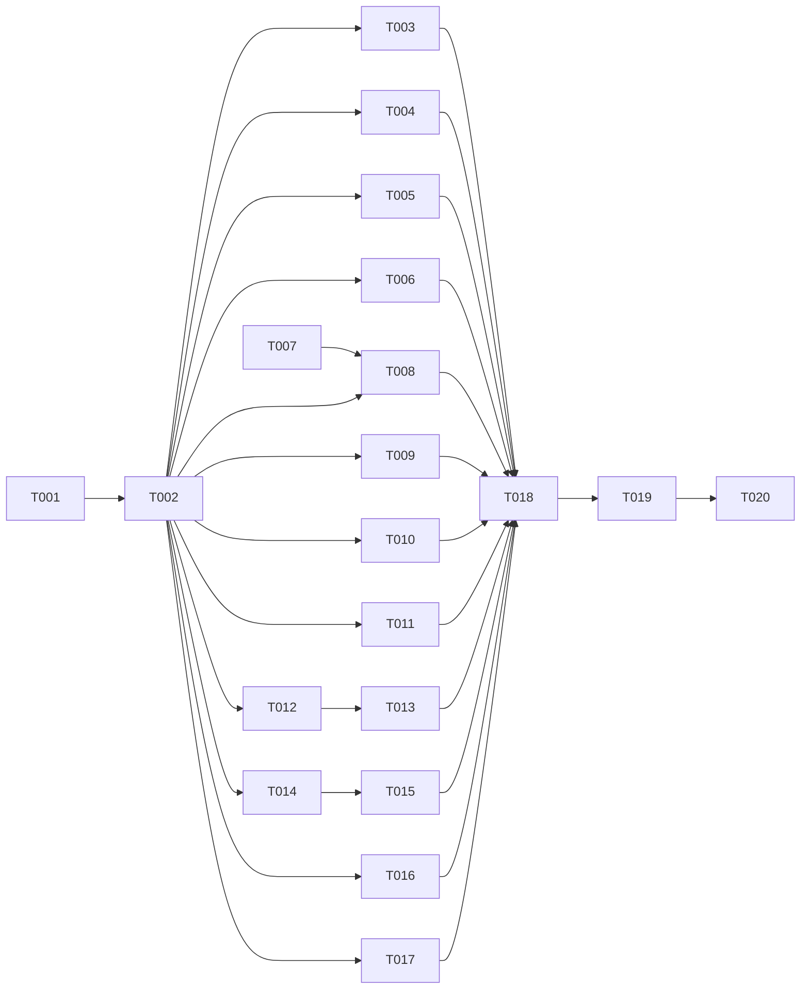

# Visual Redesign — Tasks

Specification: [SPEC.md](./SPEC.md)

## Status
Ready: 0  In Progress: 0  Blocked on decision: 0  Done: 20 (TASK-001 to TASK-020 accepted)

Checkpoint (2026-11-03): TASK-010 to TASK-012 accepted. Full gate at this checkpoint: `pnpm test` 523 files passed, 9229 tests passed, 2 skipped; `pnpm typecheck` 0; `pnpm lint` 0 errors (1 pre-existing warning in `create-reply.transaction.test.ts`); `pnpm build` exit 0. The raw-palette guard caught new raw colour classes in the TASK-011 and TASK-012 work; they were replaced with semantic tokens. `src/lib/theme/raw-palette-allowlist.json` was lowered for `SkillProfilePage.tsx` from 38 to 32 because raw classes that existed before were replaced with tokens. Next eligible: TASK-013 (Ready, depends on TASK-012, done). Note: TASK-013 requires a decision on tabs (see the TASK-013 section) before it is implemented. Remaining Ready: TASK-013 to TASK-020. Also eligible now: TASK-009 to TASK-012, TASK-014, TASK-016, TASK-017. No remediation pending. Working tree still holds uncommitted changes from TASK-001 to TASK-003 and this session (baseline 03ee34b).

## Baseline
- Baseline commit: `03ee34be03209d5e1f9adcdb15f6afbda084af20` (`wip`, on `main`). Working tree was clean at start of implementation.
- Diffs for each task are measured against the commit that precedes that task's first change.

## Conventions
- Every task runs `pnpm typecheck`, `pnpm lint` and `pnpm test`. Any task that changes a route or layout also runs `pnpm build`.
- No task changes server code, route handlers, DTOs, Firestore rules, environment variables or any Account Erasure file (BR-38, BR-31).
- No task adds a persistence path, endpoint, DTO field, metric, permission, dependency or unique illustration asset (SPEC "Out of scope", BR-7).
- Browser-based visual verification is not claimed by any task. Each task records implementation completion only (BR-34). Browser evidence is the user's final manual step (BR-35).
- Existing feature-suite tests protect behaviour and copy. Tests that assert obsolete markup may be updated in the task that changes that markup. The team-overview section-order test is kept (SPEC "Approval decisions").

## Dependency graph

## Tasks

### TASK-001 — Application shell: top bar account menu and page header composition

**Status:** Done (2026-11-03; AccountMenu tests 8 of 8, nav suites 65 of 65, typecheck, lint and build pass)
**Covers:** BR-1, BR-9, BR-33
**Depends on:** None

**Outcome**
Authenticated pages show the desktop sidebar, the current route marked with `aria-current` and a non-colour indicator, and a desktop top bar with an account menu (Min konto, with Min profil and Logg ut). Account items stay in the sidebar Account group too (SPEC AD-8).

**Decisions recorded during implementation**
- The top bar has no notification control. Notifications are not an approved feature, and the reference bell is decorative (`DESIGN-README.md` §2).
- The account trigger shows "Min konto", not the display name. The display name needs the profile read, which the shell does not make today. Adding that read to every page is new behaviour outside this task.
- Navigation grouping follows SPEC BR-9 by decision (2026-11-03): headings Workspace, Min utvikling, Administrasjon and Account; Administrasjon shows Team (`/admin/teams`) and Roller (`/admin/roles`), both admin-only. The team name, when known, is shown as a context line under the Workspace heading. Authorization, route access and the signed-out and loading sets are unchanged. Recorded in `SPEC.md` "Approval decisions" and in the dated note in product-experience `SPEC.md`.
- Open item (not part of this task): product-experience `SPEC.md` line 186 lists `Kompetanseområder` (`/admin/skills`) under Administration. The shell has never rendered it, and BR-9 does not list it. Not added.

**Implementation notes**
- Extend the existing `AppShell`, `NavGroupList` and top bar. Do not add destinations or groups (BR-9).
- Account menu actions reuse the existing sign-out and profile routes.
- Navigation items are shown only where the viewer may open the route; the existing visibility logic is unchanged.

**Verification**
- Component tests: group order, `aria-current` on the exact path only, account menu opens and closes with keyboard, Escape closes, focus returns to the trigger.
- Existing `AppShell`, drawer and skip-link tests pass or are updated only for the changed markup.
- `pnpm build`.

**Security / privacy**
No change to visibility rules. Signed-out shell behaviour (fail closed) is unchanged.

**Documentation impact**
`docs/features/product-experience/SPEC.md` "Application shell" gains a pointer to this feature for the top-bar account menu only.

**Acceptance criteria**
- [ ] Groups and items match BR-9 exactly for admin and non-admin viewers.
- [ ] Account menu is keyboard operable with visible focus.
- [ ] Relevant tests pass
- [ ] No conflict with `docs/SECURITY.md`
- [ ] Relevant documentation is updated

---

### TASK-002 — Shared dashboard presentation primitives

**Status:** Done (2026-11-03; dashboard primitive tests 13 of 13; ui and theme guard suites 228 of 228; typecheck and lint pass. Deviations recorded below.)

**Implementation record**
- Added `src/components/ui/dashboard/DashboardPrimitives.tsx`: `InsufficientData`, `StatTile`, `SummaryPanel`, `LevelBar` (renders as `<li>`, to be used inside a list), `ActionListItem`, `initialsFor` and `InitialsAvatar`.
- Deviation 1: `IdentityArt` (illustration placement wrapper) is not in this task. Its props depend on the placements decided in TASK-003 onwards. The illustration usage guard (`src/components/ui/illustrations/illustrations.usage.test.ts`) still restricts each asset to its approved state. It must be updated in the task that adds a placement, to match the Q-2 reuse decision.
- Deviation 2: `PanelHeader` with a tab-row slot is not a separate primitive. Pages compose the existing `Tabs` primitive under `SummaryPanel`'s header.
- Review result: PASS_WITH_SUGGESTIONS (non-blocking). The reviewer's suggestion text was not captured in this run; record it from the review output before closeout.
**Covers:** BR-4, BR-5, BR-6, BR-7, BR-29 (primitive-level), BR-32, BR-33
**Depends on:** TASK-001

**Outcome**
Reusable presentation primitives exist in `src/components/ui/` (or `src/components/layout/`) for the patterns the 14 references repeat, and pages can compose them. Each primitive is presentation only and accepts already-resolved values:
- `StatTile` (label, value text, optional tone badge, optional sparkline or bar, insufficient-data variant)
- `SummaryPanel` (titled card with optional action link and content region)
- `LevelBar` (labelled bar with text value and status text)
- `ActionListItem` (icon, title, description, chevron link, row border)
- `PanelHeader` with an optional tab row slot
- `IdentityArt` wrapper that places one of the three approved illustration assets with a given position, crop, scale and background (SPEC BR-7, AD-4)
- `Initials` avatar (neutral tone, derived from an existing display name)
- `InsufficientData` state (text, never zero)

**Implementation notes**
- Only create a primitive when at least two pages in this feature will use it (SPEC AD-3). Reuse `Card`, `StatusBadge`, `Button`, `Tabs`, `EmptyState`, `Skeleton`, `ChartFrame` and `Icon` where they exist.
- The three illustration assets are the existing approved assets (sidebar band, sign-in/public hero art, survey/empty-state art). Locate them in the repository; do not draw new ones.
- Use semantic tokens only (BR-3). Add no palette value outside the token file.

**Verification**
- Unit tests per primitive: renders text and tone label, never colour alone (BR-29); `Icon` and illustrations are `aria-hidden`; `InsufficientData` renders text and no numeric zero.
- Static guard: no new raw palette values; no new icon import outside `Icon`.
- `pnpm typecheck`, `pnpm lint`, `pnpm test`.

**Security / privacy**
`InsufficientData` must never render a zero for a suppressed value (SPEC BR-14, product-experience BR-9). `Initials` uses only an existing display name.

**Documentation impact**
None expected beyond a short component list in `docs/features/visual-redesign/VERIFICATION.md`.

**Acceptance criteria**
- [ ] Each primitive has tests for its states, including insufficient data.
- [ ] No primitive contains domain logic or data fetching.
- [ ] Relevant tests pass
- [ ] No conflict with `docs/SECURITY.md`
- [ ] Relevant documentation is updated

---

### TASK-003 — Signed-out home composition (reference 01)

**Status:** Done (2026-11-03; route tests 16 of 16; full suite 520 files passed; typecheck, lint (0 errors) and build pass)

**Decisions recorded during implementation**
- The locked class A line now appears once, in the trust band (BR-10). The hero no longer repeats it, so the line is not duplicated on the page.
- The shortened claim "Svar uten navn eller e-postadresse" and the excluded trust item "Enkel å bruke" were removed. The trust band has two items.
- The preview stays in the hero's right column (BR-10 two-column hero). Acceptance order is read as hero (with preview), value strip, trust band.
**Covers:** BR-10, BR-37, BR-30
**Depends on:** TASK-002

**Outcome**
`/` for signed-out visitors shows the two-column hero (headline, value sentence, "Opprett konto" and "Logg inn"), a product preview built from original SVG/CSS with no invented figures, a value strip of short statements that describe existing features, and a trust band carrying the locked class A line verbatim. Excluded reference items are not rendered; their visual role is taken by the value strip and the preview (SPEC BR-37).

**Implementation notes**
- Keep the existing `app/page.copy.ts` as the copy source. Do not edit locked copy (`product-experience` TASK-014 test).
- The preview is a styled, non-interactive representation of the dashboard. It contains no real or sample names, figures or percentages.
- The trust band uses the existing dark surface token pair.

**Verification**
- Route test: locked privacy line appears verbatim; "anonym" absent; no "gratis", "Priser", "Produkt", "Sikkerhet og personvern" or "Se hvordan det fungerer" text.
- Route test: the two actions are present and keyboard reachable; one `h1`.
- `pnpm test`, `pnpm build`.

**Security / privacy**
The class A line is the only privacy claim on the page. No outcome or certification claim is introduced (SPEC BR-10).

**Documentation impact**
None expected.

**Acceptance criteria**
- [ ] Hero, value strip, preview and trust band are present in that order.
- [ ] Locked privacy line verbatim (test).
- [ ] No excluded copy (test).
- [ ] Relevant tests pass
- [ ] No conflict with `docs/SECURITY.md`
- [ ] Relevant documentation is updated

---

### TASK-004 — Sign-in split layout (reference 02)

**Status:** Done (2026-11-03; accepted after independent review 3 returned PASS_WITH_SUGGESTIONS; sign-in and nav suites 77 of 77; typecheck, build pass; full suite 520 files and 9186 tests passed before the final assertion-only edit, which then passed 9 of 9 sign-in tests.) Remediation used both cycles (review 1 and review 2 each returned CHANGES_REQUIRED; both defects fixed).

**Open browser item (not verified here):** check that the left column text clears the right-half art at widths 1024 to 1100 px. Recorded for `VERIFICATION.md` (TASK-020).

**Independent review record**
- Review 1 (fresh reviewer, read-only): CHANGES_REQUIRED. Blocking: the art covered the lower card and submit area (CSS painting order). Suggestions: full-viewport art and a logo are not required by BR-11 or AD-4; no logo asset is required.
- Review 2 (fresh reviewer, read-only): CHANGES_REQUIRED. Important: the dark art sat behind the lower value points (estimated contrast far below 3:1 for body text). Suggestions: lighter composition closer to the reference; test asserts class strings only.
- Remediation 2: the art is limited to the right half on md and up (`SidebarLandscape` takes an optional className; default unchanged for AppShell). It sits behind the card only. Tests assert the `md:w-1/2` and `pointer-events-none` classes. Verified: sign-in and nav suites 77 of 77 (after change), typecheck exit 0, build exit 0, full `pnpm test` 520 files and 9186 tests passed. Remediation cycle 2 of 2 is now used.
- Remediation 1: positioned section and card above the art. Verified by `pnpm vitest run "app/(public)/sign-in"` (9 of 9), typecheck pass, lint 0 errors, build pass. The stacking test was written after the fix and was not run against the unfixed code.

**Implementation record**
- The split layout, value points, form card and "Opprett konto" link already existed. Added the existing `SidebarLandscape` art as a decorative, `aria-hidden`, pointer-free background on the grid (`relative` container). No new asset.
- Excluded controls (Google, "Husk meg", "Glemt passord?") were not present and remain absent (tested).
**Covers:** BR-11, BR-30, BR-29
**Depends on:** TASK-002

**Outcome**
`/sign-in` is a split layout on desktop: headline and up to three value points with existing copy on the left, a single form card on the right with the existing email and password form, labelled fields, the existing error and success states and the existing "Opprett konto" link. Below desktop the card stacks under the value points. Excluded items (Google, "Husk meg", "Glemt passord?") are not rendered. The illustration asset appears as a background treatment only.

**Implementation notes**
- The redirect gate and safe `continue` allow-list are unchanged (product-experience sign-in redirect tests must still pass).
- Auth client code is not changed.

**Verification**
- Route test: value points render; no Google, "Husk meg" or "Glemt passord" text; form labels, submit and error association unchanged.
- Existing sign-in redirect tests pass unchanged.
- `pnpm test`, `pnpm build`.

**Security / privacy**
No change to authentication. Error messages stay generic (SPEC Security and privacy).

**Documentation impact**
None expected.

**Acceptance criteria**
- [ ] Split layout on desktop, stacked below desktop.
- [ ] No excluded control or link.
- [ ] Redirect and form behaviour tests pass unchanged.
- [ ] Relevant tests pass
- [ ] No conflict with `docs/SECURITY.md`
- [ ] Relevant documentation is updated

---

### TASK-005 — Authenticated home composition (reference 03)

**Status:** Done (2026-11-03; accepted after independent review 2 returned PASS_WITH_SUGGESTIONS; home tests 10 of 10; typecheck and build pass; lint 0 errors; D2 scope guard 63 of 63; full `pnpm test` 521 files passed, 9196 tests passed, 2 skipped; an earlier full run had failed only on the D2 guard, fixed and re-verified)
**Covers:** BR-12, BR-26, BR-27, BR-32, BR-37
**Depends on:** TASK-002

**Implementation record**
- `AuthenticatedHome` loads each read independently: profile (greeting), goals, owned conversations, role target, teams overview. `TeamDevelopmentPanel` loads team results for the first admin or member team and renders the existing `TrendChart`.
- Status row: team entry tile plus active goals, completed goals and open conversations counts, computed from existing reads.
- Panels: goals (titles, status, target dates; no progress), next conversation (earliest open owned conversation), role ("Ingen rolle valgt" with action, or the selected role, or archived/unavailable text), team development chart, and next-step links. Excluded reference items (pending counters, calendar, deltas, percentages) are not rendered.
- The removed shortcut grid and unused copy keys are not in the code.
- Review 1 (CHANGES_REQUIRED): Blocking, a failed or loading teams read showed the "no results" copy; Important, no team-development tests. Remediation 1: `TeamDevelopmentPanel` takes the teams read state; three tests added. Review 2: PASS_WITH_SUGGESTIONS (non-blocking: scope the team-results error assertion to its section; the suppressed-survey test checks text only, not the chart's internal rendering). Not acted on.
- Browser verification of the composition is pending the user (BR-35); the 1024–1100 px text-clearance check for the art is recorded for TASK-020.

**Outcome**
Signed-in `/` shows the greeting band with the display name and identity art, four status tiles, and the panels: team entry, goals (owner-only read, title, status, target date, no percentages), next conversation (owner-only read), role panel ("Ingen rolle valgt" with action, or the selected role), team development chart from the existing team results read with the same thresholds and suppression, and recommended next steps as links to existing pages. Excluded counters and calendar items are replaced by the alternatives in SPEC BR-37.

**Implementation notes**
- Use only reads the viewer may already make. Add no new server call, endpoint or field.
- The team development chart reuses the existing results DTO and the existing `ChartFrame` with its text alternative. Its range control appears only if the existing read supports the range.
- Each panel loads and fails independently (BR-32).
- Greeting uses the existing display name; no time-of-day logic is added.

**Verification**
- Component/route tests with mocked reads: each panel renders its loaded state, its empty state and its failure state independently.
- Test: suppressed team values show the insufficient-data state, never zero.
- Test: no "pågående tiltak", calendar or invented delta text.
- `pnpm test`, `pnpm build`.

**Security / privacy**
Goals and conversations remain owner-only; the home shows only what the owner's existing reads return (SPEC BR-27). Team results use the same thresholds as the team overview.

**Documentation impact**
None expected.

**Acceptance criteria**
- [ ] Each panel maps to an existing read; no new call.
- [ ] Suppressed values are never shown as zero.
- [ ] Each panel's failure is isolated.
- [ ] Relevant tests pass
- [ ] No conflict with `docs/SECURITY.md`
- [ ] Relevant documentation is updated

---

### TASK-006 — Team directory card composition (reference 04)

**Status:** Done (2026-11-03; accepted after independent review returned PASS_WITH_SUGGESTIONS; TeamsOverview tests 27 of 27; typecheck, lint (0 errors) and build pass. The page-shell width changed to `wide` and the grid to `md:grid-cols-2 lg:grid-cols-3`. The reviewer's optional hardening (more control-name checks) is not applied.)
**Covers:** BR-13, BR-37, BR-32
**Depends on:** TASK-002

**Outcome**
`/teams` shows a responsive card grid. Each card has identity art derived from the team id, the team name, the description when present, the relationship badge and the existing action. The page header carries the title and purpose. Empty and error states follow BR-32. No metric, count, filter, search or "Nytt team" control is shown.

**Implementation notes**
- Reuse `TeamIdentity` and `TeamsOverview` from the Phase B working tree. Restyle; do not change the list read.
- Grid columns: one on phone, two at tablet, three at desktop.

**Verification**
- Component tests: card content, relationship badge text, action present per relationship, empty state, error state.
- Test: no search field, filter, tab or "Nytt team" control; no metric text.
- `pnpm test`, `pnpm build`.

**Security / privacy**
Team list stays name and relationship only (SPEC BR-13).

**Documentation impact**
None expected.

**Acceptance criteria**
- [ ] Card grid at three breakpoints (tests cover the class or structure per breakpoint).
- [ ] No excluded control.
- [ ] Relevant tests pass
- [ ] No conflict with `docs/SECURITY.md`
- [ ] Relevant documentation is updated

---

### TASK-007 — Duplicate React key `"2"`: investigation and fix

**Status:** Done (2026-11-03; source found and fixed in `TeamDetail.tsx`: three sibling zone children shared `key={generation}`; accepted after review 3 returned PASS_WITH_SUGGESTIONS, after two remediation cycles. Regression test at the TeamDetail boundary fails before and passes after; TrendTable row key also hardened. Browser confirmation on `/teams/[teamId]` is pending the user, recorded in `VERIFICATION.md`; BR-15 is treated as resolved at the test boundary only.)
**Covers:** BR-15
**Depends on:** None

**Outcome**
The duplicate-key warning on `/teams/[teamId]` is either proven absent by a regression test that renders the team overview with duplicate-prone data and asserts no duplicate-key error is logged, or traced to its source and fixed there with a regression test that fails before the fix. The static findings and the test evidence are recorded in `VERIFICATION.md`.

**Implementation notes**
- Static investigation first: list every array-based `key` on the team overview render path (`TrendChart`, `ResultsSummaryStrip`, `TrendTable`, `TeamRosterSection`, `TeamSkillSection`, `TeamSkillNeedsSection`, roadmap planning list). Identify which source data can produce a duplicate.
- `key={generation}` on direct children is not an array sibling and is not the cause by itself.
- A `key` change that does not remove a proven collision does not satisfy BR-15.
- Browser reproduction with a seeded team is a remaining verification item if the test cannot reproduce. Do not run `pnpm seed:demo-team` against a non-emulator project.

**Verification**
- Test that fails before a fix (if a collision is found) and passes after.
- Test rendering team overview with duplicate-prone data asserts no `console.error` containing "same key".
- `pnpm test`, `pnpm typecheck`, `pnpm lint`.

**Security / privacy**
No change to data. Keys derive from existing identifiers only; no personal data in keys.

**Documentation impact**
`VERIFICATION.md` records the investigation, findings and any remaining browser item. `product-experience` plan §10.3 is not edited by this task.

**Acceptance criteria**
- [ ] Investigation record exists with the static findings.
- [ ] Regression test exists and its result before/after is recorded (if a fix was made).
- [ ] The issue is not reported as resolved unless evidence exists; otherwise the browser item is listed.
- [ ] Relevant tests pass
- [ ] No conflict with `docs/SECURITY.md`
- [ ] Relevant documentation is updated

---

### TASK-008 — Team overview dashboard composition (reference 05)

**Status:** Done (2026-11-03; decision B applied; accepted after final independent review returned PASS with no findings; the parallel-run timeouts and the pre-existing section-order isolation dependency are recorded in the verification record below). Implemented and tested: side-by-side summary and team development chart in the results zone (large screens); competency needs and challenges side by side, with planning full width above and forum and members full width below (activity zone); roster initials (aria-hidden, no image); one level-1 heading with the team name; tabs limited to the existing overview and roadmap routes; insufficient-data text with no standalone zero. The header band is the pre-existing `TeamHeading` (identity art and h1, unchanged); the status badge is not shown because the team result carries no status field. The BR-15 zone-grouping test is kept unchanged; the layout decision is recorded in SPEC.md "Approval decisions".

Verification record (2026-11-03): `pnpm exec vitest run src/features/teams src/features/results --no-file-parallelism` passes (63 files, 1103 tests). Two conditions were observed and are not caused by this change. (1) The section-order test "renders after Kompetanseområder and before the roster…" fails when run alone with `-t`; HEAD's copy of the same test and component fails the same way in isolation, so this order dependence is pre-existing. It passes in every full-file run. (2) Under parallel file execution, the suite intermittently times out one different test per run (5–6 s, the default timeout), including tests in files this change does not touch; with `--no-file-parallelism` the suite passes. These are environment and load conditions, not assertion failures. Not fixed here: changing the timeout or the isolation behaviour is a test-infrastructure decision.

**Decision recorded (2026-11-03, user chose option B).** The side-by-side reference composition is applied to the layout only. The earlier conflict: the BR-15 zone-grouping test requires challenges and members inside the "Teamaktivitet" zone, and the section-order test requires the roster after the needs section. Both still hold under B, so the BR-15 test needed no change. The decision is recorded in SPEC.md "Approval decisions".
**Covers:** BR-14, BR-37, BR-32, BR-26
**Depends on:** TASK-002, TASK-007

**Outcome**
`/teams/[teamId]` shows the header band (identity art, name, status badge only if the team has a status, description, existing summary values), the tab row of existing team routes, a summary row of existing values (pulse, coverage, ongoing initiatives), and a dashboard grid: competency needs and coverage beside the team development chart, roadmap next steps and calendar-free upcoming items in a side column, challenges and members below. Members are initials. The DOM order is the tested section order; the grid areas are set with CSS. Excluded items use BR-37 alternatives.

**Implementation notes**
- Keep `TeamDetail` as the owner of data and states. Presentation changes go to the zone components and `TeamHeading`, `TeamRouteNav`, `TeamSummaryStrip`.
- Keep the section-order test (`Kompetansebehov og dekning` after `Kompetanseområder`, before the roster). Update only the assertion text if a heading is renamed.
- Keep per-section loading, error and empty states (BR-32).
- Keep the results-unavailable branch rendering with the same header and tabs.

**Verification**
- Existing `TeamDetail` tests pass, including the section-order test.
- New tests: header shows team name once; tab items are the existing routes only; members render initials without image elements; insufficient data is shown as text, not zero.
- `pnpm test`, `pnpm build`.

**Security / privacy**
Aggregation and thresholds unchanged. No individual response shown. Members are initials derived from existing display names.

**Documentation impact**
None expected.

**Acceptance criteria**
- [ ] Section-order test passes.
- [ ] Header, tabs, summary and grid are present; no excluded element.
- [ ] Insufficient data never shows zero.
- [ ] Relevant tests pass
- [ ] No conflict with `docs/SECURITY.md`
- [ ] Relevant documentation is updated

---

### TASK-009 — Team roadmap quarter-column board (reference 06)

**Status:** Done (2026-11-03; accepted after review 2 returned PASS_WITH_SUGGESTIONS, following one remediation cycle; the suggested wide-view assertion was applied)

**Implementation record**
- `RoadmapBoard.tsx` (new): one column per target quarter (`quarterOf(targetDate)`), an "Uten måldato" column for plans without a valid target date, a status tile row (planned, active, completed, overdue) from existing item fields, and a detail panel that reuses `RoadmapPlanCard` for the selected plan. Nothing spans columns; the board scrolls inside its own region.
- `RoadmapGantt.tsx` deleted; its copy keys (`ganttLegend`, `ganttArea`, `ganttNoArea`, `ganttEmpty`, `ganttDescription`) removed from `copy.ts`.
- `RoadmapPage.tsx` renders exactly one timeline view: the board at `(min-width: 768px)` (via `useWideRoadmapBoard`, which defaults to the list when `matchMedia` is unavailable) and the grouped list below. Rendering both would put every plan in the DOM twice.
- View switch `?view=timeline` and `view=list` are unchanged.
- Tests: `RoadmapBoard.test.tsx` (9 tests: target-quarter placement for a plan that starts and ends in different quarters, column order, undated column, overdue plan stays in its quarter, each plan exactly once, selection, status tiles, matchMedia hook). Full roadmap folder: 27 files, 675 tests passed. Typecheck 0; lint 0 errors; `pnpm build` exit 0.
- Documentation: `docs/ARCHITECTURE.md` does not describe spanning bars, so it is unchanged.
- Remediation 1 (review 1, CHANGES_REQUIRED): column headers now show the month range (e.g. "apr–jun") and the current quarter is marked "I dag" (derived from the planning-time-zone date; the `today` prop controls it in tests). Board cards show the target title (with the existing unavailable fallback), area, status, priority and owner, using existing fields only. Tests added: header month range and "I dag"; card title, priority and owner; each plan in exactly one column; page-level tests for the board region at md and up and the grouped list with the same plan text below md. Roadmap folder: 27 files, 680 tests passed; typecheck 0; lint 0 errors; build exit 0.
**Covers:** BR-16, BR-17, BR-37, BR-32, BR-26
**Depends on:** TASK-002

**Outcome**
`/teams/[teamId]/roadmap` shows the team header and tabs, a page header with the view switch (Tidslinje, Liste), a status tile row from existing derived states, and a quarter-column board: one column per quarter, plan cards in the column of their target quarter, an "Uten måldato" group for undated plans, and a detail panel for the selected plan. The Phase B `RoadmapGantt` spanning bars and Gantt legend are removed (SPEC AD-5). Below `md` the grouped list replaces the board.

**Implementation notes**
- Replace `src/features/roadmap/components/RoadmapGantt.tsx` with a quarter-column component, or rewrite it in place. Remove the `ganttLegend` copy and its tests. Do not change the roadmap read or DTOs.
- Quarter grouping uses the existing `targetDate` quarter logic (team-roadmap BR-9a/timeline). Reuse existing grouping helpers if present.
- Status tiles: planned, active, completed, overdue (existing derived copy), and archived only through the existing "Vis arkiverte" control.
- Detail panel shows only existing fields. No progress percentage.
- The board scrolls internally on narrow widths, never the page (BR-17).

**Verification**
- Tests: a plan with start and target in different quarters appears only in its target-quarter column; no element has a span across two quarter columns; no Gantt legend text; undated plans appear under "Uten måldato" and not on the axis.
- Tests: view switch URL state `?view=timeline` and `view=list` unchanged.
- Tests: list view at narrow width carries the same plan text.
- `pnpm test`, `pnpm build`.

**Security / privacy**
Roadmap read unchanged; owner and status shown only where the existing DTO returns them.

**Documentation impact**
`docs/features/team-roadmap/SPEC.md` is not changed (it already says no Gantt). `docs/ARCHITECTURE.md` "Team Roadmap" section mentions the timeline only if it describes spanning bars; update the sentence in that case.

**Acceptance criteria**
- [ ] No spanning bars and no Gantt legend remain (test and grep).
- [ ] Target-quarter placement and "Uten måldato" grouping tested.
- [ ] Relevant tests pass
- [ ] No conflict with `docs/SECURITY.md`
- [ ] Relevant documentation is updated

---

### TASK-010 — My skills composition (reference 07)

**Status:** Done (2026-11-03; accepted after independent review returned PASS_WITH_SUGGESTIONS; the optional banner-absence render assertion is not added, since the banner does not exist in the page and the copy guardrails cover its wording)

**Implementation record**
- The page already had no averages, radar or banner; the existing per-skill level indicator (text plus segments) and the existing counts were kept.
- The overview counts are now stat tiles (assessed skills, and one tile per level that has assessments), using the existing counts only.
- The two notices (privacy and role comparison) are grouped in one compact block before the list. Their text is unchanged.
- `SkillNextSteps.tsx` (new): up to three links to existing pages (`/teams`, `/me/conversations`, `/me/profile`), placed after the role panel.
- Test changes: two existing assertions for per-level text now check the matching stat tile (the count is unchanged). The cross-cutting copy walker now recurses into nested copy so the new items are scanned by the same wording guardrails. The next-step copy is worded to pass those guardrails.
- Tests: `SkillNextSteps.test.tsx` (three links, existing routes). Role states and class A notices are covered by the existing role-profile and skill-profile suites.
- Gate: skill-profiles, role-profiles and me/skills folders 55 files, 799 tests passed; typecheck 0; lint 0 errors; `pnpm build` exit 0.
**Covers:** BR-18, BR-37, BR-27, BR-32
**Depends on:** TASK-002

**Outcome**
`/me/skills` shows the page header, a summary row of existing counts, a competency area list with level bars and text status labels, a role comparison panel with all four role states, and up to three next-step links. Class A notices appear verbatim in a compact block before the list. The radar is replaced by the level bars (BR-37). Averages and the "Fortsett utviklingen din" banner are not shown.

**Implementation notes**
- Keep the existing self-assessment, role comparison and counts logic. Re-present only.
- Level labels use the existing wording.

**Verification**
- Existing skill-profile and role-profile suites pass (updated only for markup).
- New tests: class A notices verbatim; role states (none selected, no roles, selected, archived or unavailable); no average text; no radar.
- `pnpm test`, `pnpm build`.

**Security / privacy**
Self-assessments stay person-owned. No team or admin view is added. No ranking or score wording (SPEC BR-18).

**Documentation impact**
None expected.

**Acceptance criteria**
- [ ] All four role states render text, not colour alone.
- [ ] Class A notices verbatim.
- [ ] No average or banner.
- [ ] Relevant tests pass
- [ ] No conflict with `docs/SECURITY.md`
- [ ] Relevant documentation is updated

---

### TASK-011 — My goals composition (reference 08)

**Status:** Done (2026-11-03; accepted after independent review returned PASS_WITH_SUGGESTIONS; both suggestions applied: the ineffective `tone` prop on the active tile is removed, and the Fullførte tab shows an empty-state line when there are no completed goals)

**Implementation record**
- Summary strip: two stat tiles (active and completed counts). No progress ring, bar or percentage existed in the page and none was added (`GoalCompletionNode` is a status control, not progress).
- Status tabs: Aktive, Fullførte and Alle, each with its count, as toggle buttons (`aria-pressed`). Default is Alle, which shows the same content as before. Aktive hides the completed block; Fullførte shows the completed list directly.
- Side panel: distinct linked skill areas only (existing `areaName`), with a neutral empty text.
- Goal cards, completion and edit controls and the editor are unchanged.
- Tests: three composition tests in `GoalsPage.test.tsx` (tab filtering with counts, stat tiles with no progress or percentage, linked areas only). Existing goal suites updated only where the new structure needed it (none of their assertions were removed).
- Gate: personal-goals and me/goals folders 22 files, 736 tests passed; typecheck 0; lint 0 errors; `pnpm build` exit 0.
**Covers:** BR-19, BR-37, BR-27, BR-32
**Depends on:** TASK-002

**Outcome**
`/me/goals` shows the header with the existing "Nytt mål" action, a summary strip of counts (active, completed) with a status-coloured stat tile in place of the progress ring, status tabs Aktive, Fullførte and Alle with counts, and goal cards with title, linked skill area, target date, status badge, completion control and edit control. The side panel shows linked skill areas only. No progress bar, ring or percentage.

**Implementation notes**
- Goals have no progress value (`docs/PRODUCT.md`, Mål). Do not compute one.
- Keep the existing editor as disclosure or dialog.

**Verification**
- Existing personal-goals suites pass (updated only for markup).
- New tests: no progress element; tabs filter; counts match the list; completion and edit controls keep their accessible names.
- `pnpm test`, `pnpm build`.

**Security / privacy**
Goal ownership and visibility unchanged (owner-only). No teammate or admin path.

**Documentation impact**
None expected.

**Acceptance criteria**
- [ ] No progress indicator on any goal.
- [ ] Tabs and counts correct.
- [ ] Relevant tests pass
- [ ] No conflict with `docs/SECURITY.md`
- [ ] Relevant documentation is updated

---

### TASK-012 — Conversations list composition (reference 09)

**Status:** Done (2026-11-03; accepted after review 2 returned PASS_WITH_SUGGESTIONS; the optional stricter switching assertion is not added, since the key is verified by inspection)

**Implementation record**
- Filter chips (Alle, Åpne, Fullførte, Opprettet av meg, Deltar i): toggle buttons with `aria-pressed` that show or hide the existing sections. No new read. The chip set uses the domain statuses (open, completed) and the existing created/participating split.
- Counterpart initials: an aria-hidden `InitialsAvatar` beside the counterpart's display name on owned rows; the name stays as text.
- Wide layout (`lg` and up, via `useWideConversationPane`): the list sits on the left and the selected conversation's existing `ConversationDetail` view sits in an aside on the right. Clicking an owned title selects it on wide screens; below `lg` the link navigates to the detail route as before. Without `matchMedia` the list behaves as before.
- Search is not added (the existing list has no search).
- Tests: three composition tests in `ConversationsPage.test.tsx` (chips filter sections; initials without images; wide selection into the side pane). The page test mock now includes `fetchConversation` because the side pane can render the detail view.
- Gate: development-conversations and me/conversations folders 65 files, 1602 tests passed (three consecutive runs); typecheck 0; lint 0 errors; `pnpm build` exit 0.
- Remediation 1 (review 1, CHANGES_REQUIRED): the detail pane is keyed by the selected conversation, so switching selection remounts it and never shows the previous conversation's content while the new one loads (`key={selectedId}`). Recovery items are hidden under "Deltar i" (they are owner-side). Modified and non-primary clicks keep the browser default. Tests added: switching selection loads the new conversation and moves the marker; below lg the title link is not default-prevented and no pane renders. Folder: 65 files, 1604 tests passed; typecheck 0; lint 0 errors; build exit 0.
**Covers:** BR-20, BR-27, BR-32
**Depends on:** TASK-002

**Outcome**
`/me/conversations` shows the header with the existing "Ny samtale" action, a list pane and, on desktop, the selected conversation beside it. Filter chips show the existing statuses (open, completed) and the existing created-by-me and participating distinction. Items show title, counterpart display name with initials, status badge and the existing date. On phones only the list shows.

**Implementation notes**
- Domain statuses are `open` and `completed` (`conversation-status.ts`). The reference's "Planlagt" and "Aktiv" chips are not used.
- Search is added only if the existing list supports it.

**Verification**
- Existing conversation suites pass (updated only for markup and the form placement change).
- New tests: filter chips reflect domain statuses only; participants shown as initials; list-only layout at phone width (class or structure).
- `pnpm test`, `pnpm build`.

**Security / privacy**
Participant-only access unchanged. Counterpart names only for participants. No preview of conversation contents in the list.

**Documentation impact**
None expected.

**Acceptance criteria**
- [ ] Only domain statuses appear as chips.
- [ ] Participants only; initials.
- [ ] Relevant tests pass
- [ ] No conflict with `docs/SECURITY.md`
- [ ] Relevant documentation is updated

---

### TASK-013 — Conversation detail composition (reference 10)

**Status:** Done (2026-11-03; accepted after review 2 returned PASS_WITH_SUGGESTIONS; the tablist-name caller assertion was added; the textarea-count suggestion is not applied because the notes editors are textareas by design)

**Decision (2026-11-03, user chose A).** Real section tabs over the existing detail sections, presentation only; recorded in SPEC.md "Approval decisions" (decision A).

**Implementation record**
- `ConversationSectionTabs.tsx` (new): tablist, tab (aria-selected, aria-controls, roving tabindex) and tabpanel (aria-labelledby). Arrow keys, Home and End move between tabs with automatic activation and focus. Every panel stays mounted; inactive panels are hidden with the CSS class `hidden`, so drafts survive a switch.
- `OwnerConversationEditor.tsx`: main column grouped as Oversikt (title, planned-for, lifecycle), Notater (notes, participant notes) and Oppfølging (next steps). The aside (participants and goal snapshot) is unchanged.
- `ParticipantConversation.tsx`: grouped as Oversikt (title, planned-for, leave), Notater (owner notes, own notes) and Oppfølging (next steps, shared goals). Alerts and the privacy line stay above the tabs.
- Copy: `conversationsCopy.sectionTabs` (labels reuse the approved section headings where possible).
- Tests: `ConversationSectionTabs.test.tsx` (4 tests: tab semantics and panel relationship, keyboard navigation with focus, tabindex, draft survives a tab switch). Existing conversation suites pass unchanged.
- Gate: theme guard and development-conversations folders 69 files, 1701 tests passed; typecheck 0; lint 0 errors; `pnpm build` exit 0.
- No data model, encryption, authorization, persistence or workflow change; no chat-style control introduced.
- Remediation 1 (review 1, CHANGES_REQUIRED): added "no chat-like controls" tests for the owner view and the participant view in `ConversationDetail.test.tsx` (no file input, no attachment, emoji, send or message-log control, no bubble class or message role, no chat wording; the owner view keeps its existing save action label). The tablist now has an accessible name from the existing "Seksjoner" copy (`label` prop, asserted in the tab test). Folders: theme guard and development-conversations 69 files, 1703 tests passed; typecheck 0; lint 0 errors; build exit 0.
**Covers:** BR-21, BR-37, BR-27, BR-32
**Depends on:** TASK-012

**Outcome**
`/me/conversations/[conversationId]` shows the header (title, status badge, start date, participants), the existing structured sections as tabs (for example notes, goals, follow-up), a focused content column and an aside with the next meeting and related goals where stored. The chat-like composition of the reference is replaced by a structured notes and follow-up layout with the same tabbed header and summary panels (SPEC BR-37). No composer, attachments, emoji, read receipts or message history.

**Implementation notes**
- Use the existing section components and save actions; only the layout and visual treatment change.
- Save actions keep their existing labels.

**Verification**
- Existing development-conversation suites pass (updated only for markup).
- New tests: no composer, no attachment control, no message bubble class or role; existing save actions present.
- `pnpm test`, `pnpm build`.

**Security / privacy**
Participant-only access and encryption paths unchanged. No new field stored.

**Documentation impact**
None expected.

**Acceptance criteria**
- [ ] No chat-like control or text.
- [ ] Existing save actions and labels unchanged.
- [ ] Relevant tests pass
- [ ] No conflict with `docs/SECURITY.md`
- [ ] Relevant documentation is updated

---

### TASK-014 — Admin teams composition (reference 11)

**Status:** Done (2026-11-03; accepted after review 2 returned PASS_WITH_SUGGESTIONS; the suggested non-vacuous jump-link check is applied)

**Implementation record**
- The admin scope marker (`ADMIN_SCOPE_EYEBROW`, "Administrasjon") and the "Opprett team" action were already present on `/admin/teams` and on `/admin/teams/[teamId]`; they are unchanged.
- `AdminTeams.tsx`: the team list is now a card grid (one column on phones, two at md, three at xl). Each card starts with the existing `TeamIdentity` art, which is decorative (aria-hidden), then the existing name link, status badge, team id and the existing activate or disable action.
- No new tab, status, count, search, filter or pagination was added. The admin list has no counts in its data, so none is shown.
- Tests: one grid test added to `AdminTeams.test.tsx` (breakpoint classes, identity art aria-hidden, no image element). Existing admin team and roles tests pass unchanged.
- Gate: teams, results, theme guard and admin folders 70 files, 1202 tests passed; typecheck 0; lint 0 errors; `pnpm build` exit 0.
- Remediation 1 (review 1, CHANGES_REQUIRED): added the scope-marker and excluded-tab assertions. The list page test (`app/(app)/admin/teams/page.test.tsx`) asserts the "Administrasjon" eyebrow and no tab or link named Medlemmer, Tilganger or Innstillinger. The admin detail test (`AdminTeamDetail.test.tsx`) asserts the same for the detail; its one link matching "Medlemmer" is the existing in-page jump to the members section (`#admin-section-members`), which the test allows because it is not a route or tab. Folder gate: 70 files, 1204 tests passed; typecheck 0; lint 0 errors; build exit 0. The TeamDetail section-order test noted under TASK-008 (pre-existing isolation dependency) did not recur in this run.
**Covers:** BR-23, BR-14 (admin scope marker per product-experience BR-14), BR-32
**Depends on:** TASK-002

**Outcome**
`/admin/teams` shows the admin scope marker, the header with the existing "Opprett team" action, the existing admin tabs only, a card grid of teams with identity art, name, existing status badge and existing counts, and pagination only if the page already paginates. The same family is applied to `/admin/teams/[teamId]` header and tabs.

**Implementation notes**
- Team status badge uses only statuses the product already has.
- Grid/list toggle, search and status filters are not added unless they already exist.

**Verification**
- Existing admin team suites pass (updated only for markup).
- New tests: admin scope marker present; tabs are existing routes; no "Medlemmer", "Tilganger" or "Innstillinger" tab unless those routes exist; no invented count.
- `pnpm test`, `pnpm build`.

**Security / privacy**
No new admin capability (SPEC BR-23). Admin-only routes keep their guards.

**Documentation impact**
None expected.

**Acceptance criteria**
- [ ] Scope marker visible on both admin team routes.
- [ ] No invented tab, status or count.
- [ ] Relevant tests pass
- [ ] No conflict with `docs/SECURITY.md`
- [ ] Relevant documentation is updated

---

### TASK-015 — Admin roles split view (reference 12)

**Status:** Done (2026-11-03; accepted after review 3 returned PASS_WITH_SUGGESTIONS; the editor-close test and the checkbox wording are applied)

**Implementation record**
- `AdminRoles.tsx`: on lg and up the role list is a summary column on the left (name, expectation count, archived text; buttons with `aria-pressed`) and only the selected role's existing `RoleRow` (name, status, description, expectations, edit and archive actions) is shown on the right. Below lg every role stays visible as before. Every `RoleRow` stays mounted, so the edit, archive and refetch flows are unchanged.
- No permission toggles, "Rettigheter" tab or access wording was present or added (BR-24). Role profiles stay competency expectations.
- Copy: `adminRolesCopy.splitListLabel`, `expectationCount`.
- Tests: two split-view tests in `AdminRoles.test.tsx` (summary list with counts and archived text; selection moves and only the selected row is marked for desktop display). Existing role-profile and admin roles tests pass unchanged.
- Palette: the new summary classes use semantic tokens only; the theme guard passes with the existing allow-list.
- Below-desktop interpretation (2026-11-03, recorded for review): BR-24 says that on phones "the detail opens as the existing route or view". Below lg the existing full role list is that view, and every role keeps its existing card with its editor. Hiding the other roles below lg would require a separate detail route or view that does not exist; this is recorded as the chosen reading and not as a new product decision. The outcome text "Below desktop the selected role opens as a view" is read as satisfied by this existing view.
- Remediation 1 (review 1, CHANGES_REQUIRED): the summary list now shows each role's description (when defined), as BR-24 requires, with a test asserting it. An open edit panel closes when the selection moves to another role, so the editor does not stay open on a hidden row.
- Gate: role-profiles, admin roles and theme guard 37 files, 460 tests passed; typecheck 0; lint 0 errors; `pnpm build` exit 0.
**Covers:** BR-24, BR-37, BR-32
**Depends on:** TASK-014

**Outcome**
`/admin/roles` shows a split view on desktop: role list on the left (name, description, expectation count, archived state) and the selected role on the right (name, description, expected competency levels and areas, archived state, existing edit and archive actions). Below desktop the selected role opens as a view. The permission-toggle composition is replaced by a competency-expectation panel (SPEC BR-37).

**Implementation notes**
- Role profiles are competency expectations. Do not add access wording, toggles, "Rettigheter" or member assignment.
- Keep existing role create, edit and archive flows.

**Verification**
- Existing role-profile admin suites pass (updated only for markup).
- New tests: split layout structure; no toggle, switch or "Rettigheter" text; archived state shown as text.
- `pnpm test`, `pnpm build`.

**Security / privacy**
Role profiles remain separate from security roles (SPEC BR-24). No new permission surface.

**Documentation impact**
None expected.

**Acceptance criteria**
- [ ] No permission toggle or access wording.
- [x] Split view on desktop; below desktop every role stays visible in the existing list (recorded reading, see "Below-desktop interpretation").
- [ ] Relevant tests pass
- [ ] No conflict with `docs/SECURITY.md`
- [ ] Relevant documentation is updated

---

### TASK-016 — My profile composition (reference 13)

**Status:** Done (2026-11-03; decision A applied; accepted after independent review returned PASS_WITH_SUGGESTIONS; the optional suggestions are not applied: the anchor link is a no-op while the form is loading, which is acceptable for the loaded state)

**Decision recorded (2026-11-03, user chose A).** The Outcome asks for (a) the header band to show the viewer's display name and team membership, and (b) a privacy boundary note in the aside. The page header shows the page title "Min profil" and the team link is in the aside. Showing the display name needs the profile read in the page (the form already performs it), and the privacy note would be new copy unless the existing field description is reused. Options: A, reuse the existing field description as the privacy note and show the display name in the band via the form's read; B, reconcile the Outcome with the approved layout (title-only band, team link in aside) and record no privacy note.

**Implementation record**
- Layout (remediation 1, review 1): the account card now sits in the main column below the display-name form; the aside holds team membership. The header band (title, description, neutral avatar) is unchanged.
- The header band (display name heading, description, neutral avatar), the display-name form in the main column, and the team and account aside were already in place on `/me/profile`.
- Added the primary header action "Rediger profil" as a link to the form (`href="#profile-form"`); the form gained `id="profile-form"`. The form stays visible, so no existing behaviour is hidden.
- No bio, contact, location, job title, skill or goal panel is present (checked by a test on the rendered page text).
- Account Erasure: no file under `src/features/account-erasure` differs from HEAD (checked with git); the erasure entry is unchanged.
- Tests: `app/(app)/me/profile/page.test.tsx` (action link and form anchor; account aside and absence of excluded panels).
- Decision A (2026-11-03): the header band shows the viewer's own display name through a new client component `ProfileHeaderName` (`src/features/profiles/components/ProfileHeaderName.tsx`), using the existing owner-only `fetchOwnProfile` read; it shows the existing no-name copy when empty and nothing on a failed read or when signed out. 'Min profil' stays the only h1. The aside keeps the team link and now shows the existing field description (`profileCopy.fieldDescription`) as the privacy-boundary note. No new copy claims or fields.
- Tests: `ProfileHeaderName.test.tsx` (4 tests: name from the existing read, no-name copy, signed out, read failure); `page.test.tsx` adds the single-h1 and privacy-note assertions.
- Gate after decision A: profile, profiles, account-erasure and theme folders 37 files, 565 tests passed; typecheck 0; `pnpm build` exit 0.
- Remediation 1 (review 1): the account card moved to the main column; the page tests now check the card structure and the erasure entry text; the real form id is asserted in `ProfileForm.test.tsx`. Gate: profile, profiles, account-erasure and theme folders 46 files, 717 tests passed; typecheck 0; lint 0 errors; `pnpm build` exit 0.
**Covers:** BR-22, BR-37, BR-27
**Depends on:** TASK-002

**Outcome**
`/me/profile` shows a header band with the display name (existing editable field), team membership from existing data, the existing account actions, and the Account Erasure entry unchanged. The primary action "Rediger profil" opens the existing display-name form. Panels for bio, contact, location, job title, skill percentages and goal summaries are not shown. The page uses the header band and a two-column composition (display name form and account actions in the main column, team membership and privacy boundary note in the aside), with no new data.

**Implementation notes**
- The Account Erasure component and its files are not modified (BR-38).
- The privacy boundary note reuses existing copy; no new claim.

**Verification**
- Existing profile suites pass (updated only for markup). Account Erasure suites pass unchanged.
- New tests: no bio, contact, location, job-title, skill or goal panel text; display-name form present; erasure entry present with its existing safeguard text.
- `pnpm test`, `pnpm build`.

**Security / privacy**
No new profile field (SPEC BR-22). Account Erasure safeguards unchanged. Deployment remains HELD and is not affected by this task.

**Documentation impact**
None expected.

**Acceptance criteria**
- [ ] Only existing fields appear.
- [ ] Account Erasure files unchanged (git diff check).
- [ ] Relevant tests pass
- [ ] No conflict with `docs/SECURITY.md`
- [ ] Relevant documentation is updated

---

### TASK-017 — Pulse survey phone composition (reference 14)

**Status:** Done (2026-11-03; independent review returned PASS_WITH_SUGGESTIONS; decision A applied: the completion illustration stays and BR-25 is clarified in SPEC.md; the sticky-bar browser behaviour is a user-run check under BR-35)

**Implementation record**
- Already present and unchanged: a single centred column (PageShell lg), the progress text 'Spørsmål N av 3' with a bar, five radio options each 44 px square (min-h-11 min-w-11), selected state by border, text and tint, Neste disabled with 'Velg et svar for å fortsette', the survey payload and answer handling.
- Bottom action bar: on the question screen the Forrige and Neste row is sticky at the bottom on phones and inline under the card from md up (sticky bottom-0 … md:static). Behaviour is unchanged.
- Illustration: a conflict between approved rules is recorded below. The completion illustration is kept for now because the product-experience illustration guard pins it to survey completion.
- Tests: two composition tests in SurveyResponseForm.test.tsx (bottom bar classes; real question count, disabled-Neste text, and no time estimate or percentage text).
- Gate: survey, route, illustration and theme folders 27 files, 440 tests passed; typecheck 0; lint 0 errors; pnpm build exit 0.

**Decision recorded (2026-11-03, user chose A).** The approved completion illustration stays on the survey completion screen. BR-25 is clarified in SPEC.md, and the illustration guard is unchanged.
**Covers:** BR-25, BR-37, BR-27
**Depends on:** TASK-002

**Outcome**
`/survey/[surveyId]` follows the reference composition with the existing behaviour: a single column at every width, a header with survey title, team name and the progress text "Spørsmål N av 3" with a bar, one question per screen with five labelled options at least 44 × 44 px, selected state by border, text weight and tint, Forrige and Neste in a bottom bar on phones (under the card on desktop), Neste disabled with the existing text until answered, intro with the locked notice and collapsed disclosure, completion with the existing copy. The survey illustration appears on the intro only.

**Implementation notes**
- Survey behaviour, payload, answer handling in memory and no-persistence rule are unchanged (`product-experience` TASK-020 to TASK-023).
- No time estimate and no percentage text.

**Verification**
- Existing survey suites pass (updated only for markup).
- New tests: no "ca. 3 minutter" or percentage text; progress text uses the real question count; bottom action bar structure at phone width; survey route has no navigation landmark.
- `pnpm test`, `pnpm build`.

**Security / privacy**
Locked notice and disclosure verbatim. No storage API added (product-experience BR-S3). Payload identical (BR-S6).

**Documentation impact**
None expected.

**Acceptance criteria**
- [ ] Locked notice verbatim on the intro before the first question.
- [ ] Five options, each at least 44 × 44 px (test on the class or measured style value).
- [ ] No storage API added (grep check).
- [ ] Relevant tests pass
- [ ] No conflict with `docs/SECURITY.md`
- [ ] Relevant documentation is updated

---

### TASK-018 — Cross-page responsive, dark theme and reduced-motion sweep

**Status:** Done (2026-11-03; static checks recorded in VERIFICATION.md "Cross-page static sweep"; browser measurement at 320, 360, 768 and 1280 px is the user's check)

**Record.** Reduced motion: global rule in `app/globals.css` (line 210). Raw palette: the guard passes with exact allow-list counts (one entry lowered, SkillProfilePage 38 to 32). Dark theme: the contrast guard measures both themes. Charts keep a table or text alternative. Horizontal overflow at the four widths is not measured in this run.
**Covers:** BR-2, BR-8, BR-28, BR-30
**Depends on:** TASK-003, TASK-004, TASK-005, TASK-006, TASK-008, TASK-009, TASK-010, TASK-011, TASK-013, TASK-015, TASK-016, TASK-017

**Outcome**
Every composition from the tasks above is checked for, and corrected where needed to satisfy: no unintended horizontal page scroll at 320, 360, 768 and 1280 px (static CSS and structure tests where possible); dark theme uses only dark tokens (no hard-coded light surface); transitions are disabled or reduced under `prefers-reduced-motion`; charts scroll internally or switch to text.

**Implementation notes**
- Work from a list of the 14 routes. Fix only defects found by the checks; do not restyle further.
- Browser measurement is not performed here. Record what static checks cover.

**Verification**
- Static: a test scans the changed feature components for raw palette values and for transitions not covered by the reduced-motion rule.
- Tests: charts have a text or table alternative for each route using them.
- `pnpm typecheck`, `pnpm lint`, `pnpm test`, `pnpm build`.

**Security / privacy**
No change to data or access.

**Documentation impact**
`VERIFICATION.md` records the static coverage and the browser items left for the user.

**Acceptance criteria**
- [ ] Static checks pass and are recorded.
- [ ] No raw palette value outside the token file.
- [ ] Relevant tests pass
- [ ] No conflict with `docs/SECURITY.md`
- [ ] Relevant documentation is updated

---

### TASK-019 — Contrast record and accessibility static checks for new pairs

**Status:** Done (2026-11-03; accepted for the 14 references after the third review's remediation; scope as recorded in VERIFICATION.md: routes outside the 14 references and landmarks other than main are recorded gaps for the user)

**Record.** Contrast: six visual-redesign pairs added to `CONTRAST_PAIRS`; the guard passes (41 pairs in 2 themes plus 2 sanity tests, 84 tests). Accessibility: the helper `src/components/ui/heading-structure.ts` is used by a route-level test for each of the 14 references (see VERIFICATION.md "Per-route heading and landmark structure (TASK-019)"). Each route test asserts one `main` landmark; heading structure asserts a valid level sequence and one level-1 title where the route owns it. Landmarks other than `main` are covered only by existing suites.
**Covers:** BR-29, BR-3
**Depends on:** TASK-018

**Outcome**
Every text and UI token pair used by the new compositions (status tiles, level bars, identity art labels, dark panels, quarter column headers, insufficient-data text) is measured from the implemented token file in both themes and recorded. Any pair below threshold is fixed in the token file. Static accessibility checks cover: one `h1` per route, heading order, accessible names for icon-only controls, `aria-current` on navigation.

**Implementation notes**
- Extend the existing contrast test and record in `docs/features/product-experience/VERIFICATION.md` or in this feature's `VERIFICATION.md` (choose one and link it).
- No WCAG conformance claim is made.

**Verification**
- Contrast guard test updated with the new pairs; test passes.
- Static heading and landmark test per route.
- `pnpm test`, `pnpm lint`.

**Security / privacy**
No change.

**Documentation impact**
Contrast record updated.

**Acceptance criteria**
- [ ] Every new pair measured in both themes and recorded.
- [ ] No pair below threshold remains.
- [ ] Relevant tests pass
- [ ] No conflict with `docs/SECURITY.md`
- [ ] Relevant documentation is updated

---

### TASK-020 — Visual verification record, deviations and closeout

**Status:** Done (2026-11-03; closeout record in VERIFICATION.md; full gate passed; focused security and privacy review PASS_WITH_RISKS; browser checks listed as pending the user, not claimed)

**Record.** Final gate (after TASK-019): `pnpm test` 530 files passed, 9304 tests passed, 2 skipped; `pnpm typecheck` 0; `pnpm lint` 0 errors (1 pre-existing warning); `pnpm build` exit 0. Account Erasure, `app/api` and the erasure docs: no change (git diff empty). Security: PASS_WITH_RISKS, no Critical, High, Medium or Low findings; risks are the home page's additional owner reads (BR-12), and the browser checks. Deviations are listed in VERIFICATION.md "Closeout". The browser checklist and the 14-reference table are in VERIFICATION.md; no browser check is claimed as passed.
**Covers:** BR-34, BR-35, BR-36, BR-31, BR-38
**Depends on:** TASK-019

**Outcome**
`docs/features/visual-redesign/VERIFICATION.md` exists and records, per reference (01 to 14): the route and tasks; implementation status (completed, or the open items); visual status set to "not visually verified" with the browser checklist the user will run (BR-35 viewports, zoom, themes, keyboard, screen reader, axe scan, screenshot paths); the BR-37 alternatives used and any omitted alternative; intentional deviations with classification and reason (BR-36). It also records: the duplicate-key investigation result from TASK-007; the Account Erasure files unchanged (git diff check); the TASK-045 identifier not used for the gate.

**Implementation notes**
- No browser screenshots are claimed. The file lists them as pending for the user.
- Status line of `SPEC.md` stays Approved; the TASKS status counts are updated by the implementation runs.
- Do not change `product-experience` TASKS or SPEC.

**Verification**
- Full gate: `pnpm typecheck`, `pnpm lint`, `pnpm test`, `pnpm build` (results recorded with their actual output).
- `git diff --stat` shows no changes under Account Erasure paths or server/DTO/rules paths.

**Security / privacy**
Record the security-review requirement: the survey and the team overview changed presentation and should be reviewed by `security-review` before closeout (product-experience TASK-023 practice).

**Documentation impact**
`VERIFICATION.md` created; `docs/UI-UX.md` not changed.

**Acceptance criteria**
- [ ] `VERIFICATION.md` has all 14 reference sections.
- [ ] Full gate results recorded, with real output.
- [ ] Account Erasure and server paths unchanged (diff check recorded).
- [ ] Relevant tests pass
- [ ] No conflict with `docs/SECURITY.md`
- [ ] Relevant documentation is updated
