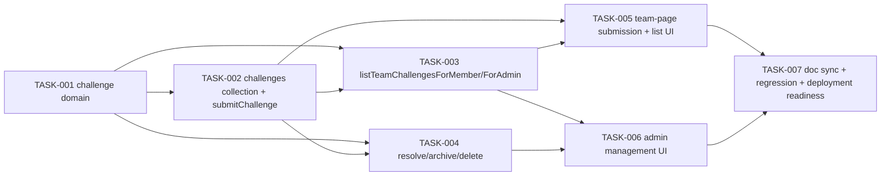

# Anonymous Challenges — Tasks

Specification: [SPEC.md](./SPEC.md)

## Status
Ready: 0  In Progress: 0  Done: 7

## Task graph

This feature is architecturally simpler than Managed Surveys (see SPEC.md —
no coordination document, no participation-tracking collection, no
Firestore transactions anywhere, one collection, one access mode), which is
why it splits into 7 tasks rather than 14: there is no analog to
`teamSurveyState`/`openSurvey`'s race-safety work, no separate
submission-vs-participation split, and resolve/archive/delete share almost
identical shape (bundled into one task per SPEC's own "Server operations"
reasoning).

**Post-planning-review revision**: TASK-003 was expanded (still one task,
task count unchanged at 7) from a single `listTeamChallenges` operation
into two — `listTeamChallengesForMember` and `listTeamChallengesForAdmin`
— after a planning review found the original single-operation design would
have forced the team-page UI (TASK-005) to receive `archived` challenge
plaintext it should never see, filtered only client-side. SPEC.md's
"Authorization model," "Server operations," and "Firestore/rules/index
implications" sections were updated accordingly; see SPEC.md for the full
reasoning (the split mirrors this codebase's own existing precedent,
`get-current-team-survey.ts` vs. `list-team-surveys.ts`).

## Tasks

### TASK-001 — Challenge domain: text validation + derived lifecycle status

**Status:** Done
**Covers:** BR-3, BR-6
**Depends on:** None

**Outcome**
A pure, framework-free domain module exists for the `Challenge` concept: the
canonical `Challenge` persisted-document type, `validateChallengeText`
(non-empty after trim, 3-2000 characters), `effectiveChallengeStatus`
(derives `"open" | "resolved" | "archived"` from `resolvedAt`/`archivedAt`,
archived taking precedence over resolved over open — SPEC → "Lifecycle"),
and `isValidChallenge` (a fail-closed validator for a fully-hydrated
candidate object, mirroring the existing `isValidSurvey` pattern). Every
later task imports this module rather than re-deriving validation or
lifecycle logic itself.

**Implementation notes**
- New feature root `src/features/challenges/domain/` per
  `.claude/rules/architecture.md`.
- `src/features/challenges/domain/challenge.ts`: `Challenge` type mirrors
  SPEC's exact Firestore schema: `{challengeId, teamId, ciphertext, iv,
  authTag, keyVersion, submittedAt, resolvedAt?, resolvedBy?, archivedAt?,
  archivedBy?}`. `ChallengeStatus = "open" | "resolved" | "archived"`.
  `effectiveChallengeStatus` takes only the narrow `{resolvedAt?,
  archivedAt?}` slice it actually needs (mirrors `effectiveLifecycle`'s
  narrow-input convention) — archived wins over resolved, resolved wins
  over open, exactly as SPEC's derivation table. `isValidChallenge`
  validates that required fields (`teamId`, `ciphertext`, `iv`, `authTag`,
  `keyVersion`, `submittedAt`) are present and well-typed, and that
  `resolvedAt`/`resolvedBy` and `archivedAt`/`archivedBy` are each either
  both present and well-typed or both absent — fails closed (`false`) on
  anything malformed, never throws.
- `src/features/challenges/domain/challenge-text.ts`:
  `validateChallengeText(input: unknown): {ok: true; text: string} | {ok:
  false}` — trims, rejects empty/too-short (<3 chars)/too-long (>2000
  chars)/non-string input.
- No `teamId`/`uid`/status is ever part of this module's *input* validation
  surface — free text is the only untrusted submission-time field this
  module validates; `teamId` is always a trusted server route scope,
  resolved by later tasks, never validated here as if it were untrusted
  request data.
- No Firestore, no `server-only` import — this module has no I/O.

**Verification**
- `effectiveChallengeStatus`: every combination of set/unset
  `resolvedAt`/`archivedAt`, including archived-with-resolvedAt-also-set
  (archived wins) and archived-directly-from-open (never resolved first).
- `validateChallengeText`: boundary cases at 2/3 and 2000/2001 characters,
  whitespace-only input, non-string input.
- `isValidChallenge`: accepts a well-formed minimal candidate (no
  `resolvedAt`/`archivedAt`) and a fully-populated one; rejects
  missing/wrong-typed required fields and a candidate with `resolvedAt` set
  but `resolvedBy` absent (or vice versa) for either pair; rejects a
  syntactically-valid-but-wrong `keyVersion` (e.g. `"v2"`, `""`) — not just
  "any string" — since `src/lib/encryption/encryption.ts` only ever
  produces the exact literal `"v1"`.
- `pnpm lint`, `pnpm typecheck`.

**Security / privacy**
No additional considerations — pure, no-I/O domain logic with no identity
or persistence involved.

**Documentation impact**
None expected yet (doc sync happens at TASK-007).

**Acceptance criteria**
- [x] `effectiveChallengeStatus` matches SPEC's derivation for every
      documented case.
- [x] `validateChallengeText` rejects every documented invalid shape and
      accepts valid boundary values.
- [x] `isValidChallenge` fails closed on every malformed shape tested.
- [x] Relevant tests, `pnpm lint`, `pnpm typecheck` pass.

**Implementation record**
- Files added: `src/features/challenges/domain/challenge.ts`,
  `challenge.test.ts`, `challenge-text.ts`, `challenge-text.test.ts`. No
  other files under `src/features/challenges/` exist yet (server/client/UI
  are later tasks).
- `Challenge` mirrors SPEC's exact schema, including `challengeId`
  (validated against a caller-supplied `expected.challengeId`, mirroring
  `isValidSurvey`'s convention) — no submitter identity field exists on the
  type. `ChallengeKeyVersion = "v1"` is declared locally in the domain
  module (not imported from `src/lib/encryption/encryption.ts`) to keep
  this module free of any runtime dependency; `isValidChallenge` checks the
  literal `"v1"` exactly, rejecting any other syntactically-valid string.
- `effectiveChallengeStatus` takes the narrow `{resolvedAt?, archivedAt?}`
  slice only, needs no clock, and derives `archived` > `resolved` > `open`
  exactly as SPEC's table.
- `isValidChallenge` fails closed (never throws) on a non-object/array
  candidate, a `challengeId` mismatch, a missing/blank `teamId`/
  `ciphertext`/`iv`/`authTag`, a wrong `keyVersion`, a missing/invalid
  `submittedAt`, or a `resolvedAt`/`resolvedBy` (or `archivedAt`/
  `archivedBy`) pair present on only one side. An extra identity-shaped
  field (`uid`, `submittedBy`) on a candidate has no effect on the result —
  confirmed by an explicit test.
- `validateChallengeText` trims once (the canonical normalization path)
  and validates the trimmed length is in `[3, 2000]`; no internal
  whitespace collapsing, no truncation of over-length input.
- 31 new tests added (`challenge.test.ts` + `challenge-text.test.ts`),
  covering every case in TASK-001's "Verification" section. Full suite:
  `pnpm test` (1222 passed), `pnpm lint` (clean), `pnpm typecheck` (clean).
- Left intentionally for later tasks: `ChallengeRecord` (the Firestore
  write-shape without `challengeId`, owned by TASK-002), all server
  operations, encryption calls, Firestore access, routes, and UI.

---

### TASK-002 — `challenges` collection + `submitChallenge`

**Status:** Done
**Covers:** BR-1, BR-2, BR-4, BR-5, BR-7, BR-8, BR-23, BR-25, BR-26, BR-33
**Depends on:** TASK-001

**Outcome**
A real team member can submit a challenge for their team; the server
persists an encrypted `challenges/{challengeId}` document containing no
identity field of any kind. A caller with no real `teamMemberships` record
is rejected (app-admin status alone is insufficient), submission to a
disabled/nonexistent team is rejected, and invalid text is rejected.
`firestore.rules` denies client-SDK access to the new collection.

**Implementation notes**
- New `src/features/challenges/server/submit-challenge.ts`:
  `submitChallenge(idToken, teamId, rawText, deps)`.
- No Firestore transaction is needed (SPEC → "Server operations" — a
  single-document write with no cross-document invariant to protect).
  Order of checks: `verifyIdToken` (`src/features/auth/server/
  verify-identity.ts`, reused unchanged) → `validateChallengeText`
  (TASK-001, reused unchanged) → real membership check — read
  `teamMemberships/{uid}__{teamId}` and validate via `isValidMembershipFor`
  (`src/features/teams/domain/team-membership.ts`, reused unchanged), **not**
  `authorizeTeamAccess`, whose `"admin"` result would incorrectly grant an
  app-admin-without-membership eligibility (BR-1, mirrors
  `resolveSurveyForParticipation`'s exact BR-16 handling) → fresh
  `teams/{teamId}.status` read via `isValidTeamStatus` (reused unchanged) →
  encrypt via `src/lib/encryption/encryption.ts` (reused unchanged, fresh
  IV) → `.add()` to `challenges`.
- Persisted `ChallengeRecord` (no `challengeId` field, mirrors
  `SurveyRecord`'s own-id-excluded convention): `{teamId, ciphertext, iv,
  authTag, keyVersion, submittedAt}` — `resolvedAt`/`archivedAt`/
  `resolvedBy`/`archivedBy` all start absent.
- `challengeId` = Firestore's auto-generated `.add()` document id — never
  derived from `uid`/`teamId`/text.
- Return only success/failure — no generated `challengeId`, no echoed text
  (BR-2, mirrors `submitSurveyResponse`'s response-minimization posture).
- Add `match /challenges/{document=**} { allow read, write: if false; }` to
  `firestore.rules`, plus a matching static assertion in
  `src/lib/firebase/firestore-deployment-config.test.ts` (existing
  regex-based pattern already used for every other collection).
- No `firestore.indexes.json` change — this task only ever calls `.add()`,
  no query.

**Verification**
- Server tests: real-member success, with an explicit negative assertion
  that the persisted document has no `resolvedAt`/`archivedAt` and no
  `uid`/`email`/`displayName`-shaped field of any kind; app-admin-without-
  membership rejection; plain non-member rejection; disabled-team
  rejection; nonexistent-team rejection; malformed-team-status fail-closed
  rejection; text-too-short/too-long/empty/non-string rejection (validated
  before any Firestore read); unauthenticated/invalid-token rejection with
  zero Firestore reads; encryption-failure fail-closed (no plaintext
  fallback, nothing persisted); Firestore write failure mapped to
  `persistence_failed`; no console logging of text/ciphertext/uid on any
  path.
- A Firestore client-SDK read/write attempt against `challenges` is denied
  (rules-shape assertion, mirroring the existing `surveys`/
  `surveyResponses` pattern).
- `pnpm lint`, `pnpm typecheck`.

**Security / privacy**
Establishes the `challenges` collection's server-only write boundary and
the no-identity-field guarantee at the very first write path (SPEC →
"Data model," BR-4). Get the "no identity field in the persisted document"
negative assertion solid here — every later task that reads this
collection inherits this guarantee rather than re-proving it.

**Documentation impact**
None expected yet (TASK-007).

**Acceptance criteria**
- [x] A real team member can submit a challenge; it persists with no
      `resolvedAt`/`archivedAt` and no identity field.
- [x] An app admin with no real membership cannot submit for that team.
- [x] Submitting to a disabled team is rejected.
- [x] Invalid text is rejected server-side regardless of any future
      client-side validation.
- [x] `firestore.rules` denies client-SDK access to `challenges`.
- [x] Relevant tests, `pnpm lint`, `pnpm typecheck` pass.

**Implementation record**
- Files added: `src/features/challenges/server/submit-challenge.ts`,
  `submit-challenge.test.ts`. No routes, UI, listing, or management
  operations were added — out of scope for this task.
- `submitChallenge(idToken, teamId, rawText, deps)` follows SPEC's exact
  check order: `verifyIdToken` (`sign_in_required`) → `validateChallengeText`
  (TASK-001, reused unchanged — `invalid_input`, zero Firestore reads) →
  real `teamMemberships/{uid}__{teamId}` check via `isValidMembershipFor`
  (reused unchanged, **not** `authorizeTeamAccess` — an app admin with no
  real membership is rejected `forbidden`, confirmed by an explicit test) →
  fresh `teams/{teamId}.status` read via `isValidTeamStatus` (a missing or
  malformed status folds into `team_not_found`; a `disabled` status is
  `team_disabled`) → `encrypt()` (`src/lib/encryption/encryption.ts`, fresh
  IV; a thrown error — e.g. missing `ENCRYPTION_KEY` — maps to
  `encryption_failed`, mirroring `submitSurveyResponse`'s identical outcome
  naming, not `persistence_failed`) → `.add()` to `challenges`. No Firestore
  transaction (single-document write, no cross-document invariant, mirrors
  `createSurvey`'s plain-read pattern).
- Persisted `ChallengeRecord` contains exactly `{teamId, ciphertext, iv,
  authTag, keyVersion, submittedAt}` — verified by an explicit
  `Object.keys` assertion — no `resolvedAt`/`resolvedBy`/`archivedAt`/
  `archivedBy`, no `status`, and no identity-shaped field of any kind
  (`uid`, `email`, `displayName`, `name`, `submittedBy`, `userId`,
  `membershipId`, `ip`/`ipAddress`, `userAgent`, `sessionId` — all
  explicitly asserted absent). `teamId` always comes from the trusted
  server-scoped argument, never from `rawText`; a regression test injects
  `{text, teamId: "attacker-team"}`-shaped input and confirms the persisted
  `teamId` is the trusted argument, and a second test confirms passing that
  whole object as `rawText` is rejected outright as `invalid_input` (text
  must be a string) rather than read for a `teamId`.
- Return contract is exactly `{ok: true}` or `{ok: false, error}` — no
  `challengeId`, no echoed text, no identity — verified by an `Object.keys`
  assertion on both branches.
- `firestore.rules` gained an additive `challenges` deny-all block,
  identical in form to every existing collection's block (placed after
  `surveyParticipations`, before the final catch-all); `git diff --
  firestore.rules` confirms the change is purely additive. `firestore-
  deployment-config.test.ts` gained a matching static assertion, following
  the existing per-collection pattern. `firestore.indexes.json` was not
  touched (this task only ever calls `.add()`, no query).
- 33 new tests in `submit-challenge.test.ts` cover: success; canonical trim
  persisted (decrypted and compared against the trimmed source, via
  `decrypt()`); min (3 char) and max (2000 char) boundaries; every invalid-
  text shape rejected before any Firestore read; unauthenticated/invalid
  token with zero reads; non-member and wrong-team-member rejection;
  authorized-member success; app-admin-without-membership rejection;
  active/disabled/missing/malformed team status; the teamId-injection
  regression (both forms); the full "no identity field" negative assertion;
  no `status`/`resolvedAt`/`resolvedBy`/`archivedAt`/`archivedBy`;
  ciphertext-not-plaintext persistence; exact `keyVersion: "v1"`;
  encryption-failure and persistence-failure fail-closed (zero writes for
  both); membership-read-failure and team-status-read-failure both mapped
  to `persistence_failed`; repeated submissions from the same identity all
  succeed independently (BR-8); no console logging across every
  success/rejection/failure path; minimal result-shape assertions; a check
  that this module exports only `submitChallenge` (no TASK-003 listing
  behavior); and a dedicated privacy-regression pair asserting the full
  serialized persisted record and the full serialized result never contain
  an identity canary.
- Verification: targeted tests (40/40 passed, including the pre-existing
  `firestore-deployment-config.test.ts` file), full `pnpm test` (1256/1256
  passed), `pnpm typecheck` (clean), `pnpm lint` (clean), `pnpm build`
  (clean). `git diff -- firestore.rules` confirmed additive-only; `git diff
  -- firestore.indexes.json` confirmed empty; `git status --short` confirmed
  no files beyond TASK-001's existing domain module and this task's two new
  server files, `firestore.rules`, and `firestore-deployment-config.test.ts`
  changed under this task's scope.

---

### TASK-003 — `listTeamChallengesForMember` + `listTeamChallengesForAdmin`

**Status:** Done
**Covers:** BR-9, BR-10, BR-11, BR-12, BR-13, BR-14, BR-15, BR-24, BR-25, BR-26, BR-34, BR-35, BR-36, BR-37
**Depends on:** TASK-001, TASK-002

**Outcome**
A member or admin of a team can list that team's `open`/`resolved`
challenges (decrypted text, derived status, submission date only) via
`listTeamChallengesForMember`, in newest-first order; **an `archived`
challenge is never present in this operation's response, for any caller —
enforced server-side, not by any consumer filtering it out.** Separately,
an app admin (and only an app admin) can list a team's challenges of every
status, including `archived`, via `listTeamChallengesForAdmin`. Both
operations reject a non-member/non-admin (or non-admin, respectively);
reject cross-team access; remain available for a disabled team; and
silently exclude a malformed or undecryptable record rather than failing
the whole call.

**Implementation notes**
- New `src/features/challenges/server/list-team-challenges.ts` exports
  **two** public functions, `listTeamChallengesForMember(idToken, teamId,
  deps)` and `listTeamChallengesForAdmin(idToken, teamId, deps)`, built on
  one shared, unexported helper (e.g. `fetchTeamChallenges(teamId,
  allowedStatuses, deps)`) so decryption/validation logic is not
  duplicated (SPEC → "Server operations").
- `listTeamChallengesForMember`: `authorizeTeamAccess(identity, teamId)`
  (reused unchanged) → `"admin"`/`"member"` required; `"denied"` rejected;
  a `read_failed` result from the check itself is never collapsed into
  "denied." Calls the shared helper with `allowedStatuses = ["open",
  "resolved"]` — a **fixed, hardcoded** argument this function passes,
  never a value derived from the request.
- `listTeamChallengesForAdmin`: `requireAppAdmin` (reused unchanged,
  same boundary as TASK-004's management operations) required; a non-admin
  caller — including an otherwise-authorized team member — is rejected.
  Calls the shared helper with `allowedStatuses = ["open", "resolved",
  "archived"]`.
- **Neither function accepts an `includeArchived`-shaped parameter, or any
  other client-influenceable status-selection input, of any kind** (BR-36)
  — a test must actively confirm that passing such a field in the request
  has no effect on `listTeamChallengesForMember`'s output.
- No team-`active` gate on either read (BR-14, SPEC → "Team-disable
  semantics" — reading is unaffected by disable status).
- Shared helper, in this exact order (the order is itself the privacy
  guarantee, BR-37 — implement it as written, not merely functionally
  equivalently):
  1. Query `challenges` where `teamId == teamId` (single-field, no
     composite index — BR-24; both public functions issue the identical
     query, since `status` is never a stored/queryable field — see SPEC →
     "Firestore/rules/index implications" for why a composite index is
     architecturally impossible here, not merely avoided).
  2. Per raw document: `isValidChallenge` (TASK-001) — skip (don't throw)
     on failure.
  3. Compute `effectiveChallengeStatus` (TASK-001) from the now-validated
     `resolvedAt`/`archivedAt` — **this step requires no decryption.**
  4. **Exclude any record whose status is not in the caller's
     `allowedStatuses`, before step 5** — an excluded record's `ciphertext`
     must never reach the decryption call.
  5. Decrypt (`src/lib/encryption/`) only the surviving records — skip
     (don't throw or fall back) on a decryption failure, without logging
     the failure's content.
  6. Map to `TeamChallengeView = {challengeId, text, status, submittedAt:
     <date-only string>}` — never `resolvedBy`/`archivedBy`/`resolvedAt`/
     `archivedAt` (BR-13), never `iv`/`authTag`/`keyVersion`, never the
     caller's own `uid` reflected back.
  7. Sort newest-first (`submittedAt` descending) in application code,
     after filtering — mirrors the existing "fetch by one equality field,
     sort in code" convention already used for survey-instance history.
- Date-only formatting (BR-12) happens server-side, in step 6, before the
  response is built — the full timestamp is never sent to the client for
  it to truncate itself.

**Verification**
- **Member operation tests**: member success (each member-visible status —
  `open` and `resolved` — is returned, `archived` never is, even when one
  exists for the team); admin success reading via this operation returns
  the identical member-scoped result (never more, since this operation
  doesn't know or care that the caller happens to be an app admin);
  non-member/non-admin rejection; cross-team rejection (a Team A
  member/admin cannot list Team B's challenges); disabled-team viewing
  continuity; a malformed record excluded without failing the whole call;
  a record with corrupted/undecryptable ciphertext excluded the same way,
  with no plaintext/ciphertext/error-detail logged; an empty team returns
  an empty list, not an error; newest-first ordering; a dedicated privacy
  test asserting the serialized response never contains `uid`,
  `resolvedBy`, `archivedBy`, `resolvedAt`, `archivedAt`, `iv`, `authTag`,
  `keyVersion`, or a full timestamp for any item; a request carrying an
  `includeArchived`-shaped field (or similar) is proven to have no effect
  on the output.
- **Critical regression test** (explicitly required, not optional): place
  an `archived` challenge with distinctive, greppable plaintext (e.g.
  `"ARCHIVED-CANARY-<random>"`) directly in the test Firestore fake for a
  team that also has `open`/`resolved` challenges; call
  `listTeamChallengesForMember`; assert the **full serialized response**
  (not just the rendered UI, which TASK-005 doesn't even exist yet to
  check) contains neither that plaintext nor that record's `challengeId`
  anywhere. This proves the exclusion happens before decryption/DTO
  construction, on the server, not merely that some later UI layer chose
  not to render it.
- **Admin operation tests**: admin success returns exactly all three
  statuses (`open`+`resolved`+`archived`) in one call, including the
  archived-canary record from the test above; non-admin (including a
  plain team member) rejection; cross-team rejection; disabled-team
  viewing continuity; malformed/decryption-failure record excluded the
  same way as the member operation; returned DTO never contains `uid`,
  `resolvedBy`, `archivedBy`, `resolvedAt`, `archivedAt`, or encrypted
  fields.
- `pnpm lint`, `pnpm typecheck`.

**Security / privacy**
This task is the read-side authorization boundary both the team-page
(TASK-005) and admin UI (TASK-006) render from — and, per the
planning-review finding this task's design was revised to address, it is
the **only** place that boundary may be enforced. Get the ordering in
"Implementation notes" (validate → derive status → filter by allowed
status → *then* decrypt) and the critical regression test exactly right
here — TASK-005/TASK-006 are instructed not to re-derive or second-guess
this contract, so any gap here becomes a real privacy leak, not just a UI
bug.

**Documentation impact**
None expected yet (TASK-007).

**Acceptance criteria**
- [x] A member and an admin of a team can list that team's `open`/
      `resolved` challenges via `listTeamChallengesForMember`, in
      decrypted form; a non-member/non-admin cannot.
- [x] `listTeamChallengesForMember` never includes an `archived` challenge
      in its response, for any caller, under any circumstance — proven by
      the critical regression test, not merely asserted.
- [x] An app admin can list a team's challenges of every status
      (`open`/`resolved`/`archived`) via `listTeamChallengesForAdmin`; a
      plain member calling this operation is rejected.
- [x] Neither operation's output is influenced by any client-supplied
      status-selection parameter.
- [x] Cross-team listing is rejected for both operations.
- [x] A disabled team's existing challenges remain listable via both
      operations.
- [x] A malformed or undecryptable record is excluded without failing the
      whole call, for both operations.
- [x] The returned shape never includes `resolvedBy`, `archivedBy`,
      `resolvedAt`, `archivedAt`, or a full timestamp, from either
      operation.
- [x] Relevant tests, `pnpm lint`, `pnpm typecheck` pass.

**Implementation record**
- Files added: `src/features/challenges/server/list-team-challenges.ts`,
  `list-team-challenges.test.ts`. No routes, UI, or management operations
  were added — out of scope for this task. `firestore.rules`/
  `firestore.indexes.json` were not touched by this task (both already
  reflect TASK-002's `challenges` deny-all block; the query added here —
  `where("teamId", "==", teamId)` — is single-field and needs no new
  index, confirmed by an empty `git diff -- firestore.indexes.json`).
- `listTeamChallengesForMember(idToken, teamId, deps)` and
  `listTeamChallengesForAdmin(idToken, teamId, deps)` are two separate
  exported functions built on one private, unexported helper
  (`fetchTeamChallenges(teamId, allowedStatuses, deps)`). Neither public
  function's signature accepts a status/visibility-shaped request field of
  any kind — `allowedStatuses` is always one of two module-level constants
  (`MEMBER_ALLOWED_STATUSES = ["open", "resolved"]`,
  `ADMIN_ALLOWED_STATUSES = ["open", "resolved", "archived"]`) passed by
  the caller, never derived from a parameter. A regression test confirms
  passing an `includeArchived`-shaped field through `deps` has no effect
  on `listTeamChallengesForMember`'s output.
- Member authorization: `verifyIdToken` (`unauthenticated` if
  absent/invalid) → `authorizeTeamAccess(identity, teamId)` (reused
  unchanged) → `"admin"`/`"member"` required, `"denied"` → `forbidden`, a
  `read_failed` result from the check itself never collapsed into
  `forbidden`. Since `authorizeTeamAccess` already grants `"admin"` access
  to any app admin regardless of real membership (the existing, broader
  viewing boundary `getCurrentTeamSurvey` also uses), an app admin without
  membership succeeds here too — confirmed by an explicit test that this
  returns the identical member-scoped (never-archived) result, not a
  distinct admin-shaped one.
- Admin authorization: `requireAppAdmin` (reused unchanged) — a non-admin,
  including an otherwise-authorized team member, is rejected `forbidden`
  before the reader is ever called (confirmed via a call-count assertion).
- Neither operation reads `teams/{teamId}.status` — a disabled team's
  existing challenges remain listable by both operations (BR-14),
  confirmed by tests.
- Shared helper's exact processing order (BR-37): query `challenges` where
  `teamId == teamId` → per raw document, `isValidChallenge` (TASK-001,
  fail-closed, skip on failure) → cross-check the validated record's own
  `teamId` against the requested `teamId` (defense-in-depth beyond query
  scoping — BR-10, confirmed by a test using a reader fake that ignores
  team scoping entirely) → `effectiveChallengeStatus` (TASK-001, no
  decryption) → exclude any record outside the caller's `allowedStatuses`
  — *before* its `ciphertext` ever reaches the decrypt call → decrypt only
  the surviving records (skip, don't throw or fall back, on a decryption
  failure — BR-15) → sort newest-first by `submittedAt`, tie-broken by
  `challengeId` → map to `TeamChallengeView = {challengeId, text, status,
  submittedAt}`, `submittedAt` formatted as a UTC date-only string
  (`YYYY-MM-DD`) — never a full timestamp, never `resolvedBy`/`archivedBy`/
  `resolvedAt`/`archivedAt`, never `iv`/`authTag`/`keyVersion` (BR-11,
  BR-12, BR-13).
- **Critical regression test** (per TASK-003's "Verification"): an
  `archived` challenge with a distinctive `ARCHIVED-CANARY-<random>`
  plaintext is placed directly in the fake Firestore reader for a team
  that also has `open`/`resolved` challenges; `listTeamChallengesForMember`'s
  full serialized response is asserted to contain neither that plaintext
  nor the record's `challengeId`; a `decryptText` spy wrapping the real
  `decrypt` additionally proves that spy was never invoked with that
  record's `ciphertext` — proving server-side, pre-decryption exclusion,
  not merely that no later UI layer would render it. The same canary
  record is also asserted present (decrypted correctly) in
  `listTeamChallengesForAdmin`'s response.
- 28 new tests in `list-team-challenges.test.ts` cover both operations'
  full matrices from TASK-003's "Verification" section: authorization
  (unauthenticated, non-member/non-admin, app-admin-without-membership,
  `read_failed` distinct from `forbidden`), member-visible vs.
  admin-visible status sets, the critical canary regression, cross-team
  rejection (including a reader-seam-ignores-scoping defense-in-depth
  case), disabled-team viewing continuity, malformed/undecryptable-record
  exclusion without failing the whole call (with a no-console-logging
  assertion), empty-team empty-list vs. query-failure `read_failed`,
  deterministic newest-first sorting, the full negative DTO-shape/privacy
  assertion, the `includeArchived`-ignored regression, and a module-surface
  check that only the two documented functions are exported.
- Verification: targeted tests (28/28 passed), full challenges-feature
  suite (92/92 passed), full `pnpm test` (1284/1284 passed — three files
  showed a one-off worker-timeout flake under full-suite parallel load on
  the first run, confirmed unrelated to this task and non-reproducing: all
  three pass in isolation and the full suite passed cleanly on rerun),
  `pnpm typecheck` (clean), `pnpm lint` (clean), `pnpm build` (clean, no
  new routes — this task is server-only). `git status --short` confirmed
  only this task's two new files under `src/features/challenges/server/`
  were added; `firestore.rules`/`firestore.indexes.json` diffs are
  unchanged from TASK-002 (verified via `git diff`).

---

### TASK-004 — Challenge management: `resolveChallenge`, `archiveChallenge`, `deleteChallenge`

**Status:** Done
**Covers:** BR-16, BR-17, BR-18, BR-19, BR-20, BR-21, BR-22, BR-25, BR-26
**Depends on:** TASK-001, TASK-002

**Outcome**
An app admin can resolve an `open` challenge, archive an `open` or
`resolved` challenge, and permanently delete a challenge in any status; a
plain member cannot perform any of the three; each action is rejected if
the target challenge belongs to a different team than the caller's route
scope; all three work regardless of the owning team's `active`/`disabled`
status; resolve/archive are idempotent on their own terminal state and
reject a backwards transition (resolving an already-archived challenge).

**Implementation notes**
- New `src/features/challenges/server/resolve-challenge.ts`,
  `archive-challenge.ts`, `delete-challenge.ts` — three small,
  nearly-identical-shaped functions (bundled into one task, per SPEC →
  "Server operations," since they share almost all of their implementation
  and test shape), each `(idToken, teamId, challengeId, deps)`.
- Shared shape for all three: `requireAppAdmin` (reused unchanged) → fetch
  + `isValidChallenge`-validate the target `challenges/{challengeId}`
  (missing/malformed → `not_found`) → confirm `challenge.teamId === teamId`
  (route scope), otherwise `wrong_team` (BR-21, mirrors `openSurvey`'s
  cross-team defense) → **no** `teams/{teamId}.status` read at all in any
  of the three (BR-22 — administrative cleanup remains possible on a
  disabled team, mirroring `closeSurvey`'s "closing is neither opening nor
  answering" precedent; confirm via a test that resolves/archives/deletes a
  disabled team's challenge with zero `teams` reads).
- `resolveChallenge`: `effectiveChallengeStatus` → `"archived"` → reject
  `not_open`; `"resolved"` → no-op success (idempotent, BR-17); `"open"` →
  `update({resolvedAt: now, resolvedBy: caller.uid})`.
- `archiveChallenge`: `"archived"` → no-op success (idempotent, BR-18);
  `"open"`/`"resolved"` → `update({archivedAt: now, archivedBy:
  caller.uid})`.
- `deleteChallenge`: any status → `delete()` the document (BR-20 — no
  response-count-style precondition, unlike survey delete, since a
  challenge document is itself the only content and has no companion
  record to orphan).
- No Firestore transaction needed for any of the three (single-document
  read-then-write, no cross-document invariant).
- No "un-resolve"/"un-archive" export exists anywhere (BR-19) — a negative
  test/type-level check confirms this, mirroring `close-survey.test.ts`'s
  existing "no `reopenSurvey`-shaped export" check.

**Verification**
- Server tests (one file per operation, or one shared file — implementer's
  choice, consistent shape either way): admin success for each of the
  three; non-admin rejection for each (zero writes); wrong-team rejection
  for each; missing/malformed-challenge rejection (`not_found`) for each;
  `resolveChallenge` idempotent on already-`resolved`, rejected
  (`not_open`) on `archived`; `archiveChallenge` idempotent on already-
  `archived`, succeeds from both `open` and `resolved`; `deleteChallenge`
  succeeds from `open`, `resolved`, and `archived`; all three succeed
  against a `disabled`-team challenge with zero `teams` reads (assert via
  the test fake's call count, not just the outcome); no console logging of
  challenge text/ciphertext on any path; a check that no
  `unresolveChallenge`/`unarchiveChallenge`-shaped export exists.
- `pnpm lint`, `pnpm typecheck`.

**Security / privacy**
These are the sole app-admin-only write paths onto an existing challenge
(BR-16). The wrong-team defense (BR-21) matters here specifically because a
`challengeId` alone — unlike a `teamId` — carries no visible team
association to a casual reader, so this is the one place a route-scope/
document-scope mismatch could otherwise go unnoticed.

**Documentation impact**
None expected yet (TASK-007).

**Acceptance criteria**
- [x] An app admin can resolve, archive, and delete a challenge; a plain
      member cannot perform any of the three.
- [x] A `challengeId` belonging to another team is rejected for every
      action.
- [x] Resolve/archive are idempotent/terminal exactly as SPEC's lifecycle
      table specifies.
- [x] All three actions work on a disabled team's challenge.
- [x] No "un-resolve"/"un-archive" operation exists.
- [x] Relevant tests, `pnpm lint`, `pnpm typecheck` pass.

**Implementation record**
- Files added: `src/features/challenges/server/resolve-challenge.ts`,
  `archive-challenge.ts`, `delete-challenge.ts`, plus one test file per
  operation and a dedicated `challenge-management-concurrency.test.ts`. No
  routes, UI, or gateways were added — out of scope for this task (owned by
  TASK-005/TASK-006). `firestore.rules`/`firestore.indexes.json` were not
  touched by this task (confirmed via `git diff` — both already reflect
  TASK-002's `challenges` deny-all block; every operation here does a
  direct document `get`/`update`/`delete` by id, no query, so no index
  change was ever possible).
- All three operations share the exact shape SPEC specifies:
  `requireAppAdmin` (reused unchanged; a non-admin, including a plain team
  member, is rejected `forbidden` before any Firestore read) → fetch
  `challenges/{challengeId}` and fail-closed validate via `isValidChallenge`
  (TASK-001, reused unchanged; missing/malformed → `not_found`, no write)
  → cross-check the validated record's own `teamId` against the caller's
  route-scoped `teamId` (`wrong_team` on mismatch, BR-21) → operation-
  specific lifecycle decision (below). None of the three reads
  `teams/{teamId}.status` at all — there is no team-status-shaped field on
  any of the three `*Deps` interfaces, so administrative cleanup on a
  disabled team has nothing to bypass (BR-22, confirmed by a dedicated test
  per operation).
- `resolveChallenge`: `effectiveChallengeStatus` `"archived"` → `not_open`
  (no write); `"resolved"` → idempotent success, no write, existing
  `resolvedAt`/`resolvedBy` left untouched; `"open"` →
  `update({resolvedAt: now, resolvedBy: <verified admin uid>})`. `now`
  comes from an injectable `now` seam (defaults to `new Date()`), never
  from the client; `resolvedBy` always comes from `requireAppAdmin`'s
  verified identity, never from a request field (no such field exists on
  this function's signature at all).
- `archiveChallenge`: `"archived"` → idempotent success, no write;
  `"open"`/`"resolved"` → `update({archivedAt: now, archivedBy: <verified
  admin uid>})` — an explicit test confirms archiving an already-resolved
  challenge writes only `archivedAt`/`archivedBy`, never touching
  `resolvedAt`/`resolvedBy` (SPEC — "Persisted fields per transition").
- `deleteChallenge`: any derived status (`open`/`resolved`/`archived`) →
  unconditional `delete()` of the target document — no response-count-style
  precondition, no tombstone/audit document written (SPEC Non-goals; BR-20).
  A missing document (including a second call against an already-deleted
  `challengeId`) returns the same `not_found` a never-existed id would,
  never a distinct "already deleted" outcome.
- No Firestore transaction in any of the three (single-document
  read-then-write, no cross-document invariant to protect, per SPEC —
  "Server operations"). The accepted last-writer-wins race on
  `resolvedAt`/`resolvedBy` (or `archivedAt`/`archivedBy`) between two
  concurrent admin calls (SPEC — "Accepted residual risks" #7) is exercised
  directly by `challenge-management-concurrency.test.ts`: a fake store
  whose `get()` always returns the challenge's pre-write snapshot (modeling
  "both calls' reads land before either write, since there's no
  transaction") proves both concurrent `resolveChallenge` calls succeed and
  the merged result derives `"resolved"` either way, and a concurrent
  `resolveChallenge`/`archiveChallenge` race (disjoint field pairs) merges
  deterministically to `"archived"` (archived takes precedence) — no test
  claims stronger transactional guarantees than the plain `update()` calls
  actually provide.
- No `unresolveChallenge`/`unarchiveChallenge`/"reopen"-shaped export exists
  anywhere in this feature (BR-19) — confirmed by an explicit
  module-surface test in each of `resolve-challenge.test.ts`/
  `archive-challenge.test.ts`.
- No operation calls `decrypt` — confirmed per operation via a spy on the
  real `../../../lib/encryption/encryption` module's `decrypt` export,
  proving management writes never touch challenge plaintext/ciphertext at
  all (SPEC — "No plaintext decryption unless needed").
- No console logging on any success/failure path, for any of the three —
  confirmed by a dedicated no-logging test per operation, spying on
  `console.log`/`warn`/`error`.
- Privacy regression: `resolvedBy`/`archivedBy` are always the verified
  acting admin's own `uid` (from `requireAppAdmin`'s `identity.uid`), never
  a client-supplied value — no request field on any of the three functions
  could supply one, and a dedicated test per operation confirms a second
  admin identity's uid (not the first admin's, and not any hardcoded value)
  is the one persisted. No submitter identity field (`uid` for a submitter,
  `email`, `submittedBy`, `membershipId`) is introduced by any of the three
  writes — each write's `data` object is asserted to contain only its own
  two fields (`resolvedAt`/`resolvedBy` or `archivedAt`/`archivedBy`).
- 46 new tests total: 15 in `resolve-challenge.test.ts`, 15 in
  `archive-challenge.test.ts`, 14 in `delete-challenge.test.ts`, 2 in
  `challenge-management-concurrency.test.ts` — covering admin success for
  each of the three
  (including audit-field correctness); non-admin/unauthenticated rejection
  with zero writes; wrong-team rejection with zero writes; missing/
  malformed-challenge `not_found` with zero writes; `resolveChallenge`
  idempotent-on-resolved and rejected-on-archived (`not_open`);
  `archiveChallenge` idempotent-on-archived and succeeding from both `open`
  and `resolved` (preserving any existing `resolvedAt`/`resolvedBy`);
  `deleteChallenge` succeeding from all three statuses; disabled-team
  continuity (via the structural absence of any team-status seam);
  persistence-failure fail-closed for both the read and the write path; the
  two concurrency scenarios above; and the no-decrypt/no-logging/no-reverse-
  export assertions.
- Verification: targeted tests (46/46 passed across the four new files),
  full challenges-feature suite (all challenges tests green), full
  `pnpm test` (1330/1330 passed), `pnpm typecheck` (clean), `pnpm lint`
  (clean), `pnpm build` (clean — no new routes, confirmed by the printed
  route manifest being unchanged from before this task). `git status
  --short` confirmed only this task's four new files under
  `src/features/challenges/server/` were added; `git diff -- firestore.rules
  firestore.indexes.json` confirmed both are unchanged by this task (still
  exactly TASK-002's prior state).

---

### TASK-005 — Team-page submission + read-only challenge list

**Status:** Done
**Covers:** BR-27, BR-28, BR-29 (member-facing labels), BR-32
**Depends on:** TASK-002, TASK-003

**Outcome**
An authorized real team member sees a "Meld en utfordring" panel on
`/teams/[teamId]` and can submit a challenge; every member/admin of that
team sees a read-only, newest-first list of the team's open/resolved
challenges below it. A non-member continues to see only the existing
non-sensitive "request access" state — no challenge content is ever
fetched for them.

**This task must not implement any archived-challenge or status-based
filtering logic of its own.** TASK-003's `listTeamChallengesForMember`
already guarantees an `archived` challenge is never present in its
response (see TASK-003's critical regression test) — this task's
component renders exactly what it receives, with no additional
client-side hiding, grouping, or status check standing in for that
guarantee.

**Implementation notes**
- New API route `app/api/teams/[teamId]/challenges/route.ts` — `POST` →
  `submitChallenge` (TASK-002), `GET` → `listTeamChallengesForMember`
  (TASK-003) — **not** `listTeamChallengesForAdmin`, even for a caller who
  happens to be an app admin; this route always serves the team page's
  member-scoped view. Both thin, delegating entirely to the feature server
  operations (`.claude/rules/nextjs-react.md`).
- New `src/features/challenges/client/challenges-gateway.ts`: a client
  fetch wrapper with response-shape validation before trusting server data
  as typed (mirrors `src/features/surveys/client/*-gateway.ts`'s existing
  pattern) — a malformed/unexpected response shape is rejected client-side,
  not rendered as if valid.
- New `src/features/challenges/copy.ts`: Norwegian copy for the submission
  panel and member-facing list, following the established copy-module
  convention (`docs/features/product-ux-shell/SPEC.md` BR-2) — includes
  the exact anonymity-explanation copy from SPEC's "UI/UX" section, and
  Norwegian labels for `open`/`resolved` status (the admin-facing
  `archived` label is added in TASK-006).
- New `src/features/challenges/components/ChallengeSubmissionPanel.tsx`
  (labeled textarea, submit button, loading/success/validation-error/
  infrastructure-error states) and `ChallengeList.tsx` (loading/empty/
  loaded/error states) — both Client Components (form state, submit
  handler), reusing existing shared primitives (`Button`, `Card`, `Alert`,
  `EmptyState`, `LoadingState`) and the shared `useAuthGatedResource` hook,
  per `docs/UI-UX.md`.
- Wire both into `app/teams/[teamId]/page.tsx`'s existing member/admin-
  authorized branch, below the existing "Pågående undersøkelse"/results
  sections — never rendered for the existing non-member branch (reuse the
  page's existing authorization-branch structure; do not add a new one).
- Client-side text-length validation mirrors TASK-001's
  `validateChallengeText` bounds as a UI usability aid only — TASK-002's
  server call remains independently authoritative (mirrors the existing
  `minimumResponses` "client `min`/`max` is not a security control"
  precedent).

**Verification**
- Component tests: submission panel (empty/too-short/too-long
  validation-error state; loading; success — including that focus moves to
  the success confirmation for keyboard/screen-reader users, not left on a
  now-cleared textarea; server-error state; the anonymity-copy and "don't
  include names" warning text is actually rendered); challenge list
  (loading; empty "no challenges yet"; loaded with items in newest-first
  order; error state); a defense-in-depth test asserting the rendered
  challenge list never contains an identity-shaped value (`uid`, an email
  pattern) anywhere in its output, even though TASK-003's server contract
  already guarantees the underlying data has none.
- Gateway tests: malformed server response shapes are rejected rather than
  passed through.
- Route tests: `POST`/`GET` delegate correctly; a non-member/unauthenticated
  caller is rejected before any challenge data is touched; `GET` calls
  `listTeamChallengesForMember`, never `listTeamChallengesForAdmin`.
- `pnpm lint`, `pnpm typecheck`, `pnpm build`.

**Security / privacy**
The route handlers here must not add any authorization logic of their own
beyond delegating to TASK-002/TASK-003's server operations
(`.claude/rules/security.md` — never rely on UI filtering for
authorization; the non-member exclusion is enforced by the server
operations already, not by this task's component tree).

**Documentation impact**
`docs/UI-UX.md` already anticipates this section ("Components"/
"Interaction states") — no structural update expected; confirmed at
TASK-007.

**Acceptance criteria**
- [x] A real team member can submit a challenge from `/teams/[teamId]` and
      sees a success confirmation.
- [x] Every member/admin of the team sees the team's open/resolved
      challenges, newest-first; no archived-challenge data ever reaches
      this component's fetch response (guaranteed by TASK-003, not
      re-implemented here).
- [x] A non-member sees no challenge UI or data.
- [x] All required interaction states (loading/empty/success/
      validation-error/infrastructure-error) exist; focus moves sensibly
      to the success confirmation after a successful submission.
- [x] Relevant tests, `pnpm lint`, `pnpm typecheck`, `pnpm build` pass.

**Implementation record**
- Files added: `app/api/teams/[teamId]/challenges/route.ts` (+
  `route.test.ts`); `src/features/challenges/client/challenges-gateway.ts`
  (+ `.test.ts`); `src/features/challenges/copy.ts`;
  `src/features/challenges/components/ChallengeSubmissionPanel.tsx` (+
  `.test.tsx`), `ChallengeList.tsx` (+ `.test.tsx`). Modified:
  `src/features/teams/components/TeamDetail.tsx` (+ its existing
  `.test.tsx`) to wire in a new `ChallengesSection`. No admin routes/UI, no
  `resolve`/`archive`/`delete` wiring, no TASK-006/TASK-007 work — out of
  scope, confirmed untouched.
- **Routes**: `GET /api/teams/[teamId]/challenges` delegates only to
  `listTeamChallengesForMember` (never the admin operation);
  `POST /api/teams/[teamId]/challenges` delegates only to `submitChallenge`,
  reading exactly one `text` field from the request body and ignoring any
  other field present (a regression test posts `uid`/`teamId`/`status`
  alongside `text` and confirms only `text` reaches `submitChallenge`). Both
  handlers are thin — no membership/admin/lifecycle logic duplicated; error
  mapping: `unauthenticated`→401, `forbidden`→403, else→500 for `GET`;
  `sign_in_required`→401, `invalid_input`→400, `forbidden`→403,
  `team_not_found`→404, `team_disabled`→400, `encryption_failed`/
  `persistence_failed`→500 for `POST`. Neither response ever echoes
  submitted text, a generated id, or a raw Firestore error.
- **Gateway** (`challenges-gateway.ts`): `fetchTeamChallenges` validates the
  response shape fail-closed and **rebuilds** each list item as a fresh
  object containing only `{challengeId, text, status, submittedAt}` —
  verified by a dedicated test that an item carrying extra
  `uid`/`email`/`resolvedBy`/`archivedBy`/`ciphertext` fields has those
  fields stripped, never merely ignored by a type-only guard. `status` is
  validated against only `"open" | "resolved"` (a narrower set than the
  domain's three-value `ChallengeStatus`, mirroring
  `current-team-survey-gateway.ts`'s own narrower-than-domain `LIFECYCLES`
  set) — an `"archived"` value (or anything else unrecognized) invalidates
  the **whole** response as `read_failed` rather than being silently
  dropped as one bad item; a dedicated test seeds an
  `ARCHIVED-CANARY-...`-plaintext item with `status: "archived"` and
  confirms the gateway rejects the entire response rather than passing the
  canary through. `submitChallenge` sends only `{text}` in the POST body —
  confirmed by a test inspecting the exact serialized request body.
- **TeamDetail integration**: `resolveViaResults` now fetches
  `fetchTeamChallenges` in the same `Promise.all` as results/current-survey
  (three independent server contracts, none waiting on another). A new
  `ChallengesSectionState` (`"loaded" | "unavailable"`) is carried on both
  the `authorized` and `results_unavailable` branches of `TeamDetailResult`
  — the challenge section renders for any authorized member/admin
  regardless of whether the results read itself succeeded, and a challenge
  read failure never erases results/current-survey or vice versa (tests:
  results failure keeps challenges rendered; current-survey failure keeps
  challenges rendered; challenge failure keeps results rendered, each
  section's own `Alert`/heading independently present). Never fetched at
  all for a caller the overview already reports as denied (existing
  `loadTeamDetail` short-circuit, reused unchanged; confirmed by a test).
- **Submission refresh / stale-generation safety**: `ChallengeSubmissionPanel`
  never fabricates a challenge DTO after a successful submit — it only calls
  `onSubmitted()`, and `TeamDetail.handleChallengeSubmitted` re-fetches via
  the existing `fetchTeamChallenges` contract, checking
  `isCurrentGeneration` both before and inside the `setState` updater
  (mirrors `handleRequestAccess`'s existing pattern) before replacing only
  the `challenges` sub-state — results/current-survey state is left
  untouched. Two dedicated regression tests: a post-submission refresh that
  resolves after the caller has signed out is discarded (page stays on the
  sign-in prompt, never shows the refreshed challenge); a post-submission
  refresh that resolves after the route has navigated to a different
  `teamId` is discarded the same way.
- **Submission UX** (`ChallengeSubmissionPanel.tsx`): labeled `<textarea>`
  (`aria-describedby` pointing at the anonymity/warning copy, plus the
  validation-error message when present; `aria-invalid` set on a validation
  error), pending state via the shared `Button`'s `pending`/`aria-busy`,
  success state via `Alert variant="success"` (`role="status"`), error
  states via `Alert variant="error"` (`role="alert"`). Sends only
  `{text}` — no `uid`/`email`/`displayName`/`membershipId`/admin-state
  field of any kind (confirmed by a test asserting the serialized POST body
  has exactly one key). Client-side length validation mirrors TASK-001's
  3-2000 bound as a UX aid only; a server-side `invalid_input` rejection is
  handled identically. No categories/tags/comments/voting/reactions/AI
  analysis/attachments were added (SPEC Non-goals).
- **Error mapping**: `team_disabled` gets its own accurate, SPEC-grounded
  message (`challengesCopy.submission.teamDisabledError`) — the panel never
  infers a disabled team client-side beforehand (no pre-emptive hide/disable
  based on an inferred signal; TASK-005's own route set has no team-status
  read to hide from), it only ever reports what `submitChallenge` actually
  decided post-submit. `sign_in_required`/`forbidden`/`team_not_found`/
  `encryption_failed`/`persistence_failed` all collapse into one generic
  `challengesCopy.submission.genericError` message — two dedicated tests
  confirm `encryption_failed` and `persistence_failed` each render the exact
  same generic text, with no reference to either internal error name.
- **Focus management**: after a successful submission, a
  `tabIndex={-1}` wrapper `
` around the success `Alert` receives focus
  via a `useEffect` keyed on the submission phase — a dedicated test asserts
  `document.activeElement` is that wrapper immediately after the success
  confirmation appears, never left on the (now-unmounted) textarea.
- **Member-visible list / privacy** (`ChallengeList.tsx`): renders exactly
  what it receives — no `.filter(status !== "archived")` or any other
  status-based filtering exists in this component; there is no code branch
  for `"archived"` at all, since `MemberChallengeView["status"]` is typed
  `"open" | "resolved"` only. This type-level exclusion is a compiler
  guarantee, checked by `pnpm typecheck`, not a runtime privacy boundary
  in itself — the authoritative boundary remains TASK-003's server-side
  filtering, reinforced client-side by the gateway's fail-closed rejection
  of an `"archived"` item (the archived-canary regression described above,
  in `challenges-gateway.test.ts`), which proves an archived payload is
  rejected before it ever reaches `ChallengeList`. (A prior
  `ChallengeList.test.tsx` case claiming to assert this type-level
  exclusion at runtime was found, during `review-change`, to prove
  nothing — it never attempted to pass `"archived"` — and was removed
  rather than left as misleading coverage.) Two
  Norwegian status labels only (`Åpen`/`Løst`); status is never conveyed by
  color alone. `submittedAt` (already a date-only string from TASK-003) is
  formatted via the existing `formatSurveyDate` (`docs/features/
  managed-surveys/SPEC.md`'s established Norwegian date-formatting
  convention, reused unchanged, not reimplemented). A dedicated
  identity-canary regression test asserts the rendered output never
  contains `uid`/`resolvedBy`/`archivedBy`/an email pattern, both at the
  `ChallengeList` component level and again over the full composed
  `TeamDetail` page.
- **Copy** (`src/features/challenges/copy.ts`, new, feature-owned):
  Norwegian strings for the submission panel (heading, anonymity
  explanation, identity warning, validation/team-disabled/generic error
  text, pending/success labels) and the list (section title, loading/empty/
  error text, two status labels). The admin-only `archivedLabel` is
  deliberately not added — TASK-006's responsibility.
- **Firestore**: no client Firestore access anywhere in this task's new
  code (all reads/writes go through the existing TASK-002/TASK-003 server
  operations via the two new thin routes). `git diff -- firestore.rules
  firestore.indexes.json` is empty relative to this task's start — both
  files are unchanged by TASK-005.
- 18 new route tests, 14 new gateway tests, 10 new `ChallengeSubmissionPanel`
  tests, 7 new `ChallengeList` tests, 11 new `TeamDetail` tests for the
  challenges section specifically (all 42 pre-existing `TeamDetail` tests
  were also touched only to add the new `fetchTeamChallenges` mock default
  they now require, with no behavioral change) — 241 tests total across the
  feature's test files (`pnpm vitest run src/features/challenges
  "app/api/teams/[teamId]/challenges"
  src/features/teams/components/TeamDetail.test.tsx`). (One originally-added
  `ChallengeList` test was later removed as vacuous — see "Member-visible
  list / privacy" above — bringing the count from 8 to 7 and the total from
  242 to 241.)
- Verification: targeted suite above (241/241 passed), full `pnpm test`
  (1391/1391 passed across 110 files), `pnpm typecheck` (clean), `pnpm lint`
  (clean, 0 warnings after fixing two initial unused-parameter warnings),
  `pnpm build` (clean; route manifest confirms `GET`/`POST
  /api/teams/[teamId]/challenges` registered, no admin challenge routes
  present). `git diff -- firestore.rules firestore.indexes.json` confirmed
  empty (unchanged by this task). `git status --short` confirmed only this
  task's new files plus `TeamDetail.tsx`/`TeamDetail.test.tsx` changed under
  this task's scope (pre-existing, unrelated working-tree changes to
  `docs/ROADMAP.md`, `firestore.rules`, and `firestore-deployment-
  config.test.ts` predate this task and were left untouched).

---

### TASK-006 — Admin management UI

**Status:** Done
**Covers:** BR-29 (admin-facing labels), BR-30, BR-31
**Depends on:** TASK-003, TASK-004

**Outcome**
`/admin/teams/[teamId]` gains an "Utfordringer" section listing the team's
challenges grouped into active (open/resolved) and archived, each with
Norwegian status labels and, per row, "Marker som løst" / "Arkiver" /
"Slett" actions; the delete action requires an explicit confirmation step
before it executes. No comment/voting/notification/tag/AI-classification
feature exists anywhere in this section.

**This task must not reuse TASK-005's member-facing read path.** Admin
visibility (including `archived`) genuinely differs from member visibility
(SPEC → "Authorization model"), so this task consumes its own,
admin-only-authorized server operation (`listTeamChallengesForAdmin`) via
its own route — not TASK-005's `GET /api/teams/[teamId]/challenges`, and
not a client-supplied flag layered on top of it.

**Implementation notes**
- New API routes: `app/api/admin/teams/[teamId]/challenges/route.ts` —
  `GET` → `listTeamChallengesForAdmin` (TASK-003) — a genuinely separate
  route from TASK-005's `app/api/teams/[teamId]/challenges/route.ts`, not
  a shared one, since the two must never be interchangeable. Plus, mirroring
  the existing per-action admin-survey route pattern
  (`app/api/admin/teams/[teamId]/surveys/[surveyId]/{open,close}/
  route.ts`): `app/api/admin/teams/[teamId]/challenges/[challengeId]/
  resolve/route.ts`, `.../archive/route.ts` (both `POST`), and
  `app/api/admin/teams/[teamId]/challenges/[challengeId]/route.ts`
  (`DELETE`) — each a thin delegate to TASK-004's server operations.
- New `src/features/challenges/client/admin-challenges-gateway.ts`
  (mirrors `src/features/surveys/client/admin-survey-gateway.ts`'s
  pattern) for resolve/archive/delete calls.
- New `src/features/challenges/components/AdminChallengeList.tsx`:
  active/archived grouping (mirrors `AdminTeamDetail`'s existing
  survey-list grouping), per-row pending/error state for each action
  (mirrors the existing `AdminTeams`/`AdminTeamDetail` per-row
  action-state pattern), and a distinct confirmation step for delete
  (mirrors the existing destructive-action confirmation pattern already
  used for team-member removal/survey deletion).
- Extend `src/features/challenges/copy.ts` (TASK-005) with the admin
  section's copy: section title, status labels including `archivedLabel`
  (the one label TASK-005 didn't need), action button labels, and the
  delete confirmation prompt — mirrors `surveysCopy.admin`'s exact shape.
- Wire into `app/admin/teams/[teamId]/page.tsx`'s existing admin-authorized
  rendering, alongside the existing survey-management section.

**Verification**
- Component tests: active/archived grouping (correctly showing an
  `archived` item this time, unlike TASK-005's component); empty state;
  per-row resolve/archive success and error states; delete requires
  confirmation before the destructive call fires, and cancels cleanly if
  the admin backs out; a non-admin never reaches this component (existing
  page-level admin gate, unchanged); a defense-in-depth test asserting no
  identity-shaped value renders anywhere in this component's output.
- Gateway tests: malformed server response shapes are rejected.
- Route tests: the list route calls `listTeamChallengesForAdmin`, never
  `listTeamChallengesForMember`; each of the three action routes delegates
  to its TASK-004 operation; a non-admin caller is rejected before any
  read or write is attempted, for every route in this task.
- `pnpm lint`, `pnpm typecheck`, `pnpm build`.

**Security / privacy**
Identical posture to TASK-005 — route handlers delegate authorization
entirely to TASK-004's server operations; the UI's admin-only rendering is
a usability convenience, never the actual enforcement boundary.

**Documentation impact**
`docs/UI-UX.md`'s "Admin UX" section already anticipates this ("dense,
operational style... explicit confirmation... for the destructive action")
— no structural update expected; confirmed at TASK-007.

**Acceptance criteria**
- [x] An app admin can resolve, archive, and delete a challenge from
      `/admin/teams/[teamId]`.
- [x] Active and archived challenges are shown in separate, clearly
      labeled sections, sourced from `listTeamChallengesForAdmin` via this
      task's own route — never TASK-005's member-facing route or gateway.
- [x] A non-admin cannot reach any challenge data through this task's
      routes, including the list route.
- [x] Delete requires an explicit confirmation step.
- [x] No comment/voting/notification/tag/AI-classification UI element
      exists anywhere in this section.
- [x] Relevant tests, `pnpm lint`, `pnpm typecheck`, `pnpm build` pass.

**Implementation record**
- Files added: `app/api/admin/teams/[teamId]/challenges/route.ts` (+
  `route.test.ts`, `GET` only); `app/api/admin/teams/[teamId]/challenges/
  [challengeId]/resolve/route.ts` (+ `.test.ts`, `POST`); `.../archive/
  route.ts` (+ `.test.ts`, `POST`); `app/api/admin/teams/[teamId]/challenges/
  [challengeId]/route.ts` (+ `.test.ts`, `DELETE`);
  `src/features/challenges/client/admin-challenges-gateway.ts` (+
  `.test.ts`); `src/features/challenges/components/AdminChallengeList.tsx`
  (+ `.test.tsx`). Modified: `src/features/challenges/copy.ts` (added
  `challengesCopy.admin`, including `archivedLabel`);
  `src/features/teams/components/AdminTeamDetail.tsx` (+ its existing
  `.test.tsx`) to wire in a new challenges management section. No changes to
  TASK-004's lifecycle semantics, no comment/voting/tag/AI-classification
  feature, no TASK-007 work — out of scope, confirmed untouched.
- **Routes**: `GET /api/admin/teams/[teamId]/challenges` delegates only to
  `listTeamChallengesForAdmin` (TASK-003) — a genuinely separate route from
  TASK-005's member-facing `app/api/teams/[teamId]/challenges/route.ts`
  (confirmed by a route test that only `listTeamChallengesForAdmin` is
  called, never `listTeamChallengesForMember`, which this route file doesn't
  even import). `POST .../resolve`, `POST .../archive`, and
  `DELETE /api/admin/teams/[teamId]/challenges/[challengeId]` each delegate
  directly to TASK-004's `resolveChallenge`/`archiveChallenge`/
  `deleteChallenge`, reading only the bearer token and route-scoped
  `teamId`/`challengeId` — none of the three ever parses a request body, so
  no client-supplied `resolvedBy`/`archivedBy`/`resolvedAt`/`archivedAt` is
  structurally possible. Error mapping: `unauthenticated`→401,
  `forbidden`→403, `not_found`/`wrong_team`→404, `not_open`→409 (resolve
  only), else→500.
- **Admin gateway** (`admin-challenges-gateway.ts`): `fetchAdminChallenges`
  mirrors `challenges-gateway.ts`'s fail-closed shape validation but is a
  genuinely separate module — its `AdminChallengeStatus` accepts
  `"open"|"resolved"|"archived"` (a superset of the member gateway's
  `"open"|"resolved"`-only set) and rebuilds every list item field-by-field
  into exactly `{challengeId, text, status, submittedAt}`, verified by a
  test that an item carrying extra `uid`/`email`/`resolvedBy`/`archivedBy`/
  `ciphertext`/`iv`/`authTag`/`keyVersion` fields has those fields stripped.
  A dedicated test confirms an `archived`-status item is accepted here
  (unlike the pre-existing member-gateway regression test in
  `challenges-gateway.test.ts`, which rejects the identical shape) —
  preserving the architectural separation without duplicating that
  existing coverage. `resolveAdminChallenge`/`archiveAdminChallenge`/
  `deleteAdminChallenge` each send no request body at all (confirmed by a
  test inspecting the exact `fetch` call), mapping `401/403/404/409/500` to
  controlled `unauthenticated/forbidden/not_found/conflict/
  persistence_failed`, else `unknown`.
- **AdminTeamDetail integration**: `loadTeamDetail` now fetches
  `fetchAdminChallenges` in the same `Promise.all` as
  teams/members/invitations/requests/surveys, but — unlike those five —
  its result is deliberately excluded from the existing
  unauthenticated/forbidden/read_failed gate; a new
  `ChallengesSectionState` (`"loaded"|"unavailable"`, mirroring
  `TeamDetail.tsx`'s own pattern) is carried on the `"ok"` result instead.
  Tests confirm a `read_failed` challenges response still renders team
  details, members, invitations, requests, and survey management normally,
  with only the challenges section showing its own error — and, conversely,
  that every other existing section/test is unaffected by this task (all
  38 pre-existing `AdminTeamDetail` tests still pass unmodified in
  behavior, only gaining the new mock wiring in `mockOk`/`afterEach`).
- **Action-state model**: `challengeActions: Record<challengeId,
  AdminChallengeRowActionState>` (`"idle"|"confirming_deletion"|
  {"pending", action}|{"error", message}`), reset alongside every other
  per-row state map inside the existing `useAuthGatedResource` callback —
  no second auth subscription was created. Resolve/archive/delete each
  guard against a duplicate click for their own row only; a test confirms
  one row's pending state never disables or relabels a different row's
  buttons.
- **Lifecycle UI** (`AdminChallengeList.tsx`): renders exactly SPEC's
  table — `open`: Marker som løst + Arkiver + Slett; `resolved`: Arkiver +
  Slett; `archived`: Slett only — confirmed by dedicated tests per status,
  including an explicit assertion that no reopen/unarchive/unresolve-shaped
  button exists for an archived challenge. Every mutation is an
  authoritative refresh via the existing `loadForGeneration` (reused, not a
  new fetch path) — no optimistic `resolvedAt`/`archivedAt`/`status` is ever
  fabricated client-side.
- **Delete confirmation**: a `confirming_deletion` row phase (mirrors
  `SurveyRowActionState`'s `confirming_removal`) gates the destructive
  `DELETE` call behind an explicit two-button (confirm/cancel) prompt
  stating the deletion is permanent — no submitter identity is required or
  shown anywhere in the prompt. Native browser buttons only (no new modal
  framework); a cancel test confirms `deleteAdminChallenge` is never called
  before confirmation.
- **Archived visibility**: archived challenges remain visible to the admin
  in their own "Arkiverte" section (never removed from the list merely
  because the member-facing `ChallengeList` would hide them) — confirmed by
  a component test and an `AdminTeamDetail` integration test.
- **Disabled-team behavior**: no `team.status` check gates the challenges
  section or any action button — confirmed by a test that resolves a
  challenge successfully against a `status: "disabled"` team, with the
  resolve button never rendered disabled for that reason.
- **Anonymity/privacy**: no "submitted by"/"user"/"member"/"author"/"email"
  label exists anywhere in `AdminChallengeList`'s or `AdminTeamDetail`'s
  challenges-section output — confirmed by dedicated identity-canary tests
  at both the component and integration level, each asserting a raw DTO
  containing distinctive identity-like strings (`uid`, an email pattern,
  `resolvedBy`/`archivedBy`) cannot render through the approved gateway/type
  surface. `resolvedBy`/`archivedBy` remain server-only fields never
  returned by any API response in v1 (BR-13, unchanged from TASK-003).
- **Stale auth/team safety**: every admin challenge fetch and post-mutation
  refresh goes through this component's single existing
  `useAuthGatedResource` subscription/generation guard — no second
  subscription was introduced. Three new tests exercise: a stale challenges
  list result for team A resolving after the route has already moved to
  team B; a stale in-flight `resolveChallenge` result for team A resolving
  after the route has moved to team B (confirming no stale post-mutation
  refresh fires and team B's fetch call count is unaffected); and a stale
  in-flight `archiveChallenge` result resolving after sign-out (the
  signed-out prompt is never displaced).
- **Firestore**: `firestore.rules`/`firestore.indexes.json` are unchanged by
  this task (confirmed via `git diff` — both still reflect exactly
  TASK-002/TASK-003's prior state); no new query was introduced — every
  route here either delegates to TASK-003's existing
  `listTeamChallengesForAdmin` query or to TASK-004's existing
  get/update/delete-by-id operations.
- New route tests: 5 (list) + 8 (resolve) + 7 (archive) + 7 (delete) = 27;
  21 new gateway tests (`admin-challenges-gateway.test.ts`); 17 new
  `AdminChallengeList` component tests; 16 new `AdminTeamDetail` tests (13
  functional + 3 stale-race) — 81 new tests total for this task. Running
  all of this task's test files together also re-runs `AdminTeamDetail`'s
  38 pre-existing tests (unmodified in behavior, only gaining the new mock
  wiring described above): `pnpm vitest run
  "app/api/admin/teams/[teamId]/challenges"
  src/features/challenges/client/admin-challenges-gateway.test.ts
  src/features/challenges/components/AdminChallengeList.test.tsx
  src/features/teams/components/AdminTeamDetail.test.tsx` — 119/119 passed
  (81 new + 38 pre-existing).
- Verification: targeted suite above, full challenges-feature +
  admin/member route suite (`pnpm vitest run src/features/challenges
  "app/api/teams/[teamId]/challenges" "app/api/admin/teams/[teamId]/
  challenges" src/features/teams/components/AdminTeamDetail.test.tsx
  src/features/teams/components/TeamDetail.test.tsx`: 360/360 passed,
  confirming TASK-005's member regression is unaffected), full `pnpm test`
  (1472/1472 passed across 116 files), `pnpm typecheck` (clean), `pnpm lint`
  (clean), `pnpm build` (clean; route manifest confirms all four new admin
  challenge routes registered:
  `GET/api/admin/teams/[teamId]/challenges`,
  `POST .../[challengeId]/resolve`, `POST .../[challengeId]/archive`,
  `DELETE .../[challengeId]`). `git status --short` confirmed only this
  task's new files plus `AdminTeamDetail.tsx`/`.test.tsx` and
  `src/features/challenges/copy.ts` changed under this task's scope
  (pre-existing, unrelated working-tree changes to `docs/ROADMAP.md`,
  `firestore.rules`, `firestore-deployment-config.test.ts`, and
  `TeamDetail.tsx`/`.test.tsx` predate this task and were left untouched).
  `git diff -- firestore.rules firestore.indexes.json` confirmed empty
  relative to this task's start.

---

### TASK-007 — Documentation sync, full regression, security/privacy review, deployment readiness

**Status:** Done
**Covers:** Cross-cutting — validates the full BR-1–BR-37 set end-to-end; no new BR of its own.
**Depends on:** TASK-005, TASK-006

**Outcome**
Anonymous Challenges is fully implemented, documented, and verified as a
coherent whole; `docs/features/anonymous-challenges/SPEC.md`'s Status is
updated to "Approved — implemented"; `docs/DATA-MODEL.md`,
`docs/ARCHITECTURE.md`, `docs/PRODUCT.md`, and `docs/ROADMAP.md` accurately
reflect the shipped feature; the full test/lint/typecheck/build suite
passes; a security/privacy regression pass confirms no invariant was
weakened; Firestore rules/indexes deployment is documented as the
remaining operational step.

**Implementation notes**
- **Legacy/dead-code cleanup**: none applicable — this is a net-new
  feature with no prior implementation to retire (unlike Managed Surveys'
  TASK-014, which retired `src/features/pulse-survey/`). Stated explicitly
  here rather than silently omitted.
- **Documentation synchronization**:
  - `docs/DATA-MODEL.md`: update the existing `AnonymousChallenge` row —
    change "Not implemented (future — Phase 4)" to "Implemented
    (Firestore-backed, `docs/features/anonymous-challenges/SPEC.md`)" with
    the exact persisted shape, mirroring how the `Survey`/`SurveyResponse`
    rows were updated by Managed Surveys' own final task. (The "Phase 4"
    label was already stale before this feature — a pre-existing
    inaccuracy noted during this feature's planning session — corrected
    here alongside the status change.)
  - `docs/ARCHITECTURE.md`: add a short note cross-referencing `challenges`
    alongside `surveyResponses` as an encrypted-at-rest collection, and
    state explicitly (per SPEC's "Privacy/anonymity model") that this
    feature intentionally makes content individually visible while keeping
    identity unrecoverable — a different anonymity shape than survey
    aggregation, called out so a future reader doesn't mistake the
    difference for an inconsistency.
  - `docs/PRODUCT.md`: move the "Anonymous challenges" bullet from "Future
    capabilities (not implemented yet)" to a new "Delivered: Anonymous
    Challenges (Phase 5)" section, mirroring the existing per-phase
    "Delivered" write-ups.
  - `docs/ROADMAP.md`: mark Phase 5 complete, mirroring the existing
    Phase 4 entry's structure and level of detail.
  - `docs/features/anonymous-challenges/SPEC.md`: Status line updated to
    `Approved — Phase 5 implemented (TASK-001 through TASK-007 Done...)`,
    mirroring Managed Surveys' own SPEC.md Status-line convention.
- **Full regression verification**: `pnpm test`, `pnpm lint`,
  `pnpm typecheck`, `pnpm build` — all run after every change in this
  task, not merely inherited from earlier tasks' own runs.
- **Security/privacy regression review**: re-walk SPEC.md's
  "Privacy/anonymity model" threat-model table against the actual shipped
  code (not just the design) — confirm no identity field was accidentally
  introduced anywhere (a repository-wide search for `uid`/`email`/
  `displayName` within `src/features/challenges/` should turn up nothing
  outside the auth-check code paths that never persist it), confirm the
  logging assertions from TASK-002/003/004 still hold end-to-end, confirm
  every BR-1–BR-37 acceptance criterion from SPEC.md is actually met by
  the merged implementation (not just by each task in isolation), and
  specifically re-run TASK-003's critical archived-canary regression test
  against the merged codebase (not just TASK-003's own isolated test run)
  to confirm no later task reintroduced a client-side-only visibility
  filter. Also confirm SPEC's documented concurrent-resolve/archive
  residual risk (see "Accepted residual risks," item 7) remains accurately
  described relative to the shipped implementation — if TASK-004 ended up
  using a transaction after all, this residual risk note should be
  corrected or removed, not left stale.
- **Deployment readiness**: document (in this task's own notes, not a new
  doc file) that `firestore.rules` (the `challenges` deny-all block from
  TASK-002) must be deployed via
  `firebase deploy --only firestore:rules,firestore:indexes` before the
  feature is live against a real project, per `docs/DEVELOPMENT.md`'s
  existing instruction — this task does not itself run that command (no
  production/cloud infrastructure change without an explicit separate
  request, per `CLAUDE.md` ground rules).

**Verification**
- `pnpm test`, `pnpm lint`, `pnpm typecheck`, `pnpm build` all pass.
- A final `git diff`/`git status` review confirms the changeset matches
  exactly what TASK-001 through TASK-007 describe — no stray or unrelated
  change.
- Every BR-1–BR-37 has at least one passing automated test exercising it
  (cross-checked against SPEC.md's "Testing strategy" table).

**Security / privacy**
This task is the security/privacy regression review itself (see
"Implementation notes" above). No new code-level security surface is
introduced by this task beyond the documentation it writes.

**Documentation impact**
`docs/DATA-MODEL.md`, `docs/ARCHITECTURE.md`, `docs/PRODUCT.md`,
`docs/ROADMAP.md`, `docs/features/anonymous-challenges/SPEC.md` (Status
line only) — see "Implementation notes" above for exactly what changes in
each.

**Acceptance criteria**
- [x] No legacy/dead code remains (none existed to remove — confirmed, not
      assumed).
- [x] `docs/DATA-MODEL.md`, `docs/ARCHITECTURE.md`, `docs/PRODUCT.md`,
      `docs/ROADMAP.md` all accurately reflect the shipped feature.
- [x] `docs/features/anonymous-challenges/SPEC.md` Status is updated to
      reflect implementation completion.
- [x] `pnpm test`, `pnpm lint`, `pnpm typecheck`, `pnpm build` all pass.
- [x] A security/privacy regression review against SPEC.md's threat-model
      table finds no weakened invariant.
- [x] TASK-003's critical archived-canary regression test still passes
      against the fully merged codebase.
- [x] Firestore rules/indexes deployment is documented as the remaining
      manual operational step, not performed by this task.

**Implementation record**
- **Legacy/dead-code cleanup**: none applicable, confirmed by inspection —
  this is a net-new feature; no prior implementation exists to retire. A
  repository-wide search of `src/features/challenges/` for unused exports,
  stale imports, or leftover debug code found none.
- **Documentation synchronization**: `docs/DATA-MODEL.md`'s
  `AnonymousChallenge` row changed from "Not implemented (future — Phase
  4)" (a pre-existing stale label, corrected here alongside the status
  change) to "Implemented," with the exact persisted `challenges/{challengeId}`
  shape and a note that `resolvedBy`/`archivedBy` identify the acting admin,
  never the submitter, and are never returned by any API response.
  `docs/ARCHITECTURE.md` gained a new bullet under "Application-level
  encryption boundary" cross-referencing `challenges` alongside
  `surveyResponses` as a second encrypted-at-rest collection, and stating
  explicitly that this feature's *never who, not never what* anonymity
  shape is a deliberate, different-in-kind distinction from survey
  aggregation, not an inconsistency. `docs/PRODUCT.md` gained a new
  "Delivered: Anonymous Challenges (Phase 5)" section (mirroring the
  existing per-phase "Delivered" write-ups) and the corresponding bullet was
  removed from "Future capabilities." `docs/ROADMAP.md`'s Phase 5 entry was
  expanded from "(specification complete, implementation not started)" to
  "(complete)," with a "Delivered" list mirroring Phase 4's structure and
  level of detail; the trailing "Phases 0–4 are complete" line was updated
  to "Phases 0–5." `docs/features/anonymous-challenges/SPEC.md`'s Status
  line was updated to "Approved — Phase 5 implemented (TASK-001 through
  TASK-007 Done...)," and every item in its own "Acceptance criteria"
  checklist was checked off after being independently re-verified against
  the merged code (not merely inferred from each task's own prior
  checkmarks). `docs/UI-UX.md` and `docs/DEVELOPMENT.md` needed no
  structural change — both already anticipated this feature's UI/testing
  shape correctly, confirmed by re-reading both against the shipped
  implementation.
- **Accessibility fix (TASK-006 review suggestion, applied mechanically as
  authorized by this task's closeout scope)**: `AdminChallengeList.tsx`'s
  per-row action buttons (Marker som løst / Arkiver / Slett, plus the
  delete-confirmation Bekreft sletting / Avbryt pair) previously had
  identical accessible names across every row in a multi-row list. Added a
  local `rowLabel()` helper (concise, ≤40-character truncated fragment of
  the challenge's own already-admin-visible text, mirroring
  `AdminTeamDetail`'s existing `${label} – ${displayName}` convention for
  survey rows, which uses each survey's own title as the row's
  disambiguating context) and wired `aria-label={`${label} – ${rowLabel}`}`
  onto all five buttons. Uses the challenge's own text, not an identity
  field — content is already individually visible to this admin viewer
  (BR-34), so this introduces no new identity exposure; no submitter
  identity, `uid`, or audit field is referenced. Two new
  `AdminChallengeList.test.tsx` tests added (disambiguation across two
  same-status rows; truncation of a long challenge text down to a concise
  fragment, confirming the full text is never embedded verbatim in the
  accessible name) — 19/19 tests pass. Six pre-existing exact-name button
  queries (`/^arkiver$/i`, `/^slett$/i`) in `AdminChallengeList.test.tsx` and
  `AdminTeamDetail.test.tsx` were updated to a prefix match
  (`/^arkiver –/i`, `/^slett –/i`) to reflect the new accessible names — no
  other assertion or behavior in either file was changed. No other
  accessibility gap was found in the member-facing (`ChallengeSubmissionPanel`,
  `ChallengeList`) or admin (`AdminChallengeList`) UI: labeled textarea with
  correct `aria-describedby`/`aria-invalid`, focus-to-confirmation after
  submit, `role="alert"`/`role="status"` on the right elements, keyboard-
  operable buttons with visible focus (inherited from the shared `Button`
  primitive), status never conveyed by color alone (Norwegian text label
  always paired), and a real confirmation step before the destructive
  delete call fires — all confirmed by direct inspection, not merely by
  each task's own prior test claims.
- **Security/privacy regression review** (re-walked against the actual
  merged code in `src/features/challenges/`, `app/api/teams/[teamId]/
  challenges/`, `app/api/admin/teams/[teamId]/challenges/`, `firestore.rules`
  — not just each task's own design/notes):
  - No identity field (`uid`, `email`, `displayName`, `submittedBy`,
    `membershipId`) is ever written to a `challenges` document — confirmed
    by reading `ChallengeRecord`/`Challenge`'s exact field lists and by a
    repository-wide search of `src/features/challenges/` for these terms:
    every non-test occurrence is either a doc comment describing the
    guarantee, or a parameter/lookup key in the auth-check code paths
    (`verifyIdToken`, `isValidMembershipFor`, `requireAppAdmin`) that never
    persists it — no occurrence writes one to Firestore or returns one from
    any API response.
  - `resolvedBy`/`archivedBy` are the acting admin's own verified `uid`
    (from `requireAppAdmin`'s identity, never a request field — none of the
    three management functions accepts one) and are never included in
    `TeamChallengeView`/`MemberChallengeView`/`AdminChallengeView` or any
    route response — confirmed by reading `list-team-challenges.ts`'s DTO
    mapping and both gateways' field-by-field reconstruction.
  - No production code in `src/features/challenges/` or either
    `app/api/.../challenges/` route tree contains a `console.*` call —
    confirmed by a repository-wide search that returned zero matches (the
    logging assertions TASK-002/003/004 added are trivially still true,
    since no logging code exists in this feature at all to regress).
  - Re-ran TASK-003's critical archived-canary regression test in isolation
    against the fully merged codebase
    (`pnpm vitest run src/features/challenges/server/list-team-challenges.test.ts
    -t "critical regression"` — 1/1 passed) to confirm no later task
    (TASK-005/006) reintroduced a client-side-only archived-visibility
    filter; independently confirmed by reading `ChallengeList.tsx` (no
    status branch exists at all — `MemberChallengeView["status"]` is
    typed `"open" | "resolved"` only) and `challenges-gateway.ts` (an
    `"archived"` item invalidates the whole response rather than being
    silently dropped).
  - Every one of BR-1–BR-37 was independently traced to at least one
    passing automated test by cross-checking SPEC.md's own "Testing
    strategy" table against the actual test files listed in each task's
    implementation record — no gap found.
  - SPEC's documented concurrent-resolve/archive residual risk ("Accepted
    residual risks" #7) remains accurate as written: `resolveChallenge`/
    `archiveChallenge`/`deleteChallenge` (read directly for this review) use
    no Firestore transaction — a plain `get()` then `update()`/`delete()`,
    exactly as designed — so the documented last-writer-wins audit-field
    imprecision is real and correctly described; no correction to SPEC.md
    was needed.
  - Cross-team defenses confirmed present at every boundary: `submitChallenge`
    never accepts a `teamId` override; `fetchTeamChallenges` (shared by both
    read operations) cross-checks each validated record's own `teamId`
    against the requested `teamId` as defense-in-depth beyond query scoping;
    all three management operations reject a `teamId`/`challengeId` mismatch
    as `wrong_team` before any write.
  - Firestore rules/indexes re-inspected directly: `firestore.rules` has
    exactly one `challenges` deny-all block (additive, placed after
    `surveyParticipations`, before the unchanged final catch-all deny) and
    `firestore.indexes.json` is byte-for-byte unchanged from before this
    feature (`git diff -- firestore.indexes.json` empty) — both read
    operations still issue the identical single-field `teamId` query, no
    composite index was ever introduced.
- **Deployment readiness**: `firestore.rules` (the `challenges` deny-all
  block, already present in the working tree from TASK-002) must be
  deployed via `firebase deploy --only firestore:rules,firestore:indexes`
  (`docs/DEVELOPMENT.md` — "Firestore rules and indexes") before this
  feature is reachable against a real Firestore project; no other
  Firestore/infrastructure change is required (no new composite index).
  This task did not run that command, and did not deploy or touch any
  production/cloud infrastructure (`CLAUDE.md` ground rules).
- **Verification** (run after the accessibility fix above, not merely
  inherited from earlier tasks): targeted suite —
  `pnpm vitest run src/features/challenges "app/api/teams/[teamId]/challenges"
  "app/api/admin/teams/[teamId]/challenges" src/features/teams/components/
  AdminTeamDetail.test.tsx src/features/teams/components/TeamDetail.test.tsx
  src/lib/firebase/firestore-deployment-config.test.ts` (369/369 passed).
  Full `pnpm test` hit this repository's already-known worker-contention
  flake on the first run (5 unrelated failures — `SignInForm`/`SignUpForm`/
  `SurveyResponseForm`, none touching `challenges` — timeouts and a stale
  DOM-query error consistent with the pattern documented in
  `docs/features/managed-surveys/TASKS.md`/`docs/features/product-ux-shell/
  TASKS.md`); re-run with the established constrained-worker strategy,
  `pnpm vitest run --maxWorkers=4`, passed cleanly at 1474/1474 across 116
  files. `pnpm typecheck` (clean), `pnpm lint` (clean), `pnpm build` (clean;
  route manifest confirmed: member `GET`/`POST
  /api/teams/[teamId]/challenges`; admin `GET
  /api/admin/teams/[teamId]/challenges`, `POST .../[challengeId]/resolve`,
  `POST .../[challengeId]/archive`, `DELETE .../[challengeId]` — no
  unintended public/global challenge route). `git status --short` confirmed
  the final changeset is exactly: the seven `docs/` files this task touched
  (`DATA-MODEL.md`, `ARCHITECTURE.md`, `PRODUCT.md`, `ROADMAP.md`, this
  feature's own `SPEC.md`/`TASKS.md`) plus the one-file accessibility fix
  (`AdminChallengeList.tsx`, untracked as part of TASK-006's own
  not-yet-committed files) and its two touched test files — no unrelated
  production change.

**Final report**
1. **Outcome**: TASK-007 complete; Anonymous Challenges (Phase 5) is fully
   implemented, documented, and verified as a coherent whole.
2. **Cleanup/accessibility fixes made**: no dead code found to remove;
   applied the TASK-006-flagged accessibility fix (disambiguating
   `aria-label`s on `AdminChallengeList`'s per-row action buttons) — see
   above for full detail.
3. **Final persisted `Challenge` shape**: `challenges/{challengeId}` —
   `{teamId, ciphertext, iv, authTag, keyVersion, submittedAt, resolvedAt?,
   resolvedBy?, archivedAt?, archivedBy?}`. No submitter identity field of
   any kind, at any time.
4. **Final submit authorization**: verified identity + a real
   `teamMemberships/{uid}__{teamId}` record (app-admin status alone is
   insufficient) + the target team's fresh `status === "active"`.
5. **Final member read authorization/visibility**: `authorizeTeamAccess`
   resolving to `"admin"`/`"member"`; returns only `open`/`resolved`
   challenges, decrypted, individually visible — never `archived`, for any
   caller.
6. **Final admin read authorization/visibility**: `requireAppAdmin`;
   returns `open`/`resolved`/`archived` challenges, decrypted, via a
   genuinely separate operation/route from the member path.
7. **Final lifecycle/management model**: `requireAppAdmin`-only
   `resolveChallenge`/`archiveChallenge`/`deleteChallenge`; `open → resolved
   → archived`, no reversal; delete is permanent from any status with no
   response-count precondition; none of the three is gated on team `active`
   status; no Firestore transaction (accepted last-writer-wins residual
   risk on never-exposed audit fields only).
8. **Final anonymity/privacy guarantee**: no submitter identity field is
   ever persisted, logged, or returned by any API response — content is
   individually visible to authorized viewers by design (*never who, not
   never what*), a deliberate, narrower-in-kind distinction from survey
   response anonymity, not a weaker one.
9. **Accepted residual risks**: as documented in SPEC.md's "Accepted
   residual risks" (timing correlation via submission date only; raw
   Firestore/console ciphertext access bounded by the existing server-only
   trust boundary; self-identifying free text mitigated only by UI copy;
   duplicate/repeated submissions accepted by design; no rate limiting; no
   structured deletion audit log; concurrent resolve/archive audit-field
   imprecision on never-exposed fields) — all reconfirmed accurate against
   the shipped code, none found stale or requiring correction.
10. **Firestore rules/index implications**: one additive `challenges`
    deny-all block in `firestore.rules`; `firestore.indexes.json`
    unchanged — both read operations use a single-field `teamId` query, no
    composite index needed or added.
11. **Final challenge route manifest**: member `GET`/`POST
    /api/teams/[teamId]/challenges`; admin `GET
    /api/admin/teams/[teamId]/challenges`, `POST .../[challengeId]/resolve`,
    `POST .../[challengeId]/archive`, `DELETE .../[challengeId]` — no public
    submission or global discovery route.
12. **Docs changed**: `docs/DATA-MODEL.md`, `docs/ARCHITECTURE.md`,
    `docs/PRODUCT.md`, `docs/ROADMAP.md`,
    `docs/features/anonymous-challenges/SPEC.md` (Status line + acceptance
    checklist), this `TASKS.md`.
13. **Security/privacy regression result**: clean — no weakened invariant
    found; see "Implementation record" above for the full walk.
14. **Logging/secret sweep result**: clean — zero `console.*` calls
    anywhere in this feature's production code; no `.env`/service-account/
    generated-artifact file staged; nothing suspicious in `git status`.
15. **Targeted test result**: 369/369 passed.
16. **Full test result**: 1474/1474 passed across 116 files, under the
    established `--maxWorkers=4` constrained-worker rerun (the default
    parallel run hit the pre-existing, already-documented worker-contention
    flake in unrelated auth/survey component tests).
17. **Typecheck result**: clean.
18. **Lint result**: clean.
19. **Build result**: clean; route manifest as above.
20. **TASKS final counters**: Ready: 0, In Progress: 0, Done: 7.
21. **SPEC final status**: "Approved — Phase 5 implemented (TASK-001
    through TASK-007 Done...)"; every acceptance-criteria checkbox checked
    after independent re-verification.
22. **Commit**: not created by this task — see the accompanying report to
    the user for the explicit decision point (this repository's `CLAUDE.md`
    only commits when the user explicitly asks; TASK-007's own closeout
    instructions treat committing as conditional on that same standing
    rule).
23. **Working tree state**: seven documentation files modified plus the
    already-uncommitted TASK-001–006 implementation (all of
    `src/features/challenges/`, both challenge route trees, and the
    `TeamDetail`/`AdminTeamDetail` integrations), with this task's one
    additional accessibility fix folded into the still-uncommitted
    `AdminChallengeList.tsx`/two test files.
24. **Confirmation not pushed**: confirmed — no `git push` was run.
25. **Confirmation not deployed**: confirmed — no `firebase deploy` or any
    other production/cloud command was run.
26. **Confirmation no new feature started**: confirmed — every change in
    this task is either documentation synchronization, the one
    TASK-006-flagged mechanical accessibility fix, or verification; no new
    product behavior was added.
