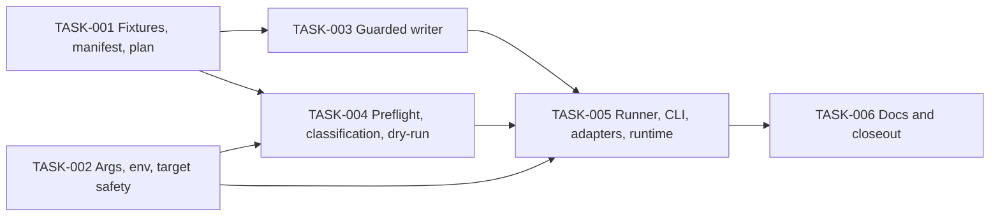

# Demo Team — Tasks

Specification: [SPEC.md](./SPEC.md) (**Approved**, no open design questions)

## Status
Ready: 0  In Progress: 0  Done: 6

Feature-wide constraints for every task: **no Firebase write, no seed
execution and no network call against a real project** during implementation
or review. No project is pre-approved; the first real `--write` needs the
coordinator's explicit approval of the exact project id reported by the online
dry-run (BR-4) and is **not part of any task here**. No `app/api/**`,
`server/`, `domain/`, `client/`, `firestore.rules`, `firestore.indexes.json`,
UI or dependency change (BR-32); no Forum data; no `tsconfig`
compiler-behavior change or new dependency without a STOP-and-report (BR-32).

## Task graph

Authoritative dependencies:

- TASK-001: no dependencies
- TASK-002: no dependencies
- TASK-003: depends on TASK-001
- TASK-004: depends on TASK-001 and TASK-002
- TASK-005: depends on TASK-002, TASK-003 and TASK-004
- TASK-006: depends on TASK-005

Why not linear: TASK-001 (data) and TASK-002 (pure arg/env/project validation —
needs no fixtures) can begin independently. TASK-003 (writer needs only the
manifest/operation types) is unblocked only after TASK-001. TASK-004 needs the
plan (001) and the config types (002). TASK-005 integrates all lanes. Valid
DAG: no cycles; roots 001 and 002.

## BR coverage

| BR | Owner |
|---|---|
| BR-7–BR-11, BR-13–BR-15, BR-17, BR-18, BR-19, BR-20, BR-21 (fixture side) | TASK-001 |
| BR-12 (fixture encryption via injected `encrypt`, plaintext-free data) | TASK-001 |
| BR-1, BR-2, BR-3 (parsing/validation), BR-5 (input requirement), BR-6 (config failures) | TASK-002 |
| BR-16, BR-22, BR-25, BR-30 (writer/batch semantics) | TASK-003 |
| BR-4 (gate text in output), BR-5 (`getUser` existence seam, no email), BR-6 (preflight failures), BR-12 (no plaintext output), BR-21 (compat criteria), BR-23, BR-24, BR-26, BR-27, BR-28, BR-29 (reader seam), BR-31 | TASK-004 |
| BR-3 (mode wiring, `--write` gating), BR-29 (real read-only adapters), BR-30 (ordering: reads/encrypt before batch), BR-32 (runtime/config), BR-33 (real-Node offline smoke) | TASK-005 |
| BR-4 (documented gate), BR-34; re-verification of BR-16, BR-25, BR-31, BR-32 | TASK-006 |

Every BR-1…BR-34 has at least one owner.

## Tasks

### TASK-001 — Deterministic dataset: fixtures, manifest and plan builder

**Status:** Done
**Covers:** BR-7, BR-8, BR-9, BR-10, BR-11, BR-12, BR-13, BR-14, BR-15, BR-17, BR-18, BR-19, BR-20, BR-21
**Depends on:** None

**Outcome**
A pure, I/O-free module in `src/features/demo-team/` builds, from
`(presenterUid, asOf, encrypt)`, the 82 intended document operations (path,
class `C`/`U`, data) plus the manifest of owned paths. Nothing imports
`firebase-admin`.

**Implementation notes**
- Typed structured fixtures per SPEC; Norwegian synthetic content.
- Dates only from the SPEC algorithm (`asOf` → `closedAt_i`, `openedAt_i`,
  `createdAt_i`, `submittedAt`); ids contain no date.
- Response generator: pure, no `Math.random`/clock; sums `round(target × n)`;
  ≥ 2 distinct values per dimension; integers 1–5.
- `encrypt` injected; challenge text passes `validateChallengeText`; response
  plaintext `JSON.stringify([flow, stress, fun])`.
- Audit constant per the SPEC field-by-field table only. **First re-inspect
  each actor field's validator/persisted shape; if the table is wrong for any
  field, STOP and report — never weaken a validator.**
- No `seedOwner`/`isDemo` field; no extra fields; no `teamSurveyState`/
  `surveyParticipations`.
- Manifest derived from the plan; expose a guard rejecting any path not in it.
- Define the shared operation/classification types (`PlannedOperation`,
  action categories) that TASK-003/004 consume.
- Imports inside the slice follow the module-structure decision taken in
  TASK-005; until then keep the module graph minimal and free of `server-only`
  modules.

**Verification**
- Real validators: surveys (`isValidSurvey`), challenges (`isValidChallenge`
  after date decode), trees, progress (node ids exist in tree), membership,
  team status.
- Real `computeSurveyAggregate` (throwaway key, `vi.stubEnv`): 7 published,
  1 insufficient (3 < 5), latest published, means within ±0.13; all answers
  1–5.
- Counts: exactly 82 (1/1/9/59/5/4/3), exact id sets, 56 + 3 = 59 responses,
  `demo-survey-next` has 0 responses, no duplicate paths, only the seven
  collections, no `forum*`, no identity field in responses/challenges, no
  plaintext in serialized ops, `demo-seed` only in the listed fields, presenter
  uid only as membership `uid`/doc-id.
- Dates: same inputs → same plan modulo ciphertext; later `asOf` shifts only
  timestamps, never ids; `submittedAt` strictly within open/close.
- `pnpm typecheck`, `pnpm lint`, focused tests.

**Security / privacy**
Encrypted-only sensitive content; no identity in anonymous records; no
individual skill data; synthetic-only (invariants 1, 5, 6, 7, 15).

**Documentation impact**
None.

**Acceptance criteria**
- [x] BR-7–BR-15, BR-17–BR-21 (fixture side) verified by tests.
- [x] Plan is pure (no Firebase import, no network, no `Math.random`).
- [x] Relevant tests, typecheck and lint pass.
- [x] No conflict with `docs/SECURITY.md`.

**Evidence:** `src/features/demo-team/fixtures.ts` (logical fixtures, date
formulas, RNG-free responses), `plan.ts` (manifest, allow-list guards,
`PlannedOperation`/`WriteClass` types, `buildDemoSeedPlan`), `plan.test.ts`
(28 tests, real validators + real `computeSurveyAggregate`). Typecheck, lint,
full `pnpm vitest run` (2530 tests) and isolated `pnpm build` pass;
review-change: PASS WITH SUGGESTIONS. No Firebase import or access.
Notes for later tasks: persisted `surveys`/`challenges` documents carry no
`surveyId`/`challengeId` field (the id is the document id, as in the existing
server operations; validators are fed the id separately). The SPEC's delivery
`currentNodeId` is `node-4`, which the UI renders as "stage 5 of 6" (the
zero-based index differs from a 1-based "stage 4 of 6" reading); implemented as
specified. Period-3 target means are not in the SPEC and interpolate between
periods 2 and 4. Challenge `resolvedAt`/`archivedAt` are as-of-relative
(−18d / −30d).

---

### TASK-002 — Arguments, environment and target-project safety

**Status:** Done
**Covers:** BR-1, BR-2, BR-3, BR-5, BR-6
**Depends on:** None

**Outcome**
A pure module that parses CLI args and validates env/project consistency into
a typed, validated run configuration (`mode`: offline dry-run / online
dry-run / write). No network, no Firebase import.

**Implementation notes**
- Required `--project`, `--presenter-uid`; optional `--as-of` (strict
  `YYYY-MM-DD`, default today UTC injected via a clock param), `--offline`,
  `--write`, `--confirm`. Reject unknown/duplicate/missing flags,
  `--write` with `--offline`, `--write` without `--confirm`, `--confirm` ≠
  `--project`. Default = dry-run.
- Env per BR-2: the trio all present; `--project` equals
  `FIREBASE_PROJECT_ID`, equals `NEXT_PUBLIC_FIREBASE_PROJECT_ID` when set;
  service-account email domain `@<project>.iam.gserviceaccount.com`.
- No hard-coded project id, allow-list, `.firebaserc` read, CLI/`gcloud` call
  or `applicationDefault()` reference anywhere in the slice.
- Results carry category-only errors; never echo the private key or values.

**Verification**
- Table tests for every missing/mismatched/duplicate/unknown case (zero
  side effects); a static assertion that the slice contains no
  `applicationDefault`, `.firebaserc`, `firebase-tools`/`gcloud` reference and
  no literal project id.
- Offline mode config carries "no network" as a typed capability the runner
  must honor.
- `pnpm typecheck`, `pnpm lint`, focused tests.

**Security / privacy**
Fail-closed target proof; secrets never in messages.

**Documentation impact**
None.

**Acceptance criteria**
- [x] BR-1, BR-2, BR-3 (parsing), BR-5 (input), BR-6 (config) verified.
- [x] No pre-approved project anywhere in code or fixtures (tests use fake ids).
- [x] Relevant tests, typecheck and lint pass.
- [x] No conflict with `docs/SECURITY.md`.

**Evidence:** `src/features/demo-team/config.ts` (`resolveDemoSeedConfig({argv, env, now})` → discriminated `ok` result; `DemoSeedConfig` with `mode`, `network`, `writesAllowed`, `credentials`), `config.test.ts` (73 tests: table-driven arg/env failures, as-of edge cases, no-secret-echo, purity, static slice checks). Typecheck, lint and full `pnpm test` (2603 tests) pass. No Firebase import, network or write.
Notes for later tasks: errors are `{category, subject?}` with fixed flag/variable names only; `--project` must match the GCP project-id shape; blank env values count as unset; a bare `--` separator is rejected as an unknown flag, so TASK-005 must check how `pnpm seed:demo-team -- …` forwards arguments; the private key is passed through as-is (any `\n` unescaping is adapter work in TASK-005).

---

### TASK-003 — Guarded single-batch writer

**Status:** Done
**Covers:** BR-16, BR-22, BR-25, BR-30
**Depends on:** TASK-001

**Outcome**
A writer wrapper over an injected batch seam that accepts only planned
operations: allow-list of the seven collections, manifest membership check,
class `C` → `create`, class `U` → `set`, everything in one batch, atomic
commit semantics. No delete method exists on the seam.

**Implementation notes**
- Validation of the **entire** operation list (allow-list + manifest +
  count ≤ 400) happens before the first batch call; any violation throws with
  zero batch calls.
- The seam exposes only `create`, `set`, `commit`; no `delete`, no query.
- Error output is a category, never raw exception text.

**Verification**
- Fake batch: `forumThreads`/`forumReplies` and every other non-allow-listed
  or non-manifest path fail before any write; `teamSurveyState`,
  `surveyParticipations`, `teamInvitations`, `teamAccessRequests` rejected;
  operations > 400 rejected; a full plan yields exactly one commit; a commit
  failure leaves the fake store unchanged (atomic fake); `C` collision fails
  the whole batch; static check that no delete symbol is reachable.
- `pnpm typecheck`, `pnpm lint`, focused tests.

**Security / privacy**
The structural Forum/collection guard is enforced here (BR-16).

**Documentation impact**
None.

**Acceptance criteria**
- [x] BR-16, BR-22, BR-25, BR-30 (writer side) verified.
- [x] No `firebase-admin` import (seam only).
- [x] Relevant tests, typecheck and lint pass.
- [x] No conflict with `docs/SECURITY.md`.

**Evidence:** `src/features/demo-team/writer.ts` (`writeDemoOperations({operations, manifest, createBatch})`, `DemoWriteBatch` seam with only `create`/`set`/`commit`, `DemoWriteError` carrying a category only: `invalid_operations` / `too_many_operations` / `write_failed`), `writer.test.ts` (fake atomic batch/store; Forum and other non-allow-listed collections, non-manifest paths, wrong class/collection, duplicates, empty list, > 400, commit failure, `C` collision, static no-delete/no-query/no-Firebase checks). Typecheck, lint and full `pnpm test` (2628 tests) pass. No Firebase import or access.
Notes for later tasks: `createBatch()` is called only after the whole list validates. The writer accepts any manifest-owned *subset* (so compatible `C` records can be dropped upstream) and does not require full manifest coverage; an empty list is rejected, so the runner must not call the writer when nothing is planned. The seam is path-based (`{collection}/{docId}`); the TASK-005 Admin adapter maps it to a document reference.

---

### TASK-004 — Preflight, manifest classification and dry-run model

**Status:** Done
**Covers:** BR-4, BR-5, BR-6, BR-12, BR-21, BR-23, BR-24, BR-26, BR-27, BR-28, BR-29, BR-31
**Depends on:** TASK-001, TASK-002

**Outcome**
With injected `Reader` (`get(path)` only), `getUser`-existence seam,
`encrypt`/`decrypt`, it produces (a) the local crypto preflight result, (b) a
classification of **every** manifest path as ABSENT / COMPATIBLE / CONFLICT
with a category reason, (c) planned actions, and (d) the redacted dry-run
report. Zero writes, no Admin SDK import.

**Implementation notes**
- Local crypto preflight (encrypt synthetic probe → decrypt → equal → discard)
  runs in every mode, including offline; failure aborts. Report states it does
  not prove key match with stored ciphertext.
- Online: `getUser(uid)` existence only; result discarded; email never read
  into output; no admin-membership inference; static reminder that the
  presenter must be an app admin via `APP_ADMIN_EMAILS` (external
  prerequisite, not mutated).
- Classification per SPEC compatibility criteria (real validators); actor
  values only where the SPEC says (`createdBy`/`grantedBy`), never
  `updatedBy`/`resolvedBy`/`archivedBy`. Existing demo-owned responses and
  challenges are shape-validated and decrypted with the active key; failure =
  key/data CONFLICT; only manifest paths read; plaintext never surfaced.
- Any CONFLICT ⇒ the result is an abort with no planned writes.
- Dry-run report per SPEC: exact resolved project id, mode, counts by
  collection, per-path action, 0 deletes, visibility warning, gate reminder
  ("coordinator must approve this exact project id before `--write`"),
  redaction rules.
- Reader seam has no query/list method; offline path makes zero reader calls.

**Verification**
- Table tests over all conflict examples in SPEC (malformed shape, wrong
  team, foreign `createdBy`/`grantedBy`, disabled team, tree node mismatch,
  different membership, scheduled id occupied by incompatible data,
  undecryptable response/challenge) ⇒ abort, zero writes; compatible-but-
  edited records (presenter-moved progress with real `updatedBy`, resolved
  demo challenge, opened scheduled survey) ⇒ COMPATIBLE.
- `C`: absent → create, compatible → skip; `U`: absent → create/set,
  compatible → set.
- Crypto preflight: failing key/probe → abort; offline → zero reader calls.
- Output tests: captured report/errors contain no key, ciphertext/iv/authTag,
  decrypted text/answers, presenter email, token or private key.
- `pnpm typecheck`, `pnpm lint`, focused tests.

**Security / privacy**
Fail-closed conflict handling; existing encrypted demo records never
overwritten if undecryptable; redaction.

**Documentation impact**
None.

**Acceptance criteria**
- [x] BR-4, BR-5, BR-6, BR-12, BR-21, BR-23, BR-24, BR-26–BR-29, BR-31 verified.
- [x] No arbitrary non-demo record is read or decrypted.
- [x] Relevant tests, typecheck and lint pass.
- [x] No conflict with `docs/SECURITY.md`.

**Evidence:** `src/features/demo-team/preflight.ts` (`runDemoPreflight`, `runLocalCryptoPreflight`, `formatDemoDryRunReport`; seams `DemoReader.get(path)`, `DemoPresenterLookup.userExists(uid)` → boolean, `DemoCrypto`), `preflight.test.ts` (59 tests with in-memory fakes and a throwaway key: empty/correct/partial targets, compatible-but-edited records, 28 conflict cases incl. undecryptable/key-mismatch, offline zero reads, presenter/read/crypto failures, no mutation, report content and redaction, static no-writer/no-Firebase/no-removal checks). Typecheck, lint and full `pnpm test` (2687 tests) pass. No Firebase import or access.
Notes for later tasks: a conflict yields `{ok: false, error: {category: "conflict"}, classifications}` with no planned operations; success yields `plannedOperations` (only `create`/`set` actions — compatible `C` records dropped), which TASK-005 passes to `writeDemoOperations` together with the manifest. Offline returns all operations with `existingStateChecked: false` and no classifications. The reader adapter must return persisted data with Firestore `Timestamp`s mapped to `Date`, and must return `{exists:false}` for absent documents. `formatDemoDryRunReport` takes only `mode/projectId/presenterUid/asOf`, so credentials can never reach output; TASK-005 prints the returned lines. Conflict reasons are fixed categories (`malformed-shape`, `scope-mismatch`, `foreign-creator`, `team-disabled`, `membership-mismatch`, `structure-mismatch`, `undecryptable`). The preflight does not check `--confirm`/mode gating — that is TASK-005 wiring.

---

### TASK-005 — Runner, CLI entry, Admin adapters, package script and runtime

**Status:** Done
**Covers:** BR-3, BR-29, BR-30, BR-32, BR-33
**Depends on:** TASK-002, TASK-003, TASK-004

**Outcome**
`pnpm seed:demo-team -- …` (name proposed) runs the harness under plain Node
with real Admin SDK adapters (read-only in dry-run); the offline dry-run works
end-to-end with no Firebase or network.

**Implementation notes**
- Runner order: validate args/env → local crypto preflight → (online only)
  build adapters, presenter lookup, manifest reads/classification → encrypt
  all payloads → (write only, requiring `--write --confirm`, all preflight
  green, zero CONFLICT) single batch commit. Adapters are constructed only
  after validation; none in offline mode. Explicit-`projectId`
  `initializeApp` + `cert()`; never `applicationDefault()`.
- **Runtime rule (BR-32):** first attempt the narrowest native-Node-24 module
  structure compatible with existing dependencies, importing only
  `encryption.ts` and pure domain validators from the app; no new dependency,
  no `tsx`, no global TypeScript compiler-behavior change merely for the seed.
  Only a `package.json` script may be added (if safe). **STOP and report before
  making the change** if implementation proves that `allowImportingTsExtensions`
  (or another compiler/`include`/`exclude` `tsconfig` change) or a new
  dependency (e.g. `tsx`) is genuinely required.
- **Do not run online modes or `--write`.** Only the offline dry-run with a
  throwaway in-memory key and a fake project id in the test process env.

**Verification**
- Smoke (child process, real Node, fake env): exit 0, prints resolved target
  and plan counts, no secret material, no Admin SDK initialization, no
  network.
- Wiring tests with fakes: dry-run and offline → zero writes; write → exactly
  one commit; reads/encryption before commit; encrypt or preflight failure →
  zero writes; conflict → zero writes; rerun with fake store → same logical
  documents, no duplicates, ciphertext differs; `--write` without matching
  `--confirm` never reaches the writer.
- `git diff`: only slice files and the `package.json` script (plus any
  coordinator-approved deviation); `pnpm-lock.yaml` unchanged.
- `pnpm typecheck`, `pnpm lint`, full `pnpm test`, then isolated `pnpm build`.

**Security / privacy**
No secrets in the script line or repo; `--env-file` reads the git-ignored
`.env.local` only; entry never prints env values.

**Documentation impact**
None yet (TASK-006).

**Acceptance criteria**
- [x] BR-3, BR-29, BR-30, BR-32, BR-33 satisfied; offline dry-run verified under real Node.
- [x] No dependency/tsconfig change (or stopped and approved first).
- [x] Typecheck, lint, tests and build pass.
- [x] No Firebase contact occurred.

**Evidence:** `runner.ts` (`runDemoSeed`, `stripForwardedSeparator`; returns redacted lines + exit code 0/1/2, never prints), `cli.ts` (process boundary), `adapters.ts` (injected-SDK Admin adapters: named app with explicit `projectId` + `cert()`, bound-project check, `get(path)`-only reader with Timestamp→Date, boolean presenter lookup, create/set/commit-only batch, `loadFirebaseAdminSdk()` via dynamic import so offline never loads `firebase-admin`), `crypto.ts` (real `encrypt`/`decrypt`), `register-ts-resolver.mjs` (native-Node `.ts` resolution hook), `package.json` script `seed:demo-team`, tests `runner.test.ts`, `adapters.test.ts`, `cli.test.ts` (incl. real-Node offline smoke). One small TASK-004 touch: `formatDemoDryRunReport` header reads "preflight before write" in write mode instead of "dry-run (no writes)". Typecheck, lint, full `pnpm test` (2737 tests) and `pnpm build` pass. No dependency, `tsconfig` or lockfile change; no Firebase contact, no `--write`.
Runtime: Node 24.20 type stripping cannot resolve the app's extensionless relative imports, so the script adds `--import ./src/features/demo-team/register-ts-resolver.mjs` (a `module.registerHooks` resolve hook retrying extensionless relative specifiers with `.ts`); with `--conditions=react-server` (for `server-only`) the repo's own `encryption.ts` and domain validators load unchanged. `--env-file-if-exists=.env.local` does not override variables already set in the shell. Node ≥ 24 is required; the repo does not pin a Node version.
pnpm forwarding (verified, pnpm 10.33.2): `pnpm seed:demo-team -- --project …` delivers a leading bare `--` in `process.argv`; without `--` the flags arrive directly. The parser is unchanged; `cli.ts` strips exactly one leading `--` (`stripForwardedSeparator`), so any other positional/second `--` is still rejected.
Private key: `FIREBASE_PRIVATE_KEY` is passed through by config; `adapters.ts` replaces literal `\n` with newlines only at the `cert()` boundary (same as `src/lib/firebase/admin.ts`). A test with a throwaway generated key confirms real `cert()` rejects the escaped form and accepts the normalized one.
Write gates (all required): `--write` + `--confirm` equal to `--project` (config) · no `--offline` · target proof (env trio ↔ `--project`) · local crypto round-trip · plan build/encrypt · adapters bound to the proven project · presenter exists · reads of every manifest path with zero CONFLICT · at least one planned operation · writer re-validates allow-list/manifest before one batch. Notes for TASK-006: a same-as-of rerun writes 79 documents (3 compatible `C` records skipped); not checked by tests: real `firebase-admin` Firestore/Auth behavior (only fakes and the real `cert()`/`Timestamp` were exercised); the preflight-to-commit race remains documented residual risk.

---

### TASK-006 — Documentation and feature closeout

**Status:** Done
**Covers:** BR-4, BR-34; re-verification of BR-16, BR-25, BR-31, BR-32
**Depends on:** TASK-005

**Outcome**
`docs/DEVELOPMENT.md` documents the as-built tool; every BR is confirmed with
evidence; the feature is closed. Seeding any real project remains a separate,
coordinator-directed act and is **not** part of this task.

**Implementation notes**
- `DEVELOPMENT.md`: invocation, modes (offline / online dry-run / write), the
  execution gate (offline → online dry-run reports exact project id →
  coordinator approves that id → write), what is/isn't written (no Forum, no
  deletes), `ENCRYPTION_KEY` must match the target app (local round-trip does
  not prove it), presenter must pre-exist and be in `APP_ADMIN_EMAILS` for
  admin surfaces (not mutated), visibility caveat, Node ≥ 24 if native runtime
  was kept, preflight-to-commit race.
- BR-by-BR audit, dependency/diff audit, security review of guardrails
  (`security-review`/`review-change` over the complete feature).

**Verification**
`pnpm typecheck`, `pnpm lint`, `git diff --check`, full `pnpm vitest run`,
isolated `pnpm build`.

**Security / privacy**
Re-verify from the diff: no secret, no plaintext, no delete, no Forum, no
authorization change, no pre-approved project.

**Documentation impact**
`docs/DEVELOPMENT.md`; command no longer "proposed" only after this task
confirms it exists.

**Acceptance criteria**
- [x] All BR confirmations recorded with evidence.
- [x] Docs synchronized; no undocumented command.
- [x] Typecheck, lint, tests and build pass.
- [x] Confirmed: no Firebase write occurred during the feature.

**Evidence:** `docs/DEVELOPMENT.md` "Demo Team seed" (invocation, env/credentials, modes, execution gate, write gates, conflicts/reruns, guardrails, residual risks); SPEC "Execution interface" no longer "proposed". CLI syntax verified by running the real script offline with a fake project id, a throwaway key and shell-set fake env: both `pnpm seed:demo-team -- --project …` and without `--` work; `--write --offline` and `--write` without `--confirm` exit 2. Note: a real `.env.local` is loaded if present, so a leftover `NEXT_PUBLIC_FIREBASE_PROJECT_ID` for another project correctly aborts (documented). `docs/SECURITY.md` needed no change (no statement contradicted).
BR audit (implementation evidence): BR-1/2/3/5/6 `config.ts` + `config.test.ts`; BR-7–15, 17–21 `plan.ts`/`fixtures.ts` + `plan.test.ts`; BR-16/22/25/30 `writer.ts` + `writer.test.ts`, `runner.test.ts`; BR-4/12/23/24/26–29/31 `preflight.ts` + `preflight.test.ts`, `runner.test.ts`; BR-32/33 `package.json` diff (script only), no tsconfig/dependency/lockfile change, `cli.test.ts` real-Node offline smoke; BR-34/BR-4 gate `DEVELOPMENT.md`. Typecheck, lint, `git diff --check`, full `pnpm vitest run` (2737 tests) and `pnpm build` pass. No Firebase contact and no `--write` during the feature. A `security-review`/`review-change` pass over the whole feature was not run in this task. Unrelated pre-existing working-tree changes (`vitest.config.ts` `maxWorkers`, `SkillTreeCreationForm.test.tsx`) are not part of this feature.
