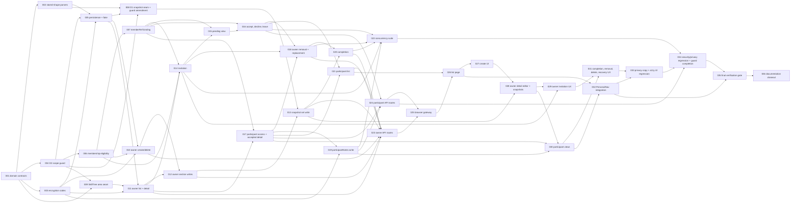

# Development conversations (D2) — Tasks

Specification: [SPEC.md](./SPEC.md) (v2, reviewed 2026-10-14; product, privacy, encryption and security
decisions approved for splitting). Baseline: D1 `personal-development-goals` complete (`a13b175`), locked.

## Status

Ready: 0  In Progress: 0  Done: 36  (derived from the 36 task status lines on 2026-10-27 at the TASK-036 closure turn: TASK-001 to TASK-036 Done. Earlier states are kept as history: on 2026-10-21 at the TASK-036 implementation turn the header read Ready: 0, In Progress: 1, Done: 35; before that transition it read Ready 1, In Progress 0, Done 35.)

Repository convention (`implement-task`): states are `Ready`, `In Progress`, `Done`. A task whose
dependencies are not `Done` stays `Ready` and is skipped until they are; `Depends on` is the gate.
The only dependency-free task is TASK-001; every other task waits on at least one lower-numbered task.

## Ground rules (apply to every task)

- **SPEC.md is authoritative.** Do not redesign or reinterpret it. If implementation shows the SPEC is
  contradictory or unsafe, stop and report the affected BR/SI/CL IDs. Never weaken a `docs/SECURITY.md`
  invariant and never work around a guard.
- **Feature directory** `src/features/development-conversations/` (`domain/`, `server/`, `client/`,
  `components/`, `copy.ts`). Routes under `app/api/me/conversations/`. Pages under `app/me/conversations/`.
- **Subject.** The only subject is the verified-token uid. No `uid`, `ownerUid`, `participantUid`, `teamId`
  as authority, `memberRef` of another party, membership id or e-mail in any path, query, body, persisted
  DTO, log or error. No `authorizeTeamAccess`, `resolveTeamRole`, `requireAppAdmin`, `isAppAdmin` on a
  D2 path (D2-SI-2). No `role` value is ever an input to a decision.
- **Persistence.** Admin SDK only. Owner subtree `userDevelopment/{ownerUid}/conversations/{conversationId}`
  and participant index `userDevelopment/{participantUid}/conversationParticipations/{conversationId}`
  (AD-2). The conversation document is the only authority. No `collectionGroup`. No client
  Firestore access.
- **Encryption.** All encrypt/decrypt calls go through the single codec from TASK-003. No raw
  `lib/encryption` call in any route, operation or component (SPEC AD-5, BR-51, BR-52).
- **Errors.** Stable codes from the SPEC "Stable errors" table only. No raw Firebase, Firestore, crypto or
  stack text in any response or log. Inaccessible cases are uniform `conversation_not_found`.
- **Reads.** Every collection read is a point read or `limit(READ_WINDOW + 1)`. No unbounded helper, no
  `getAll` without a bound, and no "fix later" shortcuts (BR-36).
- **Timestamps.** An injected application clock produces all timestamps (D1 AD-6 pattern). Tasks must not
  choose timestamp semantics independently.
- **Logging.** Titles, notes, goal titles, uids, `memberRef`s, index paths and conversation ids are never
  logged (BR-52, SPEC logging rule).
- **No Firebase access, seed, deploy, migration, backfill, new dependency, new env variable,
  `firestore.indexes.json` change, or `firestore.rules` change** unless the task explicitly says so.
- **Next.js.** `AGENTS.md` requires reading the relevant guide in `node_modules/next/dist/docs/` before
  writing route or page code. Route tasks must do so and record which guide was consulted.
- **Commands** (from `package.json`, via pnpm): `pnpm typecheck`, `pnpm lint`, `pnpm test`,
  `pnpm vitest run <path>`, `pnpm build`. Every task runs typecheck, lint and its focused tests. Full
  `pnpm test` and `pnpm build` are mandatory in the final gate (TASK-035).
- **Tests.** Injected deps and in-memory fakes (D1 `fake-goal-store` pattern). No live Firebase.
  Synthetic data only, labelled as such (invariant 15).
- **D1-area edits** are limited to the two approved surfaces: the D1 static guard test allow-lists
  (TASK-008) and the shared `PersonalNav` component plus its test (TASK-032). No other D1 file is touched.

## Dependency graph

Acyclic by construction: every task depends only on lower-numbered tasks.

## Blocking decisions and implementation decisions

These were found while splitting. They are resolved below as stated, and every affected task cites them.

- **IMPL-1 Deleting `participantNotes` requires a readable payload.** SPEC BR-16, BR-17 and BR-18 require
  `participantNotes` to be deleted on removal or leave. **Reconciled 2026-10-17 (TASK-016 review, product-owner
  decision):** pending decline and accepted self-leave are separate mutation classes. A pending decline never probes
  or decrypts the key and never rewrites the payload; only an accepted leave (and owner removal, TASK-018) needs the
  readable payload. `participantNotes` lives inside the single
  encrypted payload (BR-51), so the deletion must decrypt and re-encrypt the payload. Resolution: removal
  and leave always read and re-encrypt the payload first. When the payload is undecryptable, the operation
  returns `persistence_failed` (key outage) or `conversation_not_found` (malformed payload) and writes
  nothing. Access is not ended in that case, but the participant cannot read content either, because every
  content read decrypts too. The owner can still delete the whole conversation through the recovery path
  (BR-29). **Confirm before TASK-016, TASK-018 and TASK-019 start.** A different resolution would need a
  SPEC change, for example a separately encrypted `participantNotes` field.
- **IMPL-2 Firestore rules test is static, not emulator-based.** SPEC "Test boundaries" names an emulator
  rules test. The repository's rules tests are static text checks
  (`src/lib/firebase/firestore-user-development-rules.test.ts`), and an emulator would add a dependency,
  which the SPEC excludes. Resolution: TASK-004 and TASK-033 use the existing static rules tests and add a
  D2-specific static assertion. **Confirm the wording change at closeout.**
- **IMPL-3 D1 guard amendment has three allow-list surfaces, not one.** The D1 guard needs D2's persistence and
  tests added to the collection-token allow-list (`COLLECTION_TOKEN` for `userDevelopment`), and the snapshot module
  added to the server-importer and store-importer allow-lists. All three are exact-path entries.
  **Timing (product-owner clarification, 2026-10-15):** the two collection-token entries (`conversation-store-types.ts`
  and `conversation-store.test.ts`) landed in TASK-005, because they are the real D2 persistence references. The
  importer entries (server and store importer, the snapshot module) and any D1 goal access remain TASK-008, which lands
  them together. TASK-005 grants no D1 goal access.
- **IMPL-4 Owner-name lookup is a server call only.** `getDisplayNames` is called from one D2 server
  module (`participant-presentation.ts`). No route exposes it (AD-7, CL-20).

## Requirement coverage summary

Full traceability tables are at the end of this file. Every BR-1…BR-53, D2-SI-1…D2-SI-18 and every CL identifier defined in `SPEC.md` (CL-2, CL-5, CL-18…CL-27) is mapped to at least one task. Requirements that are structural or final-verification-only (CL-24) are additionally covered by a static or implementation task, not only by verification or docs.

---

## Foundation

### TASK-001 — Domain contracts: ids, lifecycle, dates, text, limits, DTO keys, errors

**Status:** Done
**Covers:** BR-1, BR-4, BR-5, BR-6, BR-7, BR-35 (input rules shape), BR-39, BR-40 (constant), BR-46, BR-47 (error codes), BR-51 (plain/encrypted key sets), D2-SI-1 (no caller authority fields), D2-SI-12 (DTO key discipline)
**Depends on:** none

**Purpose.** Establish the pure domain vocabulary every later task imports. Keep rules out of routes and UI.

**Expected files/surfaces.**
- `src/features/development-conversations/domain/conversation-constants.ts` (all SPEC constants, see SPEC "Code constants")
- `src/features/development-conversations/domain/conversation-id.ts` (AD-3 segment validation)
- `src/features/development-conversations/domain/conversation-status.ts` (`open` | `completed`, transitions)
- `src/features/development-conversations/domain/plan-date.ts` (`YYYY-MM-DD`, real calendar date, 2020–2100)
- `src/features/development-conversations/domain/text-rules.ts` (NFC, trim, control and separator rejection, code-point and UTF-8 byte caps for title, notes, next step)
- `src/features/development-conversations/domain/errors.ts` (the SPEC stable-error union and HTTP mapping as data)
- `src/features/development-conversations/domain/dto-keys.ts` (exact key allow-lists for owner, participant, pending, summaries, recovery)
- `src/features/development-conversations/domain/*.test.ts`

**Implementation requirements.**
- Constants exactly as the SPEC table: `CONVERSATION_LIMIT = 100`, `PARTICIPATION_LIMIT = 100`,
  `READ_WINDOW = 100`, `TITLE_MAX_CODE_POINTS = 100` (≤ 400 UTF-8 bytes), `NOTE_MAX_BYTES = 4096`,
  `NEXT_STEPS_MAX_ITEMS = 10`, `NEXT_STEP_MAX_CODE_POINTS = 200` (≤ 800 bytes), `SHARED_GOALS_MAX = 5`,
  `CONVERSATION_BODY_MAX_BYTES = 32768`. Exported `as const`, no environment read.
- `conversationId` valid iff `^[A-Za-z0-9_-]{1,128}$` and it contains no `__` anywhere (AD-3: "no `.`, `/` or `__`").
- Status type `open | completed`. Only `open → completed` is a legal transition (BR-4).
- Date: `null` or `YYYY-MM-DD` real date, year 2020–2100 (BR-6, same rule as D1, reimplemented locally).
- Text: NFC, trim, reject `\p{C}` and `\p{Zl}`/`\p{Zp}` (except as the SPEC allows, which is none), code-point
  cap and UTF-8 byte cap both enforced. Notes accept empty (BR-20 clears). Titles and next steps reject empty.
- Next steps: 0–10 items, each 1–200 code points.
- Error union exactly: `unauthenticated`, `conversation_not_found`, `invalid_input`, `payload_too_large`,
  `invalid_goal_selection`, `invalid_participant`, `conversation_completed`, `invalid_transition`,
  `conversation_limit`, `persistence_failed`. HTTP mapping: 401, 404, 400, 413, 400, 400, 409, 409, 409, 500.
- DTO key arrays match SPEC BR-41…BR-44 exactly (pending, owner, participant, owner summary, participant
  summary, recovery). Owner DTO must not include `memberRef`, uids, e-mail or membership ids (BR-42, BR-46).
  Participant DTO must not include `ownerUid`, `participantUid` or any `memberRef` (BR-43).

**Non-goals.** No Firebase import. No route, no operation, no UI. No parsing of stored documents (TASK-002).
No timestamp or clock logic.

**Tests.**
- Unit: id valid/invalid (`.`, `/`, `__x__`, length 129); date valid/invalid (leap year, 2019, 2101,
  `2026-02-30`, time suffix); text: NFC normalisation, control characters, code-point boundary 100/101,
  byte boundary (multi-byte title 101 code points rejected by bytes), next-step count 10/11.
- Negative: DTO key arrays contain no forbidden keys (`uid`, `ownerUid`, `participantUid`, `memberRef`, `email`).
- Error union exhaustive: a `Record` keyed by error code compiles only if all codes are present.

**Acceptance criteria.**
- [ ] All constants match the SPEC table.
- [ ] All validators are pure and total (no throw on unknown input; they return a result).
- [ ] DTO key lists match BR-41…BR-44 exactly.
- [ ] Error union and HTTP mapping match the SPEC table.
- [ ] No Firebase, no `process.env`, no clock inside the domain.

**Implementation notes (2026-10-14).**
- Files: `src/features/development-conversations/domain/` — `conversation-constants.ts`, `conversation-id.ts`,
  `conversation-status.ts`, `plan-date.ts`, `text-rules.ts`, `errors.ts`, `dto-keys.ts`, and a co-located test per module.
- Titles and next steps reject the full `\p{C}`, `\p{Zl}`, `\p{Zp}` set, matching D1's title rule. This also rejects
  zero-width joiners and bidi controls, which protects against spoofing. The SPEC wording (BR-39) says only "control or
  line/paragraph separator". **Finding:** SPEC BR-39 should say "control, format or separator" to match this choice. No
  behaviour change is needed.
- Notes allow LF, CR and TAB, reject other forbidden code points, and are capped by UTF-8 bytes only (4096).
- Conversation ids reject `__` anywhere, as SPEC AD-3 states. The TASK wording "prefix-and-suffix pair" was stale and
  has been corrected to match AD-3 (review 2026-10-14). Auto ids never contain `__`, so no valid id is affected.
- Review corrections (2026-10-14): forbidden DTO keys extended to the BR-46 concepts and encryption internals;
  notes are NFC-only and no longer trimmed (BR-39 trims titles and next steps only); the duplicate forbidden-code-point
  regex is merged; boundary tests added for the AD-3 grammar and for code-point versus byte limits.
- Deliberately deferred to their owning tasks: participant cardinality and binding shape (BR-7, BR-9, TASK-006/007);
  the owner/index stored-shape parsers (BR-51, BR-34, TASK-002); the request-body streaming cap (BR-40, TASK-023); and
  the caller-authority checks (BR-1, D2-SI-1, TASK-010 and TASK-023). TASK-001 supplies only the vocabulary and the
  contracts those tasks import.
- Verification: `pnpm vitest run src/features/development-conversations` → 7 files, 114 tests passed (after review); `pnpm typecheck`
  exit 0; `pnpm exec eslint src/features/development-conversations` exit 0; full `pnpm test` → 6121 tests passed.

**Recommended `/review-change` scope.** Domain module and its tests; check constants and key lists against SPEC.

---

### TASK-002 — Stored-shape parsers and malformed-data classification

**Status:** Done (closed 2026-10-14 after the SPEC CL-27 decision; see Review decisions)
**Covers:** BR-33 (malformed classification), BR-34 (index entry validity), BR-51 (exact plain and encrypted field sets, sixteen plain keys including `keyCheck`, CL-27), BR-52 (no free text in plain fields), BR-53 (classification half), D2-SI-12, D2-SI-13 (classification half)
**Depends on:** TASK-001

**Purpose.** Turn raw stored documents into validated records or into a classified "malformed" result, without
any decryption and without any authorization. The decryption outcome is supplied by the caller (TASK-003).

**Expected files/surfaces.**
- `src/features/development-conversations/domain/stored-owner-conversation.ts` (parse owner document plain fields)
- `src/features/development-conversations/domain/stored-participation-index.ts` (parse `{ownerUid, invitedAt}`)
- `src/features/development-conversations/domain/content-payload.ts` (shape of the decrypted JSON payload: `{title, ownerNotes, nextSteps, participantNotes, sharedGoals}`)
- `src/features/development-conversations/domain/shared-goal-snapshot.ts` (shape `{goalTitle, treeId, targetDate, status, capturedAt}`)
- Co-located `*.test.ts`

**Implementation requirements.**
- Owner document plain fields are exactly BR-51's list. Any extra key → malformed. Any missing required key → malformed.
- Participant tuple (SPEC BR-10, BR-15, corrected at review 2026-10-14; the earlier "all-set or all-null" wording was stale because `participantAcceptedAt` is null while pending). Valid states only:
  - none: `participantUid`, `participantMemberRef`, `participantState`, `participantInvitedAt`, `participantAcceptedAt` all `null`.
  - pending: uid, memberRef and `invitedAt` set; `participantState` `pending`; `participantAcceptedAt` `null`.
  - accepted: uid, memberRef, `invitedAt` and `acceptedAt` set; `participantState` `accepted`.
  - Any other combination, a participant with no `teamId` (BR-2), or a pending participant on a `completed` conversation (BR-13) is malformed.
- Index entry requires string `ownerUid` and valid `invitedAt`. Anything else → invalid (omitted by callers, BR-34).
- A status outside `open | completed`, or a `completedAt` present on an `open` conversation, is malformed.
- Payload shape check runs after decryption (caller supplies a parsed JSON object). Unknown key → malformed. Each
  field re-checked against TASK-001 limits. A limit violation in stored content is malformed, not truncated.
- `classifyStoredConversation(raw, decryptOutcome)` returns exactly one of: `valid` (with record), `malformed`
  (reason code internal only, never returned to clients), or `unreadable_payload` (the caller reports the
  payload could not be authenticated). It never returns `key_unavailable`; that is TASK-003's concern and
  must not reach this function as malformed data (IMPL-1, BR-53).
- Parsers never repair, default or coerce. `createdAt` string-typed or missing → malformed for list purposes.

**Non-goals.** No decryption, no Firestore, no authorization, no DTO mapping. No logging.

**Tests.**
- Valid owner doc (open, no participant; completed with participant; pending; accepted).
- Malformed: extra key, missing key, partial binding, unknown status, `completedAt` on open, bad date, string `createdAt`.
- Index: valid; missing `ownerUid`; `invitedAt` string; extra key (`title` present → invalid, proving no content duplication).
- Payload: valid; extra key; over-limit title; over-limit next-step count; snapshot with unknown key.
- Negative: no parser coerces a malformed value into a valid one (table-driven).

**Acceptance criteria.**
- [ ] Parsers are total and never throw on arbitrary input.
- [ ] The index parser rejects any field other than `ownerUid` and `invitedAt`.
- [ ] No code path returns a `key_unavailable` outcome as `malformed`.

**Implementation notes (2026-10-14).**
- Files: `domain/stored-owner-conversation.ts`, `domain/stored-participation-index.ts`, `domain/content-payload.ts`,
  `domain/shared-goal-snapshot.ts`, a shared pure helper `domain/stored-shape.ts`, and a co-located test per module.
- Stored contract for TASK-005: every BR-51 plain key is always written. Optional values are `null`, never deleted,
  so BR-16 "clear" means setting `null`. A missing or `undefined` key is malformed. There is no `conversationId` field:
  the id is the document path.
- Timestamps: top-level stored instants are `Date`s after the persistence adapter maps Firestore `Timestamp`s (the D1
  pattern). This module imports no Firebase. Decrypted payload instants (`capturedAt`) are canonical ISO-8601 strings
  (`toISOString()` round-trip) and are returned as `Date`.
- Participant binding: all-null (no participant) or all-set. `participantAcceptedAt` is set exactly when the state is
  `accepted` (BR-10, BR-15). A participant on a conversation with no `teamId` is malformed (BR-2).
- Envelope: `keyVersion` must be `"v1"`. `ciphertext`, `iv` and `authTag` must be canonical padded base64. The IV must
  decode to 12 bytes and the tag to 16 bytes. The constant is repeated because `lib/encryption` is server-only; TASK-003
  must keep them equal.
- `keyCheck` (CL-27): plain field, sixteenth canonical key. Form only: canonical padded base64 of exactly 32 decoded
  bytes, else malformed with reason `key_check`. It is passed to the decrypt seam inside `StoredEnvelope` so the codec
  can compare it. This module never compares it, and it is not part of the valid record or any DTO. A
  structurally valid `keyCheck` is accepted as stored metadata. `KEY_CHECK_CONTEXT` (`devpulse.d2.conversation-key-check.v1`)
  and `KEY_CHECK_BYTES` (32) are the single definitions, pinned by tests. TASK-003 imports them. No HMAC is computed here.
- Classification signature (deviation from the TASKS sketch): `classifyStoredConversation(raw, decrypt)` takes a
  function, not a precomputed outcome. The plain shape and envelope are checked first, and `decrypt` runs only after
  they pass, so malformed data is never sent to the codec. Exceptions from `decrypt` are not caught, so a key outage
  propagates and cannot become `malformed` (BR-53). `DecryptOutcome` has no key-unavailable variant.
- Malformed results carry an internal `reason` code only. Results never echo stored values.
- Snapshot `goalTitle` uses the TASK-001 title rule (NFC, trim, forbidden code points, caps). `status` is the local set
  `active | completed` (CL-5: no D1 domain import). `treeId` is a non-empty string or `null`.
- Not checked here, by design: timestamp ordering (`updatedAt >= createdAt` is a D1 rule, not a D2 SPEC rule;
  `acceptedAt` after `invitedAt` and `completedAt` after `createdAt` are not stated either). Deferred until the SPEC
  states them.
- Verification: `pnpm vitest run src/features/development-conversations` → 11 files, 252 tests passed (TASK-001 regression
  included: its 7 files, 114 tests, unchanged); `pnpm typecheck` exit 0; `pnpm exec eslint src/features/development-conversations`
  exit 0.
- Verification after CL-27 (2026-10-14, `/review-change`): `pnpm vitest run src/features/development-conversations` → 12 files,
  323 tests passed. TASK-001 subset (7 files, 114 tests) unchanged and green. `pnpm typecheck` exit 0. `pnpm exec eslint
  src/features/development-conversations` exit 0. `git diff --check` exit 0. No file outside the two D2 directories changed.

**Review decisions (2026-10-14, independent review of TASK-002).**
- **Null versus absent (approved, D2 deviation from D1).** D1 treats a `null` optional as malformed and deletes fields
  instead (`personal-goals/domain/goal.ts`). D2 deliberately does the opposite: every BR-51 plain key is always present,
  and an optional value is `null`. Reasons: BR-51 lists these keys as the complete plain field set; exact-key parsing
  is only unambiguous when the key set is fixed (absence could mean "optional" or "malformed"); BR-16 clears a binding
  in one transaction, which is a set-to-null write; and the stored shape stays one deterministic form. TASK-005 must
  always write all canonical keys, and a missing or `undefined` key is malformed. PATCH absence ("unchanged") is an
  input-layer rule (TASK-012) and is separate from persisted `null`.
- **Completed with a pending participant is malformed.** BR-13 and CL-25 withdraw any pending invitation in the same
  transaction as completion, so no valid operation can produce that state.
- **Timestamp boundary.** The Firestore `Timestamp` ↔ `Date` mapping belongs only to the TASK-005 adapter. This parser
  takes `Date`s and imports no Firebase. Payload `capturedAt` is a canonical ISO string (BR-25), parsed to a `Date`.
- **Decrypt seam.** `classifyStoredConversation` takes a caller-supplied `decrypt(envelope)` and imports no TASK-003 code.
  `DecryptOutcome` has only `decrypted` and `authentication_failed`. A key or operational failure must throw, and
  classification never catches it (covered by test).
- **Base64 canonicality.** The envelope must be the encoder's exact output, including zero trailing bits. Node's decoder
  accepts non-canonical trailing bits, so the check is explicit.
- **Descriptor-based exact keys.** `hasExactKeys` reads own property descriptors and never invokes a getter. Symbol,
  non-enumerable, inherited and accessor properties fail.
- **Wrong-key decision (resolved 2026-10-14: option a, SPEC CL-27).** AES-GCM with a wrong but well-formed
  `ENCRYPTION_KEY` fails authentication on every document, and the BR-53 probe cannot detect that. The SPEC now adds
  BR-51 `keyCheck` and classifies the cases as follows. (1) Malformed structure, envelope or `keyCheck` form: malformed.
  (2) Structurally valid `keyCheck` that does not match the configured key: operational, `persistence_failed`, never
  malformed, never `unreadable_payload`, never recovery. (3) Matching `keyCheck` and failed GCM authentication:
  `unreadable_payload`. (4) Missing, invalid or underivable key: operational. (5) Matching key, successful
  authentication and a malformed payload: malformed. This task's contract matches that outcome. `authentication_failed`
  is still the only path to `unreadable_payload`, and the codec must throw for cases 2 and 4 so they never reach it.
- **Required before TASK-003 starts (handoff, see TASK-003 "Key-check handoff").** The codec, not this module, does the
  comparison.
- **Helper constants.** `STORED_KEY_VERSION` is duplicated because `lib/encryption` is server-only. TASK-003 must add a
  mandatory test that asserts equality with the helper.

**Recommended `/review-change` scope.** Domain parsers and tests; verify exact key sets against BR-51 and BR-34.

---

### TASK-003 — Encryption codec: the single seam over the existing helper

**Status:** Done (2026-10-14, after the approved helper amendment; see Implementation notes)

**Blocker (2026-10-14, implement-task; resolved by the approved option A, see Implementation notes).** `src/lib/encryption/encryption.ts` exports only `encrypt` and `decrypt`.
`readEncryptionKey()`, which parses `ENCRYPTION_KEY` into the 32 key bytes, is private. The CL-27 `keyCheck` is an HMAC
keyed with those same bytes (BR-51). The codec therefore cannot compute or compare `keyCheck` through the helper's public
API, and the mandatory rule "the codec reads `ENCRYPTION_KEY` only through the helper" cannot be met as written. Evidence:
the whole helper file is 98 lines; `readEncryptionKey` is not exported. The helper also returns a decrypted `string`,
so the codec cannot detect invalid UTF-8 without access to the bytes, which blocks the "no Buffer/string coercion" rule
for class 5. Narrowest options for a decision (no code written):
- (A, recommended) Export one read-only function from `src/lib/encryption/encryption.ts`, for example
  `readEncryptionKeyBytes()`, returning the same validated 32-byte key that `encrypt` and `decrypt` use. No behaviour change.
  The codec then derives `keyCheck` from those bytes, and the compatibility test can prove both operations use the same key.
  This modifies the helper, so it needs explicit approval under the scope rule.
- (B) The codec copies the `ENCRYPTION_KEY` parsing rules and reads the environment itself. This contradicts the TASKS
  rule "never reads the environment itself" and needs an amendment. It also cannot prove key-interpretation equality.
- (C) Export a `keyCheck` function from the helper module. This is also a helper change, and it broadens the helper's API.
Also confirmed by reading (not blocking): after a successful key preflight and a matching `keyCheck`, the only throw from
the helper's `decrypt` is the GCM `final()` authentication failure, because IV and tag lengths are validated first. Mapping
any such throw to `payload_unauthenticated` therefore has evidence, but a helper change that returns bytes would make it explicit.
**Covers:** BR-51, BR-52, BR-53, CL-18, D2-SI-11, D2-SI-13 (failure classes), AD-5
**Depends on:** TASK-001

**Purpose.** One module owns every encrypt/decrypt call for D2, returns explicit failure classes, and
implements the BR-53 key probe. Operational failure is distinct from malformed data.

**Expected files/surfaces.**
- `src/features/development-conversations/server/content-codec.ts` (`import "server-only"`; wraps `src/lib/encryption/encryption.ts`)
- `src/features/development-conversations/server/content-codec.test.ts`
- `src/features/development-conversations/server/fake-content-codec.ts` (test double: deterministic, no crypto)

**Implementation requirements.**
- Public surface: `probeKey()`, `encodeContent(payload) → EncryptedContent | failure`, `decodeContent(encrypted) → result`.
- `probeKey()` calls the existing `encrypt` on a fixed probe string and discards the output (BR-53). It maps a
  thrown key error to `{ ok: false, error: "key_unavailable" }`. The helper's error message is never returned,
  logged or wrapped into a visible string.
- `decodeContent` distinguishes three failures. `{ ok: false, error: "key_unavailable" }`: a missing or invalid configured
  key, or an expected `keyCheck` that cannot be derived. `{ ok: false, error: "key_mismatch" }`: the stored `keyCheck` is
  well formed but differs from the expected value for the configured key. `{ ok: false, error: "payload_unauthenticated" }`:
  only when the `keyCheck` matches and AES-GCM authentication or format fails for this document. `key_unavailable` and
  `key_mismatch` are operational and map to `persistence_failed`. Only `payload_unauthenticated` may become
  `authentication_failed` for the TASK-002 classifier. The helper's message is never returned.
- Encrypted field set is exactly `{ title, ownerNotes, nextSteps, participantNotes, sharedGoals }` (BR-51). The
  codec does not accept or emit any other free text.
- The stored object is exactly `{ ciphertext, iv, authTag, keyVersion, keyCheck }` (CL-27). `keyCheck` is the only stored
  value derived from the key, and it is computed exactly as BR-51 specifies. No additional authenticated data is
  added (SPEC known limitation; the helper does not support it). Do not fork the helper.
- The codec reads `ENCRYPTION_KEY` only through the helper. It never reads the environment itself.
- Probe is called once per request by the operation layer (TASK-011), not per document.

**Non-goals.** No key rotation, no version dispatch, no new env variable, no change to `src/lib/encryption`.
No route code. No direct `lib/encryption` import outside this module (enforced by TASK-004 and TASK-034).

**Tests.**
- Round-trip: `decodeContent(encodeContent(p))` equals `p` for the approved payload, including Norwegian letters and emoji.
- Tampered `ciphertext`, `authTag` or `iv` → `payload_unauthenticated`.
- Wrong key: encode under key A, decode under key B (set via the helper's env in the test) → `key_mismatch`, never `payload_unauthenticated`.
- Missing key and invalid base64 key → `key_unavailable` from both `probeKey` and `decodeContent`.
- Stored object contains no plaintext substring of title or notes (serialise the encoded object and search).
- Error objects contain no ciphertext, IV, key material or helper message.
- Test key is a generated value in the test; never the `.env.local` value.

**Acceptance criteria.**
- [ ] One module; no other D2 file imports `lib/encryption`.
- [ ] `key_unavailable`, `key_mismatch` and `payload_unauthenticated` are distinct everywhere.
- [ ] No plaintext persisted in any test-produced stored object.

**Key-check handoff (CL-27, decided 2026-10-14). TASK-003 MUST implement and test all of the following.** None of it
was implemented by TASK-002.
1. The exact keyed derivation in BR-51: HMAC-SHA-256 with the decoded 32-byte configured `ENCRYPTION_KEY` as the key and
   the UTF-8 bytes of `KEY_CHECK_CONTEXT` as the message. Output is the standard padded base64 of 32 bytes. Import the
   constant from `domain/stored-owner-conversation.ts`. Do not redefine it.
2. Domain separation: the context is the only message, and a test proves a different context yields a different value.
3. Deterministic expected `keyCheck` generation: the same key always gives the same value. Add a fixed-vector test
   computed independently in the test.
4. Comparison of the stored and expected `keyCheck`, using `crypto.timingSafeEqual` on equal-length buffers
   (constant-time where practical; a length mismatch is `key_mismatch` before comparison).
5. Constant-time comparison: as in item 4.
6. Missing or invalid configured key → `key_unavailable` → operational failure (`persistence_failed`).
7. `keyCheck` mismatch → `key_mismatch` → operational failure (`persistence_failed`).
8. `keyCheck` match + GCM authentication failure → `payload_unauthenticated` → `authentication_failed` →
   `unreadable_payload`.
9. Successful decrypt + malformed plaintext stays distinct: it is malformed (TASK-002 payload semantics), not a key outage.
10. Mandatory equality test: `STORED_KEY_VERSION` (`"v1"`, TASK-002) equals the `keyVersion` the existing helper returns from
    `encrypt`. The helper does not export `KEY_VERSION`, so the test encrypts with the helper and compares the output (TASK-002 note).
11. No raw key or `keyCheck` in any public error, log or thrown message.
12. No recovery classification for a wrong-key or configuration failure. The operation adapter must throw for
    `key_unavailable` and `key_mismatch` so they never reach `classifyStoredConversation` as `authentication_failed`.

**Caller seam.** The decrypt function given to `classifyStoredConversation` receives the `StoredEnvelope`, including
`keyCheck`. It returns `decrypted` or `authentication_failed` (for `payload_unauthenticated` only). It throws for
`key_unavailable` and `key_mismatch`.

**Recommended `/review-change` scope.** Codec and tests; check IMPL-1, BR-53 wording, CL-27 and the no-leak assertions.

**Implementation notes (2026-10-14).**
- **Decision applied.** Option A from the Blocker, with the narrow helper amendment, approved for this task. Option B
  (a second `ENCRYPTION_KEY` parser in D2) and option C (a `keyCheck` function in the helper) were not used.
- **Helper amendment (`src/lib/encryption/encryption.ts`, additive, no behaviour change).**
  - `readEncryptionKey` is renamed to the exported `readEncryptionKeyBytes()`. It is still the only `ENCRYPTION_KEY`
    parser. It returns a fresh 32-byte buffer per call (no cache), never the raw string, and its errors never echo the value.
  - `decryptToBytes(payload): Buffer` is the same AES-256-GCM path as `decrypt`, returning authenticated bytes before UTF-8.
    `decrypt` now calls it and keeps its string return.
  - `EncryptedPayloadAuthenticationError` is thrown only when `decipher.final()` fails. It is the one expected authentication
    failure, identified by class, not message. Its message is fixed. Node's message is no longer surfaced by `decrypt`
    (no caller depends on it; the full suite passes).
  - `encrypt` and the public `decrypt` signatures and outputs are unchanged. Existing callers (demo-team, challenges, forum)
    are not migrated.
- **Single key source.** The codec derives keyCheck from `readEncryptionKeyBytes()`. `encrypt` and `decryptToBytes` read the
  same variable through the same function. The codec has no `process.env` access and no base64 or length logic of its own.
- **keyCheck (CL-27).** `deriveKeyCheckBytes` is HMAC-SHA-256, keyed with the 32 key bytes, over the UTF-8 bytes of
  `KEY_CHECK_CONTEXT` (imported from TASK-002, not redefined). The test pins a fixed vector computed by Node independently,
  and a different context produces a different value. Comparison is `timingSafeEqual` over decoded 32-byte buffers, after a
  length check, so a length mismatch is `key_mismatch` before comparison.
- **Decode order (locked).** Key bytes → keyCheck → helper `decryptToBytes` (`payload_unauthenticated` only for
  `EncryptedPayloadAuthenticationError`; any other throw is an unexpected failure, not an auth failure) → strict UTF-8
  (`TextDecoder` with `fatal: true`, `ignoreBOM: true`) → `JSON.parse` → TASK-002 `parseConversationContent`.
  UTF-8, JSON and payload failures all return `malformed_payload`.
- **Decrypt seam for TASK-002.** `decryptForClassification` returns `decrypted` (the parsed JSON value), or
  `authentication_failed` for `payload_unauthenticated` only. It throws `ContentKeyError` (message = the stable code) for
  `key_unavailable` and `key_mismatch`. A malformed plaintext returns `decrypted` with a `null` payload, which the TASK-002
  parser rejects as malformed, so it never becomes an authentication failure.
- **Public surface.** `probeKey()`, `encodeContent(content)`, `decodeContent(envelope)`, `decryptForClassification(envelope)`,
  `deriveKeyCheckBytes(keyBytes)`, `ContentKeyError`. The stored object is exactly `{ ciphertext, iv, authTag, keyVersion, keyCheck }`,
  with `keyVersion` set to TASK-002 `STORED_KEY_VERSION`.
- **Probe.** `probeKey()` checks that keyCheck can be derived, then makes one helper `encrypt` on a fixed string and discards
  the output. Any failure there is `key_unavailable`. The operation layer (TASK-011) calls it once per request.
- **Fake (`server/fake-content-codec.ts`).** Deterministic, no crypto, no key. Content is kept as JSON text in a private map.
  Stored envelopes are structurally valid (TASK-002 lengths). An unknown handle is `payload_unauthenticated`. `setKeyFailure`
  simulates `key_unavailable` or `key_mismatch`.
- **Mandatory tests (all pass).** Helper: accessor returns the 32 validated bytes, missing/invalid/short-key failures are
  kept, decryptToBytes returns the exact authenticated bytes, string `decrypt` is compatible, tampering still fails, and
  no key appears in errors. Codec: round-trip (Norwegian letters and emoji), stored object has no plaintext substring,
  `keyVersion` equals the helper's own output, fixed keyCheck vector, AES/keyCheck equality (the stored envelope decodes only when
  both use the same key), wrong key → `key_mismatch`, tampered ciphertext/tag/IV → `payload_unauthenticated` (keyCheck matching),
  missing and invalid keys → `key_unavailable` from `probeKey`, `encodeContent` and `decodeContent`, malformed plaintext
  (invalid UTF-8 inside a valid string, BOM, bad JSON, bad shape) → `malformed_payload` and `malformed` through the classifier,
  no logging, exact failure objects with no extra fields.
- **Leakage.** Failure results, thrown messages and the stored envelope are checked for key, keyCheck, ciphertext, IV and
  helper text. None appears.
- **DTO keyCheck.** Absent from every public DTO allow-list. The codec test now pins that with an explicit assertion. The
  static guard over the whole allow-list set is deferred to TASK-004 (dimension 8). `FORBIDDEN_DTO_KEYS` is not edited here, to avoid reopening TASK-001.
- **Mutation evidence.** Replacing the keyCheck gate with `false` fails four tests. Replacing the strict UTF-8 decoder with a
  non-fatal one fails the invalid-UTF-8-inside-a-string test. Both mutations were reverted and the file was restored byte-for-byte.
- **Verification (2026-10-14).** `pnpm vitest run src/lib/encryption` → 25 passed. `pnpm vitest run src/features/development-conversations`
  → 14 files, 369 passed. `pnpm typecheck` exit 0. `pnpm exec eslint src/features/development-conversations src/lib/encryption` exit 0.
  `git diff --check` exit 0, and the new D2 files have no trailing whitespace or tabs. Full `pnpm test` → 6425 of 6426 passed at the time of this run. The one
  failure was the D1 guard comment collision, since resolved (see Findings below).
- **Scope.** Changed: `src/lib/encryption/encryption.ts`, `src/lib/encryption/encryption.test.ts`, and the new
  `src/features/development-conversations/server/` files (`content-codec.ts`, `content-codec.test.ts`, `fake-content-codec.ts`,
  `fake-content-codec.test.ts`). Not touched: D1, membership and memberRef, Firestore rules and indexes, persistence/store, API
  routes, UI, PersonalNav, `package.json`, lockfile, Demo fixtures, Firebase configuration, SPEC.

**Deferred.**
- TASK-004 dimension 8 pins the persisted and DTO allow-lists statically. The DTO absence of `keyCheck` is already asserted in the codec test.
- Whether `keyCheck` should be added to `FORBIDDEN_DTO_KEYS` is left open (it is TASK-001 territory). It is not needed for safety now.

**Findings (not fixed here; outside TASK-003 scope).**
- **Resolved (2026-10-14, comment-only rewording).** The earlier blocking failure in `personal-goals-scope-guard.test.ts` ›
  "only the approved files reference the collection identifier" was caused by the literal `userDevelopment/...` path in doc comments
  of `domain/stored-owner-conversation.ts` and `domain/stored-participation-index.ts`. Those two comments were reworded to describe
  the D2 owner subtree and participant index without the literal. No executable code changed, and the D1 guard and its allow-lists
  were not changed. Isolated guard: 38/38 pass. Full `pnpm test`: 320 files, 6426/6426 pass. The D1 guard still does not allow
  D2 persistence files; the intentional D1 snapshot seam remains with TASK-008.

---

### TASK-004 — D2 static scope guard (initial, strict)

**Status:** Done
**Covers:** D2-SI-16 (static part), D2-SI-18 (no admin/lead surface, static part), BR-52 (static part), AD-10, IMPL-2
**Depends on:** TASK-001

**Purpose.** Install change-detection from the start, modelled on D1's guard (TASK-003 in D1), so later
tasks run under it. This is change detection, not a security boundary (SPEC wording).

**Expected files/surfaces.**
- `src/features/development-conversations/development-conversations-scope-guard.test.ts`
- Pure scanner functions reused in later tasks.

**Implementation requirements.**
- Dimensions (each with a negative virtual fixture proving it fires):
  1. Collection identifiers: `conversations` and `conversationParticipations` under `userDevelopment` may
     appear only in approved D2 persistence files (set empty now; TASK-005 adds its file).
  2. No `collectionGroup`, no `runTransaction` on a group, no client SDK imports (`firebase/firestore` client,
     `firebase/app` client).
  3. Forbidden imports in D2 production code: `skill-profiles`, `team-skills`, `roadmap`, `skill-trees/server`
     (catalog seam is D2-local), `results`, `forum`, `surveys`, `challenges`, `authorizeTeamAccess`,
     `resolveTeamRole`, `requireAppAdmin`, `isAppAdmin`, `personal-goals` **except** the approved snapshot module
     (added by TASK-008).
  4. Forbidden identifiers in D2 production code: `skillProfiles`, `teamSkillNeeds`, `roadmapItems`, `skillProgress`,
     `roleDefinitions`, `checkIns`, `notification`, `email`/`sendMail`, `calendar`, `collectionGroup`.
  5. Direct `lib/encryption` imports only from the TASK-003 codec.
  6. No `console.` or logger call in D2 production code that receives a variable named `title`, `notes`, `body`,
     `memberRef`, `uid`, `ownerUid`, `participantUid` (static lexical check, documented as limited).
  7. Forbidden concepts in D2 production text: score, rating, rank, performance, productivity, lead dashboard,
     `read receipt`, `lastViewed`, `last_viewed`, `on track`, manager note.
  8. Persisted key allow-lists (owner doc, index, payload) are pinned to TASK-002's exports.
- Header states SPEC limitations (change detection, cannot prove runtime behaviour).
- D1 files untouched in this task.

**Non-goals.** No allow-list edits to D1 (TASK-008). No runtime behaviour tests (TASK-022, TASK-034).

**Tests.** Real-tree pass on domain files; each dimension's negative fixture fails. Run the D1 guard and the
C1/C2 guards unchanged and passing.

**Acceptance criteria.**
- [x] All eight dimensions implemented with negative fixtures.
- [x] Header documents limitations.
- [x] No D1, C1, C2 or roadmap file modified.

**Security / privacy.** Static evidence only; TASK-022 and TASK-034 add behavioural evidence.

**Recommended `/review-change` scope.** Guard file; confirm each dimension has a fixture that fails when violated.

**Implementation notes (2026-10-14).**
- **Status.** Done. Single new file `development-conversations-scope-guard.test.ts`, 26 tests (real-tree pass plus a negative fixture per dimension, and the sanity checks).
- **Dimension 1 includes the participant index.** `conversationParticipations`, the quoted `conversations` segment, and the interpolated `}/conversations` path are scanned tree-wide (src and app), comments included. `userDevelopment` is scanned in D2 files only, since the D1 guard owns it tree-wide. The approved list is empty.
- **Dimension 2 covers all D2 files, tests included.** Dimension 3 covers D2 production code only, as the wording says. The approved personal-goals list is empty until TASK-008.
- **Dimension 5 approves two files.** The codec and its own test, which imports the helper for the `STORED_KEY_VERSION` equality and the `keyCheck` vector (TASK-003 handoff items 3 and 10). The sub-rule "client code imports no D2 server module or the codec" and the `server-only` marker on every D2 server production module sit under this dimension.
- **Dimension 8 has two parts.** Persisted sets (the four TASK-002 exports) are pinned by exact expected sets. DTO allow-lists are checked from the module's exports and from its source text, so a future `*_KEYS` array is covered automatically.
- **keyCheck decision.** `FORBIDDEN_DTO_KEYS` is not edited (TASK-001 is closed). The guard owns an additional `INTERNAL_ONLY_KEYS` list (`keyCheck`, `keyVersion`, `ciphertext`, `iv`, `authTag`, `participantUid`, `participantMemberRef`, `ownerUid`, and the key-failure names). The two sets are additive, not contradictory.
- **Comment policy.** Storage references count comments, because a comment with a live path is a construction hint and was the D1 incident. Imports, identifiers, concepts and log calls use comment-stripped code. In `domain/dto-keys.ts` only, string-literal contents are removed before the identifier and concept scans, so the negative list there does not trip them. Its allow-lists are still checked by dimension 8.
- **Limits.** Dimension 6 is a lexical check over log-call arguments. It also flags property keys with a sensitive name, such as `{ ownerUid: x }`. Dimension 7 has no copy exemption; TASK-033 decides how copy with a negated phrase is handled.
- **Review fixes (2026-10-14, `/review-change`).** Three narrow fixes. (a) The comment stripper is now string-, template- and regex-aware, because `"//"` or `"src/**"` in a string had hidden later code from the scans. (b) The personal-goals seam is keyed by an exact importer and module pair, not by importer alone. (c) The DTO module keeps its allow-lists in the name scans and removes only the forbidden list. Review verdict: PASS WITH SUGGESTIONS, 0 Blocking, 0 Important after the fixes.
- **Deferred to other tasks.** The `getDisplayNames` caller check (AD-7, IMPL-4) and the logging sweep across all files are TASK-034. The D1 guard's persistence allow-list changes are TASK-008 (IMPL-3).

---

## Persistence and identity

### TASK-005 — Persistence store (Admin SDK) and in-memory fake

**Status:** Done
**Covers:** BR-33 (window query and recovery scan), BR-34 (participant window query), BR-36 (bounded reads), BR-37 (count aggregation), BR-48 (transactional write API), BR-29 (delete primitive), D2-SI-11, D2-SI-12 (raw material only), AD-2, AD-9
**Depends on:** TASK-002, TASK-003, TASK-004

**Purpose.** Persistence boundary that returns raw material and never classifies, authorizes or maps errors.
Authoritative conversation documents and participant index documents are separate paths; this store exposes
them separately, and a transaction helper can touch both.

**Expected files/surfaces.**
- `src/features/development-conversations/server/conversation-store-types.ts` (interfaces, path segment asserts, read limit constants)
- `src/features/development-conversations/server/conversation-store.ts` (default Admin SDK implementation)
- `src/features/development-conversations/server/fake-conversation-store.ts` (in-memory; uses real path shape)
- Tests: `conversation-store.test.ts` (with a Firestore double), `fake-conversation-store.test.ts`
- TASK-004 guard allow-list update: add exactly these persistence files to the collection-identifier allow-list.

**Implementation requirements.**
- Methods (all take the verified owner or participant uid as first argument; path segments asserted):
  - `listOwnerWindow(ownerUid)`: `orderBy("createdAt","desc").limit(READ_WINDOW + 1)`, returns raw docs and `rawCount`.
  - `scanOwnerMissingCreatedAt(ownerUid)`: `select("createdAt").limit(READ_WINDOW + 1)`, no `orderBy`.
  - `countOwner(ownerUid)`: `count()` aggregation over the owner subcollection.
  - `getOwner(ownerUid, id)`: point read, `undefined` when absent; read failures reject.
  - `listParticipationWindow(callerUid)`: `orderBy("invitedAt","desc").limit(READ_WINDOW + 1)`.
  - `countParticipation(callerUid)`: `count()` aggregation.
  - `getParticipation(callerUid, id)`: point read.
  - `runTransaction(work)`: one Firestore transaction with `tx.getOwner`, `tx.setOwner`, `tx.updateOwner`,
    `tx.deleteOwner`, `tx.getParticipation`, `tx.setParticipation`, `tx.deleteParticipation`. Paths are built from
    segments; no caller-built paths.
- Store returns raw data and never validates, classifies, repairs or authorizes.
- Writes persist every canonical owner-document key exactly as supplied, including the sixteenth key `keyCheck` (BR-51,
  CL-27) from the TASK-003 codec. The store never computes, compares or repairs `keyCheck`.
- Writes: `create` generates an id (injected generator in the fake); `set` and `update` never overwrite a
  document they were not asked to touch.
- No query without `limit`. No `collectionGroup`. No query with `where` on an encrypted field.
- Fake mirrors the production path shape and the window and count semantics so later tasks test real behaviour.

**Non-goals.** No operation logic. No DTO mapping. No indexes (AD-9). No rules edit (AD-10).

**Tests.**
- Path shape for owner and index documents; index path uses `participantUid` as the subtree.
- Window: 101 raw returned for a 101+ set; `rawCount` correct; order `createdAt desc` and `invitedAt desc`.
- Recovery scan returns only ids and `createdAt` presence (projection test).
- Count aggregation returns integer; malformed docs counted.
- Transaction: owner write and index write commit together; an injected failure on the second write leaves neither.
- Fake and production store give the same results for the same fixture set (shared contract test).
- No query in the module lacks a limit (static assertion on source text).

**Acceptance criteria.**
- [x] Every read is bounded; no unbounded helper exists.
- [x] Owner and index are separate subcollections; transaction helper is the only multi-document write path.
- [x] Fake and production share the contract test.
- [x] `firestore.indexes.json` unchanged (verified in the diff).

**Recommended `/review-change` scope.** Store, fake and contract tests; verify boundedness and path construction.

**Implementation notes (2026-10-14).**
- **Files.** `server/conversation-store-types.ts` (path segments and asserts, read limit, canonical write shapes, the store and transaction interfaces; the only production file with the protected literals), `server/conversation-store.ts` (Admin implementation), `server/fake-conversation-store.ts` (in-memory), and the tests `conversation-store-contract.test.ts` (one suite, run against both), `conversation-store.test.ts` (Admin specifics and paths), `fake-conversation-store.test.ts`. Test support: `server/conversation-store-test-support.ts` (the recording Admin double). The asserts sit in the types module, not the store, so the storage literals stay in one file.
- **Store primitives.** Reads: `listOwnerWindow` (`orderBy createdAt desc`, `limit(101)`), `scanOwnerMissingCreatedAt` (`select createdAt`, `limit(101)`, no `orderBy`), `countOwner`, `getOwner`, `listParticipationWindow` (`orderBy invitedAt desc`, `limit(101)`), `countParticipation`, `getParticipation`. Writes exist only inside `runTransaction`: `createOwner`, `setOwner`, `updateOwner`, `deleteOwner`, `setParticipation`, `deleteParticipation`, plus `getOwner` and `getParticipation` for reads inside the transaction. `newOwnerId` is allocation only, with no write.
- **Added to TASKS' list.** `createOwner` (TASKS says "create", and the method list has no create), `updateOwner` (TASKS says "update"), and `newOwnerId`. Each is a storage primitive with no lifecycle rule.
- **Raw data, not parsed.** The store returns raw data and never validates, as TASKS says. Parsing is the operations' job through the TASK-002 parsers. Only top-level Firestore `Timestamp`s become `Date`s (the D1 pattern, and the TASK-002 handoff).
- **Writes.** Every canonical key is written field by field, and nothing is spread from a caller object. A canonical key that is `undefined` throws rather than being stored as absent. `updateOwner` writes only the canonical keys the caller set. `keyCheck` is passed through, never computed or compared, and the store never imports the codec or the helper.
- **Windows.** A document without the ordered field is not in an `orderBy` window, as in Firestore. The fake and the double both model this, and the contract test checks it. The probe document is never returned, and `rawCount` is the query size, at most 101.
- **Transactions.** Writes are applied together or not at all. A read after a write is rejected, as in Firestore. The fake uses the same rule.
- **Errors.** Firestore errors propagate unchanged. The store maps nothing, and it reaches no `ContentKeyError` branch, so no unexpected codec error can be classified here. Handoff to TASK-011 and the operations: map every Firestore or codec failure to `persistence_failed`, and never log or return an error's message or cause. A Firestore error message can contain a document path.
- **Guard amendments (exact entries only).** TASK-004 dimension 1 now allows `conversation-store-types.ts` and `conversation-store.test.ts`. The D1 `userDevelopment` allow-list gained the same two D2 paths, approved by the product owner on 2026-10-15 as the IMPL-3 timing clarification (see IMPL-3). The entries grant D2 no D1 goal access.
- **Test-only seams.** The fake's `seedRawOwner` and `seedRawParticipation` exist only on the test-only `FakeConversationStore` type. Production code never receives them.
- **Not changed.** No Firestore rules, no index, no Firebase config, no encryption or codec code, no D1 production code, and no C1 or C2 code.
- **Deferred.** The operations, the parser calls, error mapping, the owner lifecycle, and the participant lifecycle (TASK-006 onwards).

**Review (2026-10-15, `/review-change`, persistence boundary).** Verdict: PASS WITH SUGGESTIONS. 0 Blocking, 0 Important after the fixes below. TASK-005 stays Done.
- **Fixed (Important, fake parity).** The fake's `updateOwner` stored a caller's `Date` by reference, while production writes a Timestamp snapshot. The patch is now copied. The fake also accepted an empty patch that the Admin SDK rejects. A shared `patchedOwnerKeys` refuses an empty patch on both. Contract tests cover both cases, for both implementations.
- **Fixed (guard negative evidence).** The D1 collection-token guard now has a fixture proving that the D2 neighbours of the two approved files (`conversation-store.ts`, `fake-conversation-store.ts`, `conversation-store-test-support.ts`, `conversation-store-contract.test.ts`) remain rejected.
- **IMPL-3 reconciled.** The two collection-token entries landed here under the product-owner clarification. The importer entries and the snapshot seam remain TASK-008.
- **Suggestions, not fixed.** (a) The fake runs transactions without serialization, so two overlapping fake transactions lose one write. The contract is single-flight, so this is not a TASK-005 defect. TASK-014 and TASK-020 race tests (BR-50) must serialize or conflict-check the fake before they rely on it. (b) The fake orders mixed-type `createdAt`/`invitedAt` values arbitrarily, while Firestore uses type order. This matters only when a set above `READ_WINDOW` mixes types. (c) An unknown caller key is dropped, not rejected. TASKS does not require a rejection, and the type rules out such keys at compile time. (d) TASK-011 handoff: Firestore errors propagate unchanged and can contain a document path. Operations must map them to `persistence_failed` and never log or return the message. No route imports the store yet. (e) Real-Firestore behaviour of `select("createdAt")` for missing fields remains a predeployment verification. The D1 store uses the same pattern. (f) `conversation-store-types.ts` holds the protected path builders. Its exact allow-list keeps the static boundary, but its generic name hides that ownership.
- **Gates (run 2026-10-15).** Focused store, fake and contract suites: `pnpm vitest run src/features/development-conversations/server` plus the D1 guard, 158 passed. Full D2 suite with the D1, C1, C2 and roadmap guards: 22 files, 581 passed. `pnpm typecheck` exit 0. `pnpm exec eslint` on the D2 directory and the D1 guard exit 0. `git diff --check` exit 0. Full `pnpm test`: first run 6529 of 6530, with one UI timeout in `TeamDetail.test.tsx` (`keeps the same navigation with the forum flag off`, 5000 ms). That file passed alone (109/109). A complete rerun passed 6530/6530. Worker settings were not changed.

---

### TASK-006 — Membership eligibility seam (owner and candidate)

**Status:** Done
**Covers:** BR-3, BR-9, BR-21 (d) and the membership part of (e), BR-31 (team status), BR-32 (owner membership at invitation), D2-SI-2 (authorization seam), D2-SI-4, AD-1, AD-4
**Depends on:** TASK-004

**Purpose.** A single, narrow reader that answers "is this uid a genuine, current, active member of this team?"
It is used for owner checks at creation and invitation, for candidate checks, and for participant access. It
does not use `authorizeTeamAccess`, does not read `role`, and does not treat app-admin status as membership.

**Expected files/surfaces.**
- `src/features/development-conversations/server/team-eligibility.ts` (`import "server-only"`)
- `src/features/development-conversations/server/team-eligibility.test.ts`
- `src/features/development-conversations/server/fake-team-eligibility.ts`

**Implementation requirements.**
- `readGenuineActiveMembership(uid, teamId, reader) → { ok: true, memberRef: string | null } | { ok: false, error: "not_eligible" | "read_failed" }`.
  Reads `teamMemberships/{uid}__{teamId}` (exact document id via the F0 `membershipDocId`) and `teams/{teamId}`.
- Eligible only if: membership exists and `isValidMembershipFor(data, uid, teamId)`; team status is `active`
  (`isValidTeamStatus`); the membership document's `teamId` matches. `role` is never read for a decision.
- A `read_failed` is never collapsed into `not_eligible` (mirrors `authorizeTeamAccess`).
- Returns `memberRef` only through `memberRefOf(data)` for TASK-007 to consume; the caller must not expose it.
- Uses the F0 domain helpers (`membershipDocId`, `isValidMembershipFor`, `memberRefOf`, `isValidTeamStatus`); no
  import of `teams/server`.
- Owner-check helper `ownerCanInvite(ownerUid, teamId)` is the same read; the operation chooses where to call it.

**Non-goals.** No participant ref resolution (TASK-007). No name lookup. No write. No admin path.

**Tests.**
- Active member: eligible. Disabled team: not eligible. Missing team document: not eligible. Missing membership: not eligible.
- Lead role membership: eligible as an ordinary member (role ignored).
- App-admin without membership: not eligible (the reader must not consult admin status; test with an admin allow-list fixture set).
- Malformed membership (wrong `teamId`, wrong uid in document): not eligible.
- Read failure: `read_failed`, not `not_eligible`.
- Guard: no import of `authorizeTeamAccess`, `resolveTeamRole`, `isAppAdmin`, or `teams/server`.

**Acceptance criteria.**
- [x] Eligibility decided only from the membership and team documents for the exact uid and team.
- [x] `role` and admin status have no effect (table-driven tests).
- [x] Read failure never becomes "not eligible".

**Recommended `/review-change` scope.** Seam and tests; compare the decision table with SPEC BR-9 and BR-21.

**Implementation notes (2026-10-15).**
- **Files.** `server/team-eligibility.ts` (`import "server-only"`: the seam, `ownerCanInvite`, and the production Firestore reader), `server/fake-team-eligibility.ts` (in-memory fixture, `import "server-only"` like the other D2 server files), and `server/team-eligibility.test.ts`.
- **Seam.** `readGenuineActiveMembership(uid, teamId, reader)` reads the team status first. If the status is not a valid `active`, it returns `not_eligible` without reading the membership. It then reads `teamMemberships/{uid}__{teamId}` through `membershipDocId` and checks it with `isValidMembershipFor`. The result is `{ ok: true, memberRef }` where `memberRef` is `memberRefOf(data)` and may be `null` for a legacy membership. A thrown read on either document is `read_failed`.
- **Owner check.** `ownerCanInvite` is the same read. It returns `{ ok: true }` or the error, and never the member reference.
- **Not checked here.** BR-9(c), candidate ≠ owner, is an operation check (TASK-014). The seam takes only a uid and a team. It does not read `role` (asserted by source-text test) and has no admin input. Admin status cannot change the result by construction.
- **Imports.** Only `lib/firebase/admin`, `teams/domain` (`member-ref`, `team`, `team-membership`) and the D2 files. No `teams/server`, `authorizeTeamAccess`, `resolveTeamRole`, `requireAppAdmin` or `isAppAdmin`. No conversation-store import, and the conversation collections are not touched.
- **Not changed.** No D1 goal code, no C1/C2 code, no guard allow-list, no membership or team production code, no Firestore rules or indexes.

**Review (2026-10-15, `/review-change`, membership seam).** Verdict: PASS WITH SUGGESTIONS. 0 Blocking, 0 Important after the fixes below. TASK-006 stays Done. Fixed (test gap): the no-membership-read short-circuit was asserted only for a thrown team read, so it is now asserted for disabled, missing, unknown and malformed team statuses. Added: malformed memberRef values pass through as `null`, never as a string.

**Gates (2026-10-15, after review).** TASK-006 focused suite, `team-eligibility.test.ts`: 33 passed. Full D2 vitest directory: 19 files, 505 passed. D2 plus D1, C1, C2 and roadmap guards: 23 files, 614 passed. `pnpm typecheck` exit 0. `pnpm exec eslint src/features/development-conversations` exit 0. `git diff --check` exit 0. Full `pnpm test`: 325 files, 6563/6563 passed.

**Gates (2026-10-15, initial).** TASK-006 focused suite: 25 passed. Full D2 vitest directory: 19 files, 497 passed. D2 plus D1, C1, C2 and roadmap guards: 23 files, 606 passed. TASK-004 guard (in the D2 directory run) passed with no exemptions added. `pnpm typecheck` exit 0. `pnpm exec eslint src/features/development-conversations` exit 0. `git diff --check` exit 0; the CRLF notices are about pre-existing working-tree files, not this task. Full `pnpm test`: 325 files, 6555/6555 passed.

---

### TASK-007 — memberRef binding and participant reference resolution

**Status:** Done (2026-10-15)
**Covers:** BR-8, BR-21 (e) binding, BR-9 (selection half), AD-11, D2-SI-2 (memberRef is not sufficient), CL-23, invariants 24–27 (reused, not weakened)
**Depends on:** TASK-006

**Purpose.** The reviewable membership-instance binding. Resolves an opaque `participantMemberRef` supplied
by the owner into a candidate uid, using the team's bounded membership list. Provides the binding comparison
that participant access uses. Proves the security properties the review required.

**Expected files/surfaces.**
- `src/features/development-conversations/server/member-ref-binding.ts`
- `src/features/development-conversations/server/member-ref-binding.test.ts`
- Reuses `src/features/teams/domain/member-ref.ts` (`isMemberRef`, `resolveMemberRef`) and the bounded read of
  `teamMemberships` for `teamId` (≤ 500, the same bound as `list-assignable-members.ts`).

**Implementation requirements.**
- `resolveParticipantRef(ownerUid, teamId, memberRef, reader)`:
  1. Requires the **owner** to pass TASK-006 for `teamId` (BR-32); not eligible → `invalid_participant`; a failed team or membership read → `persistence_failed`.
  2. Reads at most 500 memberships of `teamId` (one bounded query, `limit(501)` for truncation), then uses
     `resolveMemberRef` to resolve the ref. Unknown, stale, cross-team, duplicate or malformed → `invalid_participant`.
  3. Rejects self (candidate uid = owner uid) → `invalid_participant`.
  4. Requires the candidate to pass TASK-006 (eligible genuine active member) → not eligible → `invalid_participant`; a failed team or membership read → `persistence_failed`.
  5. Returns `{ candidateUid, memberRef }` for internal use only. The uid is never returned to a client.
  6. If the list is truncated before a match, returns `invalid_participant` (BR-8: members beyond 500 cannot be selected).
- `bindingMatches(storedRef, currentMembership) → boolean`: true iff the current membership's `memberRef` is a
  valid ref and equals `storedRef` (BR-21 (e)). A missing or invalid current ref → false. Never reads `role`.
- Documented in the header that memberRef is a freshness/equality check only (CL-23). It grants nothing alone.
- No new Firestore query shape: reuses the bounded read; no two-field query (SPEC repository finding 7).

**Non-goals.** No access decision (TASK-017). No UI selector (TASK-029). No writes.

**Tests (review-required properties).**
- memberRef alone grants nothing: a fixture with a valid ref for a non-owner uid, but the candidate fails TASK-006 → rejected.
- Wrong uid: ref belongs to member B, caller is member C → resolution returns B's uid only to the owner flow, and the participant check (`bindingMatches` plus uid check in TASK-017) rejects C. Test `bindingMatches` plus uid mismatch fixture.
- Stale memberRef (membership removed) → `invalid_participant` and `bindingMatches` false.
- Removed then rejoined: membership regenerated with a new ref → old stored ref does not match; old accepted participation does not authorize (proven with `bindingMatches`).
- Lead role: candidate who is lead resolves exactly as an ordinary member; role changes do not change `bindingMatches`.
- App-admin non-member: `invalid_participant`.
- Display name equal to the owner's name does not affect resolution.
- Duplicate memberRef in list → `invalid_participant` (fail closed).
- Truncation at 501 → `invalid_participant`.
- Cross-team ref → `invalid_participant`.

**Acceptance criteria.**
- [x] Every property in the review list has a named test. (The wrong-uid case is proven at the comparison level, `bindingMatches` with a different uid. The participant-side uid plus binding check is TASK-017.)
- [x] No response path returns a candidate uid. (`candidateUid` is an internal result only; no route exists yet. TASK-023 and TASK-024 must not expose it.)
- [x] No `role` read in any decision path.

**Security / privacy.** This task is the reviewable evidence for CL-23. Reviewers must check that the
binding is only ever a comparison, never a source of authority.

**Recommended `/review-change` scope.** Binding module and its property tests against CL-23 and invariants 24–27.

**Implementation notes (2026-10-15).**
- **Files.** `server/member-ref-binding.ts` (`import "server-only"`: `bindingMatches`, `resolveParticipantRef`, the production reader factory, `SELECTABLE_MEMBERS_MAX`) and `server/member-ref-binding.test.ts` (36 tests). No fake module was added; the test composes the TASK-006 fake with an in-memory membership list.
- **API.** `bindingMatches(storedRef, currentMembership: { memberRef: unknown }): boolean`. True only when both refs satisfy `isMemberRef` and are equal. `resolveParticipantRef(ownerUid, teamId, memberRef, reader)` returns `{ ok: true, candidateUid, memberRef }` or `{ ok: false, error: "invalid_participant" | "persistence_failed" }`. `ParticipantRefReader` extends the TASK-006 reader with one bounded `listMemberships(teamId, limit)`.
- **Order.** Owner check (TASK-006), then the malformed-ref short-circuit (no list read), then one bounded list read of 501 with the first 500 used. `resolveMemberRef` resolves the ref. Self check, candidate TASK-006 check, then `bindingMatches` against the candidate's current membership. The last step closes the gap between the list read and the candidate read.
- **Read failures.** TASKS says "otherwise `invalid_participant`" for the eligibility checks. A not-eligible result maps to `invalid_participant`, and a read failure (team read, membership read, list read) maps to `persistence_failed`, which is the SPEC Stable-errors code for Firestore failure. A read failure is never reported as an unknown or ineligible reference.
- **Truncation.** A match inside the first 500 is selectable. A match beyond the cutoff is `invalid_participant` (BR-8). Duplicates beyond the cutoff cannot be seen, which is the accepted BR-8 limit.
- **Binding semantics.** A missing or malformed ref on either side is a mismatch. Two absent refs never match. A stored participant ref that is not a valid opaque ref never matches, so a malformed stored value cannot authorize.
- **Removal and rejoin.** Covered with TASK-006 results and pure inputs. A removed membership returns `not_eligible`, and a rejoined membership with a new ref does not match the stored ref, even under the same uid.
- **Not checked here.** The participant access check (BR-21 in full) and the owner-to-candidate invitation rules (TASK-014). Nothing here writes, repairs, or generates a ref. No `role`, admin status, e-mail, name, or uid enters a binding decision.
- **Imports.** `lib/firebase/admin`, `teams/domain` (`member-ref`, `team-membership`) and the D2 `team-eligibility` seam. No `teams/server`, no conversation store, no codec, no encryption helper, and no D1 or C1 code.
- **Guard.** The TASK-004 guard passes with no new exemption. A first draft of the test named a D2 storage identifier, and the guard caught it. The test was changed, not the guard.
- **Not changed.** No guard allow-list, no TASK-005 or TASK-006 semantics, no Firestore rules or indexes, no package files, no UI, and no API routes.

**Gates (2026-10-15).** Focused `member-ref-binding.test.ts`: 36 passed. Full D2 directory (20 files, 541 passed) and the D1, C1, C2 and roadmap guards: 24 files, 650 passed. `pnpm typecheck` exit 0. `pnpm exec eslint src/features/development-conversations` exit 0. `git diff --check` exit 0; the CRLF notices are about pre-existing working-tree files. Full `pnpm test`: 326 files, 6599/6599 passed, no flaky events.

**Review (2026-10-15, `/review-change`, membership-instance binding).** Verdict: Done stands; one Important documentation conflict is open (below). 0 Blocking. The code and tests agree with SPEC.
- **Read-failure mapping (decided from SPEC).** A Firestore or key failure is `persistence_failed` (Stable errors; BR-53). `invalid_participant` is only for an authoritative refusal of a ref (Stable errors; D2-SI-15). A team, membership or list read failure is therefore not an ineligible answer. It maps to `persistence_failed` and never to a success. Errors carry the code only.
- **Important (open, documentation).** TASK-007 says "otherwise `invalid_participant`" for the owner and candidate checks. TASK-014 says "Any failure → `invalid_participant`". Both read as collapsing read failures, which conflicts with the Stable-errors table. The code follows the SPEC. TASK-007 and TASK-014 wording should be amended to match before TASK-014 starts. Not edited in this review.
- **Reconciled (2026-10-17, documentation only).** The conflict above is resolved. The product owner approved this interpretation: an authoritative eligibility, ref or selection refusal is `invalid_participant`, and an operational read or persistence failure is `persistence_failed`. A failed Firestore, team, membership or list read is not an authoritative refusal. The wording now follows the SPEC Stable-errors table. TASK-007 lines 762 and 766 and TASK-014 line 1111 were narrowed to say so. The TASK-007 implementation and tests are unchanged. The Important finding is resolved.
- **Post-reconciliation review status.** PASS WITH SUGGESTIONS. 0 Blocking, 0 Important. TASK-007 remains Done.
- **Fixed (test gaps).** Added 11 tests: owner-ineligible, owner-no-membership, owner team-read failure and owner membership-read failure each prove the list is never read. A candidate membership read failure maps to `persistence_failed`. A list failure never reads the candidate. The position-500 boundary resolves with a probe at 501. A candidate beyond the cutoff causes exactly one bounded list call and no bypass lookup. Malformed rows consume raw window slots with no refill. An empty candidate uid is refused. `bindingMatches` refuses non-string, object and uppercase values.
- **Suggestion (ordering).** The production query has no `orderBy`. The first 500 are the Firestore implicit order of a single-field equality query. SPEC and TASKS name no order. The assignable-members list relies on the same implicit window. A composite index would be needed for explicit ordering, which is forbidden here. The in-memory fake returns insertion order, which does not model Firestore order. Record for predeployment verification.
- **Suggestion (duplicates beyond cutoff).** A duplicate ref beyond the 500 cutoff is invisible. This is the accepted BR-8 limit and is not tested.
- **Gates (2026-10-15, review).** Focused `member-ref-binding.test.ts`: 47 passed. D2 directory plus D1, C1, C2 and roadmap guards: 24 files, 661 passed. `pnpm typecheck` exit 0. `pnpm exec eslint src/features/development-conversations` exit 0. `git diff --check` exit 0. Full `pnpm test`: 326 files, 6610/6610 passed. No flaky events.

---

### TASK-008 — D1 goal-snapshot seam and the approved D1 guard amendment

**Status:** Done (2026-10-17)
**Covers:** BR-24, BR-25 (snapshot material), BR-26 (copy semantics, no goal id stored), D2-SI-5, D2-SI-16 (reads only), CL-5, IMPL-3, AD-1
**Depends on:** TASK-002, TASK-004, TASK-005

**Purpose.** The only D2 code that reads D1 goals. Narrow, server-side, bound to the verified owner uid, and
returns only snapshot material. Lands the approved D1 guard amendment in the same change, because the snapshot
module cannot pass D1's guard without it.

**Expected files/surfaces.**
- `src/features/development-conversations/server/read-owned-goal-snapshots.ts` (the snapshot module; the only D2 importer of D1's store)
- `src/features/development-conversations/server/read-owned-goal-snapshots.test.ts`
- `src/features/personal-goals/personal-goals-scope-guard.test.ts`: **allow-list entries only**, exact paths:
  - `APPROVED_COLLECTION_REFERENCES`: already landed in TASK-005 (`conversation-store-types.ts`, `conversation-store.test.ts`, product-owner clarification 2026-10-15). Verify they are present; do not duplicate them (IMPL-3)
  - `APPROVED_SERVER_IMPORTERS`: the snapshot module only
  - `APPROVED_STORE_IMPORTERS`: the snapshot module only
- No D1 production file is edited.

**Implementation requirements.**
- `readOwnedGoalSnapshots(ownerUid, goalIds, deps)`:
  1. Validates `goalIds`: array of 1–5, unique, each addressable under D2's local goal-id rule (TASK-001 segment
     rules; do not import D1 domain). Otherwise `invalid_goal_selection`.
  2. For each id: `goalStore.get(ownerUid, goalId)` (D1 store, raw). Absent or read-failed-as-absent → `invalid_goal_selection`.
     A read failure rejects and maps to `persistence_failed`; never to absence.
  3. Validates raw data with a D2-local goal validator over the snapshot projection only (BR-24, product-owner decision):
     `title` by the D2 title rule (TASK-001 text rules: NFC, no repair, forbidden code points rejected, 1–100 code points,
     ≤ 400 UTF-8 bytes); `status` in `active | completed`; optional `treeId` (non-empty string) and `targetDate` (TASK-001
     plan-date rule) valid when present. Any projection field missing, malformed or incompatible → `invalid_goal_selection`.
     Other D1 storage invariants (`createdAt`, `updatedAt`, `completedAt`, unknown raw keys, D1 title normalisation) are
     not checked here (D1 BR-35 is not duplicated; CL-5).
  4. Returns `{ goalTitle, treeId | null, targetDate | null, status, capturedAt }` per goal, `capturedAt` from the injected clock.
  5. Returns nothing else: no goal id, no timestamps other than `capturedAt`, no `createdAt`, no `updatedAt`.
- The module is only reachable from the owner's write path (TASK-013). It never accepts a uid parameter from a
  caller other than the verified owner (the function signature takes `ownerUid` from the operation, never from input).
- Imports only `personal-goals/server/goal-store` (for `getDefaultGoalStore`) and the D2 domain. No D1 domain,
  client, route, or `personal-goals` page imports (CL-5).
- Reads at most 5 documents (point reads). No list.

**Non-goals.** No change to D1 behaviour or D1 store. No goal-list read. No write to goals. No area-name lookup (TASK-009).

**Tests.**
- Owner's valid goals return snapshot material with the exact key set.
- Another owner's goal id: the store is called with the verified owner uid only, so a foreign id is absent → `invalid_goal_selection` (test with a two-owner fake).
- Malformed stored goal → `invalid_goal_selection`, nothing returned.
- Duplicate id, 6 ids, non-addressable id → `invalid_goal_selection` before any read.
- Store read failure → `persistence_failed`.
- Snapshot keeps its content after the fake goal is edited, completed, reopened or deleted (fixture mutates after capture; the snapshot object is a value copy).
- Guard: D1's guard passes with the amended allow-lists and fails for each negative fixture (a second D2 importer, a D2 file importing D1 domain, a D1 route importing D2).
- Full D1 test run unchanged and green: `pnpm vitest run src/features/personal-goals`.

**Acceptance criteria.**
- [ ] Final effective D1 guard state permits exactly the D2 snapshot seam: one exact `APPROVED_SERVER_IMPORTERS` entry and one
  exact `APPROVED_STORE_IMPORTERS` entry, both for `read-owned-goal-snapshots.ts`. No directory, prefix or wildcard exemption.
  The TASK-005 collection-token entries are already present and are not re-added here (IMPL-3). The TASK-008 diff therefore
  adds two allow-list lines plus one negative guard test, not three lines.
- [ ] D2 guard: `APPROVED_PERSONAL_GOALS_SEAMS` contains exactly the one importer/module pair for the snapshot seam.
- [ ] D1 production and D1 tests unchanged apart from the guard file.
- [ ] No goal id appears in the returned object.

**Recommended `/review-change` scope.** Snapshot module, its tests, and the exact guard diffs: the two D1 allow-list lines
and their negative test, and the single D2 seam pair. The TASK-005 collection-token entries are out of scope.

**Implementation notes (2026-10-17).** Done. Files: `server/read-owned-goal-snapshots.ts` and its test (26 tests).
Guard changes: two new D1 allow-list lines (`APPROVED_SERVER_IMPORTERS`, `APPROVED_STORE_IMPORTERS`) and one D1 guard
test; the D2 guard's `APPROVED_PERSONAL_GOALS_SEAMS` gets the one exact importer/module pair. The collection-reference
entries were already present from TASK-005. The seam validates the fields listed in step 3 (title, status, treeId,
targetDate) and does not validate D1 timestamps.

**Review (2026-10-17): PASS WITH SUGGESTIONS.** `/review-change` (TASK-008, D1 goal-snapshot seam and guard amendment).
- **Important (resolved): BR-24 vs TASK-008 ambiguity.** BR-24's "malformed stored goal" did not say whether it meant the
  full D1 canonical shape (D1 BR-35) or the D2 snapshot projection. Product-owner decision: projection-specific validation
  (BR-24 amended; CL-5 records the rationale). The implementation already matched that interpretation, so no runtime fix
  was required. D1 storage invariants outside the projection are not revalidated, and a D1 goal that D1 classifies as
  recovery-only may be selectable when its projection is valid. The snapshot does not claim the underlying D1 document is
  valid.
- **Stale acceptance wording resolved.** The TASK-005 collection-token entries landed earlier. TASK-008 landed two allow-list
  lines (server and store importers) and one negative guard test. The D2 seam pair was added as defined by TASK-004. The
  acceptance criterion now checks the final effective guard state instead of a three-line count.
- **Blocking:** none. **Important:** none outstanding.
- **Suggestions (non-blocking, not approved for change here):** (1) the goal-id rule rejects any `__`, which is stricter than
  D1 BR-27a (only `__x__` is reserved); fail-closed, and Firestore auto-ids cannot contain `__`. (2) An invalid `ownerUid`
  would surface as `persistence_failed` through the store assertion. This is unreachable under the verified-owner
  invariant, so behaviour is kept. (3) Two missing fixtures: a read failure after a successful read, and a stored
  `treeId: null`.
- **Verification (runtime, unchanged by this documentation reconciliation):** 26 focused tests pass. D1+D2 suites: 1296 pass.
  Full suite: one TeamDetail timeout on the first run (isolated 109/109, no configuration change), then 6638/6638 on rerun.
  Typecheck, lint and build green. TASK-008 remains Done.

---

### TASK-009 — SkillTree area-name read seam (D2-local)

**Status:** Done (2026-10-17). Seam decisions: more than 5 distinct ids → `invalid_input` before any read; a
`treeId` that is not an addressable document id resolves to `null` without a read.
**Covers:** BR-45, D2-SI-5 (catalog is non-personal reference data), AD-1
**Depends on:** TASK-001, TASK-004

**Purpose.** Resolve a snapshot's `treeId` to its catalog name, read-only and bounded. D2 does not import the
D1 catalog seam or the `skill-trees/server` module.

**Expected files/surfaces.**
- `src/features/development-conversations/server/area-names.ts`
- `src/features/development-conversations/server/area-names.test.ts`

**Implementation requirements.**
- `resolveAreaNames(treeIds, reader) → Map<treeId, name | null>`. Reads `skillTrees` by point read per unique
  `treeId` (≤ 5 per snapshot set) or one bounded `where`-free read. Choose point reads; `treeIds` are at most
  5 per conversation, deduplicated.
- Validity via the pure `isValidSkillTree` (imported from `skill-trees/domain/skill-tree`, which is a pure
  domain file). Invalid or missing → `null` (renders "area unavailable", BR-45).
- Read-only: no write method on the seam (static assertion, like D1 SI-8).
- Failure: a read failure yields `persistence_failed` for the calling request (never silently "unavailable").

**Non-goals.** No catalog listing, no catalog search, no catalog writes, no `skill-trees/server` import.

**Tests.** Valid tree → name; missing → `null`; invalid shape → `null`; duplicate ids read once; read failure → error;
guard: no import from `skill-trees/server`, no write call.

**Acceptance criteria.**
- [ ] Only point reads, at most 5 per call.
- [ ] Missing or invalid catalog data never leaks partial content.

**Recommended `/review-change` scope.** Seam and tests.

**Review note (2026-10-17, `/review-change`).** Fixed: a `treeId` matching the reserved `__…__` form now resolves to
`null` without a read, matching D1's `skill-catalog.ts`; previously it would reach Firestore and fail the whole request
as `persistence_failed`. Added tests for a later read failure after an earlier success (no partial names), a mixed
valid/missing/invalid set with a duplicate missing id, and the reserved form (13/13). Blocking: none. **Important, resolved
(2026-10-17, product owner), runtime not changed:** `TASK-011`, before its 2026-10-17 list decision, said area names are "batched per list", but this seam rejects more than five distinct ids with
`invalid_input`, and a list of up to 100 conversations can hold more than five distinct trees. Original resolution options
were per-detail calls with an explicit list-level read bound, or an approved larger per-call bound. TASK-010
does not depend on TASK-009 and is not blocked by this. Suggestion (not changed): the seam's id charset is narrower than
D1's; a real catalog id outside `[A-Za-z0-9_-]` would show "area unavailable".

**Reconciliation (2026-10-17, product owner).** The Important finding is resolved, not erased. The product owner keeps
this seam at a maximum of 5 distinct ids per invocation and does not raise it. The owner list does not use this seam: owner list summaries carry no area names (TASK-011, product-owner decision 2026-10-17). TASK-011's owner detail operation calls it once for at most 5 distinct ids. The TASK-009 runtime implementation required no change. Unchanged contract: at most 5 distinct ids and at most 5
point reads per invocation; more than 5 distinct ids → `invalid_input`; duplicates deduplicated; missing or invalid catalog
rows → `null`; invalid or reserved document ids → `null` without a read; operational read failure → `persistence_failed`.
Final review status: **PASS WITH SUGGESTIONS**, 0 Blocking, 0 Important. TASK-009 remains Done.
Suggestions kept, not changed: (a) the id charset is narrower than D1's; current catalog ids are generated and unaffected;
(b) verify reserved-id behaviour against real Firestore before deployment.

---

## Owner lifecycle and reads

### TASK-010 — Owner create and hard delete

**Status:** Done (2026-10-17)
**Covers:** BR-1, BR-2, BR-3 (team link at creation), BR-5, BR-29, BR-32 (owner membership for team link), BR-37 (owner cap), IMPL-1 (delete reads only plain fields), D2-SI-1
**Depends on:** TASK-003, TASK-005, TASK-006

**Purpose.** Create an `open` conversation for the verified owner and hard-delete it.

**Expected files/surfaces.**
- `src/features/development-conversations/server/create-conversation.ts`
- `src/features/development-conversations/server/delete-conversation.ts`
- Co-located tests; fake store and fake codec from TASK-005 and TASK-003.

**Implementation requirements.**
- `createConversation(ownerUid, input, deps)`: input `{ title, plannedFor?, teamId? }` already parsed (TASK-001).
  1. If `teamId` present: TASK-006 owner check → otherwise `invalid_input` for a non-member team (use `invalid_participant`? no; use `invalid_input` with field `teamId`).
     Admin without membership → same rejection.
  2. Owner count via `countOwner`; `>= CONVERSATION_LIMIT` → `conversation_limit`.
  3. Probe key (TASK-003) → `persistence_failed` on key failure, before any write.
  4. Encode content (`title`, empty notes, empty next steps, empty goals) and write owner document: `status: "open"`,
     `createdAt`, `updatedAt` from the clock, `participant*` fields null, `plannedFor`, `teamId`.
- `deleteConversation(ownerUid, conversationId, deps)`: transaction reads owner document **plain fields only**
  (no decryption, IMPL-1 for delete), then deletes owner document and, if `participantUid` is readable, the index
  at that path. Missing owner → `conversation_not_found`. A malformed owner document with readable
  `participantUid` still deletes both. An unreadable `participantUid` deletes the owner document alone and
  leaves an orphaned index, which is inert (BR-29).
- No tombstone. No "cancel" wording in code or copy.

**Non-goals.** No invitation (TASK-014). No update (TASK-012). No list (TASK-011). No route (TASK-023).

**Tests.**
- Create: no team → created; team with active membership → created; team without membership → rejected; admin non-member → rejected; disabled team → rejected; cap at 100 → `conversation_limit`; key unavailable → `persistence_failed` with no document written.
- Created document stores no plaintext title/notes (inspect fake stored object).
- Delete: open conversation removed; completed removed; participant index removed in the same transaction (injected failure on the index delete leaves both); malformed owner document with readable `participantUid` still removes the index; unreadable `participantUid` removes owner only; missing → `conversation_not_found`.
- Delete does not invoke the codec (spy: zero decrypt calls, IMPL-1 for delete).
- Negative: no caller-supplied owner uid is accepted (type-level and runtime).

**Acceptance criteria.**
- [ ] Create checks owner membership at creation (BR-2, BR-9).
- [ ] Delete never decrypts.
- [ ] Owner and index deletes are one transaction.

**Implementation notes (2026-10-17).** Done. Files: `server/create-conversation.ts`, `server/delete-conversation.ts`, and their co-located tests (27 tests).
- **Create order:** title, plannedFor and teamId shape → team membership (BR-9, via `ownerCanInvite`) → owner count (`conversation_limit`) → key probe → encode → one transaction that creates the owner document. A team read failure, a count failure, a key failure or a write failure is `persistence_failed`. A non-member, disabled or unknown team is `invalid_input` with field `teamId`, as the task states. The stable-errors table has no separate code for it.
- **Team id shape:** one document-path segment (no `/`, not `.` or `..`, not the reserved `__…__` form), checked before any read. This is an implementation choice: D2 had no shared team-id rule.
- **Delete:** one transaction through the store. The owner document is read as raw data and never decrypted. The index is removed when `participantUid` is a valid uid segment; otherwise the owner document alone is removed. A malformed conversation id is `conversation_not_found` without a read.
- **Traceability (resolved 2026-10-17, product owner).** `CL-3` and `CL-11` were stale references to superseded CL text. They were removed from this task and globally from TASKS; no runtime semantics changed. The implementation follows BR-1, BR-2, BR-3, BR-5, BR-9, BR-29, BR-32, BR-37, IMPL-1 and D2-SI-1, which are all defined.
- **Verification:** `pnpm test` 330 files, 6678 tests passed. `pnpm typecheck` exit 0. `pnpm lint` on the feature directory exit 0. `pnpm build` exit 0.

**Review (2026-10-17, `/review-change`; closed out 2026-10-17).** Final verdict: **PASS WITH SUGGESTIONS**; 0 Blocking, 0 Important. The review found no Blocking or Important code defects. Its one Important item was documentation traceability: `CL-3` and `CL-11` were stale references. The product owner confirmed undefined CL references are stale traceability; they were removed globally, not only from this task. No runtime semantics changed, no superseded CL text was restored, and TASK-010 remains Done. Suggestions preserved, not converted to required changes: (a) defense-in-depth on `participantUid` index cleanup (match `ownerUid` inside the transaction before deleting the index); (b) `encodeContent` is called outside the try boundary, so its unreachable key-version throw would escape as a raw error; (c) a stronger no-codec test (a spy, not a source check); (d) a Stable-errors row for the create membership refusal (`invalid_input` on `teamId`); (e) a membership-read-failure fixture (only the team-read failure is tested); (f) extra `teamId` boundary fixtures (`__x__`, `.`, `..`). Review additions: a lead accepted as an ordinary active member, and a failed write transaction mapped to `persistence_failed` with no owner document left.

**Recommended `/review-change` scope.** Create and delete operations and their tests; verify the no-decrypt spy.

---

### TASK-011 — Owner list and owner detail reads

**Status:** Done (2026-10-17)
**Covers:** BR-33 (owner list, recovery, key-outage separation), BR-35 (owner detail part), BR-36 (owner side), BR-42 (owner DTO), BR-44 (owner summary and recovery item), BR-45 (area names in DTO), BR-46, BR-53, D2-SI-13, CL-20 (owner name rule), AD-7
**Depends on:** TASK-003, TASK-005, TASK-009

**Purpose.** The owner's read path: a bounded, classified list with recovery items, and an owner detail DTO.

**Expected files/surfaces.**
- `src/features/development-conversations/server/read-owner-conversations.ts`
- `src/features/development-conversations/server/read-owner-conversation.ts`
- `src/features/development-conversations/server/participant-presentation.ts` (the single `getDisplayNames` call site, IMPL-4, AD-7)
- Tests for each; fakes from TASK-005, TASK-003, TASK-009.

**Implementation requirements.**
- Operation-level key probe once per request (BR-53). Failure → `persistence_failed` for the whole request, with
  no recovery items and no partial list. A `keyCheck` mismatch (BR-53 class 2, CL-27) also fails the whole request
  with `persistence_failed`. It is never a recovery item.
- List: `listOwnerWindow` (raw ≤ 101). Each raw doc goes through TASK-002 classification and TASK-003 decode.
  `valid` → owner summary. `malformed` or `payload_unauthenticated` → `{ conversationId }` recovery item.
  `truncated = rawCount > READ_WINDOW`; only the first 100 raw docs are classified.
  Documents without `createdAt` are found by `scanOwnerMissingCreatedAt` and classified the same way (recovery
  or not visible, consistent with D1 BR-58 pattern); the scan is bounded.
- Owner summary: `participant.state` derived from owner doc (`none | pending | accepted | unavailable`), where
  `unavailable` means a bound participant whose BR-21 currently fails (computed by TASK-017's pure check, not
  re-implemented. This task takes an injected `ParticipantStateResolver`; TASK-017 supplies the real one).
- Owner detail: point read, classification; malformed or unauthenticated payload → `conversation_not_found`
  (BR-35). Valid → owner DTO (BR-42) with exact key set.
- Name resolution (`participant-presentation.ts`): one `getDisplayNames` call per list, uids deduplicated, bounded
  by 101. Used only for owner view `participant.displayName` when the participant has an active membership (CL-20).
- Area names via TASK-009 only (BR-45, D2-SI-5). Detail only: one TASK-009 call for at most 5 distinct `treeId`s. Area names are presentation only, never authorization.
- **Owner list: no area-name resolution (product-owner decision, 2026-10-17).** BR-44 owner summaries carry no `areaName`. The list path must not collect `treeId`s, call `resolveAreaNames`, batch SkillTree reads, or add `areaName` to the list-summary DTO. The earlier list-level "Area-name batching" plan (distinct-id chunks of at most 5 across the whole list) is **superseded** and must not be implemented; it would cost up to 500 unnecessary SkillTree point reads per list. TASK-011 must also not read SkillTree directly, bypass TASK-009, list or scan the catalog, or treat area names as authorization.
- **Detail area-name failure.** A TASK-009 `persistence_failed` fails the detail operation with `persistence_failed`, with no partial DTO. An operational failure is never turned into `null`. A `null` for a valid id (missing or invalid catalog row) is the neutral "area unavailable" for that area only.

**Non-goals.** No writes. No route. No participant view (TASK-017). No notes writes.

**Tests.**
- List: valid, malformed (extra key, bad status), unauthenticated payload → recovery item only; key unavailable → `persistence_failed` with zero items.
- Truncation at 101 raw; only 100 classified; `truncated: true`.
- Missing `createdAt` item found by scan and classified.
- Owner DTO exact key set; no `memberRef`, uid, e-mail or membership id anywhere (deep scan of the DTO).
- Owner name: shown only with an active same-team membership; `null` when the participant is no longer active; no name when no participant.
- Detail: malformed → `conversation_not_found`; foreign id → `conversation_not_found`.
- Name lookup count: one call per list.
- Area names (detail): one TASK-009 call for ≤ 5 distinct ids; a missing or invalid tree is `null`.
- Owner list: zero area-name resolutions (`resolveAreaNames` is never called on the list path), and the list DTO has no `areaName`. A guard test asserts no `skill-trees` or direct catalog import in the list path.

**Acceptance criteria.**
- [ ] Key outage never produces recovery items.
- [ ] Owner DTO has no member-identifying field other than the roster-rule display name.
- [ ] All reads bounded.
- [ ] Owner list performs zero area-name resolution and has no `areaName` field (product-owner decision, 2026-10-17).
- [ ] Owner detail area names go through TASK-009 with at most 5 distinct ids; a TASK-009 `persistence_failed` fails the detail with no partial DTO.

**Implementation notes (2026-10-17).** Done. Files: `server/owner-read.ts` (shared seams and binding derivation), `server/read-owner-conversations.ts` (list), `server/read-owner-conversation.ts` (detail), `server/participant-presentation.ts` (the single `getDisplayNames` call site, roster rule), `server/owner-read-test-support.ts` (synthetic fixtures), and the two co-located operation tests.
- **Seams.** `readOwnerConversations` and `readOwnerConversation` take their deps explicitly, with no defaults. The BR-21 check is the injected `ParticipantStateResolver`, which TASK-017 supplies. TASK-023 must pass it. Nothing in this task implements BR-21.
- **List shape.** The result is `{ conversations, recovery, truncated }`: summaries in `createdAt desc` order, then recovery items. Recovery items are not interleaved with summaries. Route shape is TASK-023's to confirm.
- **List reads.** One key probe, then `listOwnerWindow` (raw ≤ 101, 100 classified), `scanOwnerMissingCreatedAt`, and one point read per scanned id (at most 100). A document that disappears between scan and read is skipped. Every failure is `persistence_failed` with no items.
- **Name rule (decision, CL-20).** A participant name is shown only when the caller (owner) and the participant both hold an active genuine membership of the same team. TASK-011's text named only the participant; CL-20 says "visible to each other only while both have active same-team memberships", so the owner check is included. The lookup is one `getDisplayNames` call per operation, made only when at least one name is approved.
- **Detail.** Malformed, unauthenticated, foreign and malformed-id cases are `conversation_not_found` (malformed id refused before any read). A key failure, mismatch, or area or name read failure is `persistence_failed` with no partial DTO. Area names: one TASK-009 call with at most 5 distinct ids.
- **Verification:** `pnpm vitest run src/features/development-conversations/` 26 files, 650 tests passed (the RED run failed on the missing modules). `pnpm test` 6709 tests passed (exit 0). `pnpm typecheck` exit 0. `pnpm lint` on the feature directory exit 0, no warnings. `pnpm build` exit 0.

**Review note (2026-10-17, `/review-change`; reconciled 2026-10-17).** Final verdict: **PASS WITH SUGGESTIONS.** 0 Blocking, 0 Important. TASK-011 remains Done.
- **Fixed (narrow).** The missing-createdAt merge now classifies each id once, and the ordered window takes precedence. Before the fix, an id present in both reads was emitted twice (confirmed by a mutation check). Tests added: dedup, ordered-window read failure, a point-read failure after the window (no partial list), a malformed decrypted payload (list recovery, detail `conversation_not_found`), a disabled team hiding the name, a roster membership read failure (list and detail), CL-21 notes visible while the participant is unavailable, and a detail point-read failure.
- **Guard added.** Owner-read boundaries in the D2 scope guard. SkillTree imports are allowed only in `area-names.ts`, and `getDisplayNames` only in `participant-presentation.ts`. The owner list and its shared module cannot import the area-name seam, the detail operation or the snapshot seam.
- **CL-20 (docs clarification, no code change).** CL-20 requires both the owner and the participant to hold an active same-team membership. The wording "when the participant has an active membership" is narrower than CL-20. The implementation follows CL-20. SPEC BR-42 and BR-43 should receive the same clarification at closeout.
- **Important (resolved, not erased; product-owner decision 2026-10-17).** The review found one Important product and documentation ambiguity: SPEC "DTOs" defines the public owned list as `{ items, truncated }` with mixed items, but did not define their order, and the TASK-011 internal result splits them. The product owner resolved it as follows.
  - The public owned list stays `{ items, truncated }`, with `items` one mixed array.
  - Order: all valid summaries first, in `createdAt desc` with the existing tie-break; recovery items after them, in the deterministic order of the recovery merge.
  - Recovery items are not interleaved into raw-window positions, and no synthetic `createdAt` or other metadata is added for ordering. Recovery items remain exactly `{ conversationId }`.
  - TASK-011's internal `{ conversations, recovery, truncated }` result is intentionally retained. TASK-023 owns the deterministic public mapping `items: [...conversations, ...recovery]` with `truncated` preserved. No TASK-011 runtime change is required.
  - The SPEC "DTOs" section now states this rule, and TASK-023 requires it.
- **Suggestions (retained).**
  - The missing-createdAt scan reads only the first `READ_WINDOW + 1` subcollection documents by id. Under the owner cap this covers every document. Real-Firestore `select("createdAt")` behaviour remains a predeployment check.
  - Add an exact-100-raw boundary test and a malformed-101st test.
  - Add an explicit "no email fallback" test in D2.
  - The key probe could move inside the `try` for defence in depth. It is safe as is, because `probeKey()` never throws.
  - Real-Firestore behaviour for missing `createdAt` stays on the predeployment list.
- **Gates (2026-10-17, after the last edit).** D2 focused suite: 26 files, 664 tests passed. Guards (D1 personal-goals, C1, C2, roadmap, D2): 30 files, 774 tests passed. `pnpm typecheck`, `pnpm lint` and `pnpm build` passed. Full `pnpm test`: 332 files, 6723 tests passed, no flaky events. `git diff --check` exit 0.

**Recommended `/review-change` scope.** Owner read operations, presentation module and tests; verify BR-33/BR-53 separation.

---

### TASK-012 — Owner section writes (title, date, owner notes, next steps)

**Status:** Done (2026-10-17). Seam decisions: an empty patch → `invalid_input` with field `patch`; a key outside the
four owner fields is reported as its own name only for `sharedGoalIds`, `participantMemberRef` and `status`, and as
`unknown` for any other key, so no request text is echoed.
**Covers:** BR-19 (owner allow-list, field replace), BR-28 (frozen after completion for owner fields), BR-39 (input rules), BR-49 (owner last-write-wins), BR-6 (date frozen after completion), BR-40 (body size is enforced at route; operation rejects oversize inputs by field), D2-SI-7, CL-22, IMPL-1 (rewrite requires decrypt)
**Depends on:** TASK-010, TASK-011, TASK-003

**Purpose.** Owner writes of the owner sections while `open`, through one transactional operation that
decrypts and re-encrypts the payload.

**Expected files/surfaces.**
- `src/features/development-conversations/server/update-owner-sections.ts`
- Tests.

**Implementation requirements.**
- `updateOwnerSections(ownerUid, conversationId, patch, deps)`:
  - Patch keys restricted to `title`, `plannedFor`, `ownerNotes`, `nextSteps` by this task. `sharedGoalIds`,
    `participantMemberRef` and `status` are handled by TASK-013, TASK-018 and TASK-020 respectively; this operation
    rejects them with `invalid_input` so each write has one owner task.
  - Transaction: read owner doc (plain + payload), classify (TASK-002), decode (TASK-003). Payload unreadable →
    `conversation_not_found` (malformed) or `persistence_failed` (key). Completed → `conversation_completed`
    (BR-28). Apply field replacement only for supplied keys (BR-19). Re-encode payload and write `updatedAt`.
  - Owner notes and next steps replace whole (BR-49, last write wins).
- Empty `ownerNotes` clears the value; empty `title` is rejected (TASK-001).
- Labels are not stored; the label is UI copy only (CL-22).

**Non-goals.** No participant write (TASK-019). No snapshot write (TASK-013). No route (TASK-023).

**Tests.**
- Each allowed key updates; absent keys unchanged; unknown key rejected.
- Completed conversation: every key → `conversation_completed`; zero writes.
- Payload unreadable → no write.
- Two sequential writes: last wins (no history stored).
- No write touches `participantNotes` (assert the re-encoded payload keeps the previous participant text).
- Stored object contains no plaintext.

**Acceptance criteria.**
- [ ] Owner-only writes; no participant path reaches this operation.
- [ ] Completion freezes every key here.

**Recommended `/review-change` scope.** Update operation and tests against BR-19 and BR-28.

---

### TASK-013 — Goal snapshot set write (open only; clear after completion)

**Status:** Done (2026-10-17). Seam decisions: an empty `goalIds` is the clear request and skips the D1 reads; any other
input goes through `readOwnedGoalSnapshots` (TASK-008) before the transaction. The key probe runs before any read (BR-53).
`deps` is required and carries the goal reader and codec, because the scope guard allows only `read-owned-goal-snapshots.ts`
to import the D1 goal store; the route (TASK-023) supplies production deps.
**Covers:** BR-23 (acceptance reveals earlier content, no write effect here), BR-24 (selection, owner-only, open only), BR-25 (snapshot content), BR-26 (copy semantics), BR-27 (replacement while open; clear-only after completion), BR-48, BR-50 (4), CL-26, AD-6, D2-SI-5, D2-SI-9
**Depends on:** TASK-008, TASK-012

**Purpose.** Replace the whole snapshot set atomically, with the completion rules.

**Expected files/surfaces.**
- `src/features/development-conversations/server/set-shared-goals.ts`
- Tests.

**Implementation requirements.**
- `setSharedGoals(ownerUid, conversationId, goalIds, deps)`:
  1. Goal reads run **before** the transaction through TASK-008 (`readOwnedGoalSnapshots`). Any failure rejects the whole call; nothing written.
  2. Transaction re-reads the owner document and classifies/decodes it. Completed: if `goalIds` is non-empty → `conversation_completed`; if empty → clear (CL-26).
  3. Open: replace `sharedGoals` with the new snapshot array (AD-6). `[]` clears.
  4. The decision on completion uses the status read **inside** the transaction (BR-50 (4)).
- No goal id is stored (BR-26). Snapshot array lives only in the encrypted payload (BR-25).

**Non-goals.** No participant read of snapshots (TASK-017). No goal edits. No route.

**Tests.**
- Open: set 0, 1, 5 goals; 6 rejected; duplicates rejected; foreign id rejected; no write on rejection.
- Completed: non-empty → `conversation_completed`; empty → cleared.
- Race: status changed to completed between the goal read and the transaction → `conversation_completed` and no snapshot write (use injected hook in fake).
- Snapshot survives a later goal edit (no reference stored).
- No goal id present in the stored object or returned result (deep scan).

**Acceptance criteria.**
- [ ] Atomic replacement inside one transaction.
- [ ] Completed conversations can only be cleared.

**Recommended `/review-change` scope.** Operation and tests against BR-24, BR-27 and BR-50 (4).

---

## Invitation and participant lifecycle

### TASK-014 — Invitation: set a pending participant

**Status:** Done (2026-10-17). Seam decisions: the conversation is read and classified before resolution, because the
resolver needs `teamId`; a missing `teamId` returns `invalid_participant` without a membership read. The resolution
(TASK-007) runs before the completion check, so an ineligible ref on a completed conversation returns
`invalid_participant`, and a valid ref returns `conversation_completed`. The cap is counted before the transaction
(BR-37). The transaction writes the owner fields plus `updatedAt`, and the index, together. `updatedAt` is written in
addition to the listed fields, following the owner-write convention of TASK-012 and TASK-013. Production deps default
to the Admin store, the TASK-005 codec, and the TASK-007 reader, as in TASK-012. Review (2026-10-17): `updatedAt` advancement
and error precedence are recorded in SPEC BR-10; the residual commit-time membership window is recorded there too.
**Covers:** BR-7, BR-8 (selection through TASK-007), BR-9 (candidate and owner eligibility), BR-10 (invitation write), BR-11 (single pending), BR-32 (owner membership at invitation), BR-37 (participant cap), BR-48, BR-50 (6), CL-2, CL-25 (completion precondition only), D2-SI-4, AD-11
**Depends on:** TASK-006, TASK-007, TASK-011

**Purpose.** Create the pending invitation: owner document plus participation index, atomically.

**Expected files/surfaces.**
- `src/features/development-conversations/server/invite-participant.ts`
- Tests.

**Implementation requirements.**
- `inviteParticipant(ownerUid, conversationId, memberRef, deps)`:
  1. Resolve the ref (TASK-007). Owner check and candidate check inside it. An authoritative refusal (owner or candidate not eligible, ref unknown, stale, cross-team, duplicate, self, or beyond the selectable window) → `invalid_participant` (uniform). An operational read or persistence failure (team, membership or bounded list read) → `persistence_failed`, never `invalid_participant`.
  2. Transaction: re-read owner doc; conversation must be `open` (`conversation_completed` otherwise, BR-10);
     `teamId` must be set (no participant without team, BR-2) → `invalid_participant` if null; no existing participant
     (replacement goes through TASK-018); candidate's index count `< PARTICIPATION_LIMIT` (BR-37; counted via TASK-005
     `countParticipation` before the transaction, documented as count-then-create).
  3. Writes owner fields `participantUid`, `participantMemberRef`, `participantState: "pending"`, `participantInvitedAt`
     and the index `{ ownerUid, invitedAt }` in one transaction.
  4. Owner-side missing → `conversation_not_found`.
- The candidate uid is written only into server-side fields, never returned.

**Non-goals.** No accept (TASK-016). No replacement or removal (TASK-018). No route. No notification.

**Tests.**
- Successful invitation writes both documents; index path uses the candidate's uid.
- Ineligible candidate (no membership, disabled team, admin non-member, owner self) → `invalid_participant`, zero writes.
- Owner without active membership → `invalid_participant`, zero writes.
- Completed conversation → `conversation_completed`.
- Conversation without `teamId` → `invalid_participant`.
- Participant cap reached → `invalid_participant`.
- Injected failure on the index write leaves no owner-field change (transaction atomicity).
- A second invitation while one is pending → rejected (BR-11).
- Response contains no candidate uid or memberRef.

**Acceptance criteria.**
- [ ] Owner and index written in one transaction.
- [ ] Every rejection is the uniform `invalid_participant`.

**Recommended `/review-change` scope.** Invitation operation and tests against BR-7…BR-11, BR-32, BR-37.

---

### TASK-015 — Pending view and pending DTO

**Status:** Done (2026-10-17). Seam decisions: the pending path uses a new plain-shape classifier,
`classifyStoredShape` (TASK-002 domain, additive export), which checks plain fields and envelope structure without
decrypting, so the view works without the key. The team name comes from a new `TeamNameReader` seam (the `name` of
`teams/{teamId}`, read only after the caller's active membership is confirmed). The owner name uses the TASK-011
roster helper with the caller as viewer. A missing or non-string team name is `persistence_failed`, because it is team
data, not conversation data. Review (2026-10-17): the no-decryption rule, the required `teamName`, the
`persistence_failed` mapping and the completed-with-pending rule are recorded in SPEC BR-14 and BR-41.
**Covers:** BR-12 (no expiry), BR-14 (pending view), BR-41 (pending DTO, roster-rule owner name), BR-35 (pending branch), BR-23 (pre-acceptance copy is TASK-030), CL-19, CL-20, D2-SI-3, D2-SI-14
**Depends on:** TASK-014, TASK-007

**Purpose.** Let an invitee see only the approved pending DTO, and nothing of the content.

**Expected files/surfaces.**
- `src/features/development-conversations/server/read-pending-invitation.ts`
- Tests.

**Implementation requirements.**
- `readPendingInvitation(callerUid, conversationId, deps)`:
  1. Point read of the caller's index entry. Missing or malformed → `conversation_not_found`.
  2. Point read of owner document at `ownerUid` from the index. Missing, classification failure, or the payload
     cannot matter here (no decryption is needed for the pending view; plain fields only) → `conversation_not_found`.
     **No decryption on this path.** Pending view uses plain fields only, so it does not depend on the key.
  3. Requires `participantUid === callerUid`, `participantState === "pending"`, and TASK-006 eligibility of the caller
     (BR-21 (c) pending branch and (d)/(e)). Otherwise `conversation_not_found`.
  4. Returns exactly the BR-41 DTO: `conversationId`, `state: "pending"`, `teamName` (from `teams/{teamId}`),
     `invitedAt` (index), `ownerDisplayName` (roster rule, TASK-011 presentation helper).
- No title, no sections, no goal, no `plannedFor`, no status, no owner uid.
- Decision: pending view does not require the key probe (plain fields only). Document this in the module header.

**Non-goals.** No accept/decline (TASK-016). No content.

**Tests.**
- Pending invitee gets the exact DTO key set; deep scan finds no title, note, goal, date or owner uid.
- Accepted participant calling the pending read → `conversation_not_found` (the pending view is for pending only).
- Stale index, wrong participant uid, removed membership, inactive team → `conversation_not_found`.
- Owner display name: shown with active owner membership; `null` otherwise (neutral "En kollega" is UI copy).
- Pending read succeeds when `ENCRYPTION_KEY` is unavailable (plain fields only). Test with the codec forced to `key_unavailable`.
- Decline semantics are not here.

**Acceptance criteria.**
- [ ] Pending DTO is exactly the BR-41 key set.
- [ ] No content can be reached through the pending path.

**Recommended `/review-change` scope.** Pending read and tests; check that no decrypt call exists on this path.

---

### TASK-016 — Accept, decline, and self-leave

**Status:** Done (reopened 2026-10-18 for one BR-48 correction, see "BR-48 correction (2026-10-18)" below; focused review
2026-10-18: 0 Blocking, 0 Important; returned to Done). Original closure: Done (2026-10-17). Seam decisions: accept reads the index and owner document inside the transaction, checks
the plain shape only and writes the two accepted fields, so it works during a key outage. Eligibility and the memberRef
binding are read through the TASK-006/007 seams inside the transaction callback; those reads are not transactional in
the store abstraction. Leave reads the caller's binding from plain fields, then branches. Pending decline clears the
binding and deletes the index with no key probe and no decryption. Accepted self-leave probes the key (BR-53), then
decrypts and re-encrypts the payload with `participantNotes` set to the empty note (IMPL-1, BR-16). Both branches
advance `updatedAt`. A stale-index cleanup changes no owner document and does not advance `updatedAt`.
Review (2026-10-17): the pending/accepted split above replaces the earlier shared decrypting path, per the
product-owner reconciliation recorded under IMPL-1.
**BR-48 correction (2026-10-18, product-owner approved, Important).** The 2026-10-17 note above says that the
eligibility reads inside the accept transaction were "not transactional". That was a BR-48 defect, not an accepted
trade-off. Accept used the non-transactional `deps.teamReader` (plain `db.get`) for the caller's team and membership.
SPEC BR-48 requires participant-initiated writes to re-read the caller's membership and team inside the transaction.
The correction: `acceptInvitation` now calls `readGenuineActiveMembership(callerUid, teamId, tx.teamEligibility)`, the
same transaction-bound reader that TASK-019 uses. `RespondToParticipationDeps.teamReader` is removed, so accept has no
outside eligibility reader. The TASK-006 decision function is unchanged. Each retry re-reads team and membership, and
nothing is cached across attempts. Accept still does not probe or decrypt the key, and it still works during a key outage.
Decline and accepted self-leave are unchanged: neither reads team or membership (BR-17, BR-18). TASK-014 (owner
invitation) and TASK-017 (participant read) are not changed. Focused tests: "acceptInvitation: BR-48 transaction-backed
eligibility and retry (TASK-016 correction)" in `respond-to-participation.test.ts`.
**Covers:** BR-15 (accept), BR-17 (decline and leave, stale-index branch, allowed when ineligible and completed), BR-18 (leave while ineligible), BR-48, BR-50 (3), CL-21 (leave deletes notes), IMPL-1, D2-SI-3, D2-SI-8
**Depends on:** TASK-015, TASK-007

**Purpose.** The participant's three explicit actions: accept an invitation, decline it, or leave an accepted
participation. Leave and decline end access and delete the participant's notes.

**Expected files/surfaces.**
- `src/features/development-conversations/server/respond-to-participation.ts` (accept, decline/leave)
- Tests.

**Implementation requirements.**
- `acceptInvitation(callerUid, conversationId, deps)`:
  - Transaction: index exists for caller; owner doc `participantUid === callerUid`; `participantState === "pending"`;
    TASK-006 eligibility of caller holds (BR-9) and binding matches (TASK-007 `bindingMatches`). Then set
    `participantState: "accepted"`, `participantAcceptedAt`. Failure → `conversation_not_found` uniformly (BR-15).
  - No payload rewrite (plain fields only). Works under key outage, consistent with TASK-015.
- `leaveParticipation(callerUid, conversationId, deps)` (decline when pending, leave when accepted, leave when ineligible):
  1. Index for caller required. If absent → `conversation_not_found`.
  2. Owner doc read. If owner doc is absent, or `participantUid !== callerUid`: delete the stale index entry only and
     return success (BR-17, `204`).
  3. Otherwise (the caller is named): transaction. Read payload and decode (IMPL-1): undecryptable →
     `persistence_failed` (key) or `conversation_not_found` (malformed payload), no write. Decodable: clear
     `participant*` fields, delete `participantNotes` from the payload, re-encode, delete the index entry. Works in
     `open` and `completed` (BR-17).
  4. Ineligibility does not block leave (BR-18): the leave path does not require TASK-006 eligibility.
- Decline and leave use one code path (same effects, BR-17).

**Non-goals.** No owner removal (TASK-018). No participant write (TASK-019). No route (TASK-024).

**Tests.**
- Accept: pending → accepted; wrong caller, stale index, non-pending state, ineligible caller, memberRef mismatch → `conversation_not_found`, zero writes.
- Accept during key outage succeeds (plain fields only).
- Decline: pending → cleared; index deleted; owner fields null; no content existed.
- Leave while accepted in `open`: participant notes removed from payload; index and owner fields cleared; both in one transaction (injected failure leaves both).
- Leave while accepted in `completed`: allowed; same effects.
- Leave while ineligible (team disabled, membership removed): allowed; notes removed.
- Stale index (owner doc names someone else) → index deleted; success; no owner change.
- Leave under key outage → `persistence_failed`, no write (IMPL-1).
- Leave with malformed payload → `conversation_not_found`, no write (IMPL-1).

**Acceptance criteria.**
- [ ] Accept re-checks every SPEC condition inside the transaction.
- [ ] Leave deletes participant notes and never leaves content hidden from the owner beyond the participant's own deletion.
- [ ] No leave path requires eligibility.

**Recommended `/review-change` scope.** Respond operations and tests against BR-15, BR-17, BR-18, CL-21, IMPL-1.

---

### TASK-017 — Participant access check and accepted participant detail

**Status:** Done (2026-10-17). Seam decisions: `authorizeParticipant` is pure and takes the raw index, the raw owner document
and the TASK-006 `readGenuineActiveMembership` result. That result already covers the active team (BR-21 (d)) and the
genuine current membership (BR-21 (e)), so no second team-status input is needed. A `read_failed` membership result is
mapped to `persistence_failed` by the read operation before the decision. The read order is index, owner plain shape,
membership, decision, team name, key probe, decryption. Content is decrypted only after the decision allows it. Every
denial is `conversation_not_found`. The participant DTO reuses the TASK-011 owner-side roster name and area helpers.
**Covers:** BR-21 (full access check), BR-22 (full visibility after acceptance), BR-23 (acceptance reveals earlier content, read side), BR-30 (participant view selection), BR-31 (team status effects), BR-32 (owner membership does not affect participant), BR-43 (participant DTO), BR-45 (area names), BR-46, BR-53, CL-18 (decrypt on read), CL-20 (owner name visibility, roster rule), CL-23 (memberRef binding), D2-SI-2, D2-SI-6, D2-SI-10, D2-SI-14
**Depends on:** TASK-007, TASK-011

**Purpose.** The single participant access decision and the accepted participant's detail DTO. This is the
central authorization of content for non-owners.

**Expected files/surfaces.**
- `src/features/development-conversations/server/authorize-participant.ts` (pure decision over fetched material)
- `src/features/development-conversations/server/read-participant-conversation.ts`
- Tests.

**Implementation requirements.**
- `authorizeParticipant(material)` is a pure function over: index entry, owner document (plain fields), caller's
  membership read result (TASK-006 raw result), team status. It returns `{ allowed: true, ownerUid, teamId }` or
  `{ allowed: false }`. Checks exactly BR-21: (a) index exists and has `ownerUid`; (b) owner doc parses;
  (c) `participantUid === caller` and `participantState === "accepted"`; (d) team `active`; (e) membership exists,
  is valid for caller and team, and `bindingMatches(participantMemberRef, membership)`.
- `read_failed` from any read → `persistence_failed`, never `allowed: false`.
- `readParticipantConversation(callerUid, conversationId)`: point read of index → owner doc → membership and team reads
  → `authorizeParticipant` → decode payload (TASK-003; key probe per request, BR-53) → BR-43 DTO. Any `allowed: false`
  → `conversation_not_found` (D2-SI-14).
- Participant DTO exact BR-43 key set. `participantNotes` is the caller's own text. Owner display name via the TASK-011
  presentation helper (roster rule). No `ownerUid`, `participantUid`, `memberRef`, e-mail.
- Snapshot area names via TASK-009.
- Team disabled → `conversation_not_found`; owner unaffected (not this operation's concern); re-enable restores automatically (BR-31).
- Former member and rejoined member: no path grants access without a new invitation (binding mismatch).

**Non-goals.** No writes. No list (TASK-021). No route (TASK-024). No owner view.

**Tests.** (Owner/participant authorization matrix rows owned by this task.)
- Accepted, eligible participant reads every section; participant DTO key set exact.
- Pending participant → `conversation_not_found` here (pending view is TASK-015).
- Each BR-21 condition failing alone: missing index; index without `ownerUid`; owner doc missing; `participantUid` mismatch; state `pending`; team disabled; membership missing; membership role `lead` (eligible, allowed as ordinary member); admin without membership (denied); `memberRef` mismatch (rejoin). Each → `conversation_not_found`.
- Read failure in membership → `persistence_failed`.
- Key unavailable → `persistence_failed` (not `conversation_not_found`).
- Malformed payload → `conversation_not_found`.
- Team re-enable restores access with the same binding (BR-31).
- Owner leaves team: participant access unchanged (BR-32).
- Completed conversation: participant reads while eligible (BR-30); after removal from team → denied.
- Uniform error: every denial returns the identical body.

**Acceptance criteria.**
- [ ] `authorizeParticipant` is pure and encodes BR-21 exactly.
- [ ] No participant read occurs without the full BR-21 check.
- [ ] Denials are indistinguishable.

**Recommended `/review-change` scope.** Authorization decision, read operation and matrix tests; this is the highest-risk review in D2.

---

### TASK-018 — Owner removal and replacement

**Status:** Done (2026-10-17). Seam decisions: the input must be exactly `{ participantMemberRef }`, otherwise `invalid_input`.
Removal probes the key, reads and re-encrypts the payload (IMPL-1), and is a no-op with no write when there is no
participant. The seam returns `{ ok: true }` and no DTO, like TASK-014 and TASK-016, so the route (TASK-023) reads the owner
DTO itself if it needs one. Replacement runs the TASK-014 pre-transaction order (classify, teamId, resolve, cap), then the
transaction checks completion (`conversation_completed`) and team, removes the old participant if one exists, and writes the
new pending invitation. With no current participant, a ref writes only the invitation and does not rewrite the payload. Known
residual, not changed: a replacement that names the current participant counts that participant's own index against the cap, so
it can be refused as `invalid_participant` at the cap. The refusal writes nothing, and no rule is weakened.
**Covers:** BR-10 (replacement), BR-16 (owner removal or replacement, open or completed), BR-18 (owner removal of an ineligible participant), BR-48, BR-50 (6 and 3), CL-21, IMPL-1, D2-SI-8
**Depends on:** TASK-014, TASK-016, TASK-017

**Purpose.** The owner ends a participation, optionally replacing it with a new pending invitation.

**Expected files/surfaces.**
- `src/features/development-conversations/server/change-participant.ts`
- Tests.

**Implementation requirements.**
- `changeParticipant(ownerUid, conversationId, { participantMemberRef: null | string }, deps)`:
  - `null` (removal) allowed in `open` **and** `completed` (BR-16).
  - A new ref (replacement) allowed only in `open` (BR-16); the new candidate passes TASK-007 (BR-10).
  - Transaction: owner doc read; payload read and decoded (IMPL-1: undecryptable → `persistence_failed` or
    `conversation_not_found`, no write). Removal effects: delete old index at its path (from `participantUid`), clear
    all `participant*` fields, delete `participantNotes` from payload, re-encode. Replacement additionally writes the
    new pending invitation (TASK-014 effects) in the same transaction.
  - Removal of a missing participant is an idempotent no-op returning the current owner DTO (SPEC stable errors).
  - Owner content is unchanged (BR-16).
- Ineligible participant is removable (BR-18): no eligibility check on removal.

**Non-goals.** No completion (TASK-020). No route (TASK-023).

**Tests.**
- Removal in open: index deleted, fields cleared, notes removed, owner content unchanged.
- Removal in completed: allowed; same effects.
- Replacement in open: old removed and new pending written atomically; new candidate validated.
- Replacement in completed → `conversation_completed`.
- Removal of an ineligible participant: allowed.
- Injected failure on the new index write leaves the old participation intact (atomicity).
- Removal under key outage → `persistence_failed`, no write (IMPL-1).
- Removal when no participant: idempotent no-op.
- Participant's next read after removal → `conversation_not_found` (uses TASK-017).

**Acceptance criteria.**
- [ ] Removal ends access immediately and deletes only `participantNotes`.
- [ ] Replacement only while open.

**Recommended `/review-change` scope.** Change-participant operation and tests against BR-10, BR-16, BR-18, CL-21.

**Review fix (2026-10-18, TASK-023 I-1).** The removal result carries an additive `noop: true` flag when there is no participant to remove (`{ ok: true, noop: true }`). The flag marks a successful call that wrote nothing. A real removal and every other result are unchanged, so existing callers that read only `ok` are unaffected. The owner route reads the owner DTO only after this flag (SPEC Stable errors). Mutation behaviour and the transaction are unchanged, so the TASK-022 race suite was re-run and passes.

---

### TASK-019 — Participant notes write

**Status:** Done (2026-10-18: BR-48 transaction-backed fix applied; final fresh `/review-change` 0 Blocking, 0 Important; all required gates green; TASK-016 BR-48 prior finding closed). Seam decisions: `writeParticipantNotes(callerUid, conversationId, notes: unknown, deps)` validates
`notes` with the TASK-001 note rule before any read, and refuses with `invalid_input` and `field: "notes"`. The access decision
(index, owner shape, TASK-006 membership, `authorizeParticipant`) and the completion check run inside the transaction. Completion
is checked on the plain `status` before decryption. The payload is decrypted only after both pass. A removed participant gets
`conversation_not_found`, because the in-transaction index read finds nothing. `updatedAt` advances on a successful write, as in
the other content mutations. The race rows of BR-50 (1) and (2) are covered by sequential tests over the committed state.
The fake store has no interleaving hook, so no concurrent interleaving is exercised here.

**Review fix (2026-10-18, BR-48, product-owner decision: keep BR-48 strong).**
- **Transaction-backed eligibility.** Participant writes read the caller's team and membership inside the transaction that
  commits `participantNotes`. `ConversationTransaction.teamEligibility` is a `TeamEligibilityReader` bound to that
  transaction. The Admin adapter builds it with `createTransactionTeamEligibilityReader(db, tx)`, which does the same two
  exact document reads as the production reader (`teams/{teamId}` and `teamMemberships/{uid}__{teamId}`) through `tx.get`.
  The TASK-006 decision, `readGenuineActiveMembership`, is unchanged. Raw Firestore primitives never reach the decision.
- **The four authorization reads are all transaction-backed.** (1) caller participation index, `tx.getParticipation`;
  (2) authoritative owner conversation, `tx.getOwner`; (3) team, `tx.teamEligibility.getTeamStatus`; (4) caller's exact
  membership, `tx.teamEligibility.getMembership`. The write has no `teamReader` dependency, so nothing is read outside the
  transaction. `write-participant-notes.test.ts` counts the four reads per attempt, through a wrapper around the transaction.
- **Retry.** Every attempt re-derives all four inputs from fresh reads. Nothing is cached across attempts. The payload is
  decrypted only inside the attempt, after authorization and the completion check, so a discarded attempt's decrypt is
  never reused.
- **Non-transactional reader stays for reads.** The TASK-006 `TeamEligibilityReader` used by the read operations (TASK-011,
  TASK-015, TASK-017) remains valid for read operations. This fix adds a transaction-aware path and does not replace it.
- **Fake-store limits (test only).** `createFakeConversationStore({ teams })` backs `teamEligibility` with the same fixtures
  as the operation's reader. `scheduleCommitConflicts(n, beforeRetry)` is a deterministic commit-conflict seam: it discards
  `n` completed attempts and re-runs `work`, and `beforeRetry` models the concurrent change. Limits: an attempt runs on one
  thread, so no other write interleaves inside it; team and membership fixtures are read live, so a change between attempts
  is seen by the retry, but a change during an attempt is not isolated from that attempt's reads; no timing is modelled.
  Same-field last-write-wins is covered by the sequential `is last write wins` test. The six-race matrix and any deterministic
  interleaving hooks belong to TASK-022.
- **Skipped review items, now covered.** Injected commit failure and injected owner-update failure → `persistence_failed`
  with no owner or index mutation. The index is never mutated on success or refusal. The public result carries no uid,
  `memberRef`, note text, ciphertext or key-check detail. Cases A to L are named in the write tests.
**Covers:** BR-20 (participant write, last write wins, empty clears), BR-49 (participant LWW), BR-50 (2) revoke vs write, BR-50 (1) complete vs write, BR-48, BR-28 (frozen after completion for participant writes), D2-SI-7, IMPL-1
**Depends on:** TASK-017, TASK-003

**Purpose.** The only content write a participant can make: their own notes.

**Expected files/surfaces.**
- `src/features/development-conversations/server/write-participant-notes.ts`
- Tests.

**Implementation requirements.**
- `writeParticipantNotes(callerUid, conversationId, notes, deps)`:
  - Body validated (TASK-001): plain text, ≤ 4096 bytes, may be empty.
  - Transaction: index, owner doc, membership and team are re-read inside the transaction; `authorizeParticipant`
    (TASK-017) must allow; `status` must be `open` (BR-28 freezes participant writes after completion);
    payload decoded (undecryptable → `persistence_failed` or `conversation_not_found`, no write).
  - Replaces `participantNotes` only. Owner sections are preserved byte-for-byte in the re-encoded payload.
  - Race: a removal or completion committed between the read and the write is seen by the transaction re-read
    (BR-50 (1) and (2)). Completion → `conversation_completed`; revoked binding → `conversation_not_found` and no
    `participantNotes` recreated.
- The owner cannot call this path (no owner branch; a test asserts the owner's uid gets `conversation_not_found`
  when not the bound participant, and owners cannot write participant notes through this operation).

**Non-goals.** No owner writes. No history. No route (TASK-024).

**Tests.**
- Accepted, eligible participant writes; empty clears; over-cap rejected before transaction.
- Owner (not bound as participant) → `conversation_not_found`.
- Pending participant → `conversation_not_found`.
- Completed → `conversation_completed`, no write.
- Revoked between read and write (fake hook) → `conversation_not_found`, no `participantNotes` recreated.
- Owner sections unchanged after a participant write (compare decoded payload).
- Key outage → `persistence_failed`, no write.
- Stored object has no plaintext note.

**Acceptance criteria.**
- [x] Participant writes only `participantNotes`.
- [x] Owner sections are preserved byte-for-byte.
- [x] Race outcomes match BR-50 (1) and (2).

**Recommended `/review-change` scope.** Write operation and tests against BR-20, BR-28, BR-50.

---

### TASK-020 — Completion

**Status:** Done (implemented 2026-10-18; final `/review-change` 2026-10-18: 0 Blocking, 0 Important). Implementation notes are at the end of this section.
**Covers:** BR-4 (only transition), BR-13 (withdraw pending invitation), BR-28 (completion, owner-only, freezes content), BR-27 (after completion only clear, enforced via TASK-013), BR-50 (1) and (4), CL-25, D2-SI-9
**Depends on:** TASK-013, TASK-018

**Purpose.** Owner completes the conversation: one transaction sets `completed`, freezes content, and withdraws any
pending invitation.

**Expected files/surfaces.**
- `src/features/development-conversations/server/complete-conversation.ts`
- Tests.

**Implementation requirements.**
- `completeConversation(ownerUid, conversationId, deps)`:
  - Transaction: owner doc re-read; status `open` (else `invalid_transition` when already `completed`, BR-28).
  - If `participantState === "pending"`: withdraw in the same transaction (delete index, clear `participant*` fields,
    no payload change because there is no participant content; the decode is still required to keep the payload
    rewrite path consistent — **decision:** a pending withdrawal writes only plain fields and never rewrites the
    payload, so it does not decrypt; IMPL-1 applies to accepted participants only).
  - If accepted: keep the participant (access continues, BR-28 says participant identity may be removed but not
    added or replaced; removal is TASK-018). Do not delete `participantNotes`.
  - Set `status: "completed"`, `completedAt`, `updatedAt`. The payload is not rewritten by completion.
- Completing again → `invalid_transition`.

**Non-goals.** No content edit after completion. No removal (TASK-018 remains available after completion).

**Tests.**
- Open with no participant → completed; `completedAt` set.
- Open with pending invitation → completed; invitation withdrawn in the same transaction; index deleted.
- Open with accepted participant → completed; participant keeps access (until removed); notes preserved.
- Completed again → `invalid_transition`.
- Race: participant accept racing completion (fake hook): accept after completion commit → `conversation_not_found`
  because the owner doc's pending state was cleared; no access created (BR-13).
- After completion: owner removal, participant leave and snapshot clear all still succeed (cross-check with TASK-013, TASK-016, TASK-018).
- Completion path does not decrypt (spy), so it works during key outage. Confirm this against IMPL-1's rationale: completion never needs payload rewrite.

**Acceptance criteria.**
- [ ] Pending invitations cannot survive completion.
- [ ] Completion freezes content but not access-ending actions.

**Recommended `/review-change` scope.** Completion operation and tests against BR-13, BR-28, CL-25.

**Implementation notes (2026-10-18).**
- **Files.** `server/complete-conversation.ts` (`completeConversation(ownerUid, conversationId, deps)`, deps `{ store, clock }`) and `server/complete-conversation.test.ts` (21 tests). No shared seam changed.
- **Transaction.** One `runTransaction`. It re-reads the owner document with `tx.getOwner`, classifies only the plain shape (`classifyStoredShape`), and writes `status: "completed"`, `completedAt` and `updatedAt`, all set to the injected clock. The index is deleted in the same commit only for a pending participant.
- **Pending withdrawal.** The participant fields are cleared to `null` and `tx.deleteParticipation` runs for the pending participant's uid. The payload is not touched, so the envelope is byte-identical. This matches the TASK-016 decline decision.
- **Accepted participant.** Kept. Participant fields, index and `participantNotes` are unchanged (BR-28, D2-SI-9).
- **No key access.** `CompleteConversationDeps` has no codec, so the operation cannot probe or decrypt. A key-outage test confirms success.
- **No eligibility.** The operation reads no team or membership state, because owner access does not depend on team membership (BR-32).
- **Errors.** `invalid_transition` for an already completed conversation, with no write. `conversation_not_found` for an unknown or malformed id, a malformed owner document, or another owner's uid. `persistence_failed` for any failed read or write. No raw error is surfaced. The success result is `{ ok: true }`, with no DTO.
- **Races.** Tests run sequentially over committed state: a pending-invitation accept after completion gets `conversation_not_found` and creates no access; a participant notes write after completion gets `conversation_completed` (accepted) or `conversation_not_found` (withdrawn). True interleaving belongs to TASK-022. The shared commit-conflict seam is used only to prove the completion reruns to the same final state.
- **Post-completion regressions.** Owner removal, participant leave, snapshot clear and owner delete still succeed after completion (D2-SI-9). Each is tested against its own operation.
- **Not in this task.** The PATCH route that accepts `status: "completed"` (TASK-023) and any response DTO.

---

### TASK-021 — Participant list

**Status:** Done (implemented 2026-10-18; final fresh `/review-change` 2026-10-18: 0 Blocking, 0 Important; owner-name wording resolved from BR-44). Implementation notes are at the end of this section.
**Covers:** BR-34 (participant list, verified entries, omission), BR-36 (participant side bounds), BR-44 (participant summary, title null while pending), BR-53 (probe only when decrypting titles), D2-SI-12, D2-SI-13
**Depends on:** TASK-017, TASK-016

**Purpose.** The caller's own participations, bounded and verified, for the list page.

**Expected files/surfaces.**
- `src/features/development-conversations/server/read-participations.ts`
- Tests.

**Implementation requirements.**
- `readParticipations(callerUid, deps)`:
  1. `listParticipationWindow(callerUid)`, raw ≤ 101. `truncated = rawCount > READ_WINDOW`; only the first 100 are processed.
  2. Each index entry: TASK-002 index parse. Invalid → omitted (no placeholder, BR-34).
  3. Owner doc point read and `authorizeParticipant` (TASK-017) for the entry's state. Pending entries: pending
     check (BR-14 rules, plain fields). Accepted entries: full BR-21 authorization. Failing entries → omitted.
  4. Accepted and authorized entries: decode payload only to obtain `title` (BR-44). Key probe once per request.
     Key unavailable → `persistence_failed` for the whole list (BR-53); not omitted silently.
  5. Team names resolved with deduplication per team. No owner name lookup: the BR-44 participant summary has no owner-name key.
- Participant summary exactly BR-44 (`title` null while pending).
- Cost: up to three point reads per entry deduplicated per team (accepted cost, SPEC known limitations); no change
  to bounds.

**Non-goals.** No owner list (TASK-011). No route (TASK-023).

**Tests.**
- Pending and accepted entries shown with the right summary; pending `title` null.
- Entry with stale owner doc, removed membership, or inactive team → omitted.
- Malformed index → omitted and not revealed (count of omitted entries not returned).
- Truncation at 101 raw.
- Key outage → `persistence_failed` for the whole list, not omission.
- Team name lookups deduplicated, and no owner name lookup is made.
- Output contains no `ownerUid`, `participantUid`, `memberRef`.

**Acceptance criteria.**
- [ ] Every shown entry passed the appropriate BR-21 or pending check.
- [ ] Key outage is never omission.

**Recommended `/review-change` scope.** List operation and tests; compare with BR-34 and the key-outage rule.

**Implementation notes (2026-10-18).**
- **Files.** `server/read-participations.ts` (`readParticipations(callerUid, deps)`, deps `{ store, codec, teamReader, teamNameReader }`) and `server/read-participations.test.ts` (23 tests). No shared seam changed. The team-name reader and `TeamNameReader` type are reused from TASK-015.
- **Window.** One `listParticipationWindow` read. `truncated` is `rawCount > READ_WINDOW`, and only the first `READ_WINDOW` rows are processed (BR-34, BR-36). The result is `{ ok, participations, truncated }`.
- **Index and owner.** A malformed index entry or conversation id is omitted without any count or placeholder. The owner document is point-read and must have a valid plain shape. A missing owner, a stale owner that names another participant, or a malformed binding is omitted.
- **Pending entries (BR-14).** Shown with `title: null`. Requires the current membership, its memberRef binding, and an active team. Never decrypted, and no key probe.
- **Accepted entries (BR-21).** The membership result goes through TASK-017's pure `authorizeParticipant`. The title is taken from the decrypted payload only after authorization. A malformed or unauthenticated payload omits that one entry.
- **Key (BR-53).** Probed at most once per request, and only on the first authorized accepted entry that needs a title. A key outage or mismatch fails the whole list as `persistence_failed`. It is never an omission. With only pending entries, the key is not probed and the list succeeds.
- **Operational failures.** A failed owner, team, membership or team-name read, or a missing team name, fails the whole list as `persistence_failed`.
- **Shared reads (BR-36).** Within one request, each team status, membership and team name is read once and reused, so entries in the same team share those reads. Nothing persists across requests.
- **Owner name not returned (resolved by review, 2026-10-18).** The earlier TASK-021 requirement bullet about owner-name lookups was stale implementation guidance. BR-44 pins the participant summary to exactly `conversationId`, `state`, `title` (`null` while pending), `teamName` and `invitedAt`, and no other authoritative requirement adds an owner name to the list DTO. `ownerDisplayName` belongs to the pending DTO (BR-41) and the participant detail (BR-43), which are separate use cases. The implementation returns no owner name and makes no owner-name lookup.
- **Review test added (2026-10-18).** An accepted entry whose payload decrypts but breaks the content rules is omitted at list level, and the other entries are still shown.
- **Public result.** Each summary has exactly `PARTICIPANT_SUMMARY_KEYS`. The result contains no uid, memberRef, crypto metadata or internal reason.
- **Not in this task.** The route (TASK-023) and the owner list (TASK-011).

---

### TASK-022 — Concurrency and lifecycle race suite

**Status:** Done (2026-10-18: implemented; final `/review-change` 2026-10-18: 0 Blocking, 0 Important after the review fixes below). Implementation notes are at the end of this section.
**Covers:** BR-48, BR-50 (1)–(6) (behavioural proof of every race), BR-13, BR-16, BR-27, BR-28, BR-15, BR-17, CL-25, CL-26
**Depends on:** TASK-014, TASK-016, TASK-018, TASK-019, TASK-020

**Purpose.** A dedicated test suite that drives the real operations against the fake store with injected interleavings.
Production code is not changed here except for injection points required by the fake.

**Expected files/surfaces.**
- `src/features/development-conversations/server/lifecycle-races.test.ts`
- Minimal fake hooks (`beforeCommit`, `afterRead`) in `fake-conversation-store.ts` if missing (test-only seam).

**Implementation requirements.**
- Scripted interleavings for each race: accept vs remove; accept vs replace; participant note write vs removal;
  participant note write vs completion; snapshot change vs completion; completion vs delete; leave vs owner update;
  invite vs delete; leave vs leave (the second call commits no effect and returns `conversation_not_found`, BR-17).
- Each interleaving asserts the BR-50 outcome, that no write survives a losing transaction, and that no
  `participantNotes` reappears after a revoke.
- Injected transaction retries (Firestore may re-run the work function) must not double-apply effects.

**Non-goals.** No new behaviour. No timing-based tests (deterministic hooks only).

**Tests.** The suite itself. Each race named after its BR-50 number.

**Acceptance criteria.**
- [ ] All six BR-50 outcomes proven.
- [ ] Retried transaction work is idempotent.
- [ ] No timing-dependent assertions.

**Recommended `/review-change` scope.** Race suite and any test-only seam; confirm no production behaviour change.

**Implementation notes (2026-10-18).**
- **Files.** New `server/lifecycle-races.test.ts` (52 tests, named by BR-50 number or by the TASK-022 interleaving). Test-only seam in `server/fake-conversation-store.ts`: the `beforeRetry` hook of `scheduleCommitConflicts` may now be `async` and is awaited before the retry, so a race can run a real competing operation between attempts. `server/fake-conversation-store.test.ts` gains four contract tests for the retry model. No production operation changed.
- **Conflict mechanism.** Each race calls `scheduleCommitConflicts(1, beforeRetry)`. The operation's first attempt runs to completion on a draft, the draft is discarded as a commit conflict, `beforeRetry` runs the competing operation (or changes a membership fixture), and the retry re-runs the callback with fresh reads. No timing, sleeps or worker settings. No `beforeCommit` or `afterRead` hook was added: the conflict is raised after the attempt's reads and the change lands before the retry, which is the window these races need.
- **Losing-attempt discard.** Proven by the persisted final state (plain owner fields, decoded content and both index entries) and by `updatedAt` equal to the winning operation's time. Each race asserts exactly two attempts for one scheduled conflict.
- **Interleavings (BR-50 and the TASK-022 list).** Both orders are tested unless noted.
  - BR-50 (1) complete vs participant write: note write; accept (BR-13); self-leave, which succeeds because leave is allowed after completion (BR-17).
  - BR-50 (2) revoke vs participant write: owner removal vs note write; removal then rejoin (new memberRef) vs note write.
  - BR-50 (3) accept vs removal, accept vs replacement; removal then rejoin (new memberRef) vs accept.
  - BR-50 (4) snapshot set vs completion (goal read once, before the transaction); snapshot clear vs completion (CL-26).
  - BR-50 (5) delete vs each of nine writes (note write, accept, self-leave, section update, snapshot set, removal, replacement, completion, invitation), as one table; completion vs delete (the delete loser succeeds, as BR-29 allows); invitation first vs delete (the delete retry removes the invited candidate's index).
  - BR-50 (6) invite vs delete; invite vs completion (BR-13); invite then completion withdraws the pending invitation in one commit (BR-13, CL-25).
  - TASK-022 pairs: leave vs owner update; leave vs leave; owner removal vs owner section update (BR-16); note write vs owner section update (BR-49).
- **Leave vs leave (resolved at `/review-change`, 2026-10-18).** "Idempotent" here means behavioural idempotence: one leave commits, and the other, retried, finds no index and returns `conversation_not_found`, so no second effect is applied. This is the stated contract. BR-17 says "A caller with no index entry receives `conversation_not_found`", and the stable-error table says "Leave or decline with no participation returns `conversation_not_found`". SPEC uses the word "idempotent" with a success result only for owner removal with no participant (stable errors, line 880). Leave has no such rule, so a success result is not required.
- **BR-48.** A counting wrapper records the reads each attempt makes. Accept and note write each re-read the index, owner, team and membership on every attempt. Accepted self-leave re-reads the index and owner only, and never team or membership (BR-18). BR-49 and BR-50 are asserted on the persisted encrypted content: decoded logical sections are compared, not ciphertext, except where the operation must not touch the payload (completion, snapshot-set losers).
- **Retries apply each effect once.** Eleven operations (invitation, accept, pending decline, accepted self-leave, removal, replacement, completion, note write, section update, snapshot set, delete) each run once without conflicts and once with two conflicts. Both runs must return the same result and leave the same decoded content, plain fields and indexes, after three attempts.
- **Mutation checks.** Eleven mechanical mutations were applied one at a time, and each file was restored byte-for-byte (SHA-256 verified). Each mutation is caught by at least one deterministic race test: fake keeps a conflicted attempt's writes (25 failing tests); notes write without the completion check (1); notes write reusing its first decrypt (1); accept without the memberRef check (1); accept reusing its first eligibility (2); removal reusing its first owner read (2); completion keeping the pending index (2); invitation reusing its pre-transaction owner read (2); snapshot set without the completion re-check (1); delete keeping the participant index (8); section update reusing its first decrypt (2).
- **Limits of the fake, stated plainly.** The fake is not a Firestore transaction emulator. An attempt runs on one thread with no interleaving inside it. Conflicts are scheduled, not detected from read versions, so a conflict that Firestore would raise without a scheduled hook is not modelled. Team and membership fixtures are read live: a change made between attempts is seen by the retry, and a change made during an attempt is not isolated from that attempt's reads. Read-after-write ordering is enforced by the fake, as the Admin store does. Firestore's retry limit and backoff are not modelled. The races are between attempts only, and no test claims that the Admin SDK behaves identically under real contention. The non-transactional reads of TASK-011, TASK-015 and TASK-017 are not raced.
- **Tests and gates (2026-10-18).** Race suite 52 of 52 (after the `/review-change` additions below). Earlier 48-test run was identical on three consecutive runs (no flaky observation). Fake store test file: four new tests, all passing. D2 suite 39 files and 1081 tests passing. D2 static guard 35 of 35 passing. Full repository suite 345 files and 7140 tests passing. Typecheck, lint and `pnpm build` each exit 0. `git diff --check` exits 0 for tracked files, and the new and changed D2 files contain no trailing whitespace.
- **`/review-change` fixes (2026-10-18).** The review found four missing orders, all now tested: invitation as a write in the delete table (BR-50 (5)); invitation first vs delete (the delete retry removes the invited candidate's index); self-leave first vs completion (BR-13, BR-28); and snapshot clear first vs completion (CL-26). The "leave vs leave" wording was reconciled with BR-17 (see the bullet above). Race suite 52 of 52; D2 suite 39 files and 1085 tests; full suite 345 files and 7144 tests.
- **Not in this task.** No route, UI or client change. TASK-023 has not started.

---

## API

### TASK-023 — Owner API routes

**Status:** Done (2026-10-18; second `/review-change` after the I-1 and I-2 fixes: 0 Blocking, 0 Important open; see "Second review" below; base commit `a13b175`)
**Covers:** BR-1, BR-2, BR-19, BR-33 (route), BR-35 (route), BR-40 (body cap), BR-47, D2-SI-1, D2-SI-12 (route), D2-SI-14, D2-SI-15 (route layer), D2-SI-18 (no extra routes)
**Depends on:** TASK-010, TASK-011, TASK-012, TASK-013, TASK-018, TASK-020, TASK-021

**Purpose.** Thin owner-facing routes: list and create, detail, patch, and delete.

**Expected files/surfaces.**
- `app/api/me/conversations/route.ts` (`GET`, `POST`)
- `app/api/me/conversations/[conversationId]/route.ts` (`GET`, `PATCH`, `DELETE`)
- `app/api/me/conversations/_body.ts` (streamed byte cap, BR-40; mirrors `goal-request-body.ts`)
- Route tests beside each route.

**Implementation requirements.**
- Read the relevant Next.js guide in `node_modules/next/dist/docs/` before writing (AGENTS.md); record which one in the
  task notes. Follow the D1 route convention (verified bearer, `Cache-Control: no-store`, stable JSON errors).
- Verified subject from `verifyIdToken` only. Missing or invalid token → `unauthenticated` (401).
- Body read as bytes with streamed cap `CONVERSATION_BODY_MAX_BYTES`; over the cap → `payload_too_large` (413) before parsing.
- Body allow-lists: `POST` takes `title`, `plannedFor`, `teamId` only; `PATCH` takes the keys routed to TASK-012,
  TASK-013, TASK-018 and TASK-020 (`title`, `plannedFor`, `ownerNotes`, `nextSteps`, `sharedGoalIds`,
  `participantMemberRef`, `status`). Any other key → `invalid_input`, code only (no field name is returned; resolved, see Route contract decision 1).
- Route calls one operation per request and maps its error code to the SPEC status table (TASK-001 mapping). No
  authorization logic in the route.
- `GET` list returns `{ owned: { items, truncated }, participating: { items, truncated } }`, with owner items being
  summaries or recovery items only.
- **Owned-list mapping (product-owner decision, 2026-10-17; SPEC "DTOs").** The route maps the TASK-011 internal result
  `{ conversations, recovery, truncated }` deterministically to the public `owned` as
  `{ items: [...conversations, ...recovery], truncated }`. Summaries come first in their existing `createdAt desc` order,
  and recovery items follow in the order TASK-011 produced. The route must not re-sort, interleave or invent an order,
  and must not add `createdAt`, title, team, status, participant data, failure reason or crypto metadata to a recovery
  item. Recovery items stay exactly `{ conversationId }`. `truncated` is passed through unchanged from the bounded raw
  window (BR-33). `participating` follows its own TASK-021 contract.
- Error bodies: stable code only.

**Non-goals.** No participant routes (TASK-024). No browser code. No `PUT` on the collection. No admin route.

**Tests.**
- Each route: 401 without token; 401 with malformed or unverifiable token; ignores any uid in path, query or body (test with a body containing `ownerUid`, a query `uid`, and a path that looks like a uid → rejected or ignored as unknown).
- Body cap: 32 KiB + 1 byte → 413 before parsing (stream spy).
- Unknown key → `invalid_input` with the code only (no field name; see Route contract decision 1).
- Error mapping: each stable code to its status; no internal text (fixture operation returning `persistence_failed` with a message → body has code only).
- `GET` detail for foreign id → 404 identical to missing id.
- Response bodies pass the DTO key checks (TASK-001).
- Method allow-list: only the listed methods exist on each route file (static assertion, like D1).

**Acceptance criteria.**
- [ ] No caller-selected owner identity in any route.
- [ ] Every error body is `{ error }` with a stable code.
- [ ] Routes contain no authorization decisions.

**Implementation notes (2026-10-18), closed by the second `/review-change` (see "Second review" below).**
- **Next.js guide read:** `node_modules/next/dist/docs/01-app/01-getting-started/15-route-handlers.md` (dynamic `params` as a Promise, as in the D1 goal routes).
- **Files.** `app/api/me/conversations/route.ts` (`GET` list, `POST` create), `app/api/me/conversations/[conversationId]/route.ts` (`GET` detail, `PATCH`, `DELETE`), `app/api/me/conversations/_body.ts` (streamed byte cap and key allow-list), and co-located tests for each. Server: `server/owner-participant-state.ts` (owner-side BR-21 resolver) with its test, `server/owner-route-deps.ts` (production wiring) with its test. `server/read-owned-goal-snapshots.ts` gained one export, `productionOwnedGoalReader()`, the only D2 path to the D1 store. Guard: `development-conversations-scope-guard.test.ts` (see below).
- **Gap found and filled (owner BR-21).** TASK-011 takes an injected `ParticipantStateResolver`, and TASK-017 was recorded as supplying it. No production resolver existed. `owner-participant-state.ts` derives BR-21 for the bound participant on each call: the index names this owner, the owner document names this participant in this team as `accepted` or `pending`, the team is active, and the current memberRef equals the stored one (CL-23). A failed read rejects, so the owner sees `persistence_failed`, never `unavailable`. Cost (after the TASK-023 I-2 fix, see "Review fixes (2026-10-18)" below): each owner item with a bound participant adds one index read and one owner read, which are conversation-specific; the team status and membership reads are memoized per request, so each team and each (uid, team) pair is read at most once per list or detail call.
- **Route contract decisions, not fixed by the SPEC.** These are ordinary choices and can be redirected in review.
  1. Error bodies are `{ error: <code> }` only. The `invalid_input` field name is not returned, following "stable code only" in this task and the `{ error }` rule in the Stable errors section. The status comes from `CONVERSATION_ERROR_STATUS`.
  2. A `PATCH` body must name keys from one operation only: sections (`title`, `plannedFor`, `ownerNotes`, `nextSteps`), `sharedGoalIds`, `participantMemberRef`, or `status`. Mixed keys, an empty body, `status` other than `"completed"` (so no reopen), and unknown keys return `invalid_input` without calling an operation.
  3. Success bodies: `POST` → `201 { conversationId }`; `DELETE` → `200 { ok: true }` (the D1 convention); `PATCH` → `200 { ok: true }`, except the confirmed owner-removal no-op, which returns the current owner DTO (SPEC Stable errors; see "Review fixes" below).
- **Owner list.** `GET /api/me/conversations` returns `{ owned: { items, truncated }, participating: { items, truncated } }`. `owned.items` is the operation's summaries in order, then `{ conversationId }` recovery items. Each item is built from the approved key lists, and the participating items use the BR-44 keys only.
- **Owner detail.** `GET …/[conversationId]` returns exactly `OWNER_DTO_KEYS`, with the nested participant and goal objects also allow-listed. A foreign and a missing id return the same body.
- **Body.** The cap is `CONVERSATION_BODY_MAX_BYTES` measured in bytes as the stream arrives, before decoding or parsing. Oversized malformed JSON returns `payload_too_large`. Malformed UTF-8, malformed JSON, non-objects and unknown keys return `invalid_input`.
- **Guard amendment (narrow, flagged for review).** Dimension 1 scanned the route URLs in the route tests (`…/api/me/conversations"` and `…/conversations/${id}`) as storage references. The scan now removes the exact public prefix `/api/me/conversations` before matching. Storage patterns are unchanged. A fixture test pins that a storage path in the same file is still flagged. No file was added to any allow-list.
- **Verification (2026-10-18).** Route, body and resolver tests: 48 passed. D2 directory (41 files, including the scope guard and the TASK-022 race suite `lifecycle-races.test.ts`): 1099 passed. `pnpm typecheck` exit 0. `pnpm lint` exit 0 (full repository). `pnpm build` exit 0, and the build lists `/api/me/conversations` and `/api/me/conversations/[conversationId]`. `git diff --check` exit 0, with only the CRLF notices about pre-existing files. Full `pnpm test`: 350 files, 7205 tests passed.
- **Not covered here.** There is no end-to-end test against Firestore emulation (the route tests mock the operations, and the operations' own tests use the fake store). The production wiring is covered only by a shape test.

**Review fixes (2026-10-18, `/review-change` findings I-1, I-2 and suggestions S-1 to S-3).**
- **I-1, removal no-op.** A PATCH with `participantMemberRef: null` and no participant returns `200` with the current owner DTO, read by `readOwnerConversation` and sanitized by the GET detail allow-lists (SPEC Stable errors). The no-op is detected from the TASK-018 result flag `noop: true`, not by a route-side pre-read. An ordinary participant change keeps `200 { ok: true }`. A failed owner read after a no-op maps to its own code and status; no DTO is invented.
- **I-2, request memo.** `server/request-scoped-team-reader.ts` holds the per-request memo of raw team and membership reads. It was extracted unchanged from the TASK-021 participating list, which now imports it. The owner list and the owner detail each create one memo per call and pass it to the BR-21 resolver (`ParticipantStateInput.teamReader`) and to the roster.
  - Cache keys: the team id, and `uid + NUL + teamId` for membership.
  - Cached values: the promise of the raw team status (`unknown`) and the promise of the raw membership document (`unknown`). A rejected read is cached as the same rejection for every caller.
  - Not cached: any decision. The resolver computes `bindingMatches(storedMemberRef, currentMembership)` for each conversation, from its own index read and owner read. Index and owner reads are never memoized.
  - Lifetime: one operation call. There is no module-level state, so a second call makes fresh reads.
- **Operational failure.** A cached `read_failed` rejects in every consumer that needs it: the resolver rethrows, and the list or detail returns `persistence_failed`. It never becomes `unavailable`.
- **Pending and accepted.** Unchanged. The pending branch and the accepted branch use the same checks. A stale stored `memberRef` on one conversation is `unavailable` even when another conversation for the same participant and team is `accepted`. CL-21 is unchanged: `participantNotes` is returned regardless of the participant state.
- **Read-cost model, per owner list call** (owner cap 100 documents; `READ_WINDOW` 100; the list reads at most 101 raw documents per query).
  - Query documents: the window query (≤ 101) and the missing-`createdAt` scan (≤ 101). Owner documents without `createdAt` are read by id: ≤ 100 point reads.
  - Per valid item with a bound participant: one index read and one owner read (≤ 200 in total, conversation-specific, not memoized).
  - Team status: one read per distinct team (≤ T, with T ≤ 100).
  - Membership: one read per distinct (uid, team) pair. Participant pairs are ≤ 100, owner pairs are ≤ T, so ≤ 200 in total.
  - Display names: one `getDisplayNames` call per list. Inside it, one `getAll` over the distinct approved subject uids (≤ 100 refs, one batch), so it bills up to 100 profile document reads. Area names: none on the list.
  - Recovery items (malformed, unreadable, or missing `createdAt`) make only the classification read, never an index or owner read or a membership read.
  - **Final worst case, as operation-level reads: ≤ 700 point reads (≤ 600 from the owner reads above, plus ≤ 100 profile reads in the name call), plus ≤ 202 query-returned documents.** Before the I-2 fix the same worst case was about 900 point reads, because the resolver and the roster each repeated the team and membership reads for every item. These are operation counts proven from the code, not an exact Firestore bill: an adapter may batch or fan out differently.
  - Participating list (TASK-021): unchanged. ≤ 101 index-query documents, plus at most three point reads per entry, deduplicated per team and membership.
  - Owner detail: at most about 12 reads (owner document, up to five area reads, index, owner document again, team, two memberships, and one profile read in the name call), with no repeated team or membership read.
  - Still a Suggestion (S-4): the owner list resolves its items with `Promise.all`, so up to about 100 conversation chains run at once. The SPEC pins no concurrency bound, so this is not a fix here.
- **Resolver tests** (`owner-participant-state.test.ts`): added a malformed participation index, a malformed owner document, a malformed membership, and a participation-index read failure. The expected outcomes come from the current resolver contract.
- **S-1, guard.** The `/api/me/conversations` strip is now a whole string-literal match. The literal must be a public owner route: an optional HTTP method and space (for test titles), an optional scheme and host, the exact prefix, at most one id segment (a plain id or a `${…}` interpolation), and at most one of `participant-notes`, `participation`, or `participation/accept`. The quotes must match. Storage patterns are unchanged. Fixtures cover exact and id-suffixed routes, a route-shaped fragment inside a template or a longer path (flagged), a second `conversations` segment (flagged), and a `userDevelopment` root or a participant-index token beside a route URL (flagged).
- **S-2, body.** After the size limit is exceeded, `reader.cancel()` runs inside a `try` and any failure is ignored, so the result stays `payload_too_large`. A read failure before the size decision is still `invalid_input`.
- **S-3, D1 reader.** `productionOwnedGoalReader()` returns an object whose only capability is `get`. A test pins `Object.keys` to `["get"]`.
- **S-5 closed:** the resolver test gaps listed above.
- **S-6 recorded:** the root-anchored `/node_modules` in `.gitignore` leaves nested generated caches untracked. Not changed in TASK-023.
- **Mutation checks:** six mutations were applied, one at a time, to the owner-list memo, the per-participant binding cache, the no-op route response, the cancel handling, the unanchored strip, and the wide D1 reader. Each one was caught by the targeted tests, and each file was restored byte-for-byte.

- **Verification (fix round, 2026-10-18).** `pnpm vitest run app/api/me/conversations src/features/development-conversations`: 46 files, 1175 tests, pass (includes the TASK-022 race suite and the D2 static guard). `pnpm vitest run src/features/personal-goals src/lib/encryption`: 20 files, 742 tests, pass (D1 guard). `pnpm typecheck` exit 0. `pnpm lint` exit 0, no warnings. `pnpm build` exit 0 (both conversation routes listed). `git diff --check` exit 0. `pnpm test`: 352 files, 7234 tests, pass.

**Second review (2026-10-18, `/review-change` after the I-1 and I-2 fixes).** Verdict: Done. Blocking 0, Important 0 open.
- **I-1 (removal no-op).** `changeParticipant` returns `noop: true` only from the removal transaction, when the authoritative owner read in that transaction has no participant. A real removal, an invitation, a replacement and every error carry no flag. The route reads the owner DTO only after that flag. A failed read after a no-op keeps its own code and status, and no DTO is invented. The DTO is the owner state at read time, not an atomic snapshot of the no-op transaction; SPEC pins only "the current owner DTO", so no cross-operation transaction was added. The transaction, the retry behaviour and the TASK-022 race suite are unchanged.
- **I-2 (request memo).** `requestScopedTeamReader` caches only the raw team-status and membership promises, one memo per operation call. Every conversation still makes its own binding decision (`bindingMatches` in the resolver, with its own index and owner reads). The divergent-memberRef test covers this.
- **Cache key (corrected in this review).** The membership key was `uid + NUL + teamId`. Neither `assertUidSegment` nor `isNonEmptyString` forbids NUL, so that join was not proven collision-safe. The key is now `JSON.stringify([uid, teamId])`, the same structural tuple the roster helper uses. A regression test fails on the old key and passes on the new one.
- **Read cost (corrected in this review).** The docs counted `getDisplayNames` as one call. It is one `getAll` over up to 100 profile refs, and each ref is a billed read. The corrected worst case is about 700 operation-level point reads (600 owner-list reads plus up to 100 profile reads) and about 202 query-returned documents. These are operation counts, not an exact Firestore bill. SPEC "Bounded-read" wording is aligned.
- **Wording (corrected in this review).** The requirement lines for unknown keys said "field name only". The resolved contract is code only (SPEC Stable errors), so those lines now say so and point to route decision 1.
- **Test gap (closed in this review).** The notes said a test pins the D1 reader's keys to `["get"]`. No such test existed. One now does, in `read-owned-goal-snapshots.test.ts`.
- **Unexplained intermittent failure (outside TASK-023).** One of three full `pnpm test` runs failed in `src/features/teams/components/TeamDetail.test.tsx` (team skill-needs section). That file has no import path to the D2 code. It passed in two isolated runs and in the two later full runs. Not explained; it should be investigated separately.
- **Final gates on the final tree.** `pnpm vitest run app/api/me/conversations src/features/development-conversations`: 46 files, 1176 tests, pass. `pnpm vitest run src/features/personal-goals src/lib/encryption`: 20 files, 742 tests, pass. TASK-021 and TASK-022 (`read-participations`, `lifecycle-races`, `change-participant`): 100 tests, pass. `pnpm typecheck` exit 0. `pnpm lint` exit 0. `pnpm build` exit 0 (both conversation routes listed). `git diff --check` exit 0, with only CRLF notices for pre-existing files. `pnpm test`: 352 files, 7236 tests, pass.

**Recommended `/review-change` scope.** Owner routes, body helper and route tests against BR-40 and D2-SI-1, D2-SI-15. Re-review of the Review fixes above (I-1, I-2 and S-1 to S-3).

---

### TASK-024 — Participant API routes

**Status:** Done (2026-10-18)
**Covers:** BR-14 (pending GET path), BR-15, BR-17, BR-20 (route), BR-35 (participant detail route), BR-40 (cap), BR-47, D2-SI-1, D2-SI-3, D2-SI-14 (route)
**Depends on:** TASK-016, TASK-017, TASK-019, TASK-015, TASK-021

**Purpose.** Routes for participant actions and the participant detail read.

**Expected files/surfaces.**
- `app/api/me/conversations/[conversationId]/participant-notes/route.ts` (`PUT`)
- `app/api/me/conversations/[conversationId]/participation/accept/route.ts` (`POST`)
- `app/api/me/conversations/[conversationId]/participation/route.ts` (`DELETE`)
- Route tests beside each.
- The detail `GET` in TASK-023 must dispatch to owner, participant (TASK-017) or pending (TASK-015) reads; that dispatch
  belongs to this task, implemented as an operation (`readConversationForCaller`), not in the route.

**Implementation requirements.**
- Same verified-subject, body cap and error rules as TASK-023. Read the Next.js guide and record it.
- `PUT …/participant-notes` body `{ notes }` only; other keys → `invalid_input`.
- `POST …/accept` and `DELETE …/participation` take no body; a body with keys → `invalid_input`.
- `readConversationForCaller` returns owner, participant or pending DTO, or `conversation_not_found`; the owner branch
  is tried first only if the caller owns the document (owner-first lookup is path-based, so a non-owner never reaches
  owner content).

**Non-goals.** No owner routes. No list route. No browser code.

**Tests.**
- Each route: 401 without token; ignores uid parameters; body cap; unknown keys rejected.
- Accept: 200 with accepted state; wrong caller → 404 identical body.
- Decline or leave: 204 for success; stale-index success also 204; no index → 404.
- Notes write: empty string clears; oversize note → `invalid_input` or 413 as the TASK-001 field rule dictates (`payload_too_large` only for body size).
- Detail dispatch: owner gets owner DTO, accepted participant gets participant DTO, pending gets pending DTO, others 404.
- Method allow-list static assertion.

**Acceptance criteria.**
- [x] Every participant route delegates to one operation.
- [x] Accept and leave work without eligibility checks where the SPEC says so.

**Implementation notes (2026-10-18).** Next.js guide read: `node_modules/next/dist/docs/01-app/01-getting-started/15-route-handlers.md` (`params` is a Promise, awaited as in TASK-023).
- **Routes.** `[conversationId]/participant-notes` (`PUT`, body `{ notes }`), `[conversationId]/participation/accept` (`POST`, no body), `[conversationId]/participation` (`DELETE`, no body). Each calls one operation: `writeParticipantNotes`, `acceptInvitation`, `leaveParticipation`.
- **Detail dispatch.** `readConversationForCaller` (new, `server/read-conversation-for-caller.ts`) runs the owner point read first, then the accepted participant read, then the pending read. A non-owner never reaches owner content. A pending invitee is denied before any key probe. An operational failure in any branch stays `persistence_failed` and is never turned into the pending view. The TASK-023 `GET` route now calls it. The owner DTO and its allow-lists are unchanged.
- **Shared helpers.** `_auth.ts` (`verifiedSubject`) is the one bearer-token seam, now used by all conversation routes. `_body.ts` gained `readEmptyConversationBody`, which accepts an absent or empty body or `{}`, applies the same streamed cap, and refuses any key. `readConversationBody` keeps its behaviour, and its existing tests pass unchanged.
- **Composition.** `server/conversation-view-route-deps.ts` (`productionConversationViewDeps`) wires the owner, participant and pending seams. Participant and pending seams have no codec in the pending case. Accept, leave and notes keep the defaults inside their operations, as TASK-016 and TASK-019 defined them.
- **Success bodies (interpretation, for review).** Accept: `200 { state: "accepted" }`, from TASKS "200 with accepted state". The SPEC does not pin a body, and the response carries no content. Notes write: `200 { ok: true }`, the TASK-023 convention. Decline and leave: `204` with no body (TASKS; SPEC BR-17 for the stale-index case).
- **Errors.** Every failure is `{ error: <code> }` with `CONVERSATION_ERROR_STATUS`. Notes validation returns `invalid_input` without the field name.
- **Tests.** `read-conversation-for-caller.test.ts` (14), `conversation-view-route-deps.test.ts` (3), `_body-empty.test.ts` (5), and route tests for each of the three new routes (method allow-list, 401, body cap, unknown keys, uid ignored, status mapping, leak fields). The owner detail route test now mocks the dispatch operation and gained participant and pending view cases.
- **Mutation evidence.** Five mutations, each restored byte-for-byte: the pending view returning the raw DTO, the participant DTO spreading raw fields, the body key check disabled, the owner-first check disabled, and a key probe on the pending path. Each was caught by a targeted test.
- **Verification (2026-10-18).** `pnpm vitest run src/features/development-conversations app/api/me/conversations`: 52 files, 1233 tests, pass (includes the D2 static guard and the TASK-022 race suite). `pnpm vitest run src/features/personal-goals src/lib/encryption`: 20 files, 742 tests, pass. `pnpm typecheck` exit 0. `pnpm lint` exit 0. `pnpm build` exit 0 (all five conversation routes listed). `git diff --check` exit 0 (CRLF notices for pre-existing files only). `pnpm test`: 358 files, 7292 tests, pass.

**Review (2026-10-18, `/review-change`, final).** Verdict: Done. 0 Blocking, 0 Important after one fix. The code and tests agree with SPEC.
- **Important (fixed during review).** The implementation notes said the shared bearer seam is used by all conversation routes. The owner list and create route (`app/api/me/conversations/route.ts`) still had its own copy of the same parsing and `verifyIdToken` call. It now uses `verifiedSubject` from `_auth.ts`. Behaviour is identical, and the TASK-023 owner-route tests and the full suite pass.
- **Dispatch precedence.** Owner first, then accepted participant, then pending. Only an authoritative `conversation_not_found` falls through. Owner, participant and pending `persistence_failed` never fall through. Adversarial check: making an owner `persistence_failed` fall through fails `read-conversation-for-caller.test.ts`. The file was restored byte-identical.
- **Success bodies resolved.** Accept returns `200 { state: "accepted" }`. The TASKS wording "200 with accepted state" names that field, and the body mirrors the pending DTO's `state`. Notes return `200 { ok: true }`. DELETE returns `204` with no body. These are recorded in SPEC under "Participant route contract".
- **Suggestions (not blocking).** (1) The dispatcher reads the owner document once for ownership and again inside the owner read. (2) A non-owner detail read can make up to four point reads on the pending path. The bound holds (BR-36). (3) A whitespace-only body on a no-body route is `invalid_input`, which is conservative. (4) There is no behavioural test that an accepted participant with a malformed payload stays not-found on the pending path. The code guarantees it, since the pending branch requires `state === "pending"`.
- **Gates (2026-10-18, after the fix).** D2 route and feature suites: 52 files, 1233 passed. D1 and encryption: 20 files, 742 passed. `pnpm typecheck` 0. `pnpm lint` 0. `pnpm build` 0. `git diff --check` 0. Full `pnpm test`: 358 files, 7292 passed. No TeamDetail failure.

**Recommended `/review-change` scope.** Participant routes, dispatch operation and tests.

---

## Client

### TASK-025 — Browser gateway

**Status:** Done (2026-10-18, `/review-change` final review; see Review decisions)
**Covers:** BR-47 (client parsing of stable codes), D2-SI-14 (no identifiers sent), D2-SI-13 (strict response parsing), AD-1
**Depends on:** TASK-023, TASK-024

**Purpose.** A thin `fetch` wrapper with strict, fail-closed parsing of every response. No Firestore on the client.

**Expected files/surfaces.**
- `src/features/development-conversations/client/conversations-gateway.ts`
- `src/features/development-conversations/client/conversations-gateway.test.ts`

**Implementation requirements.**
- Typed functions for each route (list, create, detail, patch, delete, participant notes, accept, decline or leave).
- Known error codes per method (the D1 gateway pattern); anything else → `unknown`, never echoed.
- Response parsers check exact key sets (TASK-001 DTO keys). Unexpected shape → `read_failed`, never partial render.
- Bearer token is obtained through the existing client auth helper used by the D1 gateway; no new auth code.
- The gateway never sends `uid`, `ownerUid`, `participantUid`, `teamId` as authority, or e-mail (the `teamId` in create
  is a choice, not authority).

**Non-goals.** No UI. No caching of conversation content in browser storage.

**Tests.** Each function: success parse; unknown error code → `unknown`; extra key in response → `read_failed`; request body contains only allowed keys; no uid in any URL.

**Acceptance criteria.**
- [x] Fail-closed parsing on every response.
- [x] No uid, e-mail, membership id or authority field is sent. The only identifiers sent are the conversation id, the chosen `teamId` on create, and the opaque `participantMemberRef` on owner PATCH (amended at review, see Review decisions).

**Implementation notes (2026-10-18).** No route, page, server module or DTO type changed. The Next.js guide is not needed: no route file is touched.
- **Module.** `client/conversations-gateway.ts` with one function per browser-called route: `fetchConversationList`, `createConversation`, `fetchConversation`, `updateConversation` (owner PATCH), `deleteConversation` (owner DELETE), `saveParticipantNotes`, `acceptInvitation`, `endParticipation` (decline or leave).
- **Token.** `idToken` is a parameter, obtained by the caller through `useAuthGatedResource` as D1 does. No new auth code. No UID, e-mail, team authority or memberRef is sent except the PATCH `participantMemberRef` key that TASK-023 keeps in the body.
- **Results.** Status unions; nothing throws. `unauthenticated` for 401. `error` with a stable code listed for that method. `read_failed` for a network failure on a read or an unexpected success shape. `unknown` for an unlisted code, a non-JSON error body, or a network failure on a write.
- **Wire types.** Timestamps arrive as ISO strings, so the gateway types use `string` where the server DTOs use `Date`. The gateway imports only pure `domain/` modules (`dto-keys`, `conversation-status`, `shared-goal-snapshot`, `stored-shape`). It does not import `server/`.
- **Parsers.** Each response is matched against the exact `dto-keys` allow-lists. A pending entry in the list must have `title: null` (BR-44, CL-19). Status and participant-state values are checked.
- **Tagged results (for review).** The detail view is tagged `owner`, `participant` or `pending`, and owned-list items are tagged `summary` or `recovery`. The tag comes from the exact key set that matched. The wire carries no such field, so this is a client-side tag, not an API change.
- **Owner PATCH.** Typed as `saved` (`{ ok: true }`) or `unchanged` (the owner DTO after a no-op removal).
- **Requests.** Bodies are built field by field. GET, accept and DELETE send no body and no `Content-Type`. No `{}` is invented. A `204` is never sent to `json()`.
- **Not added.** No `AbortSignal`, retry, cache or deduplication. The D1 gateway has none, and the TASK does not require them.

**Verification (2026-10-18).** Focused gateway test: 55 passed. Twelve targeted mutations were each caught and restored byte-for-byte: the 204 path reading JSON, notes spreading input, accept sending `{}`, the pending view dropping a field, a PATCH assuming `{ ok: true }`, echoing a raw error code, the auth header omitted, an unencoded ID, a pending title allowed, extra owner-summary keys accepted, create sending raw input, and a network error escaping. D2 feature and route suites (includes the scope guard and TASK-023/024 route tests): 53 files, 1288 passed. D1 and encryption: 20 files, 742 passed. `pnpm typecheck`, `pnpm lint`, `pnpm build`: exit 0. `git diff --check`: exit 0 (CRLF notices for pre-existing files only). Full `pnpm test`: 359 files, 7347 passed.

**Review decisions (2026-10-18, `/review-change`, final review of TASK-025).**
- **Decision A, client-only tags: accepted.** The detail view carries `kind: "owner" | "participant" | "pending"`
  (`ConversationView`). Owned-list items carry `kind: "summary" | "recovery"` (`OwnedListItem`). The tag is gateway output
  only. It is absent from every wire body, is set only after the exact-key parser has returned a fully validated object,
  and is never a server field. `kind` is distinct from conversation `status` and participation `state`. Participating
  summaries are not tagged. The `*Wire` type names describe the payload; the tag sits on the wrapper.
- **Key-set ambiguity: none.** Detail sets are pairwise distinct. Owner (13 keys) and participant (13 keys) differ by
  `{teamId, participant}` against `{teamName, ownerDisplayName}`. Pending (5 keys) differs from both. Owned summary (8 keys)
  and recovery (`{conversationId}`) are distinct sets. Exact matching therefore selects at most one shape. Value checks
  (`state`, the nested participant, the pending `title: null` rule) still run after the key match. A body that matches
  no exact set is `read_failed`, never a downgraded view. Tests cover a summary-shaped item with a non-text title (not
  recovery), and owner and participant bodies with the other view's field (both rejected).
- **Decision B, malformed successful body: `read_failed` for reads and writes. Accepted, and pinned by the text above.**
  TASK-025 states `Unexpected shape → read_failed` for every response parser, with no read/write split. `unknown` is the
  category the task gives for an unlisted code and for a network failure on a write. The mapping, per case:
  - Network failure, read: `read_failed`. Network failure, write: `unknown` (the outcome is not known).
  - 401: `unauthenticated`. Listed stable code: that code. Unlisted code, malformed error body or non-JSON error body: `unknown`.
  - Expected 2xx with an empty, non-JSON or unexpected body: `read_failed`. On a write this is a 2xx, so the mutation may
    have committed. `read_failed` on a write does not mean "not applied".
  - Different 2xx status: `unknown`, never success. `204` on `DELETE` participation: `ended`, and the body is never read.
  - **Handoff to TASK-027, TASK-029 and TASK-031:** on any write, `read_failed` and `unknown` both mean the outcome is
    uncertain. Re-read before retrying a create or any other non-idempotent write.
- **Acceptance criterion amended (identifiers).** The original "no identifiers beyond the conversation id and the chosen
  team id" conflicts with the sanctioned contract. TASK-023 keeps the opaque `participantMemberRef` in owner PATCH, and
  SPEC D2-SI-4 and AD-11 name it as the participant selector. The criterion now names that exception. The intent is
  unchanged: no uid, e-mail, membership id or authority field is sent.
- **AD-1 result.** AD-1 is the module and import contract, not an error taxonomy. The gateway imports only pure `domain/`
  modules and their transitive pure imports (`conversation-status`, `dto-keys`, `shared-goal-snapshot`, `stored-shape`,
  `plan-date`, `text-rules`, `conversation-constants`). It does not import `server/`, Firebase, encryption, Node crypto,
  or any D1 or other feature module. `stored-shape` has a persistence-sounding name but no imports, and exports only
  generic exact-key and string helpers.
- **Stable-error allow-lists.** Verified per method against the operations and the routes. Every listed code is reachable,
  and no reachable code is missing. `conversation_limit` appears only on create. `invalid_goal_selection` appears only on
  the goals PATCH path. `invalid_transition` appears only on completion. Status is derived from `CONVERSATION_ERROR_STATUS`.
- **Recorded limits (suggestions, not blocking).**
  - The `OwnerPatchInput` type accepts a mixed-family literal such as `{ title, status }`, which was checked with `tsc`.
    The server refuses it with `invalid_input` and writes nothing. Narrowing the type is a follow-up.
  - Status and code pairing is not checked on the client. The server always pairs them.
  - Extra keys in an error body are discarded and never returned. The `error` value must be on the method's list.
  - Wire timestamps are typed `string` and are not format-validated. The server always sends `toISOString()` output.
  - A wrong 2xx on a read is `unknown`, not `read_failed`. This is fail-closed and documented here.
- **Verification (2026-10-18, final).** Focused gateway tests: 59 of 59 after four review-added cases (summary-shaped
  item with a non-text title; owner view with a participant field; participant view with an owner field; a 200 on create
  reported `unknown`), plus the id-encoding case extended to `#` and `%`. D2 feature and route suites (includes the scope guard and the TASK-023 and TASK-024 route tests): 53 files, 1292 passed.
  Full `pnpm test`: 359 files, 7351 passed. `pnpm typecheck`, `pnpm lint`, `pnpm build`, `git diff --check`: exit 0. No
  TeamDetail failure. The mutations listed above were not re-run. Each maps to a
  named assertion in the current test file.

**Recommended `/review-change` scope.** Gateway and tests.

---

### TASK-026 — `/me/conversations` list page: loading, empty, error, truncation, recovery

**Status:** Done (re-closed 2026-10-20 by a fresh independent `/review-change development-conversations TASK-026`: Blocking 0, Important 0. Reopened earlier that day for one BR-5 copy regression; first closed 2026-10-18 after `/review-change` found four Important issues, fixed them, and verified the gates. See Review below and the re-closure note after the reopen paragraph.)
**Covers:** BR-33 (UI recovery region), BR-34 (participation list UI), BR-44 (summaries shown), BR-38 (list-level copy), D2-SI-13 (UI shows delete-only recovery), D2-SI-17 (no metrics)
**Depends on:** TASK-021, TASK-025

**Purpose.** The list page with the owner and participation sections. Mirrors `/me/goals` structure without redesigning it.

**Expected files/surfaces.**
- `app/me/conversations/page.tsx` (read Next.js guide first; mirror `app/me/goals/page.tsx`)
- `src/features/development-conversations/components/ConversationsPage.tsx`, `ConversationList.tsx`, `RecoveryRegion.tsx`
- `src/features/development-conversations/copy.ts`
- Component tests.

**Implementation requirements.**
- States: loading, empty (no owned and no participations), populated, error (`read_failed` / `persistence_failed`
  copy), unauthenticated (sign-in prompt), truncated (bounded message).
- Two sections: "Dine samtaler" (owner) and "Samtaler du er med i" (participation). Pending invitations appear in the
  participation section with "Venter på svar" and an accept link; accepted ones show the title (may be null if
  pending).
- Recovery region: delete-only items; the copy says the item cannot be shown and can be deleted; no content.
- Page includes `PersonalNav` (added in TASK-032; this task renders the page without the nav link to keep the
  nav change isolated).
- No score, count-of-engagement, "last active", or read indicator.

**Non-goals.** No create UI (TASK-027). No detail page (TASK-028). No nav link (TASK-032). No redesign of D1 pages.

**Tests.** Each state renders; truncation message appears; recovery region contains only delete action and no content;
forbidden-term absence in the list copy; keyboard and label assertions; no `dangerouslySetInnerHTML`.

**Acceptance criteria.**
- [x] Every state covered.
- [x] Recovery items show no content.

**Implementation notes (2026-10-18).**
- **Files.** `app/me/conversations/page.tsx` (thin, mirrors `app/me/goals/page.tsx`, includes `PersonalNav`, no nav link). `components/ConversationsPage.tsx` (client: `useAuthGatedResource`, the same state shape as `GoalsPage`), `ConversationList.tsx` (owner summaries, participations), `RecoveryRegion.tsx` (delete-only items), `copy.ts`, and tests.
- **Gateway only.** Reads use `fetchConversationList`. Recovery delete uses `deleteConversation`. No `fetch`, no server import, no Firebase, no encryption.
- **Tags.** Owner items are split on `kind` (`summary` / `recovery`). Participations are not tagged and are read by `state` only, so a pending entry never renders a title.
- **Recovery delete (scope note).** The spec requires a delete-only recovery region here (D2-SI-13). TASK-031 also lists a recovery delete control, so this task implements it and TASK-031 should not duplicate it. Each delete asks for confirmation. A `deleted` result re-reads the list. `conversation_not_found` shows neutral copy and re-reads. `read_failed`, `persistence_failed` and `unknown` show copy that makes no claim either way. There is no automatic retry.
- **Pending link.** A pending invitation links to `/me/conversations/[id]` as its "accept link" (required by this task). That route is created by TASK-028 and its pending view, with accept (BR-15), by TASK-030. Until then the link is a forward reference that resolves to not-found. Nothing is accepted from the list; the link only navigates.
- **Guard extension (narrow, for review).** The D2 scope guard's collection-identifier scan treated the UI page route `/me/conversations` as a storage reference. `PUBLIC_CONVERSATION_ROUTE_LITERAL` now also exempts that exact public page route literal, with an optional `/{id}` segment, in the same way it exempts the public API route. Nothing else is exempted.
- **Not shown.** No timestamps, no shared-goal count, no "last active". The owner's participant `displayName` is shown with `En kollega` as the fallback.
- **Copy.** Locked terms are used (Kompetanseområde for team, Venter på svar, Akseptert, Samtaler). The Norwegian labels for the participant states (`Ingen deltaker ennå`) and the list sections are new, product-owner wording to confirm at review.

**Verification (2026-10-18).**
- Focused component and page tests: 20 of 20 passed (19 in `ConversationsPage.test.tsx`, 1 in `app/me/conversations/page.test.tsx`). The component tests render the real components and mock only the gateway and the auth client.
- Mutation check: a temporary automatic retry after an `unknown` delete failed 6 tests, and the file was restored byte-for-byte.
- D2 feature, route and new page suites: 55 files, 1312 passed. The scope guard passes (39 of 39) after the narrow extension.
- Nav and goals regressions: 22 files, 752 passed.
- `pnpm typecheck`, `pnpm lint`, `pnpm build` (includes `/me/conversations`), `git diff --check`: exit 0.
- Full `pnpm test`: 361 files, 7371 passed.

**Recommended `/review-change` scope.** Page, components, copy and tests, and the narrow guard extension.

**Review (2026-10-18, `/review-change`).** Blocking 0. Important findings fixed, not deferred:
- A recovery-only owner list showed "Du har ingen samtaler du har startet." above the recovery items. The owner section now renders only when it has summaries, or when there are no recovery items.
- Owner and accepted titles linked to `/me/conversations/[id]`, which does not exist until TASK-028 and TASK-030, so they were dead links with no contract requirement. They are plain text now. The pending accept link stays, because this task requires it.
- `teamLabel` was "Kompetanseområde", which is a skill area in this product, not a team. It is "Team" now, as in the teams and nav copy.
- TASK-031 still listed a recovery delete control. Its scope now points to this task (TASK-026 owns list recovery delete), so it cannot build a second control.
- The page-route exemption had no fixture tests. Guard tests now cover the exact `/me/conversations` literal, with an id or interpolated id, and reject partial, concatenated, same-line and storage-shaped forms. A substring-broadening mutation fails two of them, and the file was restored byte-for-byte.

Verified: `pnpm vitest run` on the D2 suite, `app/me/conversations` and the components; the D2 guard (41 of 41); `pnpm typecheck`, `pnpm lint`, `pnpm build` (`/me/conversations` prerendered); `git diff --check`; and full `pnpm test`. No TeamDetail failure occurred, so no isolated reruns were needed.

Residual product items, non-blocking: "Venter på svar" is pinned by SPEC BR-38's label list. For the invitee it can read as waiting on someone else, but the "Åpne invitasjon" link wording keeps the action clear, so it is kept. "Ingen deltaker ennå", "Samtaler som ikke kan vises" and the recovery wording are new copy. They are consistent with SPEC terms and reveal no reason, so a product owner may reword them later. Owner and accepted titles become links in TASK-028 and TASK-030.

**Reopened (2026-10-20, BR-5 regression from the TASK-031 independent review).** The recovery-delete confirmation's dismiss button used the shared `cancelButton` label ("Avbryt"). BR-5 says conversation delete copy never uses "cancel". The dismiss now uses `keepConversation` ("Behold samtalen"), the existing conversation-delete dismiss label. Nothing else changed: no delete, confirmation, ambiguous-outcome, navigation or copy beyond that label. The test "keep closes the confirmation and sends nothing, and the dismiss never uses cancel wording" asserts zero DELETE calls and no button named "Avbryt" in the region. Mutation check: reintroducing `cancelButton` fails that test; the file was restored byte-identical. Gates on the current tree: D2 67 files, 1573 tests; `pnpm typecheck`, `pnpm lint`, `pnpm build`, `git diff --check`: exit 0; full `pnpm test`: 373 files, 7632 tests, passed. This is a copy-only fix. The review must still confirm it independently before TASK-026 is Done again.

**Re-closure (2026-10-20, fresh independent `/review-change development-conversations TASK-026`). Verdict: PASS. Blocking 0, Important 0. TASK-026 Done.**
- **BR-5.** Conversation delete is "the only way to end a conversation without completing it", and "the copy and API never use 'cancel' for it". Recovery delete is the same `DELETE` on the same owner document (BR-33 recovery item, delete-only), so BR-5 applies to it. The dismiss must not use cancel wording.
- **Fix.** `RecoveryRegion.tsx` dismiss uses `conversationsCopy.keepConversation` ("Behold samtalen"), the existing conversation-delete dismiss label, which the TASK-031 delete dialog also uses. It says the conversation is kept, names no deletion, and uses no cancel terminology. Recovery semantics are unchanged: delete-only, confirmation required, dismiss sends zero DELETE, confirm sends the existing `DELETE`, success re-reads, `conversation_not_found` is neutral and re-reads, ambiguous outcomes make no claim and are not retried.
- **Unrelated "Avbryt" matches left alone.** `ParticipantPanel` remove/replace, `ParticipantConversation` leave and `CreateConversationForm` create are not conversation delete (they end participation or abandon a form). `cancelButton` and `cancelCreate` remain in `copy.ts` for those uses.
- **Test.** "keep closes the confirmation and sends nothing, and the dismiss never uses cancel wording (SPEC BR-5)" asserts no button named "Avbryt" in the recovery region and zero DELETE calls. Reintroducing `cancelButton` makes the `queryByRole` assertion find the button and fail. The earlier controlled mutation (file restored byte-identical) is consistent with this.
- **Gates (fresh, current tree).** Focused TASK-026 (`ConversationsPage.test.tsx`, `app/me/conversations`): 3 files, 24 passed. TASK-031 delete-dialog test: 1 file, 11 passed. Full D2 (`src/features/development-conversations`, `app/me/conversations`, `app/api/me/conversations`): 67 files, 1573 passed. `pnpm typecheck`, `pnpm lint`, `pnpm build`, `git diff --check`: exit 0. Full `pnpm test`: first run 372 of 373 files, 7631 of 7632 passed. The one failure was `TeamDetail.test.tsx`, "renders after Kompetanseområder and before the roster…", at line 654: `expected "vi.fn()" to be called with arguments: [ 'a-token', 'team-1' ]`, `Number of calls: 0`. It was an assertion failure, not a timeout. Isolated `TeamDetail.test.tsx`: five runs of 109 of 109, plus one more isolated run of 109 of 109. One full-suite rerun: 373 files, 7632 tests, all passed.
- **TeamDetail assessment.** The failure is in an area that has now appeared in two reviews (a call-count assertion in the same TeamDetail area). It was not reproduced in six isolated runs, and one full rerun passed. TeamDetail has no import or code relationship with `development-conversations` or the recovery region, so this repair cannot have caused it. The root cause is unresolved, and nothing here proves it flaky. Worker settings were not changed.
- **Repository.** Repair files: `RecoveryRegion.tsx`, `ConversationsPage.test.tsx`, `TASKS.md`. TASK-031 implementation untouched. TASK-032 untouched. Pre-existing modified `encryption.ts`, `encryption.test.ts` and `personal-goals-scope-guard.test.ts` untouched. No commit, push, deploy, seed or Firebase access. No new API, persistence, rule, index, env, encryption, auth, endpoint, fixture or migration change.
- **Next.** TASK-031 may now be reviewed in a new fresh session. TASK-031 is not reviewed or closed here.

---

### TASK-027 — Create conversation UI

**Status:** Done
**Covers:** BR-2 (create form), BR-6 (date field), BR-39 (client-side input rules, server remains authoritative), BR-38 (create-time copy), BR-1
**Depends on:** TASK-026

**Purpose.** A create form on the list page (disclosure "Ny samtale").

**Expected files/surfaces.**
- `src/features/development-conversations/components/CreateConversationForm.tsx` and tests.
- `copy.ts` additions.

**Implementation requirements.**
- Fields: `Tittel` (required), `Dato for samtalen` (optional, `YYYY-MM-DD`), team selector (optional; lists exactly the
  teams the server returns from `GET /api/me/conversations/create-options`, the SPEC create-options contract). The selector
  never derives eligibility in the browser, and it never uses the teams overview.
- Client validation mirrors TASK-001 for immediate feedback; server result is authoritative.
- Field-level errors name a field only when the browser's own validation found it (title and date, TASK-001 rules). A server `invalid_input` is code-only (SPEC Stable errors, TASK-023) and identifies no field, so it shows one general form-level message; the browser never guesses a field or shows server text.
- Copy states: a conversation starts private and has no participant; a team can only be chosen here and not changed
  later (BR-2).
- On success: navigate to detail (TASK-028 route) or refresh list.

**Non-goals.** No participant selection (TASK-029). No notes in the create form (BR-2 says no content required).

**Tests.** Required field; date validation; team selector absent when no memberships; `conversation_limit` shows the
limit message; server `invalid_input` shows the general form-level message, never a field name or the raw text; keyboard focus order; labels.

**Acceptance criteria.**
- [ ] Create is the only write from this form.
- [ ] Team choice is explained as permanent.

**Implementation (2026-10-18, pending `/review-change`).**
- Files: `components/CreateConversationForm.tsx` and test (disclosure, form, outcomes, team selector); `copy.ts` create keys;
  `ConversationsPage.tsx` (one integration point, above the list and outside the empty branch) and one test for the empty state.
- **Team choices (owner decision, option (d)).** New D2 read `GET /api/me/conversations/create-options` (SPEC create-options
  contract, TASK-027 amendment). Server: `server/read-create-options.ts`, one `teamMemberships where uid == caller` query with
  `limit(READ_WINDOW + 1)`, then one batch of team reads. A team is offered only for a valid own membership and an `active`
  team with a non-blank name. Role, lead and app-admin status are not read. Malformed rows are omitted and consume window
  slots. Failures are `persistence_failed`. Route: `app/api/me/conversations/create-options/route.ts`, transport only.
  Browser: `fetchCreateOptions` in `client/conversations-gateway.ts` (exact shape, no retry, no cache). The superseded
  `client/create-team-options.ts` and its test are removed. D2 no longer imports `teams/client` (AD-1 boundary is enforced
  by a static test in the scope guard).
- Shared eligibility primitives in `server/team-eligibility.ts`: `isActiveTeamStatus`, `isTeamIdSegment`, and the
  `TeamChoiceReader` Firestore adapter. `create-conversation.ts` now imports `isTeamIdSegment`; its checks are unchanged.
- Client rules reuse the TASK-001 domain functions (`normalizeTitle`, `isValidPlanDate`). The server stays authoritative.
- `invalid_input` shows one general message. The server returns no field name (BR-39), so no field is named.
- `conversation_limit` shows the limit copy. `persistence_failed`, `read_failed` and `unknown` show the ambiguous copy, re-read
  the list, and never retry automatically. A second submit is blocked while a create is pending.
- Gateway (TASK-025) and server are unchanged.

**Verification (2026-10-18).**
- Red run before the first implementation: both new test files failed to load (`./CreateConversationForm` did not exist).
- Overview defects from the first review were reproduced against the real `getTeamsOverview` (app-admin member → `admin`;
  disabled membership → `member`). They are fixed by not using the overview. The overview is unchanged.
- Same-tick duplicate submit: the test dispatches two `submit` events before the pending render and expects one create.
  Mutation: removing `if (inFlight.current) return;` made it fail (`expected 1 call, got 2`). The file was restored byte-for-byte (SHA-256 checked), and the form suite was green again (25 passed).
- Focused: D2 feature and create-options route suites, 50 files, 1280 passed (before the full run below).
- Full `pnpm test`: 364 files, 7434 passed. `pnpm typecheck`, `pnpm lint`, `pnpm build`, `git diff --check`: exit 0. The build lists `/api/me/conversations/create-options`.

**Review notes (for `/review-change`).**
- App-admin genuine member: covered by the operation test (no admin input; a membership row is enough).
- App-admin nonmember: no membership row means no option, because the operation never scans teams.
- Disabled membership: omitted by the operation, so create is never asked to reject it.
- Lead: a membership is eligible regardless of role.
- Truncation (raw window full) is shown as a neutral notice. Zero options after a complete read is shown as neutral copy. A failed read is shown separately.
- Uncommitted encryption changes (`src/lib/encryption/encryption.ts` and its test, and `personal-goals-scope-guard.test.ts`) are preserved and not staged.

**Closure review (2026-10-19, final `/review-change`).** Verdict: PASS. Blocking 0, Important 0.
- Stale pending-close defect: fixed. The disclosure toggle is a real `<button disabled={pending}>`, so the close path is blocked
  natively. Cancel is `disabled={pending}`. Submit uses `pending` (disabled and `aria-busy`). No Escape, keyboard or reset path
  exists in the component. The regression test covers the full sequence: unresolved create, attempted close, form open, late
  `conversation_limit` on the current form, toggle re-enabled, Cancel close, fresh reopen with no stale error and an empty title.
- `flushSync(() => setPending(false))`: narrow, placed once before all result branches, and runs in an async continuation (not in
  render or an effect). It is needed because `resetForm` focuses the disclosure, which must already be enabled in the DOM.
  Parent-driven unmount: React 19 ignores the late update, and the `toggleAreaRef` lookup uses optional chaining.
- Pending reset on every outcome: `createConversation` cannot reject (`send` and `exchange` catch network failures, and
  `toCreated` is total), so the single reset covers created, unauthenticated, stable error, ambiguous and unknown.
- Same-tick duplicate-submit guard (`inFlight` ref) is intact. The test dispatches two submit events before the pending render.
- Team-options generation is separate from create pending. Four earlier Important findings remain fixed, and their tests are green.
- Gates (2026-10-19): form suite 26/26; focused selection 16 files / 364 tests; D2 full suite green; `pnpm typecheck`, `pnpm lint`,
  `pnpm build`, `git diff --check` exit 0; `pnpm test` 364 files / 7435 tests passed.
- Suggestions (non-blocking, unchanged): title helper copy, ambiguous-message versus generic list-error copy, stale TASKS gateway wording.
- TASK-028 may now start. It was not started during this review.

---

### TASK-028 — Owner detail editor: sections, next steps, goal snapshot selector

**Status:** Done (2026-10-19, `/review-change`: Blocking 0, Important 0 after two fixes; see Review below)
**Covers:** BR-19 (UI for owner writes), BR-24 (selector, open only, max 5), BR-26 (copy), BR-27 (clear-only after completion UI), BR-38 (snapshot and sharing copy), BR-39 (client input rules), D2-SI-6 (labels show visibility), CL-22
**Depends on:** TASK-027, TASK-013, TASK-012

**Purpose.** Owner's conversation detail page: edit owner sections and select goal snapshots.

**Expected files/surfaces.**
- `app/me/conversations/[conversationId]/page.tsx` (read Next.js guide; dynamic segment)
- `src/features/development-conversations/components/OwnerConversationEditor.tsx`, `GoalSnapshotSelector.tsx`, tests.

**Implementation requirements.**
- Sections: `Tittel`, `Dato for samtalen`, `Notater (synlige for deltakeren etter aksept)` (`ownerNotes`), `Neste steg`
  (max 10 items). Each saved explicitly per section, not on every keystroke.
- Goal selector: fetches the owner's own goals through the **existing D1 API** (`GET /api/me/goals`), bounded by D1.
  Selecting up to 5 goals; the UI sends goal ids only. Copy states snapshots are copies taken now (BR-38) and that
  changing the set changes what the participant sees.
- After completion: sections read-only; the selector allows only clearing ("Fjern alle delte mål"); copy states this.
- Area names shown as returned; `null` → "Området er ikke tilgjengelig".
- Labels make visibility obvious (D2-SI-6).

**Non-goals.** No participant UI (TASK-030). No invitation UI (TASK-029). No completion or delete buttons (TASK-031).

**Tests.** Each section saves independently; next-steps limit; selector max 5; snapshot copy notice visible; completed state read-only with clear-only selector;
D1 goal list read via the D1 API only (no D2 call to D1 internals); forbidden-term absence.

**Acceptance criteria.**
- [ ] Owner-only UI; no participant controls here.
- [ ] Visibility copy present on every shared section.

**Implementation notes (2026-10-19, In Progress; not closed).**
- **Files added.** `app/me/conversations/[conversationId]/page.tsx` (thin: awaits the id, renders `ConversationDetail`) and `page.test.tsx`. `components/ConversationDetail.tsx` (auth gate, load states, silent re-read), `OwnerConversationEditor.tsx` (four sections, read-only participant notes, goal section), `GoalSnapshotSelector.tsx`, `use-owner-write.ts` (per-section write: same-tick guard, pending, feedback, focus), `owner-write-outcome.ts` (pure mapping of a gateway result to copy), `WriteFeedbackRegion.tsx`, and `ConversationDetail.test.tsx`.
- **Files changed.** `client/conversations-gateway.ts` (adds `fetchOwnGoals`, `OwnGoalWire`) and its test (nine cases added); `copy.ts` (detail keys); `components/ConversationList.tsx` (an owner title is now a link to its detail page, the TASK-026 transition); `components/ConversationsPage.test.tsx` (the one assertion that pinned owner titles as plain text now checks the link; accepted titles stay plain).
- **D1 goal read.** The selector needs the owner's goals. The D2 scope guard forbids D2 production code from importing `personal-goals`, so the D2 gateway calls `GET /api/me/goals` itself. It keeps only `id`, `title`, `status` and `truncated`. D1 owns the rest of that response, so the parser does not require its exact key set.
- **Owner view only.** Sections save one at a time: title, date, owner notes, next steps. Each save sends one `PATCH` with one key family. Empty notes and an empty date clear the field. Next steps are one per line, blank lines are skipped, and the server rule then applies (at most 10, each 1 to 200 characters).
- **Goal selector.** Stored goal ids are never returned (BR-26), so the current snapshots are shown as text and the checkboxes start empty. A save replaces the whole set; the copy says so. The limit is five. The sixth checkbox is disabled. After completion the only action is `Fjern alle delte mål` (`sharedGoalIds: []`).
- **Writes.** No automatic retry. `persistence_failed`, `read_failed` and `unknown` are shown as "could not be confirmed", and the conversation is re-read. `conversation_completed` and `conversation_not_found` re-read. `invalid_input`, `payload_too_large` and `invalid_goal_selection` are shown without a re-read. A failed re-read keeps the editor and the person's drafts.
- **Dispatch.** The page shows the editor only for the `owner` view. The `participant` and `pending` views show neutral copy and no content. Their UI belongs to TASK-030. A pending invitation link from the list therefore lands on that neutral copy until then.
- **Visibility.** Title, date, next steps and notes carry visibility copy. The goal section carries its own copy. Participant notes are shown read-only to the owner, as BR-22 allows, and carry no "shared with participant" line.
- **Decisions for review.** (1) The owner sees participant notes read-only, which is BR-22. (2) The owner page shows no participant state, participant name or invite control, because those are TASK-029. (3) The completed state keeps feedback visible, so a write that finds the conversation completed says why it did not apply.
- **Red evidence.** The gateway tests were run red first: nine failed before `fetchOwnGoals` existed. The component tests were written after the components, so they were not run red. That gap is recorded here, not hidden.
- **Mutation checks (restored byte-for-byte, verified with `cmp`).** Removing the same-tick guard in `use-owner-write.ts` fails one test. Forcing every `ok` read to the owner branch in `ConversationDetail.tsx` fails one test.
- **Verification (2026-10-19).** Full `pnpm test`: 366 files, 7472 tests passed. TeamDetail passed, so no isolated reruns. `pnpm typecheck`, `pnpm lint`, `pnpm build`, `git diff --check`: exit 0. Focused: gateway 75 of 75; detail component and page 28 of 28; TASK-027 form 26 of 26; D2 and D1-goal suites 79 files, 2130 tests. The D2 scope guard passed unchanged. TASK-028 stays `In Progress` until `/review-change`.

**Review (2026-10-19, `/review-change`, independent).**
- **Important, fixed: an empty selection could clear every snapshot.** A fresh selector had no checked goals, and the open-state save sent `sharedGoalIds: []`, which the server accepts as a full clear (BR-27). The save is now disabled until at least one goal is selected. Clearing is a separate, visible action in the open state too (`Fjern alle delte mål`), with copy saying the participant then sees no shared goals. Test: an empty selector cannot save, and clear sends exactly `[]`. Removing the disable fails that test; the file was restored byte-for-byte.
- **Important, fixed: a truncated goal list made replacement risky.** Saving replaces the whole set, so a shared goal that is not listed would be removed without the owner noticing. The truncation copy now says so. Test: the copy is present.
- **Suggestion, fixed: canonical draft.** After a confirmed save, the field shows the saved value (for example a title without surrounding spaces), not the untrimmed draft. Test added.
- **Verified draft isolation.** Each section owns its own draft and write hook, so an unsaved title survives a notes save. Test added.
- **Verified server contracts.** Section writes (TASK-012) and snapshot writes (TASK-013) each run inside `runTransaction`, so concurrent section saves serialise and cannot erase each other. Owner PATCH carries one key family per request.
- **Verified wrong-view privacy.** A participant or pending read never triggers `fetchOwnGoals`. Test added. The "force every ok read to owner" mutation still fails a test.
- **Decision A (selector starts empty): accepted.** Current snapshots are shown as text, separately. The selector does not claim to show current sharing, and an empty selection cannot save.
- **Decision B (replacement semantics): accepted.** The copy before save says the selection replaces the set, and each chosen goal becomes a copy taken now.
- **Decision C (blank next-step lines): accepted.** The server takes an array of non-empty strings, and the UI never sends blanks. Blank lines carry no meaning in a one-per-line field. This is a presentation rule, not a content change.
- **Decision D (participant notes read-only to owner): accepted.** BR-22 requires the owner to see them. No edit, delete, identity or state is shown.
- **Decision E (D1 HTTP read of `/api/me/goals`): accepted.** TASK-028 names that endpoint, and D1 already uses it as its own browser API. The personal-goals import guard stays in force. AD-1 governs teams, not D1.
- **Decision F (D1 projection parser): accepted.** It validates the envelope (`goals` array, `truncated` boolean) and each goal's `id` (non-empty string), `title` (text) and `status` (active or completed). It ignores other fields. A body of any other shape is `read_failed`, never partial data.
- **Suggestion, not fixed: token refresh keeps the previous owner view until the re-read.** Sign-out emits `null` and clears the view at once, so this is not a stale-identity risk. Revisit if account switching without sign-out is supported.
- **Gates (2026-10-19, after fixes).** Gateway 75/75. Conversations component suite 81/81, including the review tests. Focused set (gateway, TASK-027 form, list, page, D2 scope guard) 14 files, 269 tests. D2 and D1-goal suites 79 files, 2136 tests. `pnpm typecheck`, `pnpm lint`, `pnpm build`, `git diff --check`: exit 0. Full `pnpm test`: 366 files, 7478 tests, all passed. TeamDetail passed.
- **Repository state.** The three pre-existing modified files (`encryption.ts`, its test, `personal-goals-scope-guard.test.ts`) are untouched. The D2 tree is untracked as before. Nothing committed.
- **TASK-029 may start.**

**Recommended `/review-change` scope.** Editor, selector and tests.

---

### TASK-029 — Owner invitation UX: choose, invite, replace, and unavailable state

**Status:** Done (2026-10-19; closed by the final independent `/review-change` after the approved I-1 Option B blocker fix. See the closure note below)
**Covers:** BR-8 (selector through the D2 owner selectable-member read, Amendment 2026-10-19, truncation note), BR-10 (invitation UI), BR-16 (remove and replace UI), BR-18 (unavailable display), BR-38 (invite copy), CL-19, CL-20, D2-SI-4, D2-SI-6
**Depends on:** TASK-028, TASK-014

**Purpose.** The owner's participant controls: choose a teammate, see the state, replace or remove.

**Expected files/surfaces.**
- `components/ParticipantPanel.tsx` (within the owner detail) and tests.
- Uses `GET /api/me/conversations/[conversationId]/selectable-members` (SPEC Amendment 2026-10-19, TASK-029 I-1 blocker fix) for the selector. The generic team endpoint is not used.

**Implementation requirements.**
- Selector shown only when the conversation has a `teamId`. Options from assignable members (`memberRef`, `displayName`,
  `ordinal`). `truncated` → the note that members beyond the limit cannot be selected (BR-8).
- Invite requires confirmation with the BR-38 pre-invitation copy: who sees it, invitee sees only the invitation until
  they accept, acceptance shows everything including earlier notes, participant sees current content, participant may
  leave at any time and notes are deleted, leaving the team ends access, no lead or admin can see it.
- States displayed: `Ingen deltaker`, `Venter på svar`, `Akseptert`, `Ikke lenger tilgjengelig` (unavailable, with notes
  still present to the owner, CL-21 copy).
- Remove and replace: confirmation dialog stating notes of the participant are deleted (BR-16). Replace is hidden after
  completion (BR-16 only removal after completion).
- Copy never says "avlys"; deletion copy is in TASK-031.

**Non-goals.** No participant-side UI. No completion. No team roster beyond the assignable list.

**Tests.** Selector shows only assignable members; truncation note; confirmation copy complete; each state label; remove
confirmation mentions note deletion; no replace control when completed; forbidden-term absence; keyboard and labels.

**Acceptance criteria.**
- [ ] Invitation cannot be sent without the pre-invitation copy being shown.
- [ ] Unavailable state keeps the owner able to see content and remove the participant.

**Implementation notes (2026-10-19, In Progress; not closed).**
- **Files added.** `components/ParticipantPanel.tsx` (the owner's participant section: state, choose, invite, replace, remove, confirmations) and `components/ParticipantPanel.test.tsx` (25 tests).
- **Files changed.** `client/conversations-gateway.ts` adds `fetchAssignableMembers` (`GET /api/teams/[teamId]/assignable-members`, exact-key parsing) and its types, with ten new gateway tests. `components/OwnerConversationEditor.tsx` renders the panel above the TASK-028 sections, and its doc comment is corrected. `components/owner-write-outcome.ts` maps `invalid_participant` to a re-read with neutral copy. `components/ConversationDetail.test.tsx` gains the new mock, a default, and one draft-survival regression. `copy.ts` gains the participant keys and changes `detailCompleted` (see Decision 4).
- **Selector source (superseded 2026-10-19 by the I-1 blocker fix below).** The first version used `GET /api/teams/[teamId]/assignable-members`, the source SPEC v2 named. That source is no longer used by D2. The owner's write re-resolves the chosen ref, so the list is discovery only. Self (`isSelf`) is filtered out in the browser, and the server refuses self too. Members beyond the server's bound get the truncation copy (BR-8).
- **memberRef.** A `<select>` option's value is the position in the list, so no ref is in the DOM. The ref stays in React memory and goes out only as `participantMemberRef` in the owner `PATCH`. It is never rendered, logged, put in a URL or stored. Tests assert that the HTML contains no `ref-` text.
- **Names.** The label is the display name, then ` (ordinal)` when there is an ordinal, matching the roadmap selector. A missing name uses `En kollega` (BR-41). A name never authorizes anything.
- **Invitation.** Nothing is sent from the selector. The confirmation shows the chosen name and all seven BR-38 invitation statements, and only its submit sends `{ participantMemberRef }`. Cancel sends nothing.
- **Replacement.** Offered only while `open`. Its confirmation says the current participant loses access and their notes are deleted (accepted or unavailable), or that a pending invitation is withdrawn. Hidden after completion (BR-16).
- **Removal.** `{ participantMemberRef: null }`, in `open` and `completed`. The confirmation states the effect before the owner confirms: notes deleted for an active participant, invitation withdrawn for a pending one. No removal is pre-read to decide whether it is needed (the server's no-op answer is a saved outcome).
- **Unavailable (CL-21).** The state label, a line that the notes stay visible until the owner removes the participant, and the removal control. No content is hidden.
- **Completed.** No team read, no selector, no replacement. Removal stays available, as BR-16 allows.
- **Same-tick guard.** All writes go through `useOwnerWrite`, with its `inFlight` ref. The confirmation is a `<form>` whose submit calls the write, so a second submit in one tick is refused by the guard, not by a re-render. Mutation check: the guard removed in `use-owner-write.ts` fails `two submits of the confirmation in one tick send one request`. The file was restored and confirmed with `cmp` to be byte-identical.
- **Re-read and ambiguity.** After any outcome other than a refusal, the conversation is re-read once. The team list is also re-read, so a refused choice is replaced by the current list. `invalid_participant` shows `participantInvalid`. `read_failed`, `persistence_failed` and `unknown` show `writeAmbiguous`, and the write is never retried. `unauthenticated` clears the view.
- **Drafts (TASK-028).** The panel sits as a sibling above the sections and does not remount them. The review test "an unsaved title draft survives an invitation and the re-read that follows it" passes.
- **Accessibility.** The selector has a real label. The confirmation is a labelled group, and focus moves to its text when it opens. Cancel returns focus to the panel heading, and write feedback takes focus as before. States are text, not colour. Buttons have full names. The panel has no accept, decline or leave control.
- **Red evidence.** The gateway function was written before its tests, and the panel was written before its tests. The panel tests were run and passed, but they were not run red first. This gap is recorded here, not hidden.
- **Decision 1 (selector source), SUPERSEDED 2026-10-19 (product owner, Option B).** The generic `assignable-members` endpoint was used. Its gate `authorizeTeamAccess` admits an app admin with no membership, so it was replaced by the D2 owner read. See the blocker fix below.
- **Decision 2 (no team).** A conversation with no `teamId` shows `Samtalen har ikke et team, så det kan ikke velges en deltaker.` and reads no team list.
- **Decision 3 (no new persisted model).** No Firestore, index, rules, env, encryption-format or fixture change.
- **Decision 4 (completed notice).** `detailCompleted` said "Du kan bare fjerne delte mål", which became false once removal of the participant is offered after completion. It now reads "Du kan fjerne delte mål og deltakeren." This is a TASK-028 copy transition owned by this task. The goal section stays clear-only.
- **Not implemented here (owned later).** Accept, decline and leave UI (TASK-030). The participant notes editor (TASK-030). Completion and the delete dialog (TASK-031). `Samtaler` in PersonalNav (TASK-032). No recovery control was touched.
- **Verification (2026-10-19, final tree).** Focused: gateway 85 of 85; `CreateConversationForm` (TASK-027) 26 of 26; `ConversationDetail` 34 of 34; `ConversationsPage` (TASK-026) 22 of 22; `ParticipantPanel` 25 of 25; page tests 2 of 2. D2 and D1-goal suites (`src/features/development-conversations`, `app/me/conversations`, `app/api/me/conversations`, `src/features/personal-goals`): 80 files, 2172 tests, pass. The D2 scope guard and AD-1 assertions pass inside that run. C1, C2, roadmap and teams guard suites ran once and passed, except `TeamDetail.test.tsx`, as noted below. `pnpm typecheck`, `pnpm lint`, `pnpm build`, `git diff --check`: exit 0. Full `pnpm test`: 367 files, 7514 tests, all passed.
- **TeamDetail.** In one 132-file guard run, two `TeamDetail.test.tsx` tests failed, one of them after 12070 ms. The file was then run isolated five times, and it passed 109 of 109 each time. The full suite passed. This is not labelled flaky, because nothing reproduces the failure and the evidence is one load-time failure.
- **Important issue I-1 (resolved by the blocker fix below; pending re-review).** The owner's `assignable-members` read was gated by `authorizeTeamAccess`, which admits an app admin with no membership. An owner who has left the team but is still an app admin could read that team's member list (display name, ordinal, opaque ref) through this UI. The write itself is refused (BR-10 needs an active genuine membership), so no access is granted. This edge is inherent to the approved SPEC source, so it is reported rather than worked around.
- **Repository state.** The three pre-existing modified files are untouched. The D2 tree stays untracked. Nothing is committed.

**Review (2026-10-19, `/review-change`, independent): NOT CLOSED. Stays `In Progress`; TASK-030 stays blocked.**
- **Blocking 0. Important 1 (I-1, open).** The owner's selector read `GET /api/teams/[teamId]/assignable-members` is gated by `authorizeTeamAccess`. That admits an app admin with no membership, and an ordinary member of a disabled team. The D2 owner write requires an active team and a genuine membership (`readGenuineActiveMembership`, no admin bypass). `ParticipantPanel` fetches the roster whenever the conversation is open and has a team, regardless of owner eligibility or participant state. So an app-admin owner removed from the team, or a member of a disabled team, receives teammates' display names, ordinals and opaque `memberRef`s. No write is granted. SPEC D2-SI-14 limits names to an active same-team membership.
- **Decision needed before implementation.** Do not tighten the generic endpoint: `team-skill-planning` SPEC (BR-4 and the actors matrix) approves the app-admin non-member read. Recommended fix: a D2-owned, owner-only, discovery-only selector read. It follows the TASK-027 `create-options` amendment and requires a dated SPEC amendment (AD-11, BR-8, API table, acceptance, test boundaries) before code.
- **Suggestion.** `inviteParticipant` (TASK-014) is not reached by any route; the PATCH always goes through `changeParticipant`. Both paths carry the same eligibility rules, so the duplicate invite logic should be consolidated or pinned by a route-level test.

**Blocker fix (2026-10-19, review finding I-1, implement-task; approved product-owner decision Option B).**
- **Scope of the approval.** A D2-owned, owner-only, discovery-only selector read. TASK-029 stays `In Progress`. TASK-030 stays `Ready` and was not started. No commit, push, deploy, seed or Firebase access.
- **SPEC first.** SPEC gains "Amendment 2026-10-19: owner selector source (TASK-029 review finding I-1)", with rules 1 to 25. It supersedes the selector-source clauses of repository finding 8, BR-8, AD-11 and this task's Decision 1. The API table, the `invalid_participant` stable-error row and the test boundaries were updated. No other SPEC clause changed.
- **Red before green.** `read-selectable-members.test.ts` and the route test were written before the implementation. Their first runs failed at import (`Cannot find module './read-selectable-members'`), so that red is a missing module, not a behavioural failure. The behavioural red was checked by mutation on the implementation: removing the owner refusal (ineligible owner → `conversation_not_found`) made 5 I-1 tests fail (app-admin non-member, app-admin with removed membership, ordinary member of a disabled team, app-admin lead of a disabled team, other-team-only membership). The file was then restored and confirmed byte-identical with `cmp`.
- **Route.** `GET /api/me/conversations/[conversationId]/selectable-members`. Bearer only (`verifiedSubject`). It does not use `authorizeTeamAccess`, and it reads no path, query or body value except the conversation id.
- **Owner predicate (exact, SPEC rules 3 to 7).** (1) A malformed id is `conversation_not_found`, with no read. (2) The caller's own owner document, read by point read, must classify as valid (BR-33, BR-53, key probe first). Anything else is `conversation_not_found`, which covers foreign, absent and non-owner. (3) A missing `teamId` is `invalid_participant` (400), with no team read. (4) A completed conversation is `conversation_completed` (409), before any team read. (5) `readGenuineActiveMembership(callerUid, teamId)` must succeed: team status exactly `active`, and the caller's exact membership document valid for uid and team. Ineligibility is `conversation_not_found`. A read failure is `persistence_failed`.
- **No admin bypass.** App-admin, lead, role, e-mail and display name are never read for this decision. Covered by the I-1 tests above, and by the D2 guard: `authorizeTeamAccess`, `resolveTeamRole`, `requireAppAdmin` and `isAppAdmin` are forbidden on D2 paths.
- **Member discovery.** One `teamMemberships where teamId ==` query with `limit(501)`, no `orderBy`, no index. It is the write path's shape. Only the first 500 raw rows are examined. Every raw row consumes a slot, with no refill. `truncated` is true when a 501st row exists.
- **Malformed rows.** A row is offered only if its document id is `{uid}__{teamId}`, its uid and teamId fields match, its `memberRef` is valid, and that `memberRef` is unique in the window. Any other row is omitted and counted in `unavailableCount`. Nothing about it is returned. Rows that share a `memberRef` are all omitted.
- **Self.** The caller's own offered row is included with `isSelf: true`, so ordinals match the whole roster. The browser hides it. The write path still refuses self.
- **Names and ordinals.** Names are read only after owner eligibility, for offered uids only, through `productionDisplayNames` in `participant-presentation.ts` (still the single `getDisplayNames` importer, so the D1 and roster guards are unchanged). Ordinals use the pure `arrangeAssignableMembers` rule. A missing profile gives `displayName: null`. A name read failure is `persistence_failed`, with no partial roster.
- **DTO.** Exactly `{ members: [{ memberRef, displayName, ordinal, isSelf }], unavailableCount, truncated }`, with `Cache-Control: no-store`. No uid, e-mail, role, membership id, team id or status is returned.
- **Authority.** The response grants nothing. `PATCH` still runs `resolveParticipantRef` (BR-8 to BR-10, BR-37, BR-48), which is unchanged. No write path calls the new read.
- **Files added.** `server/read-selectable-members.ts` and `.test.ts` (21 tests). `app/api/me/conversations/[conversationId]/selectable-members/route.ts` and `route.test.ts` (4 tests).
- **Files changed.** `server/owner-route-deps.ts` (`productionSelectableMembersDeps`). `server/participant-presentation.ts` (`productionDisplayNames`). `client/conversations-gateway.ts` (`fetchSelectableMembers(idToken, conversationId)` replaces `fetchAssignableMembers`; the path is the encoded conversation id only, and the team id is no longer sent). `client/conversations-gateway.test.ts` (selector block, 89 tests in file). `components/ParticipantPanel.tsx` (reads the new route with the conversation id). `components/ParticipantPanel.test.tsx` (+4 I-1 regressions, 29 tests). `components/ConversationDetail.test.tsx` (mock rename and 3 read-scope tests, 37 tests). `development-conversations-scope-guard.test.ts`, narrowly: `selectable-members` is added to the exact public route sub-resource list, and a new "selector read boundaries" block covers the real tree and negative fixtures. `docs/features/development-conversations/SPEC.md` and this file.
- **Generic endpoint (not changed).** `app/api/teams/[teamId]/assignable-members/*` and `src/features/teams/server/list-assignable-members.ts` are byte-for-byte unchanged. Consumers in roadmap and team-skill planning keep their app-admin semantics. No D2 import, path or fallback reaches them (guard).
- **Browser.** No browser path reaches the generic endpoint. The panel does not infer eligibility. A refused read shows the neutral unavailable state with retry, never a roster and never "no teammates".
- **Fetch timing.** The list is requested only for an `open` owner view with a team. Completed, pending and participant views request nothing (ConversationDetail tests). Authorization is the server's, not the timing.
- **Ineligible owner and unavailable participant.** No roster reaches the browser (server test for the refusal, panel test for the `unavailable` state). The removal control stays available.
- **Unchanged.** BR-38 seven-statement copy, invitation, replacement, removal, unavailable and completed behaviour, ambiguous-write handling, no automatic retry, and TASK-028 draft survival. These are write or copy paths, and their tests pass unchanged. No TASK-030 or TASK-031 or TASK-032 surface was added.
- **Infrastructure.** No Firestore rule, index, environment variable, encryption change, migration, seed, dependency or Firebase access.
- **Verification (2026-10-19, after the blocker fix).**
  - Focused: `read-selectable-members` 21/21; selectable-members route 4/4; gateway 89/89; ParticipantPanel 29/29; ConversationDetail 37/37; `app/me/conversations` page tests 1/1 and 1/1; ConversationsPage (TASK-026 list) 22/22; CreateConversationForm (TASK-027) 26/26.
  - Generic endpoint regression: its route, `list-assignable-members`, `assignable-ordinals`, roadmap, team-skills, D1 and C1/C2 guards (89 files, 2492 tests passed).
  - Write regression: team-eligibility, member-ref-binding and change-participant 105/105. Owner PATCH route and body helper 43/43.
  - TASK-028 regression (owner read, owner update, set-shared-goals and the owner editor test files): 85/85.
  - Guards: D2 scope guard, D1 personal-goals guard, roadmap, skill-profiles, team-skills scope guard and team-skills coverage privacy: 181 tests in 6 files.
  - Mutation evidence: see Red before green.
  - Final tree: `pnpm typecheck` exit 0; `pnpm lint` exit 0; `pnpm build` exit 0 (the build lists `/api/me/conversations/[conversationId]/selectable-members`); `git diff --check` exit 0 (only the pre-existing CRLF notices for the three pre-existing modified files); D2 plus personal-goals suites (`src/features/development-conversations`, `app/api/me/conversations`, `app/me/conversations`, `src/features/personal-goals`): 82 files, 2211 tests passed; full `pnpm test`: 369 files, 7553 tests passed.
  - TeamDetail passed in the full run, so the isolated-rerun protocol was not triggered.
- **Repository state.** The three pre-existing modified files (`encryption.ts`, `encryption.test.ts`, `personal-goals-scope-guard.test.ts`) and the untracked D2 tree are preserved. Nothing is committed.
- **Status.** Superseded by the closure review below. The review suggestion on duplicate invite logic (TASK-014 `inviteParticipant` and `changeParticipant`) is still open as a Suggestion.

**Closure review (2026-10-19, final independent `/review-change` after the I-1 blocker fix). Verdict: PASS. Blocking 0, Important 0. TASK-029 Done.**
- **Amendment first.** "Amendment 2026-10-19" was written in SPEC before the selector operation, its route or its tests. It supersedes TASK-029 Decision 1 and the selector-source clauses of repository finding 8, BR-8 and AD-11. The D2 repository is untracked, so the order rests on the recorded sequence of edits, not on commit history.
- **Authority predicate (from code).** Verified uid → own owner document, point read → classified valid (BR-33, BR-53) → `teamId` non-null → not completed → `readGenuineActiveMembership(callerUid, teamId)` (team status exactly `active`, and the exact membership for uid and team) → one `teamMemberships where teamId ==`, `limit(501)` → offered rows → names → DTO. The route passes only the verified subject. No `authorizeTeamAccess`, `requireAppAdmin`, `resolveTeamRole`, `isAppAdmin`, e-mail or display-name read is on the path.
- **I-1 structural.** The operation has no admin, e-mail or role input. Its injected reader offers only team status, one membership point read and the bounded team query. App-admin status therefore cannot change the result.
- **I-1 behavioural.** App-admin non-member, app-admin with removed membership, ordinary member of a disabled team, and app-admin-lead of a disabled team are each refused with `conversation_not_found`. No team query, no name read. The mutation check (removing the owner refusal) fails 5 I-1 tests.
- **Non-owner, teamless, completed.** Refused with no team query, no roster query and no name query (spy assertions added this review). Teamless is `invalid_participant`, and completed is `conversation_completed`.
- **Malformed rows (strengthened this review).** Wrong document id, missing uid, uid mismatch, teamId mismatch, missing or invalid `memberRef`, and duplicate `memberRef` are each omitted, counted in `unavailableCount`, and never returned. Duplicates are all omitted: no keep-first, no keep-last.
- **unavailableCount.** Counts omitted rows in the examined window only. The UI never displays it, so it cannot misstate a truncated roster. The 501st probe is not counted.
- **Truncation.** `truncated` is true only when a 501st raw row exists. Only the first 500 are processed. No refill and no load-more.
- **Self.** Returned with `isSelf: true` and filtered in the browser. PATCH refuses self (member-ref-binding tests).
- **Display names.** Read only after owner eligibility, for offered uids only. Spies show no name read for non-owner, completed, teamless, admin non-member, disabled team or removed membership. A name read failure is `persistence_failed` with no partial roster.
- **DTO, no-store, gateway.** Exact top-level and member keys, in the route and in the gateway parser. `Cache-Control: no-store`. Gateway: `/api/me/conversations/{encoded}/selectable-members`, bearer only, no team id, no cache option, wrong 2xx and network failure as `read_failed`.
- **Response authority and PATCH.** The response grants nothing. PATCH still runs `resolveParticipantRef`. Existing tests cover a removed candidate, a rejoined membership with a new ref, a disabled candidate team, self and duplicate refs.
- **Generic endpoint.** `git diff HEAD` is empty for `app/api/teams`, `src/features/teams`, `src/features/roadmap` and `src/features/team-skills`. Their tests pass. No D2 production code contains `assignable-members`, `fetchAssignableMembers`, `/api/teams/` or `list-assignable` outside a comment.
- **ParticipantPanel.** `teamId` remains a prop only for display gating (whether to show the choosing UI). It is never sent to the selector and never authorizes anything. Manual retry only.
- **Lifecycle.** Completed, pending and participant views request no selector. Removal does not depend on the selector. BR-38's seven statements are unchanged. TASK-028 draft survival and completed copy are unchanged. No TASK-030, TASK-031 or TASK-032 control was added. The only delete control is the TASK-026 recovery delete.
- **Query and index.** No `orderBy`, no composite index, no rule or env change. The raw window inherits the BR-8 and BR-36 bounded semantics. Ordinals depend on the window only past 500 members.
- **Final gates (exact).** Focused: selector operation 23/23, route 4/4, gateway 89/89, ParticipantPanel 29/29, ConversationDetail and page tests 39/39, generic endpoint, list, ordinals, roadmap and team-skills 1342/1342 (51 files), eligibility, member-ref and change-participant 105/105, owner PATCH route and body 43/43, TASK-028 85/85, TASK-027 26/26, TASK-026 22/22, guards 181/181 (6 files), full D2 with personal-goals 2213/2213 (82 files). `pnpm typecheck` exit 0. `pnpm lint` exit 0. `pnpm build` exit 0 (the route is listed). `git diff --check` exit 0. Full `pnpm test`: 369 files, 7555 tests passed.
- **TeamDetail.** Passed in the final full run. The isolated protocol was not triggered. No flakiness observed.
- **Suggestions (not blocking).** (1) Teamless selector returns `invalid_participant` (400) on a read. This is the amended contract. It matches the write path and is never called by the UI. Revisit only if the API is reshaped. (2) Completed read returns 409 `conversation_completed`. This is consistent with BR-16 and BR-27. (3) Participant and pending views have no direct selector-request test. The component branch makes this structural, and the pending test covers the detail path. (4) Ordering of the 500-row window is the Firestore implicit order, as already recorded at TASK-007. Verify before predeployment. (5) The gateway checks `memberRef` only as non-empty, which is the existing D2 convention. (6) The first red run failed at import, a setup gap. Behavioural evidence is the mutation check. (7) The duplicate invite logic (TASK-014) remains a Suggestion.
- **Repository state.** The three pre-existing modified files (`encryption.ts`, `encryption.test.ts`, `personal-goals-scope-guard.test.ts`) are untouched. The D2 tree is untracked. Nothing is committed or pushed.
- **TASK-030.** May start in its own turn. It has not been started.

**Recommended `/review-change` scope.** Panel, copy and tests.

---

### TASK-030 — Participant views: pending stub and accepted conversation

**Status:** Done (2026-10-20; closed by the independent fresh-session `/review-change`, Blocking 0, Important 0. See the closure note below)
**Covers:** BR-14 (pending UI), BR-15 (accept UI), BR-17 (decline and leave UI), BR-20 (participant notes editor), BR-22 (accepted view of every section), BR-23 (copy about earlier content), BR-43 (rendering), BR-38 (participant copy), D2-SI-3, D2-SI-6
**Depends on:** TASK-028, TASK-017, TASK-019

**Purpose.** What the invitee and the accepted participant see.

**Expected files/surfaces.**
- `components/PendingInvitation.tsx`, `ParticipantConversation.tsx`, and tests.

**Implementation requirements.**
- Pending: shows `teamName`, invitation date, owner display name or the neutral "En kollega", and buttons `Godta invitasjon`
  and `Avslå`. No content placeholder that reveals content type beyond the fixed copy.
- Accepted: shows every section (title, date, owner notes labelled as the owner's, next steps, shared goal snapshots with
  area names, participant's own notes labelled `Dine notater`). Copy says the owner's content is current and may change.
- `Notater fra deltakeren` editor: explicit save, empty clears, copy says it is visible to the owner and deleted when the
  participant leaves.
- `Forlat samtalen` always available; copy names what is deleted.
- After completion: editor read-only; copy says the conversation is finished.
- Ineligible state (if a participant read returns not-found after acceptance): UI shows the generic not-found copy, not a
  reason.

**Non-goals.** No owner UI. No lead or admin copy. No notifications.

**Tests.** Pending DTO renders with no content fields; accept and decline call the gateway; accepted view renders all
sections; notes editor save and clear; leave confirmation; completed read-only; forbidden-term absence; no owner uid rendered.

**Acceptance criteria.**
- [x] Pending view cannot display content, by construction (component props typed to the pending DTO).
- [x] Participant copy states visibility and deletion consequences.

**Recommended `/review-change` scope.** Components, copy and tests.

**Inline review (2026-10-19, `/review-change` run in the implementing session). Verdict: PASS. Blocking 0, Important 0. Not independent and not closure authority: TASK-030 stays In Progress until a fresh-session `/review-change` confirms.**
- **Files reviewed (not the implementation report).** `components/PendingInvitation.tsx`, `ParticipantConversation.tsx`, `ConversationDetail.tsx`, `use-single-flight.ts`, `participation-outcome.ts`, `ConversationList.tsx`, `copy.ts`, `PendingInvitation.test.tsx` (strengthened same-tick test); server `read-conversation-for-caller.ts`, `read-pending-invitation.ts`, `read-participant-conversation.ts`, `authorize-participant.ts`, `respond-to-participation.ts`, `write-participant-notes.ts`; gateway parsers and transport; the `participation`, `participation/accept`, `participant-notes` and detail routes.
- **Pending DTO.** Exactly `conversationId, state, teamName, invitedAt, ownerDisplayName`. The server builds it field by field, and the gateway parser rejects any other key set. `PendingInvitationWire` has no content field, so a participant or pending view cannot be passed to the component by accident. No title, plannedFor, notes, goals, teamId, memberRef, uid, email or membership id reaches it. Pending never reads goals, area names or the selector.
- **Owner identity.** `ownerDisplayName` is the roster-level name, under the BR-41 rule, or the neutral "En kollega". Copy does not imply authority.
- **Accept.** `POST …/participation/accept`, no body, returns `{state:"accepted"}`. It re-checks index, owner, pending state, membership and binding in one transaction, and writes plain fields only. A confirmed accept re-reads the detail. An ambiguous outcome (`unknown`, `read_failed`, persistence failure) is re-read once, never re-sent. Re-read results: accepted → participant view, pending → pending view with a neutral notice, failed → unconfirmed copy, with no automatic repeat.
- **Decline and leave.** One `DELETE …/participation`, 204, no body. The gateway never parses the 204 body. Decline is pending-only, needs no key and never decrypts. Leave deletes `participantNotes` and is never eligibility-gated (CL-21, BR-18). A confirmed outcome shows the ended notice and reads no content. An ambiguous outcome re-reads once and stays neutral.
- **Accepted authorization.** Server-only: verified uid, accepted state, active genuine membership, and the `memberRef` binding (`authorize-participant.ts`). No admin, lead, role or email input. The browser does not reproduce the rules.
- **Accepted DTO.** Exactly `PARTICIPANT_DTO_KEYS`. It includes `ownerDisplayName`, `participantNotes`, the snapshot goals and status, and no owner uid, participant uid, memberRef, membership id, encryption metadata or live D1 identifiers.
- **Shared goals and D1.** Participant reads use stored snapshots and the D2-local SkillTree area-name read only. The personal-goals store is imported only by `read-owned-goal-snapshots.ts`, which feeds the owner's `set-shared-goals` write. No participant or pending path reaches `/api/me/goals`, the store or the owner selector.
- **participantNotes.** Accepted, eligible participant only. Authorization runs before the completed check (`conversation_completed`), so a completed conversation is refused without decryption. The body is `{notes}` only, and the length rule is the shared `normalizeNote`. Empty clears. The editor's copy says the notes are visible to the owner and deleted on leave. The owner's own `ownerNotes` is labelled "Notater fra eieren … Det kan endres", which matches CL-22.
- **Lost eligibility, rejoin, withdrawal.** Ineligibility, a stale `memberRef` and a rejoin all return `conversation_not_found`, and the view clears through the not-found phase. A withdrawn invitation (completed plus pending) is non-canonical, so it is refused. Server tests pin each case, including rejoin with a new `memberRef` and display-name non-authority.
- **Completed.** Content is read-only, the notes editor is replaced by read-only text, and leave remains available (BR-17, D2-SI-9).
- **Detail dispatch.** Owner first, then accepted participant, then pending. Only `conversation_not_found` falls through, and operational failures are `persistence_failed`. The browser takes the server's `kind`, with no extra role request.
- **Same-tick duplicate protection.** Accept and decline share one `useSingleFlight` instance. The notes save and leave share another. The guard is a ref set before the first `await`, reset in `finally`, and the React disabled state is not relied on. Mutation evidence (`if (inFlight.current) return;` removed): the strengthened test failed with `expected "vi.fn()" to be called 1 times, but got 2 times`. Restoring the file gave a byte-identical copy and a green test. The causal link is confirmed by the code and the test. The notes and leave tests submit the form twice and cover the shared hook.
- **Gateway and boundaries.** TASK-030 components import only the gateway, the domain text helper, the shared UI primitives, and a type-only `WriteFeedbackState`. No fetch, Firebase, server module, encryption, authz helper, goal or selector import. Owner selector remains owner-only (`ParticipantPanel` is rendered only from `OwnerConversationEditor`). TASK-029 I-1 is intact. TASK-031 owner complete and delete controls do not exist. TASK-032 has no PersonalNav change. No schema, rules, index, env, encryption-format or fixture change.
- **Gates (2026-10-19, final tree).** Focused TASK-030 (4 files, 86 tests). Gateway and pending/participant server (9 files, 339). Participant API (4 files, 61). TASK-029 selector (3 files, 56). TASK-028 owner (2 files, 71). TASK-027 form (1 file, 26). TASK-026 list and page (2 files, 23). Scope guard (1 file, 49). Full D2 paths (65 files, 1544). D2 plus personal-goals (84 files, 2261). `pnpm typecheck`, `pnpm lint`, `pnpm build`, `git diff --check`: exit 0. `pnpm test`: 371 files, 7603 tests, all passed. TeamDetail passed, so no isolated runs.
- **Suggestions (non-blocking).**
  - `ConversationDetail` keeps a participant view after a transient re-read failure, flagged with a refresh alert. Eligibility loss clears it. Consider documenting that the notes editor stays usable in that state.
  - `writeAmbiguous` copy says "Innholdet er hentet på nytt", which asserts a re-read that may have failed. Consider rewording to match the actual outcome.
  - No separate same-tick test for decline. It shares the accept guard, so a structural test would be enough.
  - `ConversationList.tsx` line 19 still says the accepted titles "stay plain text until TASK-030". That comment is stale.
  - `ParticipantConversation.tsx` type-imports `WriteFeedbackState` from the owner module. Consider a shared type if the two editors diverge further.
  - `useSingleFlight` does not catch an action rejection. Every current action is non-throwing, so this is theoretical.
- **Status.** TASK-030 stays In Progress. The strict rule is that only an independent review may close it, and this review ran in the implementing session. TASK-031 must not start until an independent `/review-change development-conversations TASK-030` returns PASS. No commit, push, deploy, seed or Firebase access.

**Closure review (2026-10-20, independent fresh-session `/review-change development-conversations TASK-030`). Verdict: PASS. Blocking 0, Important 0. TASK-030 Done.**
- **Independence.** This review ran in a new session. It read the current SPEC and TASKS, then the production code, tests and gateway, and did not use the 2026-10-19 inline review, its notes or its gate counts as authority. The inline review above is historical and non-independent; it is kept unchanged.
- **Scope and acceptance.** Covers BR-14, BR-15, BR-17, BR-20, BR-22, BR-23, BR-38, BR-43, D2-SI-3 and D2-SI-6. Both acceptance criteria hold. The pending component takes only `PendingInvitationWire` (five keys, enforced by the gateway parser and the server allow-list). The participant copy states visibility and the deletion consequence.
- **Authorization and dispatch.** Owner, then accepted participant, then pending. Only `conversation_not_found` falls through. Accepted access needs the verified uid, an accepted state, an active genuine membership and the `memberRef` binding. A rejoin with a new `memberRef` is denied. Role, admin and email are never inputs.
- **Writes.** Accept, decline, leave and notes each send one request with the body the SPEC allows. Each is re-authorized inside its transaction. Decline never decrypts. Leave deletes `participantNotes` and is not eligibility-gated. Ambiguous outcomes are re-read once and never re-sent. Duplicate submits are refused by a synchronous ref guard, and the strengthened same-tick test exercises that guard.
- **Boundaries.** No participant or pending path reads D1 or calls `/api/me/goals`, `assignable-members` or `selectable-members`. TASK-029 I-1 holds. No TASK-031 control exists. No PersonalNav change (TASK-032). No new persistence, rule, index, env, encryption format, fixture or migration.
- **Historical suggestions, reviewed independently.**
  1. Transient re-read failure keeps the participant view. Confirmed, Suggestion. The failure is `persistence_failed`, never an eligibility denial, and every write is re-authorized server-side. Document this behaviour.
  2. "Innholdet er hentet på nytt" may overstate the refresh. Confirmed, Suggestion. A separate `refreshFailed` alert shows when the re-read fails, so no false security or mutation claim is made. The draft is also not re-synced after an ambiguous save, so reword the copy to match what the page did.
  3. No decline-specific same-tick test. Not confirmed as a defect. Accept and decline share one `run`, so the structural guard covers both.
  4. Stale `ConversationList.tsx` comment. Confirmed, Suggestion.
  5. `ParticipantConversation.tsx` type-imports `WriteFeedbackState` from the owner module. Confirmed, Suggestion, type-only.
  6. `useSingleFlight` does not catch rejection. Not reachable. Every gateway call catches network failure, the parsers are pure, and `finally` resets the ref even on a throw, so the guard cannot be stranded. Suggestion only.
- **Additional suggestion (outside TASK-030 changes).** The list-page `privacyNotice` (`copy.ts`, TASK-026) says "Samtalene er private". Accepted participants see those conversations, so the wording overstates privacy. It is not about notes specifically. Review it in a later copy pass.
- **Mutation evidence.** Not repeated. The test dispatches two native clicks inside one `act`, so React has not re-rendered the disabled state between them and only the ref can refuse the second. It asserts one call. The historical mutation result (2 calls without the guard) is consistent with that mechanism.
- **Verification (this session, current tree).** `vitest run` on 4 component and gateway files: 174 tests passed. Participant server authorization (8 files) and API routes (`app/api/me/conversations`, 9 files, 102 tests) passed. Selector and scope guards, including `personal-goals-scope-guard`, 4 files, 141 tests, passed. Full D2 paths: 65 files, 1544 tests passed. Full repository `pnpm test`: 371 files, 7603 tests passed. `pnpm typecheck` and `pnpm lint`: exit 0. `git diff --check`: exit 0. Build was not rerun, since no production code changed here; the prior exit 0 is accepted.
- **Repository state.** Only this document changed in this review. The pre-existing modified `encryption.ts`, `encryption.test.ts` and `personal-goals-scope-guard.test.ts` are untouched. D2 work remains uncommitted. Nothing was committed, pushed, deployed, seeded or sent to Firebase.
- **Next.** TASK-031 may start in a new implementation turn. It has not been started.

---

### TASK-031 — Completion, removal, delete and recovery UX

**Status:** Done (2026-10-20, independent `/review-change` closure: Blocking 0, Important 0; see the closure note at the end of this task)
**Covers:** BR-5 (delete wording, no "cancel"), BR-16 (removal UI after completion), BR-28 (completion UI and copy), BR-29 (delete UI), BR-38 (completion and deletion copy), CL-25. BR-33 recovery delete UI is owned by TASK-026 (see below), not repeated here.
**Depends on:** TASK-029, TASK-030

**Purpose.** The lifecycle actions in the owner detail: complete, delete, and removal after completion.

**Expected files/surfaces.**
- `components/CompleteConversationDialog.tsx`, `DeleteConversationDialog.tsx`, tests.

**Implementation requirements.**
- Complete: confirmation copy (content read-only for both parties; pending invitation withdrawn; removal and snapshot clear still
  possible). Single action; no undo.
- Delete: confirmation copy (conversation and participant access removed; nothing is kept). Button label "Slett samtale".
  No "cancel" wording anywhere.
- Recovery item delete is **not** built here. TASK-026 owns the list recovery region (delete-only items, confirmation,
  neutral ambiguous-outcome copy, re-read, no automatic retry). Do not add a second recovery delete control.
- Completed state disables editing controls; keeps removal and delete available (CL-25 / BR-16).

**Non-goals.** No new operations. No browser storage of outcomes. No recovery delete control (owned by TASK-026).

**Tests.** Confirmation required for complete and delete; cancel path does nothing; completed state shows the correct controls;
forbidden and "cancel" term absence.

**Acceptance criteria.**
- [ ] No cancel state or wording.
- [ ] Completion copy states the access-ending actions that remain available.

**Recommended `/review-change` scope.** Dialogs and tests.

**Implementation notes (2026-10-20; TASK-031 stays In Progress until an independent `/review-change development-conversations TASK-031`).**
- **Owned operations.** Owner completion (`PATCH` with `{status:"completed"}`) and owner delete (`DELETE`), both from the owner detail page, through the existing gateway methods `updateConversation` and `deleteConversation`. No new operation, route, persistence, rule, index, env, encryption format or fixture.
- **Not owned here.** Participant removal (TASK-029 `ParticipantPanel`, which stays available after completion, BR-16). Recovery delete (TASK-026 `RecoveryRegion`). `Samtaler` navigation (TASK-032). Copy and forbidden-term regression (TASK-033).
- **Files added.** `components/CompleteConversationDialog.tsx`, `components/CompleteConversationDialog.test.tsx`, `components/DeleteConversationDialog.tsx`, `components/DeleteConversationDialog.test.tsx`.
- **Files changed.** `components/OwnerConversationEditor.tsx` (a lifecycle section after the goal selector, owner-only; completion shown only while `open`; delete always shown), `components/ConversationDetail.test.tsx` (router and delete gateway mocks; six lifecycle tests), `copy.ts` (lifecycle keys only), this file.
- **Completion.** Confirmation first. States read-only content for both parties, no reopen, removal and snapshot clear still available, unsaved edits not saved, and the consequence for the participant state (pending withdrawn; accepted keeps access). One PATCH per confirmed click. A confirmed result re-reads the owner detail, and the completed view replaces the control. Participant removal is never combined with completion.
- **Delete.** Confirmation first, with the button "Slett samtale", the consequence "all participant access removed; nothing kept" and "cannot be undone". No cancel wording: the dismiss control is "Behold samtalen" and "Behold åpen" for completion. A confirmed delete navigates to `/me/conversations` with `router.replace`, so the deleted detail is not left in history. `conversation_not_found` is treated as already gone and also navigates. `persistence_failed` and `unknown` are not resent: the conversation is re-read once, and the copy claims neither success nor failure.
- **Same-tick protection.** Both confirms use the shared `useSingleFlight` (the TASK-030 hook, unchanged). Two submits in one tick send one request.
- **Ambiguous outcomes.** Completion: `persistence_failed`, `unknown` and other codes re-read once, with neutral copy; `invalid_transition` and `conversation_completed` re-read and say the conversation is already finished. Delete: as above.
- **Owner-only.** Rendered only inside `OwnerConversationEditor`. The participant and pending views render neither control (tested in `ConversationDetail.test.tsx`).
- **Hidden identifiers and raw codes.** Not rendered (tested: no raw error code, no conversation id in the text).
- **Gateway and boundaries.** The components import only the gateway, `copy.ts`, the shared UI primitives, `useSingleFlight` and `next/navigation`. No fetch, Firebase, server module, encryption, authz helper or goal/selector import. The D2 scope guard passes unchanged.
- **Tests.** The dialog tests were written before the components and run red first, but the red was an import failure (`Failed to resolve import "./DeleteConversationDialog"`), not a behaviour-level failure. The mutation check below is the behaviour evidence.
- **Gates (2026-10-20, final tree).** D2 paths (`src/features/development-conversations`, `app/me/conversations`, `app/api/me/conversations`): 67 files, 1573 tests, passed. `pnpm typecheck`, `pnpm lint`, `pnpm build`, `git diff --check`: exit 0. Full `pnpm test`: first run 373 files, 7632 tests, 2 failed in `TeamDetail.test.tsx` (one 5000 ms timeout; one call-count assertion, 45 ms). Isolated `TeamDetail.test.tsx` runs 1 to 5: 109 of 109 each. One full-suite rerun: 373 files, 7632 tests, all passed. The TeamDetail failure was not reproduced, and no flaky cause was proven.
- **Mutation evidence.** `use-single-flight.ts` line 20 (`if (inFlight.current) return;`) was replaced by a comment for one run. Both same-tick tests failed: `expected "vi.fn()" to be called 1 times, but got 2 times` (one for the completion PATCH, one for the DELETE). The file was then restored from a backup and its SHA-256 matched the original (`ac4a4477…dfabfdfe`).
- **Independent closure (2026-10-20, `/review-change development-conversations TASK-031`, fresh review; earlier reviews are not closure authority).** Verdict: PASS. Blocking 0, Important 0. TASK-026 repair intact: `RecoveryRegion` dismisses with `keepConversation` ("Behold samtalen") and sends no DELETE; no "Avbryt" on either delete surface. Completion sends one `PATCH {status:"completed"}`; the server transaction withdraws a pending invitation and keeps an accepted participant; no participant removal, snapshot write or reopen. Delete sends one body-less `DELETE`, with navigation by `router.replace` and one authoritative re-read on an uncertain result. Same-tick guard and tests confirmed. Owner-only controls. Gates on the final tree: focused TASK-031 3 files / 82 tests passed; lifecycle server/API 4 files / 116 passed; D2 67 files / 1573 passed; `pnpm typecheck`, `pnpm lint`, `pnpm build`, `git diff --check` exit 0; full `pnpm test` 373 files / 7632 tests passed on the first run (no TeamDetail failure, so no extra loops). Suggestions, not closure blockers: (1) the accepted-participant completion line "beholder tilgangen" does not say that continued access also depends on team eligibility (BR-30); a narrow wording refinement may follow in TASK-033. (2) If completion commits but the authoritative re-read fails, the stale open view and its Complete control remain until reload; the refresh alert says so, and a second completion is refused as already complete.

---

### TASK-032 — PersonalNav integration (`Samtaler`)

**Status:** Done (2026-10-20; closed by the independent fresh-session `/review-change`, Blocking 0, Important 0. See the closure note after "Recommended `/review-change` scope")
**Covers:** AD-8 (additive `Samtaler` link in the shared PersonalNav, Locked), the approved PersonalNav change (SPEC Approval item 2), the SPEC navigation shape `Ferdigheter · Mål · Samtaler` with exact `aria-current` (SPEC Screens/UI section; D1 BR-47 exact match), no C1 link. No BR or D2-SI ID governs navigation; BR-38 is privacy copy and D2-SI-17 is the no-performance invariant, so neither applies to this task.
**Depends on:** TASK-026, TASK-030

**Purpose.** Add exactly one `Samtaler` link to the shared personal nav, with the existing exact `aria-current` behaviour.

**Expected files/surfaces.**
- `src/components/nav/PersonalNav.tsx` (add one entry: `/me/conversations`)
- `src/components/nav/PersonalNav.test.tsx` (replace the "has no Samtaler" assertion with the approved shape)
- `src/components/nav/copy.ts` (add `personalConversations: "Samtaler"`)
- `app/me/conversations/**` pages must render `PersonalNav` (confirm they do, from TASK-026/028)

**Implementation requirements.**
- Only the `Samtaler` entry is added. No placeholder, no role entry, no other reorder.
- `aria-current="page"` only on exact pathname match. A detail page under `/me/conversations/[id]` does not match exactly, so
  the detail page renders the nav with `Samtaler` not current unless the pathname is exactly `/me/conversations`. Decide
  and test this explicitly; the SPEC says exact match (D1 BR-47), so the detail page shows no current link. Record the
  decision in the test name.
- Header `SiteHeader` is not changed (its test asserts no `Samtaler` in the header and stays valid).
- D1 pages keep their current behaviour; the D1 nav test for `/me/skills` and `/me/goals` continues to pass.

**Non-goals.** No header change. No nav redesign. No D1 page changes.

**Tests.** Nav has three links in order; exact `aria-current` on `/me/conversations`; no `aria-current` on detail routes
(decision test); `SiteHeader` test unchanged and passing; D1 nav tests pass after the single assertion change.

**Acceptance criteria.**
- [ ] Exactly one new link.
- [ ] D1 pages behave as before.

**Recommended `/review-change` scope.** Nav component, copy and the one changed test assertion.

**Closure review (2026-10-20, independent fresh-session `/review-change development-conversations TASK-032`). Verdict: PASS. Blocking 0, Important 0. TASK-032 Done.**

- **Scope basis.** AD-8 (Locked), SPEC Approval item 2 and the SPEC Screens/UI navigation line `Ferdigheter · Mål · Samtaler` (exact `aria-current`) authorize and define the change. D1 BR-47 (`personal-development-goals` SPEC) is the exact-match contract.
- **Traceability (Important, corrected before closure).** The reported `Covers` line cited BR-38 and D2-SI-17. Both were false: BR-38 is the privacy-copy statement set and D2-SI-17 is the no-performance invariant, and neither mentions navigation. The matrix row for D2-SI-17 also listed 032. Closure-only correction: `Covers` now cites AD-8, the approved PersonalNav change (Approval item 2) and the SPEC navigation shape; the D2-SI-17 matrix row drops 032. No BR or SI ID was added, renumbered or broadened, and no SPEC text changed. The BR-38 matrix row already omitted 032, so it needed no edit. Re-review of the corrected mapping: SPEC and matrix now agree with this task.
- **Implementation.** `PersonalNav.tsx` lists exactly `Ferdigheter` (`/me/skills`), `Mål` (`/me/goals`), `Samtaler` (`/me/conversations`), in that order. `copy.ts` adds `personalConversations: "Samtaler"`. Current matching remains `pathname === href`, so `/me/conversations` marks Samtaler, and the detail route `/me/conversations/[id]` marks no entry. The component imports only `next/link`, `next/navigation` and copy: no role, membership, admin, data or authorization logic.
- **Pages.** `app/me/skills`, `app/me/goals`, `app/me/conversations` and `app/me/conversations/[conversationId]` each render the shared `PersonalNav`. No D1 page file is modified.
- **Header.** `SiteHeader.tsx` and `SiteHeader.test.tsx` are unchanged. The header test (no Samtaler in the header) still passes.
- **Infrastructure.** No Firestore, rules, indexes, env, encryption, API, fixture, migration or dependency change is visible in the working tree for this task.
- **Gates (2026-10-20, current tree, fresh).** Focused nav, personal-goals/skill-profiles and D2 guard suites: 26 files, 546 passed. D2 scope (`src/features/development-conversations`, `app/me/conversations`, `app/api/me/conversations`): 67 files, 1573 passed. Nav-adjacent combined run: 106 files, 2743 passed. `pnpm typecheck`, `pnpm lint`, `pnpm build`, `git diff --check`: exit 0. Full `pnpm test`: 373 files, 7634 passed on the first run; no TeamDetail failure, so no isolated loops.
- **Attribution limit.** The D2 tree is untracked and the working tree has no TASK-032 baseline commit. Attribution rests on TASKS scope, file contents and status, not on a diff. The pre-existing modified `encryption.ts`, `encryption.test.ts` and `personal-goals-scope-guard.test.ts` belong to earlier D2 and D1 work (byte helpers, allow-list entries). None contains navigation content, and TASK-032 does not own them.
- **Suggestions (non-blocking).** (1) The detail-route test name ends "(exact path only)". It does prove that a detail route leaves Samtaler without `aria-current`, so the test is adequate. A clearer name could say so. (2) Nothing else.
- **Next.** TASK-033 is `Ready` and may start in a new implementation turn. It has not been started.

---

### TASK-033 — Privacy copy, forbidden-term and accessibility UI regression

**Status:** Done (2026-10-21; closed by the independent fresh-session `/review-change development-conversations TASK-033` after the I-1 and I-2 repair. Blocking 0, Important 0. See the closure note at the end of this task.)
**Covers:** BR-38 (privacy copy complete), D2-SI-17, labels and keyboard for every new control
**Depends on:** TASK-031, TASK-032

**Purpose.** A cross-cutting UI test set over every D2 component and copy string.

**Expected files/surfaces.**
- `src/features/development-conversations/conversations-ui-regression.test.tsx`
- `copy.ts` review.

**Implementation requirements.**
- Scan every copy string for forbidden terms: score, rating, vurdering, rangering, prestasjon, ytelse, "på sporet",
  "dele utviklingsprofil", "avlys", "rank", "performance", "productivity", "last viewed", "read receipt".
- Assert the BR-38 required statements appear on the invite, snapshot, completion, delete and leave surfaces.
- Keyboard and label assertions for each interactive control (dialogs, selectors, buttons).
- No `dangerouslySetInnerHTML` in D2 components (static).

**Non-goals.** No copy redesign. No new copy beyond what the SPEC lists.

**Tests.** The regression suite itself.

**Acceptance criteria.**
- [ ] All forbidden terms absent.
- [ ] Every BR-38 statement present on its surface.

**Recommended `/review-change` scope.** Regression test file and any copy adjustments.

**Implementation notes (2026-10-20; the I-1 and I-2 repair of 2026-10-21 is recorded in the closure note below).**
- **Traceability (corrected before implementation).** The `Covers` line cited BR-36 with the note "D1 analogue, no". BR-36 is the D2 bounded-reads rule and is not a copy requirement, so the reference was false. Removed. Its matrix row (`005, 011, 021`) never listed 033, so the matrix is unchanged. BR-38 and D2-SI-17 are listed for 033 in the matrix and stay. **BR-46 was removed from Covers (2026-10-21, I-2 repair):** it governs DTO, error and stored fields, not UI copy, and its matrix row (`001, 011, 017, 034`) does not list 033. The forbidden-term scan is covered by D2-SI-17, so BR-46 is not used as its authority. No SPEC ID was added, renumbered or reinterpreted.
- **Suggestion A (accepted-participant completion copy): implemented, copy only.** It sits on the completion surface, where BR-38 and the title "Privacy copy" put privacy and access statements. The old line promised continued access without a condition. Access actually depends on BR-21 (current team membership with a matching `memberRef`) and BR-31 (team status). The TASK-031 note cites BR-30 for this. That citation is correct and is not a mis-citation (corrected 2026-10-21, I-2 repair): BR-30 governs a participant's access to a completed conversation and requires active team membership under BR-21. New line: "…beholder tilgangen og kan lese den fullførte samtalen, så lenge vedkommende fortsatt er medlem av teamet." The line still states no member, notes, or internal mechanics. Team disablement is not named; "medlem av teamet" is a necessary condition and not a complete one.
- **Suggestion B (stale open view after a committed completion whose re-read fails): not implemented.** It is state handling, not wording, and TASK-033 does not require it. Left open for a separate decision.
- **Conditional capability wording (SPEC section 9): implemented.** `completeRemovalStillAvailable` (shown in every completion state) and `detailCompleted` (shown on every completed conversation) said "fjerne deltakeren" and "fjerne delte mål", which implies a participant and shared goals exist. Both now say "Eventuell deltaker og eventuelle delte mål kan fortsatt fjernes." Lifecycle behaviour is unchanged.
- **Red evidence.** `conversations-ui-regression.test.tsx` was run before the copy change. Three behavioural tests failed for the actual gaps: no-participant completion dialog names "fjerne deltakeren"; accepted completion dialog lacks the team-membership condition; completed owner notice names "deltakeren" with no participant. The static raw-HTML test first failed on a harness error (`import.meta.url` under jsdom), which is not behavioural evidence and was fixed with `process.cwd()`. The four already-correct checks pass: forbidden-term scan, BR-5 delete dismiss, pending withdrawal line, and no `dangerouslySetInnerHTML`.
- **BR-5.** The delete confirmation dismisses with "Behold samtalen" and has no cancel wording. Participant leave and remove dialogs keep `cancelButton` ("Avbryt") and `cancelCreate`, which BR-5 does not cover.
- **Copy audit, not changed.** `privacyNotice` on the list page says "Samtalene er private." Participants also see conversations shared with them, so the claim is broader than it should be. TASK-031 already flagged it. It is list-page copy, not a TASK-033 lifecycle surface, so it is left for a separate copy pass.
- **Boundaries.** No PersonalNav, `Samtaler` href, `aria-current`, or SiteHeader change. No lifecycle, API, persistence, rules, index, env, encryption, or fixture change. No dependency change. No commit, push, deploy, seed, or Firebase access.

**Closure review (2026-10-21, independent fresh-session `/review-change development-conversations TASK-033`, after the I-1 and I-2 repair; earlier reviews are not closure authority). Verdict: PASS. Blocking 0, Important 0. TASK-033 Done.**
- **Scope.** TASK-033 as written: privacy copy, forbidden-term and accessibility UI regression. Covers BR-38, D2-SI-17, labels and keyboard for every new control. Depends on TASK-031 and TASK-032 (both Done). The status line, Covers and acceptance criteria match the SPEC, and no task outside TASK-033 was started.
- **I-1 (keyboard and label evidence).** Independently inventoried the D2 interactive controls from source (dialogs, selectors, buttons, links, text fields, checkboxes, and the owner, participant, create and list forms). Each control has a Tab-reach, keyboard-activation and accessible-name test in `conversations-ui-regression.test.tsx`, or in the component test named for it. The Retry audit covers four controls (`ConversationDetail` load error and unconfirmed reload, `ConversationsPage` load error, `ParticipantPanel` colleague unavailable). The link audit covers six links. No unexplained gap remains.
- **Helper.** `tabTo` only calls `user.tab()`, with a bound of 60 and a failing `expect` on the target. It does not call `focus()` or click, and no D2 control uses `autoFocus` or a positive `tabIndex`, so it cannot pass from a pre-focused target. Native selects use `selectOptions`, and that is accepted by the stated interpretation.
- **I-2 (traceability).** BR-46 is no longer cited for TASK-033 in Covers, notes, or test labels. D2-SI-17 is the forbidden-term basis. The BR-30 note is truthful: BR-30 governs participant access to a completed conversation and depends on BR-21 active team membership, which is what the accepted-completion copy states. SPEC was not modified.
- **Copy.** Forbidden-term scan matches the TASK-033 list. No user-visible Norwegian text is hard-coded outside `copy.ts`, so the scan covers the D2 UI. BR-38 statements are present on invite (seven, asserted in `ParticipantPanel.test.tsx`), snapshot (`ConversationDetail.test.tsx`), completion and delete (regression file and dialog tests), and leave (`ParticipantConversation.test.tsx`). `dangerouslySetInnerHTML` guard intact.
- **Earlier tasks and boundaries.** No D2 production file changed in this repair (modification times on 2026-10-21 cover only `TASKS.md` and the regression test). The earlier-task suites pass. TASK-032 nav order, hrefs, exact-path `aria-current`, and the absence of `Samtaler` from SiteHeader are intact.
- **Gates on the current tree.** Focused 12 files / 305 tests passed. D2 suite (`src/features/development-conversations`, `app/api/me/conversations`, `app/me/conversations`) 68 files / 1627 tests passed. `pnpm typecheck`, `pnpm lint`, `pnpm build` exit 0. `git diff --check` exit 0 (CRLF advisories only, on earlier tracked files). Full `pnpm test` 374 files / 7688 tests passed on the first run; no TeamDetail failure, so no isolated loops.
- **Suggestions (not closure blockers).**
  - S-1: SPEC matrix row for "keyboard and labels" lists BR-41 and D2-SI-6, which TASK-033 Covers does not. The keyboard requirement is in TASK-033's own prose, and the review-change Covers check (BR and acceptance mapping) passes without them. Adding them to Covers would be a traceability nicety.
  - S-2 and S-3 unchanged. Team disablement is not named in the accepted-completion line. A committed completion with a failed re-read still leaves a stale open view until reload.
  - S-4 unchanged. "Samtalene er private." on the list page is broader than the access model.
  - New: the BR-30 row in the TASKS matrix lists only TASK-017, although TASK-031 cites BR-30. The citation is correct; the matrix row is incomplete.
  - New: pending-participant Remove and Replace confirmations change copy (`removePendingWarning`, `replacePendingWarning`) but the regression file only exercises the accepted state. The controls are the same.
  - New: the at-limit disabled goal checkbox is covered by component tests, not by keyboard tests. Several regression tests use fixed `user.tab()` counts where `tabTo` would be more diagnostic.
- **Review-time edit.** Only this TASKS.md closure: header counts (Ready 3, In Progress 0, Done 33), the TASK-033 status line, the implementation-notes heading, and this note. No production code, SPEC, or test file was edited during the review.
- **Next.** TASK-034 is `Ready` and may start only in a new implementation turn. It has not been started.

---

## Security, regression and verification

### TASK-034 — Security and privacy regression suite and guard completion

**Status:** Done (2026-10-21; closed by the independent fresh-session `/review-change development-conversations TASK-034`: PASS WITH SUGGESTIONS, Blocking 0, Important 0. See the closure note at the end of this task.)
**Covers:** D2-SI-1…D2-SI-18 (behavioural and static), BR-52, BR-53 (end-to-end), CL-24, IMPL-2, IMPL-4, AD-7
**Depends on:** TASK-022, TASK-024, TASK-033

**Purpose.** Complete the D2 static guard and add cross-cutting behavioural tests covering the authorization matrix and the
hidden-content invariant.

**Expected files/surfaces.**
- `src/features/development-conversations/development-conversations-scope-guard.test.ts` (extend dimensions to the final file set)
- `src/features/development-conversations/development-conversations-cross-cutting.test.ts`
- `src/lib/firebase/firestore-user-development-rules.test.ts` is **read only**; a new D2 static assertion is added in
  `development-conversations-scope-guard.test.ts` instead (IMPL-2).

**Implementation requirements.**
- Authorization matrix, behavioural, every row of the SPEC matrix: owner, pending invitee, accepted eligible, accepted
  ineligible, team lead (not participant), member, lead and admin, non-member admin, former member, rejoined member,
  unrelated user, unauthenticated. Each row asserts the exact outcome per operation.
- Hidden-content invariant: after acceptance, both parties receive every section; no field named like `private`, `manager`,
  `admin`, `internal`, `assessment` exists in any DTO or stored shape (static and behavioural).
- Access loss never hides previously shared content from the owner except through BR-16/BR-17 deletion.
- Role, admin, e-mail and display name never grant access (behavioural).
- Static: no `collectionGroup`; no client Firestore; no new collection outside `userDevelopment`; no `roleDefinitions`,
  `notification`, `calendar` identifier; no imports of forbidden modules; `firestore.indexes.json` and `firestore.rules`
  unchanged (diff-level assertion via existing rules tests plus a D2 assertion that the recursive block still covers both
  subcollections).
- Logging assertion: no logger call receives sensitive values (static lexical check from TASK-004, extended to all files).
- AD-7: `getDisplayNames` is called only from `participant-presentation.ts`.
- CL-24 static: no notification or invitation expiry code.

**Non-goals.** No production change. No new behaviour.

**Tests.** The suites themselves; negative fixtures for each static dimension.

**Acceptance criteria.**
- [ ] Every row of the authorization matrix has a test.
- [ ] Every static dimension has a negative fixture.
- [ ] No production file changed in this task.

**Recommended `/review-change` scope.** Cross-cutting and guard tests; this is the main security evidence for D2.

**Closure review (2026-10-21, independent fresh-session `/review-change development-conversations TASK-034`). Verdict: PASS WITH SUGGESTIONS. Blocking 0, Important 0. TASK-034 Done.**
- **Scope.** Security and privacy regression suite and guard completion: the static scope guard extended to the final D2 file set, and the cross-cutting behavioural suite. No production change was part of TASK-034. Dependencies TASK-022, TASK-024 and TASK-033 are Done.
- **Work completed.** Security/static guard and cross-cutting regression work completed. Independent review completed.
- **Suggestions (open, not closure blockers, not repaired in the closure turn).**
  - S-1: the cross-cutting matrix lacks explicit owner-view retention assertions for former-member and rejoined-member rows. Equivalent behaviour has supporting unit coverage elsewhere.
  - S-2: the cross-cutting file header describes unauthenticated coverage as if it were a matrix row. Unauthenticated coverage actually comes from the shared subject-helper test plus the route-level 401 tests.
  - S-3: the cross-cutting test fixture contains an unsafe `as unknown` cast for the synthetic team-name reader.
  - S-4: the BR-52, BR-53 and D2-SI-13 key-outage and error-body coverage exists in dedicated unit tests, not directly in the cross-cutting suite, so the cross-cutting file does not independently earn all of that traceability.
- **Boundaries.** No commit, push, deploy, seed or Firebase access. No production, test, SPEC, rules or index edit in the closure turn. TASK-035 and TASK-036 remain Ready and were not started.

---

### TASK-035 — Final verification gate

**Status:** Done (2026-10-21; closed by the independent fresh-session `/review-change development-conversations TASK-035`: PASS WITH SUGGESTIONS, Blocking 0, Important 0, Suggestion 1. See the closure note at the end of this task.)
**Covers:** SPEC acceptance criteria (all), regression of D1, F0 and C2 surfaces, build and typing
**Depends on:** TASK-032, TASK-034

**Purpose.** Prove the feature works and nothing else regressed. No new code except trivial fixes for failures found here,
each recorded.

**Required runs (all via pnpm):**
- `pnpm typecheck`
- `pnpm lint`
- `pnpm vitest run src/features/development-conversations`
- `pnpm vitest run src/features/personal-goals` (D1 regression, including the amended guard)
- `pnpm vitest run src/features/skill-profiles src/features/team-skills src/features/roadmap src/features/teams src/features/profiles` (F0/C1/C2 surfaces)
- `pnpm vitest run src/components/nav` (PersonalNav and SiteHeader)
- `pnpm vitest run src/lib/firebase` (rules and deployment-config static tests)
- `pnpm test` (full suite, mandatory)
- `pnpm build` (production build; confirm the new routes appear)
- `git diff --check`
- `git status --short` (expected changes only in: D2 feature, D2 app routes and pages, the approved D1 guard file, the approved
  PersonalNav files, and `docs/features/development-conversations/`)

**Acceptance criteria.**
- [ ] All commands above pass; each result recorded with the actual output summary.
- [ ] `firestore.indexes.json` and `firestore.rules` unchanged.
- [ ] Changed-file list matches the approved surfaces only.
- [ ] Do not hard-code test counts.

**Recommended `/review-change` scope.** Whole-feature diff against SPEC; confirm changed-file list.

**Verification record (implementer run, 2026-10-21; TASK-035 stays In Progress until an independent `/review-change development-conversations TASK-035` closes it).** No new code and no fixes were needed; no failures were found.
- `pnpm typecheck`: exit 0. `pnpm lint`: exit 0.
- `pnpm vitest run src/features/development-conversations`: 58 files, 1561 tests passed. Plus `app/api/me/conversations` and `app/me/conversations`: 11 files, 104 tests passed (D2 total 69 files, 1665 tests).
- `pnpm vitest run src/features/personal-goals`: 19 files, 717 tests passed.
- `pnpm vitest run src/features/skill-profiles src/features/team-skills src/features/roadmap src/features/teams src/features/profiles`: 118 files, 2802 tests passed.
- `pnpm vitest run src/components/nav`: 2 files, 36 tests passed. `pnpm vitest run src/lib/firebase`: 3 files, 34 tests passed.
- `pnpm test` (full suite): exit 0, 375 files, 7726 tests passed. TeamDetail protocol not triggered.
- `pnpm build`: exit 0; `/api/me/conversations/*` and `/me/conversations/*` routes appear in the route table.
- `git diff --check`: exit 0 (CRLF working-copy warnings only).
- `firestore.indexes.json` and `firestore.rules`: no diff. Tracked modifications are limited to the approved D1 guard, PersonalNav files and the D2 encryption helper seam from earlier tasks; new files are the D2 feature, app routes and `docs/features/development-conversations/`.

**Closure review (2026-10-21, independent fresh-session `/review-change development-conversations TASK-035`). Verdict: PASS WITH SUGGESTIONS. Blocking 0, Important 0, Suggestion 1. TASK-035 Done.**
- **Scope.** Final verification gate. The review reports no production or test behaviour change from TASK-035. No commit, push, deploy, seed or Firebase access.
- **Gates reported by the review** (historical results, not acceptance thresholds): typecheck pass; lint pass; D2 feature 58 files / 1561 tests; D2 routes 11 files / 104 tests (combined 69 files / 1665 tests); personal-goals 19 files / 717 tests; F0/C1/C2 surfaces 118 files / 2802 tests; nav 7 files / 129 tests; firebase 3 files / 34 tests; build pass; `git diff --check` pass; full suite 375 files / 7726 tests; TeamDetail protocol not triggered; TASK-034 guard regression pass; `firestore.rules` and `firestore.indexes.json` unchanged.
- **Count note.** The nav result differs from the implementer record above (`src/components/nav`: 2 files / 36 tests). The review did not state its exact command selection, so the difference is recorded here and not reconciled; the implementer record is kept as written.
- **Suggestion (non-blocking, preserved).** The expected-changes list in "Required runs" (`git status --short`) omits `src/lib/encryption/`. That surface is the TASK-003 encryption-helper amendment, already approved and recorded in TASK-003 and in the verification record above. It is not a TASK-035 implementation change, and no new approval is implied. The expected list is left unchanged because it is the gate definition the review ran against; this note records the surface instead.
- **Closure-turn change set.** Only `docs/features/development-conversations/TASKS.md` (header counts, TASK-035 status, this note). No production, test, SPEC, rules, index, package or env change. TASK-036 remains Ready and was not started.

---

### TASK-036 — Documentation closeout

**Status:** Done (2026-10-27; closed by the independent fresh `/review-change development-conversations TASK-036`: PASS WITH SUGGESTIONS, Blocking 0, Important 0. See the closure record at the end of this task.)
**Covers:** SPEC "Documentation impact", closeout approvals (invariants 21 and 25 wording), IMPL-2 wording, IMPL-3, CL-2 (mentors
reconciliation), SECURITY final numbering
**Depends on:** TASK-035

**Purpose.** Reconcile durable docs with the implemented behaviour.

**Expected files/surfaces.**
- `docs/SECURITY.md`: assign the final invariant numbers after checking the then-current file (provisional 55–72); add the
  approved invariant 21 and 25 wording; list the accepted residual risks (SPEC "Known limitations"); extend the checklist.
- `docs/PRODUCT.md`, `docs/ROADMAP.md`, `docs/ARCHITECTURE.md`, `docs/DATA-MODEL.md`, `docs/UI-UX.md`, `docs/DEVELOPMENT.md`:
  as listed in the SPEC "Documentation impact", using dated pointers and preserving history.
- `docs/features/development-conversations/SPEC.md`: status to Implemented with closeout date; record IMPL-1 to IMPL-4 resolutions.
- `docs/features/development-conversations/TASKS.md`: all tasks Done.
- ROADMAP: "mentors" wording reconciled as future cross-team scope (CL-2).
- D1 SPEC: dated pointer only, if at all. D1 behaviour unchanged.

**Acceptance criteria.**
- [x] Final SECURITY numbers assigned from the current file.
- [x] No historical statement rewritten; pointers added instead.
- [x] `git diff --check` clean.

**Recommended `/review-change` scope.** Documentation diff only, with the last-feature documentation-synchronization pass.

**Implementation record (2026-10-21, implementation turn; TASK-036 stays In Progress until an independent `/review-change development-conversations TASK-036`).**
- **Scope.** Documentation closeout only. No production or test code changed; red evidence N/A (documentation-only). No full
  gate re-execution was required by this task's acceptance text (`git diff --check` only), so none was run for ceremony.
- **Done in this turn.**
  - `docs/SECURITY.md`: D2-SI-1…18 assigned to invariants 55–72 (the file ended at 54). Invariant 21 (CL-20) and invariant 25 (CL-23)
    closeout wording added as dated amendments. Accepted D2 limitations added after invariant 72. Four D2 checklist items added.
  - `docs/PRODUCT.md`, `docs/ROADMAP.md`, `docs/ARCHITECTURE.md`, `docs/DATA-MODEL.md`, `docs/UI-UX.md`, `docs/DEVELOPMENT.md`: dated
    pointers and D2 sections. Historical D1 text is kept. "Mentors" is reconciled as future cross-team scope (CL-2).
  - SPEC: status set to Implemented, with a closeout record (IMPL-1…4 resolutions, final surface inventory, deployment and
    manual-verification wording).
  - TASKS.md: the stale "No task has been started" line is superseded by a dated current-state line. The planning-time text is not deleted.
    IMPL-1 and IMPL-2 cells are marked resolved. Header counts updated.
- **Historical records not rewritten.** The TASK-035 nav-count discrepancy (2 files / 36 tests in the implementer record versus 7 files /
  129 tests in the review) is preserved as written in TASK-035. Both came from different command selections, and the review did not state its
  command, so no reconciliation was made. TASK-035's expected-changes list is unchanged, and its `src/lib/encryption/` suggestion is handled
  in the SPEC final inventory with TASK-003 provenance.
- **Closed-task Suggestions.** Not implemented (TASK-033, TASK-034, TASK-035 suggestions are not TASK-036 scope).
- **Not done (by instruction).** No commit, push, deploy, seed or Firebase access. TASK-036 is not marked Done.

**Repair record (2026-10-21, documentation-only, after the independent review verdict FAIL / not closure-eligible; TASK-036 stays In Progress).**
- **Blocking 1.** The SPEC statement that the independent review records product-owner sign-off was removed. Product-owner approval of the final invariant 21 and 25 wording is pending and has not been given.
- **Important 1.** PRODUCT and ROADMAP historical D1/D2 text was restored verbatim from HEAD. Dated pointers now state the D2 implementation. Deployment is not performed.
- **Important 2.** The invariant 25 amendment in `docs/SECURITY.md` now states the full D2-SI-2 predicate. Invariant 21 is unchanged.
- **Suggestions.** All six remain open and are not implemented.
- **Verification.** Documentation-only. `git diff --check` is the required gate. No production code, tests, rules, indexes, package or env files changed.
- **Approval pointer (2026-10-21, dated; TASK-036 stays In Progress).** The planning-time text "add the approved invariant 21 and 25 wording"
  above is historical. Product-owner approval was pending during implementation and was subsequently supplied explicitly by the product
  owner. The approval record is in the SPEC "Product-owner approval" section. It is not a review result, and it does not close TASK-036.
- **DATA-MODEL historical-preservation repair (2026-10-21, documentation-only; TASK-036 stays In Progress).** The independent review's Important finding: the HEAD D1-era sentence "`checkIns` and `roleDefinitions` likewise do not exist." had been rewritten in the working tree. The original sentence is restored verbatim from HEAD, and a separate dated pointer after it states the D2 implementation (`userDevelopment/{ownerUid}/conversations/{conversationId}` and `userDevelopment/{participantUid}/conversationParticipations/{conversationId}`). No other historical statement changed. No production code, tests, rules, indexes, package or env files changed. Not closure-eligible until an independent `/review-change development-conversations TASK-036`.

**Closure record (2026-10-27, closure-only turn; TASK-036 Done).**
- **Independent review.** Fresh `/review-change development-conversations TASK-036` on 2026-10-27: PASS WITH SUGGESTIONS, Blocking 0, Important 0. The review's closure-eligibility finding is the basis for this closure.
- **Product-owner approval.** Already recorded in the SPEC "Product-owner approval" record (2026-10-21). Not supplied or implied by the review.
- **Acceptance criteria.** Final SECURITY numbers 55–72 assigned from the current file (invariants 1–72, contiguous); no historical statement rewritten, pointers used; `git diff --check -- docs/` clean.
- **Metadata reconciliation.** The invariant 25 approval-status tag in `docs/SECURITY.md` ("candidate wording, product-owner approval pending") now reads "product-owner approved 2026-10-21, see the D2 SPEC closeout record". Only the tag changed; the rule wording, the D2-SI-2 predicate and "It grants nothing alone" are unchanged.
- **Open Suggestions.** Non-blocking and not implemented: CL-23 traceability wording, PRODUCT "Delivered" deployment caveat, TASKS approval-pointer "section" terminology, SECURITY checklist goal-data wording, ARCHITECTURE cache/placement wording, TASKS IMPL-3 wording, and the stale SPEC planning-time next-command wording. Not claimed as resolved.
- **No external action.** No deployment, seed or Firebase access occurred. No commit or push by this closure.

---

## Requirement traceability

### Behavioural requirements (BR)

| BR | Task(s) |
|---|---|
| BR-1 | 010, 023 |
| BR-2 | 010, 023, 027 |
| BR-3 | 010 |
| BR-4 | 001, 020 |
| BR-5 | 001, 010, 031 |
| BR-6 | 001, 012, 027 |
| BR-7 | 014 |
| BR-8 | 007, 014, 029 |
| BR-9 | 006, 007, 014 |
| BR-10 | 014, 018 |
| BR-11 | 014 |
| BR-12 | 015 |
| BR-13 | 020, 022 |
| BR-14 | 015, 024, 030 |
| BR-15 | 016, 024 |
| BR-16 | 018, 029, 031 |
| BR-17 | 016, 024 |
| BR-18 | 016, 018, 029 |
| BR-19 | 012, 023, 028 |
| BR-20 | 019, 024, 030 |
| BR-21 | 007, 017 |
| BR-22 | 017, 030 |
| BR-23 | 017, 030 |
| BR-24 | 008, 013, 028 |
| BR-25 | 008, 013 |
| BR-26 | 008, 013 |
| BR-27 | 013, 020 |
| BR-28 | 012, 019, 020, 031 |
| BR-29 | 010, 031 |
| BR-30 | 017 |
| BR-31 | 017 |
| BR-32 | 006, 014, 017 |
| BR-33 | 005, 011, 023, 026 |
| BR-34 | 005, 021, 026 |
| BR-35 | 011, 015, 017, 024 |
| BR-36 | 005, 011, 021 |
| BR-37 | 005, 010, 014 |
| BR-38 | 027, 028, 029, 030, 031, 033 |
| BR-39 | 001, 012, 027 |
| BR-40 | 012, 023, 024 |
| BR-41 | 015 |
| BR-42 | 011 |
| BR-43 | 017, 030 |
| BR-44 | 011, 021 |
| BR-45 | 009, 011, 017 |
| BR-46 | 001, 011, 017, 034 |
| BR-47 | 001, 023, 024, 025 |
| BR-48 | 005, 014, 016, 018, 020, 022 |
| BR-49 | 012, 019 |
| BR-50 | 013, 014, 016, 018, 019, 020, 022 |
| BR-51 | 002, 003, 005 |
| BR-52 | 003, 004, 034 |
| BR-53 | 003, 011, 017, 021, 016 |

### Security invariants (D2-SI)

| SI | Task(s) |
|---|---|
| D2-SI-1 | 001, 023, 024, 034 |
| D2-SI-2 | 006, 007, 017, 034 |
| D2-SI-3 | 015, 016, 030 |
| D2-SI-4 | 006, 014, 034 |
| D2-SI-5 | 008, 009, 013, 034 |
| D2-SI-6 | 028, 029, 030, 034 |
| D2-SI-7 | 012, 019 |
| D2-SI-8 | 016, 018, 022 |
| D2-SI-9 | 020, 022, 031 |
| D2-SI-10 | 017 |
| D2-SI-11 | 003, 005 |
| D2-SI-12 | 002, 005, 011, 021 |
| D2-SI-13 | 002, 003, 011, 021, 026 |
| D2-SI-14 | 001, 017, 023, 024, 025 |
| D2-SI-15 | 008, 023, 024, 034 |
| D2-SI-16 | 004, 008, 034 |
| D2-SI-17 | 026, 033, 034 |
| D2-SI-18 | 004, 023, 024, 034 |

### Clarifications (CL)

| CL | Task(s) |
|---|---|
| CL-2 | 006, 014, 036 |
| CL-5 | 008 |
| CL-18 | 003, 005, 011, 017 |
| CL-19 | 015, 029 |
| CL-20 | 011, 015, 029 |
| CL-21 | 016, 018, 029 |
| CL-22 | 012, 028 |
| CL-23 | 007, 017 |
| CL-24 | 004, 034 |
| CL-25 | 014, 020 |
| CL-26 | 013, 020 |
| CL-27 | 002, 003, 005, 011 |

### Implementation decisions raised during splitting

| ID | Resolution | Confirmation |
|---|---|---|
| IMPL-1 | Removal and leave decrypt and re-encrypt the payload; undecryptable → `persistence_failed` or `conversation_not_found`, no write. Pending withdrawal and completion never decrypt. | Required before 016, 018, 019. Resolved: implemented in 016, 018, 019 (SPEC closeout record, 2026-10-21) |
| IMPL-2 | Static rules tests, not an emulator; no new dependency. | Confirmed at 036 (2026-10-21): static tests in `src/lib/firebase/`; the D2 test doubles are in-memory fakes, not an emulator |
| IMPL-3 | D1 guard amendment covers three exact allow-list surfaces (collection references for D2 persistence, store importer, server importer). Collection-reference entries landed in TASK-005 (approved 2026-10-15); importer entries remain TASK-008. | Resolved: importer entries landed in TASK-008 (review 2026-10-17) |
| IMPL-4 | `getDisplayNames` called from one module only. | Enforced in 034 |

## Blocked or stopped

None. Current state (2026-10-21, TASK-036 implementation turn): TASK-001 to TASK-035 are Done and TASK-036 is In Progress
until its independent review. The earlier sentences "No task has been started" and "IMPL-1 and IMPL-3 need confirmation"
were true at planning time (2026-10-14). They are superseded here and are not part of the current status. IMPL-1 to IMPL-4 are
resolved (see the SPEC "Closeout record (2026-10-21)").
