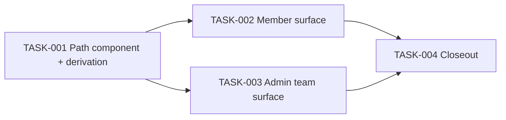

# Gamified Skill Tree UI — Tasks

Specification: [SPEC.md](./SPEC.md)

## Status
Ready: 2  In Progress: 0  Done: 2

`SPEC.md` is `Approved`. Presentation-only
feature: no task may touch `app/api/**`, `src/features/**/server/`,
`domain/`, `client/` gateways, package files, or the cross-team overview /
catalog / authoring components (BR-11, BR-12, BR-18).

## Task graph

## BR coverage

| BR | Owner |
|---|---|
| BR-1, BR-2, BR-3, BR-4 | TASK-001 |
| BR-5, BR-6 | TASK-001 |
| BR-9, BR-10 | TASK-001 (component + copy); verified in TASK-002/003 |
| BR-13, BR-14, BR-15, BR-16, BR-17 | TASK-001 |
| BR-18, BR-19, BR-20 | TASK-001 (component: no fetch/deps/motion/`Badge`/gamification) |
| BR-7 | TASK-002 |
| BR-8 | TASK-003 |
| BR-11, BR-12 | TASK-002 and TASK-003 (acceptance: no diff to overview/catalog/forms) |
| BR-18 (surfaces) | TASK-002 and TASK-003 (no server/API/domain/gateway/package diff) |
| Re-verification of BR-11, BR-12, BR-18, BR-19, BR-20 | TASK-004 (confirmation only; not sole owner) |

## Tasks

### TASK-001 — SkillProgressPath component and stage-state derivation

**Status:** Done
**Covers:** BR-1, BR-2, BR-3, BR-4, BR-5, BR-6, BR-9, BR-10, BR-13, BR-14, BR-15, BR-16, BR-17, BR-18, BR-19, BR-20
**Depends on:** None

**Outcome**
A tested, unused-yet presentational `SkillProgressPath` and a pure
stage-state derivation exist in `src/features/skill-trees/components/`,
with `skillProgressPathCopy` added to `copy.ts`.

**Implementation notes**
- Props: tree name (accessible list name only), `nodes: SkillTreeNodeView[]`,
  `currentNodeId: string | null`. No role/capability awareness. Sort a copy
  by `order` internally (never mutate the input). Reuse `SkillTreeNodeView`.
- Derivation exported as a small pure function returning per-node
  `earlier | current | upcoming` (BR-1/2). `null` = not started ("Ikke
  startet" summary); unknown id = defensive fallback, all `upcoming`, no
  `aria-current`, no throw, summary omitted (distinct from `null`).
- Markup: `<ol>` (`role="list"`), `<li>` per stage, `aria-current="step"` on
  current only; CSS-drawn numbered marker and rail, both `aria-hidden`;
  visible state text on every stage; `break-words min-w-0`; vertical at all
  widths; no `overflow-x`, no motion, no icons, no `Badge`.
- Summary line: started → "Teamets nåværende steg: {label} (steg N av M)";
  not started (`null`) → existing "Ikke startet"; unknown id → no summary.
  Positional wording ("Tidligere
  steg"/"Nåværende steg"/"Kommende steg"), no individual framing.
- No `"use client"` unless required; no hooks/effects/state.

**Verification**
- Unit tests: middle, first, last, null, unknown id, unsorted input (order follows `order`, not array position; input array not mutated).
- RTL: rerender C → B recomputes (C `upcoming`); order; 2 and 20 stages;
  100-char label rendered in full; single `aria-current`; state text present
  for every stage; decoration `aria-hidden`; no interactive roles.
- `pnpm typecheck`, `pnpm lint`, focused tests.

**Security / privacy**
No additional considerations (pure presentation of already-authorized DTO
fields). No fetch/Firebase/auth import.

**Documentation impact**
None expected (closeout in TASK-004).

**Acceptance criteria**
- [x] Derivation table verified, including backward recomputation, null vs unknown id, and non-mutation.
- [x] Accessibility/non-color/decorative semantics verified.
- [x] No production file outside the component, its tests and `copy.ts`.
- [x] Relevant tests, typecheck and lint pass.

**Evidence:** `SkillProgressPath.tsx` (component + `deriveSkillProgressPath`),
`SkillProgressPath.test.tsx` (16 tests), `skillProgressPathCopy` in `copy.ts`.
Typecheck, lint, full `pnpm vitest run` (2488 tests) and isolated `pnpm build`
pass; review-change: PASS. No call sites yet (TASK-002/003).

---

### TASK-002 — Member surface: path on `/teams/[teamId]`

**Status:** Done
**Covers:** BR-7, BR-11, BR-12, BR-18 (surface diff limits); BR-9/10 verified
**Depends on:** TASK-001

**Outcome**
`TeamSkillSection`'s `TrackedSkillRow` renders `SkillProgressPath` instead of
the decimal `<ol>`, keeping every existing behavior.

**Implementation notes**
- Replace only the stage list / "ikke startet" paragraph markup. Keep the
  `canReportProgress` gating, native `<select>`, Lagre button, phase/error
  Alerts, key-by-`treeId`+`currentNodeId` remount and `onReported` refetch.
- Update existing `TeamSkillSection` tests whose assertions depended on the
  old list markup (`aria-current`, "(Nåværende steg)" suffix); do not weaken
  the capability/authorization tests.

**Verification**
- Existing `TeamSkillSection` suite (adjusted for markup) plus: path shown
  for started/not-started trees; controls hidden/shown exactly per
  `canReportProgress`; a failed report leaves the path unchanged; a refetch
  with a new `currentNodeId` (backward included) updates states.
- `pnpm typecheck`, `pnpm lint`, focused tests.

**Security / privacy**
`canReportProgress` and `reportTeamSkillProgress` untouched; app-admin-alone
and disabled-team behavior unchanged; no new data or request.

**Documentation impact**
None expected.

**Acceptance criteria**
- [x] BR-7 satisfied; loading/error/empty unchanged.
- [x] Capability-gating tests still pass unmodified in intent.
- [x] Diff limited to `TeamSkillSection.tsx` and its tests (no overview/catalog/forms/server/API/domain/gateway/package change).

**Evidence:** `TeamSkillSection.tsx` now renders `SkillProgressPath` (name, `skill.nodes`,
`skill.currentNodeId` passed unchanged) in place of the decimal `<ol>` and "ikke startet"
paragraph; `sortedNodes` kept only for the select. `TeamSkillSection.test.tsx` updated
(+ read-only/reportable, null, unknown id, non-interactive, order, refetch-recompute tests);
`TeamDetail.test.tsx` selectors updated because it asserts the same rendered markup (no
behavior change). Typecheck, lint, `git diff --check`, full `pnpm vitest run` (2494 tests)
and isolated `pnpm build` pass; review-change: PASS. No browser inspection was run.

---

### TASK-003 — Admin team surface: path in tracked rows

**Status:** Ready
**Covers:** BR-8, BR-11, BR-12, BR-18 (surface diff limits); BR-9/10 verified
**Depends on:** TASK-001

**Outcome**
`TeamSkillTrackingSection`'s `TrackedSkillTreeRow` renders
`SkillProgressPath` instead of the decimal `<ol>`, with all admin controls
and session-derived tracking state unchanged.

**Implementation notes**
- Replace only the list and the separate "Ikke startet" paragraph markup.
  Keep `Select` (including the disabled "Ikke startet" option), pending
  indicator, "Stopp sporing", untracked group, `teamDisabled` hint and row
  errors. Do not alter `AdminTeamDetail`'s handlers or fetch topology.

**Verification**
- Existing `TeamSkillTrackingSection` suite (adjusted for markup) plus path
  presence and recomputation after a set-stage prop change.
- `AdminTeamDetail` skill-related tests still green.
- `pnpm typecheck`, `pnpm lint`, focused tests.

**Security / privacy**
Admin authority and disabled-team semantics unchanged; no new data/request.

**Documentation impact**
None expected.

**Acceptance criteria**
- [ ] BR-8 satisfied; start/update/stop behavior unchanged.
- [ ] Diff limited to `TeamSkillTrackingSection.tsx` and its test (no overview/catalog/forms/server/API/domain/gateway/package change).

---

### TASK-004 — Final regression, responsive/a11y confirmation and docs

**Status:** Ready
**Verifies (confirmation only; ownership above):** BR-11, BR-12, BR-18, BR-19, BR-20
**Depends on:** TASK-002, TASK-003

**Outcome**
The feature is confirmed unregressed and closed out; `docs/UI-UX.md`
documents the as-built path (with the positional-state semantics and the
overview/catalog intentionally unchanged); the ui-refresh deferral note is
resolved by reference, not rewritten.

**Implementation notes**
- Code-level sweep: no overflow mechanism, no new dependency, no diff in
  overview/catalog/forms/server/API/domain/gateway/package files; only the
  two adopting surfaces use the component; `aria-current` sites still one per
  list; no `Badge` for stage state.
- Add a short as-built section to `docs/UI-UX.md` (Skill Tree UX area);
  update `docs/ROADMAP.md` only if it tracks this feature after closeout.

**Verification**
- `pnpm typecheck`, `pnpm lint`, `git diff --check`, full `pnpm test`, then
  `pnpm build` in isolation (known resource contention).

**Security / privacy**
Re-verify from the actual diff that no authorization or data boundary changed.

**Documentation impact**
`docs/UI-UX.md`; possibly `docs/ROADMAP.md`.

**Acceptance criteria**
- [ ] All BR confirmations recorded with evidence.
- [ ] Docs synchronized; deferred features still unimplemented.
- [ ] Typecheck, lint, tests and build pass.
