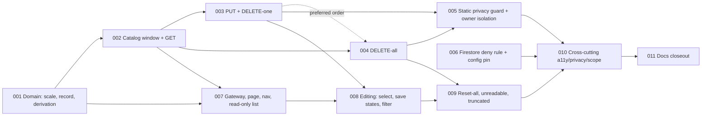

# Individual Skill Self-Assessment (C1) — Tasks

Specification: [SPEC.md](./SPEC.md) (Implemented; approved Revision 2; final review PASS WITH SUGGESTIONS, 0 BLOCKING / 0 IMPORTANT; A1–A6 approved; no open questions)

## Status
Ready: 0  In Progress: 0  Done: 11

Total tasks: **11**.

Task-splitting ground rules (apply to **every** task):

- Do not redesign the feature. If implementation proves the SPEC contradictory or
  unsafe, **stop and report** the affected SPEC sections; do not invent a workaround.
  Do not weaken any `docs/SECURITY.md` invariant to make code or tests pass.
- No Firebase access, seed, migration, backfill or deploy. Tests use injected
  `*Deps` / fake stores / mocked gateways. Rules deployment is a separate explicit step
  and is **not** part of any task.
- **No** new dependency, env/config, composite index (`firestore.indexes.json` unchanged),
  Demo Team fixture, chart, or change to `listSkillTrees` (its `requireAppAdmin`
  authorization and tests stay untouched), `skillProgress`, roadmap, `authorizeTeamAccess`,
  `resolveTeamRole`, `userProfiles` or any team/admin route.
- **Persisted shape is exactly `{ levels, createdAt, updatedAt }`** at `skillProfiles/{uid}`.
  No uid/e-mail/name/team id, per-skill timestamps, history, sharing/consent flags,
  schema version, derived values (BR-6, BR-7, BR-19).
- **Owner-only** (BR-17/BR-18): subject only from the verified token; no uid/team/role in
  path, query or body; app-admin / team-lead status grants nothing; `emailVerified` is
  **not** required; `authorizeTeamAccess`/`resolveTeamRole`/`requireAppAdmin`/`isAppAdmin`
  are never used by skill-profiles code.
- **C2 is out of scope:** no `teamSkillNeeds`, matrix, gap/coverage, aggregate reader or
  endpoint, threshold configuration, consent mechanics, role expectations, goals,
  check-ins, history, ranking/scoring.
- Dependency direction: `skill-profiles → skill-trees (isValidSkillTree) / auth`. Never the
  reverse. **Catalog-read decision (SPEC "Architecture decisions" delegated this to
  `/split-tasks`):** the bounded catalog read is **duplicated minimally inside
  `src/features/skill-profiles/server/`** (own reader seam + candidate mapping that reuses
  `isValidSkillTree`). `list-skill-trees.ts` is **not** refactored or extended.
- Follow `.claude/rules/**`. Read the relevant `node_modules/next/dist/docs/` guide before
  writing route/page code (`AGENTS.md`). Norwegian copy lives in
  `src/features/skill-profiles/copy.ts`; canonical level meanings live only in the domain
  module (BR-4).
- Never log levels, tree ids, skill names or the profile (BR-21).
- Every task ends with `pnpm typecheck`, `pnpm lint`, `pnpm test` (and `pnpm build` where
  noted), then an inspection of `git diff`. Use the actual scripts in `package.json`.
- Interim note: TASK-002 onward make routes reachable and TASK-007 makes the page
  reachable, but the feature is complete only after TASK-010. Nothing is deployed between
  tasks.

## Task graph

**Order rationale.** 001 is the only root (everything uses the scale and record guard).
002 establishes the store seam, the exact catalog window and `GET` (read path, GET
purity, malformed semantics). 003 and 004 add the mutations on the same seam. They are
**not hard-dependent** on each other (both depend only on 002), but because they extend
the same store seam and the same shared test fake, **implement 003 → 004 in that order**
(dashed edge) to avoid merge/rework churn; 004 reuses, not forks, the fake. 005 (static guard) is placed after all server routes exist so the
approved reference/import sets are final; 006 (rules) is behavior-neutral and fully
independent — it can be done at any point and is kept separate for easy review. UI is
split: 007 read-only page + nav + gateway (needs 001, 002), 008 editing (needs 003),
009 destructive/edge states (needs 004, 008). 007 defines the complete browser gateway
(all four operations) against mocked `fetch`, so it needs no backend task beyond 002 to be
built and tested; 008/009 only wire gateway operations into UI. 010 is cross-cutting verification (adds
no behavior); 011 is last. (Normally one task is `In Progress` at a time.)

## SPEC coverage

| SPEC concern | Task(s) |
| --- | --- |
| BR-4 canonical scale, `isSelfAssessedLevel`, meanings in one domain module | 001 |
| BR-7 derived values computed on read/render only | 001, 007 |
| BR-9 entry semantics, BR-10 document semantics (read side) | 001 (guards), 002 (GET) |
| BR-10 repair-on-write, unknown-field preservation, `409 profile_unreadable` | 003 |
| BR-3 minimal catalog DTO; BR-11 raw-window algorithm / `truncated` (cases a–e, g, i–k) | 002 (server), 009 (UI notice, case h) |
| BR-6 schema, BR-8 GET contract, GET purity | 002 |
| BR-12 PUT (direct target validation, per-key merge), BR-15 validation, BR-16 concurrency (server) | 003 |
| BR-13 DELETE-one | 003 |
| BR-14 DELETE-all | 004 |
| BR-17 token-only identity, no `emailVerified` | 002, 003, 004 (each route); sweep 005 |
| BR-18 owner-only, static guard (both dimensions), lead/admin negatives | 005 (guard + isolation), 002–004 (route tests) |
| BR-19 no sharing, C1/C2 boundary | 001 (no mean API), 005 (C1-scoped scope guard, key set), 010 |
| BR-22 anti-surveillance (copy / rendered-text scan) | 010 (owns the scan; copy exists only after 007–009); 001 (ordinal-only domain, no mean API); 005 (C1-scoped C2-identifier guard only, no copy scan) |
| BR-20 allow-listed responses, BR-21 no logging of content | 002–004, 010 |
| BR-23 / BR-24 independence from skillProgress/roadmap/membership | 003 (skill-profile writes never touch them), 005 (static evidence that `skillProgress` writes cannot touch `skillProfiles`: collection/reference guard; import ban), 010 |
| BR-36 deny-only rules block + deployment-config pin, no index | 006 |
| BR-1 route/auth gating, BR-2 nav, BR-5 privacy notice | 007 |
| Browser gateway: all four operations defined and tested | 007 (definition + gateway tests); 008, 009 (UI wiring only) |
| Reset-all `401` follows TASK-008 sign-in prompt (BR-30) | 009 |
| BR-25 structure, BR-26 overview, BR-31/32 a11y/responsive (read-only list) | 007 |
| BR-27 row control + indicator, BR-28 filter, BR-16 UI serialization, BR-30 save pending/failure/404/401 | 008 |
| BR-30 reset/unreadable/truncated/empty, BR-25 reset action | 009 (empty & no-skills states: 007) |
| BR-29 no chart | 007 (not built), 010 (pinned) |
| BR-33 lifecycle, BR-34 multi-team | 003 (no team link), 010 |
| BR-35 Demo Team: no change | 010 (guard: no Demo fixture touches `skillProfiles`) |
| SPEC "Documentation impact", Policy reconciliation (A1), A4 naming guidance | 011 |

---

### TASK-001 — Skill-profile domain: canonical scale, record guard and derivations

**Status:** Done
**Covers:** BR-4, BR-7, BR-9, BR-10 (read-side guards), BR-15 (identifier), BR-22, BR-26 (derivation); D2
**Depends on:** None

**Outcome**
`src/features/skill-profiles/domain/` provides the single source of truth for the personal
scale and pure, tested helpers; no I/O, no UI, no copy.

**Implementation notes**
- Scale module: `SelfAssessedLevel = 1 | 2 | 3 | 4`, `SELF_ASSESSED_LEVELS`,
  `isSelfAssessedLevel(value: unknown)` (rejects `0`, `5`, `"3"`, `2.5`, `null`, `NaN`).
  The **canonical meanings of BR-4 are documented here** as constants/comments (level 4 =
  deep/advanced proficiency; mentoring only an example, never required). Norwegian labels
  and descriptions do **not** live here (they go in `copy.ts` in TASK-007).
- Tree-id pattern `^[A-Za-z0-9_-]{1,128}$` (`isWellFormedTreeId`) as the single definition
  used by routes (BR-15).
- Record guard for the stored document: `levels` absent → empty map (readable); plain
  object → readable; present but not a plain object (`null`, array, primitive) →
  unreadable (BR-10). Timestamps never affect readability. A pure helper reports whether
  `createdAt` is a valid date (for repair-on-write in TASK-003). Persisted key set constant
  `{levels, createdAt, updatedAt}`.
- Entry selection helper: given a visible-skill id set and a raw `levels` map, returns the
  level per visible skill, ignoring keys outside the set and invalid values (BR-9), without
  inferring why a key is absent.
- Presentation helpers: sort by `name` (`localeCompare("nb")`, tie-break `treeId`);
  overview derivation `{assessedCount, totalCount, perLevelCounts}` over the **visible**
  list only; no mean/sum/percentage/score function exists.
- Public DTO types `SkillRowDto` (`treeId`, `name`, `level | null`) and
  `OwnSkillsDto` (`skills`, `truncated`, `profile: "ok" | "unreadable"`) live here.

**Verification**
- Unit tests: scale accepts exactly 1–4 and rejects the invalid set above; level 4 meaning
  constant is not mentoring-defined (assert the documented text does not require
  mentoring); tree-id pattern boundaries (128/129, spaces, `/`, empty); record guard
  matrix (absent doc/`levels`, `{}`, object with invalid entries, `levels: null|[]|"x"|5`,
  invalid/missing timestamps still readable, unknown top-level fields ignored); entry
  selection (key not visible ignored, invalid values ignored); sort incl. tie-break;
  overview counts visible only and contain no ratio/percentage field.
- `pnpm typecheck`, `pnpm lint`, `pnpm test`.

**Security / privacy**
Pure code. Ordinal-only design (no arithmetic helpers) supports BR-22.

**Documentation impact**
None in this task (closeout in TASK-011).

**Acceptance criteria**
- [x] Levels are exactly integers 1–4; canonical meanings exist only in this domain module.
- [x] Record guard implements BR-9/BR-10 read semantics, incl. timestamp tolerance.
- [x] Sort and overview helpers exist; no mean/sum/percentage exported.
- [x] Domain tests pass; no conflict with `docs/SECURITY.md`.

---

### TASK-002 — Own skills read: store seam, exact catalog window and `GET /api/me/skills`

**Status:** Done
**Covers:** BR-3, BR-6, BR-8, BR-9, BR-10 (read side), BR-11, BR-17, BR-20, BR-21, BR-18 (route negatives)
**Depends on:** TASK-001

**Outcome**
`GET /api/me/skills` returns `{ skills: [{treeId, name, level}], truncated, profile }`
for the verified caller, built from one profile `get` and one bounded catalog query in
parallel, with the exact SPEC raw-window semantics. It never writes.

**Implementation notes**
- `server/skill-profile-store.ts`: seam mirroring `UserProfileStore` over
  `skillProfiles/{uid}` (Admin SDK via `getFirestoreDb`, `import "server-only"`). In this
  task only the read method is needed; TASK-003/004 extend the seam (add transactional
  update and delete) — keep method names stable.
- `server/skill-catalog.ts`: minimal duplicated reader seam (injectable) running
  `collection("skillTrees").orderBy("createdAt","asc").limit(501)` — **no `where`, no new
  index** — plus candidate mapping to `isValidSkillTree` (Timestamp→Date, as in
  `list-skill-trees.ts`, which is **not** modified). Algorithm (normative, BR-11):
  1. one reader call with limit 501;
  2. first 500 raw documents = candidate window; a 501st is only a probe, never returned;
  3. validate each window doc; 4. discard invalid (they consume slots);
  5. **no refill query**; 6. sort remaining by name via the TASK-001 helper.
  `truncated = true` **iff** a 501st raw document was returned (even if invalid).
- `server/get-own-skills.ts` (`getOwnSkills(token, deps)`): `verifyIdToken` (revocation
  checked; **no `emailVerified` requirement**), then `Promise.all([profile get, catalog])`.
  Entry/document semantics via TASK-001 helpers: unreadable `levels` → all `level: null`,
  `profile: "unreadable"`. **No repair, no write, no creation** on GET. DTO built field by
  field: `treeId`, `name`, `level` only — never `nodes`, stage labels, `createdBy`,
  timestamps, uid. Read failure of either source → `persistence_failed` (500).
- `app/api/me/skills/route.ts`: thin `GET` only (bearer extraction as in `app/api/me/
  profile/route.ts`); other methods for this path are added by TASK-004 (`DELETE`). No uid
  from path/query/body.

**Verification**
- Catalog window tests with a fake reader returning raw docs in Firestore order — **all of**:
  (a) 500 raw docs with k invalid → exactly 500−k visible; a valid 501st is not pulled in;
  exactly **one** reader call with limit 501, no refill; (b) 501 raw whose 501st is invalid
  → `truncated:true`, every valid tree visible; (c) 501 valid → 500 visible, the 501st
  (latest) absent, `truncated:true`; (d) exactly 500 raw → `truncated:false`;
  (e) equal `createdAt` values follow the reader's id order and name-sorting does not change
  window membership; (g) entries stored for unlisted trees are retained (store untouched),
  not counted/returned. (Case f — valid tree beyond window writable — in TASK-003.)
  Additionally **required**:
  (i) **presentation sort after window selection:** with raw docs returned in a `createdAt`
  order that differs from name order (including equal names with differing ids), the
  returned list is ordered by `name` (`nb`, via the TASK-001 helper) with `treeId`
  tie-break, regardless of query order. Sorting happens only **after** (1) the single raw
  501-document query, (2) selection of the first 500 raw documents, and (3) validation and
  dropping of invalid documents; a test shows that a document that sorts early by name but
  is the 501st raw document is **still excluded**, i.e. sorting never changes window
  membership;
  (j) **exactly 500 raw documents, all valid** (separate from the 501 case): all 500 are
  visible and `truncated === false`;
  (k) **duplicated-reader parity:** because the catalog read is deliberately duplicated
  (`listSkillTrees` is not modified or refactored), a focused parity test feeds the same
  shared fixture documents (valid; invalid; `createdAt`/`updatedAt` as Timestamp-like
  values with `toDate()`, as `Date`, missing, and invalid) through both the C1 reader's
  candidate mapping and the existing `listSkillTrees` path (via its injected reader, as
  `list-skill-trees.test.ts` does) and asserts identical Timestamp→Date interpretation
  outcomes and identical `isValidSkillTree` accept/reject results, so semantic drift
  between the two readers is detected.
  Asserting only "length ≤ 500" or "truncated is true" is insufficient.
- `getOwnSkills`: DTO minimality (exact key set, no `nodes`), absent document = empty
  profile (`profile:"ok"`), invalid entries ignored (`0`,`5`,`"3"`,`2.5`,`null`), unreadable
  container, invalid timestamps tolerated and **no timestamp returned**, unknown top-level
  fields never in DTO, **GET purity** (store write/set/delete spies never called, including
  with broken timestamps), unauthenticated → 401, persistence failure → 500, token with
  `emailVerified:false` succeeds, parallelism (both reads issued before either resolves).
- Route test: bearer mapping, 401, 500, response allow-list, no other method routed.
- Owner/negative: ordinary user, team lead and app-admin tokens get identical behavior and
  only their own levels; no parameter selects another subject.
- `pnpm typecheck`, `pnpm lint`, `pnpm test`.

**Security / privacy**
First access to `skillProfiles`; Admin SDK, server-only, owner derived from token. Logging
only generic failure categories.

**Documentation impact**
None in this task.

**Acceptance criteria**
- [x] `GET` implements the exact 501-probe / 500-window / validate / no-refill / name-sort algorithm.
- [x] `truncated` is true iff a 501st raw document exists; tests cover cases a–e, g, i, j (sort after window selection; exactly 500 valid) and the parity test k.
- [x] GET performs no write, repair or document creation.
- [x] DTO is minimal and contains no timestamps, uid, nodes or team data.
- [x] No `emailVerified` requirement; no admin/lead/team authorization code used.
- [x] `listSkillTrees` and its tests are unmodified.
- [x] Relevant tests pass; no conflict with `docs/SECURITY.md`.

---

### TASK-003 — Set and clear one skill assessment (`PUT` / `DELETE` `/api/me/skills/[treeId]`)

**Status:** Done
**Covers:** BR-9, BR-10 (repair, unknown fields, `409`), BR-12, BR-13, BR-15, BR-16 (server), BR-17, BR-20, BR-23, BR-24, BR-33, BR-34
**Depends on:** TASK-002 (implement **before** TASK-004: both extend the same store seam and shared test fake)

**Outcome**
The owner can set a level 1–4 and clear one skill via the per-skill route; transactional
per-key merges preserve all other keys and unknown top-level fields.

**Implementation notes**
- Extend the store seam with a transactional update capability (single Firestore
  transaction; read profile, then write). Per-key merge via nested merge-set or
  `FieldPath` — **never** replace the `levels` map or the document.
- `server/set-own-skill-level.ts` (`setOwnSkillLevel`): verify token (no `emailVerified`);
  validate `treeId` pattern (else `skill_unavailable`); validate body shape; in **one
  transaction** read the profile (unreadable → `profile_unreadable`), read
  `skillTrees/{treeId}` **directly** (own doc reader, reusing `isValidSkillTree`; missing or
  invalid → `skill_unavailable`), then write only the key + `updatedAt` + (`createdAt` when
  the document is absent or its `createdAt` is missing/invalid). **Never** derives
  existence from the catalog window. Returns `{ level }`. Idempotent.
- `server/clear-own-skill-level.ts` (`clearOwnSkillLevel`): idempotent — absent document or
  absent key ⇒ `{ level: null }` and **no write at all** (no timestamp change/repair);
  removing an existing key preserves other keys + unknown fields, sets `updatedAt`, repairs
  `createdAt`, keeps the document (possibly empty `levels`); does **not** require the tree
  to exist; unreadable container → `profile_unreadable`; bodies never read.
- Routes `app/api/me/skills/[treeId]/route.ts`: `PUT` (body exactly `{level}`; non-object /
  malformed JSON → `400 invalid_request`; extra keys, arrays, strings, floats, `null`,
  out-of-range → `400 invalid_input`), `DELETE` (ignores any body). Error mapping per the
  SPEC API table (`401`, `404 skill_unavailable`, `409 profile_unreadable`, `500
  persistence_failed`). Follow the repo's existing dynamic routes (e.g.
  `app/api/admin/skills/[treeId]/route.ts`) and the relevant `node_modules/next/dist/docs/`
  guide for the dynamic-segment `params` contract; do not assume a framework-version-
  specific shape. No other methods.
- No write touches `skillProgress`, `roadmapItems`, `teamMemberships`, `teams`,
  `userProfiles`; skill-profiles code imports none of them (BR-23/BR-24).

**Verification**
- PUT: create (createdAt = updatedAt = now), change level (previous value gone, no history
  field), other keys preserved, unknown top-level fields preserved, invalid `createdAt`
  repaired / valid `createdAt` untouched, invalid `updatedAt` tolerated and replaced,
  entry with invalid stored value overwritten by valid PUT, unreadable container → 409 and
  **nothing written**, invalid tree / non-existent tree / malformed id → 404 and nothing
  written, **case (f): valid tree absent from (beyond) the catalog window → PUT succeeds**
  with the tree read directly (fake catalog proven not consulted), concurrent writes to
  different keys both survive (fake transactional store), same-key last-write-wins.
- Body validation matrix: `{}`, `{level:0|5|2.5|"3"|null|true}`, `{level:1,extra:1}`,
  `[]`, `"x"`, malformed JSON, missing body; response is exactly `{level}`.
- DELETE-one: removes key + sets `updatedAt` + repairs `createdAt`; absent key / absent doc
  ⇒ `{level:null}` and write spy never called; stale/hidden/unavailable tree entry can be
  cleared; malformed id → 404; unreadable → 409; any request body ignored (even invalid
  JSON); idempotent repeat.
- No `emailVerified` requirement; ordinary user, team lead, app admin identical behavior;
  team membership irrelevant (user with zero teams works).
- Independence: with fakes for `skillProgress`/`roadmapItems`/`teamMemberships`, a level write
  leaves them untouched (reads zero, writes zero).
- `pnpm typecheck`, `pnpm lint`, `pnpm test`, `pnpm build` (first dynamic API route of the
  feature: catches route typing/build integration early).

**Security / privacy**
Writes only to the verified caller's document; no client-supplied subject. Errors do not
echo levels/ids; no logging of content.

**Documentation impact**
None in this task.

**Acceptance criteria**
- [x] `PUT` validates its target tree directly and succeeds for a valid tree outside the catalog window.
- [x] Per-key writes preserve other keys and unknown top-level fields; `createdAt` repair and `updatedAt` per BR-10.
- [x] `409 profile_unreadable` never overwrites data.
- [x] `DELETE`-one is idempotent, writes nothing when nothing to remove, ignores bodies, works for stale/hidden entries.
- [x] Strict validation and exact error mapping per the API table.
- [x] No coupling to `skillProgress`/roadmap/membership; no `emailVerified` requirement.
- [x] Relevant tests pass; `pnpm build` passes; no conflict with `docs/SECURITY.md`.

---

### TASK-004 — Erase the whole profile (`DELETE /api/me/skills`)

**Status:** Done
**Covers:** BR-10 (recovery), BR-14, BR-17, BR-33
**Depends on:** TASK-002 (preferred order: after TASK-003 — shared store seam and test fake; extend the TASK-003 fake rather than creating a second one)

**Outcome**
The owner can physically delete their entire `skillProfiles/{uid}` document through
`DELETE /api/me/skills`, which also recovers an unreadable profile.

**Implementation notes**
- Extend the store seam with `delete(uid)` (physical `doc.delete()`; succeeds if absent).
- `server/delete-own-skill-profile.ts` (`deleteOwnSkillProfile`): verify token (no
  `emailVerified`), delete, return `{ ok: true }`; idempotent; body never read.
- Add `DELETE` to `app/api/me/skills/route.ts` (alongside `GET` from TASK-002). Errors:
  `401`, `500 persistence_failed`.

**Verification**
- Document with levels, timestamps and unknown top-level fields is fully removed (fake
  store shows the document **absent**, not emptied); absent document succeeds; repeated call
  idempotent; unreadable (`levels:null`) document is removed and a following `getOwnSkills`
  returns `profile:"ok"`; next `setOwnSkillLevel` recreates with fresh `createdAt`.
- Any body (including invalid JSON) ignored; 401 without/invalid token; persistence failure
  → 500; valid token with `emailVerified:false` succeeds; only the caller's document id is
  touched (assert the single deleted path equals `skillProfiles/<token uid>`).
- Route test: method surface for `/api/me/skills` is exactly `GET` and `DELETE`.
- `pnpm typecheck`, `pnpm lint`, `pnpm test`.

**Security / privacy**
Owner's erase-everything control; no other subject reachable. Account-deletion remains a
documented known limitation (BR-33) — not solved here.

**Documentation impact**
None in this task.

**Acceptance criteria**
- [x] `DELETE /api/me/skills` physically deletes the document including unknown fields, idempotently.
- [x] Recovers an unreadable profile.
- [x] Only the verified caller's document can be deleted.
- [x] Relevant tests pass; no conflict with `docs/SECURITY.md`.

---

### TASK-005 — Static privacy/scope guard and owner-isolation verification

**Status:** Done
**Covers:** BR-18 (guard, both dimensions), BR-19, BR-20, BR-23, BR-24, C1/C2 boundary
**Depends on:** TASK-003, TASK-004

**Outcome**
An automated guard test (style of `src/features/roadmap/roadmap-scope-guard.test.ts`) makes
any unexpected reader/writer of `skillProfiles` visible, and a cross-route test asserts
owner-only behavior. The guard's description states exactly what it does **not** prove.

**Implementation notes**
- File: `src/features/skill-profiles/skill-profiles-scope-guard.test.ts` (read the roadmap
  guard first and follow its scanning approach).
- **Dimension 1 — collection/reference allow-list:** the set of source files under `src/`
  and `app/` that statically reference the `skillProfiles` collection/persistence identifier
  equals the approved C1 set (skill-profiles server/store modules and their tests, the
  rules/config pin test). Any new referencing file fails.
- **Dimension 2 — module/import allow-list:** the application/server entry points (route
  files, pages, other feature modules) that import the skill-profiles **server or store**
  modules equal the approved set (`app/api/me/skills/**` routes and the feature's own
  modules). A new route importing an approved operation or the store seam fails.
- Additional assertions: persisted key set equals `{levels, createdAt, updatedAt}`;
  skill-profiles sources do not import team-authorization, `skillProgress`, roadmap,
  membership, `userProfiles` or admin code; no `app/api/admin/**` or `app/api/teams/**`
  file references the collection or imports the modules; route-method surface of
  `app/api/me/skills/**` is exactly `GET`, `PUT`, `DELETE` as specified; no `teamSkillNeeds`
  / matrix / aggregate endpoint / threshold / sharing-flag / history identifiers exist
  **within the C1 surfaces only** (scan scope below).
- **Scan scope (S1):** every identifier/copy scan in this task is **explicitly scoped** to
  the C1 surfaces it protects — `src/features/skill-profiles/**` (excluding this guard test
  file and its negative fixtures, which necessarily contain the tokens) and
  `app/api/me/skills/**` — and is **never repository-wide**. Words such as `aggregate`,
  `matrix` or `threshold` legitimately exist elsewhere (e.g. `src/features/results/**`)
  and must not fail the guard. Scoping only limits where the scan looks; it does not
  weaken the C1/C2 boundary. Add a negative fixture proving a forbidden identifier inside
  a C1 path fails while the same word in an unrelated path (e.g. `src/features/results/`)
  does not.
- **Negative fixtures (required):** run the guard's scanner functions over in-test fixture
  sources (virtual files) proving that (i) an unapproved file referencing `skillProfiles`,
  (ii) an unapproved route importing the store seam or an operation, (iii) a file under
  `app/api/admin/` or `app/api/teams/` referencing the collection, and (iv) a skill-profiles
  source importing team-authorization all **fail** the guard.
- Documented limitations in the test's header and `describe` text: does **not** prove
  arbitrary runtime behavior, a dynamically constructed collection name or module path, an
  unresolvable re-export/dynamic import, references outside the guarded directories, or
  Admin-credential access outside the application; code review remains the check.
  Document that a future C2 reader requires a deliberate, reviewed allow-list edit.
- Owner-isolation test (cross-route): for each of the four endpoints, tokens of an ordinary
  user, team lead and app admin act only on their own uid; no path/query/body parameter can
  select another subject; unauthenticated → 401.
- The anti-surveillance token scan of `copy.ts`/rendered text (BR-22) is **owned by TASK-010** (the copy does not exist yet); this task does not perform it.
- BR-23 reverse independence (`skillProgress` writes never touch `skillProfiles`) gets its static evidence here: Dimension 1 proves the collection is referenced only by the approved C1 files, so no `skillProgress` code can reference it.

**Verification**
- The guard passes on the current tree and fails for each negative fixture.
- `pnpm typecheck`, `pnpm lint`, `pnpm test`.

**Security / privacy**
This is the evidence layer for BR-18; it is evidence, not the invariant.

**Documentation impact**
None in this task (SECURITY.md reconciled in TASK-011).

**Acceptance criteria**
- [x] Both guard dimensions (collection reference set, module import set) are enforced.
- [x] Negative fixtures prove unexpected references/imports/routes fail.
- [x] Persisted key set and no-forbidden-import checks enforced.
- [x] Owner isolation verified for ordinary user, team lead and app admin on all endpoints.
- [x] Limitations stated truthfully; no overclaim.
- [x] Relevant tests pass; no conflict with `docs/SECURITY.md`.

---

### TASK-006 — Explicit deny-only Firestore rules block and deployment-config pin

**Status:** Done
**Covers:** BR-36, D14, D16
**Depends on:** None

**Outcome**
`firestore.rules` contains an explicit deny-only block for `/skillProfiles/{document=**}`
before the catch-all; the deployment-config test pins it and asserts no composite index.
Behavior-neutral (the catch-all already denies). Kept separate for easy review.

**Implementation notes**
- Add `match /skillProfiles/{document=**} { allow read, write: if false; }` with the file's
  usual explanatory comment, placed before the catch-all, following the `userProfiles`
  block's style.
- Extend `src/lib/firebase/firestore-deployment-config.test.ts` with the matching pin (block
  exists, deny-only, precedes catch-all) and the "no composite index for `skillProfiles`"
  assertion, mirroring `userProfiles`. `firestore.indexes.json` **unchanged**.
- **Do not deploy** rules; deployment is a separate explicit step (`docs/DEVELOPMENT.md`).

**Verification**
- Deployment-config test passes with the new pin; verify (e.g. temporarily/by test design)
  that removing the block or turning it into an allow fails the test.
- `git diff` shows only the rules block, the test, and nothing in `firestore.indexes.json`.
- `pnpm typecheck`, `pnpm lint`, `pnpm test`.

**Security / privacy**
Grants nothing; clients keep zero Firestore access to `skillProfiles`.

**Documentation impact**
None in this task.

**Acceptance criteria**
- [x] Explicit deny-only block before the catch-all; no client access granted.
- [x] Config test pins block and asserts no `skillProfiles` composite index.
- [x] `firestore.indexes.json` unchanged; nothing deployed.
- [x] Relevant tests pass; no conflict with `docs/SECURITY.md`.

---

### TASK-007 — `/me/skills` page: gateway, navigation link and read-only personal list

**Status:** Done
**Covers:** BR-1, BR-2, BR-5, BR-7, BR-25 (structure without reset), BR-26, BR-29, BR-30 (signed-out, loading, read failure, no-skills, no-assessments), BR-31, BR-32 (read-only list), BR-20
**Depends on:** TASK-001, TASK-002

**Outcome**
A signed-in person opens **Mine ferdigheter** (`/me/skills`) from one new header link and
sees the notice, level legend, text overview and the read-only skill list loaded via the
own-skills API. Signed-out visitors see the sign-in prompt and no request is made.

**Implementation notes**
- `src/features/skill-profiles/client/skill-profile-gateway.ts`: browser gateway for the
  four endpoints, **all defined and tested in this task** (the page uses only `GET` here):
  get own skills, `PUT` one skill, `DELETE` one skill, `DELETE` all own skills (method names
  in the repo's gateway style). TASK-008 and TASK-009 only wire these existing operations
  into UI and add no gateway methods. Fail-safe
  response parsing (exact shape, `level` ∈ 1–4|null, `truncated` boolean, `profile` enum;
  anything else → read failure). Browser never touches Firestore/client SDK.
- `copy.ts`: Norwegian copy incl. the proposed level names/descriptions (BR-4, subject to
  A2), page title/description, BR-5 notice ("Egenvurderingen din er privat. Andre brukere,
  teamledere og administratorer kan ikke se den i DevPulse."), states, overview strings.
  No numeric "x av 4", no seniority wording, no promise the data is "never" used elsewhere.
- `app/me/skills/page.tsx`: thin route entry; logic in `src/features/skill-profiles/
  components/`. Auth gating via `useAuthGatedResource` as `/me/profile` does (generation
  handling: no data from a previous identity remains rendered).
- Page structure (BR-25): `PageHeader`, BR-5 notice (persistent, not tooltip), always-visible
  level legend (`dl`, four names + descriptions), overview line (BR-26: "Du har vurdert N av
  M ferdigheter." + per-level text counts for n>0; visible skills only; when `truncated`
  the "Du har vurdert N av de viste ferdighetene." variant), skill list. In this task each
  row shows skill name + **read-only** level text and the non-colour indicator (four
  `aria-hidden` segments + level name as text); editing arrives in TASK-008.
- States here: signed-out prompt, `LoadingState`, single page error with retry (no raw
  error text), `EmptyState` "Ingen ferdigheter er definert ennå.", no-assessments list with
  one neutral inviting sentence (no nag). No team text anywhere; no internal ids visible.
- `SiteHeader` + `src/components/nav/copy.ts`: exactly one new signed-in link **"Mine
  ferdigheter"** → `/me/skills` after "Min profil", `aria-current` on exact path. No other
  nav entry, tab, `/me` index or placeholder.
- No chart, no new dependency.

**Verification**
- Component/page tests: signed-out → prompt and **zero** requests; loading; success with
  few skills / many skills; no assessments; partial assessments with correct visible-only
  overview text; error + retry; identity change clears previous data; DOM contains no
  team text, no uid/e-mail, no `treeId` in visible text, no percentage/score/rank wording,
  no chart element; legend always visible with four levels; indicator text equals level
  name (segments `aria-hidden`).
- Gateway tests (mocked `fetch`; no backend needed): for **each of the four operations**,
  URL/method/auth header and body (`PUT` exactly `{level}`; both `DELETE`s no body); success
  parsing; error-status mapping (`401`, `404 skill_unavailable`, `409 profile_unreadable`,
  `500`) to distinct typed results; malformed response shapes → failure (read failure for
  `GET`).
- `SiteHeader.test.tsx`: link visible only when signed in, correct `href`, `aria-current` on
  exact path, no other new entries; existing nav tests unchanged.
- `pnpm typecheck`, `pnpm lint`, `pnpm test`, `pnpm build` (first new page and navigation
  surface: catches page typing/build integration early).

**Security / privacy**
The page only sees the caller's own data; the notice is C1-scoped (BR-5).

**Documentation impact**
None in this task (UI-UX in TASK-011).

**Acceptance criteria**
- [x] `/me/skills` exists; the only new navigation is the one signed-in "Mine ferdigheter" link.
- [x] Notice, legend, overview, list and the listed states render as specified (Norwegian via `copy.ts`).
- [x] No request while signed out; no chart; no new dependency.
- [x] Meaning never conveyed by colour/fill alone.
- [x] All four gateway operations exist and are tested at the gateway boundary; TASK-008/009 add none.
- [x] Relevant tests pass; `pnpm build` passes; no conflict with `docs/SECURITY.md`.

---

### TASK-008 — Edit assessments: level select, save states and filter

**Status:** Done
**Covers:** BR-16 (UI), BR-27, BR-28, BR-30 (save pending/failure, 404, 401), BR-31, BR-32
**Depends on:** TASK-003, TASK-007

**Outcome**
Each row has a labelled level `Select` ("Ikke vurdert" + four level names) that saves
immediately, with per-row pending/failure handling, plus the local "Alle · Vurdert · Ikke
vurdert" filter.

**Implementation notes**
- Wire `PUT` (levels) / `DELETE` one ("Ikke vurdert") through the existing TASK-007 gateway
  operations (no new gateway methods). No optimistic
  update: apply the server's canonical `level` to that row on success; no full refetch.
- Per-row serialization: the row's control is disabled while its request is in flight
  ("Lagrer…" in a polite live region); other rows save independently. Failure → row reverts
  to last confirmed value, inline `Alert` (`role="alert"`) for that row, retry by choosing
  again; other rows unaffected.
- `404 skill_unavailable` → row error "Denne ferdigheten er ikke lenger tilgjengelig." then
  **one** catalog refetch. `401` → sign-in prompt, pending edits discarded, no previous
  user's data rendered. `409 profile_unreadable` is handled in TASK-009 (controls are
  disabled there); here treat any unexpected status as a generic row failure.
- Control: real `<label>` = skill name; level description associated via `aria-describedby`
  or the legend; keyboard operable; visible focus; touch target ≥ existing form control.
  Overview/indicator update from the applied server value.
- Filter: client-side only, segmented/radio, default "Alle", no persisted view state, no
  request; neutral empty message when no rows match.
- Rows stack name above control below the `sm` breakpoint, side by side above; long names
  wrap (never truncated).

**Verification**
- Tests: select → one `PUT` with exactly `{level}`; "Ikke vurdert" → `DELETE`; success
  applies server value; control disabled + "Lagrer…" live region during save; double change
  on same row cannot interleave (stale response cannot overwrite newer choice); different
  rows save concurrently; failure reverts + row alert + other rows usable; 404 → row error
  and exactly one catalog refetch; 401 → sign-in prompt; no optimistic render before
  confirmation; filter behavior incl. empty match and zero requests; overview and indicator
  text update; keyboard-only operation; labels/descriptions present; no wording of rank,
  score, average, percentage.
- `pnpm typecheck`, `pnpm lint`, `pnpm test`.

**Security / privacy**
Client sends only `{level}` and the path `treeId` of a listed row; server remains the
authority.

**Documentation impact**
None in this task.

**Acceptance criteria**
- [x] Setting, changing and clearing a level works with immediate save and per-row pending state.
- [x] Failure reverts to the last confirmed value with an inline alert; other rows unaffected.
- [x] 404 and 401 behaviors per BR-30.
- [x] Filter is local and non-persisted.
- [x] Keyboard/screen-reader operable; text-plus-segment indicator.
- [x] Relevant tests pass; no conflict with `docs/SECURITY.md`.

---

### TASK-009 — Reset-all confirmation, unreadable-profile recovery and truncated-catalog notice

**Status:** Done
**Covers:** BR-11 (UI wording, case h), BR-14 (UI), BR-25 (reset action), BR-26 (truncated overview), BR-30 (unreadable, reset-all, truncated)
**Depends on:** TASK-004, TASK-008

**Outcome**
The destructive and degraded states are complete: confirmed "Nullstill alle ferdigheter",
read-only unreadable-profile recovery, and a conservative truncated notice.

**Implementation notes**
- "Nullstill alle ferdigheter": secondary action shown when any visible skill is assessed
  **or** `profile: "unreadable"` **or** `truncated: true`. Explicit confirmation step using
  the existing confirmation pattern (as `DeleteConfirmation`); cancel keeps everything;
  success → all rows "Ikke vurdert" and profile state `ok`; failure → alert, state unchanged;
  `401` → the **same sign-in-prompt behavior as TASK-008 edits** (pending work discarded, no
  previous user's data rendered); no separate authentication UX for reset-all. Uses the
  existing TASK-007 `DELETE`-all gateway operation (no new gateway method).
  Focus management on open/close/cancel.
- Unreadable profile: catalog shown read-only (all controls disabled), notice that stored
  data cannot be read, reset-all offered as recovery; a `409` response during an edit also
  moves the page into this state.
- Truncated: persistent notice stating only that the list **may** be incomplete (e.g.
  "Listen kan være ufullstendig."); never states or implies areas are definitely missing;
  500 never presented as a product limit; counts/summary refer to visible areas only
  (BR-26 variant); reset-all offered so hidden entries can be removed; no UI to enumerate
  hidden tree ids.

**Verification**
- Tests: confirmation required before any `DELETE /api/me/skills`; cancel makes no request;
  success/failure paths; reset-all `401` shows the TASK-008 sign-in prompt (same behavior, no stale data); reset button visibility matrix (assessed / unreadable / truncated /
  none); unreadable state (disabled selects, notice text, recovery works, subsequent state
  `ok`); `409` mid-edit transitions; truncated notice text contains "kan være ufullstendig"
  semantics and **does not** claim missing areas or mention 500; truncated overview wording;
  keyboard operation and focus return; no internal ids visible.
- `pnpm typecheck`, `pnpm lint`, `pnpm test`.

**Security / privacy**
Erase is irreversible: explicit confirmation, owner-only, copy states the effect plainly.

**Documentation impact**
None in this task.

**Acceptance criteria**
- [x] Reset-all requires confirmation and physically erases via the API; a `401` follows the TASK-008 sign-in prompt behavior.
- [x] Unreadable profile is read-only with working recovery.
- [x] Truncated notice says only "may be incomplete"; counts are visible-only.
- [x] Every BR-30 state is implemented, distinct and Norwegian.
- [x] Relevant tests pass; no conflict with `docs/SECURITY.md`.

---

### TASK-010 — Cross-cutting accessibility, privacy, scope and regression verification

**Status:** Done
**Covers:** BR-18, BR-19, BR-20, BR-21, BR-22, BR-23, BR-24, BR-29, BR-31, BR-32, BR-35, D14, D15, C1/C2 boundary
**Depends on:** TASK-005, TASK-006, TASK-009

**Outcome**
A consolidated verification layer (analogous to Feature B TASK-012) proving the
cross-cutting requirements across the page and all states, plus a scope guard against
drift. It adds **no new feature behavior**; fix only defects discovered.

**Implementation notes**
- Read `.claude/rules/tests.md` before writing. Use Testing Library style, structural
  (not pixel) responsive assertions.
- **Anti-surveillance token scan** (BR-22 owner) of `src/features/skill-profiles/copy.ts` and the rendered `/me/skills` text only: no score, average,
  percentage, grade, rank, top/bottom, badge, streak, leaderboard, "progress to goal",
  comparison wording, completeness nagging, evaluative terms ("svak", "sterk", "dårlig"),
  and no text promising data is "never" used elsewhere or implying a lead/admin/team can
  see it.
- **Scope guard (extend or sit beside TASK-005's):** all identifier/copy scans here are
  **scoped to the C1 surfaces** — `src/features/skill-profiles/**` (including `copy.ts`),
  `app/api/me/skills/**`, `app/me/skills/**`, plus the exact new nav entry (checked via the
  `SiteHeader` test) — never repository-wide, so unrelated features (e.g.
  `src/features/results/**`) that legitimately use `aggregate`/`matrix`/`threshold` do not
  fail. Checks: no `teamSkillNeeds`, matrix, gap /
  coverage, aggregate endpoint or reader, threshold configuration, sharing/consent flag,
  history/per-skill timestamp field, role expectation, goal or check-in artifacts; no
  client Firestore SDK import in skill-profiles client/components; no new dependency
  (`package.json`/lockfile unchanged), no `firestore.indexes.json` change, no env/config
  change; no Demo Team fixture or seed references `skillProfiles` (BR-35); the only
  `firestore.rules` change is the `skillProfiles` block. Unrelated-diff checks done by
  `git diff` review.
- **Integration scenarios:** page load = one `GET`, no per-skill requests; truncated and
  unreadable combinations; stale-tree 404 → one refetch; reset then re-assess; user with no
  team memberships fully functional; logs/errors contain no levels/ids/names (BR-21 spy on
  logger/console in route tests).
- **Accessibility sweep:** keyboard-only full flow (filter, select, reset confirm), headings
  `h1` → section headings, live regions announce save/err once, errors `role="alert"`,
  visible focus, nothing by colour alone, no chart/canvas/svg-chart element.
- **Regression:** run unchanged admin skill-tree (`listSkillTrees`), `skillProgress`,
  roadmap, `/me/profile` suites; confirm `list-skill-trees.ts` untouched.
- Full `pnpm typecheck`, `pnpm lint`, `pnpm test`, `pnpm build`.

**Verification**
- As above; full gates plus `git diff` inspection confirming only approved files changed.

**Security / privacy**
Primary owner of cross-cutting privacy/scope verification for C1.

**Documentation impact**
None expected.

**Acceptance criteria**
- [x] Anti-surveillance, privacy, a11y and responsive sweeps pass.
- [x] Scope guard proves no C2/sharing/history/aggregate/client-Firestore/dependency/index/Demo drift.
- [x] Feature A/B and admin skill-tree tests pass unmodified.
- [x] `pnpm typecheck`, `pnpm lint`, `pnpm test`, `pnpm build` pass; `git diff` inspected.
- [x] No conflict with `docs/SECURITY.md`.

---

### TASK-011 — Documentation reconciliation and closeout

**Status:** Done
**Covers:** SPEC "Documentation impact", Policy reconciliation (A1), A4 mitigation, BR-18 candidate SECURITY wording
**Depends on:** TASK-010 (and therefore all production tasks)

**Outcome**
Durable docs describe the delivered C1 feature; the historical blanket per-person-rating
wording is reconciled as the explicit, approved narrowing; SPEC status and TASKS counts are
reconciled.

**Implementation notes**
- `docs/PRODUCT.md` — Non-goals clarification (self-reported, person-owned, private-in-C1,
  development-oriented, non-evaluative data is permitted; manager/lead/admin/team rating,
  ranking, scoring, named comparison, monitoring stay prohibited) and a "Delivered" entry.
- `docs/features/team-skill-tree/SPEC.md` — cross-reference note next to the historical
  "per-person skill rating" wording pointing to the C1 narrowing (additive note; do not
  rewrite history).
- `docs/DATA-MODEL.md` — add `SkillProfile`; replace the "`skillProfiles/{uid}` … do not
  exist yet" statement.
- `docs/SECURITY.md` — owner-only skill-profile invariant per BR-18 candidate wording
  (including the guard's limited proof and the C2 future-access process) + checklist items.
- `docs/ARCHITECTURE.md` — `skill-profiles` slice, catalog window, dependency direction.
- `docs/UI-UX.md` — Personal skills UX and nav entry; no-chart rationale.
- `docs/ROADMAP.md` — mark C1 delivered; **report** (do not fix) the D1/D2 naming
  inconsistency (finding 7) for the product owner.
- Admin naming guidance for SkillTree names so a name works as team and personal skill-area
  name (A4 mitigation), in the most fitting existing doc.
- Record known limitations: no account-deletion flow/orphaned profile, no pre-populated
  personal demo state, operator console access not a product entitlement.
- Update SPEC status line to "Implemented" and this file's counts; do not rewrite SPEC
  requirements. `AGENTS.md`/`CLAUDE.md` unchanged. Do **not** invent roadmap changes beyond
  the above.

**Verification**
- Docs-only; cross-check each document statement against the delivered code and tests.
- `pnpm typecheck`, `pnpm lint`, `pnpm test`, `pnpm build` (final gate), `git diff` inspected.

**Security / privacy**
Documents the owner-only invariant and residual risks accurately; no secrets.

**Documentation impact**
This task is the documentation impact.

**Acceptance criteria**
- [x] All documents listed in the SPEC "Documentation impact" are reconciled; historical-policy narrowing recorded with a cross-reference.
- [x] D1/D2 inconsistency reported, not redefined.
- [x] No new product decisions introduced; AGENTS/CLAUDE unchanged.
- [x] Final gates pass; `git diff` inspected.
- [x] No conflict with `docs/SECURITY.md`.

**Closeout notes (TASK-011, 2026-10-05).**
- Reconciled: `docs/PRODUCT.md` (Delivered entry, C2 as future, Non-goals clarification),
  `docs/SECURITY.md` (invariant 31, checklist, known limitations), `docs/DATA-MODEL.md`
  (`SkillProfile`, sources of truth, SkillTree reuse/migration note, admin naming guidance),
  `docs/ARCHITECTURE.md` (C1 section), `docs/UI-UX.md` (nav, Personal skills UX),
  `docs/ROADMAP.md` (C1 delivered, C2 future), `team-skill-tree/SPEC.md` (additive
  cross-references) and this feature's SPEC status/closeout clarifications.
- D1/D2 naming inconsistency (SPEC finding 7: ROADMAP's D1/D2 "Role expectations" vs. the
  C1 planning context's use of D1/D2) is **reported, not redefined**.
- Remaining non-blocking suggestions — none fixed:
  A. `DeleteConfirmation` reused from `src/features/forum/components/` — ARCHITECTURE known
     limitations + final report (maintainability only).
  B. "Controls disabled" vs. names-only unreadable state — reconciled in SPEC closeout
     clarification and UI-UX (production UI unchanged; it is the more truthful rendering).
  C. 404-triggered refetch may transiently replace a concurrent same-user save with an older
     snapshot — ARCHITECTURE and SPEC known limitations.
  D. Reset-failure focus can land poorly once the status area is empty/hidden — UI-UX and
     SPEC known limitations.
  E. Programmatic status-focus target has no visible outline — UI-UX and SPEC known limitations.
- Gates at closeout: `pnpm typecheck`, `pnpm lint`, `pnpm test` (252 files / 4467 tests),
  `pnpm build` all passed. No production source changed in this task.
