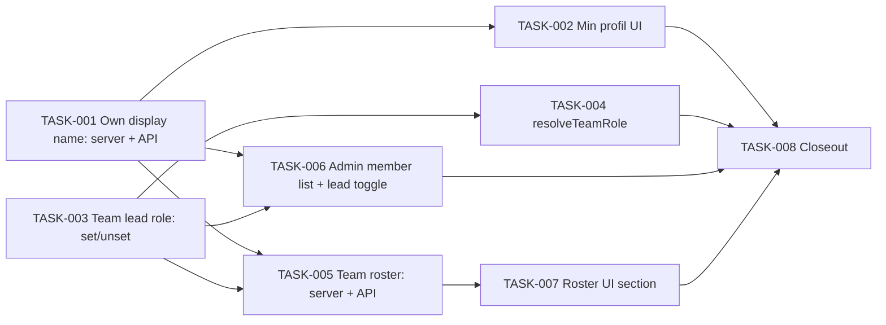

# Member Identity & Team Roles (F0) — Tasks

Specification: [SPEC.md](./SPEC.md)

## Status
Ready: 0  In Progress: 0  Done: 8

`SPEC.md` is `Approved`. Purely additive and migration-free: no task may
rewrite existing documents, change `authorizeTeamAccess` (signature, return
type, semantics), change any existing caller, add a lead-only capability,
add a feature flag, touch Demo Team / forum / surveys / challenges /
skill-tree code, or return any `uid`/e-mail in a member-facing response
(BR-14, BR-26, BR-28, BR-34).

## Task graph

**Parallelism:** TASK-001 and TASK-003 are independent roots. After them,
TASK-002, TASK-004, TASK-005 and TASK-006 are mutually independent (each
touches different files). TASK-007 needs TASK-005. TASK-008 is last.
(Normally only one task is `In Progress` at a time; "parallel" means
order-independent, not simultaneous.)

## BR coverage

| BR | Owner |
|---|---|
| BR-1, BR-2, BR-3, BR-4, BR-5, BR-7 | TASK-001 |
| BR-6 | TASK-001 (contract), verified in TASK-002/006/007 (inert rendering) |
| BR-8, BR-9, BR-10, BR-11, BR-12, BR-13, BR-14, BR-15 | TASK-005 (BR-14/15 also asserted in TASK-001) |
| BR-16, BR-17, BR-18, BR-19, BR-20, BR-21, BR-22, BR-23 | TASK-003 |
| BR-24, BR-25, BR-26, BR-27, BR-28 | TASK-004 (BR-26/28 re-verified in TASK-008) |
| BR-29 | TASK-006 |
| BR-30 | TASK-002 |
| BR-31 | TASK-007 |
| BR-32 | TASK-006 |
| BR-33 | each UI task (TASK-002, 006, 007) |
| BR-34 | TASK-003 (grant regression), confirmed in TASK-008 |

## Tasks

### TASK-001 — Own display name: validation, server operations and API

**Status:** Done
**Covers:** BR-1, BR-2, BR-3, BR-4, BR-5, BR-6, BR-7, BR-15
**Depends on:** None

**Outcome**
A signed-in user can read, set/replace and hard-delete their own display
name through `GET`/`PUT`/`DELETE /api/me/profile`, stored in
`userProfiles/{uid}`, with server-side normalisation/validation. Client
Firestore access to `userProfiles` is denied. No other user's profile can be
obtained.

**Implementation notes**
- New slice `src/features/profiles/`: `domain/display-name.ts` (NFC →
  trim → collapse whitespace → validate: 2–50 code points, ≥1 `\p{L}`/`\p{N}`,
  reject `\p{C}` and line/paragraph separators), `domain/user-profile.ts`
  (fail-closed record validator, `{displayName, createdAt, updatedAt}`),
  `server/get-own-profile.ts`, `server/set-own-profile.ts` (transaction:
  read → set preserving `createdAt`), `server/delete-own-profile.ts`.
  Follow the `*Deps` injection + `verifyIdToken` pattern of
  `src/features/skill-trees/server/`.
- Route `app/api/me/profile/route.ts`: thin delegate, bearer extraction as in
  `app/api/me/route.ts` (which stays unchanged). No `uid` accepted from
  path/query/body.
- A corrupt/invalid stored document reads as `displayName: null`.
- `firestore.rules`: standard deny block for `userProfiles`, with comment
  in the file's existing style; add the matching test in
  `src/lib/firebase/firestore-deployment-config.test.ts`. No index.
- Never log the name; errors must not echo it.

**Verification**
- Domain unit tests: NFC vs NFD, trim/collapse, 2/50/51 code points,
  astral/emoji counted as code points, non-Latin, combining marks, ZWSP,
  U+202E, newline/tab, whitespace-only, punctuation-only, non-string.
- Server-op tests with fakes: create, update keeps `createdAt`, idempotent
  delete, invalid input writes nothing, unauthenticated, corrupt doc ⇒
  `null`, persistence failure, stored value is the normalised value.
- Route tests: status mapping, bearer extraction, body validation.
- `pnpm typecheck`, `pnpm lint`, `pnpm test`.

**Security / privacy**
First personal identity data. Identity only from the verified token; no
lookup-by-`uid` surface; no list/search; not logged; not encrypted (recorded
posture per SPEC). Deny-all client rule.

**Documentation impact**
None in this task (closeout in TASK-008).

**Acceptance criteria**
- [x] `GET` returns only the caller's own `{displayName}` (`null` if none).
- [x] `PUT` stores the normalised name; invalid input → `invalid_input`, no write.
- [x] `DELETE` removes the document, idempotently.
- [x] No endpoint or function accepts a `uid` for profile reads.
- [x] `userProfiles` deny-all rule exists and is tested.
- [x] Relevant tests pass; no conflict with `docs/SECURITY.md`.

---

### TASK-002 — "Min profil" page and header link

**Status:** Done
**Covers:** BR-30, BR-33, BR-6
**Depends on:** TASK-001

**Outcome**
A signed-in user can open `/me/profile`, set, change or remove their
"Visningsnavn", and is told who can see it. The header shows "Min profil"
for signed-in users only.

**Implementation notes**
- `src/features/profiles/client/profile-gateway.ts` (thin `fetch` wrapper,
  defensive response parsing like sibling gateways), `components/ProfileForm.tsx`
  using existing `TextField`/`Button`/`Alert`/`PageHeader` primitives and
  `useAuthGatedResource`, `copy.ts` (Norwegian), `app/me/profile/page.tsx`
  with `PageShell`.
- Help text: "Synlig for medlemmer i team du tilhører, og for
  administratorer. Ikke e-postadressen din."
- States: loading, signed-out sign-in prompt, idle/pending/success,
  validation error (from server `invalid_input`), generic error.
- `SiteHeader`/`nav/copy.ts`: add the link for the signed-in set only; update
  existing header tests. Do not refactor navigation.

**Verification**
- RTL tests: each state, remove action, name rendered as inert text
  (a `<script>`-shaped name shows literally), header link present only when
  signed in, no admin-state regression.
- `pnpm typecheck`, `pnpm lint`, `pnpm test`, `pnpm build`.

**Security / privacy**
Display name rendered as text only. The page never shows e-mail or `uid`
beyond what already exists elsewhere. No client-side authorization logic.

**Documentation impact**
`docs/UI-UX.md` (TASK-008).

**Acceptance criteria**
- [x] Set/change/remove work end-to-end against the route via the gateway.
- [x] Signed-out visitors see the sign-in prompt; link hidden when signed out.
- [x] Copy is Norwegian and states visibility scope.
- [x] Relevant tests pass; existing header/auth UI tests still green.

---

### TASK-003 — Team lead role: admin assign / unassign

**Status:** Done
**Covers:** BR-16, BR-17, BR-18, BR-19, BR-20, BR-21, BR-22, BR-23, BR-34
**Depends on:** None

**Outcome**
An app admin can mark any real, current member of an **active** team as
lead and unmark them, via `PATCH /api/admin/teams/[teamId]/members/[uid]`.
Multiple leads are allowed. Existing memberships without `role` remain
ordinary members; removing a membership ends lead status; re-granting
never carries a role.

**Implementation notes**
- `teams/domain/team-membership.ts`: add optional `role?: "lead"`,
  `roleUpdatedAt?`, `roleUpdatedBy?` to `TeamMembershipRecord`, plus pure
  `membershipRoleOf(data): "lead" | "member"` (`=== "lead"` only; everything
  else `member`). **Do not change** `isValidMembershipFor`,
  `extractMemberUid`, `membershipDocId`.
- `teams/server/set-team-member-role.ts`: `requireAppAdmin` → one Firestore
  transaction reading `teamMemberships/{uid}__{teamId}` (must validate via
  `isValidMembershipFor`, else `not_a_member`, nothing created) and, for
  `"lead"` only, `teams/{teamId}.status` (`isValidTeamStatus` and
  `=== "active"`, else `team_disabled`, zero writes — including re-assign of
  an existing lead). `"lead"` sets `role`/`roleUpdatedAt`/`roleUpdatedBy`;
  `"member"` deletes `role` (`FieldValue.delete()`) and sets the two audit
  fields; un-assign is allowed on any team status. Idempotent. Invalid
  `role` value ⇒ `invalid_input`.
- Add `PATCH` to `app/api/admin/teams/[teamId]/members/[uid]/route.ts`
  beside the existing `DELETE`, which stays byte-for-byte unchanged. Map
  errors like siblings (401/403/400/404-equivalent for `not_a_member`/409 or
  400-class for `team_disabled`, chosen consistently with existing routes).
- Do **not** modify `applyMembershipGrant`, `remove-team-member.ts`, or any
  invitation/access-request code — only add regression tests proving they
  never write `role`.
- Note (no change needed): the Demo Team preflight's `classifyMembership`
  ignores extra fields, so a lead role on the presenter's demo membership
  stays `COMPATIBLE`.

**Verification**
- Server-op tests: admin-only (non-admin/unauthenticated), set/unset,
  idempotency, multiple leads, non-member target, missing team, `disabled`/
  missing/malformed team status ⇒ `team_disabled` with zero writes,
  un-assign on disabled team succeeds, existing lead untouched by
  disable→enable (no write), concurrent-removal transaction behaviour,
  invalid role, persistence failure.
- `membershipRoleOf` table tests: absent, `"lead"`, `"member"`, `"admin"`,
  `null`, number, object ⇒ only `"lead"` yields lead.
- Regression tests: grant paths (immediate grant, invitation resolve,
  access-request approve) write no `role`; remove→re-grant ⇒ member;
  existing route/`removeTeamMember`/grant suites unchanged and green.
- `pnpm typecheck`, `pnpm lint`, `pnpm test`.

**Security / privacy**
Privilege-bearing field, admin-only write, no client-supplied role trusted,
target validated server-side, fresh team-status read, fail-safe read
mapping. Lead grants no capability (BR-28).

**Documentation impact**
`DATA-MODEL.md`, `ARCHITECTURE.md` (TASK-008).

**Acceptance criteria**
- [x] Non-admin and unauthenticated callers cannot change a role.
- [x] Assign on a non-active team is rejected; un-assign still works.
- [x] Non-member target is rejected without creating any document.
- [x] Two leads on one team coexist; zero leads is fine.
- [x] `membershipRoleOf` yields `member` for every non-`"lead"` value.
- [x] Grant paths never write `role`; `DELETE` route and existing suites unchanged.
- [x] Relevant tests pass; no conflict with `docs/SECURITY.md`.

---

### TASK-004 — `resolveTeamRole`

**Status:** Done
**Covers:** BR-24, BR-25, BR-26, BR-27, BR-28
**Depends on:** TASK-003

**Outcome**
Server code can call `resolveTeamRole(identity, teamId)` and get
`{ok: true, role: "admin" | "lead" | "member" | "denied"}` or
`{ok: false, error: "read_failed"}`, derived from fresh server-side state.

**Implementation notes**
- `teams/server/resolve-team-role.ts`: call `authorizeTeamAccess` (same
  `allowList`/`collection` deps seam, extended only in this new file's own
  `Deps` type); `admin`/`denied`/`read_failed` pass through verbatim;
  for `member`, read the caller's membership and apply
  `membershipRoleOf`, returning `lead` only when `teams/{teamId}.status`
  is exactly `"active"` (a stored lead on a disabled team ⇒ `member`, per
  SPEC BR-27). App admin ⇒ `"admin"` even with a lead membership.
- `authorizeTeamAccess` and all callers are **not modified**; no existing
  operation is migrated. The function has no production caller in F0.

**Verification**
- Tests with fake collection: admin, admin+lead ⇒ admin, lead, member
  without `role`, malformed/unknown `role` ⇒ member, non-member ⇒ denied,
  removed membership ⇒ denied, disabled team member (still member) and stored lead (⇒ member, not lead), nonexistent team ⇒ denied for everyone
  incl. admin, each read failure ⇒ `read_failed` (never `denied`).
- `authorize-team-access.test.ts` and all callers' suites pass unmodified.
- `pnpm typecheck`, `pnpm lint`, `pnpm test`.

**Security / privacy**
Role is never client-supplied; least-privilege fail-safe; lead is never
`admin`.

**Documentation impact**
`ARCHITECTURE.md` (TASK-008).

**Acceptance criteria**
- [x] All four roles and both failure modes verified.
- [x] `git diff` shows no change to `authorize-team-access.ts` or its callers.
- [x] Relevant tests pass; no conflict with `docs/SECURITY.md`.

---

### TASK-005 — Team roster: server operation and API

**Status:** Done
**Covers:** BR-8, BR-9, BR-10, BR-11, BR-12, BR-13, BR-14, BR-15
**Depends on:** TASK-001, TASK-003

**Outcome**
`GET /api/teams/[teamId]/members` returns, to an authorized member or app
admin, the team's roster as `{members: [{displayName, isLead, isSelf}],
truncated}` — and nothing identity-bearing beyond that.

**Implementation notes**
- `profiles/server/get-display-names.ts`: batched reader
  (`getAll`, ≤ 100 refs per batch), returns `uid → displayName` for valid
  profiles only (corrupt ⇒ absent). `teams` imports only this function from
  `profiles`; `profiles` never imports `teams`.
- `teams/server/list-team-roster.ts`: `verifyIdToken` →
  `authorizeTeamAccess` (`denied` ⇒ `forbidden`, `read_failed` ⇒ 500, not
  403) → read memberships `where("teamId","==")` with cap 500 (limit 501 to
  detect truncation; document-id order, so no composite index is needed;
  sorted in memory; `truncated:true` when capped) → names → map to entries. `isLead` via `membershipRoleOf` and team status `active` (effective lead);
  `isSelf` from verified uid. Order: leads, then name (locale-aware,
  case-insensitive, nulls last), then creation time. **No Firebase Auth
  lookup.** The mapper must whitelist exactly the three keys.
- Route `app/api/teams/[teamId]/members/route.ts` (thin). Does not collide
  with the existing admin route path.

**Verification**
- Tests: member ok, second same-team member, admin non-member ok, cross-team
  denied, removed member denied on next call, non-member/unauthenticated
  denied, unnamed ⇒ `null`, corrupt profile ⇒ `null`, ordering, `isSelf`,
  truncation flag, batch sizes ≤ 100, auth-read failure ⇒ 500, Auth lookup
  never invoked.
- **Key-whitelist test** deep-checks that no entry or response contains
  `uid`, e-mail, membership doc id, or any extra key (BR-14).
- `pnpm typecheck`, `pnpm lint`, `pnpm test`.

**Security / privacy**
Critical: no `uid`/e-mail in a member-visible response (would make Forum
`authorTag` computable). Not a directory: scoped to the authorized
`teamId`, bounded, no search. Fresh authorization on every call.

**Documentation impact**
`SECURITY.md`, `ARCHITECTURE.md` (TASK-008).

**Acceptance criteria**
- [x] Response keys are exactly `displayName`, `isLead`, `isSelf` per entry (+ `truncated`).
- [x] Cross-team and removed-member access denied.
- [x] Missing name ⇒ `null` (no e-mail/uid/tag fallback).
- [x] Reads are bounded (memberships cap, profile batches).
- [x] Relevant tests pass; no conflict with `docs/SECURITY.md`.

---

### TASK-006 — Admin member list: names, lead marker and toggle

**Status:** Done
**Covers:** BR-29, BR-32, BR-33, BR-6
**Depends on:** TASK-001, TASK-003

**Outcome**
On `/admin/teams/[teamId]`, each member row shows display name (when set) as
primary text with e-mail secondary, a "Teamlead" text marker, and a
"Gjør til teamlead" / "Gjør til vanlig medlem" action; the existing remove
action is unchanged.

**Implementation notes**
- `listTeamMembers` (app-admin-only, existing) additively returns
  `displayName: string | null` and `role: "lead" | "member"` (names via
  `getDisplayNames`, roles via `membershipRoleOf`); `uid`/`email` and the
  exclusion/failure behaviour unchanged. Update `TeamMember` type.
- `admin-team-detail-gateway.ts`: extend `AdminTeamMemberEntry` and its
  parser (tolerate absent new fields ⇒ `null`/`"member"`), add a
  `setAdminTeamMemberRole` gateway function for the PATCH route.
- `AdminTeamDetail.tsx`: row layout, per-row pending/error via the existing
  `memberActions` pattern, refetch/update after success; map `team_disabled`
  to a Norwegian message and hide/disable "Gjør til teamlead" for a disabled
  team (server remains the authority). Copy in `teams/copy.ts`.

**Verification**
- `list-team-members` tests extended (additive fields; existing cases
  unchanged); gateway parser tests (old and new shapes); component tests:
  name/e-mail/marker rendering, toggle success/pending/error, disabled-team
  message, inert rendering of hostile names, remove action unchanged.
- `pnpm typecheck`, `pnpm lint`, `pnpm test`.

**Security / privacy**
Admin-only; e-mail and `uid` remain admin-only here. Marker is text, never
colour alone, and is system-rendered (not derived from the name).

**Documentation impact**
`UI-UX.md` (TASK-008).

**Acceptance criteria**
- [x] Existing admin member-list behaviour and tests unchanged.
- [x] Admin can toggle lead per row; errors shown per row.
- [x] Display name shown when set; e-mail still shown.
- [x] Relevant tests pass; no conflict with `docs/SECURITY.md`.

---

### TASK-007 — Collapsed roster section on `/teams/[teamId]`

**Status:** Done
**Covers:** BR-31, BR-33, BR-6
**Depends on:** TASK-005

**Outcome**
Members and admins see a collapsed, read-only "Medlemmer" section that,
on first expand, lists the team by display name (fallback "Medlem uten
navn"), marks "Teamlead" and "(deg)" as text, and states truncation.

**Implementation notes**
- Self-contained component + gateway in `src/features/teams/`, fetched on
  first expand; its own loading/error state; **no change to
  `TeamDetail`'s initial `Promise.all` or result types** beyond mounting the
  component. Use `
`/existing primitives; keyboard-operable.
- Hidden for callers who cannot view the team (existing behaviour).
  Copy in `teams/copy.ts`.

**Verification**
- RTL tests: collapsed by default and no request before expand, fetch on
  expand, fallback text, lead/self text markers, truncation notice, failure
  isolated (other sections unaffected), inert rendering of hostile names,
  existing `TeamDetail` tests unchanged.
- `pnpm typecheck`, `pnpm lint`, `pnpm test`, `pnpm build`.

**Security / privacy**
Consumes only the TASK-005 contract; renders nothing identity-bearing
beyond display name.

**Documentation impact**
`UI-UX.md` (TASK-008).

**Acceptance criteria**
- [x] No roster request until the section is expanded.
- [x] A roster failure does not affect any other section.
- [x] Markers use visible text; fallback never shows e-mail/uid.
- [x] Relevant tests pass; existing `TeamDetail` suite unchanged.

---

### TASK-008 — Closeout: documentation, invariants and verification sweep

**Status:** Done
**Covers:** BR-34 (confirmation), BR-26, BR-28 (re-verification); all BRs (sweep)
**Depends on:** TASK-002, TASK-004, TASK-006, TASK-007

**Outcome**
Durable docs reflect F0, and the feature is verified additive and
contract-preserving.

**Implementation notes**
- `docs/DATA-MODEL.md`: new `UserProfile` row; `TeamMembership` row gains
  optional `role`/`roleUpdatedAt`/`roleUpdatedBy` and the "absent = member"
  rule; note team role ≠ future professional role.
- `docs/ARCHITECTURE.md`: `resolveTeamRole` wrapping `authorizeTeamAccess`;
  roster/profile boundaries.
- `docs/SECURITY.md`: add the four invariants proposed in the SPEC
  (no `uid`/e-mail in member-visible responses incl. the `authorTag`
  rationale; display name never identifier/authz evidence; profile access
  scope/no directory; team role fail-safe and never client-supplied), and
  extend the review checklist accordingly. No existing invariant weakened.
- `docs/UI-UX.md`: "Min profil", roster section, admin lead controls.
- `docs/DEVELOPMENT.md`/`ROADMAP.md`/`PRODUCT.md` only if F0 changes what
  they state (PRODUCT non-goal rewrite is **not** F0; it belongs to C/D).
- Add the "member reference" follow-up constraint to the Skills Planning
  planning inputs only as already recorded in SPEC (no new file).
- Verification sweep: full `pnpm typecheck`, `pnpm lint`, `pnpm test`,
  `pnpm build`; inspect `git diff` to confirm no change to
  `authorize-team-access.ts`, its callers, Demo Team, forum, surveys,
  challenges, skill-trees, `firestore.indexes.json`; confirm existing
  memberships without `role` read as `member`.

**Verification**
- All checks above pass and the diff is inspected.
- Every SPEC acceptance criterion ticked with evidence.

**Security / privacy**
Final review of BR-14 (no `uid`/e-mail leakage), BR-15 (no directory),
BR-28 (lead grants nothing) against the actual diff.

**Documentation impact**
As listed.

**Acceptance criteria**
- [x] Docs updated and consistent with SPEC and code.
- [x] Full check suite passes; diff inspected.
- [x] No migration, no flag, no out-of-scope file touched.
- [x] SPEC acceptance criteria all satisfied.

---
