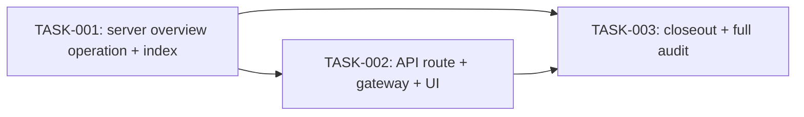

# Cross-Team Skill Progress Overview — Tasks

Specification: [SPEC.md](./SPEC.md)

## Status
Ready: 0  In Progress: 0  Done: 3

The workflow recognizes exactly three states (`Ready`/`In Progress`/`Done`).
TASK-003 is formally `Ready` and is counted as such above, even though its
own **Dependencies** section records that it cannot actually start until
TASK-001 and TASK-002 are `Done` — that constraint is expressed via
`Depends on`, not via a fourth counter bucket.

## Dependency graph

Acyclic: TASK-001 has no dependencies; TASK-002 depends only on TASK-001;
TASK-003 depends only on TASK-001 and TASK-002. No edge points backward.

---

## Tasks

### TASK-001 — Server overview read operation and DTO (composite index verified unnecessary)

**Status:** Done (2026-09-21). `src/features/skill-trees/server/get-org-skill-progress-overview.ts` and its focused test suite (`get-org-skill-progress-overview.test.ts`, 40 tests) are implemented and passing; `firestore.indexes.json` is untouched.
**Covers:** BR-1, BR-2, BR-3, BR-5 (non-mutation half), BR-6, BR-7, BR-8, BR-9, BR-10 (server-side null passthrough), BR-11, BR-12, BR-13, BR-14 (API `teamStatus` field), BR-15, BR-16, BR-17, BR-18, BR-19, BR-20, BR-21, BR-22 (server non-goal), BR-23, BR-24, BR-25, BR-26 (non-mutation half)
**Depends on:** None

**Outcome**
A new server operation `getOrgSkillProgressOverview(idToken)` exists at
`src/features/skill-trees/server/get-org-skill-progress-overview.ts`,
callable and independently unit-tested, returning
`GetOrgSkillProgressOverviewResult` exactly as declared in SPEC.md's
"API/DTO contracts". No route or UI wiring exists yet — this task is
server-only.

**Implementation notes**
- Follow the existing seam pattern used by `list-skill-trees.ts` and
  `get-team-skill-progress.ts`: injectable reader interfaces
  (`SkillTreesReader`, a new `SkillProgressOverviewReader`, and a `teams`
  reader), a `getDefault*Reader()` production implementation using
  `getFirestoreDb()`, and `deps` overrides for tests. Do not add a
  `TeamsReader`/`TeamReader` capable of writes.
- Authorization: call `requireAppAdmin` from
  `src/features/teams/server/require-app-admin.ts` unchanged, exactly like
  `listSkillTrees`/`listTeams` (BR-1). No `authorizeTeamAccess` call
  anywhere in this operation (BR-2).
- `skillTrees` read: reuse the exact bounded query shape from
  `list-skill-trees.ts` (`orderBy("createdAt","asc").limit(LIST_SKILL_TREES_LIMIT)`).
  Import `LIST_SKILL_TREES_LIMIT` from `list-skill-trees.ts` rather than
  redefining it. Run this operation's own copy of the read (per
  Architecture decision 4 in SPEC.md) rather than calling `listSkillTrees`
  itself.
- `skillProgress` read: new bounded query —
  `.orderBy("updatedAt", "desc").orderBy(FieldPath.documentId(), "desc").limit(LIST_ORG_SKILL_PROGRESS_LIMIT)`,
  no `.where()`. Define and export a new constant
  `LIST_ORG_SKILL_PROGRESS_LIMIT = 2000` in this file. Preserve this exact
  orderBy/tiebreak/limit shape — do not simplify, reorder, or drop the
  document-id tiebreaker.
- `teams` read: unbounded `.get()`, no `.where()`/`.orderBy()` — mirror
  `list-teams.ts`'s `TeamListCollection.listAll()` pattern exactly (same
  "every team including disabled" shape `listTeams` already uses).
- Validation/joining, in order: for each raw `skillProgress` doc, map
  Timestamp→Date (reuse the `toCandidateSkillProgress`/`toDateOrUndefined`
  pattern from `get-team-skill-progress.ts`), then `isValidSkillProgress`
  (skip on failure — BR-15). Resolve `treeId` against the in-memory bounded
  `skillTrees` result set (not a second Firestore read) via
  `isValidSkillTree` on the matching doc; no match (including a tree that
  exists but fell outside the 500-oldest bound) → skip (BR-16). Resolve
  `teamId` against the in-memory unbounded `teams` result set; missing, or
  failing `isValidTeamStatus`/blank-`name` validation (the same inline
  check `listActiveTeams` already applies — do **not** write a new
  `isValidTeam` full-record validator) → skip (BR-17). Never surface which
  specific check failed or any raw field value (BR-18).
- Grouping/ordering: group surviving team entries by `treeId`; a tree with
  zero surviving entries is omitted entirely (BR-7); trees ordered
  `createdAt` ascending (BR-11, same order as the bounded `skillTrees`
  read already yields); within each tree, teams ordered by `name` ascending
  (case-sensitive ordinal `<`), `teamId` ascending as tiebreak (BR-12).
- DTO construction: build `OrgSkillProgressTeamEntryView`/
  `OrgSkillProgressTreeView` explicitly field-by-field (never a spread of
  raw data) exactly as declared in SPEC.md's "API/DTO contracts" — no
  `createdAt`/`createdBy`/`updatedAt`/`updatedBy` from either source
  document (BR-23), no membership/invitation/access-request or any
  per-person field (BR-24), no raw `skillProgress` composite document ID
  (BR-25).
- Failure handling: any thrown/rejected read of `skillTrees`,
  `skillProgress`, or `teams` fails the whole operation closed with
  `{ok: false, error: "read_failed"}` — never partial/raw data (BR-19).
  This is distinct from the per-record skip behavior above.
- **Composite index — resolved, no declaration needed.** A dedicated
  verification pass (Firebase's official "Index types in Cloud Firestore"
  documentation, `firebase.google.com/docs/firestore/query-data/
  index-overview`, cross-checked against its Google Cloud mirror
  `docs.cloud.google.com/firestore/native/docs/concepts/index-overview`)
  determined that this exact query —
  `.orderBy("updatedAt","desc").orderBy(FieldPath.documentId(),"desc")
  .limit(2000)`, no `.where()` — does **not** require a user-managed
  composite index. Firestore's automatic single-field index on `updatedAt`
  already applies an implicit final `__name__` (document ID) ordering in
  the same direction as the last explicitly sorted field by default; this
  query's explicit `FieldPath.documentId()` tie-break uses that identical
  default direction (`desc`, matching `updatedAt desc`), and there is no
  `.where()` clause. This reconciles SPEC.md's "Status" →
  "Index-requirement reconciliation", BR-20, and "Firestore/index
  implications" → "Composite-index conclusion" (all updated — see
  SPEC.md). Concretely, this task must:
  1. Write the query exactly as specified above — the explicit
     `FieldPath.documentId()` tie-break stays in code (never relied on
     implicitly) because it is part of the product's determinism
     contract, independent of the (now-resolved) index question.
  2. Make **no edit** to `firestore.indexes.json`.
  3. Leave `src/lib/firebase/firestore-deployment-config.test.ts`'s
     existing `skillProgress` assertion (`"declares no composite index for
     skillProgress"`) **unmodified** — it remains true after this task,
     since no `skillProgress` composite index is added. Add a new,
     separate test (in this task's own test file, not by editing the
     deployment-config test) proving no unrelated index entry was removed
     or modified, if not already implied by the deployment-config suite
     passing unmodified.
  4. `firestore.rules` is unchanged (SPEC — no rule change needed).

**Non-goals**
- No API route, no gateway, no UI — those are TASK-002.
- No change to `create-skill-tree.ts`, `update-skill-tree.ts`,
  `start-team-skill-tracking.ts`, `update-team-skill-progress.ts`,
  `stop-team-skill-tracking.ts`, `report-team-skill-progress.ts`, or
  `get-team-skill-progress.ts` (BR-5/BR-26) — verify via `git diff` before
  marking this task Done.
- No pagination parameter or cursor of any kind (BR-22).
- No new `isValidTeam` full-record validator (Architecture decision 3).
- No suppression/minimum-team-count threshold (BR-8).

**Verification**
- Unit tests for `getOrgSkillProgressOverview` covering, at minimum:
  unauthenticated → `unauthenticated`; authenticated non-admin →
  `forbidden`; a tree with one valid tracking team is included; a tree with
  zero valid tracking teams is excluded; a tree with only malformed
  `skillProgress` records is excluded; a disabled team's entry is included
  with `teamStatus: "disabled"`; `currentNodeId: null` is passed through
  unchanged; a `skillProgress` record whose `treeId` doesn't resolve (both
  "no such tree" and "tree exists but outside the 500-oldest bound") is
  excluded; a `skillProgress` record whose `teamId` doesn't resolve, or
  resolves to an invalid `teams` doc, is excluded; tree ordering is
  `createdAt` ascending; team ordering within a tree is `name` ascending
  with `teamId` tiebreak; a seeded-beyond-2000-`skillProgress` test proving
  the most-recently-updated records survive truncation and the
  least-recently-updated ones are dropped; a tie-break test proving
  deterministic inclusion when two records share an identical `updatedAt`;
  a thrown read from each of the three underlying readers independently
  produces `read_failed`, never partial data.
- A dedicated DTO/privacy regression test asserting the full serialized
  shape of `OrgSkillProgressTreeView`/`OrgSkillProgressTeamEntryView` never
  contains `createdAt`/`createdBy`/`updatedAt`/`updatedBy` or any
  membership/invitation/access-request field, checked against the actual
  TypeScript types (BR-23 through BR-25).
- `firestore-deployment-config.test.ts` passes unmodified — its existing
  `skillProgress` assertion (zero composite indexes) remains true.
- `pnpm lint`, `pnpm typecheck`, `pnpm test` pass for the new and touched
  files.
- `git diff` confirms no change to any of the six Phase 7/8 operation files
  listed under "Non-goals".

**Security / privacy**
Admin-only server boundary (`requireAppAdmin`, unchanged); no new write
path; no audit-identity (`createdBy`/`updatedBy`) field ever reaches the
returned DTO; malformed records are skipped, never surfaced raw; a genuine
read failure fails closed. See SPEC.md "Security and privacy" — no new
concept introduced.

**Documentation impact**
SPEC.md was reconciled (index-requirement correction) as a prerequisite to
resuming this task — see SPEC.md "Status" → "Index-requirement
reconciliation", BR-20, and "Firestore/index implications". No further
documentation change is expected from implementing this task as now
specified.

**Acceptance criteria**
- [x] `getOrgSkillProgressOverview` exists and returns the exact DTO shape
      declared in SPEC.md's "API/DTO contracts".
- [x] All unit tests listed under "Verification" exist and pass (40 tests
      in `get-org-skill-progress-overview.test.ts`).
- [x] The `skillProgress` query is written exactly as
      `.orderBy("updatedAt","desc").orderBy(FieldPath.documentId(),"desc").limit(LIST_ORG_SKILL_PROGRESS_LIMIT)`
      — the explicit document-ID tie-break is present in code, never relied
      on implicitly.
- [x] `firestore.indexes.json` is byte-for-byte unchanged (no new
      composite index entry; no existing entry modified or removed) —
      confirmed via `git status`/`git diff --stat` (file not touched) and
      `grep -c skillProgress firestore.indexes.json` (0).
- [x] `firestore-deployment-config.test.ts` passes unmodified (file not in
      `git status`; 12-file, 205-test regression run green).
- [x] `pnpm lint`, `pnpm typecheck` pass for the whole repository; `pnpm
      test` passes for this task's own files plus the full Phase 7/8
      `skill-trees/server` + deployment-config regression scope (205/205).
      A full unfiltered `pnpm test` run has pre-existing, unrelated
      component-test timeouts (confirmed via a stash-based before/after
      comparison: the same — in fact more — failures occur with this
      task's files removed) — see "Remaining risks" in the final report.
- [x] `git diff` shows no change to any Phase 7/8 operation file (zero
      tracked files changed at all — only new untracked files added).
- [x] No conflict with `docs/SECURITY.md`.

---

### TASK-002 — GET route, gateway, and `/admin/skills` overview UI

**Status:** Done (2026-09-21). `app/api/admin/skills/overview/route.ts`,
`fetchOrgSkillProgressOverview` (`skill-trees-gateway.ts`),
`OrgSkillProgressOverview.tsx`, and `orgSkillProgressOverviewCopy`
(`copy.ts`) are implemented, wired into `AdminSkills.tsx` as a third,
independently-fetched sibling section, and covered by 6 route tests, 8 new
gateway tests, 11 component tests, and 3 new `AdminSkills` integration
tests — all passing.
**Covers:** BR-4, BR-5 (route-shape half), BR-9 (UI rendering), BR-10 (UI "Ikke startet" rendering), BR-13 (UI visibility), BR-14 (UI "Deaktivert" label), BR-22 (no pagination UI), BR-26 (route/UI half), BR-27
**Depends on:** TASK-001

**Outcome**
An app admin visiting `/admin/skills` sees a new, read-only "cross-team
overview" section below the existing catalog, populated from a new `GET
/api/admin/skills/overview` route that thinly delegates to
`getOrgSkillProgressOverview`. The existing creation form and catalog list
on the same page are visually and behaviorally unchanged.

**Implementation notes**
- Route: add `app/api/admin/skills/overview/route.ts` with a `GET` handler
  only (BR-4) — extract the bearer token exactly like
  `app/api/admin/skills/route.ts`'s existing `GET`, call
  `getOrgSkillProgressOverview(token)`, map `{ok:true, trees}` → `{trees}`
  (200), `unauthenticated` → 401, `forbidden` → 403, `read_failed` → 500.
  No additional logic, no query-string or body parameter of any kind
  (there is nothing to parse — a bare `GET`).
- Gateway: add a `fetchOrgSkillProgressOverview` function to
  `src/features/skill-trees/client/skill-trees-gateway.ts`, following the
  exact pattern of `fetchAdminSkillTrees` in the same file — an injectable
  gateway interface, a `getDefault*Gateway()` using `fetch`, response-shape
  validation via `is*` type guards (mirroring `isAdminSkillTreeEntry`), and
  a safe fallback to `{status: "read_failed"}` for any malformed/unexpected
  shape. Reject a response that includes any field beyond the declared DTO
  shape from being treated as an ok result (BR-9/BR-23 client-side
  reinforcement — the gateway must not just pass through whatever JSON
  arrives).
- Component: add a new component (e.g.
  `src/features/skill-trees/components/OrgSkillProgressOverview.tsx`)
  rendering: `LoadingState` while loading; a distinct `EmptyState` when
  `trees` is empty; per-tree sections (tree name as sub-heading, `<ul>` of
  tracking teams) when populated; a generic `Alert variant="error"` on
  `read_failed`, isolated from the rest of the page's loading/error state
  (mirrors the existing `AdminSkills.tsx` catalog isolation). Each team
  list item shows team name, a "Deaktivert" text suffix for
  `teamStatus: "disabled"` (never color-only), and either the current
  stage's `label` (resolved from the tree's own `nodes` by `currentNodeId`)
  or the existing "Ikke startet" copy for `currentNodeId: null` — reuse
  the exact string from `teamSkillTrackingCopy`/`teamSkillSectionCopy`
  rather than introducing a new "not started" string. No button, form,
  link, or other interactive/mutation control anywhere in this component.
- Copy: add new Norwegian strings to `src/features/skill-trees/copy.ts`
  (e.g. a new `orgSkillProgressOverviewCopy` export) for the section
  title, empty state, and error state — do not repurpose or edit
  `adminSkillsCopy`'s existing keys.
- Wiring: extend `AdminSkills.tsx` to render the new component as a third
  child alongside `SkillTreeCreationForm`/`SkillTreeCatalogList`, gated on
  the same already-established admin-access check
  (`fetchAdminSkillTrees`-driven `state.phase`/`result.status` handling)
  already in that component — do not add a second, separate sign-in/
  forbidden UI path. No new route, no new nav entry.
- Ordering: rely entirely on the server DTO's already-sorted `trees` and
  `teams` arrays (TASK-001) — do not re-sort client-side.

**Non-goals**
- No change to `getOrgSkillProgressOverview`'s behavior, query shape, or
  DTO fields — this task consumes TASK-001's contract as-is.
- No mutation control (start/stop tracking, set stage, create/correct
  tree) anywhere in the new route, gateway function, or component.
- No pagination, search, or filter control (BR-22, SPEC "Out of scope").
- No change to `SkillTreeCreationForm.tsx` or `SkillTreeCatalogList.tsx`
  beyond `AdminSkills.tsx` gaining one additional sibling child (BR-27).
- No new top-level route or navigation entry.

**Verification**
- API route test (mirroring `app/api/admin/skills/route.test.ts`'s `GET`
  suite): 200 with `{trees}` on success; 401/403/500 mapped from
  `unauthenticated`/`forbidden`/`read_failed`; confirms
  `getOrgSkillProgressOverview` is called with only the extracted token
  (no other argument); confirms no `POST`/`PATCH`/`PUT`/`DELETE` handler is
  exported from this route file.
- Gateway test (mirroring `skill-trees-gateway.test.ts`'s existing
  conventions): parses a well-formed response into `{status:"ok", trees}`;
  rejects/falls back safely on a malformed or unexpected response shape
  rather than rendering it as valid; maps `unauthenticated`/`forbidden`/
  `read_failed` correctly.
- Component tests covering: loading state; a populated multi-tree,
  multi-team result renders correctly; empty state (`trees: []`) renders
  distinctly from loading/error; error state (`read_failed`) renders an
  isolated `Alert` without hiding the rest of `/admin/skills`; a one-team
  tree renders correctly; `currentNodeId: null` renders the existing "not
  started" copy, never blank; a disabled team's entry is visibly labeled
  ("Deaktivert") via text, never color alone; tree/team ordering in the
  rendered output matches the DTO's already-sorted order (no client-side
  re-sort is exercised/needed); semantic list markup (`<ul>`/`<li>`) is
  used; no interactive/mutation control (button, form, link) exists
  anywhere within this component's rendered output; the page remains
  usable at phone width (no horizontal scroll introduced).
- Regression: existing `AdminSkills.test.tsx`,
  `SkillTreeCreationForm.test.tsx`, and `SkillTreeCatalogList.test.tsx`
  continue to pass unmodified, proving the existing management UI still
  functions with the new section present.
- `pnpm lint`, `pnpm typecheck`, `pnpm test`, `pnpm build` pass.

**Security / privacy**
Server-side `requireAppAdmin` enforcement remains entirely inside
`getOrgSkillProgressOverview` (TASK-001) — this task adds no client-side
authorization logic and performs no direct Firestore access from the
browser. No audit-identity field is ever requested, parsed, or rendered.
Error responses never leak a raw backend error string to the client
(generic `Alert` copy only).

**Documentation impact**
None expected — SPEC.md already documents the route, DTO, and UI contract
in full.

**Implementation deviation from this task's own verification text (recorded,
not silent)**: the "Regression" bullet above says `AdminSkills.test.tsx`
"continue[s] to pass unmodified." That could not be achieved literally:
`AdminSkills.tsx` now calls `fetchOrgSkillProgressOverview` unconditionally
whenever a token is present, so the test file's `vi.mock(".../skill-trees-
gateway")` factory needed that export added or every such test throws an
unhandled-rejection `TypeError` (confirmed — this was the actual failure
before the fix). Separately, two pre-existing assertions used a loose
`/ingen kompetanseområder/i` regex that became ambiguous once the new
section's own, SPEC-mandated empty-state copy ("...spores av noe team
ennå.") was mounted alongside the catalog's ("...ennå.") — both now match
the same loose pattern. Both fixes are additive/disambiguating only: no
existing assertion's expected behavior was weakened, removed, or changed to
force a pass. `SkillTreeCreationForm.test.tsx` and `SkillTreeCatalogList.test.tsx`
were not touched, since neither of those components changed.

**Acceptance criteria**
- [x] `GET /api/admin/skills/overview` returns 200/401/403/500 exactly as
      specified; no other HTTP method is handled by this route file.
      (`app/api/admin/skills/overview/route.test.ts`, 6 tests.)
- [x] The new gateway function is used by the new component; no direct
      Firestore import exists anywhere under
      `src/features/skill-trees/components/` or `.../client/` (confirmed by
      grep — only doc-comment mentions of "Firestore", no import).
- [x] The new section renders all of: loading, populated (one-team and
      multi-team), empty, and error states, each independently tested
      (`OrgSkillProgressOverview.test.tsx`, 11 tests).
- [x] A disabled team's entry is visible and text-labeled in the rendered
      output.
- [x] `currentNodeId: null` renders as "not started," never blank.
- [x] No interactive/mutation control exists anywhere in the new section.
- [x] `AdminSkills.tsx`'s existing creation form and catalog remain present
      and functional — `AdminSkills.test.tsx` required the minimal,
      disambiguating updates recorded above (mock registration for the new
      gateway call; two exact-text assertions replacing an now-ambiguous
      regex) but no existing assertion's expected behavior changed; all 8
      tests (5 original + 3 new) pass.
- [x] `pnpm lint`, `pnpm typecheck`, `pnpm build` pass; `pnpm test` passes
      except 4 pre-existing, unrelated `SignInForm`/`SignUpForm` parallel-
      worker timeout flakes (confirmed unrelated: `git diff --stat` shows
      zero changes under `src/features/auth`, and both files pass 16/16 when
      re-run in isolation).
- [x] No conflict with `docs/SECURITY.md`.

---

### TASK-003 — Closeout: BR/security/privacy/config audit, regression, and durable docs

**Status:** Done (2026-09-21). Full BR-1–BR-27 audit performed against actual
shipped code/tests (not prior task reports) — every BR PASS, no
implementation gap found, no code changed by this task. Durable docs
updated: `docs/ROADMAP.md` (Phase 9 entry added, "Phases 0–9 are complete"),
`docs/PRODUCT.md` (new "Delivered: Cross-Team Skill Progress Overview
(Phase 9)" section; stale "Future capabilities" wording reconciled to
distinguish the delivered read-only overview from the still-future Section/
org-hierarchy entity), `docs/DATA-MODEL.md` (note: no new collection/
persisted concept introduced), `docs/UI-UX.md` (new `/admin/skills` overview
section documented). `docs/ARCHITECTURE.md`/`docs/SECURITY.md` needed no
change — already-accurate generic invariants, nothing feature-specific to
add.
**Covers:** BR-1 through BR-27 (final audit pass across all — no new implementation)
**Depends on:** TASK-001, TASK-002

**Outcome**
The feature is verified complete against SPEC.md end to end, Phase 7/8
regression is confirmed, durable documentation is updated where the
feature's shipped shape requires it, and the feature is ready for
deployment-readiness review — with no further code changes beyond what
this audit finds necessary to correct.

**Implementation notes**
- This task performs **audit and correction of gaps found**, not new
  feature work. If the audit finds a genuine BR not actually satisfied by
  TASK-001/TASK-002's shipped code, fix the specific gap (in the
  appropriate existing file from TASK-001/TASK-002's surface) and re-run
  verification — do not add new scope beyond closing that gap.
- BR-1–BR-27 audit: walk every BR in SPEC.md against the actual shipped
  code and tests (not against this TASKS.md's paraphrase) and confirm each
  one is both implemented and covered by a passing test.
- Authorization/security audit: confirm `requireAppAdmin` is the only
  admin check used, no `authorizeTeamAccess` call exists anywhere in the
  new operation, and a non-admin/unauthenticated caller is rejected
  exactly as specified (BR-1, BR-2).
- Privacy/DTO audit: confirm, by reading the actual shipped
  `OrgSkillProgressTreeView`/`OrgSkillProgressTeamEntryView` types and one
  full serialized-response test, that no audit-identity or per-person
  field crosses the DTO boundary (BR-23–BR-25).
- Malformed-record semantics audit: confirm BR-15–BR-18 are each covered
  by an actual passing test, not merely asserted in prose.
- Bounds/truncation audit: confirm the `skillTrees` 500-bound,
  `skillProgress` 2000-bound with newest-first truncation, and the
  document-id tiebreak are each covered by an actual passing test
  (BR-20/BR-21), and that no pagination control exists anywhere (BR-22).
- Index/config verification: confirm `firestore.indexes.json` reflects
  exactly what TASK-001 verified was actually required (no drift since
  TASK-001), `firestore.rules` is unchanged, and
  `firestore-deployment-config.test.ts` passes.
- Phase 7/8 regression: run `docs/features/team-skill-tree/SPEC.md`'s and
  `docs/features/skill-progress-self-report/SPEC.md`'s full existing test
  suites unmodified and confirm they still pass; confirm via `git diff`
  that none of `create-skill-tree.ts`, `update-skill-tree.ts`,
  `list-skill-trees.ts`, `start-team-skill-tracking.ts`,
  `update-team-skill-progress.ts`, `stop-team-skill-tracking.ts`,
  `get-team-skill-progress.ts`, or `report-team-skill-progress.ts` changed;
  confirm `AdminSkills.test.tsx` and the existing
  `SkillTreeCreationForm.test.tsx`/`SkillTreeCatalogList.test.tsx` suites
  still pass (BR-26, BR-27); confirm Phase 8 member authorization
  (`skill-progress-self-report` tests) and Phase 7 admin disabled-team
  behavior (`team-skill-tree` tests covering disabled-team tracking) are
  both still green.
- Durable documentation: update `docs/DATA-MODEL.md` only if this
  feature's shipped shape introduces a documentation gap (e.g. if the
  composite index list there needs the new entry reflected); update
  `docs/ROADMAP.md` to mark Phase 9 complete **only after** all acceptance
  criteria above are confirmed, never before.
- Full-suite verification: run `pnpm lint`, `pnpm typecheck`, `pnpm test`,
  and `pnpm build` for the whole repository (not just this feature's
  files) and confirm all pass.
- Deployment-readiness review: confirm nothing in this feature requires a
  production/cloud infrastructure change beyond the reviewed
  `firestore.indexes.json` entry, and that no deploy has been performed as
  part of this task (deploys require an explicit separate request per
  `CLAUDE.md`).

**Non-goals**
- No new BR, feature behavior, route, or UI beyond what SPEC.md already
  specifies.
- No implementation work that belongs in TASK-001 or TASK-002 — this task
  only closes genuine gaps found during audit.
- No production deploy.
- No `docs/ROADMAP.md` update before every acceptance criterion in
  TASK-001 and TASK-002 is independently confirmed.

**Verification**
- Full `pnpm lint`, `pnpm typecheck`, `pnpm test`, `pnpm build` run against
  the whole repository, all green.
- `docs/features/team-skill-tree/SPEC.md`'s and
  `docs/features/skill-progress-self-report/SPEC.md`'s existing test files
  run unmodified and pass.
- `git diff` reviewed in full against the pre-feature `HEAD`
  (`4c0f6a7b858fef1312c5ff0c8e88c6f49a53536a`) confirming only the expected
  new/changed files for this feature exist, with no unrelated file touched.

**Security / privacy**
This task performs the feature's final security/privacy audit — see
"Implementation notes." No new security surface is introduced by this task
itself.

**Documentation impact**
`docs/ROADMAP.md` (Phase 9 completion marker, only after acceptance);
`docs/DATA-MODEL.md` only if the audit finds a genuine gap. No other
durable doc is expected to need a change, since SPEC.md already documents
this feature's product/architecture/security shape in full.

**BR-1–BR-27 closeout audit result — every BR PASS, no gap found**

| BR | Result | Evidence |
|---|---|---|
| BR-1 | PASS | `requireAppAdmin` call in `get-org-skill-progress-overview.ts`; tests "rejects an unauthenticated caller"/"rejects an authenticated non-admin"/"rejects a real team member who is not app-admin"/"succeeds for an app admin" |
| BR-2 | PASS | Grep confirms zero `authorizeTeamAccess` reference in the operation/route/gateway/component surface (only a doc-comment noting its absence); test "performs no authorizeTeamAccess-shaped check" |
| BR-3 | PASS | "read-only boundary" describe block: "exposes no create/set/update/delete-shaped export", "never calls any write-shaped method on any reader dependency" |
| BR-4 | PASS | `route.ts` exports only `GET`; route test "exports no POST/PATCH/PUT/DELETE handler from this route file" |
| BR-5 | PASS | `git diff` vs pre-feature HEAD shows zero change to any of the 8 Phase 7/8 operation files |
| BR-6 | PASS | Test "includes a tree tracked by exactly one team" |
| BR-7 | PASS | Tests "returns an empty overview when no tree has any tracking team", "excludes a tree whose only skillProgress records are malformed" |
| BR-8 | PASS | BR-6's one-team-inclusion test proves no suppression threshold exists; no threshold constant anywhere in the operation |
| BR-9 | PASS | Server DTO key-shape test; UI: `OrgSkillProgressOverview.test.tsx` renders teamId/name/status/stage |
| BR-10 | PASS | Server test "preserves null currentNodeId unchanged"; UI test "renders 'Ikke startet' for a null currentNodeId, never blank" |
| BR-11 | PASS | Server test "orders trees by createdAt ascending"; UI test "preserves the DTO's tree ordering without re-sorting" |
| BR-12 | PASS | Server tests "orders teams... by name ascending"/"breaks a tied team name with teamId ascending"; UI test "preserves the DTO's team ordering" |
| BR-13 | PASS | Server tests "includes a disabled team's entry, never excluding it"/"includes a tree where all tracking teams are disabled" |
| BR-14 | PASS | Server DTO includes `teamStatus`; UI test "labels a disabled team's entry with 'Deaktivert' via text" (component has no status-only-color styling) |
| BR-15 | PASS | Test "excludes a tree whose only skillProgress records are malformed" |
| BR-16 | PASS | Tests for "treeId does not resolve to any tree", "tree exists but falls outside the bounded skillTrees result set", "references a malformed tree document" |
| BR-17 | PASS | Tests for missing team, invalid `status`, blank `name` |
| BR-18 | PASS | Test "never surfaces which specific check failed or any raw field value for an excluded record" |
| BR-19 | PASS | Tests: each of the three readers throwing independently yields `read_failed`; "never returns partial/raw data alongside a read_failed error" |
| BR-20 | PASS | Source confirmed: `.orderBy("updatedAt","desc").orderBy(FieldPath.documentId(),"desc").limit(LIST_ORG_SKILL_PROGRESS_LIMIT)`, no `.where()`; reader-arg tests for both bounds; truncation test ("keeps the most-recently-updated 2000... drops the least-recently-updated"); two tie-break tests |
| BR-21 | PASS | "returns exactly the 500 oldest-created skillTrees when 501 exist"; truncation test above; DTO shape test proves no count/exhaustiveness field exists anywhere |
| BR-22 | PASS | No cursor/page param anywhere in the operation, route, or gateway signatures; UI has no pagination control (proven by the "no interactive control" test) |
| BR-23 | PASS | Test "never includes createdAt/createdBy/updatedAt/updatedBy from either source document" (seeded leak values absent from serialized JSON) |
| BR-24 | PASS | Test "never includes membership/invitation/access-request or any per-person field" |
| BR-25 | PASS | Test "never includes the raw skillProgress composite document id" |
| BR-26 | PASS | `git diff` shows zero change to any Phase 7/8 file; full Phase 7/8 regression scope (406 tests, see "Verification" below) green |
| BR-27 | PASS | `SkillTreeCreationForm.tsx`/`SkillTreeCatalogList.tsx` not in `git status`; their existing test files pass unmodified |

No remediation was required — every BR was already correctly implemented
by TASK-001/TASK-002; this task changed no source file.

**Acceptance criteria**
- [x] Every BR-1 through BR-27 is confirmed implemented and covered by a
      passing test, cited against actual file/test names (see table above).
- [x] Full `pnpm lint`, `pnpm typecheck`, `pnpm test`, `pnpm build` pass
      for the whole repository. `pnpm test`: 2342/2342 passing, 166/166
      files, run twice for stability (no parallel-worker flakes observed
      in this closeout run — see "Verification").
- [x] Phase 7/8 regression suites pass unmodified (406/406 across the full
      `src/features/skill-trees` + `app/api/admin/skills` scope, which is
      the actual file location of every `team-skill-tree`/
      `skill-progress-self-report` SPEC test).
- [x] `firestore.indexes.json`/`firestore.rules`/deployment-config test are
      confirmed consistent and correct (byte-identical to pre-feature HEAD;
      15/15 deployment-config tests pass).
- [x] `docs/ROADMAP.md` reflects Phase 9 completion — added only after all
      of the above were independently confirmed.
- [x] No conflict with `docs/SECURITY.md`.
- [x] Nothing was committed, pushed, or deployed as part of this task.
