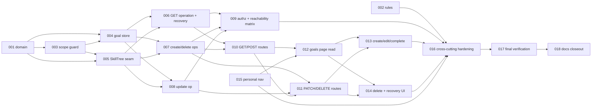

# Personal development goals (D1) — Tasks

Specification: [SPEC.md](./SPEC.md) (product decisions D1-P1…D1-P19, CL-1, CL-2 and OQ-1 resolved; no open product decisions)

## Status
Ready: 0  In Progress: 0  Done: 18

**All tasks are Done; D1 is implemented (closeout 2026-10-14).**

Total tasks: **18**. Repository convention (`implement-task`): the only states are `Ready`, `In Progress`,
`Done`. A task whose dependencies are not `Done` stays `Ready` and is skipped until they are; `Depends on`
is the gate. Dependency-free tasks: TASK-001 (Done), TASK-002, TASK-015.

## Ground rules (apply to every task)

- **SPEC.md is authoritative.** Do not redesign or reinterpret it. If implementation proves the SPEC
  contradictory or unsafe, stop and report the affected BR/SI IDs; never weaken a `docs/SECURITY.md`
  invariant or work around a guard.
- Feature directory `src/features/personal-goals/` (`domain/`, `server/`, `client/`, `components/`,
  `copy.ts`), routes `app/api/me/goals/`, page `app/me/goals/page.tsx` (AD-3). Persistence only at
  `userDevelopment/{uid}/goals/{goalId}` via the Admin SDK (AD-1, AD-2, BR-43).
- The only goal subject is the verified-token uid. No uid/ownerUid/teamId/memberRef/e-mail in any API
  input, persisted document, DTO or error body. No `authorizeTeamAccess`, `resolveTeamRole`, `isAppAdmin`,
  `requireAppAdmin`, membership/team collection read (BR-3). No `skillProfiles`, `skillProgress`,
  `roadmapItems`, `teamSkillNeeds` reads. No client Firestore. No `collectionGroup`.
- No uid-parameterised or cross-user goal reader/writer, no "future-use" generic goal service, no lead/admin
  variant of any operation.
- Timestamps follow BR-14 exactly (injected application clock → Firestore `Timestamp`; ISO DTO); the clock
  and id generator are injected (AD-6). Tasks must not choose timestamp semantics independently.
- Titles, request bodies, tree names and raw/malformed documents are never logged (BR-54, BR-62).
- No Firebase access, seed, deploy, migration, backfill, new dependency, env var, composite index
  (`firestore.indexes.json` unchanged) or Demo Team change. Tests use injected deps / in-memory fakes.
- Commands (from `package.json`, run with pnpm): `pnpm typecheck`, `pnpm lint`, `pnpm test` (vitest run;
  focused: `pnpm vitest run <path>`), `pnpm build`. Every task runs typecheck, lint and its focused tests;
  full `pnpm test` and `pnpm build` are mandatory in TASK-017 and recommended earlier when a task touches
  shared files (header, rules).
- Out of scope everywhere (SPEC "Out of scope"): D2, conversations, sharing, mentors, lead/admin access,
  roleDefinitions/role expectations, manager views, analytics, journal, descriptions, attachments, numeric
  progress, target levels, inference, roadmap/challenge/teamSkillNeeds/skillProgress integration,
  notifications, assignments, AI, account erasure, archive, Demo Team fixtures, `/me` index, `Samtaler`.

## Dependency graph

---

### TASK-001 — Goal domain: normalisation, validation, parsing, lifecycle, DTO types

**Status:** Done
**Covers:** BR-6, BR-7, BR-8, BR-9, BR-10, BR-11, BR-12, BR-13, BR-14, BR-15, BR-16, BR-17, BR-18, BR-64, BR-20, BR-21, BR-24, BR-35, BR-57 (type + key tuple), BR-63 (id shape), BR-27a (id shape predicate), SI-5, SI-7, SI-10
**Depends on:** None

**Outcome**
A Firebase-free `src/features/personal-goals/domain/` module: constants (`GOAL_LIMIT`, `GOAL_READ_WINDOW`,
`GOAL_TITLE_MIN/MAX`, `GOAL_BODY_MAX_BYTES`, `SKILL_OPTIONS_WINDOW`), goal-local title normaliser (BR-9),
goal-local `targetDate` validator (BR-12), status type, goal-id shape predicate (BR-27a: `^[A-Za-z0-9_-]{1,128}$` and not the reserved form `^__.*__$`),
readability/parse function for a raw document (BR-35, including `null` optionals, unknown keys,
non-normalised title, `updatedAt >= createdAt`, `completedAt` iff completed), pure lifecycle transition
functions (create/complete/reopen/edit with no-op detection, `completedAt` invariant, preserved on edits,
caller-supplied `now`), `GoalDto` and `GoalRecoveryDto` types and exported key tuples (persisted keys, DTO
keys, recovery-DTO keys, GET-envelope keys), ISO timestamp serialisation helper.

**Implementation notes**
Normaliser and date validator are local with **parity tests** against `normalizeDisplayName` /
`isValidPlanDate` over a shared fixture table (differing only in length bounds) — tests may import the
originals; production domain code must not (BR-10, BR-12, AD-7). The parser returns a discriminated result
(`readable` | `malformed`) carrying **no failure reason or content** beyond what the caller needs to
classify. Timestamp fixtures use millisecond precision.

**Verification**
- Domain tests: title edge cases (100/101 code points, surrogate pairs, NFC, control/format/line-separator
  rejection, inner newline rejected, letter-or-digit rule, non-string); date cases from SPEC edge cases;
  lifecycle (complete twice no-op, reopen active no-op, edit no-op, title edit on completed preserves
  `completedAt`, `updatedAt` rules; BR-64: changed mutation with `now < createdAt` rejected `clock_regressed`
  atomically, no-op wins over a regressed clock, `now === createdAt` allowed); readability over malformed fixtures (unknown key, bad status,
  completedAt/status mismatch, wrong-type/missing timestamps, `updatedAt < createdAt`, empty `treeId`, `null`
  optionals, non-normalised title); key-tuple equality to BR-6/BR-24/BR-57/BR-25.
- `pnpm typecheck`, `pnpm lint`, `pnpm vitest run src/features/personal-goals/domain`.

**Security / privacy**
No persisted `uid`/`ownerUid`/forbidden BR-7 fields can be produced by any domain function; DTO shape
contains no uid/team/C1/actor fields; the recovery DTO type has only `goalId`.

**Documentation impact**
None expected (closeout in TASK-018).

**Acceptance criteria**
- [x] All covered BRs satisfied by pure functions with tests; no Firebase/`firebase-admin` import in `domain/`
- [x] No import from `profiles`, `roadmap`, `skill-profiles`, `teams` (production code)
- [x] Parity tests pass; key tuples exactly equal the SPEC sets
- [x] No conflict with `docs/SECURITY.md`

---

### TASK-002 — Deny-only Firestore rules for `userDevelopment`

**Status:** Done
**Covers:** BR-44, BR-45 (no index), SI-9, AD-2
**Depends on:** None

**Outcome**
`firestore.rules` gains `match /userDevelopment/{document=**} { allow read, write: if false; }` with the
standard documentation comment, placed **before** the catch-all; the catch-all remains.

**Implementation notes**
Follow the existing deny-only blocks (`teamSkillNeeds`, `skillProfiles`) and the repository's existing rules
/ deployment-config pin test convention; extend that test (or add one beside it) to pin the new block and its
position. Rules are **not** deployed by this task.

**Verification**
- Rules pin test: block exists, is deny-only, precedes catch-all, catch-all unchanged, no `allow` with a
  true/auth condition for `userDevelopment`; `firestore.indexes.json` unchanged (`git diff --stat`).
- `pnpm typecheck`, `pnpm lint`, focused rules test.

**Security / privacy**
Defence in depth only; owner authorization stays server-side (BR-44).

**Documentation impact**
None expected (SECURITY.md in TASK-018).

**Acceptance criteria**
- [x] Deny-only block before catch-all; existing blocks untouched
- [x] Pin test passes; no index/env/dependency change
- [x] No deploy or Firebase access

---

### TASK-003 — D1 static scope guard (initial, strict)

**Status:** Done
**Covers:** BR-3, BR-4 (static), BR-7, BR-11, BR-20, BR-21, BR-37, BR-42, BR-43, BR-45, SI-3, SI-5, SI-6, SI-7, SI-8, SI-10, SI-15, AD-3
**Depends on:** TASK-001

**Outcome**
`src/features/personal-goals/personal-goals-scope-guard.test.ts`, modelled on
`skill-profiles-scope-guard.test.ts` (pure scanner functions over the real tree and virtual negative
fixtures; the guard file excluded from real scans), implementing all nine SPEC dimensions: collection
identifier allow-list for `userDevelopment`, importer allow-list for `personal-goals/server/**` (narrower for
the store), no `collectionGroup`, no client Firestore, forbidden imports/identifiers (skill-profiles, team
authorization, membership, roadmap, `skill-trees/server`, `team-skills`, `skillProgress`, `roadmapItems`,
`teamSkillNeeds`, `skillProfiles`, `teamMemberships`), persisted-key allow-list, DTO/recovery-DTO/envelope
key allow-lists, forbidden concepts (sharing/consent, lead/admin reader, ranking/scoring, overdue,
`dangerouslySetInnerHTML`), and "no other guard weakened" (D1 files absent from C1/C2 allow-lists).

**Implementation notes**
Runs from the start so later tasks execute under it; later tasks extend only D1's own allow-lists (file
names) as they add files. The header documents the SPEC limitations (change-detection evidence, not a
security boundary; cannot prove runtime authorization). Negative virtual fixtures prove each dimension
fires. Do not edit C1/C2 guards.

**Verification**
- Guard test passes on the real tree (currently domain files only) and fails on each negative fixture.
- `pnpm typecheck`, `pnpm lint`, `pnpm vitest run src/features/personal-goals`, plus the C1/C2 guard tests
  unchanged and passing.

**Security / privacy**
Static scan does not replace behavioral tests (TASK-009).

**Documentation impact**
None expected.

**Acceptance criteria**
- [x] All nine dimensions implemented with negative fixtures
- [x] Header states limitations
- [x] C1/C2 guard files and allow-lists unmodified
- [x] No conflict with `docs/SECURITY.md`

---

### TASK-004 — Owner-scoped goal store (Admin SDK) and in-memory fake

**Status:** Done
**Covers:** BR-6, BR-14, BR-29, BR-30, BR-33, BR-34 (count), BR-35 (applied), BR-43, BR-56 (store layer), BR-58, SI-15, AD-1, AD-2, AD-6
**Depends on:** TASK-001, TASK-003

**Outcome**
`src/features/personal-goals/server/goal-store.ts`: the **only** module naming `userDevelopment`. All
functions take the verified `ownerUid` and construct the path
`collection("userDevelopment").doc(ownerUid).collection("goals")`:
create (explicit persisted-key construction, `Timestamp` from injected `Date`, auto-ID from injected
generator); list raw window — exactly `orderBy("createdAt","desc").limit(101)` returning raw
snapshots/ids with Timestamp→Date mapping applied before parsing; recovery scan — exactly
`.select("createdAt").limit(101)` with no `orderBy`, returning ids whose `createdAt` is absent plus the raw
count; owner `count()` aggregation; transactional read-modify-write helper on a single goal document
(transaction callback re-reads the clock); delete by id **without reading or parsing**; get-by-id for
PATCH. A `fake-goal-store.ts` (like `fake-skill-profile-store.ts`) implements the same contract with
Firestore ordering semantics (documents missing `createdAt` excluded from `orderBy`; non-timestamp
`createdAt` returned by type order; `__name__` tie-breaks and default id-ascending order; projection).

**Implementation notes**
Use the exact query shapes and the 100+1 window algorithm of BR-30/BR-58; do not redesign. Store never
writes `uid`/`ownerUid`; no parent document is created. No `collectionGroup`, no client SDK. The store
returns raw material; classification is TASK-006.

**Verification**
- Store tests with a recording fake of the Admin SDK surface: path scoping for every function, exact query
  shape (order, limit, select, no extra clauses), persisted-key set on create (exact BR-6 keys, no BR-7
  keys), `completedAt` iff completed on writes, Timestamp mapping both directions, delete issues no read,
  transaction used for read-modify-write, `count()` counts all documents (malformed and missing-`createdAt`).
- Fake-store contract tests (ordering/exclusion semantics) so later tasks can rely on it.
- Scope guard updated for the new files; `pnpm typecheck`, `pnpm lint`, focused tests.

**Security / privacy**
Per-owner path is the ownership boundary (SI-14 structurally); no uid-parameterised cross-owner function.

**Documentation impact**
None expected.

**Acceptance criteria**
- [x] Exact query shapes of BR-30 and BR-58 asserted
- [x] Only the store module mentions `userDevelopment` (guard)
- [x] No composite index; `firestore.indexes.json` unchanged
- [x] Persisted-key boundary test passes; no conflict with `docs/SECURITY.md`

---

### TASK-005 — D1-local SkillTree catalog seam

**Status:** Done
**Covers:** BR-36, BR-36a, BR-36b, BR-36c, BR-36d, BR-36e, BR-37, BR-38 (read primitive), BR-39 (batch resolver), BR-41, CL-1, SI-6, SI-8
**Depends on:** TASK-001, TASK-003

**Outcome**
`src/features/personal-goals/server/skill-catalog.ts`: (a) selector window — exactly
`collection("skillTrees").orderBy("createdAt","asc").limit(501)`, first 500 candidate, 501st probe,
Timestamp→Date mapping before `isValidSkillTree` (pure predicate from `skill-trees/domain`), invalid
documents keep their slot (no refill), presentation order `name` ascending by code point then `treeId`,
`skillOptionsTruncated = raw > 500`, selector DTO exactly `{treeId, name}`; (b) direct validity read by
document id for POST/PATCH (independent of the window); (c) one bounded batch `getAll` name resolution for
stored `treeId`s (chunked at the repository precedent size), missing/invalid → unavailable. Read failures
surface as a typed failure mapped to `persistence_failed`.

**Implementation notes**
Duplicate the narrow candidate-mapping locally; do **not** import `skill-profiles` (BR-37). Reads only
`skillTrees`; never writes. Selector visibility never defines existence (BR-36d).

**Verification**
- Tests: exact query shape; 500+1 probe and slot-keeping; Timestamp→Date before validation; ordering and
  ties; DTO exact keys (no node data/actors/timestamps/C1/team data); a valid tree outside the window is
  accepted by the direct read and resolved by the batch; single batch call regardless of count (no
  per-goal read); invalid tree → unavailable; failure paths.
- Guard extended for the new file; `pnpm typecheck`, `pnpm lint`, focused tests.

**Security / privacy**
SkillTree data is reference data only; no C1 levels, `skillProfiles`, team or roadmap reads.

**Documentation impact**
None expected.

**Acceptance criteria**
- [x] Window ≠ existence proven by test
- [x] No import from `skill-profiles`; C1/C2 guards unmodified
- [x] No conflict with `docs/SECURITY.md`

---

### TASK-006 — Operation: list own goals, recovery items and SkillTree options

**Status:** Done
**Covers:** BR-1, BR-2, BR-24, BR-25, BR-30, BR-31, BR-32, BR-33, BR-39, BR-41, BR-54, BR-56 (GET), BR-57, BR-58, BR-59, BR-62, BR-63, BR-36a–BR-36e (GET), CL-1, CL-2, OQ-1 (resolved; read side), SI-2, SI-10, SI-18
**Depends on:** TASK-004, TASK-005

**Outcome**
`get-personal-goals.ts` (server operation, takes the verified owner uid from the route boundary, never from
client input) runs the list window, the recovery scan, the options window and one batch name resolution, and
returns exactly `{ goals, recoveryItems, truncated, skillOptions, skillOptionsTruncated }`:
- BR-59 classification: non-addressable id → neither; readable → `GoalDto` (field-by-field, `areaName` /
  `areaAvailable` per BR-24/BR-39); malformed → `{goalId}`; scan documents with absent `createdAt` →
  `{goalId}`; union deduplicated, disjoint from `goals`, sorted by `goalId` ascending, ≤ 200;
- `goals` sorted by `createdAt` desc then `id` asc (presentation only; window membership unchanged);
- `truncated = listRaw > 100 || scanRaw > 100`; malformed keep slots, no refill;
- any store/catalog/scan failure → stable `persistence_failed`, no partial result;
- no logging of content or malformed values; no parser reason leaves the operation.

**Implementation notes**
Use the exact BR-30/BR-58/BR-59 algorithm. Test with the TASK-004 fake store and a fake catalog.

**Verification**
- Tests: valid-only; malformed of every BR-35 class → `recoveryItems` with exactly `{goalId}` and **no**
  title/treeId/date/status/timestamp/unknown-key/reason anywhere in the serialised result; string-typed
  `createdAt` → recovery item; document without `createdAt` → recovery item via scan; scan ignores
  present-`createdAt` documents; 101 raw / 3 malformed → 97 goals, 3 recovery, `truncated:true`, no refill;
  100 raw / 3 malformed → `truncated:false`; 100 documents of which 2 lack `createdAt`; 103 all lacking
  `createdAt`; deterministic recovery order; no duplicate id across lists; non-addressable ids neither
  goals nor items (BR-63); unavailable tree DTO (`areaName:null`, `areaAvailable:false`); one batch call;
  tie-break rules; failures → `persistence_failed`; `console` spies prove no content logging.
- Distinguish in tests: business cap, raw window, valid-`GoalDto` count, recovery count, `truncated`.
- Guard, typecheck, lint, focused tests.

**Security / privacy**
Owner path only; recovery items reveal only the opaque id (SI-18); no raw document or reason ever leaves.

**Documentation impact**
None expected.

**Acceptance criteria**
- [x] Exact response envelope and recovery contract of BR-25/BR-57/BR-59
- [x] No malformed content in any output or log
- [x] Failure mapping and no-partial-result verified
- [x] No conflict with `docs/SECURITY.md`

---

### TASK-007 — Operations: create and delete own goal (cap, SkillTree check, idempotence)

**Status:** Done
**Covers:** BR-1, BR-12, BR-13, BR-15, BR-19, BR-22 (field validation), BR-23 (create/delete codes), BR-26, BR-27, BR-27a, BR-34, BR-38, BR-54, BR-56 (cap, DELETE), CL-2, OQ-1 (delete/cap side), SI-2, SI-14
**Depends on:** TASK-004, TASK-005

**Outcome**
`create-personal-goal.ts`: validation order (title, date) → direct SkillTree check for a supplied `treeId`
(`404 skill_not_found`) → owner `count()` (`>= 100` → `409 goal_limit`, no write; count failure →
`persistence_failed`, no write) → create with injected clock/id; returns the DTO (area resolved via the
batch resolver). `delete-personal-goal.ts`: shape-invalid id → `{ok:true}` with **no Firestore access**;
otherwise owner-scoped delete without reading/parsing; foreign and missing indistinguishable and idempotent;
malformed documents deleted.

**Implementation notes**
Cap is count-then-create, non-transactional, no counter document (AD-5); concurrent overshoot is accepted
and must not be claimed strict. Operations accept only the verified owner uid and a typed input.

**Verification**
- Tests: persisted-key set and `createdAt == updatedAt == now`; invalid title/date codes; unknown/invalid
  tree; 99 → ok, 100 → 409; count includes malformed and missing-`createdAt` documents; delete frees
  capacity (409 → delete a recovery item → create succeeds); delete of malformed with no parsing (spy on
  parser/reads); shape-invalid ids (`/`, `.`, `..`, `__x__`, oversize) cause zero store calls; foreign ids
  never touch another owner's path; no content logging.
- Guard, typecheck, lint, focused tests.

**Security / privacy**
No foreign addressing is possible; error bodies content-free (BR-28).

**Documentation impact**
None expected.

**Acceptance criteria**
- [x] Cap behaves per BR-34 including malformed documents; overshoot not claimed prevented
- [x] Recovery deletion frees capacity (test)
- [x] DELETE idempotent and parse-free
- [x] No conflict with `docs/SECURITY.md`

---

### TASK-008 — Operation: update own goal (edit, complete, reopen)

**Status:** Done
**Covers:** BR-16, BR-17, BR-18, BR-64 (operation mapping), BR-22 (PATCH validation), BR-23 (PATCH codes), BR-27, BR-27a, BR-29, BR-38, BR-40, BR-54, BR-56 (PATCH), CL-2, SI-2, SI-14
**Depends on:** TASK-004, TASK-005

**Outcome**
`update-personal-goal.ts`: shape-invalid id → `404 goal_not_found` without Firestore access; validation
(title, date, status) → single-document transaction (clock re-read in callback) → missing/foreign/malformed
→ `404 goal_not_found` (no repair, no overwrite) → SkillTree check only when `treeId` **changes** to a
different non-null value (`404 skill_not_found`); `treeId:null` always succeeds → apply only supplied
fields via the domain lifecycle → identical result performs no write and returns the current DTO → response
DTO with BR-39 name resolution (unavailable tree still saves unrelated edits).

**Verification**
- Tests: complete/reopen/edit/no-op matrix; `PATCH {title,status}` bumps `updatedAt` once; `completedAt`
  preserved on edits; two concurrent edits of different fields both apply (simulated transaction retry);
  same-field last-write-wins; unchanged-`treeId` re-save with a now-unavailable tree succeeds; `treeId:null`
  on unavailable tree succeeds; malformed (each class) → `404`, **no write**; foreign/missing identical
  responses; no content logging.
- Guard, typecheck, lint, focused tests.

**Security / privacy**
Atomic status/`completedAt`; no cross-owner addressing; failed invariant never exposed.

**Documentation impact**
None expected.

**Acceptance criteria**
- [x] BR-16…BR-18 and BR-29/BR-40 verified by tests
- [x] Malformed PATCH never writes
- [x] No conflict with `docs/SECURITY.md`

---

### TASK-009 — Authorization matrix and reachability integration tests

**Status:** Done
**Covers:** BR-1, BR-2, BR-3, BR-4, BR-5 (operation layer), BR-34, BR-60, SI-1, SI-2, SI-4, SI-14, CL-2, OQ-1 (reachability), spec Edge cases (membership changes)
**Depends on:** TASK-006, TASK-007, TASK-008

**Outcome**
A behavioral integration suite (in-memory Firestore fake exercising the **production default collection
paths**, precedent: `membership-role-regression.test.ts`) proving:
- authorization matrix: owner, teammate, lead, lead+app-admin, non-member admin, former member, unrelated
  user — each only ever addresses their **own** subtree; no information about another owner; membership
  join/leave/rejoin/disable has no effect on goals; no team/membership/admin collection is read;
- BR-60 reachability: (i) N ≤ 100 documents (mixed valid, malformed, missing-`createdAt`, string-typed
  `createdAt`) are each in exactly one of `goals`/`recoveryItems`; (ii) at `409 goal_limit` a deletable
  visible item exists and deleting it lets create succeed; (iii) overshoot to N > 100 (simulate concurrent
  creates) is `truncated:true` and repeated delete-and-refetch drains until every document is visible,
  including all-missing-`createdAt` and all-malformed distributions; the cap is not claimed strict.

**Implementation notes**
Test-only task plus any minimal seams required by earlier tasks (no behavior change). Deterministic ids and
clock.

**Verification**
- `pnpm vitest run src/features/personal-goals`, typecheck, lint, guard.

**Security / privacy**
Primary behavioral evidence for owner-only access; complements (never replaced by) the static guard.

**Documentation impact**
None expected.

**Acceptance criteria**
- [x] Every matrix actor row of the SPEC verified
- [x] Reachability (i)–(iii) proven by simulation
- [x] No conflict with `docs/SECURITY.md`

---

### TASK-010 — API routes: `GET` and `POST /api/me/goals`

**Status:** Done
**Covers:** BR-1, BR-5, BR-22, BR-23, BR-25, BR-28, BR-54, SI-2, SI-10, SI-11, CL-1 (options carried by GET), OQ-1 (envelope)
**Depends on:** TASK-006, TASK-007

**Outcome**
`app/api/me/goals/route.ts` (thin; bearer extraction like `app/api/me/skills`; `verifyIdToken`) plus a
shared route helper for strict body reading: body read as text with the 4096-byte cap enforced on the bytes
actually read, JSON parse, non-object/unknown-key rejection, `POST` allow-list `{title,treeId,targetDate}`
(`null` treated as absent), explicit error mapping. Every success and error response carries
`Cache-Control: no-store`. `GET` returns the five-key envelope; `POST` returns `201` + DTO. Error bodies are
only `{error}`.

**Verification**
- Route tests: `401` for missing/malformed/unverifiable token on both methods (no store read); unknown
  keys (`uid`, `ownerUid`, `teamId`, `memberRef`, `email`) → `400 invalid_request`; invalid JSON,
  non-object, oversize (bytes, not just `Content-Length`), wrong types; code mapping table of BR-23;
  `no-store` on all responses; exact envelope keys; DTO and recovery-DTO exact keys; no uid/team/C1/e-mail
  anywhere; `persistence_failed` → `500`; `GET`/`DELETE` never read a body.
- Guard (importer allow-list updated), typecheck, lint, focused tests.

**Security / privacy**
No uid in path/query/body; error bodies never contain titles/ids/names/stored content.

**Documentation impact**
None expected.

**Acceptance criteria**
- [x] Contract of BR-22/BR-23/BR-25/BR-28 verified at the route level
- [x] No other goal route exists; no `collectionGroup`
- [x] No conflict with `docs/SECURITY.md`

**Implementation notes (TASK-010, for TASK-011)**
- Body helper: `src/features/personal-goals/server/goal-request-body.ts` (`readCreateGoalRequest`: bounded byte
  read, JSON, key allow-list, `null` treeId/targetDate omitted). TASK-011 adds a PATCH reader beside it
  (PATCH `null` means *remove*, not absent). Route helpers (`authenticate`, `json`, `fail`) are local to
  `app/api/me/goals/route.ts`; extract only if TASK-011 genuinely shares them.
- Auth: the route verifies the bearer with `verifyIdToken` and passes `identity.uid` as `ownerUid`; order is
  authenticate → body shape → operation. Missing/non-string `title` and wrongly typed `treeId`/`targetDate`
  are `400 invalid_request` (route shape, BR-22/BR-23); string content problems come from the operation.
- TASK-008 quirk TASK-011 must map correctly: an update can commit and then return `persistence_failed`
  (response-area read failed, BR-40); the mutation persists and an identical retry is a no-op success. Do not
  treat `500 persistence_failed` on PATCH as "nothing was written".

---

### TASK-011 — API routes: `PATCH` and `DELETE /api/me/goals/[goalId]`

**Status:** Done
**Covers:** BR-5, BR-22, BR-23, BR-26, BR-27, BR-27a, BR-28, BR-54, CL-2, OQ-1 (PATCH/DELETE semantics), SI-2, SI-11, SI-14
**Depends on:** TASK-007, TASK-008, TASK-010

**Outcome**
`app/api/me/goals/[goalId]/route.ts` with `PATCH` (allow-list `{title,treeId,targetDate,status}`, at least
one key, `treeId`/`targetDate` accept string or `null`, `status` exactly `"active"|"completed"`) → `200` + DTO,
and `DELETE` → `200 {ok:true}` idempotent. Reuses the TASK-010 body helper. `no-store` everywhere.
Unsupported methods stay framework `405`; no action routes exist.

**Verification**
- Route tests: auth `401`; empty PATCH, unknown keys, bad `status`, invalid title/date codes, `skill_not_found`;
  foreign/missing/shape-invalid id → identical `404 goal_not_found` body and headers on PATCH, identical
  `200 {ok:true}` on DELETE; shape-invalid ids cause no store access; malformed goal PATCH → `404`, DELETE →
  success; error bodies content-free; no uid/team/C1 leakage.
- Guard, typecheck, lint, focused tests.

**Security / privacy**
Foreign and missing ids are indistinguishable (SI-14); no body on DELETE.

**Documentation impact**
None expected.

**Acceptance criteria**
- [x] BR-26/BR-27/BR-27a verified at the route level
- [x] Malformed PATCH/DELETE semantics verified through the route
- [x] No conflict with `docs/SECURITY.md`

**Implementation notes (TASK-011, for TASK-013/014)**
- Route: `app/api/me/goals/[goalId]/route.ts` (`params` is a Promise in this Next version). `PATCH` reader
  `readUpdateGoalRequest` lives beside the create reader in `goal-request-body.ts` and shares its 4096-byte
  reader; `null` `treeId`/`targetDate` are forwarded as `null`, absent keys stay absent.
- The route passes the raw path `goalId` to the operations (they own BR-27a): PATCH shape-invalid → `404`,
  DELETE → `200 {ok:true}`. Malformed goal: PATCH `404`, DELETE success (recovery items are deletable by id alone).
- Decision recorded in SPEC BR-23: `clock_regressed` → `500 {error:"clock_regressed"}` (nothing written).
- `500 persistence_failed` on PATCH may follow a committed write (BR-40 response-area read failure); clients
  must treat it as "outcome unknown" and may retry the identical PATCH (a no-op success if it had committed).

---

### TASK-012 — `/me/goals` page: gateway, loading/empty/populated, truncation, privacy copy

**Status:** Done
**Covers:** BR-11, BR-31 (client grouping), BR-48 (states 1, 2, 3, 7, 9, 10), BR-49, BR-50 (copy), BR-51, BR-53, SI-12, SI-13, AD-3
**Depends on:** TASK-010, TASK-015

**Outcome**
`src/features/personal-goals/client/` gateway (fresh ID token per request; follows
`skill-profile-gateway.ts` and the `/me/skills` re-auth pattern), `copy.ts` (Norwegian, incl. privacy copy
and forbidden-term-free wording), page `app/me/goals/page.tsx` titled `Mål` rendering the shared personal
nav (TASK-015) and states: loading (`role="status"`), empty (only when both `goals` and `recoveryItems` are
empty, with a create affordance), populated (active goals first; completed goals in a collapsed-by-default
disclosure labelled with the count; status shown as text `Aktivt`/`Fullført`), unavailable stored area text
(`Ferdighetsområdet er ikke lenger tilgjengelig`), load-error `role="alert"` with retry, truncated notice
(not all stored goals are shown; deleting reveals more), `skillOptionsTruncated` notice, privacy copy
(personal; teammates/leads get no access through DevPulse; do not put confidential information in a title;
no encryption/anonymity/operator-access/inference claims). Titles rendered as inert React text only.

**Verification**
- Component tests: each state; completed grouping preserves BR-31 order; text status; no
  `dangerouslySetInnerHTML`; privacy copy assertions; forbidden-term list absent (BR-50 copy test);
  keyboard order and labels; token refresh/401 behavior; the page never touches Firestore.
- Guard, typecheck, lint, focused tests.

**Security / privacy**
Titles inert; no client Firestore; copy makes no overclaims.

**Documentation impact**
None expected (UI-UX.md in TASK-018).

**Acceptance criteria**
- [x] States 1, 2, 3, 7, 9, 10 and the options-truncation notice implemented and tested
- [x] Privacy copy meets BR-49; forbidden-term test passes
- [x] No conflict with `docs/SECURITY.md`

**Implementation notes (TASK-012, for TASK-013/014)**
- Files: `app/me/goals/page.tsx` (thin, renders `PersonalNav`), `src/features/personal-goals/{copy.ts,client/goals-gateway.ts,components/GoalsPage.tsx}`. The gateway is GET-only with a fail-closed exact-key parser; TASK-013/014 add their mutation methods beside `fetchGoals`.
- Create affordance (BR-48 state 2): the empty state renders an `Opprett mål` button (`aria-expanded`, `aria-controls="create-goal-region"`) that only toggles the hidden `#create-goal-region` section (heading `Nytt mål`, focus moves to it). It persists nothing. SPEC/TASKS do not specify the mechanism; this is the seam TASK-013 activates by rendering the create form (and the `POST`) inside that region, in `CreateGoalEntry` in `GoalsPage.tsx`. The affordance is empty-state only; BR-48 state 3 requires none in the populated state, and TASK-013 decides how a populated page reaches creation.
- Recovery items render only a neutral read-only notice (`recoveryNotice`: "Et lagret mål kan ikke vises."); the "Du kan slette det…" sentence, the per-item delete action and the confirmation belong to TASK-014. `goalId` is held in the parsed DTO only and never rendered.
- `skillOptions` is parsed and validated but not rendered; `skillOptionsTruncated` has its own notice, separate from `truncated`. `GoalsPage` keeps the whole `GoalListResponse` in `ready` state; TASK-013/014 should refetch through the same `load` path.

---

### TASK-013 — `/me/goals`: create, edit, complete, reopen, selector, Måldato, goal limit

**Status:** Done
**Covers:** BR-12 (UI label), BR-13, BR-36d (UI), BR-40 (UI), BR-48 (states 4, 5, 8, 9), BR-50, BR-51, CL-1 (selector UI)
**Depends on:** TASK-011, TASK-012

**Outcome**
Native create/edit form: `Tittel` (required, visible label, inline validation message), `Ferdighetsområde`
(native `<select>`, first option `Ingen`, options from `skillOptions`, **always includes the goal's currently
linked tree when `areaAvailable` even if absent from `skillOptions`**, so editing never silently unlinks it;
an unavailable stored tree offers `Ingen` and valid options and edit remains possible), `Måldato` (native
`<input type="date">`, optional, past dates accepted, no overdue wording/styling). Complete and Reopen
buttons per goal. `409 goal_limit` as `role="alert"` with form content preserved; other errors
`role="alert"`; success refetches the canonical `GET`. Only changed fields are sent in `PATCH`.

**Verification**
- Component tests: create (valid, invalid title messages), edit title/area/date, unlink via `Ingen`, linked
  tree outside the options window stays selectable, unavailable-tree edit, complete/reopen with text status,
  goal-limit message preserves input, API error alert, request bodies contain only allow-listed keys, no
  overdue/score/percentage text, keyboard operability and label association.
- Guard, typecheck, lint, focused tests.

**Security / privacy**
No uid/team field is ever sent; no C1 level shown or sent.

**Documentation impact**
None expected.

**Acceptance criteria**
- [x] BR-48 states 4, 5, 8 implemented with accessible semantics
- [x] BR-36d current-tree rule tested
- [x] No conflict with `docs/SECURITY.md`

**Implementation notes (TASK-013, for TASK-014)**
- Files: `components/GoalForm.tsx` (native create/edit form), `GoalsPage.tsx` (`ReadyView`, `CreateGoalEntry`, `GoalItem`), gateway `createGoal` / `updateGoal` (POST 201 / PATCH 200, exact-key goal parser reused, per-method error allow-list, anything else → `unknown`; goalId URL-encoded), copy additions. No DELETE anywhere.
- Entry point decision (SPEC silent): the TASK-012 `Opprett mål` button + `#create-goal-region` is now rendered in every ready state (empty, populated, recovery-only), so creation stays reachable after the first goal. Only one form (create or one edit) is open at a time. Success closes the form and refetches the canonical `GET` (silent, no loading flash); a failed refetch falls to the load-error state.
- Edit sends only changed fields (absent = unchanged, `null` = removal). An unavailable stored area is shown as a selected "unchanged" option (`Ferdighetsområdet er ikke lenger tilgjengelig`); title/date edits omit `treeId`; `Ingen` sends `treeId:null`. The linked available tree is always an option even outside `skillOptions`. A save with no changes closes the form without a request.
- `persistence_failed` / `unknown` use unknown-outcome copy ("kunne ikke bekrefte om endringen ble lagret"), never "not saved"; no automatic retry. `goal_limit` copy states no count. 401 on any mutation → signed-out state.
- TASK-014 adds delete/recovery controls beside `GoalItem` / the recovery section; the recovery section remains read-only text.

---

### TASK-014 — `/me/goals`: hard delete confirmation and malformed-goal recovery region

**Status:** Done
**Covers:** BR-19 (UI), BR-48 (states 6, 11), BR-51, BR-52, BR-56 (UI), BR-61, CL-2, OQ-1 (resolved; UI), SI-18
**Depends on:** TASK-011, TASK-012

**Outcome**
Delete confirmation for ordinary goals (BR-52: names the title as inert text, states permanent/irreversible,
`Slett permanent` and `Avbryt` native buttons, focus moves in and returns sensibly) and the separate
recovery region (BR-61) rendered when `recoveryItems.length > 0`, including when `goals` is empty: neutral
copy with the meaning "Et lagret mål kan ikke vises. Du kan slette det og opprette målet på nytt." (plural
form), exactly one delete action per item with a unique accessible name (e.g. `Slett lagret mål som ikke
kan vises (2 av 3)`), no `goalId` displayed, the same confirmation without a title, deletion through the
existing `DELETE` endpoint, refetch of the canonical `GET` on success, `role="alert"` on failure. No edit,
complete, reopen, title, skill, date, raw data or repair control for recovery items.

**Verification**
- Component tests: confirmation open/cancel/confirm and focus; recovery region shown with empty `goals`;
  delete-only (assert absence of all other controls and of any stored content); unique accessible names;
  copy makes no claim about cause or non-destructive recovery; refetch after success; failure alert;
  empty state only when both lists empty; goal-limit scenario: after recovery deletion the create form
  works again.
- Guard, typecheck, lint, focused tests.

**Security / privacy**
Only the opaque id is held client-side and it is never rendered.

**Documentation impact**
None expected.

**Acceptance criteria**
- [x] BR-52 and BR-61 behaviors tested
- [x] Recovery UI is delete-only
- [x] No conflict with `docs/SECURITY.md`

**Implementation notes (TASK-014)**
- Files: `components/DeleteConfirmation.tsx` (shared inline confirmation, `role="group"`, focus moves to its message), `GoalsPage.tsx` (`deleteTarget` state = at most one open confirmation; `GoalItem` Delete control; `RecoveryItem`), gateway `deleteGoal` (`DELETE` encoded path, bearer only, no body; success only for 200 with exactly `{ok:true}`; 401 → unauthenticated; everything else → `unconfirmed`), copy.
- Delete is idempotent (BR-26) and a 500 can follow a committed delete, so failure copy (`deleteFailed`) claims neither outcome; there is no automatic retry, an explicit second confirm is allowed. Success refetches the canonical `GET`; nothing is removed optimistically, `truncated` and further recovery items come from the new response. A failed refetch shows the load error, not a delete failure.
- A goal being edited has no Delete control; opening edit drops that goal's confirmation; Delete is disabled while Complete/Reopen for the same goal is pending. Recovery items show neutral `Lagret mål som ikke kan vises (i av n)` text and one Delete action named `Slett lagret mål som ikke kan vises (i av n)`; ids are used only as keys, state and the encoded URL.
- Non-addressable stored ids are not recovery items and stay undeletable here by design (BR-63). `recoveryNotice` now carries the BR-61 sentence about deleting and recreating.

---

### TASK-015 — Personal navigation: `Min utvikling` header entry and shared `Ferdigheter · Mål` nav

**Status:** Done
**Covers:** BR-46, BR-47, BR-42 (C1 behavior unchanged), AD-4
**Depends on:** None

**Outcome**
`SiteHeader`: `Mine ferdigheter` replaced by `Min utvikling` → `/me/skills`, `aria-current="page"` when the
pathname is exactly `/me/skills` or `/me/goals`; `Min profil` stays separate and active only on
`/me/profile`; signed-out/loading headers unchanged; no separate global goals link. New shared
`PersonalNav` in `src/components/nav/`: `<nav aria-label="Personlig utvikling">` listing `Ferdigheter`
(`/me/skills`) and `Mål` (`/me/goals`), exact-path `aria-current="page"`; rendered on `/me/skills` (no other
C1 behavior change). No `/me` index, `Samtaler`, role entries or placeholders. (`/me/goals` link target
works once TASK-012 exists; this task does not create the goals page.)

**Verification**
- Update `SiteHeader.test.tsx` and add `PersonalNav` tests: labels, hrefs, exact `aria-current` on each
  path, `Min profil` independence, signed-out/loading unchanged, absence of `Samtaler`/role entries;
  regression: existing `/me/skills` page tests and all other header links remain valid.
- `pnpm typecheck`, `pnpm lint`, focused nav + skills page tests.

**Security / privacy**
No additional considerations.

**Documentation impact**
UI-UX.md in TASK-018.

**Acceptance criteria**
- [x] Header and page nav match BR-46/BR-47 exactly
- [x] C1 self-assessment tests still pass unchanged
- [x] No conflict with `docs/SECURITY.md`

**Implementation notes (TASK-015, for TASK-012)**
- `PersonalNav` (`src/components/nav/PersonalNav.tsx`, client for `usePathname`) is rendered on `/me/skills`; TASK-012 renders the same component on `/me/goals`. The page title `Mine ferdigheter` on `/me/skills` is page content and unchanged. `/me/goals` does not exist yet.

---

### TASK-016 — Cross-cutting hardening: guard completion, logging, copy, regressions

**Status:** Done
**Covers:** BR-7, BR-11, BR-21, BR-42, BR-45, BR-50, BR-54, BR-55, BR-62, SI-7, SI-10, SI-11, SI-13, SI-15, SI-18, testing requirements (Regression, Logging, Demo Team)
**Depends on:** TASK-002, TASK-009, TASK-013, TASK-014, TASK-015

**Outcome**
A final pass over the whole D1 tree with no new product behavior: complete the scope-guard allow-lists
against the real file set (and verify each dimension still fires on negative fixtures); a cross-operation
logging suite (spy on `console` across success/failure paths of every operation and route, including
recovery classification and the scan, asserting no title, body, tree name, id-with-title or malformed
field value); a response-body sweep (no uid/ownerUid/teamId/memberRef/e-mail/displayName/C1 level in any
success or error body); a forbidden-term copy sweep across all D1 copy; assertion that Demo Team seed counts
and fixtures, `firestore.indexes.json`, `package.json` dependencies and env files are unchanged; assertion
that C1/C2 guard allow-lists do not list D1 files; regression runs for C1, C2, F0, Feature A/B suites
(`pnpm vitest run` of the relevant feature directories).

**Implementation notes**
Fix only genuine defects found; any defect that requires a SPEC change → stop and report.

**Verification**
- Focused D1 suite, the C1/C2/F0/team-roadmap/team-skill-planning/demo-team regression suites, typecheck,
  lint.

**Security / privacy**
Final behavioral and static confirmation of the privacy boundaries.

**Documentation impact**
None expected.

**Acceptance criteria**
- [x] No content in logs or bodies (tests)
- [x] Regression suites pass; no guard weakened
- [x] No conflict with `docs/SECURITY.md`

**Implementation notes (TASK-016)**
- Test-only task; no production code changed. Added `src/features/personal-goals/personal-goals-cross-cutting.test.ts` (10 tests): all four route handlers run over the production operations with the in-memory fake store and a `console` spy across success, validation, not-found, clock-regression and persistence-failure paths (recovery items and missing-`createdAt` included); every body is checked for uid/e-mail/`ownerUid`/`teamId`/`displayName`/C1 level/malformed content/failure detail and error bodies must be exactly `{ error }`; owner selectors in query/path/body do not change the subject; static checks for no logging call, no env read, no package beyond react/next/firebase-admin/server-only, no Demo Team or index change; forbidden-term sweep over all copy and component/gateway literals.
- Scope guard: two one-line test-file entries (store importer, catalog importer) for the new test, which substitutes the default store/reader. No dimension, pattern or other allow-list changed; the guard's negative fixtures still pass.
- Earlier non-blocking review suggestions (TASK-002/013/014) are not in TASK-016's scope and were left untouched.

---

### TASK-017 — Final verification gate

**Status:** Done
**Covers:** all Acceptance criteria of SPEC.md; BR-45, BR-55; Migrations / dependencies / config
**Depends on:** TASK-001, TASK-002, TASK-003, TASK-004, TASK-005, TASK-006, TASK-007, TASK-008, TASK-009, TASK-010, TASK-011, TASK-012, TASK-013, TASK-014, TASK-015, TASK-016

**Outcome**
Evidence that D1 is complete and safe. Run and record: `pnpm typecheck`, `pnpm lint`, the focused D1 tests,
full `pnpm test`, `pnpm build`. Verify against the SPEC acceptance-criteria checklist; verify TASK-001…016
are `Done`; inspect the actual `git diff`/`git status` for: no unexpected file, no change to
`firestore.indexes.json`, `package.json`/lockfile, env files, Demo Team fixtures, C1/C2 guards or the SPEC;
no `collectionGroup`, client Firestore import or team-authorization import in D1; no Firebase access,
deploy or seed needed. Fix only verification-revealed defects.

**Verification**
- All commands above pass and are reported with real results.

**Security / privacy**
Explicit privacy-boundary regression check against `docs/SECURITY.md` invariants 1–36 and SI-1…SI-18.

**Documentation impact**
None (TASK-018 follows).

**Acceptance criteria**
- [x] Every command passes (reported as run)
- [x] SPEC acceptance checklist fully satisfied
- [x] No privacy boundary regression; no C1/C2 guard weakening

---

### TASK-018 — Documentation reconciliation and D1 closeout

**Status:** Done
**Covers:** SPEC "Documentation impact", "Label resolution (D1/D2)", SI-12, SI-16, SI-17, Known limitations 1–7
**Depends on:** TASK-017

**Outcome**
Reconcile only after TASK-017 passes: `docs/PRODUCT.md` (D1 personal goals; resolved D1/D2 labels; role
expectations remain unscheduled future work, neither implemented nor cancelled; restated non-goals),
`docs/ROADMAP.md` (D1 delivered; D2 = check-ins/conversations planned; old "D1/D2 — Role expectations"
re-labelled as a separate unscheduled feature), `docs/ARCHITECTURE.md` (first subcollection pattern,
`personal-goals` boundary, shared personal nav, owner route family, recovery scan), `docs/DATA-MODEL.md`
(`userDevelopment/{uid}/goals`, unencrypted title; fix `roleDefinitions (D1/D2)` wording), `docs/UI-UX.md`
(header entry, personal nav, `/me/goals` states and copy), `docs/SECURITY.md` (SI-1…SI-18 as numbered
invariants 37+, checklist, known limitations: no account erasure, operator access, unencrypted title, cap
race, non-addressable ids), dated pointers in C1 and C2 SPEC/TASKS, an F0 pointer only if its D1/D2 wording
still requires one. Historical statements stay historically accurate. Mark D1 delivered and update this
file's status only here.

**Verification**
- Re-read each edited document; search for stale "D1/D2 = role expectations" statements; `git diff --check`;
  no code change.

**Security / privacy**
Documents the accepted residual risks without overclaiming.

**Documentation impact**
This task is the documentation impact.

**Acceptance criteria**
- [x] Every row of the SPEC documentation-impact table done or justified
- [x] D1/D2 labels consistent repository-wide; history preserved
- [x] No conflict with `docs/SECURITY.md`

**Implementation notes (TASK-018)**
- Reconciled: `docs/PRODUCT.md` (D1 delivered, label resolution, clarification), `docs/ROADMAP.md` (D1 delivered; D2 planned; role expectations separate/unscheduled), `docs/ARCHITECTURE.md` (D1 section), `docs/DATA-MODEL.md` (`PersonalGoal` row, notes, PERSON source), `docs/UI-UX.md` (header rename, D1 UX section), `docs/SECURITY.md` (invariants 37–54 = SI-1…SI-18, checklist, limitations), dated pointers in C1/C2 SPEC and TASKS, and SPEC status.
- Justified no change: F0 SPEC (its "D1/D2" wording already means check-ins/mentors, consistent with D2); Features A and B (their `D1`/`D2` are their own decision IDs, unrelated to the initiative labels); `docs/DEVELOPMENT.md`/`docs/AI-WORKFLOW.md` (no D1/D2 text).
- Verification: D1+nav+rules suite 26 files / 872 tests; full suite 306 files / 6045 tests; typecheck, lint, build pass; `/me/goals` static (○); no code or test change. Prior non-blocking review suggestions (TASK-002/013/014/016) intentionally untouched.

---

## Suggestions disposition

| SPEC-review suggestion | Disposition |
|---|---|
| (a) Non-addressable ids (BR-63) cannot be recovered in-product | Included in TASK-001 (id predicate) and TASK-006 (tests: neither goal nor item); widening BR-27a **intentionally deferred** (needs a separate product/technical decision) |
| (b) Confirm `select("createdAt")` returns documents lacking the field | Behavior encoded in the TASK-004 fake and tests; real-emulator/Firebase confirmation is **intentionally deferred** (no Firebase access permitted in D1 tasks) — a manual check before any future deployment, not a task |
| (c) D1-P1…P19 list absent from the repository | **Intentionally deferred** (traceability aid only); not a task |

## Requirement traceability

| Requirement | Task(s) |
|---|---|
| BR-1, BR-2 | TASK-006, 007, 008, 009, 010 |
| BR-3, BR-4 | TASK-003, 009 |
| BR-5 | TASK-009, 010, 011 |
| BR-6, BR-7, BR-8 | TASK-001, 004, 016 |
| BR-9, BR-10 | TASK-001 |
| BR-11 | TASK-001, 003, 012 |
| BR-12 | TASK-001, 007, 013 |
| BR-13 | TASK-001, 007, 013 |
| BR-14 | TASK-001, 004 |
| BR-15 | TASK-001, 007 |
| BR-16, BR-17, BR-18 | TASK-001, 008 |
| BR-64 | TASK-001 (domain), 008 (operation mapping) |
| BR-19 | TASK-007, 014 |
| BR-20, BR-21 | TASK-001, 003, 016 |
| BR-22, BR-23 | TASK-007, 008, 010, 011 |
| BR-24 | TASK-001, 006 |
| BR-25 | TASK-006, 010 |
| BR-26, BR-27, BR-27a | TASK-001, 007, 008, 011 |
| BR-28 | TASK-010, 011 |
| BR-29 | TASK-004, 008 |
| BR-30, BR-31, BR-32 | TASK-004, 006, 012 |
| BR-33 | TASK-004, 006 |
| BR-34 | TASK-004, 007, 009 |
| BR-35 | TASK-001, 004, 006 |
| BR-36, BR-36a, BR-36b, BR-36c, BR-36e | TASK-005, 006 |
| BR-36d | TASK-005, 013 |
| BR-37 | TASK-003, 005 |
| BR-38 | TASK-005, 007, 008 |
| BR-39, BR-41 | TASK-005, 006 |
| BR-40 | TASK-008, 013 |
| BR-42 | TASK-003, 015, 016 |
| BR-43 | TASK-003, 004 |
| BR-44 | TASK-002 |
| BR-45 | TASK-002, 003, 016, 017 |
| BR-46, BR-47 | TASK-015 |
| BR-48 | TASK-012 (1, 2, 3, 7, 9, 10), 013 (4, 5, 8), 014 (6, 11) |
| BR-49 | TASK-012 |
| BR-50 | TASK-012, 013, 016 |
| BR-51 | TASK-012, 013, 014, 015 |
| BR-52 | TASK-014 |
| BR-53 | TASK-012 |
| BR-54 | TASK-006, 007, 008, 010, 011, 016 |
| BR-55 | TASK-016, 017 |
| BR-56 | TASK-004, 006, 007, 008, 011, 014 |
| BR-57, BR-58, BR-59 | TASK-001, 004, 006 |
| BR-60 | TASK-009 |
| BR-61 | TASK-014 |
| BR-62 | TASK-006, 016 |
| BR-63 | TASK-001, 006 |
| SI-1 | TASK-009 |
| SI-2 | TASK-006, 007, 008, 010, 011 |
| SI-3 | TASK-003 |
| SI-4 | TASK-009 |
| SI-5 | TASK-001, 003 |
| SI-6, SI-8 | TASK-003, 005 |
| SI-7 | TASK-001, 003, 016 |
| SI-9 | TASK-002 |
| SI-10 | TASK-001, 003, 006, 010 |
| SI-11 | TASK-010, 011, 016 |
| SI-12 | TASK-012, 018 |
| SI-13 | TASK-012, 016 |
| SI-14 | TASK-007, 008, 009, 011 |
| SI-15 | TASK-003, 004, 016 |
| SI-16, SI-17 | TASK-018 |
| SI-18 | TASK-006, 014, 016 |
| CL-1 | TASK-005, 006, 010, 013 |
| CL-2 | TASK-006, 007, 008, 011, 014 |
| OQ-1 (resolved) | TASK-004 (queries), 006 (read), 007 (delete/cap), 009 (reachability), 011 (routes), 014 (UI), 016 |
| AD-1…AD-7 | TASK-004 (AD-1, 2, 6), 003 (AD-3), 015 (AD-4), 007 (AD-5), 001 (AD-7) |
| Accessibility (BR-51), privacy copy (BR-49) | TASK-012, 013, 014, 015 |
| Test boundaries (SPEC table) | TASK-001…016 as listed per task; static guard TASK-003 |
| Acceptance criteria / config constraints | TASK-017 |
| Documentation impact, Known limitations | TASK-018 |
