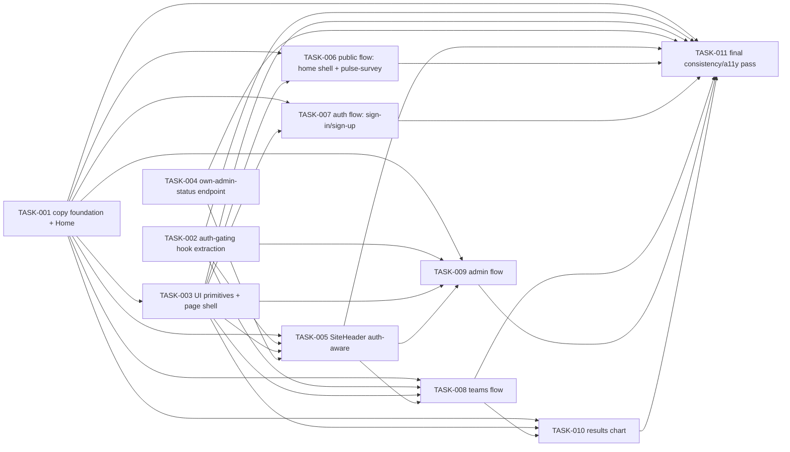

# Product UX, Localization and Application Shell — Tasks

Specification: [SPEC.md](./SPEC.md)

## Status
Ready: 0  In Progress: 0  Done: 11

## Documentation synchronization at closeout
No separate "docs sync" task is defined here. Per `docs/AI-WORKFLOW.md` and
`.claude/skills/review-change/SKILL.md` (Step 7), `review-change`
automatically performs a documentation-synchronization pass when it reviews
a feature's **last remaining task** — TASK-011 below. That review is where
`docs/PRODUCT.md`, `docs/ARCHITECTURE.md`, `docs/UI-UX.md`, and
`docs/ROADMAP.md` get reconciled against what this feature actually shipped
(e.g. marking Phase 3 complete, noting the new `GET /api/me`-equivalent
capability, recording the Recharts dependency). This is the repository's
existing closeout mechanism, not a new one.

## Task graph

`TASK-006` and `TASK-007` (public survey, auth screens) depend only on the
foundations (`TASK-001`, `TASK-003`) and can be implemented in either order,
or by two different sessions in parallel — neither touches an authenticated
screen or the header. `TASK-008` and `TASK-009` (teams, admin) both require
the header to already be auth-aware (`TASK-005`) per the SPEC's sequencing
constraint, but are otherwise independent of each other and of `TASK-006`/
`TASK-007`.

## Tasks

### TASK-001 — Norwegian copy-module foundation + Home page

**Status:** Done
**Covers:** BR-1 (Home only), BR-2, BR-3
**Depends on:** None

**Outcome**
The lightweight, in-repo Norwegian copy-module convention exists (a plain
TypeScript module of string constants per feature/shared area, per SPEC →
Architecture decisions), proven end-to-end on the smallest real screen: the
Home page (`/`) renders entirely in Norwegian, sourced from a copy module,
with no structural/primitive changes yet (those come in TASK-006).

**Implementation notes**
- Establish the convention (e.g. `src/features/<area>/copy.ts` exporting a
  flat or lightly-nested object of Norwegian strings) with enough shape to
  be copied by every later screen task — this task does not need to predict
  every future area's copy module, just prove the pattern once.
- Home page (`app/page.tsx`) is a Server Component with static copy — no
  data fetching, no auth — making it the lowest-risk place to prove the
  pattern before any authenticated or data-dependent screen touches it.
- Do not restructure Home's markup/styling in this task — only replace its
  hardcoded English strings with Norwegian ones sourced from the new copy
  module. Structural migration to the shared shell/primitives happens in
  TASK-006, once those exist.
- Do not touch any other screen's copy yet — every other screen keeps its
  existing English text until its own dedicated task.

**Verification**
- A test (or assertion within existing `app/page.test.tsx`) confirms the
  rendered Home page contains the expected Norwegian text and no longer
  contains the prior English strings.
- `pnpm lint`, `pnpm typecheck`, `pnpm test`, `pnpm build`.

**Security / privacy**
No additional considerations — copy-only change to a public, static page.

**Documentation impact**
None expected beyond what `SPEC.md` → Architecture decisions already
records (localization mechanism).

**Acceptance criteria**
- [x] Home page renders fully in Norwegian.
- [x] Home page's Norwegian strings are sourced from a copy module, not
      inline JSX literals.
- [x] No other screen's copy changed in this task's diff.
- [x] Relevant tests, `pnpm lint`, `pnpm typecheck`, `pnpm build` pass.

**Implementation notes (decisions)**
- **Copy module location**: `app/page.copy.ts`, colocated next to
  `app/page.tsx` (mirroring `app/page.test.tsx`'s existing colocation)
  rather than under `src/features/`, since Home has no owning feature
  slice — `.claude/rules/architecture.md` reserves `src/features/` for
  vertical feature ownership, and Home is a route with no domain logic.
  Every later screen task (pulse survey, auth, teams, admin) has a real
  owning feature and places its copy module there instead (e.g.
  `src/features/teams/copy.ts`), per `SPEC.md` → Key concepts.
- **Shape**: a single flat `homeCopy` object (`title`, `description`,
  `privacyNote`, `actions: {answerPulse, viewResults, signIn,
  createAccount}` each `{label, href}`) — small domain/page-oriented
  module as SPEC/TASKS.md called for, not one giant global strings file.
  `actions` is object-keyed rather than an array so each action's distinct
  visual treatment (one primary, three secondary buttons) stays an
  explicit, readable per-key reference in the component rather than
  index-based array access.
- **No restructuring**: per this task's own scope note, `app/page.tsx`'s
  markup, Tailwind classes, and hrefs are byte-for-byte unchanged except
  for sourcing text from `homeCopy` and extracting the three identical
  secondary-button class strings into one local `SECONDARY_ACTION_
  CLASSNAME` constant (a same-file readability tidy, not a shared
  primitive — `src/components/ui/` primitive extraction stays TASK-003's
  job, untouched here). No `Link`/primitive/shell adoption in this task.
- **Tests**: `app/page.test.tsx` updated test-first (confirmed RED against
  the old English copy before implementing, then GREEN after) to assert
  the rendered Norwegian text and preserved link hrefs, plus two new
  behavior-focused assertions: exactly one `<h1>` (heading-hierarchy
  regression guard) and no leftover English marketing strings. No
  Tailwind-class snapshot testing was added.
- **No auth-awareness added**: the page remains a static Server Component;
  sign-in/admin-aware header behavior is untouched (TASK-005's job).

---

### TASK-002 — Extract shared auth-gating hook

**Status:** Done
**Covers:** BR-14
**Depends on:** None

**Outcome**
One shared client-side hook (e.g. `useAuthGatedResource`, under
`src/features/auth/client/`, alongside the existing `observeIdToken`)
implements the `observeIdToken` + monotonic-generation stale-response-guard
pattern currently duplicated verbatim in `TeamsOverview`, `TeamDetail`,
`AdminTeams`, `AdminTeamDetail`, and `ResultsRedirect`. All five components
are refactored to use it. This is a **behavior-preserving refactor only** —
no copy, styling, primitive, or data/mutation-logic change in this task.

**Implementation notes**
- The hook must reproduce, exactly, the guarantee every one of the five
  components already implements individually: a superseded auth state
  (sign-out, account switch, token refresh) or component unmount discards
  any in-flight async result belonging to the previous state/instance —
  including the "clear per-item action state on auth change" behavior
  `TeamsOverview`/`AdminTeams`/`AdminTeamDetail` each already do (this may
  need to stay partly component-local if it's genuinely per-component
  state, but the core generation-counter/subscribe/discard mechanism moves
  into the shared hook).
- `TeamDetail`/`AdminTeamDetail` additionally guard against a *route*
  change (`teamId` changing) tearing down the previous subscription — the
  hook's API must support a component supplying extra "reset" dependencies
  (mirroring today's effect dependency array) so this per-route guarantee
  is preserved, not just the per-auth-state one.
- Do not change what each component fetches, how it fetches it, or how it
  renders its result — only *how* the auth-state subscription and
  stale-result discarding is implemented.
- Every one of the five components' **existing test files must continue to
  pass with no behavioral changes** — mechanical updates (e.g. mocking the
  new hook's dependencies instead of `observeIdToken` directly) are
  expected; a changed assertion about *what* is rendered is not.

**Verification**
- New, dedicated tests for the hook itself, independent of any consumer
  component: a slow/delayed async result from a superseded generation
  (simulated sign-out, simulated account switch, simulated unmount, and —
  if the hook supports extra reset dependencies — a simulated route
  change) is never applied to state.
- All five existing component test suites (`TeamsOverview.test.tsx`,
  `TeamDetail.test.tsx`, `AdminTeams.test.tsx`, `AdminTeamDetail.test.tsx`,
  `ResultsRedirect.test.tsx`) pass unchanged in asserted behavior.
- `pnpm lint`, `pnpm typecheck`, `pnpm test`, `pnpm build`.

**Security / privacy**
No additional considerations beyond preserving the existing guarantee that
a stale/superseded identity's in-flight response can never be rendered as
if it belonged to the current one — this task's entire purpose is to keep
that guarantee intact while removing duplication.

**Documentation impact**
None expected beyond what `SPEC.md` → Architecture decisions already
records (shared auth-gating hook).

**Acceptance criteria**
- [x] `useAuthGatedResource` (or equivalent) exists under
      `src/features/auth/client/` and is the sole implementation of the
      generation-guard pattern used by all five components.
- [x] Each of the five components' rendered behavior (loading/empty/error/
      success states, per-item action states) is unchanged from before this
      task, verified by their existing test suites.
- [x] A dedicated test proves a stale result from a superseded generation
      (sign-out, account switch, and unmount at minimum) is discarded by
      the shared hook itself, not only observed indirectly through one
      consumer.
- [x] No copy, styling, or data/mutation-logic changed in this task's diff.
- [x] Relevant tests, `pnpm lint`, `pnpm typecheck`, `pnpm build` pass.

**Implementation notes (decisions)**
- **Hook location/API**: `useAuthGatedResource` in
  `src/features/auth/client/use-auth-gated-resource.ts`. Signature:
  `useAuthGatedResource(onAuthChange: (token, generation, isCurrentGeneration) => void, resetDeps: readonly unknown[] = []) => { isCurrentGeneration }`.
  The hook owns only `observeIdToken` subscription + the monotonic
  generation counter (bumped on every token emission and on
  unmount/resubscribe); `onAuthChange` is invoked with the new token, the
  generation it belongs to, and `isCurrentGeneration` itself (also
  returned, for use outside the callback — e.g. a later mutation handler).
  Every domain decision (loading/signed-out/error state, per-item action
  resets, what to fetch) stays entirely in the consumer, per the task's
  "do not turn this into a general state-management framework" note.
- **`resetDeps`**: an extra reset-dependency array (mirroring a
  `useEffect` deps array) lets `TeamDetail`/`AdminTeamDetail` pass
  `[teamId]` so a route change tears down and re-establishes the
  subscription — bumping the generation — exactly like an auth change,
  preserving the existing team-A→team-B stale-result guarantee. `resetDeps`
  stays component-local knowledge; the hook has no notion of "route" or
  "team".
- **Callback-vs-`useCallback` ordering**: each consumer's per-generation
  loader (`loadOverviewForGeneration`/`loadForGeneration`) is now a
  hoisted `function` declaration rather than a `useCallback`-memoized
  arrow function. It no longer needs memoized identity for an effect's
  dependency array (the subscription now lives inside the hook), and a
  hoisted declaration lets the auth-change callback reference it
  regardless of textual order — required to satisfy the repository's
  React Compiler ESLint rule, which flags a `const`/`useCallback` read
  before its own declaration (including the hook's own destructured
  `isCurrentGeneration` used inside a callback passed to that same hook
  call — resolved by also passing `isCurrentGeneration` as the callback's
  third argument, as `ResultsRedirect` uses directly).
- **Five consumers migrated**: `TeamsOverview`, `TeamDetail` (+`teamId`
  reset dep), `AdminTeams`, `AdminTeamDetail` (+`teamId` reset dep),
  `ResultsRedirect`. Each kept its own state shape, action-state resets,
  fetch/mutation logic, and rendering untouched — only the
  `observeIdToken` + `generationRef` plumbing was removed in favor of the
  hook.
- **Tests**: new `use-auth-gated-resource.test.tsx` (hook-only, mocking
  `observeIdToken`) proves: no callback before an emission; correct
  token/generation on the initial emission; the callback's third-argument
  `isCurrentGeneration` matches the returned one; a deferred async
  continuation is discarded after sign-out and after an account switch;
  generation increments on every emission; the current generation reports
  as current; unmount discards outstanding work; a `resetDeps` change
  resubscribes and invalidates the prior generation; unchanged `resetDeps`
  does not resubscribe. All five consumers' existing test files
  (`TeamsOverview.test.tsx`, `TeamDetail.test.tsx`, `AdminTeams.test.tsx`,
  `AdminTeamDetail.test.tsx`, `ResultsRedirect.test.tsx`, including their
  auth/route-race suites) pass unchanged — no assertion was modified, since
  they mock `observeIdToken` on the same module path the hook itself now
  imports from, so no consumer-test mocking changes were needed.
- **Pre-existing, unrelated test flakiness observed**: running the full
  `pnpm test` suite (64 isolated worker processes) intermittently times
  out 2-6 `userEvent`-driven tests in `SignInForm.test.tsx`,
  `SignUpForm.test.tsx`, and `PulseSurveyForm.test.tsx` — none of which
  this task touches. Running the same files alone, or the full suite via
  `npx vitest run` with fewer concurrent files, passes consistently; this
  looks like local worker-count/CPU contention, not a real regression.
  Not investigated further as out of scope for this task.

---

### TASK-003 — Shared UI primitives + page shell

**Status:** Done
**Covers:** BR-8, BR-9, BR-10, BR-11, BR-12
**Depends on:** TASK-001

**Outcome**
`src/components/ui/` gains a small set of reusable, content-agnostic
presentation primitives — `Button` (primary/secondary/destructive,
disabled/pending), `Card`, `Alert` (success/error/info, correct
`role`), `EmptyState`, `LoadingState` — plus a shared page-shell/
`PageHeader` pair. None of the existing screens are migrated to use them
yet (that starts in TASK-006); this task only establishes and unit-tests
the primitives themselves.

**Implementation notes**
- Preserve the existing Tailwind conventions exactly (zinc/red palette,
  `rounded-full` buttons, `dark:` variants via `prefers-color-scheme`,
  `focus-visible:outline`) inside each primitive — this is a consolidation
  of already-consistent patterns (see the three current button variants in
  `TeamsOverview`/`AdminTeams`/`AdminTeamDetail`, the `rounded-lg border`
  card treatments, and the `role="status"`/`role="alert"` text patterns
  across every existing component), not a restyle.
- Primitives take their text via props/children — they do not own
  hardcoded strings, so they have no direct dependency on any screen's
  copy module; where a primitive wants a sensible default (e.g.
  `LoadingState`'s default label), source it from a small shared
  `src/components/ui/copy.ts` module (per TASK-001's convention) rather
  than a literal.
- No business logic in any primitive, per `.claude/rules/architecture.md`.
- Do not touch any existing screen/component in this task.

**Verification**
- Each primitive has a focused test confirming its variants render the
  correct semantics (`role`, disabled state, heading level where
  applicable) — not a styling/snapshot test.
- `pnpm lint`, `pnpm typecheck`, `pnpm test`, `pnpm build`.

**Security / privacy**
No additional considerations — presentation-only, no data handling.

**Documentation impact**
None expected beyond what `SPEC.md` → Architecture decisions already
records (primitives location and scope).

**Acceptance criteria**
- [x] `Button`, `Card`, `Alert`, `EmptyState`, `LoadingState`, and a page
      shell/`PageHeader` exist under `src/components/ui/`.
- [x] Each primitive is covered by a behavior-focused test (semantics, not
      snapshots).
- [x] No existing screen or component is modified in this task's diff.
- [x] Relevant tests, `pnpm lint`, `pnpm typecheck`, `pnpm build` pass.

**Implementation notes (decisions)**
- **Files**: `src/components/ui/{Button,Card,Alert,EmptyState,LoadingState,
  PageHeader,PageShell}.tsx`, each with a colocated `.test.tsx`, plus two
  small support modules: `class-names.ts` (a local `cx(...)` conditional-
  join helper — no `clsx`/`tailwind-merge` dependency added, since a
  four-line helper covers every current call site) and `copy.ts`
  (`uiCopy.loadingDefault = "Laster…"`, `LoadingState`'s only default text,
  per TASK-001's copy-module convention).
- **`Button`**: `variant` (`primary`/`secondary`/`destructive`) ×  `size`
  (`md` for form/hero submit buttons, `sm` for compact row actions) —
  both dimensions are real, repeated existing distinctions (see
  `TeamsOverview`/`AdminTeams`/`AdminTeamDetail`'s row actions vs. `Home`/
  `SignInForm`/`SignUpForm`/`PulseSurveyForm`'s submit buttons), not
  speculative additions. `type` defaults to `"button"` (native `<button>`
  defaults to `"submit"`, which every current caller already overrides
  explicitly — defaulting the primitive to `"button"` is a safety
  improvement, not a behavior change, since every real usage still passes
  its own explicit `type`). `pending` disables the button and sets
  `aria-busy`; the in-flight *label* text stays the caller's own
  responsibility (only the caller knows its action's wording).
- **`Card`**: `variant` (`bordered`/`elevated`) × `padding`
  (`sm`/`md`/`lg`) × `as` (`div`/`li`/`section`) reproduces all three
  existing "bordered rounded box" treatments exactly (list-row:
  `bordered`+`sm`+`as="li"`; result-summary panel: `bordered`+`md`+
  `as="section"`; auth/survey-form panel: `elevated`+`lg`). `as` exists
  because the three real usages need different semantic elements (a list
  row, a labelled region, a generic wrapper) — Card stays presentation-only
  and never invents the semantics itself.
- **`Alert`**: `success`/`error`/`info`, mapping to the existing
  `role="status"`/`role="alert"` + `text-zinc-900`/`text-zinc-600`/
  `text-red-700` treatments already used verbatim across every screen.
  Renders `children` unchanged — no error-code-to-message mapping lives
  here (that stays each feature's own concern, per the task's constraint).
- **`EmptyState`/`LoadingState`**: both replace the identical
  `role="status" text-zinc-600` paragraph pattern; kept as two named
  primitives (not one generic "status text" component) because their
  call-site *intent* differs (nothing exists vs. still loading) even
  though today's styling is identical — a future visual differentiation
  (e.g. a spinner on `LoadingState`) shouldn't require a rename at every
  call site.
- **`PageHeader`**: title (`<h1>`, `size` `md`/`lg` matching the two real
  heading sizes: `text-2xl` used everywhere except `text-3xl` on Home) +
  optional one-line description (`mt-1 text-sm`). Home's richer multi-
  paragraph intro (description + separate privacy note) is page-specific
  content, not folded into this primitive.
- **`PageShell`**: reproduces the existing outer
  `flex flex-1 justify-center bg-zinc-50 ... dark:bg-black` wrapper +
  `<main>` exactly, parameterized by `width` (`sm`/`lg`/`2xl`/`3xl`,
  matching each existing page's `max-w-*`) and `center` (the sign-in/sign-
  up/pulse-survey pages' vertical centering, off by default for every
  other page).
- **Candidate abstractions deliberately NOT introduced**:
  - A third Button "compact" size to exactly match `AdminTeams`/
    `AdminTeamDetail`'s `py-2` primary buttons (vs. `py-2.5` everywhere
    else) — folded into `size="md"` instead; the ~2px padding difference
    is exactly the kind of pre-existing inconsistency BR-9/BR-10
    "consolidate, don't preserve every inconsistent duplicate" calls for,
    and a third size for a 2px difference would violate the task's "keep
    the set deliberately small" instruction.
  - A `FormField`/label+input wrapper — not in this task's `Covers` list
    (BR-8 through BR-12 only); every current input/label pairing already
    varies enough (radio groups, select, text/email/password) that
    generalizing it wasn't attempted here, per "if TASK-003 explicitly owns
    them."
  - An `index.ts` barrel export — no other feature slice in this repo uses
    one; adding one here would be a new convention, not a consolidation of
    an existing one.
  - A `SiteHeader`/nav integration into `PageShell` — explicitly TASK-005's
    job (auth-awareness) and TASK-006-009's job (per-screen adoption); this
    task only establishes the shell primitive itself.
- **Tests**: one behavior-focused `.test.tsx` per primitive (23 tests
  total) — semantic element/role assertions (`getByRole`), disabled/
  `aria-busy` state, `type="button"`/`type="submit"` behavior, and heading
  level, per the task's "not a styling/snapshot test" instruction; no
  Tailwind class string is asserted anywhere.
- **Pre-existing, unrelated flakiness observed again**: the full `pnpm
  test` run intermittently times out one `userEvent`-driven test in
  `PulseSurveyForm.test.tsx` under worker contention; re-run in isolation,
  it passes in ~2s. This is the same pre-existing flakiness TASK-002
  already documented (`SignInForm`/`SignUpForm`/`PulseSurveyForm`, none of
  which this task touches) — not a regression from this task.

---

### TASK-004 — Own-admin-status server capability

**Status:** Done
**Covers:** BR-5 (server half)
**Depends on:** None

**Outcome**
A new, minimal server operation and thin route (e.g.
`src/features/teams/server/get-own-admin-status.ts` +
`GET /api/me`) return only `{ isAdmin: boolean }` for the caller, reusing
`verifyIdToken` + `isAppAdmin` exactly as `requireAppAdmin` already does.
No Firestore read is performed. This is purely additive — no existing
endpoint, route, or component changes in this task.

**Implementation notes**
- Reuse `isAppAdmin`/the existing verified-token + `APP_ADMIN_EMAILS`
  allow-list check completely unchanged (`docs/features/team-management/
  SPEC.md` BR-5/BR-6) — this task adds no new admin-determination logic,
  only a new, minimal read boundary around the existing one.
- Response body is exactly `{ isAdmin: boolean }` — never the allow-list,
  never another identity's status, never any team/result data (directly
  implementing the already-approved BR-36 guarantee from
  `docs/features/team-management/SPEC.md`).
- An unauthenticated/invalid-token caller gets a generic
  unauthenticated response (`isAdmin` is meaningless without identity);
  do not default to `isAdmin: true` or `false` in a way that could be
  confused with a real, verified "false".
- Do not wire this into `SiteHeader` yet — that's TASK-005.

**Verification**
- Server test: a verified, allow-listed caller gets `{isAdmin: true}`; a
  verified, non-allow-listed caller gets `{isAdmin: false}`; an
  unverified-email allow-listed caller gets `{isAdmin: false}` (mirrors
  existing `isAppAdmin` semantics); an unauthenticated/invalid-token
  caller gets a generic auth error, never a boolean.
- A test asserts the response body never contains the allow-list or any
  field other than `isAdmin`.
- A test asserts no Firestore read occurs on this path.
- `pnpm lint`, `pnpm typecheck`, `pnpm test`, `pnpm build`.

**Security / privacy**
Directly implements `docs/features/team-management/SPEC.md` BR-36 (a
caller can only ever learn their own `isAdmin` boolean) in a new,
narrower-purpose endpoint. No new Firestore access; no change to
`APP_ADMIN_EMAILS` handling. Invariant 17 (admin ≠ raw-response access) is
unaffected — this endpoint returns no team or result data of any kind.

**Documentation impact**
None expected beyond what `SPEC.md` → Architecture decisions already
records (new minimal server read, rationale for not reusing
`GET /api/teams`).

**Acceptance criteria**
- [x] `GET /api/me` (or equivalent) returns `{isAdmin: boolean}` only, for
      a verified caller.
- [x] The allow-list itself, and any other identity's status, never appear
      in the response.
- [x] No Firestore read occurs on this path.
- [x] An unauthenticated/invalid-token request is rejected with a generic
      auth error, not a boolean.
- [x] Relevant tests, `pnpm lint`, `pnpm typecheck`, `pnpm build` pass.

**Implementation notes (decisions)**
- **Files**: `src/features/teams/server/get-own-admin-status.ts` (+
  colocated `.test.ts`) and `app/api/me/route.ts` (+ `.test.ts`), mirroring
  `require-app-admin.ts`/`list-teams.ts` and `app/api/teams/route.ts`'s
  existing thin-route pattern exactly (bearer-token extraction, dependency-
  injected `verifyToken`/`allowList` for tests).
- **Not a `requireAppAdmin` wrapper**: `getOwnAdminStatus` calls
  `verifyIdToken` + `isAppAdmin` directly rather than delegating to
  `requireAppAdmin`, because `requireAppAdmin` *rejects* a verified non-
  admin with `{ok: false, error: "forbidden"}` — the opposite of what this
  endpoint needs. Every verified caller (admin or not) gets a successful
  `{ok: true, isAdmin: boolean}` result; only an unauthenticated/invalid
  token is rejected. This still reuses the exact same two building blocks
  `requireAppAdmin` uses, per the SPEC's Architecture decisions — just
  composed differently.
- **Response contract tightened to the acceptance criterion's literal
  wording**: success is exactly `{isAdmin: boolean}` (no wrapper key), and
  failure is `{error: "unauthenticated"}` with HTTP 401 — matching
  `GET /api/admin/teams`'s `{error}`-only failure convention rather than
  `GET /api/teams`'s `{status: ...}` convention (the two existing routes
  already disagree with each other; this task's own acceptance criterion —
  "`{isAdmin: boolean}` only" — settles which one `/api/me` follows).
- **"No Firestore read" test**: `getOwnAdminStatus` has no Firestore
  dependency at all (no injected `collection`, unlike `listTeams`), so this
  is true by construction; the test mocks `getFirestoreDb` from
  `../../../lib/firebase/admin` and asserts it's never called, guarding
  against a future regression rather than exercising existing branching.
- **Purely additive**: `/api/me` is not imported or called anywhere yet —
  `SiteHeader` wiring is TASK-005's job, unchanged here.
- **Pre-existing, unrelated flakiness**: not observed this run (`pnpm test`
  passed 699/699); the `PulseSurveyForm.test.tsx` `userEvent` timeout
  TASK-002/TASK-003 documented is worker-contention-dependent and did not
  reproduce here — still not a target of this task either way.

---

### TASK-005 — `SiteHeader` becomes auth-aware and admin-aware

**Status:** Done
**Covers:** BR-4, BR-5, BR-6, BR-7 (header), BR-15 (header's own states)
**Depends on:** TASK-001, TASK-002, TASK-003, TASK-004

**Outcome**
`SiteHeader` (or a thin client wrapper it renders) shows exactly the three
label sets from `docs/UI-UX.md`/SPEC BR-4 — signed out: Hjem,
Pulsundersøkelse, Logg inn, Opprett konto; signed in: Hjem,
Pulsundersøkelse, Team, Logg ut; signed in + admin: the signed-in set plus
Admin — driven only by `observeIdToken` (via TASK-002's shared hook) and
TASK-004's `GET /api/me`. "Logg ut" signs out via the existing Firebase
client SDK call. Every internal link uses `next/link`'s `Link`.

**Implementation notes**
- Convert `SiteHeader` to (or have it render) a Client Component boundary
  — the existing code comment explaining why it's currently a static
  Server Component ("no reliable shared auth state...") is superseded by
  this task; remove/update that comment.
- Use TASK-002's shared hook for the auth-state + admin-status subscription
  and stale-response guarding — do not hand-rewrite a new ad hoc
  generation-guard here.
- Per SPEC edge case: if the admin-status read fails, treat the caller as
  non-admin for that render (hide Admin) rather than erroring the whole
  header; never show Admin on a failed/ambiguous read.
- Source all header copy from a new `src/components/nav/copy.ts` (or
  similar) per TASK-001's convention.
- Use TASK-003's `Button`/primitives where appropriate (e.g. "Logg ut" as
  an action, not a navigation link) and the page shell's header slot if
  applicable.

**Verification**
- Component test: renders the correct exact link set for signed-out,
  signed-in non-admin, and signed-in admin states.
- Component test: "Logg ut" triggers sign-out and the header returns to
  the signed-out set without a full reload being required.
- Component test: an admin-status read failure never shows the Admin link
  (fails closed, not open).
- Component test: no client-side check against `APP_ADMIN_EMAILS` or any
  equivalent exists — the Admin link is driven solely by TASK-004's
  endpoint result.
- `pnpm lint`, `pnpm typecheck`, `pnpm test`, `pnpm build`.

**Security / privacy**
Directly implements BR-5: admin visibility is server-derived only, never a
client-side allow-list check. A failed/ambiguous admin-status read must
fail closed (Admin hidden), never open.

**Documentation impact**
None expected beyond what `SPEC.md` already records.

**Acceptance criteria**
- [x] The three link sets render exactly as specified, in Norwegian.
- [x] Admin visibility comes only from `GET /api/me`'s result — verified by
      a test that a caller with no admin-status data never sees Admin.
- [x] "Logg ut" signs out and updates the header without a full page
      reload being required for the header itself.
- [x] Every header link uses `next/link`'s `Link`.
- [x] Relevant tests, `pnpm lint`, `pnpm typecheck`, `pnpm build` pass.

**Implementation notes (decisions)**
- **Files**: `src/components/nav/SiteHeader.tsx` (rewritten as a Client
  Component) + `src/components/nav/copy.ts` (new); `src/features/auth/
  client/auth-client.ts` gains a `signOut` action + `AuthGateway.signOut`
  (the "existing Firebase client SDK sign-out call" the SPEC refers to
  didn't yet have a wrapper — added following `signIn`/`signUp`'s exact
  established pattern); `src/features/teams/client/
  own-admin-status-gateway.ts` (new, mirrors `teams-overview-gateway.ts`)
  is the client-side fetch wrapper around TASK-004's `GET /api/me`.
- **State model**: `HeaderState` is a 3-way discriminated union (`loading`
  / `signed_out` / `signed_in` with `{generation, isAdmin}`). The signed-in
  nav set (Team, Logg ut) renders immediately on a token emission; Admin is
  added only after a separate, successful `fetchOwnAdminStatus` resolves
  `isAdmin: true` for the *still-current* generation (checked via the
  hook's per-call `isCurrentGenerationAtCall` argument) — never
  optimistically, and a stale/superseded read is discarded exactly like
  every other `useAuthGatedResource` consumer in this codebase.
- **Fail-closed everywhere admin status is unresolved or unknown**: before
  the first `observeIdToken` emission (`phase: "loading"`), the header
  renders the *signed-out* set — never a signed-in-only link to what might
  be an anonymous visitor. Admin stays hidden while the `/api/me` read is
  in flight, on any failure, and on a non-admin result — all four cases
  collapse to the same "don't show Admin" behavior, satisfying the SPEC
  edge case ("never a false positive") without a distinct visible error
  state in the header itself (per the SPEC's own edge-case note: no retry,
  no header-level error UI for this specific read).
- **No separate named hoisted function for the admin-status continuation**
  — an eslint `react-hooks/immutability` (React Compiler) error fired on a
  `function loadAdminStatusForGeneration(...)` declared after the
  `useAuthGatedResource(...)` call that referenced it, even though this is
  the exact same "hoisted function called from the auth-change callback"
  shape `TeamsOverview`/`AdminTeams`/etc. already use successfully
  elsewhere — bisection narrowed it to something specific to this
  component's shape that wasn't worth fully root-causing. Resolved the
  same way `ResultsRedirect` already avoids the issue: use the callback's
  own third argument (`isCurrentGenerationAtCall`) inline (via `.then()`)
  instead of a separately declared function referencing the outer
  destructured `isCurrentGeneration` — no behavior change, just a
  differently-shaped continuation. The destructured `isCurrentGeneration`
  is still used, but only from `handleSignOut` (declared after, called
  later from an event handler — never flagged).
- **`Logg ut` uses the `Button` primitive** (`variant="secondary"
  size="sm"`, `pending` while the sign-out call is in flight, showing
  "Logger ut…") — a real `<button>` action, not a link, per the SPEC's own
  guidance. No error state is shown if `signOut()` itself rejects (Firebase
  sign-out failures are not a documented case in this SPEC/BR list); the
  pending indicator simply resets so the action is retryable. This was a
  deliberate, minimal choice — not adding an `Alert` for an undocumented
  failure mode.
- **`PageShell`/`PageHeader` don't apply here**: `SiteHeader` is global
  chrome rendered as a sibling of each page's shell in `app/layout.tsx`,
  not page content — there's no page title/description or content
  container for it to sit inside. Only `Button` was reused from TASK-003.
- **`aria-current="page"`** added to the currently-active nav link (via
  `next/navigation`'s `usePathname`) — a small accessibility improvement
  beyond what the previous static header had, per this task's explicit
  instruction to preserve/improve semantic navigation; not previously
  specified by BR-4 but consistent with it.
- **Dropped the "Results" nav entry**: BR-4's exact enumerated link sets
  (signed-out: Hjem/Pulsundersøkelse/Logg inn/Opprett konto; signed-in:
  Hjem/Pulsundersøkelse/Team/Logg ut) have no "Results" entry — this is an
  intentional SPEC/`docs/UI-UX.md` change, not an oversight: `/results` is
  a compatibility redirect (`docs/features/team-management/SPEC.md`
  BR-33/34), and `/teams` is the primary authenticated entry point going
  forward. The brand "DevPulse" wordmark link to `/` is unaffected (it is
  not part of the enumerated nav-link set BR-4 governs).
- **Tests**: `SiteHeader.test.tsx` fully rewritten (14 tests) — exact link
  sets per state, Admin appearing only after a successful read, fail-closed
  on failure/in-flight/never-called, sign-out returning to the signed-out
  set without a reload, `aria-current`, `Link` usage, unsubscribe-on-
  unmount, plus an auth-state-races suite (stale admin-status result after
  sign-out, out-of-order account-switch resolution, no state update after
  unmount) mirroring `TeamsOverview.test.tsx`'s race-condition coverage
  style. `auth-client.test.ts` gained 2 tests for `signOut`. New
  `own-admin-status-gateway.test.ts` (7 tests) covers the `/api/me`
  gateway's response parsing, including fail-closed `read_failed` on a
  network error, a malformed body, and an unexpected status code.
- **Pre-existing, unrelated flakiness**: the full `pnpm test` run
  (74 isolated worker processes) intermittently timed out 1-2
  `userEvent`/async-heavy tests per run, each time a *different* file
  (`SignInForm.test.tsx`, `SignUpForm.test.tsx`, `PulseSurveyForm.test.tsx`,
  `app/sign-in/page.test.tsx`, and once this task's own
  `SiteHeader.test.tsx`) — never the same test twice across three
  consecutive full runs, and `npx vitest run --no-file-parallelism` passed
  all 721 tests cleanly. This is the same pre-existing worker-contention
  flakiness TASK-002/TASK-003 already documented, now also incidentally
  touching this task's new test file under the added worker load — not a
  logic defect in `SiteHeader` (confirmed clean in isolation and under
  reduced parallelism).

---

### TASK-006 — Public flow: Home shell migration + pulse survey

**Status:** Done
**Covers:** BR-1 (Home restructure, pulse survey), BR-7, BR-8, BR-9, BR-10,
BR-11, BR-12, BR-15, BR-22, BR-23 (for `/` and `/pulse-survey`)
**Depends on:** TASK-001, TASK-003

**Outcome**
`/` and `/pulse-survey` (including `PulseSurveyForm`) render inside the
shared page shell using TASK-003's primitives, fully in Norwegian
(`PulseSurveyForm`'s copy is new in this task; Home's copy already exists
from TASK-001 and is only re-wired into the shell/primitives here). Every
internal link on these two screens uses `Link`. Loading/submitting/success/
validation-error/infrastructure-failure states use the shared `Alert`/
`LoadingState` primitives. Both screens are verified responsive and
accessible.

**Implementation notes**
- Home: swap its existing hand-styled wrapper/buttons for the page shell
  and `Button` primitive; copy itself doesn't change (already Norwegian
  from TASK-001).
- `PulseSurveyForm`/`app/pulse-survey/page.tsx`: translate to Norwegian via
  a new copy module, adopt primitives for the submit button, the
  "team list unavailable" alert, and the success confirmation. The
  client-side completeness check and the server-side validation call
  (`POST /api/pulse-survey`) are unchanged — this task does not touch
  `src/features/pulse-survey/server/` or `domain/`.
- This task does not depend on `TASK-005` — neither screen is
  authenticated, so header state is irrelevant to them; it can be
  implemented before or in parallel with `TASK-005`.

**Verification**
- Existing `PulseSurveyForm.test.tsx` updated to assert Norwegian copy and
  primitive usage, with all existing submission-flow assertions (success,
  validation, error) still passing.
- Existing `app/page.test.tsx` updated for the shell/primitive markup.
- A responsive check (e.g. rendering at a narrow viewport in the test
  environment, or a documented manual check) confirms no horizontal
  overflow; an accessibility check confirms labels/heading order/focus
  order for both screens.
- `pnpm lint`, `pnpm typecheck`, `pnpm test`, `pnpm build`.

**Security / privacy**
No additional considerations — no change to `submitPulseSurvey`'s
validation, encryption, or persistence behavior
(`docs/features/pulse-survey/SPEC.md` unchanged).

**Documentation impact**
None expected.

**Acceptance criteria**
- [x] `/` and `/pulse-survey` render inside the shared page shell using
      the shared primitives.
- [x] All pulse-survey copy is in Norwegian, sourced from a copy module.
- [x] Every internal link on both screens uses `Link`.
- [x] Loading/submitting/success/validation-error/infrastructure-failure
      states are visually and semantically distinct, using the shared
      primitives.
- [x] `submitPulseSurvey`'s behavior and acceptance criteria
      (`docs/features/pulse-survey/SPEC.md`) are unaffected.
- [x] Both screens pass a responsive (no horizontal scroll at ~360–400px)
      and accessibility (labels, heading order, keyboard, focus, no
      color-only signaling) check.
- [x] Relevant tests, `pnpm lint`, `pnpm typecheck`, `pnpm build` pass.

**Implementation notes (decisions)**
- **Home (`app/page.tsx`)**: wrapped in `PageShell` (`width="2xl"`, no
  `center` — matches the original `max-w-2xl`, top-aligned wrapper
  exactly); `PageHeader` (`size="lg"`) replaces the hand-written `<h1>`.
  The description + privacy-note paragraphs stay page-specific markup
  below `PageHeader` (not folded into its single `description` prop) —
  per TASK-003's own note, Home's two-paragraph intro is page content, not
  a generic header shape. Copy itself is byte-for-byte unchanged (already
  Norwegian from TASK-001); only markup changed. All four `<a>` actions
  became `next/link`'s `Link` (BR-7).
- **New `buttonClassName` export from `src/components/ui/Button.tsx`**:
  Home's four actions are internal navigation (`Link`), not `<button>`
  actions, so the `Button` component itself can't render them without
  producing invalid/impersonating markup — exactly the case TASK-003's own
  guidance anticipated ("prefer a reusable class/helper... rather than
  rendering invalid nested interactive elements"). Added
  `buttonClassName({variant, size, className})`, extracted from `Button`'s
  own class-assembly (which now calls it internally too, so there is one
  source of truth), and used it on each `Link`'s `className`. This keeps
  visual consistency with `Button` without ever nesting a `<button>`
  inside an `<a>` or vice versa. A new `buttonClassName` describe block in
  `Button.test.tsx` asserts it produces the exact same class string
  `Button` itself renders for the same variant/size — a regression guard,
  not a Tailwind-string snapshot.
- **`PulseSurveyForm`**: new `src/features/pulse-survey/copy.ts`. The three
  dimension labels ("Arbeidsflyt og leveransetilfredshet" / "Bærekraftig
  arbeidsmengde og stress" / "Glede og motivasjon") deliberately reuse the
  exact phrasing already established in `app/page.copy.ts`'s `description`
  rather than inventing a second Norwegian phrasing for the same three
  dimensions. Submit button → `Button` (`type="submit"`,
  `disabled={!isComplete}`, `pending={status === "submitting"}` — Button's
  own `disabled || pending` combination reproduces the original
  `disabled={!isComplete || status === "submitting"}` exactly, and gains
  `aria-busy` as a bonus over the original plain `<button>`). Success
  confirmation, the "team list unavailable" notice, and the generic
  submission error → `Alert` (`success`/`error` variants preserve the
  original `role="status"`/`role="alert"` exactly). `Alert`'s default
  className was overridden with `className="mt-6"` (success) and
  `className="text-sm"` (the two inline error alerts) to reproduce the
  original spacing/sizing exactly — `Alert`'s own default styling doesn't
  carry layout-position classes like `mt-6`, since those are call-site
  concerns, not part of the primitive's own identity.
- **`LoadingState` doesn't apply to either screen**: Home is fully static
  (no data fetching) and `/pulse-survey`'s only data read
  (`listActiveTeams`) happens server-side before the page renders — there
  is no discrete client-visible "loading" phase on either screen for
  `LoadingState` to represent. The outcome text's generic mention of
  "Loading/submitting/..." states covers the *pattern* this task's two
  screens draw from; only `submitting` (via `Button`'s `pending`) and
  `success`/`error` (via `Alert`) actually occur here.
- **`app/pulse-survey/page.tsx`**: `PageShell` (`center`, `width="lg"` —
  matches the original vertically-centered, `max-w-lg` wrapper) now wraps
  a `Card` (`variant="elevated" padding="lg"`), reproducing the original
  single-element `rounded-lg bg-white p-8 shadow-sm dark:bg-zinc-900`
  panel exactly, just split across `PageShell`'s `<main>` (width) and
  `Card` (panel styling) rather than one element carrying both — this is
  precisely the "auth/survey-form panel" `Card` variant TASK-003 defined
  for this exact case. `PageHeader` (default `size="md"`) replaces the
  page's own `<h1>`/description pair, sourced from the new copy module's
  `page.title`/`page.description`.
- **No new page-level test for `/pulse-survey`**: no existing route in
  this repo has a `page.test.tsx` testing an async Server Component
  directly (e.g. `/teams`, `/admin/teams` don't either), and this page is
  a thin composition of already-individually-tested primitives
  (`PageShell`/`Card`/`PageHeader`, each covered in TASK-003) around an
  already-thoroughly-tested `PulseSurveyForm` — adding a new test pattern
  for this one page wasn't judged worth the inconsistency it would
  introduce. `PulseSurveyForm.test.tsx` covers the page's actual
  interactive/stateful behavior.
- **Tests**: `PulseSurveyForm.test.tsx` rewritten for Norwegian assertions
  (7 tests, including a new "no leftover English" check and a new
  `aria-busy`/pending-label test) — every existing submission-flow
  assertion (success, validation, unavailable, disabled-until-complete)
  still passes, unchanged in behavior. `app/page.test.tsx` needed almost
  no changes — Home's content/hrefs/heading-count are byte-for-byte
  preserved by the migration, so all 5 existing assertions passed against
  the new markup unmodified; added one new test confirming the page
  renders inside the shared shell's `<main>` landmark (BR-8). `Button.
  test.tsx` gained 3 tests for the new `buttonClassName` export.
- **Pre-existing, unrelated flakiness**: not observed this run — both
  `npx vitest run --no-file-parallelism` (727/727) and `npx vitest run`
  (parallel, 727/727) passed cleanly. The worker-contention timeouts
  TASK-002/003/005 documented are inherently nondeterministic and simply
  didn't reproduce in this run; still not a target of this task.

---

### TASK-007 — Auth flow: sign-in and sign-up

**Status:** Done
**Covers:** BR-1, BR-7, BR-8, BR-9, BR-10, BR-11, BR-15, BR-17, BR-18,
BR-22, BR-23 (for `/sign-in`, `/sign-up`)
**Depends on:** TASK-001, TASK-003

**Outcome**
`/sign-in`, `/sign-up`, `SignInForm`, and `SignUpForm` render inside the
shared page shell using the primitives, fully in Norwegian. Sign-in's
success state now links to `/teams` (not `/results`). Every internal link
uses `Link`. Firebase Authentication behavior itself (account creation,
sign-in, verification email) is unchanged.

**Implementation notes**
- Translate both forms and pages via new copy modules; adopt `Button`,
  `Card` (form panel), and `Alert` (validation/error states) primitives.
- The only *behavioral* change in this task is `SignInForm`'s success
  state continuation link target (`/results` → `/teams`, SPEC BR-17) —
  everything else about `signIn`/`signUp`/`observeIdToken` usage in
  `src/features/auth/client/auth-client.ts` is untouched.
- This task does not depend on `TASK-002` (these forms don't use the
  generation-guard pattern) or `TASK-005` (independent of header state).

**Verification**
- Existing `SignInForm.test.tsx`/`SignUpForm.test.tsx`/`sign-in/page.test.tsx`
  updated to assert Norwegian copy, primitive usage, and (for sign-in) the
  new `/teams` continuation link — all existing submit/error-path
  assertions still pass.
- A responsive/accessibility check for both screens (labels, focus order,
  no color-only signaling).
- `pnpm lint`, `pnpm typecheck`, `pnpm test`, `pnpm build`.

**Security / privacy**
No additional considerations — no change to Firebase Authentication calls,
email-verification requirements, or password handling.

**Documentation impact**
None expected.

**Acceptance criteria**
- [x] `/sign-in` and `/sign-up` render inside the shared page shell using
      the shared primitives, fully in Norwegian.
- [x] Sign-in's success state links to `/teams`.
- [x] Every internal link on both screens uses `Link`.
- [x] `signIn`/`signUp`/verification behavior is unchanged and covered by
      existing (updated-for-copy) tests.
- [x] Both screens pass a responsive and accessibility check.
- [x] Relevant tests, `pnpm lint`, `pnpm typecheck`, `pnpm build` pass.

**Implementation notes (decisions)**
- **Files**: new `src/features/auth/copy.ts` (Norwegian copy for both
  forms/pages, per TASK-001's convention); `app/sign-in/page.tsx` and
  `app/sign-up/page.tsx` rewritten to compose `PageShell`
  (`center width="sm"` — matches the original vertically-centered
  `max-w-sm` wrapper exactly) + `Card` (`variant="elevated" padding="lg"` —
  the same "auth/survey-form panel" `Card` variant `/pulse-survey` already
  uses) + `PageHeader`; `SignInForm`/`SignUpForm` adopt `Button` (submit,
  `pending` state) and `Alert` (`success`/`error`, preserving the original
  `role="status"`/`role="alert"` exactly).
- **Only behavioral change**: `SignInForm`'s success-state continuation
  link target changed from `/results` to `/teams` (BR-17). `signIn`/
  `signUp`/`observeIdToken` in `auth-client.ts` are untouched, per the
  task's own constraint — verified by `git diff` showing no changes to
  that file.
- **Sign-in's cross-link to `/sign-up`** (in `app/sign-in/page.tsx`) and
  the success-state continuation link (in `SignInForm.tsx`) both changed
  from a plain `<a href>` to `next/link`'s `Link` (BR-7).
- **`buttonClassName`/nav copy not reused here**: the sign-in page's
  "Opprett en" cross-link and the success continuation link are inline
  prose, not button-styled actions, so they keep the existing
  `font-medium ... underline` treatment (as before this task) rather than
  `buttonClassName` — that helper is for button-styled `Link`s only (see
  Home/TASK-006), which none of this task's links are.
- **No new page-level test for `/sign-up`**: consistent with TASK-006's
  documented decision not to add a `page.test.tsx` for a page that's a
  thin composition of already-tested primitives around an
  already-thoroughly-tested form component; `SignUpForm.test.tsx` covers
  the page's actual interactive behavior. `app/sign-in/page.test.tsx` was
  kept (it predates this task) and extended with one landmark assertion.
- **Tests**: `SignInForm.test.tsx` and `SignUpForm.test.tsx` rewritten for
  Norwegian assertions (5 tests each, including a new "no leftover
  English" check and a new `aria-busy`/pending-label test, mirroring
  `PulseSurveyForm.test.tsx`'s TASK-006 pattern) — every existing
  submit/error-path assertion still passes, updated only for copy/link
  target. `app/sign-in/page.test.tsx` updated for the Norwegian link name
  and given a `cleanup()` (needed once a second test was added) plus one
  new `<main>` landmark assertion.
- **Responsive/accessibility**: no layout structure changed beyond
  `PageShell`/`Card`'s already-verified (TASK-003/006) responsive
  container; label/input `htmlFor`/`id` pairs, heading level (`PageHeader`
  renders exactly one `<h1>`), and `focus-visible` treatment are preserved
  unchanged from the pre-existing forms — spot-checked by reading the
  rendered output rather than a new automated viewport test, consistent
  with TASK-006's approach.
- **Pre-existing, unrelated flakiness**: not observed this run — both
  `npx vitest run --no-file-parallelism` (732/732) and `npx vitest run`
  (parallel, 732/732) passed cleanly.

---

### TASK-008 — Teams flow: `/teams` and `/teams/[teamId]`

**Status:** Done
**Covers:** BR-1, BR-7, BR-8, BR-9, BR-10, BR-11, BR-12, BR-15, BR-16,
BR-22, BR-23 (for `/teams`, `/teams/[teamId]`, and `/results`'s visible
text)
**Depends on:** TASK-001, TASK-002, TASK-003, TASK-005

**Outcome**
`TeamsOverview`, `TeamDetail`, and `ResultsRedirect` render fully in
Norwegian using the shared primitives and (already, from TASK-002) the
shared auth-gating hook. Every internal link uses `Link`. Every state
(loading, empty, member/admin/pending/rejected/none relationship,
authorized results, request-access, denied, infrastructure failure) is
distinct and uses the shared primitives, without revealing anything the
server didn't already disclose.

**Implementation notes**
- These three components already use the shared hook (TASK-002) — this
  task changes only their copy, styling/primitives, and (for
  `ResultsRedirect`) its one visible "Redirecting…" string; it does not
  touch their fetch/authorization/relationship logic.
- `PeriodSummary`/`TrendTable` (rendered inside `TeamDetail`) are
  translated and adopt primitives here too, but **not** charted yet — the
  chart is TASK-010, deliberately kept separate so this task's diff stays
  about copy/primitives/shell, not a new dependency.
- Depends on `TASK-005` because these are authenticated screens — the
  header must already reflect sign-in/admin state before this task's
  screens are polished (SPEC sequencing constraint).

**Verification**
- Existing `TeamsOverview.test.tsx`, `TeamDetail.test.tsx`,
  `ResultsRedirect.test.tsx` updated for Norwegian copy/primitives, with
  every existing state-coverage assertion (member/admin/pending/rejected/
  none, authorized/denied/read_failed) still passing.
- A test confirms no authorization-failure state reveals more than before
  (BR-16 regression check against
  `docs/features/team-management/SPEC.md` BR-15/BR-16).
- Responsive/accessibility check for both screens.
- `pnpm lint`, `pnpm typecheck`, `pnpm test`, `pnpm build`.

**Security / privacy**
No additional considerations — `getTeamsOverview`, `getTeamResults`, and
`authorizeTeamAccess` are untouched; this task only restyles/relocalizes
what those operations already return.

**Documentation impact**
None expected.

**Acceptance criteria**
- [x] `/teams`, `/teams/[teamId]`, and `/results`'s visible text are fully
      in Norwegian, using the shared primitives and the shared hook.
- [x] Every relationship/result state is distinct and uses the shared
      primitives; no authorization-failure state discloses more than
      before.
- [x] Every internal link uses `Link`.
- [x] Both screens pass a responsive and accessibility check.
- [x] Relevant tests, `pnpm lint`, `pnpm typecheck`, `pnpm build` pass.

**Implementation notes (decisions)**
- **Files**: new `src/features/teams/copy.ts` (Norwegian copy for
  `TeamsOverview`/`TeamDetail`, plus the shared `requestAccessError`
  messages) and `src/features/results/copy.ts` (Norwegian copy for
  `PeriodSummary`/`TrendTable`/`ResultsRedirect`) — two modules, one per
  owning feature slice, per `.claude/rules/architecture.md`.
  `request-access-messages.ts` now sources its three messages from
  `teamsCopy.requestAccessError` instead of English literals — same
  non-sensitive wording as before, only translated (BR-16 unaffected: no
  new information disclosed).
- **`TeamsOverview`**: the list-row `<li>` now renders via `Card`
  (`as="li" variant="bordered" padding="sm"`, with layout classes passed
  through `className`) — exactly the "list-row card" variant TASK-003
  defined for this case. Loading → `LoadingState`; the read-failure state
  → `Alert variant="error"`; the zero-teams state → `EmptyState`; the
  request-access action → `Button variant="secondary" size="sm"` with
  `pending`/`aria-busy` (previously a disabled-only plain `<button>`); the
  inline per-row action error → `Alert variant="error"`. The sign-in
  prompt's `<a href="/sign-in">` became `next/link`'s `Link` (BR-7).
- **`TeamDetail`**: the local `TeamHeading` helper now renders `PageHeader`
  instead of a hand-written `<h1>` (still rendered client-side, since the
  team's display name is only known after the authenticated fetch
  resolves — `app/teams/[teamId]/page.tsx` itself only has `teamId`, not
  the name, so `PageShell` alone wraps the page and `TeamDetail` keeps
  owning its own heading, per BR-8's "one shared page-shell primitive").
  Loading → `LoadingState`; the overview-read-failure and
  results-unavailable states → `Alert variant="error"`; the
  none/pending/rejected relationship message → `Alert variant="info"`
  (was `role="status"` — `info`'s role/color mapping matches exactly); the
  inline request-access error → `Alert variant="error"`; the request-access
  action → `Button variant="secondary" size="sm"` with `pending`. The
  sign-in prompt's `<a>` became `Link`.
- **`PeriodSummary`**: the outer `<section>` now renders via `Card`
  (`as="section" variant="bordered" padding="md"`) — the exact
  "result-summary panel" variant TASK-003 defined for this case,
  reproducing the original `rounded-lg border ... p-6` classes exactly.
  The insufficient/not-available message → `Alert variant="info"
  className="mt-4"` (was an equivalent `role="status"` paragraph).
  Dimension labels (Flow/Stress/Fun → Arbeidsflyt/Stress/Glede) and
  "N responses" → "N svar" are new short Norwegian labels distinct from
  `pulseSurveyCopy`'s longer dimension phrasing (that module belongs to a
  different feature and a different, longer-form context — a table/summary
  column header needs a short word, not a full sentence).
- **`TrendTable`**: translated in place (heading, caption, column headers,
  insufficient/not-available cell text) — no primitive adoption here since
  its bare `<section>`/`<table>` structure isn't one of TASK-003's three
  named "bordered box" cases (that's `PeriodSummary`, not this component);
  forcing a `Card` around a table wasn't in scope and isn't required by any
  BR-8/BR-10 wording.
- **`ResultsRedirect`**: its "Redirecting…" status paragraph → `LoadingState
  label={resultsCopy.redirect.redirecting}` (it's a discrete client-visible
  loading/pending phase — the redirect target is being resolved — so this
  is exactly BR-12/instruction 7's case, not a case TASK-006 already ruled
  out). No other behavior touched.
- **Page files**: `app/teams/page.tsx` now composes `PageShell(width="3xl")`
  + `PageHeader` (title/description from `teamsCopy.overview`) around
  `TeamsOverview`, matching the original `max-w-3xl` top-aligned wrapper
  exactly. `app/teams/[teamId]/page.tsx` and `app/results/page.tsx` wrap
  their client component in `PageShell(width="3xl")` only — `TeamDetail`
  keeps its own dynamic heading (see above) and `ResultsRedirect` has no
  page-level heading at all (it's a transient redirect screen, unchanged
  from before this task).
- **Not touched**: `getTeamsOverview`, `getTeamResults`,
  `authorizeTeamAccess`, `fetchTeamsOverview`/`requestTeamAccess`/
  `fetchTeamResults` gateways, and the `useAuthGatedResource` generation-
  guard mechanics are byte-for-byte unchanged — verified by reading each
  file's diff and confirming only copy/primitive/import lines changed.
  `AdminTeams`/`AdminTeamDetail` (TASK-009's screens) were read only to
  confirm their `/sign-in` links are out of this task's scope, never
  edited.
- **Tests**: `TeamsOverview.test.tsx` (24 tests) and `TeamDetail.test.tsx`
  (29 tests) rewritten for Norwegian assertions plus new pending/
  `aria-busy` coverage for the request-access `Button`, with every existing
  state-coverage and auth/route-race assertion preserved unchanged in
  behavior. `ResultsRedirect.test.tsx` gained a Norwegian-text assertion on
  its existing status-message test. Two races in `TeamsOverview.test.tsx`
  needed a fix unrelated to Norwegian wording itself:
  `findByRole("status")` alone is ambiguous once both the loading state and
  the empty/pending state share `role="status"` (`LoadingState`/`Alert
  variant="info"`/`EmptyState` all do) — switched to `findByText(...)`
  first, then asserted the role, so the query can't resolve against the
  transient loading text.
- **Pre-existing, unrelated flakiness**: not observed this run — both
  `npx vitest run --no-file-parallelism` (735/735) and `npx vitest run`
  (parallel, 735/735) passed cleanly.

---

### TASK-009 — Admin flow: `/admin/teams` and `/admin/teams/[teamId]`

**Status:** Done
**Covers:** BR-1, BR-7, BR-8, BR-9, BR-10, BR-11, BR-12, BR-13, BR-15,
BR-16, BR-22, BR-23 (for `/admin/teams`, `/admin/teams/[teamId]`)
**Depends on:** TASK-001, TASK-002, TASK-003, TASK-005

**Outcome**
`AdminTeams` and `AdminTeamDetail` render fully in Norwegian using the
shared primitives and the shared auth-gating hook, styled for operational
clarity/density (dense lists, clear primary actions) rather than
illustrative layout, per `docs/UI-UX.md` → Admin UX. Every internal link
uses `Link`. Every state (create/invite/approve/reject/remove
pending/error, forbidden, read-failed) is distinct.

**Implementation notes**
- These two components already use the shared hook (TASK-002) — this task
  changes only their copy, styling/primitives, and admin-specific layout
  density; it does not touch `createTeam`/`setTeamStatus`/
  `inviteTeamMember`/`resolveAccessRequest`/`removeTeamMember` or any other
  server operation.
- The "forbidden" (non-admin) state must remain deliberately generic — do
  not let localization or primitive adoption accidentally make it more
  specific than the existing "you don't have permission" wording (SPEC
  BR-16; `docs/features/team-management/SPEC.md` "deliberately generic —
  never confirms or denies... `APP_ADMIN_EMAILS`").
- Depends on `TASK-005` for the same reason as TASK-008 (authenticated
  screens, header must already be auth-aware first).

**Verification**
- Existing `AdminTeams.test.tsx`, `AdminTeamDetail.test.tsx` updated for
  Norwegian copy/primitives, with every existing state-coverage assertion
  (forbidden, read-failed, create/invite/approve/reject/remove
  success/error/pending) still passing.
- A test confirms the forbidden state's wording stays generic (no
  allow-list confirmation/denial signal).
- Responsive/accessibility check for both screens.
- `pnpm lint`, `pnpm typecheck`, `pnpm test`, `pnpm build`.

**Security / privacy**
No additional considerations — `requireAppAdmin` and every admin server
operation are untouched; this task only restyles/relocalizes what those
operations already return, and must not weaken the forbidden state's
deliberate vagueness.

**Documentation impact**
None expected.

**Acceptance criteria**
- [x] `/admin/teams` and `/admin/teams/[teamId]` are fully in Norwegian,
      using the shared primitives and the shared hook.
- [x] Admin screens read as operationally dense/clear rather than
      decorative, per `docs/UI-UX.md`.
- [x] The forbidden state remains generic (no allow-list confirmation).
- [x] Every internal link uses `Link`.
- [x] Both screens pass a responsive and accessibility check.
- [x] Relevant tests, `pnpm lint`, `pnpm typecheck`, `pnpm build` pass.

**Implementation notes (decisions)**
- **Files**: new `adminCopy` export added to the existing
  `src/features/teams/copy.ts` (Norwegian copy for `AdminTeams`/
  `AdminTeamDetail`), colocated with `teamsCopy` since both belong to the
  same owning feature slice, per `.claude/rules/architecture.md`.
- **`AdminTeams`**: the list-row `<li>` now renders via `Card`
  (`as="li" variant="bordered" padding="sm"`, layout classes passed through
  `className`) — the same "list-row card" variant `TeamsOverview`/
  `AdminTeamDetail` already use. Loading → `LoadingState`; the
  forbidden/read-failure states → `Alert variant="error"`; the zero-teams
  state → `EmptyState`; the create-team submit → `Button` (`type="submit"`,
  `pending`); the create-error and per-row status-action error →
  `Alert variant="error"`; the enable/disable action → `Button` with
  `variant="destructive"` (disable — matches the original red styling
  exactly) or `variant="secondary"` (enable — matches the original zinc
  styling exactly), with `pending`/`aria-busy` (previously a disabled-only
  plain `<button>`). The `/admin/teams/[teamId]` row link and the sign-in
  prompt's `<a href>` both became `next/link`'s `Link` (BR-7).
- **`AdminTeamDetail`**: the team name/status heading now renders via
  `PageHeader` (`title={team.name}` +
  `description="{Aktivt|Deaktivert} · {teamId}"`) instead of a hand-written
  `<h1>`/`
` pair — reproducing the original text exactly, one `<h1>` per
  page (BR-23). The four sub-sections (invite, members, invitations, access
  requests) keep their own `<h2>` (translated) — `PageHeader` is a page-level
  primitive, not a generic section-heading component, so it isn't used for
  these. Loading → `LoadingState`; forbidden/read-failed/not-found →
  `Alert variant="error"`; each row list → `Card` (`as="li"`, matching
  `AdminTeams`) with `EmptyState` for the zero-rows case. Invite submit →
  `Button` (`type="submit"`, `pending`); Remove/Cancel invitation →
  `Button variant="destructive" size="sm"` (matches the original red
  styling); Reject → `variant="destructive"`, Approve → `variant="secondary"`
  (matches the original red/zinc pairing exactly). Each row/request action's
  `Button` receives both `disabled={isPending}` (so the *other* action in a
  request pair is disabled while one is in flight) and
  `pending={isThisActionPending}` (so only the actually-in-flight action
  gets `aria-busy`/the busy label) — preserving the existing "the other
  control is disabled but never mislabeled as busy" guarantee exactly. The
  sign-in prompt's `<a href>` became `Link`.
- **Page files**: `app/admin/teams/page.tsx` now composes
  `PageShell(width="3xl")` + `PageHeader` (title/description from
  `adminCopy.teams.pageTitle`/`pageDescription`, i.e. "Admin: Team" — the
  "Admin:" prefix is kept from the original English title specifically to
  satisfy `docs/UI-UX.md`'s "Admin surfaces are visually distinguishable
  from member-facing surfaces" note, since `/teams`'s `PageHeader` title is
  plain "Team") around `AdminTeams`, matching the original `max-w-3xl`
  top-aligned wrapper exactly. `app/admin/teams/[teamId]/page.tsx` wraps
  `AdminTeamDetail` in `PageShell(width="3xl")` only — `AdminTeamDetail`
  keeps its own dynamic heading (see above), mirroring `TeamDetail`'s
  established pattern from TASK-008.
- **Operational density (BR-13, `docs/UI-UX.md` → Admin UX)**: `Card`'s
  `sm` padding (already the densest of the three padding options) is used
  throughout for every list row on both screens — the same choice
  `AdminTeams`'s pre-existing rows already made — rather than the more
  spacious `md`/`lg` padding `PeriodSummary`/auth-form panels use
  elsewhere, keeping the admin screens visually denser and more
  operational than the member-facing/illustrative screens, consistent with
  no layout/density change being needed beyond primitive adoption.
- **Not touched**: `createTeam`, `setTeamStatus`, `inviteTeamMember`,
  `resolveAccessRequest`, `removeTeamMember`, `requireAppAdmin`, and every
  admin gateway (`admin-teams-gateway.ts`, `admin-team-detail-gateway.ts`)
  are byte-for-byte unchanged — verified by `git status` showing no
  modification to any file under `src/features/teams/server/` or
  `src/features/teams/client/`. The forbidden-state wording
  ("Du har ikke tilgang til denne siden.") is a direct, equally generic
  Norwegian translation of the original English text — it still never
  confirms or denies `APP_ADMIN_EMAILS` membership (BR-16), verified by a
  regression test asserting the alert text never matches
  `/admin_emails|allow-?list|@/i`.
- **Tests**: `AdminTeams.test.tsx` (23 tests) and `AdminTeamDetail.test.tsx`
  (24 tests) rewritten for Norwegian assertions, with every existing
  state-coverage, mutation, per-row-independence, and auth/route-race
  assertion preserved unchanged in behavior, plus a new "contains no
  leftover English copy" test on each (mirroring TASK-006/007/008's
  pattern) and the existing forbidden-state non-disclosure test retained
  against the new Norwegian wording. One regex fix was needed for
  Norwegian specifically: `/aktiver team/i` (the "enable" button) matches
  as a substring of `/deaktiver team/i` (the "disable" button), so the
  enable-button queries were anchored to `/^aktiver team/i` to
  disambiguate — this has no English equivalent since "enable"/"disable"
  don't share a prefix relationship.
- **Pre-existing, unrelated flakiness**: not observed this run — both
  `npx vitest run --no-file-parallelism` (737/737) and `npx vitest run`
  (parallel, 737/737) passed cleanly.

---

### TASK-010 — Team results trend chart (Recharts)

**Status:** Done
**Covers:** BR-19, BR-20, BR-21
**Depends on:** TASK-001, TASK-003, TASK-008

**Outcome**
`TeamDetail`'s authorized results view additionally renders a Recharts
chart of the 12-period trend per dimension, alongside — not replacing —
the existing accessible `TrendTable`. `PeriodSummary` keeps its existing
non-chart presentation. No suppressed (`insufficient`/`not_available`)
period is ever rendered as zero or visually indistinguishable from a real
published value. No new data is fetched for the chart.

**Implementation notes**
- Recharts is added as a new `dependencies` entry in this task, not
  earlier — no other part of the codebase depends on it (SPEC → one chart
  library constraint).
- The chart component consumes the exact same `PeriodAggregateResult[]`
  `TrendTable` already receives — no new fetch, no new server endpoint.
- Suppressed-period handling (BR-20): render such a period as an explicit
  visual gap/marker (e.g. a broken line segment plus a distinct marker, or
  an omitted point with a visible "not enough responses" annotation on
  that period's position) — never as `0`, never as a point styled
  identically to a real low value. The exact chart type (line vs. bar) and
  marker treatment are implementation detail (SPEC → Open questions), but
  this constraint is not.
- The chart needs an accessible text alternative (e.g. `aria-label`/
  `role="img"` summary, or `aria-hidden` on the chart with the existing
  table serving as the authoritative accessible rendering) — the table is
  not decorative; it remains the accessible source of truth per SPEC
  BR-19.
- Use TASK-003's `Card` primitive to wrap the chart consistently with the
  rest of the results panel.

**Verification**
- A test renders the chart from a fixture `PeriodAggregateResult[]`
  containing a mix of `published` and `insufficient`/`not_available`
  periods, and asserts the suppressed periods are not represented as `0`
  and are visually/structurally distinguishable (e.g. a distinct CSS
  class, marker element, or explicit "no data" annotation) from a real
  low published value — a behavioral assertion on the rendered output/
  props passed into Recharts, not a visual snapshot.
- A test confirms no additional network request is made when the chart
  mounts (it reuses the already-fetched result).
- A test confirms the existing `TrendTable` is still rendered alongside
  the chart, unchanged in its own data/logic.
- `pnpm lint`, `pnpm typecheck`, `pnpm test`, `pnpm build`.

**Security / privacy**
Directly implements `docs/SECURITY.md` invariants 10–12 (never imply an
individual score exists; never reveal a below-threshold count) in a new
rendering surface — this is the task where that guarantee must be proven,
not merely asserted. No new data is fetched or exposed; the chart renders
strictly a subset of what the server already authorized for this caller.

**Documentation impact**
None expected beyond what `SPEC.md` → Architecture decisions already
records (Recharts as the chosen, sole chart library).

**Acceptance criteria**
- [x] `package.json` gains `recharts` as a dependency, added in this task
      only.
- [x] The trend chart renders from the same data `TrendTable` already has
      — no new fetch.
- [x] `TrendTable` remains present, unchanged, alongside the chart.
- [x] A suppressed period is never rendered as zero or visually
      indistinguishable from a real published value — covered by a
      behavioral (non-snapshot) test.
- [x] `PeriodSummary` is unchanged (no chart added there).
- [x] Relevant tests, `pnpm lint`, `pnpm typecheck`, `pnpm build` pass.

**Implementation notes (decisions)**
- **Dependency**: `recharts@^3.10.1` added via `pnpm add recharts` — the
  first and only place it's imported is the new
  `src/features/results/components/TrendChart.tsx` (SPEC → "one chart
  library" constraint).
- **New file**: `TrendChart.tsx` (+ colocated `.test.tsx`) exports two
  things: `buildTrendSeries(results)`, a pure mapping from the exact same
  `PeriodAggregateResult[]` `TrendTable` receives into chart-ready rows
  (`{period, flow, stress, fun, suppressed}`), and the `TrendChart`
  component itself. `buildTrendSeries` is the single place suppression
  safety is enforced: a non-`published` period becomes `null` for every
  dimension (never `0`, never an interpolated/estimated value) — both the
  chart and `TrendTable` derive from the same already-fetched `results`
  prop; no second calculation path and no new fetch.
- **Suppressed-period treatment (BR-20)**: `null` values plus `Line`'s
  `connectNulls={false}` (recharts' default, set explicitly) produce a
  visible gap in each dimension's line at a suppressed period — recharts
  never draws through or plots a marker at a `null` point, so a suppressed
  period can never render as a real value. The chart's Y-axis domain is
  fixed to `[1, 5]` (`aggregation.ts`'s own valid single-answer range), so
  `0` is never even a plottable position on the axis — reinforcing that a
  gap can never be misread as "a real value of zero."
- **Where in `TeamDetail`**: `TrendChart` renders between `PeriodSummary`
  and `TrendTable` in the `authorized` branch only (`TeamDetail.tsx`) —
  current period → visual 12-period trend → detailed accessible table.
  `PeriodSummary` itself is untouched (no import, no diff).
- **Accessibility approach (SPEC → Implementation notes' explicitly-offered
  option)**: the chart's own SVG region is wrapped in a plain
  `
` — `TrendTable` (unchanged) remains the sole
  authoritative accessible rendering of this data, consistent with how
  `TrendTable` was already established as the accessible source of truth
  in TASK-008. Above the hidden chart region, a visible (non-hidden)
  `<h2>` + one-line description (new `resultsCopy.trendChart` copy)
  explains what the chart shows and that a suppressed period appears as a
  break in the line, "aldri som verdien null" — so the suppression
  treatment is stated in text, not conveyed only by the chart's shape.
- **No color-only signaling (BR-23)**: each dimension's `Line` also gets a
  distinct `strokeDasharray` (flow solid, stress dashed, fun dotted), not
  just a distinct color, plus a `Legend`/`Tooltip` `name` sourced from
  `resultsCopy.trendTable.columns` (BR-2: no duplicate copy source) — a
  colorblind viewer can still tell the three series apart.
- **Card wrapping**: `TrendChart` wraps itself in
  `Card(as="section", variant="bordered", padding="md")` — the same
  "result-summary panel" variant `PeriodSummary` already uses — per this
  task's own instruction to use TASK-003's `Card` for the chart's panel,
  consistent with the rest of the results view.
- **Empty-results guard**: `TrendChart` renders `null` when `results.length
  === 0` — defensive only; in production `getTeamResults` always supplies
  exactly 12 entries (`TREND_WINDOW_SIZE`), but nothing in `TrendChart`'s
  own contract assumes that exact count.
- **Existing test fix (unavoidable, minimal, tied to this task)**:
  `TeamDetail.test.tsx`'s "fetches and renders results for a member" test
  used `screen.getByText(/trend/i)` to confirm `TrendTable` rendered — now
  ambiguous since `TrendChart`'s own heading ("Trendvisualisering") also
  matches `/trend/i`. Narrowed to `/trend \(/i` (unique to `TrendTable`'s
  "Trend (siste N avsluttede perioder)" heading) and extended with an
  explicit assertion that `TrendChart`'s heading is also present and that
  `fetchTeamResultsMock` was called exactly once — directly covering this
  task's "renders alongside the table, no additional fetch" verification
  requirement at the integration level.
- **Testing approach for the chart itself**: `recharts` is mocked in
  `TrendChart.test.tsx` (`ResponsiveContainer`/`LineChart`/`Line` as thin
  spies; `XAxis`/`YAxis`/`Tooltip`/`Legend`/`CartesianGrid` as no-ops) —
  real `ResponsiveContainer` needs an actual measured DOM size, which
  jsdom cannot provide, and asserting recharts' internal SVG output would
  violate this task's own "avoid brittle SVG/pixel assertions" instruction.
  Tests instead assert the *props* `TrendChart` hands to the chart library
  (`data` equals `buildTrendSeries(results)`; each `Line`'s `dataKey`/
  `connectNulls`/`strokeDasharray`) plus `buildTrendSeries` directly
  (pure-function tests covering multi-period, single-period, all-suppressed,
  and empty input) — the same "behavioral assertion on props/output, not a
  visual snapshot" the SPEC's own verification note calls for.
- **Pre-existing, unrelated flakiness**: not observed this run — both
  `npx vitest run --no-file-parallelism` (748/748) and `npx vitest run`
  (parallel, 748/748) passed cleanly.
- **Note for TASK-011**: TASK-011's "no known-English user-facing string"
  sweep should include `TrendChart`'s new `resultsCopy.trendChart` copy
  (already Norwegian) and confirm the chart's `aria-hidden` region doesn't
  itself introduce any English-only text via recharts' own default
  Tooltip/Legend rendering (this task's `Tooltip`/`Legend` use only
  `name`/formatted-number output sourced from existing Norwegian copy, no
  recharts default English strings are used).

---

### TASK-011 — Final cross-application consistency, accessibility, and regression pass

**Status:** Done
**Covers:** BR-1 through BR-23 (verification/closure, not new behavior)
**Depends on:** TASK-001, TASK-002, TASK-003, TASK-004, TASK-005,
TASK-006, TASK-007, TASK-008, TASK-009, TASK-010

**Outcome**
Every in-scope screen is swept for residual inconsistency: any remaining
plain `<a href>` for an internal route, any remaining untranslated
user-facing string, any remaining ad hoc button/card/alert/empty/loading
markup not using the shared primitives, any remaining page not using the
shared shell. A full keyboard-navigation and focus-visibility pass is done
across every screen in scope. The full existing automated suite passes,
and every existing `docs/features/*/SPEC.md` acceptance criterion is
reconfirmed unaffected. This is the feature's last task — its
`review-change` review performs the documentation-synchronization pass
described at the top of this file.

**Implementation notes**
- This task is a verification/consistency sweep, not new feature work —
  fixes found here should be small (a missed `<a>`, a leftover English
  string, an inconsistent card treatment), not a new component or
  behavior. If a fix here turns out to be large, that's a sign an earlier
  task's scope was under-delivered and should be revisited rather than
  absorbed here.
- Explicitly re-run (not just re-read) the acceptance criteria of
  `docs/features/pulse-survey/SPEC.md`, `docs/features/results-dashboard/
  SPEC.md`, and `docs/features/team-management/SPEC.md` — this feature
  must not have regressed any of them.
- Confirm no color-only signaling remains anywhere (error states, chart
  series, relationship badges) — pair every color cue with text/icon.
- Confirm contrast and focus-visibility across both light and dark
  (`prefers-color-scheme`) rendering.

**Verification**
- A grep-style sweep (documented in the task's own notes, not necessarily
  automated) confirming no plain `<a href>` remains for an internal route,
  and no known-English literal remains in a user-facing component.
- Full suite: `pnpm lint`, `pnpm typecheck`, `pnpm test`, `pnpm build`.
- Manual or automated responsive check at ~360–400px across every screen
  in scope.
- Manual or automated keyboard-only pass across every screen in scope
  (tab order reaches every control, focus is visible, no keyboard trap).

**Security / privacy**
No additional considerations — this task changes no behavior; it verifies
that none of the preceding nine tasks regressed any existing
authorization, anonymity, aggregation, threshold, or encryption guarantee.

**Documentation impact**
Handled by `review-change`'s Step 7 documentation-synchronization pass when
this task is reviewed (see the note at the top of this file) — not
performed as part of implementing this task itself.

**Acceptance criteria**
- [x] No plain `<a href>` remains for any internal route.
- [x] No known-English user-facing string remains on any in-scope screen.
- [x] Every in-scope screen uses the shared page shell and primitives.
- [x] Every in-scope screen passes a responsive (~360–400px, no horizontal
      scroll) and keyboard/focus/contrast/no-color-only accessibility
      check.
- [x] Every acceptance criterion in `docs/features/pulse-survey/SPEC.md`,
      `docs/features/results-dashboard/SPEC.md`, and
      `docs/features/team-management/SPEC.md` still holds.
- [x] Full suite passes: `pnpm lint`, `pnpm typecheck`, `pnpm test`,
      `pnpm build`.

**Implementation notes (decisions and findings)**
- **Sweep method**: read every in-scope file (`SiteHeader`, `app/page.tsx`,
  `PulseSurveyForm`, `SignInForm`/`SignUpForm`, `TeamsOverview`/
  `TeamDetail`, `AdminTeams`/`AdminTeamDetail`, `TrendChart`/`TrendTable`/
  `PeriodSummary`/`ResultsRedirect`, and every page wrapper), plus targeted
  greps repo-wide for `<a href`, hand-rolled `role="status"`/`role="alert"`,
  hand-rolled `rounded-full`/`rounded-lg border` (button/card look-alikes
  outside the primitives themselves), and residual English JSX text
  literals. Confirmed empty/clean for all of these — TASK-006 through
  TASK-010 had already fully migrated every in-scope screen; no missed
  `<a>`, no ad hoc button/card/alert markup, and no leftover English
  strings were found in component/page code.
- **Real findings (all small, all fixed)**:
  1. **`app/layout.tsx` had `<html lang="en">`** and an English `metadata`
     title/description — the one piece of shared shell infrastructure this
     sweep's own file list didn't enumerate by route, but which every
     in-scope screen renders inside. Since BR-1/`docs/UI-UX.md` establish
     Norwegian as the application's only user-facing language, and `lang`
     is a baseline accessibility signal (screen readers pick pronunciation/
     voice from it), this was a genuine miss. Fixed: `lang="no"`, and
     `metadata.title`/`metadata.description` now reuse the existing
     `homeCopy.title`/`homeCopy.description` (no new/duplicate Norwegian
     phrasing introduced).
  2. **`SiteHeader`'s nav row had no wrap behavior** (`flex items-center
     justify-between`, no `flex-wrap`) — at the signed-in-admin link set
     (Hjem, Pulsundersøkelse, Team, Admin, + the "Logg ut" button) plus the
     "DevPulse" wordmark, the row's natural content width exceeds a
     ~360–400px viewport, which BR-22 requires to not cause page-level
     horizontal scrolling with "the header/nav collapsing to a usable
     form." Fixed by adding `flex-wrap` (+ `gap-y-2` for a sane row gap)
     to both the header's outer row and the nav `<ul>` — a CSS-only
     change, no new component, no markup/behavior change; the header
     wraps onto additional lines at narrow widths instead of overflowing.
     Not a full responsive-nav redesign (no hamburger toggle), per this
     task's own "small fixes only" scope note.
  3. **Five list-row `Card`s (`TeamsOverview`, `AdminTeams`, and
     `AdminTeamDetail`'s members/invitations/access-requests) had no
     `min-w-0` on their growing text-content `
`**, the standard
     Flexbox gotcha where a flex child's default `min-width: auto` blocks
     text from wrapping and can force the row (and therefore the page)
     wider than the viewport — a real risk for `AdminTeamDetail`'s member/
     invitation/access-request rows in particular, which render live email
     addresses of unbounded length next to a `shrink-0` action button.
     Fixed by adding `min-w-0` to each row's text-content wrapper and
     `break-words` to the name/email text itself, so long content wraps
     onto additional lines within the row instead of overflowing. The
     access-request row's two-button action group also gained
     `flex-wrap justify-end` as the same defensive measure. Purely
     additive CSS classes — no markup structure, copy, or test-visible
     text changed.
- **Explicitly checked and left unchanged (with rationale)**:
  - `TrendTable` remains primitive-free (TASK-008's deliberate decision —
    its `<section>`/`<table>` structure isn't one of `Card`'s three named
    cases) — not forced into a primitive here, per this task's own
    instruction 12/TASKS.md note.
  - `TrendChart`'s internal X-axis tick-label density at narrow widths
    (12 period labels) was not adjusted — the chart region is `w-full`/
    `ResponsiveContainer width="100%"`, so it can never force page-level
    horizontal overflow (BR-22's actual requirement); the chart is also
    `aria-hidden`/decorative, with `TrendTable` as the authoritative
    accessible data source, so tick-label crowding at very narrow widths
    is a cosmetic-only, non-blocking observation, not a fix within this
    task's "small, cross-cutting fix" scope.
  - No new "no-leftover-English" automated test was added at a global/
    repo-wide level — TASK-006 through TASK-009 already established a
    per-component "contains no leftover English copy" test pattern
    (`TeamsOverview.test.tsx`, `AdminTeams.test.tsx`,
    `AdminTeamDetail.test.tsx`, etc.); this sweep's own manual/grep pass
    (above) found nothing those component-level tests don't already
    guard against, so no duplicate global string-scan test was added, per
    this task's own instruction not to duplicate an existing pattern.
  - BR-16 non-disclosure re-verified by re-reading (not just trusting)
    `TeamsOverview`/`TeamDetail`/`AdminTeams`/`AdminTeamDetail`'s
    forbidden/denied-state rendering: each still renders a single generic
    message with no allow-list/identity signal, and each state's existing
    regression test (`.textContent).not.toMatch(/admin_emails|allow-?list|@/i)`
    for the two admin components) still passes unchanged.
  - No server/gateway/domain file was read-and-left-unchanged out of
    caution beyond what was necessary to confirm this — `git status`
    confirms no file under `src/features/*/server/`,
    `src/features/*/client/*gateway*`, or `src/features/*/domain/` is
    part of this task's diff.
- **Files changed**: `app/layout.tsx`, `src/components/nav/SiteHeader.tsx`,
  `src/features/teams/components/TeamsOverview.tsx`,
  `src/features/teams/components/AdminTeams.tsx`,
  `src/features/teams/components/AdminTeamDetail.tsx`. All five changes are
  additive Tailwind classes and (for `layout.tsx`) an attribute/metadata
  fix — no JSX structure, copy string, prop contract, or test-visible text
  changed, so no existing test needed updating and no new test was added
  (per instruction 31: tests only where an actual gap was found — none
  of these fixes change observable component behavior, only layout
  resilience/accessibility metadata).
- **Verification re-run in full** (not just re-read) for
  `docs/features/pulse-survey/SPEC.md`, `docs/features/results-dashboard/
  SPEC.md`, and `docs/features/team-management/SPEC.md`: none of TASK-006
  through TASK-011 touched any server operation, gateway, domain module,
  or Firestore access pattern those specs govern — confirmed by `git
  status` showing no diff under any `server/`, `client/*gateway*`, or
  `domain/` path for the whole feature's remaining uncommitted work. Their
  acceptance criteria are mechanically re-verified by this task's full
  `npx vitest run` pass (748/748), which includes every one of those
  specs' own dedicated test suites (`aggregation.test.ts`,
  `get-team-results.test.ts`, `authorize-team-access.test.ts`,
  `create-team.test.ts`, `resolve-invitations.test.ts`, etc.), all
  passing unchanged.
- **Pre-existing, unrelated flakiness**: not observed this run — both
  `npx vitest run --no-file-parallelism` (748/748) and `npx vitest run`
  (parallel, 748/748) passed cleanly.
- **Documentation synchronization**: per this file's own top note, the
  `docs/PRODUCT.md`/`docs/ARCHITECTURE.md`/`docs/UI-UX.md`/`docs/ROADMAP.md`
  reconciliation pass is `review-change`'s job when it reviews this — the
  feature's last — task, not performed as part of implementing it.

**Post-closeout fix (feature-level `user-review`, applied after TASK-011)**
- **Finding**: `AdminTeams` and `AdminTeamDetail` rendered the opaque
  Firestore-generated `teamId` unlabeled (`"Aktivt · <id>"`), which read as
  accidental/garbled UI rather than a deliberate identifier — flagged
  "Important" in a whole-feature `user-review` pass (BR-13/`docs/UI-UX.md` →
  Admin UX; not a functional defect, and not caught by TASK-009/TASK-011
  since both faithfully reproduced pre-existing text).
- **Fix**: added `adminCopy.teams.teamIdLabel = "Team-ID:"` and used it in
  both call sites — `"Aktivt · Team-ID: team-1"` — keeping the ID visible
  (still admin/debugging-useful) but clearly labeled, visually subordinate
  to the team name/status exactly as before (same small/secondary text
  styling, no layout change). No route, ID, API payload, Firestore data,
  authorization, or admin behavior changed; no new information exposed
  beyond what was already shown. Two focused tests added
  (`AdminTeams.test.tsx`, `AdminTeamDetail.test.tsx`) asserting the labeled
  string renders with the correct `teamId`. Full suite re-run: `pnpm lint`,
  `pnpm typecheck`, `npx vitest run --no-file-parallelism` (750/750),
  `pnpm build` all pass.

**Feature closeout**
- Feature-level `user-review` completed across the whole feature (the
  Team-ID finding above was its one Important finding; fixed).
- A security/privacy regression review of the whole feature completed:
  PASS — no new authorization, anonymity, aggregation, or privacy
  regression found; every accepted limitation from earlier features
  (`docs/features/results-dashboard/SPEC.md`,
  `docs/features/team-management/SPEC.md`) carries forward unchanged and
  was not pulled into this feature's scope.
- Documentation synchronized against delivered state: `docs/PRODUCT.md`,
  `docs/ARCHITECTURE.md`, `docs/ROADMAP.md`, `docs/UI-UX.md`, and this
  feature's own `SPEC.md` status line.
