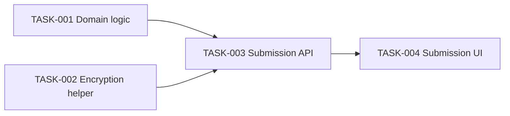

# Recurring Developer Pulse Survey — Tasks

Specification: [SPEC.md](./SPEC.md)

## Status
Ready: 0  In Progress: 0  Done: 4

## Task graph

## Tasks

### TASK-001 — Survey period computation and submission validation

**Status:** Done
**Covers:** BR-2, BR-3, BR-4, BR-5
**Depends on:** None

**Outcome**
A pure, server-usable domain module in `src/features/pulse-survey/` that:
- Computes the current survey period as the UTC ISO week (e.g. `2026-W36`)
  from a given (or current) timestamp, with no client input accepted.
- Validates a raw submission payload: exactly three answers, each an
  integer 1-5, and a `teamId` that is a member of the authoritative,
  application-defined team list. Returns either a validated result or a
  generic validation failure (no leakage of which field failed in a way
  that would matter for this feature, per BR-5's "generic validation
  error").
- Defines the static, application-defined team list used as the
  authoritative allowed set (see SPEC "Architecture decisions").

**Implementation notes**
- Pure functions, no Firestore/Firebase/encryption/network dependency —
  this task is deliberately I/O-free so it's cheap to test exhaustively.
  API wiring happens in TASK-003.
- This is the first task in the feature to need automated tests; set up
  Vitest per `.claude/rules/tests.md` (`docs/DEVELOPMENT.md` names Vitest
  as the intended runner once configured) — add the dependency, minimal
  config, and a `pnpm test` script.
- Exact period string format and validation error shape are implementation
  detail; keep them simple and internally consistent for TASK-003/TASK-004
  to consume.

**Verification**
- Unit tests: period computed correctly for a given UTC instant and is
  never taken from caller-supplied input; boundary case near a week
  transition uses the supplied/current instant, not any external period
  value.
- Unit tests: valid payload (3 in-range answers + allowed teamId) passes;
  each invalid case rejects — missing/out-of-range/non-numeric answer,
  missing `teamId`, `teamId` not in the allowed set.
- `pnpm lint`, `pnpm typecheck`, `pnpm test` pass.

**Security / privacy**
No additional considerations — this module handles no secrets and persists
nothing. Validation logic here is what BR-5 relies on to ensure invalid
requests are rejected before anything reaches encryption/storage.

**Documentation impact**
None expected (team list and period format remain implementation detail
per SPEC "Architecture decisions").

**Acceptance criteria**
- [x] Period is computed server-side from the current instant, never from
      client input.
- [x] Valid submissions pass validation; each invalid case (per Edge cases
      in SPEC.md) is rejected.
- [x] Relevant tests pass (`pnpm test`, `pnpm lint`, `pnpm typecheck`).
- [x] No conflict with `docs/SECURITY.md`.
- [x] Relevant documentation is updated (none expected).

---

### TASK-002 — Server-only encryption helper

**Status:** Done

**Covers:** BR-6, BR-10

**Depends on:** None

**Outcome**

A shared, server-only encryption helper under `src/lib/encryption/` that:

* Encrypts an arbitrary payload using authenticated encryption, generating a fresh cryptographically random nonce/IV per encryption operation.
* Reads key material from a server-only environment variable at call time; never accepts key material from client input or caller-supplied configuration.
* Returns the ciphertext plus the non-secret metadata required for future decryption and key rotation, at minimum:

  * nonce/IV;
  * key/algorithm version identifier;
  * any authentication data required by the selected authenticated-encryption scheme.
* Never returns or persists the raw encryption key material.
* Fails closed when the encryption key is missing, empty, malformed, or otherwise unusable. It must never fall back to plaintext storage or a weaker encryption mode.
* Produces an encrypted representation that contains everything required for future authorized decryption and key rotation.
* Does **not** introduce reporting/read functionality or a production-facing decryption API as part of this feature.
* May use a narrowly scoped decrypt/round-trip mechanism internally or in tests when needed to prove that the encryption contract is correct.

**Implementation notes**

* Use Node's built-in `crypto` APIs. Prefer an authenticated-encryption mode such as AES-256-GCM so no additional runtime crypto dependency is required.
* Keep the implementation server-only. The encryption module must never be imported from client-reachable code (`.claude/rules/nextjs-react.md`, `.claude/rules/security.md`).
* Use an explicit server-only boundary such as `server-only` where appropriate for the repository setup.
* Generate a fresh cryptographically secure nonce/IV for every encryption operation. Never derive it from the payload, team, period, document ID, timestamp, or any other deterministic value.
* Never reuse a nonce/IV with the same encryption key.
* Define one simple key/algorithm version identifier for the current scheme. A constant such as `v1` is sufficient unless the implementation naturally benefits from a slightly more descriptive identifier.
* Persist only non-secret encryption metadata. The identifier must allow future code to determine which scheme/key generation is required without exposing the key itself.
* Keep the encrypted-result type explicit and minimal. It should contain only the ciphertext and metadata required by the encryption contract.
* Keep encoding choices internally consistent and explicit, for example base64/base64url for binary ciphertext, nonce/IV, and authentication tag.
* Do not silently accept encryption keys of arbitrary length. Validate and normalize the environment-provided key according to the selected scheme's requirements.
* Do not log plaintext, serialized payloads, ciphertext, nonce/IV, authentication tags, key material, or environment-variable contents.
* Do not expose lower-level cryptographic primitives to feature code when a small `encrypt(...)` abstraction is sufficient.
* Do not add KMS integration, key rotation jobs, reporting functionality, or Firestore persistence in this task.
* The exact algorithm/library configuration and metadata field names are implementation details, provided they satisfy the approved SPEC encryption contract.
* If the chosen implementation requires a decrypt operation to verify round-trip correctness, keep it private/internal or test-scoped unless there is a concrete current production consumer.

**Verification**

* Unit test: encrypting the same plaintext twice with the same configured key produces different ciphertext because each operation receives a fresh nonce/IV.
* Unit test: both encrypted outputs can be round-trip decrypted to the original plaintext using the same encryption contract.
* Unit test: modifying the ciphertext causes authenticated decryption to fail rather than returning corrupted plaintext.
* Unit test: modifying the authentication tag or equivalent authentication metadata causes decryption to fail.
* Unit test: missing encryption-key environment variable causes encryption to fail closed.
* Unit test: empty encryption-key environment variable causes encryption to fail closed.
* Unit test: malformed/invalid key material causes encryption to fail closed rather than being silently accepted or weakened.
* Unit test: the encryption result contains the required nonce/IV and key/algorithm version metadata.
* Unit test: the encryption result never contains the raw key material or source environment-variable value.
* Unit test: separate encryption operations receive distinct nonce/IV values.
* Inspection/test: no plaintext fallback path exists.
* Inspection/test: the module does not emit logs containing plaintext, ciphertext, key material, or other sensitive encryption material.
* Run the repository's actual relevant checks:

  * `pnpm test`
  * `pnpm lint`
  * `pnpm typecheck`
* Run `pnpm build` as well if that is part of the repository's normal completion checks or if the server-only boundary/import behavior needs build-time verification.
* Never report a verification command as passing unless it was actually run and checked.

**Security / privacy**

This task directly implements the approved security requirements around application-level encryption and key handling.

* Sensitive survey answer content must be encrypted before it can reach persistence.
* Encryption must happen only on the trusted server side.
* Authenticated encryption must provide both confidentiality and integrity.
* A fresh cryptographically random nonce/IV must be generated for every encryption operation.
* Key material must come only from server-only configuration and must never reach browser code, Firestore, git, application logs, error responses, or returned encryption metadata.
* Missing or invalid key material must cause a fail-closed error.
* The encryption helper must never provide a plaintext fallback.
* Encryption metadata may contain only the non-secret information needed for future decryption/key rotation, such as nonce/IV, authentication tag where applicable, and key/algorithm version.
* The helper must not add correlation metadata such as timestamps, request identifiers, respondent identifiers, team information, or survey-period information. Those concerns belong to the feature/persistence layer.
* The module must not log plaintext, ciphertext, nonce/IV, authentication tags, or encryption keys.
* Introducing decryption capability for future dashboards/reporting is outside this task. Future authorized read flows must be designed and reviewed separately.

**Documentation impact**

None expected.

The current feature deliberately uses server-only environment-provided key material. Real KMS-backed key management and production key-rotation strategy remain deferred architecture work and must not be introduced by this task.

If implementation exposes a genuinely durable encryption-format decision that future code must understand, update the appropriate architecture/security documentation only if that decision rises above the implementation-detail level allowed by `SPEC.md`.

**Acceptance criteria**

* [x] Sensitive payloads are encrypted using authenticated encryption.
* [x] Every encryption operation generates a fresh cryptographically random nonce/IV.
* [x] Two encryptions of identical input using the same configured key produce different ciphertext.
* [x] Round-trip verification proves that valid encrypted output can recover the original plaintext.
* [x] Tampered ciphertext fails authentication and is not returned as plaintext.
* [x] Tampered authentication metadata/tag fails authentication.
* [x] Missing, empty, or malformed encryption key material causes a fail-closed error.
* [x] No plaintext fallback exists.
* [x] Encrypted output contains the required nonce/IV and key/algorithm version metadata.
* [x] Encrypted output contains any authentication metadata required by the selected scheme.
* [x] Encrypted output never contains raw key material.
* [x] No plaintext, ciphertext, nonce/IV, authentication tag, or key material is written to application logs.
* [x] The encryption helper remains server-only and is not reachable from client bundles.
* [x] No production-facing reporting/read/decryption functionality is introduced by this task.
* [x] Relevant tests pass with `pnpm test`.
* [x] `pnpm lint` passes.
* [x] `pnpm typecheck` passes.
* [x] `pnpm build` passes when run as part of the repository's applicable verification.
* [x] No conflict with `docs/SECURITY.md`.
* [x] Relevant documentation is updated if, and only if, a durable contract changed beyond what the approved SPEC already defines.

---

### TASK-003 — Submission API endpoint (validate, encrypt, persist)

**Status:** Done
**Covers:** BR-1, BR-4, BR-5, BR-6, BR-7, BR-9, BR-10
**Depends on:** TASK-001, TASK-002

**Outcome**
An unauthenticated `POST` API route under the App Router (e.g.
`app/api/pulse-survey/route.ts`) that accepts a submission, and a
`src/features/pulse-survey/` server operation it delegates to, such that:
- The request body is parsed and validated using TASK-001's domain
  validation; any failure (malformed body, wrong content type, invalid
  answers, invalid/missing `teamId`) returns a generic 4xx error and
  persists nothing.
- On a valid submission, the three answers are encrypted using TASK-002's
  helper before any Firestore write.
- A new Firestore document is written via a centralized, server-only
  Firebase Admin SDK initialization under `src/lib/firebase/`, with a
  randomly generated document ID (not derived from `teamId`, period, or
  any request metadata) and a persisted shape limited to: `teamId`, the
  coarse server-computed period, the encrypted answer payload, and the
  encryption metadata (nonce/IV, key/algorithm version) — no identity
  field, no IP/user agent/session ID, no precise timestamp.
- A Firestore write failure after successful encryption is reported to the
  client as a failure, with no partial-success response.
- Multiple submissions for the same period succeed independently with no
  dedup check.
- Nothing about the request body, parsed answers, or error internals is
  logged.

**Implementation notes**
- Introduces `firebase-admin` as a new dependency (SPEC "Architecture
  decisions"); initialize it once, server-only, under `src/lib/firebase/`.
- Firestore collection name/exact document field names are implementation
  detail (SPEC.md leaves final schema open) — pick something simple and
  consistent with the conceptual shape above.
- Keep the route handler thin (`.claude/rules/nextjs-react.md`); put
  validation/encryption/persistence orchestration in the feature's server
  operation, not in the route file.
- Requires a Firestore project/credentials to run against in practice; for
  automated tests, isolate the Firestore write behind a seam that can be
  substituted in tests (e.g. inject/mimic the Admin SDK client) rather than
  hitting a real project — do not weaken this task's persistence-shape or
  error-handling assertions to avoid that setup.

**Verification**
- API-contract tests: valid request → success response, and (via the test
  seam) exactly one write occurs with the minimal persisted shape and a
  random document ID unrelated to `teamId`/period.
- API-contract tests: each invalid case from TASK-001 → generic 4xx, zero
  writes attempted.
- API-contract test: malformed JSON body / wrong content type → generic
  4xx, zero writes, and the error path does not log the raw body.
- API-contract test: simulated Firestore write failure → failure response
  to the client, not a success/partial-success response.
- API-contract test: two valid submissions for the same period both
  succeed (no dedup rejection).
- Test/inspection: encryption key material never appears in any logged
  output for a successful or failed request.
- `pnpm lint`, `pnpm typecheck`, `pnpm test` pass.

**Security / privacy**
This task is where SECURITY.md invariants 1, 3, 4, 5, 6, and 14 become
concretely testable end-to-end: plaintext never reaches Firestore, the key
never reaches logs, no identity field is ever constructed or persisted,
and the document ID carries no correlatable information. `teamId` remains
self-declared and unverified against real membership (no auth exists yet);
this is documented, not treated as an authorization gap for this feature.

**Documentation impact**
None expected — the Firestore schema and team-list-to-`Team`-concept
migration remain explicitly deferred per SPEC.md and `docs/DATA-MODEL.md`.

**Acceptance criteria**
- [x] Valid unauthenticated request succeeds and persists exactly one
      minimal-shape, randomly-IDed, encrypted document.
- [x] Each invalid/malformed request is rejected with a generic 4xx and
      persists nothing.
- [x] Firestore write failure surfaces as a failure response, not a
      partial success.
- [x] Two submissions in the same period both succeed independently.
- [x] No request body, parsed answers, or key material appear in logs.
- [x] Relevant tests pass (`pnpm test`, `pnpm lint`, `pnpm typecheck`).
- [x] No conflict with `docs/SECURITY.md`.
- [x] Relevant documentation is updated: `docs/DEVELOPMENT.md` env var
      table now documents the Firebase Admin credential variables
      introduced by this task (not anticipated by the original "none
      expected" note).

---

### TASK-004 — Submission form and confirmation UI

**Status:** Done
**Covers:** BR-1, BR-2, BR-3, BR-8
**Depends on:** TASK-003

**Outcome**
A public page (e.g. `app/pulse-survey/page.tsx`, thin, delegating to a
feature component) that:
- Loads for any visitor without authentication.
- Presents the three fixed questions (Flow/delivery satisfaction,
  Stress/sustainable workload, Fun/motivation), each requiring a single
  1-5 answer, and a team selection control populated from the
  application-defined team list.
- Prevents submission client-side until all three answers and a team are
  selected (a UX convenience only — TASK-003's server-side validation
  remains authoritative).
- On successful submission (via TASK-003's endpoint), shows a confirmation
  state; on failure, shows a generic error without retry-blocking
  (resubmission is allowed per BR-9).

**Implementation notes**
- Server Component for the page shell; an interactive client component
  only for the form itself (`.claude/rules/nextjs-react.md`).
- Use the repository's existing styling system (Tailwind, already
  configured) — no new UI/component library.
- Use accessible form semantics: labeled scale inputs, labeled team
  select, visible focus states, no color-only state indication.

**Verification**
- Component/user-behavior tests: form renders all three questions and the
  team select; submit is disabled/prevented until all fields are filled;
  a successful submission shows the confirmation state; a failed
  submission shows an error state without navigating away or claiming
  success.
- `pnpm lint`, `pnpm typecheck`, `pnpm test` pass.
- Manual check: load the page unauthenticated and complete a real
  submission end-to-end against TASK-003's endpoint.

**Security / privacy**
No additional considerations beyond `.claude/rules/nextjs-react.md` and
`.claude/rules/security.md` — the client never sees encryption material,
and the client-side team list is a UI convenience only (server remains
authoritative per TASK-003).

**Documentation impact**
None expected.

**Acceptance criteria**
- [x] Unauthenticated visitor can load the form and see exactly three
      1-5 questions plus a team selector.
- [x] Submission is blocked client-side until all fields are complete.
- [x] A successful submission shows a confirmation; no individual answers
      or aggregate results are displayed.
- [x] Relevant tests pass (`pnpm test`, `pnpm lint`, `pnpm typecheck`).
- [x] No conflict with `docs/SECURITY.md`.
- [x] Relevant documentation is updated (none expected).
