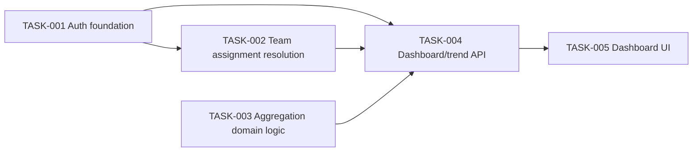

# Team Results Dashboard and Trends — Tasks

Specification: [SPEC.md](./SPEC.md)

## Status
Ready: 0  In Progress: 0  Done: 5

## Task graph

## Tasks

### TASK-001 — Firebase Authentication: sign-up, sign-in, email verification, verified-identity helper

**Status:** Done
**Covers:** BR-1, BR-2, BR-3
**Depends on:** None

**Outcome**
A visitor can create an account (email + password) via Firebase
Authentication, is sent a verification email, and can sign in. A
server-side helper exists that verifies a Firebase ID token and exposes
the caller's `uid`, `email`, and `email_verified` claim to server code —
this is the seam every later protected request (TASK-002, TASK-004) builds
on.

**Implementation notes**
- New feature slice `src/features/auth/` per `.claude/rules/architecture.md`:
  sign-up form, sign-in form, "verify your email" state, and the
  server-side token-verification helper.
- New dependency: `firebase` (client SDK). Initialize it under
  `src/lib/firebase/` (browser-safe config only — no service-account
  material in client config), alongside the existing `firebase-admin`
  server-only initialization.
- The server-side verification helper uses the Firebase Admin SDK
  (`getAuth().verifyIdToken(...)`) — server-only, never imports into
  client-reachable code (`.claude/rules/security.md`).
- Trigger Firebase's standard email-verification send on sign-up (client
  SDK `sendEmailVerification`); no custom email/token handling is built.
- Sign-in itself does not require a verified email (BR-3 only gates team
  resolution, introduced in TASK-002) — an unverified user can still sign
  in, they just won't resolve to a team yet.
- Keep components thin; delegate token handling to the auth feature's
  server helper, not route files (`.claude/rules/nextjs-react.md`).

**Verification**
- Unit/integration tests: sign-up creates an account and triggers a
  verification email send (via a test seam/mock for the Firebase call, not
  a real email); sign-in succeeds for an existing account and fails for
  bad credentials.
- Unit tests: the token-verification helper returns `{ uid, email,
  emailVerified }` for a valid token (via a test seam/mock for
  `verifyIdToken`), and rejects/returns an error for a missing, malformed,
  or invalid token.
- Test/inspection: no Firebase service-account credential or secret is
  present in client-bundled code or `NEXT_PUBLIC_*` config.
- `pnpm lint`, `pnpm typecheck`, `pnpm test` pass.

**Security / privacy**
- Password handling is entirely delegated to Firebase Authentication; no
  custom password storage is introduced.
- The server-side token-verification helper must live server-only and
  must never trust a client-asserted `email` or `email_verified` value —
  only the value returned by `verifyIdToken` on the Admin SDK.
- No credentials, tokens, or verification-email content are logged.

**Documentation impact**
`docs/DEVELOPMENT.md` env var table gains the new client-side Firebase
config variables (`NEXT_PUBLIC_FIREBASE_*`) this task introduces, alongside
the existing Firebase Admin SDK variables.

**Acceptance criteria**
- [x] A visitor can sign up with email + password and receives a
      verification-email send (observable via the test seam).
- [x] A visitor with an existing account can sign in; invalid credentials
      are rejected.
- [x] The server-side helper correctly extracts `uid`/`email`/
      `emailVerified` from a valid token and rejects an invalid one.
- [x] No Firebase service-account/secret material reaches client-bundled
      code.
- [x] Relevant tests pass (`pnpm test`, `pnpm lint`, `pnpm typecheck`).
- [x] No conflict with `docs/SECURITY.md`.
- [x] `docs/DEVELOPMENT.md` env var table is updated.

---

### TASK-002 — Team-assignment resolution (static mapping, verified-email lookup)

**Status:** Done
**Covers:** BR-4, BR-5, BR-10
**Depends on:** TASK-001

**Outcome**
A server-side function that, given a verified identity (from TASK-001's
helper), resolves that user's `teamId` by looking it up in a static,
server-only configuration mapping of Firebase-verified email addresses to
`teamId`s — returning "no team" whenever the email is unverified, absent
from the mapping, or maps to a `teamId` no longer present in
`ALLOWED_TEAM_IDS`.

**Implementation notes**
- New feature slice `src/features/teams/`: the static assignment mapping
  (e.g. `src/features/teams/domain/team-assignments.ts`) plus a
  `resolveTeamForUser(identity)`-shaped function.
- The mapping is static, server-only config (code constant or server-only
  env var — implementation choice), analogous to the existing
  `ALLOWED_TEAM_IDS` in `src/features/pulse-survey/domain/teams.ts`. Reuse
  or promote that constant rather than duplicating the team-id list (SPEC
  "Architecture decisions" leaves exact placement open).
- Resolution never accepts a client-supplied `teamId`/email — it only ever
  reads the verified identity produced by TASK-001's helper.
- Return a discriminated result (e.g. `{ ok: true, teamId }` vs
  `{ ok: false, reason: "unverified" | "unassigned" }`) rather than
  throwing, so callers (TASK-004) can render the right no-access state
  without inspecting error internals.

**Verification**
- Unit tests: verified email present in the mapping → resolves to its
  `teamId`. Unverified email present in the mapping → no team. Verified
  email absent from the mapping → no team. Mapping's `teamId` no longer in
  `ALLOWED_TEAM_IDS` → no team (defensive staleness case).
- Unit test: resolution is a pure function of the verified identity passed
  in — no code path accepts an alternate/override team identifier from any
  other source.
- `pnpm lint`, `pnpm typecheck`, `pnpm test` pass.

**Security / privacy**
This task is where BR-4/BR-10's authorization fix becomes concretely
testable: team resolution derives solely from a verified identity against
static server-only config, never from client input, directly closing the
prior "unrestricted self-declaration" gap identified in SPEC review.

**Documentation impact**
None expected, unless the mapping is implemented as environment variables
rather than a code constant — in that case add it to `docs/DEVELOPMENT.md`'s
env var table (mirroring the existing pattern for `ALLOWED_TEAM_IDS`/
Firebase Admin vars).

**Acceptance criteria**
- [x] A verified, mapped email resolves to the correct `teamId`.
- [x] An unverified email, an unmapped email, and a mapped-but-now-invalid
      `teamId` all resolve to "no team".
- [x] No client-supplied value can influence which team is resolved.
- [x] Relevant tests pass (`pnpm test`, `pnpm lint`, `pnpm typecheck`).
- [x] No conflict with `docs/SECURITY.md`.
- [x] Relevant documentation is updated only if the mapping is
      env-var-based (see Documentation impact) — not applicable; the
      mapping is a code constant.

---

### TASK-003 — Aggregation domain logic: open/closed periods, decrypt-then-threshold, trend window

**Status:** Done
**Covers:** BR-6, BR-7, BR-8, BR-9, BR-12
**Depends on:** None

**Outcome**
A pure-ish, server-usable domain module in `src/features/results/` that,
given a team's candidate `SurveyResponse` records for a set of periods:
- Determines which periods are closed vs. open (open = the server's
  current period; never eligible for aggregation).
- Enumerates the 12 most recent closed periods for the trend window.
- For a closed period, decrypts and schema-validates each candidate
  response, counts only the successes, and computes the per-dimension mean
  over that same successful set.
- Applies minimum-threshold suppression (initially 5) to that count before
  returning a publishable result; below-threshold (or open-period) periods
  return an "insufficient"/"not available" result that carries no count.

**Implementation notes**
- Reuses the existing `src/lib/encryption/` decrypt path and
  `getCurrentSurveyPeriod`/period utilities from `src/features/pulse-survey/`
  rather than duplicating period logic — extend, don't fork, the existing
  period domain module if it needs a "list preceding periods" capability.
- Deliberately I/O-free where possible: accept an already-fetched list of
  candidate response records (ciphertext + metadata) per period as input,
  so this task needs no Firestore query wiring — that's TASK-004's job.
  This mirrors Phase 1's TASK-001 pattern (pure domain, cheap to test
  exhaustively).
- A response that fails to decrypt or fails schema validation is excluded
  from both the count and the mean; the function must not throw on a
  single bad record — it degrades that one record only.
- The open period is rejected/ignored at this layer too (not just at the
  API layer in TASK-004) — defense in depth for BR-6.
- Encodes BR-12's immutability as a property test/assertion: computing the
  aggregate twice from the same closed-period input set yields the same
  result (no hidden non-determinism, e.g. no reliance on wall-clock "now"
  for anything but distinguishing open vs. closed).

**Verification**
- Unit tests: a period equal to or after `getCurrentSurveyPeriod()` is
  always treated as open/ineligible, regardless of any records passed in.
- Unit tests: mean/count computed correctly over a set of valid encrypted
  records for a closed period; a mix of valid + undecryptable/invalid
  records excludes only the bad ones from both count and mean.
- Unit tests: count below the configured threshold (including zero) →
  "insufficient" result with no count exposed; count at/above threshold →
  published result with mean + count.
- Unit test: trend-window enumeration returns exactly the 12 periods
  immediately preceding the current one, oldest/newest ordering internally
  consistent, current period never included.
- Unit test: recomputing from an identical closed-period input set is
  deterministic (BR-12).
- `pnpm lint`, `pnpm typecheck`, `pnpm test` pass.

**Security / privacy**
- This module is the core enforcement point for BR-6 (open period never
  aggregated) and the threshold-as-publication-gate design (BR-7) — get
  this right here so TASK-004 can trust it rather than re-implementing the
  rule.
- No decrypted plaintext, ciphertext, or decryption-failure detail is
  logged; a failing record is dropped silently (data, not security,
  concern — see SPEC edge cases).
- Does not itself introduce any Firestore access or auth — no new
  authorization surface here beyond "never touches the open period."

**Documentation impact**
None expected — this task implements SPEC-level decisions already
recorded in `docs/features/results-dashboard/SPEC.md`.

**Acceptance criteria**
- [x] The open period never produces an aggregate, under any input.
- [x] Undecryptable/invalid records are excluded from both count and mean
      without throwing.
- [x] Threshold suppression withholds the count for below-threshold
      periods (including zero) and publishes mean + count at/above
      threshold.
- [x] Trend-window enumeration returns exactly the 12 preceding closed
      periods.
- [x] Recomputing from the same closed-period input is deterministic.
- [x] Relevant tests pass (`pnpm test`, `pnpm lint`, `pnpm typecheck`).
- [x] No conflict with `docs/SECURITY.md`.
- [x] Relevant documentation is updated (none expected).

---

### TASK-004 — Dashboard/trend API endpoint (auth, team resolution, aggregation, authorization)

**Status:** Done
**Covers:** BR-5, BR-6, BR-7, BR-8, BR-9, BR-10, BR-11
**Depends on:** TASK-001, TASK-002, TASK-003

**Outcome**
A protected API route (e.g. `app/api/results/route.ts`, thin, delegating
to a `src/features/results/` server operation) that:
- Verifies the caller's Firebase ID token (TASK-001); rejects with a
  generic auth error if missing/invalid.
- Resolves the caller's team via TASK-002; if no team is resolved, returns
  a "no team assigned" response — never an aggregate.
- Queries `pulseSurveyResponses` (the existing Phase 1 collection) for the
  resolved team across the most recent closed period and the 12-period
  trend window (TASK-003's enumeration), decrypts/aggregates via TASK-003,
  and returns only the computed aggregate figures (or "insufficient"/"not
  available" markers) — never raw or per-response data.
- Never accepts or honors any client-supplied team identifier or period
  value that could target another team or the open period.
- Reports a Firestore read failure as a failure response, not a partial or
  fabricated aggregate.

**Implementation notes**
- Keep the route handler thin; orchestration lives in the feature's server
  operation, consistent with Phase 1's `submit-pulse-survey.ts` pattern.
- Reads only from the existing `pulseSurveyResponses` collection — no
  schema change to Phase 1's persisted shape.
- Isolate the Firestore read behind a test seam (mirroring Phase 1's
  `PulseSurveyCollection` pattern) so tests don't need a real Firestore
  project.
- This task must not modify anything under `src/features/pulse-survey/`
  (BR-11) — read-only consumer of that collection.

**Verification**
- API-contract tests: valid verified request with a resolved team → the
  most recent closed period's aggregate (or insufficient-state) plus the
  12-period trend, all closed-period-only.
- API-contract test: missing/invalid/expired token → generic auth error,
  no aggregation attempted.
- API-contract test: verified but unassigned/unverified-email caller → "no
  team" response, never an aggregate.
- API-contract test: request attempts to target another team (e.g. via a
  parameter, header, or body value) → server ignores it and uses only the
  resolved team; no cross-team data returned (BR-10).
- API-contract test: no request path returns any count/mean/threshold-flag
  for the open period.
- API-contract test: simulated Firestore read failure → failure response,
  not a partial/fabricated aggregate.
- Regression check: existing Phase 1 pulse-survey submission tests are
  unmodified and still pass; no files under `src/features/pulse-survey/`
  were changed (BR-11).
- Test/inspection: no decrypted content, decryption-failure detail, or key
  material appears in logs for any success or failure path.
- `pnpm lint`, `pnpm typecheck`, `pnpm test` pass.

**Security / privacy**
This is the concrete end-to-end enforcement point for the SPEC's security
fixes: server-verified-identity-only authorization (BR-4/BR-10), the
open-period hard exclusion (BR-6), and threshold-as-publication-gate
(BR-7) all become testable together here. No raw individual response data
is ever constructed for a client response.

**Documentation impact**
Firestore collection/schema is unchanged from Phase 1, but this task's new
compound read query and read path introduced two deployment-relevant
requirements, both added post-Done and documented in `docs/DEVELOPMENT.md`:
- A composite index (`firestore.indexes.json`) — found in `review-change`.
- Firestore Security Rules (`firestore.rules`) denying all client-SDK
  reads/writes on `pulseSurveyResponses` (and everything else, by default)
  — without this, the public `NEXT_PUBLIC_FIREBASE_*` web config would be
  enough for a client to bypass this task's server-side team scoping,
  open-period exclusion, and threshold suppression entirely — found in
  `security-review`. Both are wired into `firebase.json` and deployed
  together via `firebase deploy --only firestore:rules,firestore:indexes`.
- Separately, `verifyIdToken` now checks token revocation
  (`checkRevoked: true`) so a revoked/disabled session is rejected before
  its token's natural expiry, rather than remaining valid for its full
  remaining lifetime — found in `security-review`.

**Acceptance criteria**
- [x] Verified, team-resolved caller receives closed-period aggregate/trend
      data for their own team only.
- [x] Unauthenticated/invalid-token requests are rejected generically.
- [x] Unassigned/unverified callers receive a "no team" response, never an
      aggregate.
- [x] No request can obtain another team's data or any open-period data.
- [x] Firestore failure surfaces as a failure response, not a partial
      success.
- [x] Phase 1 submission behavior/tests are unaffected.
- [x] No sensitive content appears in logs.
- [x] Relevant tests pass (`pnpm test`, `pnpm lint`, `pnpm typecheck`).
- [x] No conflict with `docs/SECURITY.md`.
- [x] Relevant documentation is updated (see Documentation impact above).

**Implementation notes (actual)**
- `getDashboard` (`src/features/results/server/get-dashboard.ts`) derives
  `current` as the last (most recent) entry of the 12-period `trend` array
  returned by `listPrecedingClosedPeriods`, rather than issuing a second
  query — the most recently closed period is by definition the newest of
  the 12 preceding closed periods, so one scoped Firestore read
  (`teamId ==` + `period in [...12 periods]`) covers both.
- Route: `GET app/api/results/route.ts`, reading only the `Authorization:
  Bearer <token>` header; any query/body value is never read, so a
  client-supplied `teamId`/`period` has no effect (verified by test).
- Response shape: `{ status: "unauthenticated" }` (401), `{ status:
  "no_team" }` (200), `{ status: "read_failed" }` (500), or `{ status:
  "ok", teamId, current, trend }` (200).
- `firestore.indexes.json` declares the composite index
  (`teamId` ASC, `period` ASC) the default `ResultsCollection` query
  depends on; without it deployed, the query fails at read time against a
  real Firestore project and the endpoint correctly (but permanently, until
  the index is created) reports `read_failed`.
- `firestore.rules` denies all Firestore client-SDK reads/writes
  unconditionally (`pulseSurveyResponses` explicitly, everything else by a
  default-deny match). The Admin SDK this app's server code uses always
  bypasses Security Rules, so this has no effect on `get-dashboard.ts` or
  `submit-pulse-survey.ts`; it only closes the direct-client-access path.
  `src/lib/firebase/firestore-deployment-config.test.ts` inspects both
  `firebase.json`'s wiring and the rules file's content as a regression
  check (no Firestore emulator is used).
- `verifyIdToken`'s default production path now calls
  `getAdminAuth().verifyIdToken(token, true)` (`src/features/auth/server/
  verify-identity.ts`); `checkRevoked: true` costs an extra Admin SDK
  round-trip but rejects a revoked/disabled session immediately instead of
  after up to ~1 hour.

---

### TASK-005 — Dashboard and trend UI

**Status:** Done
**Covers:** BR-5, BR-6, BR-7, BR-8
**Depends on:** TASK-004

**Outcome**
A protected page (e.g. `app/results/page.tsx`, thin, delegating to
`src/features/results/` components) that, for a signed-in visitor:
- Shows a "no team assigned" state when TASK-004 reports no resolved team
  (including the unverified-email case).
- Otherwise shows the most recently closed period's per-dimension result,
  or an "insufficient responses" state that reveals no count when
  below-threshold.
- Shows a trend view across the up-to-12 closed periods returned by
  TASK-004, each period independently rendering its own
  published/insufficient state.
- Never renders any control, state, or copy implying data exists for the
  current/open period.

**Implementation notes**
- Server Component for the page shell; a client component only where
  interactivity (e.g. auth state) requires it (`.claude/rules/
  nextjs-react.md`).
- Use the existing Tailwind setup; no new UI/component library.
- Accessible presentation for the trend view (e.g. a labeled table or
  chart with text alternatives) — exact visualization approach is
  implementation detail.

**Verification**
- Component/user-behavior tests: renders the no-team state, the
  insufficient-responses state, and the published-aggregate state
  correctly from mocked TASK-004 responses; renders the trend view with a
  mix of published/insufficient periods.
- Test/inspection: no rendered state or copy references the open/current
  period's data.
- `pnpm lint`, `pnpm typecheck`, `pnpm test` pass.
- Manual check: sign in as a verified, team-assigned user and load the
  page end-to-end against TASK-004's endpoint.

**Security / privacy**
No additional considerations beyond `.claude/rules/nextjs-react.md` and
`.claude/rules/security.md` — the client only ever renders TASK-004's
already-aggregated response; it performs no decryption, aggregation, or
team-resolution logic itself.

**Documentation impact**
None expected.

**Acceptance criteria**
- [x] No-team, insufficient-responses, and published states all render
      correctly.
- [x] Trend view renders up to 12 closed periods with correct per-period
      state.
- [x] No UI state or copy implies open-period data exists.
- [x] Relevant tests pass (`pnpm test`, `pnpm lint`, `pnpm typecheck`).
- [x] No conflict with `docs/SECURITY.md`.
- [x] Relevant documentation is updated (none expected).

**Implementation notes (actual)**
- `src/features/auth/client/auth-client.ts` gained `observeIdToken` plus a
  `subscribeToIdToken` gateway method (backed by Firebase's
  `onIdTokenChanged`) — the minimal supporting seam this task needed to
  obtain the bearer token `GET /api/results` requires; no server session
  exists, so the client must hold and resend the Firebase-managed ID token
  per `docs/features/results-dashboard/SPEC.md` ("Session mechanism").
- `src/features/results/client/dashboard-gateway.ts`: a thin, injectable
  `fetchDashboard` seam (mirrors `AuthGateway`) wrapping the `GET
  /api/results` call; on any fetch failure it degrades to `{ status:
  "read_failed" }` rather than throwing.
- `src/features/results/components/Dashboard.tsx` (`"use client"`):
  subscribes to the id token, fetches on each change, and renders exactly
  one of signed-out / no-team / insufficient / published / read-failed —
  it performs no decryption, aggregation, or team resolution itself, only
  rendering `getDashboard`'s already-computed figures.
- `src/features/results/components/PeriodSummary.tsx` and `TrendTable.tsx`
  are presentational only; both treat `not_available` the same as
  `insufficient` (a generic, non-revealing message) as defense in depth,
  even though `getDashboard` never actually passes an open period into
  either slot.
- `app/results/page.tsx`: thin Server Component shell rendering
  `<Dashboard />`.
- Manual end-to-end check (sign in as a real, verified, team-assigned user
  against a live Firebase project) was not performed — no Firebase test
  project/credentials are configured in this environment (no `.env`
  present). Verified instead via the full automated test suite, `next
  build`, and a `curl` of the server-rendered `/results` shell.
