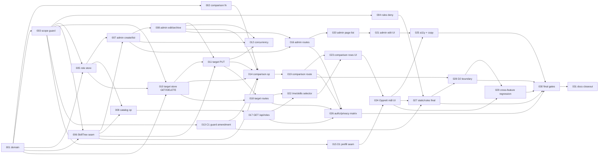

# Role profiles (Rolleprofiler) — Tasks

Specification: [SPEC.md](./SPEC.md) (approved product planning 2026-10-27; PO-1, PO-2, PO-3 resolved, not reopened; PG-1 … PG-12 resolved 2026-10-27)

## Status
Ready: 0  In Progress: 0  Done: 31

**Implementation readiness: implementation-ready, with zero implementation-blocking planning gaps.** The product owner
decided PG-1 … PG-11 on 2026-10-27; PG-12 (cross-feature static guard ownership) was approved on 2026-10-27 after the TASK-009 milestone. The decisions are recorded in SPEC.md ("Planning-gap decisions"). Each task's
"Decisions applied" line names the PG it depends on. All 31 tasks are `Done` (0 `In Progress`, 0 `Ready`). TASK-022 was reopened on 2026-10-28 for the C1 notice amendment, which is implemented and passed review; its last blocker, product-owner approval of the `unavailable` copy string, is recorded and it is closed again.
Dependencies still gate execution (repository convention). TASK-001 is the only dependency-free root.

Total tasks: **31**. Dependency-free root: **TASK-001** only.

## Ground rules (apply to every task)

- **SPEC.md is authoritative.** Do not redesign, reinterpret or reopen PO-1, PO-2 or PO-3. If implementation shows the
  SPEC contradictory or unsafe, stop and report the BR/PG IDs; never weaken a `docs/SECURITY.md` invariant or work
  around a guard.
- Feature directory `src/features/role-profiles/` (`domain/`, `server/`, `components/`, `copy.ts`). Routes under
  `app/api/admin/roles/`, `app/api/roles/`, `app/api/me/role-target/`, `app/api/me/role-comparison/`. Pages
  `app/admin/roles/page.tsx`; the person section is inside the existing `app/me/skills/page.tsx`.
- Naming: the concept is `roleDefinition` / `targetRole`. Never reuse the team `role` field (`teamMemberships.role`).
- Persistence only at `roleDefinitions/{roleId}` and `userDevelopment/{uid}/roleTarget/current`, via the Admin SDK
  on the server. No client Firestore, no `collectionGroup`, no composite index, no env variable, no dependency change.
- Static guards (PG-12): the existing C2/team-skills and D1 guards stay active. Only exact file-level role-profiles
  entries are allowed (SPEC PG-12). No directory exclusion, no production `collectionGroup`, and no D1 goal access.
- PG-12 remediation sequence. Run it in the resumed `implement-feature` run before TASK-010 (not started). It edits
  only the files named here:
  1. Reword the comment-only `roleDefinitions` mentions in `src/features/role-profiles/domain/role-definition.ts` and
     `src/features/role-profiles/server/role-store-types.ts` so neither names the literal (TASK-005 notes).
  2. Add the exact C2 entry `src/features/role-profiles/server/role-store.ts` to the team-skills cross-cutting guard's
     `roleDefinitions` allow-list (TASK-005 notes).
  3. Rewrite the `collectionGroup` token in `role-profiles-scope-guard.test.ts` as the pattern `collection\s*Group`
     (TASK-003 notes).
  4. Add `src/features/role-profiles/role-profiles-scope-guard.test.ts` as the test-only D1 pin for `userDevelopment`
     (TASK-003 notes).
  5. Run the team-skills, personal-goals and role-profiles suites and report the results. The D1 role-target entry
     waits for TASK-010's file.
  - **Status (2026-10-27, resumed run): steps 1–4 applied; step 5 passed.** Affected guard suites: 115 files / 3119 tests
    pass. Full `pnpm test`: 386/387 files pass; the one failure (`TeamDetail.test.tsx` 5s timeout under full parallel
    load) passes when run alone (109/109) and is unrelated to this feature. `pnpm typecheck` and `pnpm lint` pass. The
    D1 role-target entry (`role-target-store.ts`) is added in TASK-010.
- Subject of every person operation is the verified-token uid. No uid, e-mail or `memberRef` in any path, query,
  body, DTO, log or error.
- Internal fields (`createdBy`, `updatedBy`, `archivedBy`, `uid`) never appear in any DTO.
- Errors and logs never contain role names, descriptions, `roleId`s, skill-area names, levels or the comparison (BR-23).
- No Firebase access, seed, fixture change, deploy, migration, backfill or Demo Team change (PO-3, BR-26).
- Next.js: `AGENTS.md` requires reading `node_modules/next/dist/docs/` before writing route handlers or pages.
- Commands (`package.json`, pnpm only): `pnpm typecheck`, `pnpm lint`, `pnpm test` (focused: `pnpm vitest run <path>`),
  `pnpm build`. Every task runs typecheck, lint and its focused tests. Full `pnpm test` and `pnpm build` run in TASK-030.
- Tests use injected dependencies and in-memory fakes (repository precedent: `personal-goals` `fake-goal-store`).

## Planning gaps (resolved 2026-10-27)

The eleven planning gaps found by `/split-tasks` were decided by the product owner on 2026-10-27. The decisions and the
contracts they set are recorded in SPEC.md under "Planning-gap decisions (PG-1 to PG-12)". This table is a resolution
index; the SPEC is authoritative.

| Gap | Resolved decision | Tasks that apply it |
|---|---|---|
| PG-1 title prefill for "Opprett mål" | `treeId` only. No title is prefilled or generated. | 015, 024 |
| PG-2 role with no valid SkillTree | Selectable only with at least one valid, available expectation. An unselectable write returns `409` `role_not_selectable`. The catalog keeps the role with `selectable: false`. | 011, 017, 018, 022 |
| PG-3 malformed or missing target | `GET` returns `{status:"none"}`, `{status:"unavailable"}` or `{status:"selected", target}`. No write. `DELETE` still works. | 010, 018, 022 |
| PG-4 comparison when target unusable | `{state:"no_target"}`, `{state:"target_unavailable", reason}` with no rows, or `{state:"available", target, rows}`. | 014, 019, 023 |
| PG-5 order, window, overflow, cap | `orderBy createdAt` then document ID, `limit(51)`. The first 50 raw documents are the window; malformed documents consume slots; the 51st sets `truncated`. The cap uses `count()` over all documents. | 005, 007, 009 |
| PG-6 archive, restore, edit | Archive and restore are idempotent `200` no-ops. `PATCH` on an archived role returns `409` `role_archived`. An empty `PATCH` returns `400`. | 008, 021 |
| PG-7 selection versus archive | Selection runs in `runTransaction`, reading the role (and SkillTrees) with `tx.get` before a single `tx.set`. | 006, 011, 012 |
| PG-8 `RoleDto` fields | Allow-list: `roleId`, `name`, `description?`, `selectable`, `expectations[treeId, treeName, expectedLevel]`. | 009, 017 |
| PG-9 malformed role by ID | `404` `not_found`, identical to a missing role. Admin mutations fail closed. | 008, 016, 021 |
| PG-10 description normalisation | Trim; at most 500 code points; empty after trim means absent; `PATCH` to empty clears it. | 001, 021 |
| PG-11 where "Opprett mål" opens | Link to `/me/goals?treeId=<treeId>`; `treeId` is the only parameter. | 015, 024 |
| PG-12 cross-feature static guard ownership | Explicit file-level entries only: C2 `role-store.ts` (005); D1 role-target store (010) and the role-profiles guard test as a test-only pin (003). No directory exclusion; no production `collectionGroup`. | 003, 005, 010, 013, 027, 029, 031 |

Minor items resolved by convention: an invalid `roleId` path shape returns the same `404` as a missing role;
`includeArchived` accepts only `true` or `false` (otherwise `400`); neutral error copy follows the
`src/features/skill-trees/copy.ts` pattern. Copy strings still need a copy review before release.

## Dependency graph

---

## Phase A — Foundation

### TASK-001 — Role domain: bounds, validation, stored-shape parsing and DTO types

**Status:** Done
**Covers:** BR-2, BR-3, BR-4, BR-7 (constant), BR-21 (validation on read), BR-22 (constants), AD-5, AD-1 (stored shape)
**Depends on:** None
**Decisions applied:** PG-10 (resolved 2026-10-27: trim, length in code points, empty after trim means absent)

**Outcome**
Pure domain module that validates role input, parses stored role documents, and defines the explicit DTO types and
their field builders. No I/O.

**Implementation notes**
- Surfaces: `src/features/role-profiles/domain/`, `src/features/role-profiles/domain/role-definition.test.ts`.
- Constants: 50 roles (BR-7), 20 expectations (BR-22), name 1–80 after trim, description ≤500 (BR-2), `expectedLevel`
  integer 2–4 (AD-5, BR-2), `treeId` unique within a role.
- Reuse the existing SkillTree `treeId` shape validator from `src/features/skill-trees/domain/`. Do not import from
  `skill-trees/server/`.
- Three distinct shapes: stored document (`StoredRoleDefinition`), domain role, DTO. The DTO builders are the only way
  to produce output; they copy named fields only.
- A role with zero expectations is valid as a draft (BR-3). Selection is not decided here (TASK-011).
- Non-goals: no Firestore import, no route, no weights, required flags, priorities or due dates (BR-4).

**Verification**
- Boundary tests: name 0 / 1 / 80 / 81; description 500 / 501 code points (after trim); whitespace-only description is absent; 20 / 21 expectations; duplicate `treeId`; level 1, 2, 4,
  5, 0 and non-integer; zero-expectation role accepted.
- Parser tests: wrong-typed fields, missing name, out-of-range level, duplicate `treeId`, and non-object input each
  yield "invalid" (skip), never an exception.
- DTO test: an input carrying `createdBy`, `updatedBy`, `archivedBy` and `uid` produces output without them.

**Security / privacy**
- Role data is org reference data. No personal data is accepted in the domain model.
- Internal accountability fields never enter a DTO type (SPEC, Security section).

**Documentation impact**
None expected (see TASK-031).

**Acceptance criteria**
- [ ] Every boundary in BR-2 and AD-5 is covered by a test.
- [ ] Stored malformed documents are reported as invalid, never thrown (BR-21).
- [ ] DTO builders exclude `createdBy`, `updatedBy`, `archivedBy` and `uid`.
- [ ] PG-10 is decided and the description rule is implemented as decided.
- [ ] Typecheck, lint and focused tests pass.
- [ ] No conflict with `docs/SECURITY.md`.

---

### TASK-002 — Pure comparison status function

**Status:** Done
**Covers:** BR-11, BR-12, AD-3
**Depends on:** TASK-001

**Outcome**
A pure function that maps a role's expectations, the owner's C1 levels, and per-tree availability to one row per
expectation, in expectation order, with exactly one status each.

**Implementation notes**
- Surfaces: `src/features/role-profiles/domain/comparison.ts` and its test.
- Inputs are domain values only: expectations (TASK-001), a map of valid owner C1 levels by `treeId`, and a set of
  `treeId`s whose SkillTree is missing or invalid.
- Precedence: `area_unavailable` (tree missing or invalid) wins over `not_assessed`. For that row, `ownLevel` is `null`.
- Absence of a C1 level yields `not_assessed` and is never treated as a level (BR-11).
- The C1 reader supplies only valid levels (TASK-014). This function treats any level it is not given as absent.
- Output has no totals, counts, percentages, scores, labels or ordering by status (BR-12). Rows keep input order.

**Verification**
- Table tests: `meets` (equal and greater), `development_opportunity` (less), `not_assessed` (no level),
  `area_unavailable` (missing tree, with and without a C1 level present).
- Output key test: rows contain only `treeId`, `expectedLevel`, `status`, `ownLevel`; no aggregate keys.
- Order test: output order equals expectation order for a mixed-status input (no sort by status).
- Zero expectations yields `[]`.

**Security / privacy**
- Pure, no persistence, no logging. Output is for the owner only (enforced in TASK-014).

**Documentation impact**
None expected.

**Acceptance criteria**
- [ ] Exactly one status per expectation, from the four approved values only (BR-11).
- [ ] No aggregate or ordering output (BR-12).
- [ ] Typecheck, lint and focused tests pass.

---

### TASK-003 — Role-profiles static scope guard (initial)

**Status:** Done
**Covers:** BR-10 (change detection), BR-13, BR-17 (D2 guard pin), BR-18, BR-24, BR-25, BR-26, PO-1, PO-3
**Depends on:** TASK-001

**Outcome**
A new `src/features/role-profiles/role-profiles-scope-guard.test.ts` in the style of
`personal-goals-scope-guard.test.ts`. It fails visibly on any drift from the approved scope.

**Implementation notes**
- Surfaces: `src/features/role-profiles/role-profiles-scope-guard.test.ts` (new only; no other guard is edited here).
- Pins:
  - collection allow-list: `roleDefinitions` and `userDevelopment/{uid}/roleTarget` only;
  - forbidden imports: `skill-trees/server/`, `team-skills`, `roadmap`, `skill-progress`, D2 `development-conversations`,
    and any notification or email module;
  - forbidden concepts (identifier and string scan, comments stripped): `currentRole`, `currentRoleId`, role family,
    role level, grade, `teamRole`, `memberRef`, and comparison aggregates (`percent`, `count`, `readiness`, `promotion`,
    `score`, `rank`);
  - no `collectionGroup`; no Demo fixture path reference; no seed script reference.
- Existing guards: this task edits none. The D2 guard is never edited. Per PG-12, the team-skills (C2) guard gets the
  exact `role-store.ts` entry in TASK-005, and the D1 guard gets exact role-profiles entries (the role-target store in
  TASK-010, and this task's guard test as a test-only pin, PG-12 remediation step 4). The earlier "asserted unchanged"
  statement is superseded by PG-12.
- PG-12 test-token technique: this guard test spells the forbidden token as the pattern `collection\s*Group` (and in its
  fixture), so the D1 scan does not match its own text. No production `collectionGroup` exception is created.

**Verification**
- The guard passes on the feature tree as it stands.
- Negative tests: an injected source with each forbidden pattern fails (`forbiddenImportViolations`-style helpers).
- `git diff` shows no change to the D2 guard. No team-skills or D1 guard is edited by this task.

**Security / privacy**
- A static guard is change detection, not a security boundary (SPEC, test boundaries). It does not replace server
  authorization tests (TASK-026).

**Documentation impact**
None expected.

**Acceptance criteria**
- [ ] Guard passes on the current tree; each forbidden pattern is shown to fail.
- [ ] Collection allow-list is exactly the two approved paths.
- [ ] No existing guard is weakened.
- [ ] Typecheck, lint and focused tests pass.

---

### TASK-004 — Explicit deny-only Firestore rule for `roleDefinitions`

**Status:** Done
**Covers:** SPEC "Firestore rules, indexes and config impact"; BR-1 (no client writes); AC "firestore.rules contains an explicit deny-only block" and "firestore.indexes.json is unchanged"
**Depends on:** TASK-003 (the guard pins the collection and the rule block)

**Outcome**
`firestore.rules` contains an explicit `match /roleDefinitions/{document=**}` block with `allow read, write: if false;`,
commented the way the other blocks are. No other rule changes.

**Implementation notes**
- Surfaces: `firestore.rules`; the rules verification mechanism that the repository already uses (extend it if one
  exists; otherwise the guard pins the block).
- `userDevelopment/{document=**}` already covers `userDevelopment/{uid}/roleTarget/current`. Do not add a second block.
- Do not weaken or reorder any existing deny. The final `{document=**}` deny stays.
- No Firebase access and no deploy. Rules deployment is a separate explicit step (SPEC).

**Verification**
- Textual or emulator check that the new block exists and that every pre-existing block is byte-identical.
- `firestore.indexes.json` unchanged (`git diff` empty for that file).
- Guard (TASK-003) updated to pin the block.

**Security / privacy**
- Client Firestore access to role definitions is denied. Role data is reachable only through Admin SDK routes.

**Documentation impact**
None here (rules documentation is in TASK-031).

**Acceptance criteria**
- [ ] Explicit deny-only `roleDefinitions` block present.
- [ ] No existing rule changed; `userDevelopment` access not broadened.
- [ ] `firestore.indexes.json` unchanged.
- [ ] Focused verification passes.

---

## Phase B — Persistence and admin domain

### TASK-005 — Role store (Admin SDK) with bounded raw read

**Status:** Done
**Covers:** BR-7 (count support), BR-21 (raw access), BR-22 (≤50 reads), AD-1, AD-7
**Depends on:** TASK-001, TASK-003
**Decisions applied:** PG-5 (resolved 2026-10-27: `orderBy createdAt`, document ID tie-breaker, `limit(51)`, `count()` for cap)

**Outcome**
A server-only store over `roleDefinitions` with: bounded ordered raw list (`limit(51)`), a `count()` aggregation, get by ID, create under a
server-generated opaque ID, field update, and archive/restore field writes. Also an in-memory fake for tests.

**Implementation notes**
- Surfaces: `src/features/role-profiles/server/role-store.ts`, `role-store-types.ts`, `fake-role-store.ts`, and tests.
- The store returns raw documents. Parsing and validation are done by TASK-001.
- No `roleId` field is stored. The Firestore document ID is the identity.
- `orderBy createdAt` plus document ID only: single-field ordering, no composite index (AD-7, PG-5). No in-memory name sort exists. The `count()` aggregation covers all documents, malformed included.
- The store has no uid-parameterised operation. Stored shape writes `createdAt`; `createdAt` is never rewritten.
- PG-12 (C2 guard, resumed run; remediation steps 1–2): reword the comment-only mentions of `roleDefinitions` in
  `domain/role-definition.ts` and `server/role-store-types.ts` (completed-task comment edits, not behaviour changes).
  Add exactly one C2 entry, `src/features/role-profiles/server/role-store.ts`, to the team-skills cross-cutting guard's
  `roleDefinitions` allow-list. Do not add the test files, the other two files, or any directory. Verify that the C2
  suite passes and that a probe production file naming `roleDefinitions` still fails.

**Verification**
- Fake-store tests: create sets `createdAt`; update never changes `createdAt`; the ordered list requests at most 51 raw documents, and the window, probe and `truncated` follow BR-22.
- The store source contains no `where` clause requiring an index.

**Security / privacy**
- Admin SDK only. No client path. No uid in any document path.

**Documentation impact**
None expected.

**Acceptance criteria**
- [ ] Bounded ordered read of 51 raw documents (50-document window plus probe) with no composite index.
- [ ] Create, get, update, archive and restore field writes exist and are tested against the fake.
- [ ] PG-5 decided and implemented as decided.
- [ ] PG-12 C2 entry is exact-file only; the team-skills guard passes; no other production file gains an entry.
- [ ] Focused tests pass.

---

### TASK-006 — SkillTree expectation seam (read-only)

**Status:** Done
**Covers:** AD-4, BR-2 (`treeId` must exist on admin write), BR-8 (validity input), BR-11 (`area_unavailable` input), BR-22 (names only for referenced IDs)
**Depends on:** TASK-001, TASK-003

**Outcome**
A read-only seam over `skillTrees` that returns, for referenced `treeId`s only, existence, validity and name. It mirrors
the D1 SkillTree catalog seam but lives in the role-profiles feature.

**Implementation notes**
- Surfaces: `src/features/role-profiles/server/skill-tree-seam.ts`, `skill-tree-seam-types.ts`, tests.
- Validity uses `isValidSkillTree` from `src/features/skill-trees/domain/`. No import from `skill-trees/server/`.
- Batch reads chunked at 100 IDs (repository precedent in D1).
- Read-only: no write and no batch write (SI-8 pattern). The seam starts no transaction of its own. It accepts a
  transaction-bound reader (`tx.get`) from the caller, so TASK-011 can read SkillTrees inside `runTransaction` (PG-7).
- SkillTrees have no delete or archive in v1 (team-skill-tree BR-5). The "missing" case is defensive.
- A rejected read is a failure, never "missing". BR-11 limits `area_unavailable` to a missing or invalid tree, so a
  transient read failure must reach the operation as a failure (neutral `500`), not as `area_unavailable`.

**Verification**
- Fake tests: missing tree → missing; invalid tree → invalid; valid tree → name; chunking over 100 IDs; rejected read
  surfaces as failure, not as missing.
- Static: no import from `skill-trees/server/`; no write call in the seam.

**Security / privacy**
- Skill-area names are org data and may be shown to any signed-in person in role data. No personal data is read.

**Documentation impact**
None expected.

**Acceptance criteria**
- [ ] Only referenced `treeId`s are read (BR-22).
- [ ] A read failure is never reported as `area_unavailable`.
- [ ] Read-only; no write or batch-write call.
- [ ] Focused tests pass.

---

### TASK-007 — Admin role create and list (operations)

**Status:** Done
**Covers:** BR-1 (admin-only creation), BR-2, BR-7 (cap), BR-21 (silent skip on read), BR-22, BR-23, PO-2
**Depends on:** TASK-005, TASK-006
**Decisions applied:** PG-5 (window, overflow and cap-count rule for the list, resolved 2026-10-27)

**Outcome**
Two server operations, both behind an injected `requireAppAdmin`-style authorisation: `createRole` and
`listRolesForAdmin({ includeArchived })`.

**Implementation notes**
- Surfaces: `src/features/role-profiles/server/create-role.ts`, `list-roles-for-admin.ts`, tests.
- `createRole`: validate (TASK-001), check each `treeId` exists (TASK-006; unknown → not found), count then create
  (BR-7, PG-5). The count is a `count()` aggregation over all documents, including archived and malformed ones. A count of 50 or more → `409` `cap_reached`. A small overshoot under concurrent creates is
  accepted (SPEC, same precedent as D1). Set `createdAt` and `createdBy` (internal).
- `listRolesForAdmin`: bounded ordered read and 50-document window (TASK-005, BR-22), skip malformed silently (BR-21), archived included by default (API), `truncated` from the probe (PG-5).
  Map to `RoleAdminDto` through the TASK-001 builder. `treeName` is `null` for an unresolved tree.
- Authorisation: the app-admin check is `requireAppAdmin` (existing); it is injected, not reimplemented. No second admin
  system (SPEC, Actors).
- Non-goals: no lead or member path; no edit (TASK-008).

**Verification**
- Non-admin is refused at the operation with zero writes.
- Create success: persisted-shape assertion (exact fields); DTO has no `createdBy`, `updatedBy`, `archivedBy` or `uid`.
- Cap: a create at a count of 50 is refused and not written; archived and malformed documents count toward the cap.
- Unknown `treeId` → not found, zero writes. Invalid body → validation error, zero writes.
- List skips a malformed document without exposing it; it still consumes a window slot. A 51st raw document sets `truncated: true` (BR-22).
- Log spy: no role name or description appears in any log call.

**Security / privacy**
- Authorisation before any read or write. No personal data.

**Documentation impact**
None expected.

**Acceptance criteria**
- [ ] Only app admins can create (BR-1); the operation refuses others with zero writes.
- [ ] Cap enforced as count-then-create with the BR-7 overshoot accepted and documented (TASK-012 tests it).
- [ ] Malformed documents are skipped on read (BR-21).
- [ ] Focused tests pass.

---

### TASK-008 — Admin edit, archive and restore

**Status:** Done
**Covers:** BR-1, BR-2, BR-4, BR-5, AD-6, BR-23, PO-2
**Depends on:** TASK-007
**Decisions applied:** PG-6 (archive/restore/edit idempotency), PG-9 (by-ID addressing of a malformed role), resolved 2026-10-27

**Outcome**
`updateRole` (name, description, and the whole expectations array when present) and `setRoleArchived(roleId, archived)`.

**Implementation notes**
- Surfaces: `src/features/role-profiles/server/update-role.ts`, `set-role-archived.ts`, tests.
- `updateRole` is a partial patch. Expectations replace the whole array (SPEC API). Set `updatedAt` and `updatedBy`
  (internal). `createdAt` never changes.
- `setRoleArchived`: sets `archivedAt` and `archivedBy` on archive; clears both on restore. Archiving an archived role and restoring an active role are `200` no-ops (PG-6). Neither changes `updatedAt`.
- No history and no per-expectation flags (BR-4). Removing an expectation removes the entry.
- `updateRole` on an archived role returns `409` `role_archived` and writes nothing. An empty patch returns `400` `invalid_input`. A `description` that trims to empty clears the stored field (PG-10). A malformed role requested by ID returns `404` `not_found`, with no repair (PG-9).
- Last write wins. There is no ETag or transaction (SPEC edge cases; see TASK-012).

**Verification**
- Partial patch leaves other fields untouched; expectations replace removes old entries.
- `createdAt` unchanged after edit and archive.
- Archive → restore round trip restores active state; `archivedAt` absent afterwards.
- Patch on an archived role → `role_archived`, zero writes. Archive twice → same state, `archivedAt` unchanged; restore an active role → no-op.
- Non-admin refused with zero writes. Validation failure writes nothing.
- Log spy: no name, description or expectation content in logs.

**Security / privacy**
- No personal data. `updatedBy` and `archivedBy` never in output (TASK-001 builder).

**Documentation impact**
None expected.

- **Reopened (during TASK-016):** an unaddressable `roleId` (not a valid document id) reached `store.get` and was reported as `persistence_failed` (500) instead of `not_found` (404). PG-9 requires the same 404 as a missing role. Fixed in `update-role.ts` and `set-role-archived.ts` by an addressability check before any store call. Re-reviewed after the fix: PASS (regression tests added in `update-role.test.ts` and `set-role-archived.test.ts`).

**Acceptance criteria**
- [ ] Edit, archive and restore are admin-only (BR-1).
- [ ] Archive is reversible and does not touch any person's stored target (BR-5).
- [ ] PG-6 and PG-9 decided and implemented as decided.
- [ ] Focused tests pass.

---

### TASK-009 — Active role catalog read (operation)

**Status:** Done
**Covers:** BR-5 (archived hidden from lists), BR-6, BR-21, BR-22, BR-23
**Depends on:** TASK-005, TASK-006
**Decisions applied:** PG-5 (window and `truncated`), PG-8 (`RoleDto` allow-list), PG-2 (`selectable`), resolved 2026-10-27

**Outcome**
`listActiveRolesForPerson()`: active roles only (no `archivedAt`), each mapped to a `RoleDto` through the TASK-001
builder, including roles with zero expectations (drafts are readable; BR-6 and BR-3).

**Implementation notes**
- Surfaces: `src/features/role-profiles/server/list-active-roles.ts`, tests.
- Read through the store (TASK-005) and the seam (TASK-006). Names are resolved for referenced `treeId`s only (BR-22).
- No subject parameter: the catalog is org-wide, and it is readable by any signed-in user (BR-6).
- Non-goals: no target or comparison data; no person data.

**Verification**
- Archived roles excluded; malformed documents excluded without their content in any output.
- A zero-expectation active role is included with `expectations: []` and `selectable: false`.
- `selectable` is `false` for a role whose expectations all fail to resolve to an available SkillTree, and `true` otherwise (PG-2).
- Output keys equal exactly the PG-8 allow-list: `roleId`, `name`, `description` (when present), `selectable`, `expectations[treeId, treeName, expectedLevel]`.
- Unresolved `treeId` → `treeName: null`.
- Output has no uid, `createdBy`, `updatedBy` or `archivedBy`.
- Log spy: no role content in logs.

**Security / privacy**
- Org reference data only. No personal data. Visible to any signed-in person (BR-6).

**Documentation impact**
None expected.

**Acceptance criteria**
- [ ] Only active roles are returned (BR-5).
- [ ] DTO allow-list enforced (BR-6, AC "no uid, e-mail, createdBy, updatedBy or archivedBy").
- [ ] PG-8 decided and implemented as decided.
- [ ] Focused tests pass.

---

### TASK-010 — Personal target store and owner read / clear

**Status:** Done
**Covers:** BR-10, BR-19, BR-20, BR-23, BR-25, AD-2, PO-1 (no history)
**Depends on:** TASK-001, TASK-003, TASK-005
**Decisions applied:** PG-3 (target status shape, resolved 2026-10-27)

**Outcome**
Owner-only store at `userDevelopment/{uid}/roleTarget/current` with: `getOwnRoleTarget(subjectUid)` (returns
`{ status: "none" } | { status: "unavailable" } | { status: "selected", target: { roleId, name, archived } }`, PG-3) and `clearOwnRoleTarget(subjectUid)` (hard delete, idempotent).

**Implementation notes**
- Surfaces: `src/features/role-profiles/server/role-target-store.ts`, `get-own-role-target.ts`, `clear-own-role-target.ts`, tests.
- The fixed document ID `current` makes "at most one" structural (AD-2). Stored fields: `roleId`, `updatedAt` only.
- Missing document → `{ status: "none" }` (BR-19). Malformed document → `{ status: "unavailable" }`; its content is not returned.
- Referenced role missing or malformed (BR-21) → `{ status: "unavailable" }`, with no `roleId` or name. Role archived → `selected` with `archived: true`.
- The read performs no write, and no repair happens on GET (PG-3).
- Clear deletes the document. No tombstone, no history (SPEC, data model).
- The operation's subject is the `subjectUid` parameter, supplied by the route from the verified token only. No
  operation accepts an arbitrary uid (BR-10).
- The store is not reachable from any other feature. Its path is pinned by TASK-003.
- PG-12 (D1 guard, resumed run, once the file exists): add `src/features/role-profiles/server/role-target-store.ts` as
  the single explicit file entry for `userDevelopment` in the D1 scope guard's approved-file list. Add the store's test
  file only if inspection shows it names the identifier. The store must not import or call `personal-goals` modules,
  and must not use the D1 goal path or goal store. The entry grants role-target persistence only: no goal store, goal
  route, goal DTO or `collectionGroup` access.

**Verification**
- Missing document → `{ status: "none" }`, no error.
- Malformed document → `{ status: "unavailable" }`; output contains no stored field.
- Missing or invalid referenced role → `{ status: "unavailable" }`; zero writes.
- Archived role → `archived: true`.
- Clear on a missing document succeeds without error; clear writes exactly one delete; no history document is created.
- Static: no operation signature has a uid parameter other than `subjectUid`.
- The D1 guard passes with exactly the new role-target entry (plus the test file only if it names the identifier). A
  probe role-profiles file that names `userDevelopment` still fails it.

**Security / privacy**
- Owner-only. Stored content is never exposed in an error or a log (BR-23).

**Documentation impact**
None expected.

**Acceptance criteria**
- [ ] Owner-only; no arbitrary uid access (BR-10).
- [ ] Missing reads as `none` and malformed reads as `unavailable`; neither produces a 500 (BR-19, BR-20).
- [ ] No history (PO-1).
- [ ] PG-3 decided and implemented as decided.
- [ ] Focused tests pass.

---

### TASK-011 — Set own target role (selection rules)

**Status:** Done
**Covers:** BR-3, BR-5 (archived role stays readable as archived), BR-8, BR-10, BR-20 (replace malformed), BR-25
**Depends on:** TASK-006, TASK-008, TASK-010
**Decisions applied:** PG-2 (`role_not_selectable` refusal), PG-7 (transactional selection), resolved 2026-10-27

**Outcome**
`setOwnRoleTarget(subjectUid, roleId)`: refuses an unselectable role (PG-2, BR-3, BR-8). A missing or malformed role gets `404` `not_found`. An archived role,
a zero-expectation role, or a role with no available SkillTree gets `409` `role_not_selectable`. The eligibility check
and the write run in `runTransaction` (PG-7), and the write is `{ roleId, updatedAt }` to the fixed document,
replacing any existing or malformed target.

**Implementation notes**
- Surfaces: `src/features/role-profiles/server/set-own-role-target.ts`, tests.
- Refusal map (PG-2, PG-9): missing or malformed role → `404` `not_found`; archived, zero expectations, or no available
  SkillTree → `409` `role_not_selectable`. Both bodies are neutral and carry no reason or role content.
- Transaction (PG-7): `runTransaction`; `tx.get` on the role and on each referenced SkillTree; all reads before the single
  `tx.set`. A plain `get` inside the callback does not count as transactional.
- Last write wins for concurrent changes by the same person. No history (SPEC edge cases).
- Only `roleId` is accepted. The body may carry no uid, e-mail or other field.
- Non-goals: no admin or lead path; no assignment by anyone other than the owner (BR-25).

**Verification**
- Each refusal case writes zero documents.
- Archive committed before the transaction's read → `role_not_selectable`, zero writes.
- A valid selection writes exactly `{ roleId, updatedAt }` to `userDevelopment/{subjectUid}/roleTarget/current`.
- Replacing a malformed document succeeds.
- Changing the target replaces the previous `roleId`; no second document is created.
- Static: no operation signature accepts a uid other than `subjectUid`.

**Security / privacy**
- Owner-only. The role identity written is an opaque ID, not a name.

**Documentation impact**
None expected.

**Acceptance criteria**
- [ ] Only an active role with at least one valid expectation can be selected (BR-8, BR-3); refusals write nothing.
- [ ] No history; last write wins (PO-1, edge cases).
- [ ] PG-2 and PG-7 decided and implemented as decided.
- [ ] Focused tests pass.

---

### TASK-012 — Concurrency and transaction semantics verification

**Status:** Done
**Covers:** BR-5, BR-7 (overshoot accepted), BR-8, SPEC edge cases (two admins; concurrent target changes; failed persistence)
**Depends on:** TASK-007, TASK-008, TASK-011
**Decisions applied:** PG-7 (resolved 2026-10-27: selection is transactional, with `tx.get` on the role)

**Outcome**
A dedicated test set, plus a recorded decision in the task notes, that proves each operation's concurrency behaviour
and the absence of any reader that is treated as transaction-bound without being one.

**Implementation notes**
- Surfaces: `src/features/role-profiles/server/concurrency.test.ts` (new).
- Operations and their semantics:
  - Role create cap: count-then-create, not transactional. Overshoot under concurrent creates is accepted (BR-7). The
    test documents the bound and does not claim a hard cap.
  - Role update and archive/restore: single-document writes, last write wins.
  - Target selection (PG-7): validates the role inside `runTransaction` with `tx.get`, then writes one document. An
    archive that commits first makes the transaction refuse. An archive after the commit is handled at read time (BR-5).
- PG-7 (resolved): the selection reads the role and the referenced SkillTrees with `tx.get` inside `runTransaction`. A
  plain read inside a transaction callback does not count as transaction-bound.
- Failed persistence: every operation performs at most one write, so no partial state is possible. Tests assert this.
- **Deferred to TASK-014:** the comparison half of the archive-after-selection check (`target_unavailable`, no rows). The comparison operation does not exist until TASK-014; TASK-012 verifies only the read-time `selected` with `archived: true` status (BR-5).

**Verification**
- Fake interleaving: archive committed before the transaction's read → selection refused (`role_not_selectable`), zero writes.
  Archive committed after the selection → `GET /api/me/role-target` shows `status: "selected"` with `archived: true`, and
  the comparison is `target_unavailable` (checks BR-5 read-time handling).
- Concurrent create simulation: both creates pass the count check; the test records the resulting count and asserts
  the documented bound, not an exact cap.
- Each operation's write count is asserted (≤1 document write per call).

**Security / privacy**
- No privacy effect beyond TASK-010 and TASK-011. Tests assert no uid or role content appears in errors.

**Documentation impact**
PG-7 is recorded in SPEC.md and in this task. TASK-031 records it in ARCHITECTURE and SECURITY as applicable.

**Acceptance criteria**
- [ ] Each operation's concurrency behaviour is tested and matches the SPEC.
- [ ] No operation claims a transaction it does not perform.
- [ ] PG-7 decided and recorded.
- [ ] Focused tests pass.

---

## Phase C — Personal target and comparison

### TASK-013 — Narrow `skillProfiles` reader allow-list amendment (C1 guard)

**Status:** Done
**Covers:** SPEC "Security and privacy" (new reader of `skillProfiles`; amendment (c), allow-list update), BR-13
**Depends on:** TASK-003

**Outcome**
The C1 scope guard (`src/features/skill-profiles/skill-profiles-scope-guard.test.ts`) approves exactly one new outside
reader of `skillProfiles`: the role-profiles comparison module. Nothing else in that guard changes.

**Implementation notes**
- Surfaces: `src/features/skill-profiles/skill-profiles-scope-guard.test.ts` (narrow edit: one entry in the approved
  server-importer list, and the collection-reference entry if the module names the collection).
- The approved module path is `src/features/role-profiles/server/get-own-role-comparison.ts` (TASK-014). Add exactly
  that path, not a directory allowance.
- The C2 pre-authorisation is unchanged (C2 is the only outside importer already approved).
- D1 guard: no change in this task. The comparison module reads `skillProfiles` and the role target through the
  TASK-010 store. It does not name the `userDevelopment` identifier, so this task needs no D1 entry. The only
  role-profiles D1 entry is the PG-12 role-target entry in TASK-010. If TASK-014 needs a D1 source import, stop and
  report.
- The D1 SI-6 statement itself is amended in documentation only (TASK-031).

**Verification**
- The C1 guard passes with the new entry.
- A probe module outside the approved path that reads `skillProfiles` fails the guard.
- The C2 pre-authorisation is still present and passing.
- `git diff` is empty for the D1 guard in this task (the PG-12 role-target entry belongs to TASK-010).

**Security / privacy**
- The amendment is the SPEC's required review point for the new reader. It is not a boundary by itself (SPEC).

**Documentation impact**
The `skillProfiles` reader list is recorded in TASK-031 (SECURITY).

**Acceptance criteria**
- [ ] Exactly one new approved outside reader (the comparison module), by exact path.
- [ ] C1 guard assertions unchanged except for this entry. This task does not edit the C2 guard (its PG-12 entry belongs
  to TASK-005).
- [ ] D1 guard unchanged by this task.
- [ ] Focused tests pass.

---

### TASK-014 — Derived comparison operation (owner-only)

**Status:** Done
**Covers:** BR-9, BR-10, BR-11, BR-12, BR-13, BR-19, BR-22 (≤20 rows; referenced names only), BR-23, AD-3
**Depends on:** TASK-002, TASK-006, TASK-008, TASK-010, TASK-011, TASK-013
**Decisions applied:** PG-4 (comparison states, resolved 2026-10-27)

**Outcome**
`getOwnRoleComparison(subjectUid)`: reads the owner's target, its role, and the owner's own C1 levels. It returns the
PG-4 state: `no_target`; `target_unavailable` with reason `no_expectations` or `unavailable` and no rows; or `available`
with rows from TASK-002. Nothing is written.

**Implementation notes**
- Surfaces: `src/features/role-profiles/server/get-own-role-comparison.ts`, tests.
- Flow: target (TASK-010). `none` → `{ state: "no_target" }`. `unavailable`, or a role that is missing, malformed or
  archived → `{ state: "target_unavailable", reason: "unavailable" }`. An active, valid role with zero stored expectations →
  `reason: "no_expectations"`. Otherwise: C1 levels (below), tree status (TASK-006), rows (TASK-002). If no expectation
  resolves to an available SkillTree → `reason: "unavailable"`, no rows.
- C1 read: first reuse an existing owner-scoped C1 read in `src/features/skill-profiles/server/` if its public API
  returns only the owner's levels. If none exists, add one minimal owner-keyed read by `subjectUid`, approved by
  TASK-013. The read returns only valid levels and no document metadata.
- Read failure (C1 or tree) → neutral failure (`500`), never `area_unavailable` or `not_assessed` (BR-11 limits those
  to absent data).
- Bounds: at most 20 rows (BR-22). No totals, counts, ordering by status (BR-12).
- Non-goals: no persistence or cache; no comparison in any other route, notification or aggregate (BR-13).
- **Implementation decision (TASK-014):** the operation takes the verified `idToken`, not a bare `subjectUid`, because the only existing owner-scoped C1 read (`getOwnSkills`) takes the token. It verifies the token once for the target and again inside that read. No uid parameter exists and no new C1 file was added. The single C1 importer entry is the TASK-013 guard entry. The read is skipped when the target is `none` or unusable. A truncated C1 catalog that omits a comparable tree is a `persistence_failed`, not `not_assessed`.

**Verification**
- Write spy: zero write calls on any store.
- One status per expectation, in expectation order; `not_assessed` for missing C1 levels; `area_unavailable` for a
  missing or invalid tree; `ownLevel` `null` where unavailable.
- Missing target → `no_target`. Archived or malformed target → `target_unavailable` (`unavailable`). Zero stored
  expectations → `target_unavailable` (`no_expectations`). None of these returns rows or raw data.
- Read failure → neutral failure, no `area_unavailable` substitution.
- Output key test: no totals or ordering keys (shared with TASK-002).
- Log spy: no names, levels or comparison content in logs.

**Security / privacy**
- Owner-only (subject from the parameter the route takes from the verified token). The comparison is never stored,
  logged or aggregated (BR-13, AD-3).

**Documentation impact**
Recorded in TASK-031 (ARCHITECTURE, SECURITY).

**Acceptance criteria**
- [ ] Comparison is live, owner-only, never persisted (BR-11–BR-13, AD-3).
- [ ] A read failure never becomes a status (BR-11).
- [ ] PG-4 decided and implemented as decided.
- [ ] Focused tests pass.

---

### TASK-015 — D1 "Opprett mål" prefill seam (approved cross-feature dependency)

**Status:** Done
**Covers:** BR-14, BR-15, BR-16; SPEC "D1 goal integration"
**Depends on:** TASK-003
**Decisions applied:** PG-1 (`treeId` only, no title), PG-11 (`/me/goals?treeId=` entry), resolved 2026-10-27

**Outcome**
The existing D1 create form can be opened with an initial `treeId` (PG-1: no title). The
submit path is the existing `createGoal` gateway, `POST /api/me/goals`, unchanged.

**Implementation notes**
- **Cross-feature D1 change (explicit):** `src/features/personal-goals/components/GoalForm.tsx` and/or
  `GoalsPage.tsx`, `app/me/goals/page.tsx` (reads only the `treeId` search parameter, PG-11), plus their tests. This is the approved dependency for "Opprett mål" (SPEC, D1 goal integration). It
  reuses the D1 component; it does not duplicate D1 create.
- Add an optional `initial` value for create mode only, holding `treeId` and nothing else (PG-1). Edit mode is unchanged.
- The `treeId` must go through the existing D1 option window (`SKILL_OPTIONS_WINDOW`) and existing "linked outside
  window" handling in `GoalForm`. Reuse; do not add a second path.
- No role identifier, role name, level or comparison state can enter the input (BR-15).
- Opening the form creates nothing; only an explicit submit creates a goal (BR-16).
- D1 guard (`personal-goals-scope-guard.test.ts`) must still pass. No D1 API, persistence or rule change.
- **Implementation notes (TASK-015, resolved):** `app/me/goals/page.tsx` is now async and reads only `treeId` from `searchParams` (an empty or repeated value is absent). `GoalsPage` takes an optional `initialTreeId` that opens the create form once. The form preselects it only when it is one of the bounded `skillOptions`; a stale tree starts with no area, with no new error path. The route test awaits the now-async page; its assertions are unchanged apart from the new `treeId` cases. Known edge: an auth-token change remounts the page and reopens a prefilled form, which sends nothing until an explicit submit.

**Verification**
- Existing D1 mutation and create tests still pass unmodified.
- New test: an opened form with `initial.treeId` submits only the D1 fields; the request body has no role key.
- New test: opening and cancelling the form issues no request.
- Page test: `/me/goals?treeId=<id>` opens the create form with that `treeId`; other parameters are ignored; a stale `treeId` gets the existing D1 handling and no new error path (PG-11).
- D1 guard passes.

**Security / privacy**
- No title is prefilled (PG-1). The user types the title, which is stored exactly as D1 stores titles (SPEC, D1 treatment).

**Documentation impact**
Recorded in TASK-031 (ARCHITECTURE: D1 cross-feature change).

**Acceptance criteria**
- [ ] The only D1 source change is the explicitly named initial-value seam (approved dependency).
- [ ] No role field enters any D1 request (BR-15).
- [ ] No automatic goal creation (BR-16).
- [ ] PG-1 and PG-11 decided and implemented as decided.
- [ ] Focused tests and the D1 guard pass.

---

## Phase D — API

### TASK-016 — Admin role routes

**Status:** Done
**Covers:** BR-1, PO-2; SPEC API "Role catalog (admin)" and "Error semantics (all routes)"
**Depends on:** TASK-007, TASK-008
**Decisions applied:** PG-9 (by-ID status for a malformed role), PG-6 (archived PATCH), resolved 2026-10-27

**Outcome**
`GET` and `POST /api/admin/roles`, `PATCH /api/admin/roles/[roleId]`, `POST /api/admin/roles/[roleId]/archive`, each
calling TASK-007/008 operations.

**Implementation notes**
- Surfaces: `app/api/admin/roles/route.ts`, `app/api/admin/roles/[roleId]/route.ts`,
  `app/api/admin/roles/[roleId]/archive/route.ts`, and tests. Mirror `app/api/admin/skills/` exactly.
- `GET` takes optional `includeArchived` (default true; `true` or `false` only, otherwise `400`) and returns `{ roles: RoleAdminDto[], truncated: boolean }`.
- Status map: `401` unauthenticated; `403` not an app admin; `400` malformed body or out-of-range field; `404` role or
  tree not found, and a malformed role by ID gets the same body (PG-9); `409` `cap_reached`, or `role_archived` on PATCH of an archived role (PG-6); `400` for an empty PATCH; `500` neutral persistence failure with no role content in the message.
- Archive body is `{ archived: boolean }`; anything else is `400`.

**Verification**
- Per route: `401`, `403` for a member and a lead, admin success with the exact DTO shape, `400` with zero writes,
  `404`, `409` at the cap, `500` neutral message.
- A malformed role by ID returns the same `404` body as a missing role (PG-9). PATCH on an archived role → `409` `role_archived`.
- Response bodies contain no uid, e-mail, `createdBy`, `updatedBy` or `archivedBy`.

**Security / privacy**
- `requireAppAdmin` on every route. No person route is touched.

**Documentation impact**
None here (TASK-031).

**Acceptance criteria**
- [ ] Only app admins can call any admin route; leads and members get `403` (BR-1, PO-2).
- [ ] Status map matches the SPEC API table.
- [ ] No internal field in any response.
- [ ] Focused tests pass.

---

### TASK-017 — Catalog route `GET /api/roles`

**Status:** Done
**Covers:** BR-6; SPEC API "Role catalog (person, read-only)"
**Depends on:** TASK-009
**Decisions applied:** PG-8 (`RoleDto` allow-list), PG-2 (`selectable`), PG-5 (`truncated`), resolved 2026-10-27

**Outcome**
`GET /api/roles` for any signed-in user, returning `{ roles: RoleDto[], truncated }` for active roles only, each with `selectable` (PG-2, PG-8).

**Implementation notes**
- Surfaces: `app/api/roles/route.ts` and test. Mirror `app/api/me/skills/route.ts` for the auth pattern.
- No request body or parameters. The subject is taken from the verified token only, and the response does not depend on it.

**Verification**
- Unauthenticated → `401`. Ordinary signed-in person → `200` with active roles only.
- Archived roles absent; response has no uid, `createdBy`, `updatedBy` or `archivedBy`.
- Each role carries exactly the PG-8 allow-list, including `selectable`.
- Member and lead get the same response (no role-based difference).

**Security / privacy**
- Org reference data only (BR-6).

**Documentation impact**
None here.

**Acceptance criteria**
- [ ] Signed-in users only; no admin requirement.
- [ ] DTO allow-list enforced.
- [ ] PG-8 decided and implemented as decided.
- [ ] Focused tests pass.

---

### TASK-018 — Personal target routes

**Status:** Done
**Covers:** BR-8, BR-10, BR-20; SPEC API "Personal target role (owner)"
**Depends on:** TASK-010, TASK-011
**Decisions applied:** PG-3 (status shape), PG-2 (`role_not_selectable`), resolved 2026-10-27

**Outcome**
`GET`, `PUT` and `DELETE /api/me/role-target`, calling TASK-010/011 operations with the verified-token uid.

**Implementation notes**
- Surfaces: `app/api/me/role-target/route.ts` and test. Mirror the body-allowlist convention of `app/api/me/goals/`.
- `PUT` body `{ roleId }` only; success returns `200` `{ status: "selected", target }`; refusals follow TASK-011 (`404` `not_found`, `409` `role_not_selectable`). `DELETE` returns `204`, idempotent.
- Any body or query key other than `roleId` on `PUT` is refused as `400` (no uid, e-mail or other field accepted; SPEC
  Security). Confirm the exact unknown-key rule against the goal route convention while implementing.
- **Implementation decision (TASK-018):** the unknown-key rule follows the goal route convention: a bounded JSON object whose only key is `roleId` (a string). Any other key is `400`. `PUT` success returns the status read after the committed write (one extra owner-scoped read) rather than a value from the write, so the response matches the stored state; TASK-011 is unchanged. Every response is `Cache-Control: no-store`.

**Verification**
- Unauthenticated → `401` on all three verbs.
- `GET` without a target → `{ status: "none" }`; malformed target or missing role → `{ status: "unavailable" }`; archived role → `selected` with `archived: true` (PG-3).
- `PUT` refusals: archived, zero-expectation or no-available-SkillTree → `409` `role_not_selectable`; missing or malformed role → `404` `not_found`; zero writes.
- `DELETE` twice → `204` both times.
- A body or query `uid` is refused or ignored; it never selects another person's target.

**Security / privacy**
- Owner-only. No uid in any path, query, body or response.

**Documentation impact**
None here.

**Acceptance criteria**
- [ ] Subject is the verified token uid only (BR-10).
- [ ] Refusal statuses match TASK-011.
- [ ] PG-2 and PG-3 decided and implemented as decided.
- [ ] Focused tests pass.

---

### TASK-019 — Comparison route `GET /api/me/role-comparison`

**Status:** Done
**Covers:** BR-9, BR-11, BR-12, BR-13; SPEC API "Derived comparison (owner)"
**Depends on:** TASK-014
**Decisions applied:** PG-4 (response states, resolved 2026-10-27)

**Outcome**
`GET /api/me/role-comparison` returns `{ target, rows }` from TASK-014 for the verified-token owner.

**Implementation notes**
- Surfaces: `app/api/me/role-comparison/route.ts` and test.
- No request body. The route passes only the verified uid to TASK-014.
- **Implementation decision (TASK-019):** the route passes the bearer token, not a uid, because TASK-014 takes the verified `idToken` (see TASK-014). The operation performs the verification. The route never reads a uid from the body or query. Every response is `Cache-Control: no-store`.
- Response DTO is an explicit allow-list of the PG-4 states: `{ state: "no_target" }`; `{ state: "target_unavailable", reason }`
  with no rows; or `{ state: "available", target: { roleId, name }, rows }`. Each row is limited to `treeId`, `treeName`,
  `expectedLevel`, `status` and `ownLevel`. No totals, no counts, no ordering keys.

**Verification**
- Unauthenticated → `401`.
- Owner → rows from TASK-014; response keys match the allow-list exactly.
- Route accepts no uid input (body/query).
- The route writes nothing (write spy).

**Security / privacy**
- Owner-only; never persisted; never logged (BR-13).

**Documentation impact**
None here.

**Acceptance criteria**
- [ ] Owner-only, no uid input.
- [ ] Response is an allow-list with no aggregate keys (BR-12).
- [ ] PG-4 decided and implemented as decided.
- [ ] Focused tests pass.

---

## Phase E — UI

### TASK-020 — Admin roles page: list, archived state, notice, navigation

**Status:** Done
**Covers:** BR-1 (admin read), BR-5 (archived visible to admins), BR-23 (copy); SPEC Navigation and UX (admin page, notice, empty states)
**Depends on:** TASK-016

**Outcome**
`/admin/roles` (*Roller*) lists roles with active/archived status, shows the personal-name notice, shows the empty
states, and is linked from the existing admin area next to *Ferdigheter* and *Team*.

**Implementation notes**
- Surfaces: `app/admin/roles/page.tsx`, `src/features/role-profiles/components/AdminRoles.tsx`,
  `src/features/role-profiles/copy.ts`, tests. Reuse the `app/admin/skills/page.tsx` and `AdminSkills.tsx` pattern.
- Copy: *Roller*; notice "Ikke registrer personnavn eller personlige opplysninger i rollebeskrivelser."; empty state
  "Ingen roller er lagt inn ennå."; archived state label from the SPEC terminology table.
- Loading and error states follow the existing admin pages; the error uses `role="alert"`.
- Non-goals: no create/edit/archive controls (TASK-021); no lead administration.
- **Implementation notes (TASK-020):** the list is read-only. `AdminRoles` takes the hook's own `isCurrentGeneration` argument, so no state is read before it is declared. The client view omits the dates: `RoleAdminDto.createdAt` is typed `Date` in the domain but reaches the client as an ISO string over JSON. That type mismatch is recorded for TASK-031 (no change here). The `/admin/teams` page links to `/admin/roles` next to Kompetanseområder.

**Verification**
- Component tests: list shows active and archived roles with a status label; empty state; error alert; notice present;
  navigation entry present next to the existing admin entries.
- Admin-only: the page calls the admin route and shows no person data.

**Security / privacy**
- Shows only role fields returned by the admin DTO. No person identifiers.

**Documentation impact**
`docs/UI-UX.md` (TASK-031).

**Acceptance criteria**
- [ ] Admin page lists active and archived roles with a status label (BR-5).
- [ ] Notice and empty states present.
- [ ] Link next to *Ferdigheter* and *Team*; no new personal navigation item.
- [ ] Focused tests pass.

---

### TASK-021 — Admin role editing UI

**Status:** Done
**Covers:** BR-1, BR-2, BR-4, BR-5, PO-2; SPEC Navigation and UX (admin actions)
**Depends on:** TASK-020
**Decisions applied:** PG-6 (edit controls on archived roles), PG-9 (error shown for a malformed role), PG-10 (description clearing), resolved 2026-10-27

**Outcome**
Create (*Ny rolle*), edit name (*Rediger*), edit description, manage expectations (SkillTree picker and *Forventet nivå*
select 2–4), archive (*Arkiver*) and restore (*Gjenopprett*).

**Implementation notes**
- Surfaces: `src/features/role-profiles/components/RoleForm.tsx`, `ExpectationsEditor.tsx`, tests; `copy.ts` additions.
- Client validation mirrors TASK-001 (name 1–80, description ≤500, ≤20 expectations, no duplicate `treeId`, level 2–4).
  The server is authoritative.
- Skill-area picker reads the SkillTree catalog through the existing skill-trees client gateway. No new catalog.
- A draft role with zero expectations can be created and saved (BR-3).
- Show the personal-name notice in the form (SPEC, Security).
- Archived roles: edit controls are disabled and only *Gjenopprett* is offered (PG-6). A `role_archived` or `not_found` response shows as a neutral `role="alert"` (PG-6, PG-9). A description that trims to empty clears the field (PG-10).
- Non-goals: no lead or teammate control; no weights, required flags or history (BR-4).
- **Implementation notes (TASK-021):** client validation calls the domain functions (`normalizeRoleName`, `normalizeRoleDescription`, `validateRoleExpectations`), so the rules cannot drift from the server. Edit sends only the changed fields; an emptied description sends `""` (PG-10); an unchanged form closes with no request. Archived roles keep `Rediger` disabled and offer only `Gjenopprett` (PG-6). Server error codes map to neutral copy in `roleErrorMessage`. The list refreshes through the hook's own `isCurrentGeneration`, so a superseded sign-in never applies.

**Verification**
- Component tests: each validation message; `aria-describedby` linking field and error; `role="alert"` on a server error;
  zero-expectation draft saves; restore action only for archived roles; archive action only for active roles.
- No person-data field appears in the form.

**Security / privacy**
- Role text is admin-entered org text. The notice is shown on the form.

**Documentation impact**
`docs/UI-UX.md` (TASK-031).

**Acceptance criteria**
- [ ] Create, edit name, edit description, expectations, archive and restore all work through TASK-016 routes.
- [ ] Client validation mirrors the server rules; server remains authoritative.
- [ ] PG-6 and PG-9 decided and implemented as decided.
- [ ] Focused tests pass.

---

### TASK-022 — `/me/skills` role section: target selector and states

**Status:** Done
**Covers:** BR-3, BR-5, BR-6, BR-8, BR-19, BR-20; SPEC Navigation and UX (person section, C1 notice amendment)
**Depends on:** TASK-017, TASK-018
**Decisions applied:** PG-2 (selectable roles only), PG-3 (`unavailable` state), resolved 2026-10-27

**Outcome**
A section *Rolleforventninger* on `/me/skills`, below the self-assessment overview, with the target-role selector, the
no-target state, the archived-target state, the unavailable-target state (PG-3) and the zero-expectation state. No new navigation item.

**Implementation notes**
- Surfaces: `src/features/role-profiles/components/RoleTargetSection.tsx`, `RoleTargetSelector.tsx`, copy, tests;
  `app/me/skills/page.tsx` (mount the section only).
- Copy: *Rolle å utvikle mot*, *Ingen rolle valgt*, *Endre rolle*, *Fjern valgt rolle*, *Rollen er arkivert*,
  "Rollen har ingen forventninger ennå", and the empty state "Ingen roller er lagt inn ennå." The selector offers only roles with `selectable: true` (PG-2).
- Amend the existing C1 notice on this page: a role comparison is private and optional (SPEC, Navigation).
- **C1 notice amendment (decision approved 2026-10-28; applied in TASK-022).** `src/features/skill-profiles/copy.ts` exports `roleComparisonNotice` with the approved text ("Dine ferdighetsvurderinger er private. De kan brukes til en valgfri sammenligning med din egen valgte målrolle. Sammenligningen er bare synlig for deg."). `SkillProfilePage` renders it directly after the unchanged `privacyNotice`. The C2 BR-29 exact-text pin on `privacyNotice` is unchanged.
- **Guard decision (approved 2026-10-28; applied).** The C1 anti-surveillance scan (`skill-profiles-cross-cutting.test.ts`, BR-22) exempts only the exact value of `roleComparisonNotice`. No pattern, directory or file-level exception was added. A pinned test asserts the exact text and that a near-copy with comparison wording is still flagged. The C2 privacy scan (`team-skills-cross-cutting.test.ts`) also scans the approved text.
- **Copy approval (product owner, 2026-10-28).** The `unavailable` string "Valgt rolle kan ikke brukes til sammenligning nå." (`src/features/role-profiles/copy.ts`) is approved exactly as implemented. Recorded in SPEC "Decision record: copy approval (2026-10-28)" and in the SPEC terminology table. The string is unchanged.
- **History.** TASK-022 was marked `Done` earlier while the C1 notice amendment was an open decision, and was reopened on 2026-10-28. The notice amendment was implemented and passed the independent `review-task-for-feature` gate (no Blocking or Important findings). The copy approval above was the only remaining blocker for the "approved Norwegian copy" criterion, so the task was closed again on the same date.
- No new navigation entry: the nav config is unchanged (asserted by test).

**Verification**
- Component tests: no-target state; selected state; archived state; zero-expectation notice; unavailable notice (PG-3)
  (PG-3); clear action calls the DELETE route; change action calls the PUT route; error uses `role="alert"`.
- Nav config test: unchanged.

**Security / privacy**
- Visible only to the owner. The privacy notice text is TASK-023's and is not duplicated here.

**Documentation impact**
`docs/UI-UX.md` (TASK-031).

**Acceptance criteria**
- [ ] Section on `/me/skills`; no new navigation item.
- [ ] Every state listed in the SPEC renders with approved Norwegian copy.
- [ ] PG-2 and PG-3 decided and implemented as decided.
- [ ] Focused tests pass.

---

### TASK-023 — Comparison rows UI

**Status:** Done
**Covers:** BR-9, BR-11, BR-12, BR-13; SPEC Navigation and UX (statuses, privacy copy)
**Depends on:** TASK-019, TASK-022
**Decisions applied:** PG-4 (response states, resolved 2026-10-27)

**Outcome**
The comparison rows under the selector, with approved status labels, *Ditt nivå* and *Forventet nivå*, the
unavailable notice (`reason: "unavailable"`), the zero-expectation notice (`reason: "no_expectations"`), and the approved privacy notice. Rows keep the role's order. No totals, counts or sorting.

**Implementation notes**
- Surfaces: `src/features/role-profiles/components/ComparisonRows.tsx`, copy, tests.
- Status labels: *Møter forventningen*, *Utviklingsmulighet*, *Ikke vurdert ennå*, *Ikke tilgjengelig*.
- Privacy notice (exact SPEC text): "Valgt rolle og sammenligningen er bare synlige for deg. Rollen sier noe om
  forventninger til en rolle, ikke om deg som person, og brukes ikke i vurdering, lønn eller tildeling av oppgaver."
- The "Opprett mål" control belongs to TASK-024; this task renders its slot only when the row status allows it.
- No summary line, no percentage, no "ready" wording, no status sort.
- **Implementation notes (TASK-023):** `ComparisonRows` renders the rows in response order, one label per status, and the approved privacy notice word for word. A missing own level reads as *Ikke vurdert ennå*, and an unavailable tree as *Ikke tilgjengelig*. The section reads the comparison alongside the target and catalog. A comparison read failure is a local alert, and the target stays visible. The "Opprett mål" slot is TASK-024's and is not rendered here. A null `treeName` is labelled *Kompetanseområdet er ikke tilgjengelig*, so it never repeats the status label.

**Verification**
- Component tests: each status renders its label; rows keep response order; no summary or count text appears; the
  privacy notice text matches exactly; `ownLevel: null` renders as *Ikke vurdert ennå*, not as zero.
- Copy test: no forbidden wording (readiness, promotion, percentage, ranking) in the section.

**Security / privacy**
- Rendered only on the owner's own page. Not logged; not cached beyond the page request.

**Documentation impact**
`docs/UI-UX.md` (TASK-031).

**Acceptance criteria**
- [ ] One label per status; no totals, counts or sorting (BR-12).
- [ ] Privacy notice text matches the SPEC.
- [ ] PG-4 decided and implemented as decided.
- [ ] Focused tests pass.

---

### TASK-024 — "Opprett mål" integration

**Status:** Done
**Covers:** BR-14, BR-15, BR-16; SPEC "D1 goal integration"
**Depends on:** TASK-015, TASK-023
**Decisions applied:** PG-1 (`treeId` only), PG-11 (`/me/goals?treeId=` link), resolved 2026-10-27

**Outcome**
"Opprett mål" appears only on rows with status `development_opportunity` or `not_assessed`. It links to `/me/goals?treeId=<treeId>` (PG-11), which opens the D1 form
through TASK-015's seam with `treeId` only (PG-1). Saving uses the existing D1 path.

**Implementation notes**
- Surfaces: `src/features/role-profiles/components/CreateGoalAction.tsx`, tests; mount in `ComparisonRows.tsx`.
- Button only for the two statuses (BR-14). Not on `meets` or `area_unavailable`.
- The link and the form input carry `treeId` only (PG-11, PG-1). No role field is added.
- Rendering the button or opening the form does not create anything (BR-16).
- **Implementation notes (TASK-024):** `CreateGoalAction` is a plain link to `/me/goals?treeId=<treeId>`, the only parameter (PG-1, PG-11). It is rendered for `development_opportunity` and `not_assessed` rows only. The D1 side (prefill, no title, no role key in the request, no request on cancel) is verified by the TASK-015 suites, which this link feeds. A browser click-through was not run; the link target and the D1 page parameter are covered by unit tests.

**Verification**
- Button present only for the two statuses.
- Activating it navigates to `/me/goals?treeId=<treeId>`; the D1 form opens with `treeId` preselected and no title.
- Submitting sends only the D1 request body (test asserts no role key).
- Cancelling sends no request.
- No automatic goal creation on render or data load.

**Security / privacy**
- Goal creation is an explicit owner action (BR-16). The goal stores no role data (BR-15).

**Documentation impact**
`docs/UI-UX.md` (TASK-031).

**Acceptance criteria**
- [ ] Button only on `development_opportunity` and `not_assessed` rows (BR-14).
- [ ] Created goal has no role identifier, role name or level (BR-15).
- [ ] PG-1 and PG-11 decided and implemented as decided.
- [ ] Focused tests pass.

---

### TASK-025 — Accessibility and privacy-copy regression

**Status:** Done
**Covers:** SPEC Acceptance criteria (accessibility), BR-23 (copy), SPEC Navigation (copy review), SPEC Security (admin notice)
**Depends on:** TASK-021, TASK-024

**Outcome**
A regression set for keyboard and screen-reader behaviour of the admin page and the `/me/skills` section, and a check
that all user-visible copy is in `copy.ts` with the approved wording.

**Implementation notes**
- Surfaces: `src/features/role-profiles/accessibility.test.tsx` (new), `copy.test.ts`.
- Use the repository's existing accessibility test approach if one exists. Otherwise assert the attributes directly:
  labels, `aria-describedby`, `role="alert"`, focus order, button names.
- Copy test: the approved Norwegian strings in the SPEC terminology table are present; no English-only UI label.

**Verification**
- Keyboard: all controls reachable in order; the form and the rows operate without a pointer.
- Labels: every input has a label; errors linked by `aria-describedby`; server errors use `role="alert"`.
- Copy: the SPEC table strings match; the admin notice and the privacy notice match exactly.
- **Implementation notes (TASK-025):** `accessibility.test.tsx` and `copy.test.ts` added. Two fixes came out of this task: each row's `Rediger` and `Arkiver`/`Gjenopprett` buttons now carry an `aria-label` with the role name (repeated identical names were ambiguous for screen readers), and the action tests query them by prefix. The admin notice and the privacy notice are pinned word for word.

**Security / privacy**
- The admin notice ("Ikke registrer personnavn …") and the personal privacy notice are asserted.

**Documentation impact**
None expected.

**Acceptance criteria**
- [ ] Admin page and `/me/skills` section pass the keyboard and label checks (SPEC acceptance).
- [ ] Copy matches the SPEC terminology and notices.
- [ ] Focused tests pass.

---

## Phase F — Security, verification and closeout

### TASK-026 — Authorization and privacy matrix

**Status:** Done
**Covers:** SPEC "Actors and access"; authorisation matrix in the planning brief; BR-1, BR-10, BR-13, PO-2; AC items 1, 4, 5, 7, 22, 23, 24
**Depends on:** TASK-016, TASK-017, TASK-018, TASK-019

**Outcome**
An authorisation matrix test that exercises the real route handlers with injected stores, for every actor and every
route. It does not rely on UI hiding.

**Implementation notes**
- Surfaces: `src/features/role-profiles/role-profiles-authz-matrix.test.ts` (new), mirroring
  `personal-goals-authz-matrix.test.ts`.
- Actors: unauthenticated; ordinary person (owner); ordinary teammate; team lead; app admin.
- Required assertions:
  - Unauthenticated: no catalog, no admin mutation, no target, no comparison.
  - Ordinary person: active catalog; own target read/write/clear; own comparison; no admin mutation.
  - Ordinary teammate: no access to another person's target or comparison; no role-definition mutation.
  - Team lead: no role-definition mutation and no proposal route; no access to another person's target or comparison.
  - App admin: role-definition administration; archived roles visible in the admin list; no access to another
    person's target or comparison (BR-10, BR-13).
- Subject-binding: a `uid` placed in a query, path or body is refused or ignored; it never reads another person's target.
- **Implementation notes (TASK-026):** the matrix runs each actor (unauthenticated, person, teammate, lead, app admin) against every authorization-bearing operation with an injected verifier, allow-list and stores, and asserts the outcome and zero writes on refusal. Scope note: the route handlers build their own default stores and cannot take injected ones, so the matrix is at the operation layer. The route layer is covered by its own suites (status map, token-only subject, body allow-lists). A static check confirms that only `app/api/admin/roles/**` calls the role-definition mutation and listing operations.

**Verification**
- The matrix is generated from the actor × route table; every cell asserts a status code and, where applicable, zero writes.
- Test names cite the BR or PO they prove.

**Security / privacy**
- This task is the server-side proof of BR-1, BR-10, BR-13 and PO-2. Passing it is a precondition for TASK-030.

**Documentation impact**
None here.

**Acceptance criteria**
- [ ] Every cell of the actor × route matrix is asserted.
- [ ] No cell relies on UI hiding.
- [ ] App-admin status grants no access to another person's target or comparison.
- [ ] Focused tests pass.

---

### TASK-027 — Static guard and Firestore rules final verification

**Status:** Done
**Covers:** BR-10 (change detection), BR-17, BR-18, BR-24, BR-25, BR-26, PO-1, PO-3; AC "firestore.rules contains an explicit deny-only block" and "firestore.indexes.json is unchanged"
**Depends on:** TASK-004, TASK-013, TASK-024

**Outcome**
The role-profiles scope guard (TASK-003) pins the final allow-lists, the final importers and the final forbidden
concepts. Rules and index state are verified against the approved change.

**Implementation notes**
- Surfaces: `src/features/role-profiles/role-profiles-scope-guard.test.ts` (extend only), rules verification.
- Pins the final importer list (the comparison module and the approved UI call sites only).
- Pins: `firestore.indexes.json` unchanged; no new environment variable; no dependency change (`package.json` and lock
  file unchanged); no fixture or seed file changed (PO-3).
- Asserts the C2, D1 and D2 guards still contain their original forbidden entries. Asserts that the only
  role-profiles entries in those guards are the PG-12 exact-file entries (C2: `role-store.ts`; D1: the role-target store
  file, plus this feature's guard test as a test-only pin). Asserts that no directory-level entry and no production
  `collectionGroup` exception exists.

**Verification**
- Guard passes on the final tree; negative fixtures from TASK-003 still fail.
- **Verification evidence (TASK-027):** the role-profiles guard now also pins, as code, the exact PG-12 entries in the C2 guard (`role-store.ts` only), the D1 guard (role-target store, its path test and this guard's pin only), and the C1 guard (the comparison module by exact constant), and forbids any directory-level or collection-group exception. One-time git evidence: `firestore.indexes.json`, `package.json` and `pnpm-lock.yaml` have no diff; demo-team and scripts have no change; no role-profiles production file reads `process.env`.
- `git diff` for `firestore.indexes.json`, `package.json`, the lock file and any fixture path is empty.

**Security / privacy**
- Guard is change detection, not a boundary; it is not used as evidence of authorisation (TASK-026 is).

**Documentation impact**
None here (TASK-031).

**Acceptance criteria**
- [ ] Final allow-lists pinned exactly.
- [ ] Indexes, dependencies, env and fixtures unchanged.
- [ ] Existing D1 and D2 forbidden entries still present.
- [ ] Focused tests pass.

---

### TASK-028 — D2 boundary regression evidence

**Status:** Done
**Covers:** BR-17; AC "D2 routes, DTOs and persistence are unchanged; D2 guard still passes"; SPEC "D2 interaction"
**Depends on:** TASK-019, TASK-027

**Outcome**
Regression evidence that D2 is unchanged and that role data cannot reach D2.

**Implementation notes**
- Surfaces: `src/features/role-profiles/d2-boundary.test.ts` (new); no D2 source change.
- Evidence: the D2 scope guard still forbids `roleDefinitions` (the existing entry); D2 routes and DTOs are unchanged (the
  existing D2 tests pass as-is); no role identifier, role name or comparison appears in any D2 DTO or persistence type.
- No D2 file changes merely to preserve a guard. The D2 guard already declares `roleDefinitions` as forbidden, so no D2
  file must change (SPEC D2 interaction). If a D2 file change becomes necessary, stop and report.

**Verification**
- D2 guard and D2 tests pass unmodified.
- Static: no import from `development-conversations` in role-profiles source; no role key in D2 types.
- `git diff` shows no change under `src/features/development-conversations/` or `app/api/me/conversations/`.
- **Verification evidence (TASK-028):** `d2-boundary.test.ts` pins that role-profiles production code never imports D2, that no D2 production file names a role term, and that no D2 file names the role collections. The D2 suites (70 files, 1670 tests together with the boundary test) pass unmodified, and git reports no change under the D2 source or route directories. The boundary test names only the D2 source directory: naming the D2 route directories would trip the D2 storage-identifier scan, which counts raw text.

**Security / privacy**
- Role data is not snapshotted, shared or referenced in D2 (BR-17).

**Documentation impact**
`docs/SECURITY.md` D2 note in TASK-031 (no D2 change).

**Acceptance criteria**
- [ ] D2 source, routes, DTOs and persistence unchanged.
- [ ] D2 guard and D2 tests pass unmodified.
- [ ] No role data path into D2.

---

### TASK-029 — Cross-feature regression

**Status:** Done
**Covers:** BR-15, BR-18; AC "No team skill planning, need, coverage, progress or roadmap collection is read or written by this feature"; SPEC "Migration and backward compatibility"
**Depends on:** TASK-024, TASK-028

**Outcome**
Evidence that team skill planning, team skill needs, coverage, progress, roadmap and C2 are unaffected, and that D1 and C1
behave as before.

**Implementation notes**
- Surfaces: `src/features/role-profiles/cross-feature-regression.test.ts` (new); run existing suites for the listed features.
- Runs unmodified suites for: `team-skills`, `roadmap`, `skill-profiles` (C1 and C2 guards), `personal-goals` (D1 guard and
  mutations).
- Static: no role-profiles source references `teamSkillNeeds`, `roadmapItems`, `skillProgress` collections, or the team
  `role` field.

**Verification**
- The listed suites pass unmodified, except the TASK-013 C1 entry and the PG-12 exact-file entries (C2 in TASK-005, D1
  in TASK-010). Each of those entries is asserted.
- `git diff` for `src/features/roadmap/` and `src/features/skill-progress/` is empty.
- **Verification evidence (TASK-029):** `cross-feature-regression.test.ts` pins that role-profiles imports no team, roadmap or progress module (the app-admin boundary `teams/server/require-app-admin` is the one allowed import). The unmodified suites of team-skills, roadmap, skill-profiles and personal-goals run with it (117 files, 2787 tests, pass). Git: `src/features/roadmap/` has no change; `src/features/team-skills/` has only the cross-cutting guard test (the PG-12 entry); `src/features/skill-profiles/` has only the TASK-013 guard entry; `src/features/personal-goals/` has only the TASK-015 seam and the D1 guard pin. The repository has no `src/features/skill-progress/` folder, so there is nothing to diff there. Team planning and progress identifiers are pinned by the role-profiles collection allow-list and forbidden-concept scan, not repeated here. Under `src/features/team-skills/`, the
  only changed file is the C2 cross-cutting guard test, with the PG-12 `role-store.ts` entry.

**Security / privacy**
- No role data reaches team planning, coverage or progress (BR-18).

**Documentation impact**
None here.

**Acceptance criteria**
- [ ] No team-planning, need, coverage, progress or roadmap collection read or written by this feature (BR-18).
- [ ] D1 and C1/C2 suites pass.
- [ ] Only the TASK-013 (C1) entry and the PG-12 exact-file entries (C2 in TASK-005; D1 in TASK-010) touched other features' guards.

---

### TASK-030 — Final verification gates

**Status:** Done
**Covers:** All SPEC acceptance criteria (verification of the whole feature); planning brief section 27 (no Demo, no current role, no D2 integration, no nav item, no ranking, no deploy, no seed)
**Depends on:** TASK-025, TASK-026, TASK-027, TASK-028, TASK-029

**Outcome**
The feature passes the repository's full gates and the scope checks.

**Implementation notes**
- Run from `package.json`: `pnpm typecheck`, `pnpm lint`, `pnpm test` (full), `pnpm build`.
- Scope checks: `git diff --check` on the changed paths; a no-index whitespace check for untracked feature files (since
  `docs/features/role-profiles/` is untracked); confirm no Demo fixture, seed, deploy or Firebase reference was added.
- Record the actual command output in the closeout; do not report a command as passing unless it was run.

**Verification**
- All four pnpm commands exit 0, output shown.
- Whitespace checks report no problems.
- **Verification output (TASK-030, recorded 2026-10-28):** `pnpm typecheck` exit 0; `pnpm lint` exit 0; `pnpm test` exit 0, 415 files and 8153 tests passed; `pnpm build` exit 0, with the new routes present (`/admin/roles`, `/api/admin/roles`, `/api/admin/roles/[roleId]`, `/api/admin/roles/[roleId]/archive`, `/api/roles`, `/api/me/role-target`, `/api/me/role-comparison`). `git diff --check` reports no whitespace error (only the repo's existing LF/CRLF warnings). The untracked feature files have no trailing whitespace or conflict markers. No seed, fixture, deploy, Firebase call or dependency change was made.

**Security / privacy**
- No deploy, seed, Firebase access or secret.

**Documentation impact**
None here.

**Acceptance criteria**
- [ ] `pnpm typecheck`, `pnpm lint`, `pnpm test`, `pnpm build` all pass, and the output is recorded.
- [ ] Whitespace checks pass.
- [ ] No seed, fixture, deploy or Firebase change.

---

### TASK-031 — Documentation closeout

**Status:** Done
**Covers:** SPEC "Documentation impact (for implementation)" and AC item 19; SECURITY additions named in the SPEC
**Depends on:** TASK-030

**Outcome**
The durable documents describe the as-built feature, and the placeholder role-expectations entries are replaced.

**Implementation notes**
- `docs/ROADMAP.md`: replace the unscheduled "Role expectations" entry with this feature's entry.
- `docs/PRODUCT.md`, `docs/DATA-MODEL.md`: replace the `roleDefinitions` "does not exist yet" text; add `roleDefinitions`
  and `userDevelopment/{uid}/roleTarget/current`. Keep the historical D1-era sentences verbatim, with a dated pointer
  (precedent: development-conversations TASK-036 repair).
- `docs/ARCHITECTURE.md`: add the feature section; scope the D1 statement that D1 never reads `skillProfiles` to this
  feature (SI-6); record the D1 cross-feature change (TASK-015).
- `docs/SECURITY.md`: add invariants for owner-only target and comparison, no admin or lead access to a person's target or
  comparison, and the new `skillProfiles` reader (TASK-013), plus the PG-12 persistence-ownership invariant (`roleDefinitions` owner;
  role-target owner inside `userDevelopment`; no D1 goal access; no `collectionGroup`). Record the PG-7 decision (TASK-012)
  if it touches security.
- `docs/UI-UX.md`: add the *Rolleforventninger* section and the admin roles page.
- `docs/features/personal-development-goals/SPEC.md`: dated pointer only; no history rewritten.
- Do not mark this feature's tasks `Done` here; closeout of task state is `review-change`'s job.

**Verification**
- Each listed document contains the change; no historical sentence silently rewritten (diff review).
- Spot-check that every SECURITY invariant number added does not collide with an existing number.

**Security / privacy**
- Docs describe the invariants; they do not weaken any.

**Documentation impact**
This task is the documentation impact.

**Acceptance criteria**
- [ ] All documents listed in the SPEC are updated; D1 SI-6 is scoped.
- [ ] No existing invariant weakened or renumbered.
- [ ] Focused diff review passes.

---

## Traceability

Acceptance criteria are numbered 1–25 in the order the SPEC's "Acceptance criteria" checklist lists them. The
three-line documentation item is 19. Use this numbering only for traceability in this file.

### Business requirements (BR-1 … BR-26)

| BR | Covered by |
|---|---|
| BR-1 admin-only mutation | 007, 008, 016, 020, 021, 026 |
| BR-2 name, description, expectations, levels | 001, 006, 007, 008, 016, 021 |
| BR-3 zero-expectation draft not selectable | 001, 011, 022, 026 |
| BR-4 expectation has no flags or history | 001, 008, 021 |
| BR-5 archive hides; admin sees archived; target unaffected | 008, 009, 010, 011, 012, 014, 020, 022 |
| BR-6 active roles readable, no person data | 009, 017, 022, 025 |
| BR-7 cap 50, count-then-create | 001, 005, 007, 012 |
| BR-8 selection rules | 006, 011, 018, 022 |
| BR-9 comparison only when selected, active, with expectations | 014, 023 |
| BR-10 owner-only target | 003, 010, 011, 014, 018, 026 |
| BR-11 four statuses | 002, 014, 019, 023 |
| BR-12 no totals, no ordering | 002, 014, 019, 023 |
| BR-13 comparison never exposed or stored | 014, 019, 026, 031 |
| BR-14 "Opprett mål" statuses and navigation | 015, 023, 024 (PG-1 and PG-11 resolved) |
| BR-15 goal stores no role data | 015, 024, 029 |
| BR-16 explicit, one-at-a-time goal creation | 015, 024 |
| BR-17 D2 unchanged | 003, 028 |
| BR-18 no team planning use | 003, 029 |
| BR-19 no target shows empty state | 010, 014, 022 |
| BR-20 malformed target = no target, notice | 010, 011, 018, 022 |
| BR-21 malformed role skipped | 001, 005, 007, 009 |
| BR-22 bounded reads | 001, 005, 006, 007, 009, 014 |
| BR-23 no names, levels or comparison in errors or logs | 007, 008, 009, 010, 014, 019, 026 |
| BR-24 no current role | 003, 027 |
| BR-25 no admin or lead assignment | 003, 010, 011, 026 |
| BR-26 no Demo or seed data | 003, 027, 030 |

Every BR is mapped at least once. BR-14 and BR-15 carry the resolved PG-1 and PG-11 scope.

### Security and privacy requirements (SPEC "Security and privacy")

| Requirement | Covered by |
|---|---|
| Target treated as C1/D1 personal data: owner-only, verified uid, server-only, no uid in path/query/body | 010, 011, 018, 026 |
| Comparison owner-only, never stored, logged or aggregated | 014, 019, 026, 027 |
| Role data has no personal data; admin notice; `createdBy` / `updatedBy` / `archivedBy` never returned | 001, 007, 008, 016, 021, 025 |
| New `skillProfiles` reader: amendment, invariant, allow-list, review | 013, 014, 031 |
| `requireAppAdmin` only; app-admin never widens personal access | 007, 016, 026 |
| No free text in target document | 010, 011 |
| Residual risk notice (visible to screen) | 023 (privacy notice); 031 (SECURITY) |
| No aggregation, so no threshold | 003 (forbidden aggregates); 027 |

### Approved product-owner decisions

| Decision | Covered by | Note |
|---|---|---|
| PO-1 target role only; no current role | 003, 010, 011, 027, 030 | Forbidden concepts pinned; no current-role task exists. |
| PO-2 app-admins only; no lead proposal workflow | 007, 008, 016, 020, 021, 026 | No proposal or suggestion route or task exists. |
| PO-3 no Demo seeding | 003, 027, 030 | No seed or fixture task exists. |

### Cross-feature boundaries

| Boundary | Covered by |
|---|---|
| D1 "Opprett mål": existing create path, one explicit D1 source change (approved) | 015 (the only D1 change), 024, 029 |
| D1 guard (SI-6 statement) | 031 (documentation scope); 013 makes no D1 change |
| D1 guard (`userDevelopment` identifier, PG-12) | 010 (exact role-target file entry), 003 (test-only pin), 027 |
| C2 guard (`roleDefinitions` identifier, PG-12) | 005 (exact `role-store.ts` entry), 027, 029 |
| C1 guard (`skillProfiles` importer allow-list) | 013 (narrow amendment), 014 |
| C2 and team skill planning, roadmap, progress | 003, 029 |
| D2 conversations | 003, 028 |
| Firestore rules and indexes | 004, 027 |

### Implementation constraints and acceptance criteria (SPEC numbered list)

| AC | Covered by |
|---|---|
| 1 admin-only mutation, 403 for lead and member | 007, 016, 026 |
| 2 role validation boundaries | 001, 007, 016 |
| 3 zero-expectation or unavailable-tree role refused as target (409 `role_not_selectable`) | 011, 016, 018 |
| 4 archived hidden from catalog and selector; admin sees archived | 009, 020, 022 |
| 5 `GET /api/roles` active only, no internal fields | 009, 017 |
| 6 bounded reads (50-document window with probe, ≤20 rows) | 005, 009, 014 |
| 7 set, change, clear own target; no other access | 010, 011, 018, 026 |
| 8 comparison: one status per expectation, `not_assessed`, `area_unavailable` | 002, 014 |
| 9 no totals, counts, percentages, readiness labels, ordering | 002, 014, 019, 023, 026 |
| 10 comparison not stored | 014, 019, 027 |
| 11 "Opprett mål" sets `treeId`; saved goal has no role data | 015, 024 |
| 12 no automatic goal, notification or assignment | 003, 015, 024 |
| 13 D2 unchanged; D2 guard passes | 003, 028 |
| 14 no team planning, coverage, progress or roadmap collection touched | 003, 027, 029 |
| 15 no target → empty state, no error | 010, 014, 022 |
| 16 malformed target and role: not rendered, no 500 | 005, 010, 014, 022 |
| 17 errors and logs contain no role content | 007, 008, 009, 010, 014, 016, 026 |
| 18 rules deny-only block; indexes unchanged | 004, 027 |
| 19 documentation updated | 031 |
| 20 admin page and `/me/skills` section pass keyboard and screen-reader checks | 020, 021, 022, 025 |
| 21 no current, primary or job-title role field, route, DTO or UI | 003, 027 |
| 22 no admin, lead or manager route or UI assigns or reads a target | 003, 026 |
| 23 no lead or teammate can create, propose, approve or suggest a role | 007, 008, 016, 026 |
| 24 app-admin status grants no read of any target or comparison | 026 |
| 25 no Demo fixture, seed or synthetic target | 003, 027, 030 |

Every AC is mapped to at least one task.

## Planning-gap resolution index (2026-10-27)

| Gap | Blocked tasks (now unblocked) | Resolution |
|---|---|---|
| PG-1 title prefill for "Opprett mål" | 015, 024 | `treeId` only; no title; BR-14 and BR-15 amended |
| PG-2 role with no valid SkillTree; selectability | 011, 018, 022 | `409` `role_not_selectable`; `selectable` flag in RoleDto |
| PG-3 malformed or missing target notice | 010, 018, 022 | `none` / `unavailable` / `selected` status shape |
| PG-4 comparison response for unusable targets | 014, 019, 023 | `no_target` / `target_unavailable` (reason) / `available` |
| PG-5 list ordering, collation, window, cap counting | 005, 007, 009 | `createdAt` then document ID; `limit(51)`; `truncated`; `count()` cap; no name sort |
| PG-6 archive, restore and edit idempotency | 008, 021 | Idempotent no-ops; PATCH on archived `409`; empty PATCH `400` |
| PG-7 selection versus archive race | 011, 012 | Transactional selection with `tx.get` on the role |
| PG-8 `RoleDto` fields versus BR-6 | 009, 017 | Allow-list amended in BR-6 |
| PG-9 by-ID addressing of a malformed role | 008, 016, 021 | `404` `not_found`, identical to missing |
| PG-10 description normalisation | 001, 021 | Trim; 500 code points; empty means absent |
| PG-11 where "Opprett mål" opens the form | 015, 024 | `/me/goals?treeId=<treeId>` link |

## Invented-behavior audit

The task split adds no product behavior. Where it chose an implementation detail, it recorded the choice and its basis:
- File and path placement follows `src/features/<feature>/` and the existing route folders.
- A C1 level that is not valid is treated as absent, which yields `not_assessed` (BR-11 wording).
- A transient read failure is a `500`, not `area_unavailable` (BR-11 limits that status to a missing or invalid tree).
- The D1 change is limited to the approved initial-value seam and is named explicitly (SPEC, D1 goal integration).
- No new status value, index, env variable, dependency, fixture, seed, deploy or D2 change is introduced.

Choices made while applying the PG decisions (product-owner delegated DTO and implementation detail; recorded in SPEC):
- `RoleDto.selectable` and `truncated` on list responses make PG-2 and PG-5 visible to clients. Both are derived, not stored.
- `reason` on `target_unavailable` separates a zero-expectation role from an unusable one, so the SPEC notice can be shown.
- Cap counting uses `count()` over all documents. A document without a Timestamp `createdAt` is invisible to the ordered
  window but still counts toward the cap. This is a Firestore `orderBy` consequence, not a new product rule.
- An empty admin `PATCH` returns `400`. Archive and restore do not change `updatedAt`.
- The neutral error and state names (`role_not_selectable`, `role_archived`, `cap_reached`, `not_found`, `unavailable`,
  `no_target`, `target_unavailable`, `available`) are the SPEC's exact contract names.
