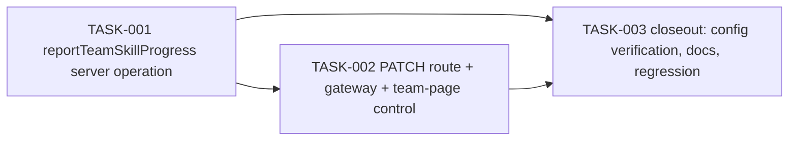

# Member Skill Progress Self-Report (Phase 8) — Tasks

Specification: [SPEC.md](./SPEC.md)

## Status
Ready: 0  In Progress: 0  Done: 3

`SPEC.md`'s Status is `Approved` (see `SPEC.md` → "Status"/"Approval gate").
TASK-001 has no unresolved dependency and is the first task an
`implement-task` session should pick up.

## Task graph

Verified acyclic: T1 → T2 → T3 is a valid topological order for every edge
above. This is intentionally a small, linear, three-task slice — see
`SPEC.md` → "Scope"/"Out of scope": one new server operation, one new
route, one existing UI surface extended, no new collection/data model.
Bundling the route, gateway extension, and UI control into TASK-002
(rather than splitting them into separate tasks) mirrors Phase 7's own
`docs/features/team-skill-tree/TASKS.md` TASK-005/006/007 pattern, where
each user-facing surface's route(s) + gateway + component were bundled
into one reviewable task.

## BR coverage

| BR | Description (short) | Owning task |
|---|---|---|
| BR-1 | Real-member-only write; app-admin status alone insufficient | TASK-001 |
| BR-2 | Forward/backward `nodeId`, no monotonicity constraint | TASK-001 |
| BR-3 | Rejects untracked `(teamId, treeId)` → `not_tracked` | TASK-001 |
| BR-4 | Requires `active` team → `team_disabled` otherwise (revised) | TASK-001 |
| BR-5 | `updatedBy` = verified caller uid, server-only, never returned | TASK-001 (write); TASK-002/TASK-003 (DTO/UI reconfirm) |
| BR-6 | Foreign `nodeId` rejected, fresh server-side tree read | TASK-001 |
| BR-7 | Fresh per-call membership re-derivation; cross-team rejected | TASK-001 |
| BR-8 | Six existing admin operations unchanged | TASK-003 |
| BR-9 | `getTeamSkillProgress` DTO unchanged regardless of writer | TASK-001 |
| BR-10 | `/teams/[teamId]` gains stage-setting control | TASK-002 |
| BR-11 | `/admin/teams/[teamId]` unchanged | TASK-002 (verified untouched) |
| BR-12 | Current-stage indicator/accessibility unchanged | TASK-002 |
| BR-13 | No new collection/field/index | TASK-003 |
| BR-14 | `PATCH` route delegates, whitelist `{nodeId}` only | TASK-002 |

Every BR-1 through BR-14 maps to at least one task. No task implements
behavior outside `SPEC.md`.

## Tasks

### TASK-001 — `reportTeamSkillProgress` server operation

**Status:** Done
**Covers:** BR-1, BR-2, BR-3, BR-4, BR-5, BR-6, BR-7, BR-9
**Depends on:** None

**Outcome**
A real team member can call `reportTeamSkillProgress(idToken, teamId,
treeId, nodeId, deps)` to set their team's current stage on a tree the
team already tracks. App-admin status alone, without a real membership
record, is not sufficient. A non-member, a member acting on a different
team, a member of a disabled team, an untracked pair, an unresolvable
tree, or a foreign `nodeId` each fail closed with zero writes.
`getTeamSkillProgress`'s response DTO is unaffected regardless of whether
the most recent writer was a member or an admin.

**Implementation notes**
- New `src/features/skill-trees/server/report-team-skill-progress.ts`,
  alongside the unmodified `update-team-skill-progress.ts` (SPEC
  "Architecture decisions" — separate operation, not a merged/dual-
  authorization rework).
- Order, fail-closed, zero writes before step 7:
  1. `verifyIdToken` → `unauthenticated`.
  2. Fresh-read `teamMemberships/{uid}__{teamId}`; validate via
     `isValidMembershipFor` (`src/features/teams/domain/
     team-membership.ts`, reused unchanged — the same primitive
     `submitChallenge`/`createThread`/`createReply` already use) →
     missing/malformed/wrong-scope → `forbidden`. **No app-admin check of
     any kind** anywhere on this path.
  3. Fresh-read `teams/{teamId}.status`, validated via
     `isValidTeamStatus` (`src/features/teams/domain/team.ts`, reused
     unchanged) → anything other than `"active"` (including a missing or
     malformed team) → `team_disabled`.
  4. Fetch `skillProgress/{teamId}__{treeId}`; validate via
     `isValidSkillProgress` (Phase 7, unchanged) and cross-check its
     persisted `teamId`/`treeId` against the requested scope → missing,
     malformed, or cross-scope → `not_tracked`.
  5. Fetch `skillTrees/{treeId}`; validate via `isValidSkillTree`
     (unchanged) → missing or malformed → `tree_not_found`.
  6. Confirm `nodeId` is present in the fetched tree's own `nodes` list →
     otherwise `invalid_input`. Reuse `updateTeamSkillProgress`'s existing
     node-membership check (extract to a small shared pure function, or
     duplicate — implementation discretion per SPEC "Architecture
     decisions").
  7. `.update()` `skillProgress/{teamId}__{treeId}`: exactly
     `{currentNodeId: nodeId, updatedAt: now, updatedBy: caller.uid}` —
     always performed, including when `nodeId` equals the current value
     (no same-node short-circuit).
  8. Fail-closed `persistence_failed` on any Firestore error at any step.
- This operation's `*Deps` interface includes a `teams`-status-reading
  seam — unlike `updateTeamSkillProgress`'s, which deliberately has none
  (Owner decision 4/BR-4). This is the one structural difference between
  the two operations' dependency shapes.
- Do not modify `update-team-skill-progress.ts`, `start-team-skill-
  tracking.ts`, `stop-team-skill-tracking.ts`, `create-skill-tree.ts`,
  `update-skill-tree.ts`, or `list-skill-trees.ts` in any way.

**Verification**
- Genuine Team A member → Team A tree success, exercised for: a forward
  move, a backward move, and a same-node re-report (the last asserting
  `updatedAt`/`updatedBy` still refresh even though `currentNodeId` is
  unchanged); exact persisted-shape (`Object.keys`) assertion.
- Team A member supplying Team B's `teamId` → `forbidden`, zero writes.
- App-admin without real membership → `forbidden`, zero writes.
- Malformed/missing membership record → `forbidden`.
- Membership read itself throwing/rejecting → this codebase's established
  fail-closed error for that failure mode (match `submitChallenge`/
  `createThread`'s existing convention exactly), zero writes.
- Disabled team → `team_disabled`, zero writes, with a call-count/spy
  assertion proving the `teams` read genuinely occurred.
- Missing/malformed `teams/{teamId}.status` → `team_disabled` (same
  bucket — mirrors `createReply`'s established single-outcome
  interpretation for this step).
- Missing, malformed, and persisted-cross-scope `skillProgress` documents
  each → `not_tracked`, zero writes.
- Missing and malformed `skillTrees/{treeId}` documents each →
  `tree_not_found`.
- `nodeId` foreign to the tree's own `nodes` list → `invalid_input`, zero
  writes.
- Persistence failure on the final `.update()` → `persistence_failed`.
- A request-shaped `teamId`/`treeId`/`updatedBy` override proven to have
  no effect (the function's own signature has no such parameter).
- Exact write whitelist: a spy on the Firestore write proves only
  `{currentNodeId, updatedAt, updatedBy}` are ever included, on every
  success path.
- No caller-controlled audit/scope field: `updatedBy` always equals the
  verified caller's `uid` from `verifyIdToken`.
- **BR-9 regression**: a `skillProgress` document most recently written
  via `reportTeamSkillProgress` (this task) returns the identical
  `getTeamSkillProgress` DTO shape (no `updatedBy`/`updatedAt`/
  `createdAt`/`createdBy`) as one most recently written via the existing,
  unmodified `updateTeamSkillProgress` — run against the real Phase 7
  `getTeamSkillProgress`.
- `pnpm lint`, `pnpm typecheck`.

**Security / privacy**
This task owns the entire new authorization/gating boundary this feature
introduces — membership-before-team-status ordering, fresh reads on every
call (never cached or client-asserted), zero writes on every failure
path, and no app-admin bypass. No other task re-verifies this boundary;
get the fresh-re-derivation and no-admin-bypass tests exactly right here.
`updatedBy` remains server-only, never returned by any API response
(BR-5) — enforced by the unmodified `getTeamSkillProgress` DTO, reconfirmed
by this task's own BR-9 regression rather than assumed.

**Documentation impact**
None expected yet (TASK-003).

**Acceptance criteria**
- [x] A genuine Team A member can report forward, backward, and same-node
      moves for Team A; each performs the approved update.
- [x] App-admin status alone (no real membership) is rejected `forbidden`;
      no code path grants access via admin status on this operation.
- [x] A member cannot report progress for a team they don't belong to,
      via any supplied `teamId`.
- [x] A member of a disabled team is rejected `team_disabled`, zero
      writes.
- [x] An untracked pair, a malformed/cross-scope `skillProgress` record,
      a missing/malformed tree, and a foreign `nodeId` are each rejected
      with zero writes.
- [x] The exact write whitelist (`currentNodeId`, `updatedAt`,
      `updatedBy`) is proven, with `updatedBy` always the verified
      caller's uid.
- [x] `getTeamSkillProgress`'s DTO is unchanged after a member-authored
      write (BR-9 regression passes).
- [x] Relevant tests, `pnpm lint`, `pnpm typecheck` pass.

**Notes**
Implemented as `src/features/skill-trees/server/report-team-skill-progress.ts`
(new file, `update-team-skill-progress.ts` and all other Phase 7 operations
left byte-for-byte unmodified). Reuses `isValidMembershipFor`/
`membershipDocId`, `isValidTeamStatus`, `isValidSkillProgress`/
`skillProgressDocId`, and `isValidSkillTree` unchanged. No app-admin check
of any kind on this path — `ReportTeamSkillProgressDeps` has no `allowList`
field, making the no-admin-bypass property structural, not just a code-path
choice (mirrors `UpdateTeamSkillProgressDeps`'s analogous no-team-status-seam
proof for BR-16). 34 new tests added
(`report-team-skill-progress.test.ts`), all passing; full `pnpm test`
(2232 tests), `pnpm lint`, `pnpm typecheck`, and `pnpm build` all pass.
`git diff -- firestore.rules firestore.indexes.json` empty.

---

### TASK-002 — `PATCH /api/teams/[teamId]/skills/[treeId]` + team-page self-report control

**Status:** Done
**Covers:** BR-10, BR-11, BR-12, BR-14
**Depends on:** TASK-001

**Outcome**
A real member (or admin) viewing `/teams/[teamId]`'s existing
Kompetanseområder section can set their team's current stage on any
already-tracked tree, via a new control that submits through the new
route to `reportTeamSkillProgress` (TASK-001). A fresh page load, both
before and after a report, reconstructs the persisted stage through the
existing `getTeamSkillProgress` read path — never optimistic or
session-only state. The unchanged admin route/UI at
`/admin/teams/[teamId]` continues to work exactly as before.

**Implementation notes**
- New `app/api/teams/[teamId]/skills/[treeId]/route.ts` — `PATCH` →
  `reportTeamSkillProgress` (TASK-001). Thin delegate: `teamId`/`treeId`
  taken only from route params (authoritative, never from the body); body
  accepts only `{nodeId}` — malformed JSON and any extra/unapproved field
  rejected before reaching the operation, mirroring the existing admin
  `PATCH` route's whitelist discipline. Error mapping exactly per
  `SPEC.md` → "API/DTO contracts" (`unauthenticated`→401, `forbidden`→403,
  `team_disabled`→400, `not_tracked`→404, `tree_not_found`→404,
  `invalid_input`→400, `persistence_failed`→500); no raw Firestore/
  Firebase error text ever reaches the response body. No `POST`/`DELETE`
  handler on this route (member routes never start/stop tracking).
- Extend `src/features/skill-trees/client/skill-trees-gateway.ts` with a
  thin, response-shape-validated client function for this route,
  mirroring the file's existing functions — its existing exports are not
  touched.
- Extend the existing `TeamSkillSection.tsx` (Phase 7, `/teams/[teamId]`)
  with a stage-setting control per already-tracked tree: rendered for any
  authorized viewer of the page (member or admin, per
  `authorizeTeamAccess`) — no client-side authorization invented; the
  server remains authoritative (BR-10). Keyboard-operable, with an
  associated accessible label. Loading/success/validation-error/
  authorization-failure/infrastructure-failure states, all using the
  existing generic-failure copy conventions (a `forbidden` response never
  gets a distinct "you're not a member" message). **No optimistic local
  update**: a successful submission re-fetches via the existing
  `getTeamSkillProgress` read path (`fetchTeamSkills`, unchanged) rather
  than locally mutating displayed state; a failed submission leaves the
  previously-rendered stage visibly unchanged and shows an error state —
  never a false success.
- `/admin/teams/[teamId]` and `TeamSkillTrackingSection.tsx` are not
  touched by this task (BR-11).
- Norwegian copy for the new control lives in the existing
  `src/features/skill-trees/copy.ts` (extended, not duplicated).

**Verification**
- Route tests: delegates to `reportTeamSkillProgress`; `teamId`/`treeId`
  always taken from route params even if the body supplies conflicting
  values; malformed JSON body rejected; a body field other than `nodeId`
  rejected; each operation-result → status-code mapping from the table
  above; no raw backend error text in any response body; no `POST`/
  `DELETE` handler exists on this route.
- Gateway test: malformed server response shapes rejected; request body
  contains only `{nodeId}`.
- Component tests for the extended `TeamSkillSection.tsx`:
  - Genuine member viewer: control renders; forward, backward, and
    same-node submissions each succeed and the displayed stage updates to
    reflect the server's response (via re-fetch, not local mutation).
  - App-admin-only viewer (no real membership): the control renders
    identically to a member's (server remains authoritative, BR-10); a
    submission attempt surfaces the existing generic authorization-
    failure treatment from the server's `forbidden` response.
  - Active team: control usable.
  - Disabled team: submission surfaces the generic error state from
    `team_disabled` — no distinct client-side messaging reveals team
    status.
  - `currentNodeId: null` tree: renders "ikke startet" (unchanged Phase 7
    behavior) before any report; the control remains usable from this
    state.
  - Failure (any error outcome): the previously-displayed stage remains
    shown; no success indication appears.
  - **Fresh-load integration, required** (closes the Phase 7 write/read
    integration gap this feature must not repeat):
    1. A fresh render, backed by a real `getTeamSkillProgress` response,
       shows a tracked tree with `currentNodeId: null` as not started.
    2. The member selects a valid stage.
    3. `PATCH` succeeds (via the real route/gateway/`reportTeamSkill
       Progress` chain — TASK-001, not mocked at the operation boundary).
    4. The UI reflects the newly reported stage.
    5. A second, independent fresh render (a new `getTeamSkillProgress`
       fetch on a fresh component instance, not the same instance's
       retained state) reconstructs that same stage from the persisted
       read path alone.
    6. A write failure (`PATCH` rejects) does not update the displayed
       stage and does not show a success indication.
- `pnpm lint`, `pnpm typecheck`, `pnpm build`.

**Security / privacy**
The route handler adds no authorization logic of its own beyond
delegating to TASK-001's already-authorized operation (mirrors Phase 7's
TASK-006/TASK-007 posture). The component renders no writer identity,
history, or attribution of any kind (BR-5, unaffected) — a defense-in-
depth test asserts the rendered output never contains an identity-shaped
value, mirroring `TeamSkillSection`'s existing Phase 7 test.

**Documentation impact**
`docs/UI-UX.md`'s existing Kompetanseområder section gains a note that the
stage-setting control is member-facing (previously read-only only via the
admin route), confirmed/completed at TASK-003.

**Acceptance criteria**
- [x] A genuine member can set their team's current stage on an
      already-tracked tree, from `/teams/[teamId]`.
- [x] An app-admin-only viewer's control is server-gated, not hidden
      client-side; a non-member/non-admin submission is rejected
      `forbidden` with the existing generic treatment.
- [x] A disabled team's submission is rejected `team_disabled` with the
      existing generic treatment.
- [x] A `currentNodeId: null` tree renders "ikke startet" before any
      report.
- [x] Fresh page load obtains current persisted progress through the
      existing `getTeamSkillProgress` read path (not TASK-002's own new
      route).
- [x] A successful report is reflected in the UI, and a later independent
      fresh load reconstructs that same stage from the read path alone —
      not from retained/optimistic state.
- [x] A write failure never displays a false success.
- [x] `/admin/teams/[teamId]` and `TeamSkillTrackingSection.tsx` are
      unmodified (BR-11), confirmed via `git diff`.
- [x] Relevant tests, `pnpm lint`, `pnpm typecheck`, `pnpm build` pass.

**Notes**
Implemented as:
- `app/api/teams/[teamId]/skills/[treeId]/route.ts` (new) — thin `PATCH`
  delegate to `reportTeamSkillProgress` (TASK-001). Route-level whitelist
  rejects malformed JSON, a non-object/array body, a missing `nodeId` key,
  and any extra/unapproved key (400 `invalid_request`) before the operation
  is ever called; a present-but-wrong-typed `nodeId` (e.g. a number) is
  forwarded to the operation, which rejects it as `invalid_input` (the
  route/domain split the SPEC calls for). No `GET`/`POST`/`DELETE` exported.
- `src/features/skill-trees/client/skill-trees-gateway.ts` extended with
  `reportTeamSkillProgress` (client) — sends only `{nodeId}`; existing
  exports untouched.
- `src/features/skill-trees/copy.ts` — `teamSkillSectionCopy` extended with
  a `report` block (stage-select label, save/saving button text, and one
  generic message per failure bucket: validation/authorization/
  infrastructure). `authorizationError` deliberately covers both `forbidden`
  and `team_disabled` with the same wording (BR-10).
- `src/features/skill-trees/components/TeamSkillSection.tsx` — extended
  (no longer strictly read-only): each tracked-tree row gets a `<select>`
  (defaulting to the current stage, or the first node for a not-started
  tree) plus a "Lagre" button, rendered unconditionally for any authorized
  viewer. Submits directly via the gateway; on success calls the new
  `onReported` prop (no local/optimistic mutation of `state.skills`); on
  failure shows one of three generic messages and leaves the prior
  persisted marker untouched. Each row is keyed by `` `${treeId}-${currentNodeId
  ?? "null"}` `` so a post-report parent refresh remounts the row (resetting
  its local selection to the freshly persisted stage) without a
  `useEffect` sync.
- `src/features/teams/components/TeamDetail.tsx` — passes `idToken`/`teamId`
  and a new `onReported` callback (`handleSkillReported`, mirroring
  `handleChallengeSubmitted`) to `TeamSkillSection` at both render sites;
  a successful report re-fetches via the existing, unmodified
  `fetchTeamSkills` and replaces only the skill sub-state, generation-guarded
  exactly like every other post-mutation refresh in this component.
- Tests added: `route.test.ts` (18 tests — whitelist, route-param
  authority, full error-status mapping, no other HTTP verb, no raw backend
  error leakage); `skill-trees-gateway.test.ts` (+9 tests for
  `reportTeamSkillProgress` — URL/method/body shape, error mapping, network
  failure, no audit-identity leakage); `TeamSkillSection.test.tsx` (rewritten,
  24 tests — forward/backward/same-node report, pending state, all three
  generic failure buckets leaving the prior marker intact, keyboard
  operability, and a fresh-mount reconstruction test proving the display is
  driven by `state` alone); `TeamDetail.test.tsx` (+6 tests — control
  presence, real end-to-end report-then-refetch via the mocked gateway,
  a stale-refresh discard on a route change, admin-only-viewer `forbidden`,
  and disabled-team `team_disabled`, both with the generic message and the
  prior stage still marked).
- Full `pnpm test` (2276 tests): 2 tests in unrelated files
  (`SkillTreeCreationForm.test.tsx`, `CreateThreadForm.test.tsx` — neither
  touched by this task) timed out under the default parallel run; both
  pass in isolation and the full suite passes 2276/2276 under
  `vitest run --no-file-parallelism`, confirming the pre-existing
  parallel-test resource-contention issue, not a TASK-002 regression.
  `pnpm lint`, `pnpm typecheck`, `pnpm build` all pass; the build's route
  manifest lists the new `ƒ /api/teams/[teamId]/skills/[treeId]` alongside
  the unchanged admin route. `git diff -- firestore.rules
  firestore.indexes.json` and `git diff` against every Phase 7
  admin-only file (`create-skill-tree.ts`, `update-skill-tree.ts`,
  `list-skill-trees.ts`, `start-team-skill-tracking.ts`,
  `update-team-skill-progress.ts`, `stop-team-skill-tracking.ts`,
  `TeamSkillTrackingSection.tsx`, `AdminSkills.tsx`, everything under
  `app/api/admin`) are both empty.
- `docs/UI-UX.md`'s "Skill Tree UX" section extended with a note that the
  `/teams/[teamId]` section is no longer strictly read-only.

---

### TASK-003 — Closeout: configuration verification, documentation sync, full regression

**Status:** Done
**Covers:** BR-8, BR-13 (plus a full BR-1–BR-14 final audit; no new
requirement of its own)
**Depends on:** TASK-001, TASK-002

**Outcome**
`firestore.rules`/`firestore.indexes.json`/deployment-config tests are
confirmed to already cover every collection this feature touches, with no
modification made unless a genuine gap is found and explicitly justified.
`docs/DATA-MODEL.md`, `docs/UI-UX.md`, and `docs/ROADMAP.md` accurately
reflect the shipped feature. A full regression pass confirms every
existing Phase 7 operation/route/UI surface (BR-8) is unmodified and
passing. `pnpm lint`, `pnpm typecheck`, `pnpm test`, `pnpm build` all pass.
The feature is deployment-ready.

**Implementation notes**
- Verify, do not modify unless a genuine gap is found (and if so,
  document why the SPEC's "no new collection/field/index" claim was
  wrong, don't silently patch around it):
  - `firestore.rules`'s existing `skillTrees`/`skillProgress`/
    `teamMemberships` deny-all blocks already cover every collection
    `reportTeamSkillProgress` reads/writes (BR-13).
  - `firestore.indexes.json` needs no new entry — `reportTeamSkillProgress`
    performs only deterministic document-level `get`/`update`, no query.
  - `firestore-deployment-config.test.ts`'s existing static assertions for
    these collections remain accurate and still pass.
- Confirm via `git diff`/`git status` that `create-skill-tree.ts`,
  `update-skill-tree.ts`, `list-skill-trees.ts`,
  `start-team-skill-tracking.ts`, `update-team-skill-progress.ts`,
  `stop-team-skill-tracking.ts`, and every route/component under
  `/admin/skills` and `/admin/teams/[teamId]` are byte-for-byte
  unmodified (BR-8).
- `docs/DATA-MODEL.md`: confirm the existing `skillProgress` entry needs
  no schema change (no new field); add a one-line note that `updatedBy`
  may now reflect a member's uid, not only an admin's, if the existing
  text implies admin-only.
- `docs/UI-UX.md`: confirm/complete the Kompetanseområder-section note
  TASK-002 started.
- `docs/ROADMAP.md`: mark "Phase 8 — Member Skill Progress Self-Report"
  complete.
- `docs/features/team-skill-tree/SPEC.md`: confirm no change is needed
  (Phase 7 is already marked complete) — verify, don't assume.
- Final independent audit against `SPEC.md`'s "Owner decisions,"
  "Security and privacy," and "Accepted residual risks" sections —
  confirm nothing drifted during implementation: no visible attribution
  was added, no per-team/per-tree opt-in toggle was introduced, no new
  Firestore collection/field exists, no individual skill/performance data
  appears anywhere in code, tests, or DTOs.

**Verification**
- Full `pnpm test` (regression across the whole repository), `pnpm lint`,
  `pnpm typecheck`, `pnpm build`.
- `git diff -- firestore.rules firestore.indexes.json` empty, or a
  documented, justified change if a genuine gap was found (not expected).
- Manual cross-reference confirming BR-1 through BR-14 each map to at
  least one passing test in TASK-001/TASK-002's own suites (see "BR
  coverage" table above).

**Security / privacy**
Final review pass: confirms no individual skill/performance data was
introduced anywhere (Invariant 10), no writer identity reaches any DTO or
UI, direct Firestore client-SDK access remains denied for every touched
collection, Firebase Admin usage remains server-only throughout, and a
Team A member cannot mutate Team B's data (re-confirm TASK-001's
cross-team test still passes in the final tree, not merely at the time it
was written).

**Documentation impact**
`docs/DATA-MODEL.md`, `docs/UI-UX.md`, `docs/ROADMAP.md` — as described in
Implementation notes above.

**Acceptance criteria**
- [x] `firestore.rules`/`firestore.indexes.json` require no change,
      confirmed rather than assumed; deployment-config tests pass.
- [x] Every existing Phase 7 operation/route/UI surface is confirmed
      byte-for-byte unmodified (BR-8).
- [x] `docs/DATA-MODEL.md`, `docs/UI-UX.md`, `docs/ROADMAP.md` accurately
      describe the shipped feature.
- [x] BR-1 through BR-14 are each confirmed covered by a passing test.
- [x] No visible attribution, no per-team/per-tree toggle, no new
      collection/field, and no individual skill/performance data exist
      anywhere in the final implementation.
- [x] `pnpm lint`, `pnpm typecheck`, `pnpm test`, `pnpm build` all pass.

**Notes**
Independent closeout audit, no implementation defects found — no code
changes were needed beyond documentation:
- `git diff` confirmed empty for every Phase 7 admin-only file
  (`create-skill-tree.ts`, `update-skill-tree.ts`, `list-skill-trees.ts`,
  `start-team-skill-tracking.ts`, `update-team-skill-progress.ts`,
  `stop-team-skill-tracking.ts`, `TeamSkillTrackingSection.tsx`, everything
  under `app/api/admin`) and for `firestore.rules`/`firestore.indexes.json`
  (BR-8, BR-13). `firestore.rules`'s existing `teams`/`teamMemberships`/
  `skillTrees`/`skillProgress` deny-all blocks already cover every
  collection `reportTeamSkillProgress` touches; `firestore-deployment-
  config.test.ts`'s existing static assertions for `skillTrees`/
  `skillProgress` remain accurate — no rules/index change made.
- Independently re-verified the full member write-path ordering
  (auth → membership → team status → existing progress → tree → node →
  exact write), the admin-status-alone rejection, cross-team isolation,
  and the exact `{currentNodeId, updatedAt, updatedBy}` write whitelist by
  reading `report-team-skill-progress.ts` and its 34-test suite directly
  — all assertions are non-vacuous (exact-shape `toEqual`, call-count/spy
  proofs of fresh reads and zero-writes-on-failure, an explicit
  admin-without-membership rejection test).
- Independently re-verified the route (`route.test.ts`, 18 tests: request-
  body whitelist rejects a `teamId`/`treeId`/`updatedBy` override outright,
  route params are authoritative, full error→status mapping, no raw
  backend error text, no other HTTP method), the gateway
  (`skill-trees-gateway.test.ts`: sends only `{nodeId}`, never surfaces an
  audit/identity field), and the UI (`TeamSkillSection.test.tsx`,
  `TeamDetail.test.tsx`: fresh-load reconstruction from `state` alone,
  stale-route-change refresh discarded, generic failure messaging for both
  `forbidden` and `team_disabled`, no identity-shaped value ever rendered).
- Ran full BR-1–BR-14 audit (see closeout report) — every BR maps to at
  least one passing, non-vacuous test; no gap found.
- Terminology/privacy search across implementation, tests, DTOs, and docs
  found no drift: no "individual skill level," "per-user progress,"
  "proficiency score," "employee performance," or "personal skill
  tracking" wording anywhere in Phase 8 surfaces; `updatedBy` is confirmed
  server-only and absent from every DTO/gateway/UI shape.
- Documentation updated to reflect delivered Phase 8 behavior:
  `docs/DATA-MODEL.md` (SkillProgress entry — `updatedBy` may now be a
  member's uid, tracking-lifecycle writes remain admin-only, the current-
  stage write itself has two authorized actors), `docs/PRODUCT.md` (new
  "Delivered: Member Skill Progress Self-Report (Phase 8)" section; the
  stale "future capability" bullet for member-initiated self-report
  removed, since it is now delivered — the genuinely still-future
  section-scoped/org-wide skill-tree item is preserved), `docs/ROADMAP.md`
  (new Phase 8 entry; "Phases 0–7" → "Phases 0–8 are complete").
  `docs/UI-UX.md`'s Kompetanseområder section was already completed by
  TASK-002 and needed no further change (verified, not assumed).
  `docs/features/team-skill-tree/SPEC.md` needed no change — its Open
  Questions #1 (member self-report) remains an accurate historical record
  of what Phase 7 deferred; its resolution is documented in this feature's
  own `SPEC.md`, not retrofitted into Phase 7's.
- No new task-caused test added: closeout found no coverage gap requiring
  a new regression test (see closeout report's test audit).
- Full `pnpm test` (default, parallel): 2264/2276 passed; the 12 failures
  spanned 4 files (`SignUpForm.test.tsx`, `CreateThreadForm.test.tsx`,
  `SurveyResponseForm.test.tsx`, `SkillTreeCreationForm.test.tsx`) — none
  touching any Phase 8 surface; all 4 pass fully in isolation, and the full
  suite passes 2276/2276 under `vitest run --no-file-parallelism`,
  confirming the known pre-existing parallel-test resource-contention
  issue (also seen during TASK-002), not a regression. `pnpm lint`,
  `pnpm typecheck`, `pnpm build` all pass; the build's route manifest
  lists exactly the one new `ƒ /api/teams/[teamId]/skills/[treeId]` route
  alongside the unchanged admin route, with no accidental extra route, no
  new environment variable, and no secrets/config added.
