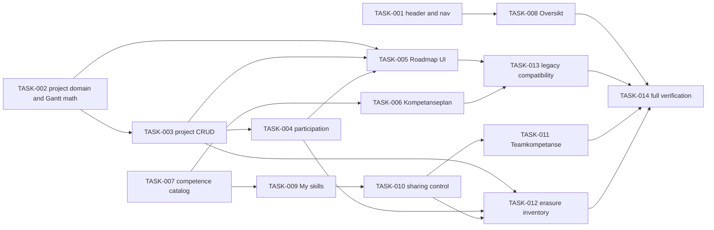

# Team Experience Redesign — Tasks

Specification: [SPEC.md](./SPEC.md)
Verification record: [VERIFICATION.md](./VERIFICATION.md)

## Status
Ready: 3 (TASK-012, TASK-013, TASK-014)  In Progress: 4 (TASK-001, TASK-005, TASK-008, TASK-009)  Done: 7 (TASK-002, TASK-003, TASK-004, TASK-006, TASK-007, TASK-010, TASK-011)

Pass 4 (code evidence in VERIFICATION.md, "Pass 4 evidence"): TASK-009 code complete with browser/visual check `not_verified`. TASK-012 erasure inventory audit complete: every new user-linked record is registered or allow-listed, with no guard changes; emulator run `not_verified`. TASK-013 compatibility evidence recorded from existing regression tests. TASK-014 gates green on this pass (typecheck, lint, full test, build all exit 0); browser checks and independent review are `not_verified`. Statuses above are not changed by this pass: final acceptance still needs the owner's review of the `not_verified` items.

Final acceptance pass (2026-11-06, VERIFICATION.md "Final acceptance pass"): typecheck exit 0; Firestore deny-only client rules verified on the local emulator (403 on all four new collections); the D-EMU race test FAILED on this machine (timeout in the test harness; the owner's earlier PASS needs reconciling); browser checks were unauthenticated only (sign-in gate, no overflow, no console errors); authenticated visual checks and an owner-account browser run are `not_verified`. Independent review: three findings fixed (Oversikt forbidden state, erasure comments); the participation-note visibility question (medium) and the sharing dialog inert background are open. TASK-013 gained one hook regression test; its legacy-shape audit is partial. No task is marked accepted in this pass.

Owner decisions recorded 2026-11-06 (SPEC.md, "Owner decisions"): OD-1 no skills chart on `/me/skills` (amends BR-20); OD-2 private role direction reuses the existing role target; OD-3 to OD-5 Kompetanseplan milestone, target-stage and erasure classification; OD-6 sharing control reuses the C2 record, OFF by default. The request cited "BR-29" for the skills visualization; in SPEC.md BR-29 is erasure, so the requirement is recorded against BR-20.

Owner decision (2026-11-06): the participation-related erasure subwork of TASK-012 is pulled forward. A-15 (`teamProjectParticipations.memberRef`, DELETE) is registered in the inventory with a membership-step adapter and a sweep counter. TASK-012 is **not** Done; only A-15 is complete. See `docs/features/account-erasure/SPEC.md` (A-15 row and decision log).

TASK-003 correction: its earlier Done status was recorded while the existing erasure inventory tripwire (`inventory.test.ts`) failed on the unregistered `teamProjects` collection. That is now fixed by a documented allow-list entry (`inventory-allow-list.ts`), and the tripwire passes.

Two decisions are unresolved and block the tasks marked **Blocked**: **D1** (default-on sharing vs SECURITY invariant 32) and **D2** (radar, averages and trends vs SECURITY invariant 35). Do not start a blocked part until the owner decides. Everything else is unblocked and can be implemented under the non-blocking defaults in the SPEC.

## Dependency graph

---

### TASK-001 — Shared team header and five-tab navigation

**Status:** In Progress — shared `TeamPageHeader` (name + five tabs) is now used by Roadmap and Systemoversikt, and by the two new route entry points (`competence`, `competence-plan`, interim copy until TASK-011/TASK-006). Focused vitest: 842/844 passed in the final run (the 2 failures were load-related timeouts; the file passed alone). typecheck exit 0; lint exit 0, 0 errors. NOT done: Oversikt (`TeamDetail`) still uses its own identity/summary header (to be unified with TASK-008); no browser/keyboard check run; no independent review run. Not marked Done.
**Covers:** BR-30
**Depends on:** None

**Outcome**
Every team page shows the same header (name, description, counts) and the five tabs `Oversikt`, `Roadmap`, `Kompetanseplan`, `Teamkompetanse`, `Systemoversikt`, with the active tab marked. Existing deep links still work.

**Implementation notes**
- Extend `src/features/teams/components/TeamRouteNav.tsx`. Keep the existing component's tests passing.
- Use existing design tokens. No new visual framework.

**Verification**
- Component tests for active state, keyboard order and `aria-current`.
- `pnpm typecheck`, `pnpm lint`.

**Security / privacy**
No additional considerations.

**Documentation impact**
`docs/features/team-experience-redesign/VERIFICATION.md`.

**Acceptance criteria**
- [ ] Five tabs render with correct active state
- [ ] Tabs are keyboard operable
- [ ] Existing route tests pass
- [ ] No conflict with `docs/SECURITY.md`

---

### TASK-002 — Project domain, effective status and Gantt date math

**Status:** Done — pure domain in `src/features/team-projects/domain/` (`team-project.ts`, `timeline-geometry.ts`), 27 focused tests pass, typecheck and lint exit 0. Deviation: no existing roadmap effective-status resolver exists in `src/features/roadmap/domain`, so the BR-9 rule (non-terminal and start date ≤ Oslo today → `Pågår`; completed stays completed) is implemented here and reuses only the roadmap date validators and `planningToday`. Project statuses are stored as `planned | completed`; `Pågår` is derived only.
**Covers:** BR-9, BR-10, BR-13
**Depends on:** None

**Outcome**
A pure domain module defines the project model, validation (required fields, date order), effective status (`Pågår` from start date, completed stays completed), and timeline geometry for 3-month and 6-month windows (month columns, bar offsets, today marker).

**Implementation notes**
- `src/features/team-projects/domain/`. Reuse the existing roadmap effective-status resolver (`src/features/roadmap/domain`) rather than duplicating it.
- Calendar dates only. Test month and year boundaries and timezone-neutral date handling.

**Verification**
- Unit tests: date order, missing dates, effective status at boundaries, 3/6-month bar positioning, today marker outside range.

**Security / privacy**
No additional considerations.

**Documentation impact**
None expected.

**Acceptance criteria**
- [ ] Bar positions come from real start and end dates
- [ ] Effective status matches roadmap semantics
- [ ] Relevant tests pass

---

### TASK-003 — Project CRUD with team authorization

**Status:** Done — gateway, routes, deny rule and focused tests implemented (see VERIFICATION.md). Product association is **deferred** by owner decision (see below), so the product criterion is out of scope for this task rather than a failing or blocked check. Emulator/Firestore integration and route-handler tests are not verified (recorded as gaps in VERIFICATION.md); the acceptance criteria below are verified by the server gateway tests.
**Covers:** BR-6, BR-14 (BR-7 deferred)
**Depends on:** TASK-002

**Owner decision (product association):** Product association is optional and **unsupported** until an approved Product domain model exists. No Product entity or collection is introduced by this feature. A project is created and managed without any product ID. Writes never accept `productId`. A stored non-null `productId` is treated as malformed and fails the read closed. Revisit only if a concrete security or data-integrity conflict appears.

**Outcome**
Team leads can create, edit, archive and restore projects. Members can read them. Competence-stage roadmap records are never read as projects. Projects are not linked to products (deferred).

**Implementation notes**
- New collection `teamProjects/{projectId}` (AD-1), server-only via Admin SDK, with deny-only client rules.
- Gateway: `src/features/team-projects/server/`, using `authorizeTeamAccess` and the lead check from `resolveTeamRole`.
- API: `app/api/teams/[teamId]/projects/`. Validate IDs, dates and enums server-side.

**Verification**
- Server tests for CRUD, date validation, cross-team product rejection, archive and restore, and member read-only access.

**Security / privacy**
Projects are team-scoped. Cross-team references are rejected. No personal data.

**Documentation impact**
`docs/DATA-MODEL.md` (new TeamProject entity). `docs/ARCHITECTURE.md` if a new gateway pattern is added.

**Acceptance criteria**
- [x] Only leads of an active team can write projects
- [x] Product association deferred (owner decision): writes reject `productId`; stored non-null `productId` fails closed
- [x] Archived projects are excluded from default lists
- [x] Relevant tests pass (63 team-projects tests)

---

### TASK-004 — Project participation records

**Status:** Done — participation domain, server write and read gateways, API routes, deny-only Firestore rule, A-15 erasure (membership and destruction paths) and focused tests are implemented. Emulator integration not verified (recorded as `not_verified` in VERIFICATION.md). See VERIFICATION.md, "TASK-004 evidence".
**Covers:** BR-8, BR-12, BR-13
**Depends on:** TASK-003

**Outcome**
Leads record member participation in a project with an interval and an optional non-evaluative description. Participation shows only planning intervals.

**Implementation notes**
- Collection `teamProjectParticipations/{id}`, referencing a same-team `memberRef` (existing `teamMemberships.memberRef`). Store no uid in responses.
- Overlap is returned as an informational flag only.

**Verification**
- Server tests for same-team member validation, removed member rejection, interval validation, and that no utilization or capacity value is returned.

**Security / privacy**
Participation is planning data. It must not feed skill, coverage or performance outputs (SECURITY invariant 30 pattern). Responses contain only allow-listed keys.

**Documentation impact**
`docs/DATA-MODEL.md`.

**Acceptance criteria**
- [x] Member references are validated against the same team
- [x] No utilization, capacity or performance field exists in any response
- [x] Relevant tests pass

---

### TASK-005 — Roadmap UI: 3/6-month Gantt, participation, mobile cards

**Status:** In Progress — implementation and focused tests done (see VERIFICATION.md, "TASK-005 evidence"). NOT Done: browser screenshots against reference 19, responsive overflow, keyboard check and independent review are not verified (blocked: no approved browser fixture data).
**Covers:** BR-10, BR-11, BR-12, BR-27
**Depends on:** TASK-002, TASK-003, TASK-004

**Outcome**
`/teams/[teamId]/roadmap` shows the project plan as a Gantt with a 3/6-month toggle, month headers, a today marker and labelled bars. Below it, participation is shown grouped by project or member. On narrow screens the Gantt becomes accessible project cards.

**Implementation notes**
- Desktop: sticky labels, horizontally scrollable timeline. Bars carry text labels and an accessible description.
- Replace the existing competence-stage roadmap list, which moves to TASK-006.
- Follow `docs/design/references/19-system-overview-roadmap.png.png`.

**Verification**
- Component tests for toggle, labels, mobile fallback, empty state.
- Playwright screenshots at 320, 360, 768, 1024, 1280 and 1440 px, compared to the reference, recorded in VERIFICATION.md.

**Security / privacy**
No additional considerations.

**Documentation impact**
`docs/features/team-experience-redesign/VERIFICATION.md`.

**Acceptance criteria**
- [ ] 3- and 6-month views position bars from real dates
- [ ] Mobile fallback has no horizontal page overflow
- [ ] Gantt controls are keyboard operable
- [ ] Visual comparison to reference 19 is recorded

---

### TASK-006 — Kompetanseplan: team competence development plans

**Status:** Done — domain (`src/features/team-competence-plan/domain/`), lead-only gateway (`server/competence-plans.ts`), API routes (`app/api/teams/[teamId]/competence-plans`), deny-only rule, erasure allow-list entry, the read-only legacy roadmap block and the page. Focused tests: 39 Kompetanseplan tests (domain, gateway, component), 7 route tests, erasure inventory guards 84/84; typecheck and lint pass. **Not verified:** browser and visual comparison to reference 20; independent review; emulator run. See VERIFICATION.md, "TASK-006 evidence". Decisions OD-3, OD-4, OD-5 in SPEC.md.
**Covers:** BR-15, BR-16, BR-17
**Depends on:** TASK-007

**Outcome**
Team leads create and edit development plans for a catalog area, with priority, target stage and ordered milestones. Cards show progress as completed milestones of the plan only. Existing competence-stage records remain readable and are shown here.

**Implementation notes**
- Reuse the existing competence-stage data (`src/features/team-skills`, `src/features/roadmap` competence entries) read-only for legacy records.
- Follow `docs/design/references/20-system-overview-competense-plan.png.png`.

**Verification**
- Server tests for milestone progression, priority validation, and legacy read.
- Component tests for card, expanded detail, empty state.
- Visual comparison to reference 20.

**Security / privacy**
No individual scoring. Plans are team-level intent (SECURITY invariant 30 pattern).

**Documentation impact**
`docs/DATA-MODEL.md`.

**Acceptance criteria**
- [ ] Progress is plan-step completion only
- [ ] Legacy competence records are readable and unchanged
- [ ] Relevant tests pass

---

### TASK-007 — Competence catalog management for team admins

**Status:** Done — implemented in `src/features/team-competence-catalog/` (not in C2 `team-skills`). Assignment domain, lead-only transactional gateways, member-readable list, API routes, deny-only Firestore rule, non-person-owned inventory entry and focused tests. Evidence in VERIFICATION.md, "TASK-007 evidence". Emulator run not performed.
**Covers:** BR-18
**Depends on:** None

**Outcome**
Team leads can assign, reorder, activate, deactivate and archive team competence areas from the existing skill-tree catalog. Referenced areas are archived, never deleted.

**Implementation notes**
- Per D4 default: global areas from `skillTrees`, per-team active or archived assignment.
- Admin-only catalog creation stays in existing admin flows. Team leads cannot rename global areas.

**Verification**
- Server tests for assignment, archive behavior with existing ratings, and cross-team isolation.

**Security / privacy**
Catalog only. No read of individual ratings (REQ §6.1).

**Documentation impact**
`docs/DATA-MODEL.md`.

**Acceptance criteria**
- [x] Archive does not delete ratings
- [x] Team A catalog changes do not affect Team B
- [x] Relevant tests pass

---

### TASK-008 — Team Oversikt redesign with concise summaries

**Status:** In Progress. Code acceptance for the results route and the Oversikt cut is implemented (`/teams/[teamId]/results`, see VERIFICATION.md, "TASK-008 evidence"): survey history, trend chart and summary blocks moved off Oversikt, four KPI cards, `Neste steg`, and a link to results. Focused tests pass (teams feature and results route), typecheck exit 0, eslint on the teams files exit 0. Pass 3 adds the competence-area count under the team name (already-loaded data). Team description and member/system counts are not shown (no data source on Oversikt without an extra read). Still open: browser and visual comparison to reference 18, keyboard/responsive checks, and independent review. TASK-009, TASK-012, TASK-013 and TASK-014 were not started in this pass; see VERIFICATION.md "Pass 3 evidence".
**Covers:** BR-1, BR-2, BR-3, BR-4, BR-5
**Depends on:** TASK-001

**Outcome**
`/teams/[teamId]` shows up to four KPI cards (open challenges, active projects, systems needing follow-up, competence-plan priorities), a `Neste steg` list of up to three items, and a link to each detail tab. Survey history and long ladders move to their existing routes.

**Implementation notes**
- Summaries come from the existing gateways (`get-teams-overview`, challenges, systems, projects, plans).
- Roadmap status uses the effective-status resolver from TASK-002.
- Document the old-to-new content mapping in SPEC (appendix, D6).
- Follow `docs/design/references/18-system-overview-.png.png`.

**Verification**
- Tests for summary counts matching detail tabs, loading and empty states, and no fake `0` while loading.
- Visual comparison to reference 18.

**Security / privacy**
Survey publication threshold rules stay unchanged.

**Documentation impact**
SPEC appendix (old-to-new mapping).

**Acceptance criteria**
- [ ] At most four KPI cards, each from real data
- [ ] Counts agree with detail tabs in tests
- [ ] Old survey history reachable from its new route

---

### TASK-009 — My skills redesign (personal profile, assessment list, role direction)

**Status:** In Progress — Pass 4 (code): assessment status pill and filter chips added; the radar, average and team-average elements of reference 22 stay out (OD-1, D2). Browser/visual comparison and independent review are `not_verified`. See VERIFICATION.md, "Pass 4 evidence". Earlier 2026-11-06 pass: each skill row is now a competence card (level indicator leads, labelled select below; `SkillProfilePage.tsx` `SkillRow`); 443 skill-profile and /me/skills tests and typecheck pass. Still open: visual comparison to reference 22 (no browser run), the card header/status pill treatment, and independent review. Earlier: done: no radar or chart (OD-1), private role direction reused from the existing role-target section (OD-2), and the "Del kompetanse med teamet" control per member team on `/me/skills` (`team-skills/components/OwnCompetenceSharing.tsx`, existing C2 record, OFF by default). The C1/C2 boundary is resolved (owner Option A, 2026-11-06): the C1 guard permits exactly the approved `OwnCompetenceSharing` composition and nothing else (see VERIFICATION.md, "Pass 2 evidence"). **Not done (still In Progress):** the reference-22 competence-card redesign, browser and visual comparison, and the independent review. Sharing-control placement was updated. **Previously not done:** the competence-card visual redesign (the page keeps its existing row list and overview), browser and visual comparison to reference 22, and an independent review. See VERIFICATION.md, "TASK-009 evidence".
**Covers:** BR-19, BR-20
**Depends on:** TASK-007

**Outcome**
`/me/skills` shows the user's own assessed count, the four-level scale, a personal radar (only with at least three rated areas), a filterable skill list (`Alle`, `Vurdert`, `Ikke vurdert`), and a private role direction section. Assessments save through the existing authorized `PUT /api/me/skills/[treeId]`.

**Implementation notes**
- Reuse `SkillProfilePage` and the existing gateway. Do not replace the four-level scale.
- Unrated skills stay `Ikke vurdert`. No average is shown unless a valid existing calculation is approved (none currently).
- Follow `docs/design/references/22-me-skills.png.png`, without the team-average series (see D2).

**Verification**
- Tests for existing assessments loading, save feedback, and unrated staying unrated.
- Visual comparison to reference 22.

**Security / privacy**
Owner-only (SECURITY invariant 31). No team comparison series.

**Documentation impact**
`docs/features/individual-skill-self-assessment/SPEC.md` dated pointer, only if behavior changes.

**Acceptance criteria**
- [ ] Existing assessments load unchanged
- [ ] Unassessed remains unassessed
- [ ] No team-average series on the page

---

### TASK-010 — Team sharing control and disclosure dialog

**Status:** Done (implementation and focused tests, 2026-11-06). D1 is resolved as explicit opt-in, default OFF (SPEC OD-6, SECURITY invariant 32), so the default-state block no longer applies. The accessible `SharingExplanationDialog` opens from a per-team `Om deling` control next to the sharing panel. Focus moves to its close button, Escape and the close button dismiss it, Tab is trapped, and focus returns to the trigger. Tests: `SharingExplanationDialog.test.tsx` (5) and `OwnCompetenceSharing.test.tsx`. `pnpm typecheck` exit 0. Vitest on team-skills and skill-profiles: 49 files, 1111 tests passed. Not verified here: browser keyboard check and independent review (tracked under TASK-014).
**Covers:** BR-21, BR-22, BR-23, BR-24
**Depends on:** TASK-009

**Outcome**
`Del kompetanse med teamet` appears near the page header, per team, with the current state. Turning it on or off writes `teamMemberships.skillContribution` through the owner-only path. An accessible dialog explains sharing.

**Implementation notes**
- Reuse the existing C2 participation write (`set-own-skill-contribution`) and its `SkillContributionPanel`.
- Current behaviour: presence is opt-in (SECURITY invariant 32). The control defaults to **OFF**. Changing the default requires D1.
- Dialog: keyboard focus management, Norwegian copy from REQ §7.2.

**Verification**
- Tests for on/off, re-enable, multi-team isolation, and that turning off removes the contribution.
- Dialog focus test.

**Security / privacy**
No default-on rollout until D1 is approved. Legacy users without a record are not opted in (REQ §9.3).

**Documentation impact**
`docs/SECURITY.md` only if D1 changes the invariant.

**Acceptance criteria**
- [ ] Default is OFF until D1 is approved
- [ ] Turning off removes the contribution from the next read
- [ ] Dialog focus is managed
- [ ] No conflict with `docs/SECURITY.md`

---

### TASK-011 — Teamkompetanse: categorical coverage view

**Status:** Done (team-experience-redesign pass 2, 2026-11-06) — categorical view in `TeamCompetenceCoverage.tsx` on the existing coverage gateway; 8 component tests and route test pass; radar and trend panels disabled per D2. Deviations: no "Delvis dekket" (no backing state), no donut (counts forbidden). Visual comparison to reference 21 not run (no browser). See VERIFICATION.md "Pass 2 evidence".
**Covers:** BR-25, BR-26 (categorical part), BR-27
**Depends on:** TASK-010

**Outcome**
`/teams/[teamId]/competence` shows per-area categorical coverage (`Dekket`, `Delvis dekket`, `Behov for utvikling`, `Ikke nok grunnlag`) with a donut of area statuses and a table. Every chart has a text alternative. The radar and trend panels are shown as disabled explained empty states.

**Implementation notes**
- Reuse `get-team-skill-coverage` (C2, k=5). No new aggregate store (SECURITY invariant 35).
- Map the existing `covered` / `gap` / `insufficient_data` states to the REQ labels. Do not add numeric states.
- Follow `docs/design/references/21-system-overview-team-competense.png.png` for layout only.

**Verification**
- Tests for suppression (below k=5 shows `Ikke nok grunnlag`), no per-member data in the response, and chart text alternatives.
- Visual comparison to reference 21 (layout only; numeric parts deviate, see D2).

**Security / privacy**
Thresholded categories only. No counts, averages, radar coordinates or trends (D2).

**Documentation impact**
SPEC deviations recorded in VERIFICATION.md.

**Acceptance criteria**
- [x] Only categorical states are returned or rendered
- [x] Suppressed areas show `Ikke nok grunnlag`
- [x] No counts or averages appear anywhere
- [x] Radar and trend remain disabled until D2 is decided

---

### TASK-012 — Account-erasure inventory for new records

**Status:** Ready
**Covers:** BR-29
**Depends on:** TASK-003, TASK-004, TASK-010

**Outcome**
The erasure inventory covers project records, participation records, sharing preference changes and any new audit actor fields, with the existing detachment contracts. Erasure guards are not weakened.

**Implementation notes**
- Extend `src/features/account-erasure/server/inventory.ts` and its adapters.
- Follow the existing erasure contract tests.

**Verification**
- Inventory tests and existing erasure tests pass.

**Security / privacy**
Erasure must not leave a participation link that identifies the deleted user.

**Documentation impact**
`docs/features/account-erasure/SPEC.md` if the inventory contract changes.

**Acceptance criteria**
- [ ] All new user-linked records are in the inventory
- [ ] Existing erasure tests pass
- [ ] No weakened guard

---

### TASK-013 — Legacy compatibility tests

**Status:** Ready
**Covers:** BR-17, BR-28
**Depends on:** TASK-005, TASK-006

**Outcome**
Tests confirm that existing personal assessments, team needs, competence stages, roadmap records, survey records and System Overview records remain readable, and that no migration runs.

**Implementation notes**
- Fixtures are local and deterministic. Do not use shared Firebase data.

**Verification**
- Unit and server tests with legacy-shaped fixtures.

**Security / privacy**
No additional considerations.

**Documentation impact**
None expected.

**Acceptance criteria**
- [ ] Each listed legacy shape is read in tests
- [ ] No migration code is run on read

---

### TASK-014 — Full verification and documentation sync

**Status:** Ready
**Covers:** All BR-*
**Depends on:** TASK-008, TASK-011, TASK-012, TASK-013

**Outcome**
Quality gates run and their exit codes are recorded. Browser checks on isolated fixtures, responsive checks, axe checks and visual comparisons against all five references are recorded in VERIFICATION.md with `passed`, `failed`, `not_verified` or `blocked`.

**Implementation notes**
- Commands: `pnpm typecheck`, `pnpm lint`, `pnpm test`, `pnpm build`, `pnpm verify:browser`.
- Do not write to shared or production data.

**Verification**
- Record each command's exit code and the browser results.

**Security / privacy**
Check that no raw rating appears in any payload or log.

**Documentation impact**
SPEC, TASKS and VERIFICATION synchronized.

**Acceptance criteria**
- [ ] All quality gates have recorded exit codes
- [ ] Each requirement maps to a verification status
- [ ] No result is marked `passed` without a run
