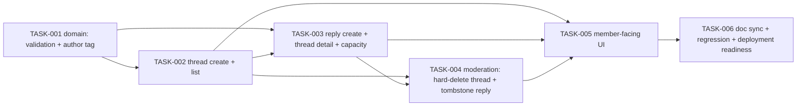

# Team Forum — Tasks

Specification: [SPEC.md](./SPEC.md)

## Status
Ready: 0  In Progress: 0  Done: 6

## Revision note (planning-review remediation pass)
`SPEC.md` was revised after an independent planning review found two of its
"Open questions" (member-visible email exposure; indefinite retention of
unreadable deleted ciphertext) were being silently locked in by `Ready`
tasks with no gate on either decision, plus a third gap (a reply beyond the
read window becoming permanently undeletable). Both product-owner decisions
are now made and encoded directly in `SPEC.md`; there is nothing left for
any task in this file to decide. Every task below is revised to match:
- **TASK-001** gains the `authorTag` pure-function domain module (no more
  Firebase Auth dependency for display).
- **TASK-002**/**TASK-003** lose the `resolveAuthorDisplay` Firebase Auth
  lookup entirely (replaced by TASK-001's pure function) and **TASK-003**
  gains the 500-reply capacity check (BR-52/BR-53).
- **TASK-004** is substantially redesigned: `deleteThread` is now a
  two-step hard-delete-plus-cascade, not a soft-delete update; `deleteReply`
  is now a content-erasing tombstone, not a flag-set update.
- **TASK-006** gains `docs/UI-UX.md` to its documentation-sync list (a gap
  the same review found) and a follow-up note about
  `src/lib/encryption/encryption.ts`'s inaccurate docstring.

No task was `In Progress` or `Done` when this revision was made — all six
remain `Ready`, and none has been implemented.

## Task graph



This feature has no separate admin-only UI task, unlike Anonymous
Challenges' TASK-006 (`docs/features/anonymous-challenges/TASKS.md`) —
`docs/features/team-forum/SPEC.md` → "Product behavior" #7 deliberately has
no admin-only forum surface: moderation is a delete affordance shown inline
in the same member-facing UI to whichever caller (author or admin) is
authorized for it. Two content types (thread, reply) and two read shapes
(thread list, thread-detail-with-replies) are split into their own tasks
(TASK-002, TASK-003) since each is independently reviewable and
TASK-003 depends on the domain module TASK-001 establishes (`authorTag`,
validators) and the pattern TASK-002 sets for thread operations —
mirroring how `docs/features/anonymous-challenges/SPEC.md`'s TASK-002/
TASK-003 split submission from listing.

## Tasks

### TASK-001 — Forum domain: content validation, author tag, and reply lifecycle shapes

**Status:** Done

**Implementation record**
Implemented exactly as specified, under `src/features/forum/domain/`:
- `forum-thread.ts` — `ForumThreadRecord` (no `deletedAt`/`deletedBy` field
  on the type at all) and `isValidForumThread`, which fails closed on any
  malformed/missing field and additionally rejects a candidate carrying a
  `deletedAt` or `deletedBy` field of any kind (a thread has no tombstone
  shape — this is an explicit, intentional exception to this codebase's
  general "extra fields are tolerated" validator convention).
- `forum-reply.ts` — `ActiveForumReply`/`TombstonedForumReply` as a
  discriminated union `ForumReplyRecord`; `isValidForumReply` accepts only a
  well-formed instance of exactly one of the two shapes (rejects a
  candidate with fields from both, from neither, or a partially-formed
  version of either); `isForumReplyDeleted` narrows via `"deletedAt" in
  record`.
- `thread-content.ts` — `validateThreadTitle` (3–150 trimmed chars) and
  `validateThreadBody` (3–4000 trimmed chars), kept independent per the
  task's implementation notes.
- `reply-content.ts` — `validateReplyBody` (3–2000 trimmed chars).
- `author-tag.ts` — `authorTag(teamId, authorUid)` implementing SPEC's exact
  formula (`uppercase(hex(SHA-256(\`${teamId}:${authorUid}\`)).slice(0,
  6))`) via `node:crypto`'s `createHash("sha256")`. Pure, synchronous, no
  `server-only` import, arity 2 (no dependency-injection seam — nothing to
  spy on).

68 new tests across 5 files, including: `authorTag` determinism, team-scoped
distinctness (same author/different teams, different authors/same team,
fixed fixtures), exact 6-uppercase-hex shape, a known independently-computed
SHA-256 fixture (`authorTag("team-1","uid-1") === "48D73D"`, etc. — would
fail under a different hash/concatenation/order), tag-never-equals-raw-input
assertions, and an arity check proving no email/name/displayName/dependency
parameter exists; `isValidForumThread`/`isValidForumReply` boundary and
malformed-hybrid cases per BR-56; every content validator's min/max/
whitespace/non-string boundaries.

Verification: `pnpm test` (full suite, 121 files / 1542 tests) passed;
`pnpm typecheck` passed; `pnpm lint` passed. No Firestore, `firebase-admin`,
API route, React component, or persistence code was introduced — confirmed
via `git status`/`git diff`: only `src/features/forum/domain/*` and this
`TASKS.md` update are new/changed; `firestore.rules`/`firestore.indexes.json`
are untouched. Nothing was committed.
**Covers:** BR-3, BR-4, BR-10, BR-11, BR-12, BR-20, BR-50, BR-51, BR-56
**Depends on:** None

**Outcome**
A pure, framework-free domain module exists for the `ForumThread`/
`ForumReply` concepts: their persisted-document types (including a reply's
two valid shapes, active and tombstoned), content validators, and the
`authorTag` pseudonym function. Every later task imports this module
rather than re-deriving validation, lifecycle, or attribution logic itself.

**Implementation notes**
- New feature root `src/features/forum/domain/` per
  `.claude/rules/architecture.md`.
- `src/features/forum/domain/forum-thread.ts`: `ForumThreadRecord` type
  mirrors SPEC's exact schema (`teamId`, `authorUid`, `ciphertext`, `iv`,
  `authTag`, `keyVersion`, `createdAt`) — **no `deletedAt`/`deletedBy`
  field at all** (a thread has no tombstone shape — SPEC "Data model").
  `isValidForumThread` fails closed (never throws) on a missing/wrong-typed
  required field, mirroring `isValidChallenge`'s established shape. There
  is no `isForumThreadDeleted`-shaped export in this module — a thread's
  existence *is* its lifecycle state (see TASK-004's `not_found` handling).
- `src/features/forum/domain/forum-reply.ts`: `ForumReplyRecord` is a
  **discriminated union of two valid shapes** (BR-56), not one type with
  optional fields:
  ```ts
  type ActiveForumReply = {
    teamId: string; threadId: string; authorUid: string;
    ciphertext: string; iv: string; authTag: string; keyVersion: "v1";
    createdAt: Date;
  };
  type TombstonedForumReply = {
    teamId: string; threadId: string;
    createdAt: Date; deletedAt: Date; deletedBy: string;
  };
  ```
  `isValidForumReply(data): data is ActiveForumReply | TombstonedForumReply`
  accepts only a candidate matching **one of these two shapes exactly** —
  present-and-well-typed for every field of that shape, and **absent** for
  every field belonging only to the other shape (e.g. a candidate with
  both `ciphertext` and `deletedAt` set, or with `deletedAt` set but
  `ciphertext` still present, is rejected as malformed, never guessed at).
  `isForumReplyDeleted(record) => record is TombstonedForumReply` narrows
  on `"deletedAt" in record` (mirrors `effectiveChallengeStatus`'s "one
  function, reused everywhere" convention).
- `src/features/forum/domain/thread-content.ts`:
  `validateThreadTitle(input: unknown)` (trims, 3–150 chars) and
  `validateThreadBody(input: unknown)` (trims, 3–4000 chars) — independent
  validators, not one combined function, since a title-only or body-only
  validation error must be reportable distinctly to the UI (TASK-005).
- `src/features/forum/domain/reply-content.ts`:
  `validateReplyBody(input: unknown)` (trims, 3–2000 chars).
- **New**: `src/features/forum/domain/author-tag.ts`:
  `authorTag(teamId: string, authorUid: string): string` — implements
  SPEC's exact formula (`uppercase(hex(SHA-256(\`${teamId}:${authorUid}\`))
  .slice(0, 6))`) using Node's built-in `createHash("sha256")` from
  `node:crypto` (no external dependency). **Pure — no Firestore, no
  Firebase Auth, no `server-only` import, no async.** This is the single
  reusable point both TASK-002 (threads) and TASK-003 (replies) call; do
  not re-implement the formula in either.
- No Firestore, no `server-only` import, no I/O anywhere in this module
  (mirrors `src/features/challenges/domain/`'s established boundary) — this
  is a stronger property than the original design, which would have needed
  a `server-only`-scoped author-resolution module; that module no longer
  exists anywhere in this feature.

**Verification**
- `isForumReplyDeleted`: true only for a well-formed tombstone shape, false
  for a well-formed active shape.
- Each content validator: boundary cases at min/min+1 and max/max+1
  characters, whitespace-only input, non-string input.
- `isValidForumThread`: accepts a well-formed candidate; rejects
  missing/wrong-typed required fields; rejects a candidate carrying an
  extra `deletedAt`/`deletedBy`-shaped field (a thread schema has no such
  field at all — an extra one present is itself a malformed-shape
  rejection, not silently ignored).
- `isValidForumReply`: accepts a well-formed active candidate and a
  well-formed tombstone candidate; rejects a candidate with fields from
  both shapes; rejects a candidate with fields from neither (e.g. missing
  both `ciphertext` and `deletedAt`); rejects a syntactically-valid-but-
  wrong `keyVersion` on an active candidate (only `"v1"` accepted); an
  extra identity-shaped field (`email`, `displayName`) has no effect on
  either shape's acceptance.
- `authorTag`: deterministic (same `(teamId, authorUid)` called twice
  returns the identical string); different for two different `teamId`
  values with the same `authorUid`; different for two different
  `authorUid` values with the same `teamId` (not a guarantee — see
  BR-51 — but a test with two arbitrary distinct real-looking uids should
  not collide, and a dedicated test documents the accepted collision
  possibility rather than asserting global uniqueness); output is exactly
  6 uppercase hex characters; a spy/fake Firestore or Firebase Auth
  dependency passed into the test is never invoked (proves the function
  takes no I/O dependency at all — there is no `deps` parameter to spy on
  in the first place, which the test asserts via the function's arity/
  signature).
- `pnpm lint`, `pnpm typecheck`.

**Security / privacy**
Establishes `authorUid` as the only identity field an *active* record's
type allows, and *no* identity field at all on a tombstoned reply's
type (BR-10) — every later task inherits this shape rather than
re-deriving it. `authorTag`'s determinism/no-I/O properties are the
foundation of BR-49/BR-50/BR-51 (non-contact-reachable, no new Firebase
Auth exposure) — get its test coverage solid here, since TASK-002/TASK-003
call it without re-verifying these properties themselves.

**Documentation impact**
None expected yet (TASK-006).

**Acceptance criteria**
- [x] `isValidForumThread` fails closed on every malformed shape tested,
      including one carrying a `deletedAt`/`deletedBy`-shaped field. —
      Re-verified directly against `forum-thread.ts` source at TASK-006
      closeout (these boxes were left unchecked at original authoring time
      despite the task being marked `Done`; corrected here as part of the
      closeout's stale-requirement sweep, not a new claim).
- [x] `isValidForumReply` accepts exactly the two documented valid shapes
      and rejects every other combination tested, including partial/mixed
      shapes. — Re-verified directly against `forum-reply.ts` source at
      TASK-006 closeout.
- [x] `authorTag` is deterministic, takes no I/O dependency, and matches
      SPEC's exact formula. — Re-verified byte-for-byte against
      `author-tag.ts` source at TASK-006 closeout.
- [x] Every content validator rejects every documented invalid shape and
      accepts valid boundary values.
- [x] Relevant tests, `pnpm lint`, `pnpm typecheck` pass.

---

### TASK-002 — Thread creation + team thread list

**Status:** Done

**Implementation record**
Implemented exactly as specified, under `src/features/forum/server/`:
- `create-thread.ts` — `createThread(idToken, teamId, rawTitle, rawBody,
  deps)`. Order: `verifyIdToken` → `validateThreadTitle` +
  `validateThreadBody` (TASK-001, before any Firestore read) → real
  `teamMemberships/{uid}__{teamId}` check via `isValidMembershipFor`
  (**not** `authorizeTeamAccess` — an app admin with no real membership is
  rejected `forbidden`) → fresh `teams/{teamId}.status` read
  (`team_not_found`/`team_disabled`) → `encrypt(JSON.stringify({title,
  body}))` → `.add()` to `forumThreads` using TASK-001's `ForumThreadRecord`
  type directly (no separate write-side type). Returns `{ok: true,
  threadId}` using Firestore's auto-generated id.
- `list-team-threads.ts` — `listTeamThreads(idToken, teamId, deps)`.
  `authorizeTeamAccess` → `"admin"`/`"member"` required, `read_failed` never
  collapsed into `forbidden`. Reader queries `forumThreads` where
  `teamId == teamId`, `orderBy("createdAt","desc")`, `limit(200)`
  (`LIST_TEAM_THREADS_LIMIT`, exported). Per document: `isValidForumThread`
  (TASK-001, skip on failure) → defense-in-depth cross-check of the
  validated record's own `teamId` against the requested scope (BR-18,
  independent of the reader's own query filter) → decrypt `{title, body}`
  and validate the decrypted JSON shape (skip on decryption failure or a
  decrypted-but-malformed payload, per SPEC's "Why one combined
  ciphertext...") → compute `authorTag(teamId, authorUid)` (TASK-001) and
  `isOwnThread` → map to `ThreadSummaryView` (`threadId`, `title`,
  `authorTag`, `isOwnThread`, `createdAt` as a full-precision ISO string —
  no date-only truncation, per SPEC). No `isForumThreadDeleted` check
  anywhere — a thread returned by the query is definitionally not deleted.
- `firestore.rules`: added the `forumThreads` deny-all block, plus a
  matching static assertion in `firestore-deployment-config.test.ts`.
- `firestore.indexes.json`: added the `forumThreads` (`teamId` ascending,
  `createdAt` descending) composite index required by `listTeamThreads`'s
  query shape.

68 (TASK-001) + 51 new tests (32 for `createThread`, 19 for
`listTeamThreads`) plus 1 new Firestore-rules assertion — 127 forum-related
tests total. New coverage includes: real-member creation success and exact
persisted-shape (`Object.keys`) assertion; app-admin-without-membership,
wrong-team-membership, and malformed-membership rejection; disabled/
nonexistent/malformed-status team rejection; title/body boundary
(min/min-1/max/max+1/whitespace/non-string) rejection before any Firestore
read; client-supplied `teamId`/`authorUid`/`threadId`/`deletedAt` override
proven to have no effect; encryption-failure and persistence-failure
fail-closed with zero writes; repeated creations succeeding independently
with distinct ids; no console logging on any path; member and admin listing
success with correct `authorTag`/`isOwnThread`; non-member/non-admin
rejection; a `read_failed` from the authorization check itself never
collapsed into `forbidden`; cross-team exclusion even when a deliberately
misbehaving reader ignores its own team-scoping filter (BR-18); malformed-
document, wrong-`keyVersion`, tampered-ciphertext, and decrypted-but-
wrong-JSON-shape exclusion, each without failing the whole call; a
decrypt-spy test proving a shape-invalid document is never passed to
`decrypt` at all; a 200-seeded-thread test proving only the 200 newest are
returned, newest-first; disabled-team viewing continuity; a response-shape
regression proving no `authorUid`/encrypted field/email-pattern value is
ever returned; identical `authorTag` for the same author across two
separate calls; module-surface tests proving no other export (no
update/edit-shaped function) exists in either file.

**Deferred by design, not silently dropped**: TASK-002's own acceptance
criterion "a thread deleted via `deleteThread` never appears in
`listTeamThreads`" names a function (`deleteThread`) that is TASK-004's own
deliverable and does not exist yet — this repository's plan for this exact
situation is recorded in this task's own "Verification" section above
("this test is written here but exercised across TASK-002+TASK-004; note
the cross-task dependency explicitly in the test file"). Importing a
not-yet-existent module here would break this task's own test suite, so
`list-team-threads.test.ts` instead proves the achievable half now (a
reader that returns nothing yields an empty list — `listTeamThreads` never
fabricates a thread beyond what its reader returns, and has no
`isDeleted`-shaped field to mis-check), with an inline comment pointing to
TASK-004 for the full composed regression. TASK-004's own test suite (its
`deleteThread` tests, already specified in this file) is the correct place
to add the end-to-end version once `deleteThread` exists.

Verification: `pnpm vitest run src/features/forum
src/lib/firebase/firestore-deployment-config.test.ts` (127 tests) passed;
full `pnpm test` (123 files / 1594 tests, run twice for stability) passed
with zero failures; `pnpm typecheck` passed; `pnpm lint` passed; `pnpm
build` succeeded with no forum API routes present (confirms TASK-005 has
not been started). `git diff`/`git status` confirmed: only
`src/features/forum/server/*`, `firestore.rules`, `firestore.indexes.json`,
`src/lib/firebase/firestore-deployment-config.test.ts`, and this `TASKS.md`
changed; no `forumReplies` usage, no API routes, no React components, no
`deleteThread`/`deleteReply`/`createReply`/`getThreadWithReplies` were
introduced. Nothing was committed.
**Covers:** BR-1, BR-2, BR-5, BR-6, BR-7, BR-9, BR-13, BR-14, BR-15, BR-18, BR-19, BR-20, BR-21, BR-29, BR-33, BR-34, BR-36, BR-47, BR-48, BR-49
**Depends on:** TASK-001

**Outcome**
A real team member can create a titled thread for their team; any member/
admin of the team can list that team's threads, newest-first, each showing
`authorTag` (TASK-001's pure function — no Firebase Auth call anywhere in
this task). `firestore.rules` denies client-SDK access to the new
`forumThreads` collection, and its required composite index is declared.

**Implementation notes**
- New `src/features/forum/server/create-thread.ts`:
  `createThread(idToken, teamId, title, body, deps)`. Order: `verifyIdToken`
  → `validateThreadTitle` + `validateThreadBody` (TASK-001, `invalid_input`
  before any Firestore read) → real `teamMemberships/{uid}__{teamId}` check
  via `isValidMembershipFor` (**not** `authorizeTeamAccess` — BR-1, mirrors
  `submitChallenge`'s exact BR-1 handling) → fresh `teams/{teamId}.status`
  read (`team_disabled`/`team_not_found`, BR-7) → encrypt
  `JSON.stringify({title, body})` (fresh IV) → `.add()` to `forumThreads`:
  `{teamId, authorUid: caller.uid, ciphertext, iv, authTag, keyVersion,
  createdAt: now}`. Returns `{ok: true, threadId}` — safe and necessary
  here (unlike Anonymous Challenges' `submitChallenge`), since a thread's
  own author needs a durable handle to it even after it ages out of
  `listTeamThreads`'s 200-newest window (SPEC "Reply capacity" — the
  analogous fix for replies, not needed for threads because this return
  value already exists).
- New `src/features/forum/server/list-team-threads.ts`:
  `listTeamThreads(idToken, teamId, deps)`. `authorizeTeamAccess` →
  `"admin"`/`"member"` required (BR-15). Query `forumThreads` where
  `teamId == teamId`, `orderBy("createdAt", "desc")`, `limit(200)` (BR-19,
  BR-34). Per document: `isValidForumThread` (TASK-001, skip on failure) →
  cross-check the validated record's own `teamId` against the requested
  `teamId` (defense-in-depth, BR-18) → decrypt `{title, body}` (skip on
  decryption failure, same as a malformed document) → compute
  `authorTag(teamId, authorUid)` (TASK-001) and `isOwnThread = authorUid
  === caller.uid` → map to `ThreadSummaryView`. **There is no
  `isForumThreadDeleted` check here at all** — a thread returned by this
  query is definitionally not deleted, since `deleteThread` (TASK-004)
  removes the document entirely; a deleted thread simply cannot be a
  member of this query's result set.
- **No `resolve-author-display.ts`/Firebase-Auth-lookup module exists
  anywhere in this feature** — this is a deliberate simplification from
  the original design: `authorTag` (TASK-001) is a pure function called
  directly, with no dependency-injection seam needed for it at all (it has
  no I/O to fake in a test).
- No Firestore transaction for `createThread` (single-document write, no
  cross-document invariant — mirrors `createSurvey`/`submitChallenge`'s
  plain-read pattern; SPEC's "Data model" explains why no `replyCount` or
  other counter exists to require one).
- `firestore.rules`: add `match /forumThreads/{document=**} { allow read,
  write: if false; }` (BR-33), plus a matching static assertion in
  `firestore-deployment-config.test.ts`.
- `firestore.indexes.json`: add the composite index `forumThreads` (`teamId`
  ascending, `createdAt` descending) — required by `listTeamThreads`'s
  query shape (BR-34).
- No `updateThread`/`editThread`-shaped export exists anywhere in this
  module (BR-29) — a module-surface test confirms this, mirroring
  `close-survey.test.ts`'s existing "no `reopenSurvey`-shaped export"
  pattern.
- Content is never aggregated or suppressed by any threshold (BR-48) —
  there is no threshold-related code path in this module at all to
  accidentally introduce one.

**Verification**
- `createThread` tests: real-member success (persisted document contains
  exactly `{teamId, authorUid, ciphertext, iv, authTag, keyVersion,
  createdAt}` — explicit `Object.keys` assertion, no other field);
  app-admin-without-membership rejection; disabled/nonexistent/malformed-
  team-status rejection; title/body boundary and invalid-input rejection
  (validated before any Firestore read); unauthenticated rejection with
  zero Firestore reads; encryption-failure and persistence-failure
  fail-closed (nothing persisted); a request body carrying
  `authorUid`/`teamId`/`threadId`/`deletedAt` overrides is proven to have
  no effect (BR-2, BR-47); repeated creations from the same identity all
  succeed independently (BR-9); no console logging of title/body/ciphertext
  on any path (BR-36).
- `listTeamThreads` tests: member and admin success; non-member/non-admin
  rejection; cross-team exclusion (a Team A identity cannot list Team B's
  threads); **critical regression test**: a thread is created via
  `createThread` and then deleted via the actual `deleteThread` operation
  (TASK-004) — not a hand-seeded soft-delete fixture, since no such shape
  exists anymore — and `listTeamThreads`'s response is asserted to no
  longer contain it at all (this test is written here but exercised across
  TASK-002+TASK-004; note the cross-task dependency explicitly in the test
  file); a malformed thread document excluded without failing the whole
  call; the 200-row bound exercised with more than 200 seeded threads,
  asserting only the 200 newest are returned, in newest-first order;
  returned DTO never contains `authorUid`, any encrypted field, or a
  value matching an email-address pattern (`Object.keys`/regex assertion).
- `authorTag` usage tests (integration-level, on top of TASK-001's own unit
  tests): the same `authorUid` posting twice to the same team produces the
  identical `authorTag` in two separate `listTeamThreads` responses;
  `isOwnThread` is computed correctly for the caller's own vs. another
  author's content; the response never contains `authorUid` itself.
- A Firestore client-SDK read/write attempt against `forumThreads` is
  denied (rules-shape assertion, mirroring the existing pattern).
- `pnpm lint`, `pnpm typecheck`, `pnpm build`.

**Security / privacy**
Establishes the `forumThreads` collection's server-only write boundary and
the real-membership-required creation gate (BR-1). No Firebase Auth lookup
exists in this task at all — `authorTag` is computed entirely from data
already in hand, which structurally rules out an entire class of
mistakes (e.g. an admin-only lookup accidentally left reachable from a
member-facing route) that the original email-based design would have had
to guard against.

**Documentation impact**
None expected yet (TASK-006).

**Acceptance criteria**
- [x] A real team member can create a thread; an app admin with no real
      membership cannot.
- [x] A member or admin of a team can list that team's threads,
      newest-first, each showing `authorTag`; a non-member/non-admin
      cannot.
- [x] A thread deleted via `deleteThread` never appears in a subsequent
      `listTeamThreads` response, for any caller. — **Now fully verified**:
      `listTeamThreads` never fabricates a thread beyond what its reader
      returns (proven within this task's own scope by an empty-reader
      test), and TASK-004's `delete-thread.test.ts` adds the full composed
      regression (create via the real `createThread`, delete via the real
      `deleteThread`, re-list via the real `listTeamThreads`, all backed by
      one shared in-memory store) proving the deleted thread is absent.
- [x] The 200-row bound is enforced and verified against a seeded
      over-limit dataset.
- [x] No response from either operation contains `authorUid`, an encrypted
      field, or any email-shaped value.
- [x] `firestore.rules` denies client-SDK access to `forumThreads`; its
      required composite index is declared in `firestore.indexes.json`.
- [x] Relevant tests, `pnpm lint`, `pnpm typecheck`, `pnpm build` pass.

---

### TASK-003 — Reply creation, capacity limit, and thread detail

**Status:** Done

**Implementation record**
Implemented exactly as specified, under `src/features/forum/server/`:
- `create-reply.ts` — `createReply(idToken, teamId, threadId, rawBody,
  deps)`. Order: `verifyIdToken` → `validateReplyBody` (TASK-001) → real
  `teamMemberships/{uid}__{teamId}` check via `isValidMembershipFor` (BR-1,
  same handling as `createThread`) → fresh `teams/{teamId}.status` read →
  fetch `forumThreads/{threadId}` and validate (`isValidForumThread`,
  TASK-001); missing, malformed, or cross-team → `not_found` (BR-8) →
  **new**: `forumReplies.where("threadId","==",threadId).count().get()`;
  `>= 500` → `thread_full` (BR-52), nothing written → encrypt the body
  (fresh IV) → `.add()` to `forumReplies` using TASK-001's `ActiveForumReply`
  type directly, with `teamId` read from the already-validated thread record
  (BR-35), never from the caller-supplied `teamId` directly. Returns
  `{ok: true}` only (no `replyId`).
  **One interpretive decision, recorded here**: SPEC's implementation notes
  for `createReply`'s team-status step don't spell out its exact error
  codes (unlike `createThread`'s explicit `team_not_found`/`team_disabled`
  split), but the "API/DTO contract" table for `POST .../replies` lists no
  `team_not_found` outcome at all — only `team_disabled`. Treated the DTO
  table as authoritative: a disabled, nonexistent, or status-malformed team
  all map to the single `team_disabled` outcome for `createReply`
  specifically (BR-7's invariant — reject all three — is unaffected; only
  the HTTP-facing error code differs from `createThread`'s finer split).
- `get-thread-with-replies.ts` — `getThreadWithReplies(idToken, teamId,
  threadId, deps)`. Same `authorizeTeamAccess` boundary as `listTeamThreads`
  (BR-16). Fetch `forumThreads/{threadId}`; a genuinely missing document (the
  reader returns `undefined`) → `not_found`; an existing-but-malformed
  document → whole call fails closed `read_failed` (BR-20, distinguished via
  the same "Firestore returns `undefined` for a missing document" signal
  `createThread`/`authorizeTeamAccess` already rely on); a valid document
  whose `teamId` doesn't match the route scope → `not_found`. Decrypt
  `{title, body}` (undecryptable/malformed-JSON → `read_failed`, same
  fail-closed-whole-call treatment as BR-20 requires for the thread).
  Query `forumReplies` where `threadId == threadId`, `orderBy("createdAt",
  "asc")`, `limit(500)` (`THREAD_REPLIES_LIMIT`, exported) — ascending
  directly, no reverse-in-code step. Per reply: `isValidForumReply`
  (TASK-001, BR-56, skip on failure) → cross-check the reply's own `teamId`
  against the **thread's** own validated `teamId` (BR-35, independent of the
  reader's own query scoping) → tombstone shape (`isForumReplyDeleted`) →
  map directly to a content-free `ReplyView` (`isDeleted: true, body: null,
  authorTag: null, isOwnReply: false`) with **no `decrypt` call at all**
  (BR-26 — a tombstone has no `ciphertext` field to pass to it); active shape
  → decrypt, compute `authorTag`/`isOwnReply` (TASK-001, reused unchanged),
  map to a full `ReplyView`.
- `firestore.rules`: added the `forumReplies` deny-all block, plus a
  matching static assertion in `firestore-deployment-config.test.ts`.
- `firestore.indexes.json`: added the `forumReplies` (`threadId` ascending,
  `createdAt` ascending) composite index required by
  `getThreadWithReplies`'s query shape, plus a static shape-assertion test
  (closing a "Testing strategy" gap this task's own SPEC section named —
  BR-34). Confirmed the reply-count query (BR-52) and (TASK-004's future)
  cascade-delete query need no composite index — both are single-equality
  filters with no `orderBy`.

66 new tests across the two new server-operation files (38 for
`createReply`, 28 for `getThreadWithReplies`) plus 2 new Firestore-config
assertions (the `forumReplies` deny-rule, and the exact composite-index
shape) — 1662 forum-and-deployment-config-related tests in the full suite
total (up from TASK-002's 1594). New coverage includes: real-member reply
success and exact persisted-shape (`Object.keys`) assertion; app-admin-
without-membership, wrong-team-membership, and malformed-membership
rejection; disabled/nonexistent/malformed-status team rejection (all
`team_disabled`, per the interpretive decision above); body boundary
(min/min-1/max/max+1/whitespace/non-string) rejection before any Firestore
read; a nonexistent, since-deleted (via an absent-document fixture — the
full create+actual-`deleteThread` composition is deferred to TASK-004,
documented inline, mirroring TASK-002's identical cross-task deferral for
`listTeamThreads`), cross-team, and malformed parent thread all resolving to
the byte-identical `not_found`; **capacity tests**: 499-seeded accepts,
500-seeded and 501-seeded reject with `thread_full` and zero writes; the
persisted `teamId` is always the parent thread's own validated `teamId`;
client-supplied `replyId`/`deletedAt`/`deletedBy` overrides proven to have no
effect; encryption-failure and persistence-failure fail-closed with zero
writes; repeated creations succeeding independently; no console logging on
any path; `getThreadWithReplies` success returning the thread plus every
reply oldest-first with correct `authorTag`/`isOwnReply`/`isOwnThread`;
never-existed, hard-deleted-shaped (absent-document fixture, same TASK-004
deferral note), and cross-team `threadId` all resolving to the byte-identical
`not_found`; a malformed thread document/undecryptable thread ciphertext
each failing the *whole call* closed (`read_failed`), distinct from the
missing-document `not_found` case; a malformed reply, a both-shapes-present
hybrid reply, and a neither-shape reply all excluded without failing the
call; a reply whose own `teamId` doesn't match its parent thread's `teamId`
excluded (BR-35) even when a deliberately misbehaving reader ignores its own
`threadId` scoping; a tombstoned reply rendered as a content-free
placeholder at its original position, with a `decrypt` spy proving zero
calls for it specifically (only the thread's own content and the one active
reply are ever decrypted); a decrypt-spy test proving a shape-invalid or
cross-team-excluded reply is never passed to `decrypt` either; a
500-seeded-thread test proving all 500 replies return, ascending, with no
truncation; disabled-team viewing continuity; a response-shape regression
proving no `authorUid`/`deletedAt`/`deletedBy`/encrypted field/email-pattern
value is ever returned for the thread or any reply; module-surface tests on
both files proving no other export exists.

Verification: `pnpm vitest run src/features/forum
src/lib/firebase/firestore-deployment-config.test.ts` (194 tests) passed;
full `pnpm test` (125 files / 1662 tests, run twice for stability) passed
with zero failures; `pnpm typecheck` passed; `pnpm lint` passed; `pnpm
build` succeeded with no forum API routes present (confirms TASK-005 has
not been started). `git diff`/`git status` confirmed: only
`src/features/forum/server/create-reply.{ts,test.ts}`,
`src/features/forum/server/get-thread-with-replies.{ts,test.ts}`,
`firestore.rules`, `firestore.indexes.json`,
`src/lib/firebase/firestore-deployment-config.test.ts`, and this `TASKS.md`
changed relative to TASK-001/TASK-002's own already-uncommitted work; no
`deleteThread`/`deleteReply` implementation, no API routes, no React
components were introduced. Nothing was committed.
**Covers:** BR-6, BR-7, BR-8, BR-9, BR-13, BR-14, BR-16, BR-17, BR-18, BR-19, BR-20, BR-21, BR-26, BR-29, BR-33, BR-34, BR-35, BR-36, BR-47, BR-52, BR-53, BR-56
**Depends on:** TASK-001, TASK-002

**Outcome**
A real team member can reply to an active thread in their team, up to a
500-reply-per-thread capacity; any member/admin of the team can open a
thread to read its title, body, `authorTag`, and **every** one of its
replies in chronological order (never a truncated window) — including a
content-free tombstone placeholder for any reply that has been deleted.
`firestore.rules` denies client-SDK access to the new `forumReplies`
collection, and its required composite index is declared.

**Implementation notes**
- New `src/features/forum/server/create-reply.ts`:
  `createReply(idToken, teamId, threadId, body, deps)`. Order:
  `verifyIdToken` → `validateReplyBody` (TASK-001) → real membership check
  (BR-1, same as TASK-002's `createThread`) → fresh `teams/{teamId}.status`
  (BR-7) → fetch `forumThreads/{threadId}` and validate
  (`isValidForumThread`, TASK-001); missing or wrong `teamId` → `not_found`
  (BR-8 — a thread has no separate "deleted" shape to check for anymore;
  missing *is* deleted, per TASK-001's design) → **new**: `forumReplies
  .where("threadId","==",threadId).count().get()`; `count >= 500` →
  `thread_full` (BR-52), nothing written → encrypt `body` (fresh IV) →
  `.add()` to `forumReplies`: `{teamId: thread.teamId, threadId, authorUid:
  caller.uid, ciphertext, iv, authTag, keyVersion, createdAt: now}` —
  `teamId` is always read from the already-validated thread record, never
  from a client-supplied value (BR-2, BR-35, BR-47). Returns `{ok: true}`
  only — no `replyId` needed (SPEC "Reply capacity" explains why this is
  no longer a gap now that the cap guarantees full visibility).
- New `src/features/forum/server/get-thread-with-replies.ts`:
  `getThreadWithReplies(idToken, teamId, threadId, deps)`. Same
  `authorizeTeamAccess` boundary as `listTeamThreads` (BR-16). Fetch
  `forumThreads/{threadId}`; missing or wrong `teamId` → `not_found`.
  Decrypt `{title, body}`, compute `authorTag`/`isOwnThread` (TASK-001,
  reused unchanged from TASK-002's usage — do not re-implement). Query
  `forumReplies` where `threadId == threadId`, `orderBy("createdAt",
  "asc")`, `limit(500)` — **ascending directly, no reverse-in-code step**
  (a deliberate simplification from the original design, now that BR-52
  guarantees a thread never has more replies than this limit in normal
  operation; the `limit(500)` here is a defensive safety net for BR-53's
  rare over-cap race, not the primary bounding mechanism). Per reply
  document: classify via `isValidForumReply` (TASK-001) — a well-formed
  *active* shape → cross-check its `teamId` against the *thread's*
  `teamId` (BR-35) → decrypt, compute `authorTag`/`isOwnReply`, map to a
  full `ReplyView`; a well-formed *tombstone* shape → map directly to a
  tombstone `ReplyView` (`isDeleted: true`, `body: null`, `authorTag:
  null`, `isOwnReply: false`, `createdAt` retained — BR-26, BR-56) — **no
  decrypt call for a tombstone at all, since it has no `ciphertext` field
  to pass to it**; any other shape (BR-56 violation) → excluded entirely.
  If the *thread itself* fails validation, the whole call fails closed
  (`read_failed`) rather than fabricating thread content (BR-20).
- No Firestore transaction anywhere in this task (single-document reads/
  writes plus one count-aggregation read; no coordination document, no
  denormalized counter — the count check is a plain read, not a
  transactionally-protected invariant, per BR-53's accepted best-effort
  posture).
- `firestore.rules`: add `match /forumReplies/{document=**} { allow read,
  write: if false; }` (BR-33), plus a matching static assertion.
- `firestore.indexes.json`: add the composite index `forumReplies`
  (`threadId` ascending, `createdAt` **ascending**) — required by
  `getThreadWithReplies`'s query shape (BR-34). The count-aggregation query
  in `createReply` needs no composite index (single equality filter, no
  `orderBy`).
- No `updateReply`/`editReply`-shaped export exists anywhere in this
  module (BR-29).

**Verification**
- `createReply` tests: real-member success on an active thread; rejection
  on a since-deleted thread (create the thread, delete it via TASK-004's
  `deleteThread`, then attempt a reply — asserted `not_found`), a
  cross-team thread, a nonexistent thread (all resolve to the identical
  `not_found` response shape — BR-8); app-admin-without-membership
  rejection; disabled-team rejection; body boundary/invalid-input
  rejection; **capacity tests**: a thread seeded at exactly 499 replies
  accepts a 500th; a thread seeded at exactly 500 replies rejects a 501st
  with `thread_full` and zero writes; persisted document's `teamId` always
  equals the parent thread's `teamId`, never a client-supplied value; no
  console logging of body/ciphertext on any path.
- `getThreadWithReplies` tests: success returning thread + every reply in
  oldest-first order; a cross-team, a never-existed, and a (via TASK-004's
  actual `deleteThread`) deleted `threadId` all resolve to the
  byte-identical `not_found` response (full response-shape equality) —
  BR-16; a malformed reply excluded from the list while a malformed thread
  fails the whole call closed; a reply document whose own `teamId` doesn't
  match its parent thread's `teamId` is excluded (BR-35); a reply document
  with fields from both the active and tombstone shapes (or neither) is
  excluded (BR-56); **critical regression test**: a reply is created via
  `createReply` and then deleted via the actual `deleteReply` operation
  (TASK-004) — the full serialized response is asserted to still include
  that `replyId` at its original position but to contain neither its
  original plaintext nor any author-identifying value, **and a `decrypt`
  spy (wrapping the real `src/lib/encryption/encryption.ts` export) proves
  `decrypt` was never invoked for that record at all** (not merely that
  its output never reached the response — closes the planning-review gap
  on "decrypted-but-discarded" implementations); a thread seeded with
  exactly 500 replies returns all 500, in ascending order, with no
  truncation; returned DTOs never contain `authorUid`/`deletedAt`/
  `deletedBy`/encrypted fields for either the thread or any reply.
- A Firestore client-SDK read/write attempt against `forumReplies` is
  denied.
- `pnpm lint`, `pnpm typecheck`, `pnpm build`.

**Security / privacy**
The tombstone-vs-exclusion distinction (a validly-tombstoned reply is
shown as a placeholder; a malformed or shape-inconsistent reply is
excluded entirely) is the one place this feature's read contract differs
in kind from Anonymous Challenges' "always exclude" posture — get the
critical regression test, **including the `decrypt`-spy assertion**,
exactly right here, since TASK-005's UI is instructed not to re-derive or
second-guess this contract. The 500-reply cap (BR-52) is this task's other
privacy-adjacent responsibility: without it, the original design's
"a reply beyond the window becomes unreadable *and* undeletable" gap would
reappear — the cap is what makes `getThreadWithReplies`'s "always return
everything" contract (BR-19) actually true, not merely aspirational.

**Documentation impact**
None expected yet (TASK-006).

**Acceptance criteria**
- [x] A real team member can reply to an active thread in their team, up
      to 500 replies; the 501st is rejected `thread_full`.
- [x] A reply to a deleted, cross-team, or nonexistent thread is rejected
      identically (`not_found`). — **Deleted-thread case verified via an
      absent-document fixture** (createReply's own perspective cannot
      distinguish "never existed" from "hard-deleted" — both are a missing
      document); the full create-via-`createThread`-then-delete-via-the-
      real-`deleteThread` composition is deferred to TASK-004, exactly as
      TASK-002 deferred its own analogous `listTeamThreads` regression.
- [x] A member or admin of a team can read a thread's title, body, author
      tag, and **every** one of its replies in chronological order.
- [x] A deleted reply appears as a content-free tombstone at its original
      position, proven by the critical regression test, including that
      `decrypt` is never called for it. — **Verified against a hand-seeded
      fixture matching TASK-001's exact `TombstonedForumReply` shape**
      (`deleteReply` itself doesn't exist until TASK-004); the full
      create-via-`createReply`-then-delete-via-the-real-`deleteReply`
      composition is deferred to TASK-004's test suite, per the same
      cross-task pattern.
- [x] A malformed or shape-inconsistent reply is excluded without failing
      the call; a malformed thread fails the whole call closed.
- [x] A thread with exactly 500 replies returns all 500, in ascending
      order, with no truncation.
- [x] `firestore.rules` denies client-SDK access to `forumReplies`; its
      required composite index is declared in `firestore.indexes.json`.
- [x] Relevant tests, `pnpm lint`, `pnpm typecheck`, `pnpm build` pass.

---

### TASK-004 — Moderation: hard-delete thread (with reply cascade), content-erasing reply tombstone

**Status:** Done

**Implementation record**
Implemented exactly as specified, under `src/features/forum/server/`:
- `delete-thread.ts` — `deleteThread(idToken, teamId, threadId, deps)`.
  `verifyIdToken` → fetch `forumThreads/{threadId}` and validate
  (`isValidForumThread`, TASK-001); missing, malformed, or wrong `teamId` →
  `not_found` (BR-32) → authorize `isAppAdmin(identity)` **or**
  `thread.authorUid === identity.uid`, else `forbidden` (BR-23) — no
  membership re-check exists on this operation's signature at all, so an
  ex-member's own-content delete path is structurally unaffected by current
  membership. Step 1: `threadDocs.delete(threadId)` (thread removed first,
  BR-55). Step 2: `repliesCascade.deleteNextBatch(threadId)` looped until it
  returns `0` (BR-54) — the default implementation queries
  `forumReplies.where("threadId","==",threadId).limit(500)` and deletes every
  returned document in one `WriteBatch` per iteration
  (`DELETE_THREAD_CASCADE_BATCH_SIZE`, exported). No `teams/{teamId}.status`
  read anywhere in this file (BR-31). Not a transaction.
- `delete-reply.ts` — `deleteReply(idToken, teamId, threadId, replyId, deps)`.
  Same fetch/validate shape, additionally cross-checking the fetched
  reply's own `threadId` alongside its `teamId` (BR-32, BR-35) — a mismatch
  on either is `not_found`, checked before the tombstone shortcut below.
  Already tombstoned (checked via `isForumReplyDeleted`, TASK-001) →
  idempotent `{ok: true}` for **any authenticated caller**, no write, no
  authorization check at all (BR-27 — resolved by the review remediation
  below). Otherwise (still active): authorize `isAppAdmin(identity)` or
  `reply.authorUid === identity.uid`, else `forbidden` (BR-23); then
  `docs.tombstone(replyId, now, identity.uid)` — the default implementation
  issues one Firestore `update()` setting `deletedAt`/`deletedBy` and
  removing `ciphertext`/`iv`/`authTag`/`keyVersion`/`authorUid` via
  `FieldValue.delete()` on each (BR-26), a genuine field removal, not a
  set-to-`null`/`undefined`. No `teams/{teamId}.status` read (BR-31).

50 tests across the two new files (21 for `deleteThread`, 29 for
`deleteReply`) — 1713 tests in the full suite total (up from TASK-003's
1662). New coverage includes: author-of-own-content and app-admin success
for both operations; unauthenticated and non-owner/non-admin rejection with
zero writes; cross-team (`deleteThread`) and cross-team/cross-thread
(`deleteReply`) rejection with the identical `not_found`; malformed/
never-existed document rejection; `deleteThread`'s revised non-idempotent
`not_found`-on-repeat contract, verified distinctly from `deleteReply`'s
idempotent-no-op contract; a literal `.get().exists === false` assertion
that the thread document is actually gone; a cascade test seeded with 1,250
replies (batch size 500) proving the looped multi-batch delete removes all
of them across three non-empty batches plus a terminating empty one, not
just the first 500; a BR-55 ordering test proving the thread document is
deleted strictly before any reply-batch query runs; an `Object.keys`
assertion that a tombstoned reply contains **exactly**
`{teamId, threadId, createdAt, deletedAt, deletedBy}`; a `deletedBy`-equals-
verified-caller test; the two-actor concurrent-delete race (mirrors
`challenge-management-concurrency.test.ts`'s established fake-store
technique) proving both calls succeed and `deletedBy` reflects whichever
write lands last; both operations succeeding with zero `teams`/membership
dependencies to stub in the first place (structural proof neither operation
gates on team status or current membership); a `decrypt` spy (wrapping the
real `src/lib/encryption/encryption.ts` export) proving neither operation
ever calls it; a logging spy proving neither operation logs on any path; a
module-surface test per file proving no restore/undelete-shaped export
exists; and two cross-task composed regressions: (1) in
`delete-thread.test.ts`, a thread created via the real `createThread`,
deleted via the real `deleteThread`, and re-listed via the real
`listTeamThreads` (one shared in-memory store backs all three), proving the
deleted thread is absent — completing TASK-002's own deferred acceptance
criterion; (2) in `delete-reply.test.ts`, a reply created via the real
`createReply`, deleted via the real `deleteReply`, and re-read via the real
`getThreadWithReplies`, proving the tombstone renders at its original
position with no plaintext/author-identifying value in the serialized
response and exactly one `decrypt` call (the thread's own content only —
zero for the tombstoned reply).

`firestore.rules`/`firestore.indexes.json` are untouched by this task
(neither operation's query shape — a single `threadId` equality filter with
no `orderBy`, or no query at all — requires a new composite index; confirmed
against the actual query shapes, not assumed).

**Review remediation (post-Done, this task's own findings resolved before
TASK-005; TASK-004 status unchanged at `Done`).** An independent review of
this task found that `deleteReply`'s literal fetch→authorize→tombstone-check
ordering meant BR-27's idempotent no-op was only reachable by an app admin's
repeat call, not by a non-admin caller (including the reply's own original
author) retrying after a lost/dropped response — a real gap against BR-27's
unconditional wording, correctly flagged by this task's own original
"Follow-up note" as needing a product decision rather than being resolved
silently. That decision has now been made and implemented:

- `deleteReply` now checks tombstone state (`isForumReplyDeleted`)
  **immediately after** the fetch/validate/cross-check step and **before**
  any authorization check. An already-tombstoned, correctly-scoped record
  returns idempotent `{ok: true}` for **any authenticated caller** — no
  write, no authorization check, no identity of any kind reconstructed or
  reintroduced to perform one. The `teamId`/`threadId` cross-check still
  runs first, so a wrong-team/wrong-thread tombstone continues to resolve
  to `not_found` and never becomes an existence oracle. An **active**
  reply's authorization is unchanged: only `isAppAdmin(identity)` or
  `reply.authorUid === identity.uid`, else `forbidden`.
- `SPEC.md` BR-27, the "Lifecycle/moderation" → "Reply-tombstone
  idempotency" bullet, the `deleteReply` "Server operations" description,
  the `deleteReply` two-actor "Edge cases and concurrency" example, BR-23,
  and the `deleteReply` "Testing strategy" row were all updated to
  unambiguously encode this — no wording claiming only an app admin can
  retry a tombstoned reply remains.
- `SPEC.md`'s `deleteThread` "Not a Firestore transaction" paragraph was
  also tightened per the same review: it no longer claims the operation is
  generally "made safe by idempotent retry" — it now states plainly that
  retry only helps *before* the thread document is deleted, that a retry
  after that point returns `not_found` without repairing an interrupted
  cascade, and that any resulting orphaned replies remain an explicitly
  accepted residual risk (Accepted residual risks #9) unless a separate
  cleanup mechanism is introduced later. **`deleteThread`'s own behavior
  was not changed** — only the documentation's accuracy.
- 8 tests added/changed in `delete-reply.test.ts` (net +7 after removing
  the now-superseded "non-admin cannot retry a tombstone" test) proving:
  the original author's own retry after tombstoning succeeds idempotently
  with zero additional writes; a different non-admin member's retry also
  succeeds idempotently with zero writes; an app admin's retry on a
  tombstone created by someone else also succeeds; a wrong-team and a
  wrong-thread tombstoned reply each still resolve to `not_found`, never an
  idempotent success; an unauthenticated caller retrying a tombstone is
  still rejected before any tombstone state is read; and `decrypt` is still
  never called on the idempotent-retry path.
- 1 test added to `src/lib/firebase/firestore-deployment-config.test.ts`
  closing a pre-existing (TASK-002-era) gap the same review found: a static
  assertion that exactly one `forumThreads` composite index exists, with the
  exact shape `{teamId ASCENDING, createdAt DESCENDING}` — mirroring the
  `forumReplies` index assertion that already existed. `firestore.
  indexes.json` itself already had the correct shape; only the missing test
  coverage was added.

Corrected verification: `pnpm vitest run src/features/forum
src/lib/firebase/firestore-deployment-config.test.ts` (**246 tests**,
corrected from an inaccurate earlier count of 228/238 — recomputed directly
from this run, not assumed) passed; full `pnpm test` (127 files / **1713**
tests, run twice for stability) passed with zero failures both times;
`pnpm typecheck` passed; `pnpm lint` passed; `pnpm build` succeeded with no
forum API routes, gateway, copy module, or React components present
(confirms TASK-005 has not been started). `git status`/`git diff` confirmed
only `src/features/forum/server/delete-reply.{ts,test.ts}`, `docs/features/
team-forum/SPEC.md`, `src/lib/firebase/firestore-deployment-config.test.ts`,
and this `TASKS.md` update changed as part of this remediation (on top of
TASK-001–004's own already-uncommitted work); `firestore.rules`/
`firestore.indexes.json` remain untouched — the missing index assertion was
a test-only completeness fix, not a configuration change. Nothing was
committed, pushed, or deployed.

**Covers:** BR-23, BR-24, BR-25, BR-27, BR-28, BR-30, BR-31, BR-32, BR-36, BR-47, BR-54, BR-55
**Depends on:** TASK-002, TASK-003

**Outcome**
A thread's own author, or an app admin, can permanently delete that
thread — this genuinely removes the thread document and every one of its
reply documents from Firestore (not merely from view), for everyone,
including admins with direct Admin SDK/console access. A reply's own
author, or an app admin, can delete that one reply — this content-erases
the reply's document (removes `ciphertext`/`iv`/`authTag`/`keyVersion`/
`authorUid`, retains only `teamId`/`threadId`/`createdAt`/`deletedAt`/
`deletedBy`) while leaving the thread and its other replies unaffected.
Neither action requires the actor's current team membership, and neither
is gated on the team's `active`/`disabled` status.

**This task's design changed substantially from the feature's original
planning pass** (which specified a soft-delete/tombstone for threads too,
retaining full ciphertext indefinitely). The product owner has since
decided against indefinite unreadable retention (`SPEC.md` → "Owner
decisions"); implement the hard-delete/cascade and content-erasure design
below, not the original soft-delete shape.

**Implementation notes**
- New `src/features/forum/server/delete-thread.ts`:
  `deleteThread(idToken, teamId, threadId, deps)`.
  - `verifyIdToken` → `sign_in_required`.
  - Fetch `forumThreads/{threadId}`; missing or wrong `teamId` →
    `not_found` (this covers both "never existed" and "already deleted" —
    a hard-deleted thread's document is indistinguishable from one that
    never existed, so there is no separate idempotent-success branch for
    threads, unlike replies — BR-27, revised).
  - Authorization: `isAppAdmin(identity)` **or** `thread.authorUid ===
    identity.uid`, else `forbidden` — **no re-check of current real team
    membership on the author path** (an ex-member may still delete their
    own past thread).
  - **Step 1**: `forumThreads/{threadId}.delete()` — delete the thread
    document itself **first**, before touching any reply (BR-55; this
    ordering is what minimizes, though does not perfectly eliminate, the
    narrow orphan-reply race window documented in SPEC's "Edge cases and
    concurrency" — do not reverse this order).
  - **Step 2**: repeatedly (a `while` loop, not a single pass) query
    `forumReplies.where("threadId","==",threadId).limit(500)` and delete
    every document returned in **one Firestore `WriteBatch` per
    iteration**, until a query returns zero documents (BR-54). This
    correctly handles a thread that ended up with slightly more than 500
    replies via BR-53's rare race, and stays within Firestore's per-batch
    write-count limit on every iteration by construction (each batch is
    at most 500 deletes).
  - Returns `{ok: true}` once both steps complete. Fail-closed on any
    Firestore error during either step → `persistence_failed`.
  - **Not a transaction** — a transaction spanning the thread delete plus
    up to 500+ reply deletes would itself risk Firestore's per-transaction
    operation-count limits, which is exactly why this is a plain
    two-step sequential operation instead (see SPEC "Server operations" —
    "Not a Firestore transaction").
- New `src/features/forum/server/delete-reply.ts`:
  `deleteReply(idToken, teamId, threadId, replyId, deps)`.
  - Same `verifyIdToken`/fetch/authorize shape as `deleteThread`, applied
    to `forumReplies/{replyId}`, additionally cross-checking the fetched
    reply's own `threadId` against the route-scoped `threadId` alongside
    its `teamId` (BR-32, BR-35) — a mismatch on either is `not_found`.
  - Already tombstoned (no `ciphertext` field present — check via
    `isValidForumReply`'s discriminated shape from TASK-001, not an ad hoc
    field check) → idempotent `{ok: true}`, no write (BR-27 — this
    operation **keeps** the idempotent-success contract, unlike
    `deleteThread`, since the reply's document still exists to check).
  - Else: one `update()` that sets `deletedAt: now`, `deletedBy:
    identity.uid`, and removes `ciphertext`, `iv`, `authTag`, `keyVersion`,
    and `authorUid` via Firestore `FieldValue.delete()` on each field
    (BR-26) — a single atomic document write, not a transaction.
- Neither operation reads `teams/{teamId}.status` at all (BR-31 —
  administrative/self cleanup remains possible on a disabled team;
  confirm via a test that both succeed against a disabled team's content
  with zero `teams` reads).
- `deletedBy` is always the verified caller's own `uid` — never a
  client-supplied value (no such field exists on either function's
  signature). `deleteThread` persists no `deletedBy` anywhere, since its
  target document no longer exists once the operation completes (BR-28).
- No `restoreThread`/`undeleteThread`/`restoreReply`-shaped export exists
  anywhere in this feature (BR-30) — a module-surface test confirms this.
- **No operation in this file calls `decrypt`** — a dedicated spy test per
  operation confirms this (mirroring `docs/features/anonymous-challenges/
  TASKS.md` TASK-004's identical "no operation calls decrypt" assertion) —
  neither delete path needs plaintext for any reason.

**Verification**
- `deleteThread` tests: author-of-own-thread success; app-admin success on
  someone else's thread; a plain member who is neither the author nor an
  admin rejected (`forbidden`, zero writes); a `threadId` belonging to
  another team rejected `not_found` (zero writes); a second `deleteThread`
  call on an already-deleted thread returns `not_found` (not idempotent
  `{ok:true}` — the revised, thread-specific contract; a dedicated test
  distinguishes this from `deleteReply`'s idempotency); **the thread
  document is actually absent from Firestore afterward**
  (`.get().exists === false`), not merely excluded from a read DTO; **every
  one of its replies is actually absent from Firestore afterward too** —
  including a test seeded with more than 500 replies (simulating BR-53's
  rare over-cap race) to prove the looped-batch cascade (BR-54) removes
  all of them across multiple batches, not just the first 500; an
  ex-member (real membership removed after posting) can still delete their
  own thread, with a test that stubs the membership check to fail and
  confirms it is never even consulted on the author-ownership path;
  deletion succeeds against a disabled team's content with zero `teams`
  reads; no console logging of any content on any path; a `decrypt` spy
  confirms it is never called; module-surface check confirming no
  restore-shaped export exists.
  **Carried over from TASK-002**: also add the full composed
  `listTeamThreads` regression TASK-002's own acceptance criteria named but
  could not implement (`deleteThread` did not exist yet at that point) — a
  thread created via the real `createThread`, deleted via the real
  `deleteThread` implemented in this task, then a `listTeamThreads` call
  asserted to no longer contain it at all.
- `deleteReply` tests: author-of-own-reply success; app-admin success on
  someone else's reply; a plain member who is neither the author nor an
  admin rejected (zero writes); a `replyId`/`threadId` mismatch (wrong
  team or wrong thread) rejected `not_found`; idempotent no-op on an
  already-tombstoned reply, including when the second call is from a
  different caller than the first (asserting no second write occurs); **the
  persisted document after deletion is asserted via `Object.keys` to
  contain exactly `{teamId, threadId, createdAt, deletedAt, deletedBy}`** —
  no `ciphertext`/`iv`/`authTag`/`keyVersion`/`authorUid` present, not
  merely absent from a DTO; deleting a reply leaves the thread and its
  other replies fully intact (a cross-task test composing TASK-003's
  `getThreadWithReplies` before and after); the two-actor concurrent-
  delete scenario (mirrors `challenge-management-concurrency.test.ts`)
  proving both calls succeed and `deletedBy` reflects whichever write
  landed last; deletion succeeds against a disabled team's content with
  zero `teams` reads; a `decrypt` spy confirms it is never called; module-
  surface check confirming no restore-shaped export exists.
- `pnpm lint`, `pnpm typecheck`, `pnpm build`.

**Security / privacy**
This task is where Owner Decision 2 is actually implemented — the whole
point of the redesign is that a deleted thread's content, and a deleted
reply's content, must become **impossible** to decrypt, not merely
unauthorized to fetch. The `decrypt`-spy tests and the literal
`Object.keys`-on-the-persisted-document assertions are not optional
extras here; they are the only way to prove the content is actually gone
rather than merely hidden. The cross-team/cross-thread defense (BR-32,
BR-35) matters here specifically because a `threadId`/`replyId` alone
carries no visible team association to a casual reader.

**Documentation impact**
None expected yet (TASK-006).

**Acceptance criteria**
- [x] A thread's own author, and separately an app admin, can permanently
      delete it; a plain, non-authoring member cannot.
- [x] After `deleteThread`, the thread's own document, and every one of
      its (pre-deletion) reply documents, are actually absent from
      Firestore — verified directly, not inferred from a read DTO.
- [x] `deleteThread`'s cascade correctly removes more than 500 replies
      when a thread has them, across multiple batches.
- [x] A reply's own author, and separately an app admin, can delete it; a
      plain, non-authoring member cannot.
- [x] After `deleteReply`, the persisted document contains exactly
      `{teamId, threadId, createdAt, deletedAt, deletedBy}` — verified via
      `Object.keys`, not a DTO-shape assertion.
- [x] A cross-team `threadId`/`replyId` (or cross-thread `replyId`) is
      rejected `not_found` for both operations.
- [x] `deleteReply` is idempotent for any authenticated caller on an
      already-tombstoned reply (BR-27, revised per review remediation —
      see "Implementation record"), never gated on that caller also being
      the original author or an app admin; `deleteThread` returns
      `not_found` on a repeat call (the revised, non-idempotent-in-the-old-
      sense contract).
- [x] Neither operation ever calls `decrypt` — proven by a spy, not
      inferred.
- [x] Both operations succeed against a disabled team's content, with zero
      `teams` reads.
- [x] No "restore"/"undelete" operation exists anywhere in this feature.
- [x] Relevant tests, `pnpm lint`, `pnpm typecheck`, `pnpm build` pass.

---

### TASK-005 — Member-facing UI: forum section, thread detail, and delete affordances

**Status:** Done

**Implementation record**
Implemented exactly as specified:
- Four thin route delegates under `app/api/teams/[teamId]/forum/`:
  `threads/route.ts` (`GET` → `listTeamThreads`, `POST` → `createThread`,
  reading only `{title, body}`), `threads/[threadId]/route.ts` (`GET` →
  `getThreadWithReplies`, `DELETE` → `deleteThread`),
  `threads/[threadId]/replies/route.ts` (`POST` → `createReply`, reading only
  `{body}`, `thread_full` → 400), `threads/[threadId]/replies/[replyId]/
  route.ts` (`DELETE` → `deleteReply`). Every handler extracts only the
  bearer token and the exact whitelisted body field(s) and delegates
  immediately — no authorization/validation/lifecycle logic of any kind
  lives in a route.
- `src/features/forum/client/forum-gateway.ts`: `fetchTeamThreads`,
  `createThread`, `fetchThreadDetail`, `createReply`, `deleteThread`,
  `deleteReply` — each a thin `fetch` wrapper with an injectable gateway
  seam, mirroring `challenges-gateway.ts`/`admin-challenges-gateway.ts`'s
  "rebuild, don't merely pass through" discipline: every list/detail item is
  reconstructed field-by-field from an explicit allow-list, so an extra
  `authorUid`/`deletedBy`/encrypted/email-shaped field on a raw payload is
  stripped, never forwarded. `toReplyView` accepts only the two documented
  active/tombstone shapes (mirrors TASK-001's `isValidForumReply` discipline
  client-side) — a hybrid or partial candidate invalidates the whole
  response as `read_failed`.
- `src/features/forum/copy.ts`: Norwegian copy for every surface (thread
  list, create-thread form, thread detail, reply form including its
  `thread_full` state, delete confirmations, the deleted-reply placeholder
  "Innlegget er fjernet"). Solely responsible for the `authorTag` display
  prefix ("Medlem {authorTag}") — the server returns the bare tag.
- `src/features/forum/components/`: `ThreadList.tsx` (loading/empty/loaded/
  error, newest-first as received), `CreateThreadForm.tsx` (title+body,
  validation/loading/success/team-disabled/error, focus moves to the
  success confirmation), `ThreadDetail.tsx` (the full thread-detail page
  component: title/body/authorTag, ordered replies via each `ReplyView`'s
  `isDeleted` variant, the thread's own delete action, and the
  reply-submission panel), `ReplyForm.tsx` (same interaction-state matrix as
  `CreateThreadForm`, plus a `thread_full` state reached reactively — see
  "Implementation notes"), `DeleteConfirmation.tsx` (shared
  request→confirm/cancel affordance reused for both thread and reply
  delete, with an optional `context` string to disambiguate accessible
  names when several render in one list).
- New route `app/teams/[teamId]/forum/[threadId]/page.tsx`, rendering
  `ThreadDetail` inside the existing `PageShell` — a thread's own author
  needs a durable handle to it (SPEC "Reply capacity"), and `createThread`
  already returns `threadId` for exactly this purpose.
- Wired a new "Forum" section into `TeamDetail.tsx`, alongside the existing
  results/current-survey/challenges sections: a `ForumSectionState`
  resolved in the same `Promise.all` as results/current-survey/challenges
  (BR-45 — an independent server contract, no read waits on another), a
  `ForumSection` component composing `CreateThreadForm` + `ThreadList`, and
  a `handleThreadCreated` handler that navigates to the new thread's detail
  view via `next/navigation`'s `useRouter`, guarded by
  `isCurrentGeneration` (BR-46) exactly like `handleChallengeSubmitted`.

**One implementation-task decision, recorded here.** SPEC's UI/UX section
states the "start a new thread"/reply-submission actions are "visible only
to a real team member." No client-observable signal distinguishing "real
member" from "app admin without real membership" exists anywhere in this
codebase today — `GET /api/teams`'s `relationship` field collapses both
into `"admin"` (`get-teams-overview.ts`'s `relationshipFor`), and
`TeamDetail`'s own authorization resolution (`resolveViaResults`) does not
distinguish them either. Inventing a new membership-detection mechanism
here would be exactly the kind of scope expansion this task's own
instructions forbid ("must not implement ... authorization logic of its
own"). Followed this codebase's actual, already-implemented precedent for
the identical situation instead: `ChallengeSubmissionPanel` (Anonymous
Challenges, whose own BR-27 has the same "real member only" wording) is
shown to any `TeamDetail`-authorized viewer regardless of real membership,
relying entirely on `submitChallenge`'s own server-side `forbidden` for an
app-admin-without-membership caller. `CreateThreadForm`/`ReplyForm` do the
same — rendered for any authorized viewer; an app admin with no real
membership sees the server's `forbidden` response surface as the existing
generic error state. BR-1 itself (server-side real-membership enforcement)
is completely unaffected — this is a UI-visibility heuristic only, and the
component's own doc comment records the reasoning.

**Reply capacity (BR-38, BR-52) is never re-implemented client-side.**
`REPLY_CAPACITY_LIMIT` lives in `create-reply.ts`, which is `server-only`
and cannot be imported into client code even if desired. `ReplyForm`
therefore discovers fullness reactively: only once a real submission
attempt actually returns `thread_full` does it render a disabled,
explanatory state instead of the form — it never pre-computes fullness by
counting the locally-fetched reply list against a duplicated "500".

143 new tests across 12 new files (18 for the threads route, 10 for the
thread-detail route, 12 for the replies route, 6 for the reply-delete
route, 25 for the gateway, 8 for `ThreadList`, 9 for `CreateThreadForm`, 8
for `ReplyForm`, 9 for `DeleteConfirmation`, 22 for `ThreadDetail`) plus 10
new/changed tests in `TeamDetail.test.tsx` (forum-wiring, failure isolation,
stale-generation regressions for create-thread navigation) — 433 tests
total across the feature's full test scope (up from TASK-004's 246 in the
narrower `src/features/forum` + firestore-config slice; the increase here
reflects TASK-005 also touching `app/api/...` routes and
`TeamDetail.test.tsx`, not previously part of that count).

New coverage includes: every route's exact request-body whitelisting (an
injected `authorUid`/`teamId`/`deletedAt`/`threadId`/status-shaped field
proven to have no effect); every documented error-status mapping per
SPEC's "API/DTO contract" table; the gateway's shape-validation-before-
trust behavior including extra-field stripping and hybrid-reply rejection;
a defense-in-depth test proving the delete affordance is absent from
rendered output for a non-owner/non-admin viewer; a tombstoned reply
rendering only the fixed placeholder, never original content or an author
tag; explicit confirmation required before either delete fires; BR-27's
idempotent-retry UX tolerance (a `deleteReply` call returning `ok: true`
for an already-tombstoned reply is handled identically to a first-time
delete, with no error surfaced and no identity ever reconstructed);
**the runtime stored-XSS regression** (an HTML/script-shaped thread title,
thread body, and reply body all render as literal visible text, produce no
corresponding ``/`<script>` element, and never execute
`window.__forumXss = true`); stale-generation discard for the initial
thread-detail load, a post-reply refresh, a post-create-thread navigation,
a delete-thread response, and a delete-reply response, each resolving
after sign-out or a route change; failure isolation (a forum read failure
never hides results/current-survey/challenges, and vice versa); a
`not_found`/`forbidden` byte-identical generic message (BR-16); and a
dedicated privacy-canary test per surface proving no `authorUid`/
`deletedBy`/encrypted-field/email-shaped value is ever rendered.

Verification: `pnpm vitest run src/features/forum "app/api/teams/[teamId]/
forum" src/features/teams/components/TeamDetail.test.tsx src/lib/firebase/
firestore-deployment-config.test.ts` (23 files / 433 tests) passed; full
`pnpm test` (137 files / 1847 tests) passed; `pnpm typecheck` passed;
`pnpm lint` passed; `pnpm build` succeeded, listing all four new forum API
routes and the new `/teams/[teamId]/forum/[threadId]` page route.
`git status`/`git diff` confirmed: only `src/features/teams/components/
TeamDetail.{tsx,test.tsx}` changed among previously-tracked files (both
additive — the forum section slots in alongside the existing
results/current-survey/challenges sections, no existing behavior removed);
`firestore.rules`, `firestore.indexes.json`, and
`src/lib/firebase/firestore-deployment-config.test.ts` are byte-identical
to their TASK-004 state — this task introduced no new Firestore query
shape requiring a rules or index change (every operation used here already
existed from TASK-002–004). Nothing was committed, pushed, or deployed.
**Covers:** BR-22, BR-29, BR-37, BR-38, BR-39, BR-40, BR-41, BR-42, BR-43, BR-44, BR-45, BR-46
**Depends on:** TASK-002, TASK-003, TASK-004

**Outcome**
`/teams/[teamId]` gains a "Forum" section: a thread list with a
"start a new thread" action for a real team member, and a thread-detail
view (implemented as a new route, `/teams/[teamId]/forum/[threadId]` — a
thread's own author needs a durable handle to it even after it ages out of
the list's 200-newest window) showing a thread's content, its replies (with a
non-identifying placeholder for any deleted reply), a reply-submission
panel for a real team member (disabled once the thread reports
`thread_full`), and delete affordances for a thread/reply's own author or
an app admin — a thread's delete confirmation explicitly states that its
replies are also permanently removed, since that is now literally true
(Owner Decision 2).

**This task must not implement any deleted-content filtering, tombstone
detection, capacity-limit logic, or authorization logic of its own.**
TASK-002/TASK-003's server operations already guarantee a deleted thread
never appears, a deleted reply always appears as a content-free tombstone
at its correct position, and a full thread rejects further replies —
this task's components render exactly what they receive and surface
exactly the errors the server returns.

**Implementation notes**
- New API routes, each a thin delegate (`.claude/rules/nextjs-react.md`):
  `app/api/teams/[teamId]/forum/threads/route.ts` (`GET` →
  `listTeamThreads`, `POST` → `createThread`, reading only `{title,
  body}` from the request body — BR-47), `app/api/teams/[teamId]/forum/
  threads/[threadId]/route.ts` (`GET` → `getThreadWithReplies`, `DELETE`
  → `deleteThread`), `app/api/teams/[teamId]/forum/threads/[threadId]/
  replies/route.ts` (`POST` → `createReply`, reading only `{body}`, mapping
  `thread_full` → 400), `app/api/teams/[teamId]/forum/threads/[threadId]/
  replies/[replyId]/route.ts` (`DELETE` → `deleteReply`). Status-code
  mapping per SPEC's "API/DTO contract" table.
- New `src/features/forum/client/forum-gateway.ts`: a client fetch wrapper
  with response-shape validation and DTO rebuild-from-scratch (mirrors
  `challenges-gateway.ts`'s established "rebuild, don't merely pass
  through" discipline) — an item carrying extra `authorUid`/`ciphertext`/
  `deletedBy`/email-shaped fields has those fields stripped, never merely
  ignored by a type-only guard.
- New `src/features/forum/copy.ts`: Norwegian copy for every surface
  (BR-41) — thread list, create-thread form, thread detail, reply form
  (including the disabled/`thread_full` state), delete confirmation
  (thread version mentions replies are also removed), the deleted-reply
  placeholder text (e.g. "Innlegget er fjernet"), and empty/error
  states — following the established copy-module convention. The copy
  module is solely responsible for any prefix/framing text around
  `authorTag` (e.g. "Medlem {authorTag}") — the server returns the bare
  tag string only.
- New components under `src/features/forum/components/`: `ThreadList.tsx`
  (loading/empty/loaded/error), `CreateThreadForm.tsx` (labeled title
  field + body textarea, validation/loading/success/error),
  `ThreadDetail.tsx` (title/body/author tag, reply list rendering each
  `ReplyView`'s `isDeleted` variant per BR-39, delete action for the
  thread with replies-also-removed confirmation copy), `ReplyForm.tsx`
  (same interaction-state matrix as `CreateThreadForm`, plus a disabled
  state when the thread is full), and a shared `DeleteConfirmation`-style
  affordance reused for both thread and reply delete (mirrors the existing
  admin destructive-action confirmation pattern already used for
  surveys/challenges/team members — BR-40). All content (title/body/reply
  text) is rendered strictly as literal text via ordinary JSX
  interpolation — never `dangerouslySetInnerHTML`, never a Markdown/HTML
  parser, never string-concatenated into markup (BR-22).
- Delete affordance visibility: computed from the DTO's `isOwnThread`/
  `isOwnReply` flag **or** the caller's own already-known `isAdmin` status
  (from the existing `GET /api/me`-derived state, reused unchanged) — never
  from a raw `authorUid` comparison, since the DTO never contains one
  (BR-13, enforced upstream by TASK-002/TASK-003). A defense-in-depth
  component test confirms the delete affordance is absent from rendered
  output for a caller who is neither the owner nor an admin, even though
  the actual enforcement is server-side (TASK-004).
- Wire the "Forum" section into `app/teams/[teamId]/page.tsx`'s existing
  member/admin-authorized branch, alongside the existing results/current-
  survey/challenges sections, as an independent `Promise.all` member (or
  equivalent) so a forum fetch failure never hides those sections and vice
  versa (BR-45, mirrors the established `ChallengesSectionState` pattern).
- Stale-generation protection for create-thread/create-reply/delete
  responses, mirroring `TeamDetail.handleChallengeSubmitted`'s existing
  `isCurrentGeneration` guard exactly (BR-46).
- No reaction, voting, categorization/tag, mention, notification, search,
  pinning, locking, or AI-classification affordance is introduced anywhere
  (BR-42). No edit affordance exists anywhere in this UI (BR-29).

**Verification**
- Component tests: thread list (loading/empty/loaded/error, newest-first
  order as received — no client-side re-sorting or filtering); create-
  thread form (empty/too-short/too-long validation-error state; loading;
  success — focus moves to the new thread/success confirmation, not left
  on a cleared form; server-error state); thread detail (loading/empty-
  replies/loaded/error; a tombstoned reply renders the fixed placeholder
  text and never the original content/author, from a fixture the server
  contract already guarantees is tombstoned — this component does not
  re-derive that; reply form disabled once a `thread_full` state is
  reached); reply form (same matrix as create-thread); delete action
  (explicit confirmation step required before it executes — thread
  confirmation copy explicitly mentions replies are also removed; a
  defense-in-depth test asserting the affordance's absence for a non-
  owner/non-admin fixture).
- **Runtime stored-XSS rendering test** (new — closes a planning-review
  gap): a fixture thread/reply body is set to an HTML/script-shaped string
  (e.g. ``); the rendered component's
  DOM is asserted to contain the literal characters as visible text, to
  contain no corresponding ``/`<script>` element, and
  `window.__xss` is asserted to remain unset — a stronger assertion than
  merely checking `dangerouslySetInnerHTML` is absent from the component's
  source.
- Gateway tests: malformed/unexpected server response shapes rejected
  rather than passed through; extra identity-shaped or email-shaped fields
  on a fixture item are stripped by the DTO rebuild.
- Route tests: each route delegates to the correct server operation from
  TASK-002/003/004; a request body carrying `authorUid`/`teamId`/
  `deletedAt`/`threadId`/status-shaped fields alongside the legitimate
  field(s) is proven to have no effect; `thread_full` maps to 400;
  auth/session error mapping matches SPEC's table.
- Stale-generation regression tests: a create-thread/create-reply/delete
  response resolving after sign-out, or after navigation to a different
  `teamId`/thread, is discarded rather than applied to the stale view
  (BR-46).
- `pnpm lint`, `pnpm typecheck`, `pnpm build`.

**Security / privacy**
The route handlers here must not add any authorization logic of their own
beyond delegating to TASK-002/003/004's server operations
(`.claude/rules/security.md` — never rely on UI filtering for
authorization). Plain-text-only content rendering (BR-22) is this task's
one architectural security responsibility — verify it with the runtime
rendering test above, not only a source-code absence check for
`dangerouslySetInnerHTML`.

**Documentation impact**
Deferred to TASK-006 by design (that task's own "Implementation notes"
already lists it): `docs/UI-UX.md` gains a short "Forum UX" section
describing the thread list/detail/create/reply/delete states (including the
reactively-reached `thread_full` disabled state and the
thread-delete-also-removes-replies confirmation copy), mirroring the
existing "Teams UX"/"Results UX" sections' structure.

**Acceptance criteria**
- [x] A real team member can start a thread from `/teams/[teamId]` and is
      taken to its detail view.
- [x] Any member/admin of the team can read the team's thread list and any
      thread's detail, including every one of its replies in order.
- [x] A deleted reply renders as a fixed, non-identifying placeholder in
      its original position; no deleted thread ever appears in the list.
- [x] A thread/reply's own author, or an app admin, sees its delete
      action; no one else does; delete requires explicit confirmation
      (thread version mentions replies are also removed).
- [x] A non-member sees no forum content or data. — Enforced at the
      `TeamDetail`/`ThreadDetail` page level exactly like every other
      section: a non-member never reaches the forum-authorized branch, so
      `fetchTeamThreads`/`fetchThreadDetail` are never even called.
- [x] HTML/script-shaped content renders as inert literal text, verified
      by a runtime DOM assertion, not only source-code inspection.
- [x] All required interaction states exist for every surface in scope,
      including a full thread's reactively-disabled reply form (see
      "Implementation record" — the 500-cap number itself is never
      duplicated client-side; `server-only` also makes that structurally
      impossible).
- [x] Relevant tests, `pnpm lint`, `pnpm typecheck`, `pnpm build` pass.

---

### TASK-006 — Documentation sync, full regression, and deployment readiness

**Status:** Done

**Implementation record**
Independently re-verified TASK-001 through TASK-005 from repository state
(not from prior implementation-record prose) before making any change:
re-read every domain module (`author-tag.ts`, `forum-thread.ts`,
`forum-reply.ts`), every server operation (`create-thread.ts`,
`list-team-threads.ts`, `create-reply.ts`, `get-thread-with-replies.ts`,
`delete-thread.ts`, `delete-reply.ts`), all four API routes, the client
gateway, every component, the `TeamDetail.tsx` integration, `firestore.rules`,
`firestore.indexes.json`, the deployment-config test, and
`src/lib/encryption/encryption.ts` directly, and independently recomputed
BR-1 through BR-56 coverage against `SPEC.md`'s actual BR text and every
task's `Covers` line (all 56 are covered by at least one task; no gap
found). Spot-verified the highest-risk invariants directly against source
and test code rather than trusting descriptions: BR-27's tombstone-retry
ordering (tombstone check strictly before authorization, unconditional on
caller identity, zero writes — `delete-reply.ts`); BR-32/BR-35's
wrong-team/wrong-thread check strictly before the tombstone shortcut;
BR-54's cascade genuinely loops past one batch (a seeded-1,250-reply test
asserts the exact batch sequence `[500, 500, 250, 0]` across 4 calls, not
merely "succeeds"); BR-55's delete-before-cascade ordering (a dedicated
ordering-assertion test); BR-26's exact tombstone field set via
`Object.keys`; the `authorTag` SHA-256 formula byte-for-byte; the stored-XSS
regression's non-vacuous DOM assertions; the request-body whitelisting on
every route; and that no `dangerouslySetInnerHTML`/Markdown/HTML-parser
path exists anywhere in the feature (confirmed via full-tree grep, zero
matches). No implementation defect was found in TASK-001–005 — the one
genuine finding was purely documentation-side (see below).

**Finding, and how it was resolved.** `src/lib/encryption/encryption.ts`'s
`decrypt()` docstring still claimed "callers must be server-side, authorized
aggregation code... never a route handler returning decrypted content
directly to a client" — inaccurate for Anonymous Challenges already, and
inaccurate for Team Forum too (both `listTeamThreads` and
`getThreadWithReplies` decrypt content and return it directly to an
authorized client). Corrected the docstring to state the actual, general
rule (server-side/authorized-only; whether decrypted plaintext may then
reach a client is a per-feature product decision, not something this
function enforces), naming all three features' actual behavior rather than
special-casing Forum — `encrypt()`/`decrypt()`'s own behavior is
byte-for-byte unchanged. No other defect, gap, or stale requirement was
found across the BR-1–BR-56 sweep, the authorization/identity/lifecycle/DTO
invariant checklist, or the accessibility/UX closeout pass — see the
session's final report for the itemized result of each.

Documentation updated to reflect the as-built feature: `docs/DATA-MODEL.md`
gained `ForumThread`/`ForumReply` rows (active/tombstoned shapes, the
`authorTag` mechanism, hard-delete-vs-tombstone distinction) plus a Notes
bullet flagging this as the codebase's first deliberately-attributed
collection pair; `docs/ARCHITECTURE.md`'s "Application-level encryption
boundary" gained a Phase 6 bullet distinguishing Team Forum's identity
shape from both `surveyResponses` (never individually shown) and
`challenges` (individually shown, submitter never persisted) — Team Forum
is individually shown **and** really-attributed, with only the *real-world*
identity kept hidden via `authorTag`; `docs/ROADMAP.md` and `docs/PRODUCT.md`
each gained a full "Phase 6 complete"/"Delivered: Team Forum" section (and
were removed from "future capabilities" wording); `docs/DEVELOPMENT.md`'s
Firestore rules/indexes section gained `forumThreads`/`forumReplies` (and,
incidentally, the previously-missing `challenges` deny-block mention, a
one-word same-sentence fix — not a separate cleanup pass) plus both
composite-index shapes and the count/cascade single-equality-needs-no-index
note; `docs/UI-UX.md` gained the "Forum UX" section TASK-005 promised,
mirroring "Teams UX"/"Results UX" format; `docs/features/team-forum/SPEC.md`'s
top-of-file `## Status` line was updated from "Draft — planning only" to
"Approved — Phase 6 v1 slice implemented," and its encryption-docstring
follow-up note was updated to record the fix as resolved rather than
pending. `docs/SECURITY.md` was reviewed against its own "Feature review
checklist" for this feature as a whole (see "Security / privacy" below) and
needed no edit — it is a general, project-wide invariant list with no
per-feature elaboration convention (the per-feature distinction TASK-006's
own instructions asked for already lives in `docs/ARCHITECTURE.md` and
`SPEC.md`, which do have that convention).

No test gap was found that required closing — every BR already had
meaningful test evidence, so no test was added purely to inflate coverage,
per this task's own instruction not to. All 433 tests in the feature's
targeted scope, and all 1847 in the full suite, were re-run and pass.

**Full-suite flake investigated, not dismissed.** Two consecutive plain
`pnpm test` runs each produced a handful of failures (5–8 tests) in
entirely different, unrelated files each time — `SignInForm`/`SignUpForm`/
`SurveyResponseForm`/the sign-in page in one run, `CreateThreadForm` (a
scrambled-character `userEvent.type()` result) in the next — always as
`Test timed out in 5000ms` or an interleaved-typing symptom, never the same
test twice, and never a deterministic assertion failure. Every one of these
files passes cleanly and immediately in isolation, and the full suite
(137 files / 1847 tests) passes cleanly, twice, when run with a bounded
thread pool (`vitest run --pool=threads --maxWorkers=4`) instead of the
default one-process-per-file behavior (137 concurrent worker processes on
this machine). This is environmental resource contention from this
machine's default Vitest process-pool size, not a product or test defect —
confirmed, not assumed, by the isolation and bounded-pool reruns; no test
was weakened or skipped to work around it.

Verification: `pnpm vitest run src/features/forum "app/api/teams/[teamId]/
forum" src/features/teams/components/TeamDetail.test.tsx src/lib/firebase/
firestore-deployment-config.test.ts` (23 files / 433 tests) passed;
`pnpm vitest run --pool=threads --maxWorkers=4` (full suite, 137 files /
1847 tests) passed cleanly on two independent runs; `pnpm typecheck`
passed; `pnpm lint` passed; `pnpm build` succeeded — the route manifest
lists exactly the four approved forum API routes
(`/api/teams/[teamId]/forum/threads`, `/api/teams/[teamId]/forum/threads/
[threadId]`, `.../replies`, `.../replies/[replyId]`) and the one approved
page route (`/teams/[teamId]/forum/[threadId]`), no global/public
forum-discovery route, nothing else forum-related. `git diff -- firestore.
rules firestore.indexes.json` shows exactly the two deny-blocks (from
TASK-002/TASK-003) and two composite indexes (from TASK-002/TASK-003) —
purely additive, confirmed via direct diff inspection, not assumed; neither
file was touched by this task. `git status`/`git diff --stat` confirmed the
only files this task changed are the eight documentation files listed
above, `src/lib/encryption/encryption.ts` (docstring only), and this
`TASKS.md` update — no source/test file under `src/features/forum`,
`app/api/teams/[teamId]/forum`, `app/teams/[teamId]/forum`, or
`src/features/teams/components/TeamDetail.{tsx,test.tsx}` was modified by
this task. Nothing was committed, pushed, or deployed. Phase 7 was not
started.

**Covers:** None (closeout task; verifies the complete BR matrix end to end rather than introducing new behavior)
**Depends on:** TASK-005

**Outcome**
Every durable document affected by this feature reflects what was actually
built; the full automated test suite, lint, typecheck, and build pass
together; and the two new Firestore collections' rules/indexes are
confirmed deployable together, exactly like every prior feature's closeout
task (mirrors `docs/features/anonymous-challenges/TASKS.md`'s TASK-007).

**Implementation notes**
- Update `docs/DATA-MODEL.md`: add `ForumThread`/`ForumReply` rows
  (mirroring the existing `AnonymousChallenge` row's format), noting
  `authorUid` as the sole identity field on an active record, the
  pseudonymous `authorTag` display mechanism (no Firebase Auth
  dependency), and the hard-delete-cascade (thread) vs. content-erasing-
  tombstone (reply) deletion shapes.
- Update `docs/ARCHITECTURE.md` → "Application-level encryption boundary":
  add `forumThreads`/`forumReplies` as a third encrypted-at-rest collection
  pair, cross-referencing SPEC's "Encryption/content classification"
  rationale.
- Update `docs/ROADMAP.md` → Phase 6: mark the `team-forum` v1 slice
  delivered, using the same "Delivered: ..." bullet-list format as Phases
  1–5, cross-referencing `docs/features/team-forum/SPEC.md`, and explicitly
  noting that a cross-team/org-wide "developer forum" and real-name
  attribution both remain unimplemented future scope.
- Update `docs/PRODUCT.md` → add a "Delivered: Team Forum (Phase 6)"
  section mirroring the existing per-phase delivered sections' format and
  level of detail.
- Update `docs/DEVELOPMENT.md` → "Firestore rules and indexes": add
  `forumThreads`/`forumReplies` to the deny-block list and document the two
  new composite indexes (noting the replies index is ascending on
  `createdAt`, unlike the descending-then-reversed approach some earlier
  planning considered).
- **New**: update `docs/UI-UX.md` with the "Forum UX" section TASK-005
  promised (a planning-review finding: this was missing from this task's
  original doc list even though TASK-005 already referenced it).
- **New**: record a small follow-up item (does not need to block this
  feature's closeout, but must not be silently dropped) — `src/lib/
  encryption/encryption.ts`'s `decrypt()` docstring inaccurately claims
  decrypted content is never returned directly to a client; this was
  already false for Anonymous Challenges and is false for this feature
  too. This planning/implementation pass does not modify `encryption.ts`
  itself; leave a one-line note in this task's closeout report (or a
  follow-up backlog item) that the docstring should be corrected in a
  small, separate, low-risk change.
- Confirm both of `SPEC.md`'s original two decisions remain accurately
  reflected as **resolved** (not reopened) — `SPEC.md`'s "Open questions"
  section should read "None" at closeout, exactly as it does now; if
  implementation surfaced a reason to revisit either decision, that must be
  reported and re-approved explicitly, never silently changed back.
- Run the full suite (`pnpm test`, `pnpm lint`, `pnpm typecheck`, `pnpm
  build`) after all prior tasks are complete; investigate and fix, rather
  than skip, any newly-revealed flake or regression.

**Verification**
- Full `pnpm test`, `pnpm lint`, `pnpm typecheck`, `pnpm build` all pass
  together, not merely per-task.
- A dedicated review pass confirms every BR-1 through BR-56 in SPEC.md has
  at least one corresponding passing test somewhere in the suite (cross-
  referencing this file's `Covers` lists against actual test names/
  describe-blocks) — report any gap found rather than silently closing
  over it.
- `git diff -- firestore.rules firestore.indexes.json` shows exactly the
  two deny-blocks and two composite indexes documented across TASK-002/
  TASK-003, nothing else.

**Security / privacy**
Final confirmation that `docs/SECURITY.md`'s feature review checklist
passes for this feature as a whole (not just per-task): no plaintext
sensitive data in Firestore; no browser access to encryption material; no
identity field beyond `authorUid` on any *active* persisted record, and
none at all on a tombstoned reply; no cross-team leakage possible;
aggregates/thresholds are correctly not applicable here (BR-48); a
deleted thread's document, and every one of its replies' documents, are
verified actually absent from Firestore, not merely excluded from reads;
a deleted reply's content-bearing fields are verified actually absent from
its document; no secrets in source control; no real employee data in
tests or fixtures.

**Documentation impact**
This task's entire scope is documentation impact — see "Implementation
notes" above.

**Acceptance criteria**
- [x] `docs/DATA-MODEL.md`, `docs/ARCHITECTURE.md`, `docs/ROADMAP.md`,
      `docs/PRODUCT.md`, `docs/DEVELOPMENT.md`, and `docs/UI-UX.md` all
      reflect the as-built feature.
- [x] Every BR-1 through BR-56 has at least one corresponding passing
      test; any gap found is fixed, not silently accepted. — Independently
      recomputed at TASK-006 (not merely re-read from prior `Covers`
      lists); no gap found, so none needed fixing.
- [x] `SPEC.md`'s "Open questions" section is confirmed to still read
      "None" — neither owner decision was silently reopened or reversed
      during implementation.
- [x] The `encryption.ts` docstring inaccuracy is fixed (not merely
      recorded as a follow-up — TASK-006 corrected it directly, since doing
      so was a small, low-risk, doc-only change well within this task's own
      scope).
- [x] Full `pnpm test`, `pnpm lint`, `pnpm typecheck`, `pnpm build` pass
      together. — `pnpm test` flaked under this machine's default
      137-concurrent-worker pool across two runs (different unrelated files
      each time); confirmed as environmental resource contention, not a
      regression, via clean isolated reruns and two clean full-suite runs
      under a bounded thread pool (see "Implementation record").
- [x] `docs/SECURITY.md`'s feature review checklist passes for the feature
      as a whole.
