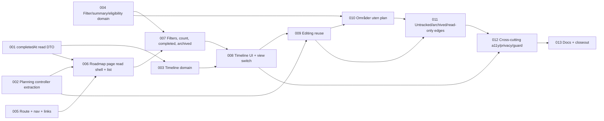

# Team Roadmap (B) — Tasks

Specification: [SPEC.md](./SPEC.md) (Revision 2, narrow re-review `PASS WITH SUGGESTIONS`, 0 BLOCKER / 0 IMPORTANT, no open product decisions)

## Status
Ready: 0  In Progress: 0  Done: 13

Task-splitting ground rules (apply to **every** task):

- Do not redesign the feature. If implementation proves the SPEC contradictory
  or unsafe, **stop and report** the affected SPEC sections; do not invent a
  workaround.
- No Firebase access, seed, migration, backfill or deploy. Tests use injected
  `*Deps` / mocked gateways.
- **No** change to `firestore.indexes.json`, Firestore rules, `RoadmapItemRecord`,
  `authorizeTeamAccess`, `resolveTeamRole`, the `POST`/`PATCH` roadmap routes,
  Demo Team fixtures, or any new route method/collection/field (D14, D16, D22–D24).
- No persisted history, multi-plan, board/Gantt, challenge links, owner
  filter/sort/metric, lead-specific behavior (D8, D14, D15, D18, D19).
- No UID, email, visible `memberRef`, forum `authorTag` or anonymous-challenge
  identity anywhere in B UI/DOM/URL/`aria-*`/`data-*` (BR-26, BR-27).
- Reuse `AreaPlanEditor`, `PlanningActions`, existing gateway/routes/validation.
  Do not duplicate the editor.
- Feature A behavior (base read + lazy archived read; all A tests) stays
  unchanged (BR-6).
- Follow `.claude/rules/**`. Read the relevant `node_modules/next/dist/docs/`
  guide before writing route/UI code (`AGENTS.md`). Norwegian copy in
  `src/features/roadmap/copy.ts` (extend, don't duplicate); *Kompetanseområde*,
  never *Ferdighet* (BR-31).
- Every task ends with `pnpm typecheck`, `pnpm lint`, `pnpm test` (and
  `pnpm build` where noted), then an inspection of `git diff`. Use the actual
  scripts in `package.json`.
- Interim note: TASK-005 makes the Roadmap route reachable, but the page is only
  complete after TASK-011. Nothing is deployed between tasks; do not ship a
  partial feature.

## Task graph

**Order rationale.** Four tasks have no prerequisites and can be implemented in
any order: 001 (DTO), 002 (extraction), 004 (pure filter/summary/eligibility
helpers), 005 (route + nav). 003 needs 001 only for the `completedAt` type
(Fullførte ordering). The page shell (006) needs the DTO field, the planning
controller's single-read mode and the route. Filters/count/completed/archived
(007) need 006 and the pure helpers (004). The timeline UI (008) needs the
domain partition (003) and the shared filter/disclosure state (007) so that both
views read one state. Editing (009) is wired once into the shared card/row
components after both views exist; creation (010) needs the eligibility helper
(004) and the editor wiring (009). Edge states (011) verify untracked/archived/
read-only behavior on top of editing + creation. 012 is cross-cutting
verification (it adds no feature behavior); 013 is last.

## BR / decision coverage

| Requirement | Task(s) |
| --- | --- |
| BR-1 route/page | 005, 006 |
| BR-2 nav | 005 |
| BR-3 links | 005 |
| BR-4 page states / team name | 005 (auth, loading, team-name heading + generic fallback), 006 (authoritative no-access, read failure, zero plans) |
| BR-5 single archived-inclusive read, no optimistic | 002, 006, 007 (toggle), 009 (refetch after write) |
| BR-6 Feature A unchanged | 002, 012 |
| BR-7 skills dependency | 006 |
| BR-8 skills-failure behavior | 006 (state, retry), 007 (archived toggle), 009/010 (controls absent), 011 |
| BR-9a list grouping | 006, 007 |
| BR-10a list card | 006, 007 |
| BR-11a list states | 006 (no-plan), 007 (ingen treff) |
| BR-12a edit affordance | 009 |
| BR-9 timeline partition | 003, 008 |
| BR-10 timeline ordering | 003 |
| BR-11, BR-11b, BR-11c timeline rows | 008, 009 |
| BR-12, BR-13 view switch / URL | 008 |
| BR-14 filters | 004, 007 |
| BR-15 count line | 004, 007 |
| BR-16 completed disclosure | 007, 008 (shared state) |
| BR-17 archived visibility | 004, 007, 008, 011 |
| BR-18 Områder uten plan | 004, 010 |
| BR-19, BR-20, BR-21 replanning / refetch | 009 |
| BR-22, BR-23 untracked / completed | 011, 007 |
| BR-24 no history copy | 006, 012 |
| BR-25 independent failures | 006, 009, 011 |
| BR-26, BR-27 privacy | every UI task; swept in 012 |
| BR-28 `canEdit:false` | 009, 010, 011 |
| BR-29, BR-30 responsive / a11y | each UI task; swept in 012 |
| BR-31 copy | every UI task |
| D16 `completedAt` | 001 |
| D6 planning extraction | 002, 009 |
| D14/D22/D23/D24 no persistence/index/fixture/migration | guard in 012; docs in 013 |

Review suggestions: **S1** (legacy `completedAt === null`) → TASK-001 (DTO/parser) + TASK-003 (ordering) + TASK-007 (render, never "Fullført null").
Decision after TASK-001 review (SPEC BR-23a): a legacy completed plan with `completedAt === null` is readable but **read-only** in B v1 → mutation suppression in TASK-009; read-only presentation in TASK-011; re-asserted in TASK-012 (the mutation parser stays strict; no tolerance, backfill or synthesized timestamp).
**S2** (tracked-area source = the team skills read) → TASK-004 (helper input) + TASK-010 (tests). **S3** (skills failure + archived toggle) → TASK-007 (integration test) + re-asserted in TASK-012.

---

### TASK-001 — Expose `completedAt` in the roadmap read DTO

**Status:** Done
**Covers:** D16, BR-24, BR-27 (contract); enables BR-10a, BR-10
**Depends on:** None

**Outcome**
`RoadmapItemView` has an additive `completedAt: string | null` populated by the shared `toRoadmapItemView` from the already-persisted field, returned by `GET …/roadmap-items`, and parsed fail-safe by the client gateway. Legacy completed plans without a timestamp yield `null`.

**Implementation notes**
- Files: `src/features/roadmap/server/list-roadmap-items.ts` (type + `toRoadmapItemView`), `src/features/roadmap/client/roadmap-gateway.ts` (`parseItem`), their tests, and any test fixtures/builders that construct `RoadmapItemView` (grep `RoadmapItemView`).
- `toRoadmapItemView` is shared with create/update responses; update their tests for the added key. The write-response presentation fields are still dropped client-side (callers refetch).
- Output is ISO string like `createdAt`/`updatedAt`; no actor (`completedBy` stays internal).
- Do **not** add `currentLabel` or `today` (D16, D26). No Firestore change; `mapDates` already maps `completedAt`.
- Gateway: `completedAt` must be `string | null`; any other type → item invalid → `read_failed` (existing fail-safe).

**Verification**
- Server read contract tests assert the **exact allow-listed key set** including `completedAt`, and absence of `currentLabel`/`today`/`updatedBy`/`completedBy`/`archivedBy`/uid.
- Completed plan → ISO string; non-completed → `null`; legacy completed with missing/`null` persisted value → `null`.
- Gateway parser: valid string, valid `null`, non-string (e.g. number) → `read_failed`.
- Existing create/update server tests updated and passing; `pnpm typecheck`, `pnpm lint`, `pnpm test`.

**Security / privacy**
Allow-list stays field-by-field; the new field is a plan timestamp with no actor. No new Firestore surface.

**Documentation impact**
None now (ARCHITECTURE reconciled in TASK-013).

**Acceptance criteria**
- [x] `RoadmapItemView.completedAt` is `string | null` (ISO or `null`), no actor.
- [x] Legacy completed plan with no timestamp reads as `completedAt: null` (S1, server side).
- [x] Gateway parses `completedAt` fail-safe; malformed ⇒ `read_failed`.
- [x] Exact key-set test passes; no `currentLabel`/`today`.
- [x] Feature A tests pass unchanged apart from fixture additions.
- [x] No conflict with `docs/SECURITY.md`.

---

### TASK-002 — Extract reusable roadmap planning controller (behavior-preserving)

**Status:** Done
**Covers:** D6, BR-5 (single-read mode), BR-6
**Depends on:** None

**Outcome**
The state/actions currently inline in `RoadmapPlanningScope` (base/archived read state, `refresh()`, owners + `loadOwners`, epoch guard, `canEdit`) live in a small reusable hook/controller (symbol/file are the implementer's choice, e.g. `useRoadmapPlanning`) with a mode option: **`lazy-archived`** (Feature A, current behavior) and **`archived-inclusive`** (B: one `?archived=true` GET on mount and on refresh, holds the complete response, exposes truncated, never issues another roadmap GET when archived visibility changes). `RoadmapPlanningScope` becomes a thin wrapper over the hook with unchanged observable behavior.

**Implementation notes**
- Keep the epoch/`token`/`teamId` drop-late-responses behavior, the owners-once-per-scope rule and `loadOwners(force)` semantics, and failed-refresh-keeps-previous-state (`refresh()` resolves `false`).
- `PlanningArea`, `PlanningActions`, `OwnersState`, `AreaPlanning` types stay exported from where consumers import them today (or are re-exported) so `RoadmapPlanEditor`, `TeamSkillSection`, `TeamDetail` need no behavioral change.
- In `archived-inclusive` mode the hook returns the **complete** item list; archived visibility is the caller's concern (B page, TASK-007). Surface `truncated` from the read result (A currently ignores it — expose it without altering A).
- Do not touch `AreaPlanEditor` logic, gateway, routes. No broad `TeamDetail` refactor.
- Dependency direction stays inside `src/features/roadmap/`.

**Verification**
- **Feature A regression:** `RoadmapPlanning.test.tsx`, `RoadmapPlanEditor.test.tsx`, `RoadmapUntracked.test.tsx` and TeamDetail/TeamSkillSection tests pass **unmodified** (request pattern: base on mount, archived read only on toggle, refresh refetches base + archived while on).
- New hook tests (`archived-inclusive`): exactly one roadmap GET with `archived=true` on mount; no further GET until `refresh()`; `refresh()` issues exactly one archived-inclusive GET; failed refresh keeps previous state and resolves `false`; late response after identity/teamId change is dropped; owners load once, `force` reloads.
- `pnpm typecheck`, `pnpm lint`, `pnpm test`.

**Security / privacy**
No additional considerations (no data change); `memberRef` handling untouched.

**Documentation impact**
None expected (ARCHITECTURE in TASK-013).

**Acceptance criteria**
- [x] Hook supports `lazy-archived` (A) and `archived-inclusive` (B) modes.
- [x] `RoadmapPlanningScope` behavior and request pattern unchanged; all A tests pass without edits.
- [x] `archived-inclusive` mode: one GET on load, one GET per refresh, none otherwise.
- [x] Editor, gateway and routes not duplicated or modified.
- [x] Relevant tests pass; no conflict with `docs/SECURITY.md`.

---

### TASK-003 — Timeline domain: `quarterOf` and `groupRoadmapTimeline`

**Status:** Done
**Covers:** BR-9, BR-10, BR-11b (classification), D4
**Depends on:** TASK-001 (needs `completedAt` on the item type)

**Outcome**
Pure, client-safe helpers in `src/features/roadmap/domain/roadmap-timeline.ts` that partition included `RoadmapItemView`s into ordered groups by first-match precedence and order each group per BR-10, composing `compareRoadmapPlans` rather than copying its rules.

**Implementation notes**
- Precedence: archived → `Arkiverte`; completed → `Fullførte`; `overdue` → `Forfalt`; `targetDate` → quarter group; `startDate` only → `Kun startdato`; else `Uten dato`. Group display order: Forfalt, quarters asc, Kun startdato, Uten dato, Fullførte, Arkiverte; empty groups omitted.
- `quarterOf(targetDate: ISO YYYY-MM-DD)` → `{ year, quarter }` + label ("4. kvartal 2026"); string comparison for ordering; quarter always from `targetDate`, never `startDate`. No current-date dependence (overdue is the server flag). Model groups as a discriminated union.
- Ordering per BR-10 table; `Fullførte`: `completedAt` desc with `null` last, then `compareRoadmapPlans`.
- Input is the *already filtered and archived-visibility-applied* list (filtering lives in TASK-004/007).
- No invented dates; no `Nå` marker; no Gantt data.

**Verification**
- Precedence tests for each combination of archived × completed × overdue × targetDate/startDate/none (full truth-table permutation).
- **Partition/property test:** concatenated groups are a permutation of the input — each item exactly once, none lost, none duplicated — over generated/enumerated item sets.
- Archived+completed → only `Arkiverte`; completed+overdue flag → only `Fullførte`; overdue incomplete with target → only `Forfalt` (not its quarter); long-running plan with earlier `startDate` in another quarter stays in target quarter; target+start, target only, start only, undated.
- Ordering with ties inside every group, including `Fullførte` with `completedAt` null (S1: legacy null sorts last, then `compareRoadmapPlans`).
- Quarter boundaries (Mar 31 / Apr 1, Dec 31 / Jan 1), year ordering.
- `pnpm typecheck`, `pnpm lint`, `pnpm test`.

**Security / privacy**
No owner field is read by the helper (owner is never a key or group dimension).

**Documentation impact**
None expected.

**Acceptance criteria**
- [x] Classification is an exhaustive, mutually exclusive partition (test-proven).
- [x] Group display order and per-group ordering match BR-9/BR-10 including ties and `completedAt === null`.
- [x] Reuses `compareRoadmapPlans`; no copied comparator rules; no owner key.
- [x] No date invented; no dependency on current date.
- [x] Relevant tests pass; no conflict with `docs/SECURITY.md`.

---

### TASK-004 — Filter, summary and create-eligibility domain helpers

**Status:** Done
**Covers:** BR-14, BR-15, BR-17 (visibility), BR-18 (eligibility), D5, D19
**Depends on:** None

**Outcome**
Pure helpers in `src/features/roadmap/domain/roadmap-filter.ts`: `filterRoadmapItems` (status single-select, priority single-select, archived visibility), `summarizeRoadmapItems` (mutually exclusive status counts over the unfiltered non-archived set, optional overdue-as-subset), and an eligibility helper for `Områder uten plan`.

**Implementation notes**
- Filter input: `{ status: "all" | RoadmapStatus; priority: "all" | RoadmapPriority; showArchived: boolean }`. Status filter matches the plan's `status` regardless of archived; filters apply to archived plans when shown. Closed filter set — no owner/area/tracking/text filter.
- Summary counts only `archived === false` items, independent of any filter; counts are `active`, `planned`, `completed`; `overdue` (if returned) is a count **within** active/planned only, never a peer category. No rates, scores, owner figures.
- Eligibility signature takes the **tracked-area list from the team skills read** (the existing `TeamSkillView`-shaped list, or a minimal projection) and the **complete archived-inclusive item list**; returns tracked areas whose `treeId` is not present in **any** item (active, planned, completed, archived). It must not accept or derive tracked areas from any other source (S2) and must not depend on filters or `Vis arkiverte`. Preserve the skills-read order, or use `orderAreasForPlanning`-consistent ordering — pick one and test it.
- Pure/domain only; no React.

**Verification**
- Filters: each status × priority combination; `Alle` defaults; archived hidden/shown; filters apply to archived when shown; completed-and-archived matched by status filter `completed` only when archived shown.
- Summary: unchanged by filters/`showArchived` (same inputs → same output); archived excluded; exclusive counts sum to non-archived total; overdue subset never exceeds active+planned; no owner property exists on the output type.
- Eligibility: tracked minus planned/active/completed/**archived** treeIds; area with only an archived plan excluded; untracked plans' treeIds are not in the tracked list (no effect); empty tracked list → empty; areas not in the skills read are never offered (S2); independent of filters.
- `pnpm typecheck`, `pnpm lint`, `pnpm test`.

**Security / privacy**
Enforces the closed filter set and no-owner-dimension (invariant 30) at the domain boundary.

**Documentation impact**
None expected.

**Acceptance criteria**
- [x] Filter/summary/eligibility behave per BR-14/15/18 and are test-covered.
- [x] Eligibility source is exactly the supplied skills-read areas (S2).
- [x] Area with an archived plan is never eligible.
- [x] No owner-related input/output anywhere.
- [x] Relevant tests pass; no conflict with `docs/SECURITY.md`.

---

### TASK-005 — Roadmap route, team navigation and cross-links

**Status:** Done
**Covers:** BR-1, BR-2, BR-3, BR-4 (signed-out, loading, team-name heading with generic fallback), D1, D27
**Depends on:** None

**Outcome**
`/teams/[teamId]/roadmap` exists (thin `app/teams/[teamId]/roadmap/page.tsx` using `PageShell`, same pattern as `app/teams/[teamId]/page.tsx`) rendering a `RoadmapPage` client component that, for now, handles auth (loading, signed-out), the best-effort team-name heading (generic fallback), the team navigation and the "Åpne Kompetanseområder" link. A shared two-link `Oversikt · Roadmap` navigation appears on the Roadmap page and in the **authorized** `TeamDetail` branches (both: `results_unavailable` and `authorized`), plus a "Se roadmap" link in the *Kompetanseområder* section.

**Implementation notes**
- Read the Next docs for dynamic route params and `useSearchParams`/`usePathname` before coding (`AGENTS.md`). If `usePathname`/`useSearchParams` require `<Suspense>`, wrap per current conventions.
- Nav: `<nav aria-label>` with exactly two links; `aria-current="page"` on the exact-path match only (no prefix match; forum sub-route and unknown paths mark nothing). Place the shared component under `src/features/teams/components/` (or per `architecture.md`). Not rendered in access-denied/request states of `TeamDetail`.
- "Åpne Kompetanseområder" → `/teams/[teamId]#team-skill-section-heading` (existing id in `TeamSkillSection`; add no new anchor). "Se roadmap" in `TeamSkillSection`/`TeamDetail` in both branches.
- Page states: signed out → existing `SignInPrompt` pattern (duplicate-free: reuse if exported, otherwise reuse the same primitive); loading → `LoadingState`. Team name from the existing `fetchTeamsOverview` (best effort, non-blocking: failure or team not in the response → generic heading, never a team id; absence from the overview is **not** an access decision). The authoritative `forbidden`/unknown-team no-access `Alert` is owned by TASK-006 because it depends on the roadmap read.
- Roadmap data reads are **not** part of this task (TASK-006). Do not change forum behavior or the flag.
- Dependency direction: `roadmap → teams`; `TeamDetail` only gains nav + link.

**Verification**
- Nav component tests: Oversikt current on `/teams/x`; Roadmap current on `/teams/x/roadmap`; neither on `/teams/x/forum/t1` and unknown paths; trailing-slash/exact-path behavior defined and tested.
- `TeamDetail` tests: nav and "Se roadmap" present in **both** branches; absent in access-denied/request branch; forum flag on/off layout unchanged; existing TeamDetail tests unchanged.
- Route page test: renders `RoadmapPage` for a `teamId` param. Page tests: signed-out, loading, team-name success vs. failure vs. team-absent fallback heading (no denied state, no raw team id), no roadmap/skills request.
- Anchor test: `team-skill-section-heading` id exists in `TeamSkillSection` and the link href matches.
- `pnpm typecheck`, `pnpm lint`, `pnpm test`, `pnpm build` (route compiles).

**Security / privacy**
`teamId` from URL only; authorization remains server-side on every read (only the existing teams-overview name read is issued here; it is presentational and not an access decision). Team id never shown as a heading.

**Documentation impact**
None now (UI-UX reconciled in TASK-013).

**Acceptance criteria**
- [x] `/teams/[teamId]/roadmap` renders; signed-out shows the sign-in prompt.
- [x] Exactly two nav links with exact-path `aria-current`; forum sub-route does not mark Roadmap.
- [x] Nav + "Se roadmap" in both authorized `TeamDetail` branches; not in access-denied/request states.
- [x] Roadmap page shows the team name from the best-effort `fetchTeamsOverview` read; read failure or a team absent from the response gives the generic heading (never a team id) without a denied state.
- [x] No authoritative no-access state is implemented here (owned by TASK-006); no roadmap/skills/owner reads.
- [x] "Åpne Kompetanseområder" targets the existing heading id.
- [x] Forum behavior and layout unchanged.
- [x] Relevant tests and build pass; no conflict with `docs/SECURITY.md`.

---

### TASK-006 — Roadmap page: archived-inclusive read, skills dependency and grouped list

**Status:** Done
**Covers:** BR-4 (authoritative no-access, read failure, zero plans), BR-5, BR-7, BR-8 (state + retry), BR-9a, BR-10a, BR-11a (no-plan), BR-24, BR-25, BR-27 (truncated), D5
**Depends on:** TASK-001, TASK-002, TASK-005

**Outcome**
The Roadmap page loads the complete canonical plan set with **one** archived-inclusive GET (via the TASK-002 hook in `archived-inclusive` mode) plus the existing team skills read (`fetchTeamSkills`) loaded alongside it, and renders the non-archived plans as a list grouped Pågår / Planlagt / Fullført (each in `compareRoadmapPlans` order; empty groups hidden) with full read-only list cards. The access decision is made from the roadmap read result: an authoritative `forbidden`/unknown-team result shows the neutral no-access `Alert` with a link to `/teams/[teamId]`. Roadmap read failure shows an error alert with retry; zero plans shows `EmptyState`; a skills-read failure keeps plans rendered and shows a scoped alert whose retry refetches **only** the skills read.

**Implementation notes**
- No-access (moved from TASK-005): derive it only from the roadmap read (`forbidden`/unknown team), never from the best-effort teams-overview team-name read in TASK-005 (absence there is not a denial). Render a neutral `Alert` (no existence signal beyond "no access") with a link to `/teams/[teamId]`; page chrome (nav, heading) from TASK-005 stays; no skills read result or plan data is shown for a denied caller.
- Page state: roadmap read (`loading | error | loaded{items, canEdit, truncated}`) from the hook; skills read as its own state (`loading | error | loaded`), independent. Roadmap read failure never blanks page chrome; skills failure ≠ roadmap failure (BR-25).
- Skills data is held at page level for later tasks (areas → `PlanningArea` with `nodes`/`currentNodeId`, eligibility). Derive nothing about target/current stage from the roadmap DTO (BR-7).
- This task renders **no mutation controls** at all (editing arrives in TASK-009). While skills load/failed, the future mutation capability is "absent" by construction; expose a single derived `canMutate = canEdit && skills.loaded` for later tasks.
- List card (`RoadmapPlanCard`, shared later by timeline rows): area (or "Ukjent område"), target label (or existing `targetUnavailable` text), status/priority as text, period with labelled "Startdato"/"Måldato" (`DD.MM.YYYY` / `<time datetime>`), owner per Feature A presentation (reuse `RoadmapPlanSummary` owner presentation where possible; never render `memberRef`), indicators "Målet er nådd", "Måldato passert", "Arkivert", "Følges ikke", "Sist oppdatert <date>", and "Fullført <date>" on completed plans **only when `completedAt` is non-null** (never "Fullført null" — S1). Reuse/extend `RoadmapPlanSummary.tsx` rather than duplicating its formatting.
- Interim: Fullført group renders expanded here; the disclosure, filters, count line and archived visibility land in TASK-007. Archived items are held in state but not rendered yet.
- Show a `truncated` notice (reuse A's pattern). Copy states the roadmap shows the **current** plan; no "historikk"/"endringslogg" wording anywhere (BR-24).
- Identity change (token/teamId/generation) discards state (epoch/key pattern from A).

**Verification**
- **Read behavior:** exactly **one** roadmap GET with `archived=true` on load; skills read called once; the TASK-005 teams-overview name read is unaffected (no second overview read).
- **No-access:** a `forbidden`/unknown-team roadmap result → neutral no-access `Alert` with link to `/teams/<teamId>`, no plans, no skills content, no mutation controls; a team merely absent from the teams-overview name read does **not** produce this state, and a read failure (non-forbidden) is the error state instead.
- Roadmap read failure → error alert + retry refetches the roadmap read; zero plans → `EmptyState`; truncated → notice.
- **Skills failure:** plans still render; scoped alert shown; **retry calls only the skills read** (no roadmap GET); after a successful retry the alert disappears; skills loading shows a scoped loading indicator; no stage/target data inferred.
- Cards: all indicators as text; unavailable owner copy; `areaName: null` → "Ukjent område"; `targetAvailable:false` copy; `completedAt` non-null → "Fullført DD.MM.YYYY"; **`completedAt === null` completed plan renders as completed without a date and the DOM never contains "Fullført null"** (S1).
- Grouping/order by `compareRoadmapPlans`; empty groups hidden; completed group present.
- Privacy: no `memberRef`, UID or email in DOM text/attributes.
- `pnpm typecheck`, `pnpm lint`, `pnpm test`.

**Security / privacy**
Plan names/labels/dates are rendered as inert text; `memberRef` never rendered; owner shown as in A; no metrics.

**Documentation impact**
None now.

**Acceptance criteria**
- [x] Page performs one archived-inclusive roadmap GET on load and holds the complete response.
- [x] Skills read is a page-level dependency; failure keeps plans visible, shows scoped alert; retry refetches skills only.
- [x] Grouped list and cards satisfy BR-9a/BR-10a; legacy completed plan with null `completedAt` shows no date and never "Fullført null".
- [x] Roadmap read failure and zero-plan states are distinct and correct.
- [x] Authoritative `forbidden`/unknown-team roadmap result shows the neutral no-access `Alert` with a link to `/teams/[teamId]`; it is derived from the roadmap read only, not from the teams-overview name read.
- [x] No mutation controls rendered; no history wording; no `memberRef`/UID/email.
- [x] Relevant tests pass; no conflict with `docs/SECURITY.md`.

---

### TASK-007 — List filters, plan-count line, completed disclosure and archived visibility

**Status:** Done
**Covers:** BR-8 (archived toggle under skills failure), BR-9a (Arkiverte), BR-11a (ingen treff), BR-14, BR-15, BR-16, BR-17, BR-23, BR-30 (disclosures/filters), D5, D11, D12
**Depends on:** TASK-004, TASK-006

**Outcome**
The Roadmap page has labelled single-select **Status** and **Prioritet** filters (default *Alle*) and a **Vis arkiverte** toggle, all transient client state shared by both views; a plan-count line; a collapsed-by-default *Fullført* disclosure; and a final separate *Arkiverte* list section. Toggling archived visibility never issues a roadmap GET.

**Implementation notes**
- Page-level transient state (not URL/localStorage): `status`, `priority`, `showArchived`, `completedExpanded`. Designed as shared state (TASK-008 reads it for the timeline); do not put it inside the list component.
- Use TASK-004 helpers; render from the in-memory complete response.
- Count line: labelled as plan counts (e.g. "Planer: 2 pågår · 1 planlagt · 1 fullført"; overdue only as explicit subset or omitted), from unfiltered non-archived items; unchanged by filters/`Vis arkiverte`.
- Completed disclosure: `<button>` with `aria-expanded` + `aria-controls`, collapsed by default, header shows the **filtered** completed count; status filter `Fullført` auto-expands (user may collapse again); focus remains on trigger. Replace TASK-006's interim expanded completed group.
- Archived section: final, separate, `compareRoadmapPlans` order, only when `showArchived`; completed+archived appears only here. Filters apply to archived plans too.
- Filtered-empty state "ingen treff" + clear-filters action, distinct from the no-plan state; if all plans are archived and hidden, show a hint pointing to `Vis arkiverte`.
- Filters are native labelled controls, keyboard operable with visible focus; no owner/area/tracking/text filter, no owner sort/metric.

**Verification**
- **Zero roadmap GETs** when toggling `Vis arkiverte` on/off (assert fetch call count stays at 1).
- **Skills failure + archived visibility (S3):** with roadmap OK and skills read failing, `Vis arkiverte` still toggles archived plans client-side, performs **no** skills read and **no** roadmap GET, and no mutation controls appear.
- Status/priority single-select behavior; filters also filter archived when shown; filters reset on remount; not present in URL or `localStorage`.
- Count line invariant under filters/archived toggle; no rates/scores/owner figures; overdue only as subset (if shown).
- Completed disclosure: collapsed default; `aria-expanded`/`aria-controls` wiring; filtered count in header; status `Fullført` auto-expands and can be collapsed; expanded state is not persisted.
- ingen-treff vs. no-plan states; clear-filters action; archived final section content/order.
- Legacy completed plan (`completedAt: null`) inside the disclosure: no date text, no "Fullført null".
- `pnpm typecheck`, `pnpm lint`, `pnpm test`.

**Security / privacy**
Closed filter set; count line has no per-person data; no owner dimension.

**Documentation impact**
None now.

**Acceptance criteria**
- [x] Only status, priority and Vis arkiverte filters exist; defaults *Alle*/off; transient; not in URL/`localStorage`.
- [x] Archived toggle causes zero roadmap GETs and works under skills failure (S3).
- [x] Count line uses unfiltered non-archived status counts and never changes with filters.
- [x] Completed disclosure accessible, collapsed by default, filtered count, auto-expands for status `Fullført`.
- [x] Archived plans in a final separate section; completed+archived only there.
- [x] Relevant tests pass; no conflict with `docs/SECURITY.md`.

---

### TASK-008 — Timeline view and Liste | Tidslinje switch

**Status:** Done
**Covers:** BR-9, BR-10, BR-11, BR-11b, BR-12, BR-13, BR-16 (shared), BR-17, BR-29, BR-30 (timeline semantics), D2, D3, D4
**Depends on:** TASK-003, TASK-007

**Outcome**
A labelled **Liste | Tidslinje** control (real buttons with `aria-pressed`, default Liste) selects the view; `?view=timeline` selects the timeline and any other/absent value falls back to list; switching updates the URL by replacement. The timeline renders `groupRoadmapTimeline` output over the same filtered/visibility-applied items as the list, as semantic headings + ordered lists, with compact text-only rows reusing the card facts.

**Implementation notes**
- Read Next docs for `useSearchParams` / `useRouter().replace` / `Suspense` requirements; implement the view as navigational state only (no `localStorage`, no server persistence). Preserve other query params; drop invalid values.
- Timeline is composed from the shared page state (filters, `showArchived`, `completedExpanded`) so list/timeline always show the same set and share completed expansion. `Fullførte` group uses the same disclosure (button/`aria-expanded`/`aria-controls`, filtered count, auto-expand on status `Fullført`); `Arkiverte` only when visible.
- Group heading h2, rows in `<ol>`; reading order = group order. Period, status, priority, target and indicators as text; "Målet er nådd", "Måldato passert", "Følges ikke" per BR-11b; completed never "overdue".
- No Gantt, horizontal scale, decorative range bar, or `Nå` marker. Rows stack facts vertically below `sm`; no required horizontal scroll to 360 px.
- Reuse card/row facts component from TASK-006 (compact variant) — no duplicated formatting logic.

**Verification**
- `?view` handling: absent → list; `timeline` → timeline; invalid → list; switch uses replace (assert `replace`, not `push`); `aria-pressed` reflects current view; view not stored in `localStorage`.
- UI reflects domain precedence for archived/completed/overdue/quarter/start-only/undated examples; each included plan appears exactly once across rendered groups; group order; empty groups hidden; ordering spot-checks (full ordering proven in TASK-003).
- Shared state: filters and completed expansion persist across view switch within the page; **no roadmap GET** on view switch or toggle.
- Completed group disclosure and legacy `completedAt: null` row render without date text (S1).
- Semantic structure: headings + `<ol>`; text for every meaning; no `Nå`.
- `pnpm typecheck`, `pnpm lint`, `pnpm test`, `pnpm build` (Suspense/search-param build check).

**Security / privacy**
View param is a closed enum; nothing identity-related enters the URL.

**Documentation impact**
None now.

**Acceptance criteria**
- [x] Default list; `?view=timeline` shows timeline; invalid falls back to list; switching replaces history entry.
- [x] Timeline groups follow BR-9 precedence, display order and BR-10 ordering; each plan appears exactly once.
- [x] Completed disclosure/expansion and filters are shared with the list; no extra GETs.
- [x] Timeline is headings + ordered lists, all meaning as text, no Gantt/`Nå`.
- [x] Relevant tests and build pass; no conflict with `docs/SECURITY.md`.

---

### TASK-009 — Reuse the existing editor, archive/restore and canonical refetch on the Roadmap page

**Status:** Done
**Covers:** BR-8 (controls absent), BR-12a, BR-11c, BR-19, BR-20, BR-21, BR-25, BR-28, D6, D7, D10
**Depends on:** TASK-002, TASK-008

**Outcome**
Every plan card (list) and timeline row exposes a "Planlegg"/"Rediger" button that expands the existing `AreaPlanEditor` inline (`aria-expanded`/`aria-controls`, focus returns to trigger on close), using `PlanningActions` from the planning controller. Edit, archive and restore use the existing `PATCH` route and validation. After a successful write the page refetches the same archived-inclusive read; no optimistic updates.

**Implementation notes**
- Mutation controls render only when `canMutate` (= `canEdit` from the roadmap read **and** skills read loaded). With skills loading/failed or `canEdit:false`, no edit/archive/restore control exists in either view.
- Build `PlanningArea` for a tracked plan from the skills read (tracked area's `nodes`/`currentNodeId`); never from the DTO. If a tracked plan's area is not present in the skills read, render the plan read-only (no inferred data) — do not invent a target list.
- Untracked plans (BR-22) use the synthetic area (`currentNodeId: null`, `nodes: []`, `targetLocked`) as in `RoadmapPlanning.tsx` — behavior verified in TASK-011; the wiring is established here so one affordance serves all cards.
- `actions.refresh()` = hook refresh in `archived-inclusive` mode → one archived-inclusive GET. A failed refetch is reported separately from the write and keeps previous state (A's notices).
- No new endpoint, field, status or client rule; do not fork `AreaPlanEditor`; do not change Feature A's tests/behavior. Editor copy/errors unchanged.
- Only one editor expanded per plan; same editor in list and timeline.
- **Legacy read-only plans (BR-23a):** a plan with `status === "completed"` and `completedAt === null` is item-ineligible for mutation: no edit, archive or restore control, and no `PATCH` is ever sent for it (the server's strict parser would answer `not_found`). Implement as a separate per-item predicate (e.g. `isLegacyReadOnlyPlan(item)`) combined with `canMutate`; do **not** fold it into or redefine `canEdit`/`canMutate`. Completed plans with a valid `completedAt` keep full edit/reopen/archive behavior. No parser tolerance, no synthesized timestamp.

**Verification**
- Legacy completed plan (`completedAt: null`) in list and timeline, with `canEdit:true` and skills loaded: no edit/archive/restore control, and no `PATCH` request is made (assert fetch calls); a completed plan with a valid `completedAt` beside it still has the edit affordance; the same legacy plan archived (when visible) has no restore control.
- Edit affordance present in list and timeline when `canMutate`; absent when `canEdit:false`, skills loading, or skills failed (mutation controls fully absent, including archive/restore).
- Successful edit → exactly one additional archived-inclusive GET (`archived=true`), UI renders the refetched data (assert no state change before the refetch resolves — no optimistic update); mutation requests hit existing `PATCH` only.
- Failed write shows A's error copy; refetch except on `persistence_failed`/`request_failed` per A; failed refetch reported separately, previous state kept.
- Archive/restore through the editor; archived plan (when visible) accepts restore only; `archived`/`not_found` stale-write copy + refetch.
- Owner dataset loads lazily on first editor open only; owner-list failure keeps editor usable (A's behavior). `memberRef` not in DOM.
- `aria-expanded`/`aria-controls`/focus return on edit button.
- **Feature A regression:** A's planning/editor tests still pass unmodified.
- `pnpm typecheck`, `pnpm lint`, `pnpm test`.

**Security / privacy**
Authorization is server-side and unchanged; `canEdit` only hides controls. No lead-specific branch. Owner is coordination metadata only.

**Documentation impact**
None now.

**Acceptance criteria**
- [x] Existing `AreaPlanEditor`/`PlanningActions`/routes reused; no duplicate editor or new endpoint.
- [x] Edit/archive/restore work from both views; successful write triggers one canonical archived-inclusive refetch; no optimistic update.
- [x] No mutation control when `canEdit:false` or when skills read is not loaded.
- [x] Legacy completed plan (`completedAt === null`) has no edit/archive/restore control and no `PATCH` is sent for it; valid completed plans stay editable; `canEdit` is not redefined (BR-23a).
- [x] Feature A tests unchanged and passing.
- [x] Relevant tests pass; no conflict with `docs/SECURITY.md`.

---

### TASK-010 — "Områder uten plan" creation

**Status:** Done
**Covers:** BR-18, BR-8 (absent on skills failure), BR-28, D25
**Depends on:** TASK-004, TASK-009

**Outcome**
A minimal *Områder uten plan* section lists tracked competency areas that have no plan and lets the user create one through the existing editor create path (`POST …/roadmap-items`, existing validation). Eligibility = areas returned by the team skills read used by the Roadmap page minus every `treeId` in the complete archived-inclusive response (planned, active, completed, **archived**).

**Implementation notes**
- Use the TASK-004 eligibility helper with the page-level skills read result as the **only** tracked-area source (S2) and the complete (unfiltered, archived-included) roadmap response — independent of `Vis arkiverte` and of status/priority filters.
- Section absent when `canEdit` is false, skills read failed/loading, or no area eligible. An area with an archived plan is never offered "Planlegg"; a hint (e.g. under the empty/archived state) points the user to `Vis arkiverte` to restore.
- Zero plans + eligible areas: `EmptyState` and the section both render (BR-4). All plans archived and hidden: main view empty, section does **not** list those areas, hint to `Vis arkiverte`.
- After a successful create, refetch via the shared refresh (one archived-inclusive GET); the created plan then appears in the roadmap and leaves the section.
- No new endpoint, validation, persistence; one plan per team/tree remains.

**Verification**
- Eligible set equals skills-read areas minus all roadmap `treeId`s (planned, active, completed, archived); area with only an archived plan is **not** listed and has no create control; archived plan is restorable via `Vis arkiverte` instead.
- **Source test (S2):** tracked areas come only from the skills read — an area present in the roadmap but absent from the skills read is not eligible/created; changing filters or `Vis arkiverte` does not change the list.
- Creation uses existing create contract (request body shape matches editor create path); success → one canonical refetch, area leaves section, plan appears; `already_planned`/`plan_archived` surface via A's copy and refetch.
- Section absent for `canEdit:false`, skills failed, skills loading, and no eligible areas.
- `pnpm typecheck`, `pnpm lint`, `pnpm test`.

**Security / privacy**
Create is the existing server-authorized path; UI absence is convenience only.

**Documentation impact**
None now.

**Acceptance criteria**
- [x] Eligibility = skills-read tracked areas minus all roadmap `treeId`s including archived (S2 test-covered).
- [x] Archived-plan area is not offered create; restore path is via `Vis arkiverte`.
- [x] Creation uses the existing contract and editor; refetches canonical read; no optimistic update.
- [x] Section absent when read-only, skills unavailable, or nothing eligible.
- [x] Relevant tests pass; no conflict with `docs/SECURITY.md`.

---

### TASK-011 — Untracked, archived, completed and read-only edge states

**Status:** Done
**Covers:** BR-8, BR-17, BR-22, BR-23, BR-25, BR-28, D13, D17
**Depends on:** TASK-009, TASK-010

**Outcome**
Edge-state behavior is complete and covered end to end on the Roadmap page: untracked plans in place with "Følges ikke" and explanation, locked target, other fields editable, archive/restore available (subject to skills read); archived plans restorable from the final archived group/section; completed plans distinct from archived; `canEdit:false` and skills failure produce a fully read-only page with no claimed reason.

**Implementation notes**
- Mostly verification plus gap-fixing of behavior wired in 006–010; do not add new product behavior. Fix only genuine gaps found.
- Untracked plan editor uses the synthetic `PlanningArea` with `targetLocked`; verify the untracked explanation copy (reuse `roadmapCopy.untracked`).
- `canEdit:false` UI makes no claim about why (no inactive-team banner, no lead-specific UI, no admin-specific UI).
- Skills failure while editor is open/after mutation: plans remain, mutation controls vanish consistently, retry restores them.
- A tracked plan whose area is missing from the skills read is read-only (no invented target data).
- **Legacy completed plan presentation (BR-23a):** the TASK-009 predicate makes the item read-only; here verify/complete its presentation: still rendered as completed in *Fullført*/*Fullførte*, no completion-date detail, never "Fullført null", and a concise non-alarming read-only note (e.g. "Eldre fullført plan – kan ikke endres") that is text, associated with the card, and not colour-only. Only this item is affected; other completed plans are unchanged.

**Verification**
- Legacy completed plan (`completedAt: null`) in list and timeline: renders as completed in the completed group, no date text, DOM never contains "Fullført null", read-only note present as text; no editor/archive/restore control; compared with a valid completed plan that keeps its controls; holds with `canEdit:true`, and the note is not tied to `canEdit:false`/skills-failure copy.
- Untracked plan in list and timeline: "Følges ikke" + explanation; target control locked; date/priority/status/owner editable; archive/restore present; absent when read-only.
- Archived: restore from archived group in both views; completed+archived only in archived; archive independent of completed status; reopening a completed plan via status select works through existing editor.
- Read-only matrix: `canEdit:false`; skills failed; skills loading; both → no edit/archive/restore/create; no explanatory claim about reason; `Vis arkiverte` and view switch still work.
- Unavailable owner → "Ansvarlig er ikke lenger tilgjengelig"; `areaName: null` → "Ukjent område" sorted last.
- Stale/forbidden write copy (`forbidden`, `team_disabled`, `archived`, `not_found`) → A's copy + refetch (`canEdit` flips false after refetch → controls disappear).
- `pnpm typecheck`, `pnpm lint`, `pnpm test`.

**Security / privacy**
No additional considerations beyond the global rules (no `memberRef`/UID in DOM in any state).

**Documentation impact**
None now.

**Acceptance criteria**
- [x] Untracked, archived, completed, unknown-area and unavailable-owner states behave per BR-22/23/17.
- [x] Read-only matrix verified for list and timeline; no claimed reason; no lead-specific controls.
- [x] Legacy completed plan (`completedAt === null`) renders as completed, without a date, never "Fullført null", with an understandable text read-only note; only that item is read-only (BR-23a).
- [x] Permission loss mid-session flips controls off after the refetch.
- [x] Relevant tests pass; no conflict with `docs/SECURITY.md`.

---

### TASK-012 — Cross-cutting accessibility, privacy, responsive and scope-guard verification

**Status:** Done
**Covers:** BR-24, BR-26, BR-27, BR-29, BR-30, BR-31, BR-6, D14, D16, D19, D22–D24
**Depends on:** TASK-008, TASK-011

**Outcome**
A consolidated verification layer proving the cross-cutting requirements across both views and all states, plus a scope-guard test. It adds **no new feature behavior**; fix only defects discovered.

**Implementation notes**
- Use repository-appropriate component/integration tests (Testing Library style per `.claude/rules/tests.md`), not brittle viewport implementation tests. For responsive: assert stacked/wrapping structure (no fixed widths, `break-words`, wrapping filter container, no horizontal-scroll-inducing wrappers) rather than pixel layout.
- Guard test (Node/fs style): pins the `RoadmapItemRecord` persisted key set (compile-time exhaustive map + runtime list), the fields the update module writes, that roadmap server modules write only to `roadmapItems`, the route-method surface, the full `firestore.indexes.json` content, the `roadmapItems` deny-all rule block, and the Demo Team roadmap fixture set. It does not pin the whole `firestore.rules` file (unrelated features legitimately change it); absence of unrelated rule changes is verified by git diff review.
- Read `.claude/rules/tests.md` before writing.

**Verification**
- **Privacy sweep** (list, timeline, editor open, all states): rendered DOM text and all attributes contain no `memberRef` value, UID, email, forum `authorTag`, or challenge identity; URL contains only `view`; no owner filter/sort/metric/rate/score text.
- **No-history sweep:** no "historikk"/"endringslogg"/prior-value copy; current-plan help text present.
- **Accessibility:** keyboard-only flow (view switch, filters, completed disclosure, edit open/close focus return, archive/restore); `aria-pressed`, `aria-expanded`/`aria-controls` wiring; every status/priority/overdue/reached/archived/untracked meaning exists as text; dates labelled or `<time datetime>`; headings h1 page / h2 groups; live regions announce load/error once.
- **Responsive:** structural assertions for stacked cards/rows, wrapping filters, long names breaking.
- **Integration scenarios:** one archived-inclusive GET on load; zero GETs on toggle/view switch; one GET per successful write; skills failure = read-only + retry skills only + archived toggle still works (S3 re-asserted); legacy completed `completedAt: null` renders without "Fullført null" in both views (S1 re-asserted); creation eligibility (S2 re-asserted).
- **Feature A regression:** run the complete Feature A roadmap/skill-section test suites unchanged.
- Full `pnpm typecheck`, `pnpm lint`, `pnpm test`, `pnpm build`.

**Security / privacy**
Primary owner of the cross-view privacy verification for BR-26/BR-27.

**Documentation impact**
None expected.

**Acceptance criteria**
- [x] Privacy/no-history/no-owner-metric sweeps pass across both views and all states.
- [x] Keyboard, ARIA and text-only-meaning checks pass; responsive structure checks pass.
- [x] Guard test proves no new persisted field, route method, index, roadmap rule or Demo roadmap fixture change (unrelated rule changes: git diff review).
- [x] S1, S2, S3 are re-asserted at integration level, including the legacy read-only completed plan (no controls, no `PATCH`, no "Fullført null"; BR-23a).
- [x] All Feature A tests pass unmodified; typecheck, lint, test and build pass.
- [x] No conflict with `docs/SECURITY.md`.

---

### TASK-013 — Documentation reconciliation and closeout

**Status:** Done
**Covers:** SPEC "Documentation impact", BR-37 reconciliation (Feature A), D1, D8, D14–D16
**Depends on:** TASK-012 (and therefore all production tasks)

**Outcome**
Durable docs describe the delivered Team Roadmap; Feature A BR-37 carries a dated reconciliation note; the B SPEC status and TASKS counts are reconciled.

**Implementation notes**
- `docs/ROADMAP.md` — B delivered state; nav and history decisions.
- `docs/UI-UX.md` — replace "There is no Roadmap route…" with the Roadmap page, `Oversikt · Roadmap` nav, list/timeline views, filters, accessibility.
- `docs/ARCHITECTURE.md` — Feature B surface: route, no new persistence, additive `completedAt`, planning-controller extraction, single archived-inclusive read.
- `docs/PRODUCT.md` — replace the "later, separate feature" line.
- `docs/features/team-skill-planning/SPEC.md` — dated reconciliation note on **BR-37** recording: (1) two route links `Oversikt · Roadmap` rather than three tabs (Kompetanse remains a section of Oversikt); (2) no board view in B v1; (3) no persisted/multi-plan history in B v1; (4) no challenge links in B v1.
- `docs/SECURITY.md` / `docs/DEVELOPMENT.md` — change only if implementation actually altered something they govern (not expected; state "no change" in the closeout report if so).
- `docs/DATA-MODEL.md` — no update (persistence unchanged); confirm.
- Update `docs/features/team-roadmap/SPEC.md` Status to implemented/completed per repository convention (compare Feature A's SPEC status line) and reconcile `TASKS.md` counts/states. This is the only task that edits SPEC.
- Run the final documentation-synchronization check from `review-change` conventions (docs match behavior; no stale "no Roadmap route"/"tabs" statements — grep).

**Verification**
- Grep docs for stale statements (`no Roadmap route`, `Oversikt · Kompetanse · Roadmap`, "later, separate feature") and resolve each.
- `pnpm typecheck`, `pnpm lint`, `pnpm test`, `pnpm build` green; inspect `git diff` (docs-only plus status lines).

**Security / privacy**
No additional considerations (docs must not expose any identity/key material).

**Documentation impact**
This task.

**Acceptance criteria**
- [x] ROADMAP, UI-UX, ARCHITECTURE, PRODUCT updated; DATA-MODEL unchanged.
- [x] Feature A BR-37 note records the four B v1 supersessions.
- [x] SECURITY/DEVELOPMENT changed only if actually required.
- [x] B SPEC status and TASKS counts reconciled; all tasks Done.
- [x] Final checks pass; no conflict with `docs/SECURITY.md`.
