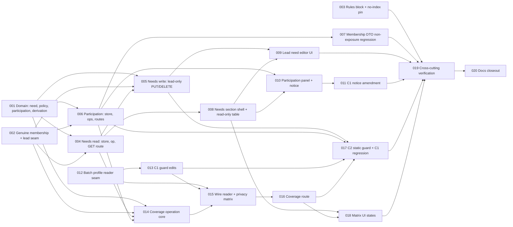

# Team Skill Needs and Privacy-Thresholded Coverage (C2) — Tasks

Specification: [SPEC.md](./SPEC.md) (Approved, revision 2; P1–P6 closed; no open questions)

## Status
Ready: 3  In Progress: 0  Done: 17

Total tasks: **20**. Repository convention (`implement-task`): the only states are `Ready`,
`In Progress`, `Done`; a task whose dependencies are not `Done` stays `Ready` and is skipped until they
are. **Unblocked now (dependencies satisfied):** TASK-018.

Task-splitting ground rules (apply to **every** task):

- **Do not reopen P1–P6 or redesign C2.** If implementation proves the SPEC contradictory or unsafe,
  **stop and report** the affected SPEC sections; never weaken a `docs/SECURITY.md` invariant, never
  work around a guard, never add a bypass "to make it work".
- No Firebase access, seed, migration, backfill or deploy. Tests use injected `*Deps` / in-memory
  fakes (the in-memory Firestore in `membership-role-regression.test.ts` is the precedent for exercising
  production default collections). Rules deployment is a separate explicit step and is **not** part of any
  task.
- **No** new dependency, env var/config, composite index (`firestore.indexes.json` unchanged), cache,
  background job, persisted aggregate/history, Demo Team fixture change, chart, or change to
  `authorizeTeamAccess`, `resolveTeamRole`, `listSkillTrees`, `skillProgress`, roadmap, F0 role
  management, or any C1 owner API/route.
- **Fixed `k = 5` (P2)** is the code constant `SKILL_COVERAGE_MIN_CONTRIBUTORS`; no env, setting, request
  parameter or UI may change it. **Notice version (P1)** is the code constant
  `SKILL_CONTRIBUTION_NOTICE_VERSION = 1`. **Both live only in
  `src/features/team-skills/domain/skill-coverage-policy.ts`** (one owner; client, server and tests import
  them — the literals `5` and `1` are never duplicated).
- **Coverage is derived, never stored** (BR-20). **No** `skillProgress`/`roadmapItems` read or write,
  no assignment/notification/goal/roadmap creation (BR-24). **No** D1/D2 concepts.
- **C2 never mutates C1 data** (BR-23): no PUT/DELETE of a personal level, no profile reset/repair, no
  timestamp change, no consent in `skillProfiles`.
- Authorization is **three separate permissions** (read need / write need / read coverage) plus participation
  — never one combined `canEdit`. App-admin status never grants write, coverage or participation, and never
  removes a genuine membership's capability. `authorizeTeamAccess` is used **only** for need *read*;
  coverage, need writes and participation use the genuine-membership seam of TASK-002.
- Responses are built field by field from allow-lists; never a `uid`, e-mail, display name, `memberRef`,
  membership id, audit field, `consentedAt`, a spread, or a raw document (BR-22). Logs carry only generic
  failure categories (no levels, tree ids, names, needs, participation).
- Dependency direction: `team-skills → skill-trees/domain, teams/domain, skill-profiles (level domain +
  the single batch module, TASK-015 only)`. Never the reverse; `team-skills` never imports
  `skill-profiles/server/**` except in `get-team-skill-coverage.ts`.
- Follow `.claude/rules/**`. Read the relevant `node_modules/next/dist/docs/` guide before writing route/page
  code (`AGENTS.md`). Norwegian copy lives in `src/features/team-skills/copy.ts`.
- Every task ends with `pnpm typecheck`, `pnpm lint`, `pnpm test` (and `pnpm build` where noted), then an
  inspection of `git diff`. Use the actual scripts in `package.json`.
- Interim note: routes become reachable from TASK-004 onward and UI from TASK-008; the feature is complete only
  after TASK-019. Nothing is deployed between tasks. The coverage reader (TASK-015) is not reachable until its
  route (TASK-016); the C1 notice amendment (TASK-011) follows the participation UI (TASK-010) so the copy is
  never ahead of the behaviour.

## Seams verified in the repository (task notes rely on these)

- `authorizeTeamAccess` and `resolveTeamRole` return `admin` **before** looking at membership (even for an
  admin holding a lead membership); both stay untouched. Reusable pure helpers: `isValidTeamStatus`,
  `isValidMembershipFor`, `membershipRoleOf`, `membershipDocId` (`src/features/teams/domain/`).
- Membership has no status field; removal is a hard delete (`remove-team-member.ts`); an existing membership
  is never overwritten by a grant (`applyMembershipGrant`) and a rejoin writes a fresh record. Membership
  field updates use a transaction + `tx.update` with `FieldValue.delete()` (`set-team-member-role.ts`).
  Memberships are listed with `where("teamId","==",…).limit(n)` (auto-indexed; roster uses 500/501).
- C1: `skill-profile-store.ts` (`SkillProfileStore` + `getDefaultSkillProfileStore`, collection constant),
  `fake-skill-profile-store.ts`, `skill-catalog.ts` (raw-window catalog, `toCandidateSkillTree`),
  domain `readSkillProfileRecord`, `isSelfAssessedLevel`, `SELF_ASSESSED_LEVEL_MEANINGS`. C1 guard:
  `src/features/skill-profiles/skill-profiles-scope-guard.test.ts` (Dimension 1 `APPROVED_COLLECTION_REFERENCES`,
  Dimension 2 `APPROVED_SERVER_IMPORTERS`, route checks, forbidden-identifier list that bans the words
  `aggregate`, `threshold`, `consent`, `matrix`, `sharing`, `history`, … in C1 production code, virtual
  negative fixtures). C1 notice text is pinned in `skill-profiles/copy.ts`,
  `SkillProfilePage.test.tsx` and `skill-profiles-cross-cutting.test.ts`.
- Team page: `TeamDetail.tsx` renders `TeamSkillSection` (inside `RoadmapPlanningScope`) at two render sites,
  then `TeamRosterSection`; self-loading sections follow the `TeamRosterSection` pattern
  (`token`, `teamId`, auth-gated resource). Team nav stays `Oversikt · Roadmap`.
- `firestore.rules` has an explicit deny block per collection before the catch-all;
  `src/lib/firebase/firestore-deployment-config.test.ts` pins each block and asserts "no composite index".
- Demo seed writes the presenter membership by full-replace `set` and no `role` (`demo-team/plan.ts`).
- **Catalog-read decision (SPEC delegated it):** the member-readable bounded catalog read is **duplicated
  minimally inside `src/features/team-skills/server/`** (own reader seam; reuses `isValidSkillTree`; a parity
  test against `list-skill-trees.ts`' candidate mapping, as C1 did). `list-skill-trees.ts` and C1's
  `skill-catalog.ts` are neither refactored nor imported.
- **Store seams (fixed so the guard sets are exact):** `server/skill-needs-store.ts` is the only production file
  naming the `teamSkillNeeds` collection; `server/skill-contribution-store.ts` is the only production file that
  writes or lists membership documents for C2; the literal field name `skillContribution` appears in production
  only in `domain/skill-contribution.ts` (exported constant `SKILL_CONTRIBUTION_FIELD` and the pure accessor
  `readSkillContribution`/`isEffectiveSkillContribution`).

## Task graph

**Order rationale.** Roots: 001 (pure domain), 002 (authorization seam), 003 (rules pin, behaviour-neutral)
and 012 (batch reader, touches only C1 internals) are independent. Needs are delivered first without any
personal data (004 read → 005 lead-only write), so lead authorization is exercised and reviewed before any
profile reader exists. Participation (006) is a separate, owner-only write on the membership; its
non-exposure regression (007) is a narrow review of other DTOs. The profile reader (012) and its C1 guard edits
(013) are isolated from aggregation (014 core with an **injected levels-reader seam**, no production default;
015 wires the one approved reader and owns the end-to-end privacy matrix). UI follows its server contract:
needs UI 008/009 after 004/005, participation UI 010 after 006, matrix states 018 after the coverage route 016.
The C1 notice amendment (011) follows 010. 017 (C2 static guard) runs when all production files exist; 019 is
cross-cutting verification (no new behaviour); 020 is last. The final feature-wide review is a **separate
post-closeout step** (`/review-change` / `security-review`), not an implementation task.

## SPEC coverage

| BR | Owner task(s) | Notes |
| --- | --- | --- |
| BR-1 need identity/fields/validity | 001 (domain, id vs stored `teamId`/`treeId`), 004 (skip invalid on read), 005 (write shape) | |
| BR-2 need domain (levels 2–4, coverage 1–20) | 001, 005 (`400` mapping) | |
| BR-3 need semantics, no skillProgress/roadmap coupling | 001, 017 (no imports), 019 | |
| BR-4 need read + `viewer` hints + member catalog | 004 (server), 008 (UI) | |
| BR-5 lead-only write | 002 (seam), 005 (server/routes), 009 (UI) | **narrow review** |
| BR-6 need lifecycle (disabled, tree invalid) | 004 (read), 005 (write `team_disabled`), 014 (coverage) | |
| BR-7 participation model (exact shape, presence = opt-in) | 001 (shape/guard), 006 | |
| BR-8 notice version | 001 (constant + rule), 006 (enforced on write), 010 (UI), 014/015 (effective consent) | |
| BR-9 participation API | 006 | **narrow review** |
| BR-10 non-exposure | 007 (+006 own state only) | |
| BR-11 lifecycle | 006 (removal/rejoin/re-grant/role change with production grant/remove code), 014/015 (disabled team, multi-team, reset) | |
| BR-12 eligible contributor | 014 (selection), 015 (real reader end-to-end) | |
| BR-13 fixed `k = 5` per skill | 001 (constant, `n` rule), 014 | |
| BR-14 derivation | 001 (pure), 014 (per-need), 015 | |
| BR-15 output allow-list | 014 (DTO), 015 (negative deep scans), 017 (key set) | |
| BR-16 no query-time inputs | 016 (route), 014 | |
| BR-17 indistinguishable suppression | 015 | |
| BR-18 genuine-membership ordering | 002 (seam), 005, 006, 014, 016 | **narrow review** |
| BR-19 completeness / `incomplete` | 014 | |
| BR-20 no persistence/cache | 014 (write counters = 0), 017, 019 | |
| BR-21 privacy contract (residual risks stated, no prevention claim) | 010 (notice), 019 (copy scan), 020 (docs) | |
| BR-22 field-by-field responses | 004, 005, 006, 014, 017 | |
| BR-23 write boundary / no C1 mutation | 012, 013, 015, 017 | |
| BR-24 no automatic action / independence | 014, 017, 019 | |
| BR-25 participation panel + notice | 010 | |
| BR-26 needs + matrix | 008, 009, 018 | |
| BR-27 states | 008 (needs/empty/read-only), 018 (coverage states) | |
| BR-28 accessibility | 008, 009, 010, 018, 019 | |
| BR-29 C1 notice amendment | 011 | |
| BR-30 Dimension 1 / no new naming file | 012, 013, 017 | |
| BR-31 single reader module | 012 | |
| BR-32 importer maps, identifier/re-export scans | 013 | |
| BR-33 negative fixtures | 013 | |
| BR-34 C2 guard | 017 | |
| BR-35 rules + indexes | 003 | |

**Acceptance-criteria ownership** (SPEC "Acceptance criteria" → task): no sensitive fields in responses → 014/015/017;
levels read only under effective participation → 014/015; participation shape/lifecycle → 001/006/007; fixed `k` and
per-skill threshold, indistinguishable suppression → 001/014/015; output states and `gap` when
`requiredCoverage` > cohort → 001/014; no query params → 016; need read/write matrix → 004/005; coverage read →
014/016; lead gains nothing else → 005/017; `incomplete`/read failure → 014; no persistence → 014/017; no C1
mutation → 012/015/017; reader isolation + guard → 012/013/017; C1 notice → 011; table semantics, text states,
keyboard, narrow layout → 008/009/010/018/019; notice carries the ten points → 010; no Demo/env/dependency/index →
003/019; verification gates → every task, 020.

**Required test classes (user list) → owner:** cohort sizes 0/1/4/5/6+ and threshold → 001 (pure), 014 (operation);
all below / exactly `requiredCoverage` at-or-above / one below / `requiredCoverage` > cohort → 001, 014; unassessed and
unreadable → 014 (fake reader), 015 (real reader); invalid consent version, withdrawn, removed, multiple teams, disabled
team → 014; missing / malformed SkillTree → 014; no returned counts and DTO negative assertions → 015 (deep key scan),
017 (key set). Need read / write, coverage and participation authorization matrices → 004 / 005 / 014 (+016 route) /
006. `area_unavailable` isolation → 014 (owner) and 015.

---

### TASK-001 — Team-skills domain: policy constants, need model, participation rule and coverage derivation

**Status:** Done
**Covers:** BR-1, BR-2, BR-3, BR-7, BR-8, BR-13, BR-14 (domain parts)
**Depends on:** None

**Outcome**
A pure, fully tested domain slice `src/features/team-skills/domain/` that every later task imports: the two
policy constants, the need record/validation, the participation record/rule, and the coverage derivation with a
type-level separation between privacy outcomes and the non-personal integrity state.

**Implementation notes**
- `skill-coverage-policy.ts` — **sole owner** of `SKILL_COVERAGE_MIN_CONTRIBUTORS = 5`,
  `SKILL_CONTRIBUTION_NOTICE_VERSION = 1`, `TEAM_SKILL_COHORT_SCAN_MAX = 500`. No `process.env`, no setting, no
  parameter. A test pins `=== 5` and `=== 1` so a change is a deliberate, reviewed edit.
- `skill-need.ts` — `SkillNeedRecord { teamId, treeId, requiredLevel, requiredCoverage, createdAt, updatedAt }`
  (exactly these keys; a compile-time exhaustive key map like the roadmap guard), `skillNeedDocId(teamId, treeId)`
  (`${teamId}__${treeId}`, never parsed), `isValidSkillNeed(data, { docId })` (fail-closed: well-formed ids whose
  composite equals the document id; `requiredLevel ∈ {2,3,4}` integer; `requiredCoverage` integer in `[1,20]`; valid
  timestamps; never throws; `1`, `5`, `"3"`, `2.5`, `null`, `21` rejected), `parseSkillNeedInput(body)` (strict
  allow-list: keys exactly `requiredLevel`, `requiredCoverage`; envelope vs value errors map to `invalid_request` /
  `invalid_input` — **no** `1` for level). No actor, owner, archive, status or derived fields exist in the type.
- `skill-contribution.ts` — `SKILL_CONTRIBUTION_FIELD = "skillContribution"`, `SkillContributionRecord { noticeVersion,
  consentedAt }`, `readSkillContribution(rawMembership)` and `isEffectiveSkillContribution(rawMembership)` (effective
  iff the object has **exactly** the keys `noticeVersion` and `consentedAt`, `noticeVersion` is an integer
  **strictly equal** to `SKILL_CONTRIBUTION_NOTICE_VERSION`, `consentedAt` is a valid date/Timestamp-like; an
  `enabled`-style key, extra key, other version, string version, missing/invalid timestamp, array/`null` ⇒ not
  effective). This is the **only production file that contains the literal `skillContribution`**. No "enabled:false"
  concept anywhere.
- `skill-coverage.ts` — `CoverageState = "covered" | "gap" | "insufficient_data"` (privacy outcomes only) and a
  **separate** type `NeedIntegrityState = "area_unavailable"`; `CoverageRowState = CoverageState | NeedIntegrityState`
  is defined only for DTO row typing. `deriveCoverageState({ requiredLevel, requiredCoverage, levels })` takes
  **only** a `readonly number[]` of plain integers for one tree and the two need numbers — no uid/profile/identity —
  and **never returns `area_unavailable`** (its return type excludes it): `n < SKILL_COVERAGE_MIN_CONTRIBUTORS` ⇒
  `insufficient_data`; else `count(level >= requiredLevel) >= requiredCoverage` ⇒ `covered`; else `gap` (including
  `requiredCoverage > n`). Defensive: non-integers / out-of-range inputs are excluded from `n` by the caller contract
  and the function rejects (never coerces) them — document the contract in the type.
- Level labels/meanings are **not** duplicated: import `SELF_ASSESSED_LEVEL_MEANINGS`/`isSelfAssessedLevel` from
  `src/features/skill-profiles/domain/` (domain import only; allowed).
- No average/overall/score function exists (BR-3); no counts leave `deriveCoverageState`.

**Verification**
- Vitest domain tests (no mocks): constants pinned; need validation table (valid/invalid levels, coverage bounds
  `0`, `1`, `20`, `21`, non-integers, missing keys, extra keys, id mismatch, bad timestamps); `parseSkillNeedInput`
  envelope vs value; participation rule (valid, version 0/2/"1", missing/extra/`enabled` keys, bad timestamp,
  non-object); `deriveCoverageState` for `n` = 0, 1, 4, 5, 6 and for all-below, exactly `requiredCoverage` at/above,
  one below, `requiredCoverage` larger than `n` (⇒ `gap`, with `n ≥ 5`); a type-level/runtime test that the function
  can never produce `area_unavailable`.
- `pnpm typecheck`, `pnpm lint`, `pnpm test`.

**Security / privacy**
Owns the fixed threshold and the fail-closed consent rule. `area_unavailable` is structurally outside the
derivation so it cannot become a privacy-threshold side channel (BR-14, BR-17).

**Documentation impact**
None in this task.

**Acceptance criteria**
- [x] `k = 5`, notice version `1` and the scan bound live only in `skill-coverage-policy.ts` and are pinned by tests.
- [x] Need record has exactly the six approved keys; validation matches BR-1/BR-2 and rejects `requiredLevel = 1`.
- [x] Participation is effective only for the exact `{noticeVersion, consentedAt}` shape at the current version.
- [x] Derivation uses only plain integers, returns only privacy outcomes, and never returns counts or `area_unavailable`.
- [x] No conflict with `docs/SECURITY.md`; relevant tests pass.

---

### TASK-002 — Genuine team-membership and lead check (admin-independent authorization seam)

**Status:** Done
**Covers:** BR-18, BR-5 (authorization seam), BR-9 (authorization part)
**Depends on:** None

**Outcome**
A reusable server seam `src/features/team-skills/server/genuine-team-membership.ts` that answers, from fresh
reads and **without consulting app-admin status**, whether the verified caller is a genuine member and/or a genuine
lead of a team, plus the team status, with a defined error ordering. It does not change `authorizeTeamAccess` or
`resolveTeamRole`.

**Implementation notes**
- `resolveGenuineTeamMembership(identity, teamId, deps)` returns `{ ok: true, relationship: "denied" | "member" |
  "lead", teamStatus: "active" | "disabled" }` or `{ ok: false, error: "read_failed" }`. Order (BR-18): team doc read —
  missing/invalid status ⇒ `denied` for everyone; membership doc read by `membershipDocId(uid, teamId)` +
  `isValidMembershipFor` — invalid/absent ⇒ `denied` **regardless of app-admin status**; `lead` iff
  `membershipRoleOf(membership) === "lead"` (a stored lead on a disabled team is reported as `lead` here with
  `teamStatus: "disabled"`; callers decide — operations map: coverage/write/opt-in require `active` ⇒ `team_disabled`
  after membership is proven; a non-member never learns `team_disabled`).
- Provide small helpers `requireGenuineMember` / `requireGenuineLead` returning a discriminated result
  (`forbidden` | `team_disabled` | `read_failed` | ok) so every C2 operation uses the same ordering (verify-token →
  team → membership → role → status).
- Read seam `{ getTeamStatus, getMembership }` injectable; default reads the two documents with the Admin SDK (mirror
  the defaults in `authorize-team-access.ts`; do **not** import `resolveTeamRole`). Needs-write operations re-run the
  checks **inside their own transaction** (TASK-005); this seam is the shared, testable decision logic.
- Do not import `isAppAdmin`/`allowList`; a static assertion in TASK-017 forbids it.

**Verification**
- Tests: ordinary member; lead; **lead + app admin** (a caller on the admin allow-list holding a lead membership ⇒
  `lead`); **member + app admin** ⇒ `member`; **non-member app admin** ⇒ `denied`; non-member ordinary user ⇒ `denied`;
  removed member ⇒ `denied`; disabled team with member and with stored lead (`teamStatus: "disabled"`, role still
  reported but never enough for active-only operations); non-existent team; invalid team status; invalid/foreign
  membership document; read failures from either read ⇒ `read_failed` (never `denied`); the allow-list is never
  consulted (spy).
- `pnpm typecheck`, `pnpm lint`, `pnpm test`.

**Security / privacy**
**Narrow review required** (lead-only write foundation, admin-first pitfall). Fails closed; never trusts client
role/team/uid.

**Documentation impact**
None in this task (SECURITY.md in TASK-020).

**Acceptance criteria**
- [x] Genuine member and lead are decided from fresh membership state only; app-admin status never grants or removes either.
- [x] Lead + app admin is `lead`; non-member admin is `denied`.
- [x] Error ordering and `read_failed` vs `denied` distinction implemented and tested.
- [x] `authorizeTeamAccess` / `resolveTeamRole` unchanged.
- [x] No conflict with `docs/SECURITY.md`; relevant tests pass.

---

### TASK-003 — Explicit deny-only Firestore block for `teamSkillNeeds` and no-index pin

**Status:** Done
**Covers:** BR-35
**Depends on:** None

**Outcome**
`firestore.rules` has an explicit, behaviour-neutral deny-only block for `/teamSkillNeeds/{document=**}` before the
catch-all, pinned by the deployment-config test, with an assertion that no composite index exists for it.

**Implementation notes**
- Add the block with the repository's usual explanatory comment; `allow read, write: if false;`. No change to
  `skillProfiles`, `teamMemberships` or any other block. `firestore.indexes.json` **unchanged** — the planned queries
  are single-field (`teamSkillNeeds where teamId ==` limit 501; memberships `where teamId ==` limit 501; profiles by
  document id; trees by direct get). Add to the config test: block pinned and ordered before the catch-all, no other
  rule mentions `teamSkillNeeds`, and `indexes.indexes.filter(collectionGroup === "teamSkillNeeds")` is empty
  (as for `userProfiles`/`skillProfiles`). Do not deploy.

**Verification**
- Extend `src/lib/firebase/firestore-deployment-config.test.ts`; `pnpm typecheck`, `pnpm lint`, `pnpm test`.

**Security / privacy**
Server-only access to team needs; no client Firestore access (and none to `skillProfiles` / participation).

**Documentation impact**
None in this task.

**Acceptance criteria**
- [x] Explicit deny block present before the catch-all and pinned by a test.
- [x] No composite index for `teamSkillNeeds`; `firestore.indexes.json` unchanged.
- [x] No deploy performed; no other rule changed.
- [x] No conflict with `docs/SECURITY.md`; relevant tests pass.

---

### TASK-004 — Team skill needs read: store seam, member-readable catalog and `GET /api/teams/[teamId]/skill-needs`

**Status:** Done
**Covers:** BR-1 (read validity), BR-4, BR-6 (read), BR-22
**Depends on:** TASK-001, TASK-002

**Outcome**
Any genuine team member, lead or app admin can read a team's valid needs (disabled teams included) together with the
bounded catalog and server-derived `viewer` hints; unrelated users cannot.

**Implementation notes**
- `server/skill-needs-store.ts` — the **only production file naming `teamSkillNeeds`**: `listNeeds(teamId, limit)`
  (`where("teamId","==",teamId).limit(501)`, no composite index), `getNeed(docId)`, transactional `put`/`delete` hooks
  added in TASK-005. Raw documents are mapped (Timestamp → Date) and validated with `isValidSkillNeed(data, { docId })`;
  invalid/mismatched documents are **skipped**, never repaired, never coerced, never returned. 501st raw document ⇒
  `needsTruncated: true` (the first 500 are the window).
- `server/skill-need-catalog.ts` — minimal duplicate of the C1 raw-window catalog read (`orderBy createdAt asc
  limit 501`, first 500 candidate window, no refill, `isValidSkillTree`), returning `{treeId, name}` + `catalogTruncated`;
  parity test with `list-skill-trees.ts`' candidate mapping; **no** import of `skill-profiles/server/**`.
- `server/list-skill-needs.ts` — `listSkillNeeds(token, teamId, deps)`: `verifyIdToken` (401) → `authorizeTeamAccess`
  (`member`/`admin` pass; `denied` ⇒ 403; failed read ⇒ `read_failed`) — **this is the only C2 use of
  `authorizeTeamAccess`**. Resolve each need's tree directly (`skillTrees/{treeId}`): valid ⇒ `areaName`, missing/invalid
  ⇒ `areaAvailable:false, areaName:null`. `viewer = { canManageNeeds, canReadCoverage }` computed from TASK-002's seam as
  **two separate booleans** (`canManageNeeds` = genuine lead ∧ team active; `canReadCoverage` = genuine member ∧ team
  active; an admin-only caller gets both `false`); hints are never authority. `GET` never writes.
- Route `app/api/teams/[teamId]/skill-needs/route.ts` — `GET` only: thin delegate, bearer extraction, status map
  (`unauthenticated`→401, `forbidden`→403, `read_failed`→500), response
  `{ needs:[{treeId,areaName,areaAvailable,requiredLevel,requiredCoverage}], catalog:[{treeId,name}], catalogTruncated,
  needsTruncated, viewer }` built field by field (no ids, timestamps, audit or uid). No other method exported.

**Verification**
- Operation tests with fakes: member, lead, app admin (non-member), unrelated user (403), signed-out (401), **disabled
  team readable** by member/lead/admin, non-existent team 403, read failures 500; invalid/mismatched/foreign-team need
  documents skipped; tree missing/malformed ⇒ `areaAvailable:false`; truncation flags; `viewer` combinations (lead/active,
  lead/disabled, member, admin-only, lead+admin); `GET` writes nothing; catalog parity test.
- Route tests: status mapping, allow-listed keys deep-scanned (no uid/e-mail/name/memberRef/audit/timestamps), no
  other method.
- `pnpm typecheck`, `pnpm lint`, `pnpm test`.

**Security / privacy**
Need **read** authorization only; read and write permissions are kept separate. No personal data is touched.

**Documentation impact**
None in this task.

**Acceptance criteria**
- [x] Member, lead and app admin can read needs; unrelated users and signed-out callers cannot; disabled teams are readable.
- [x] Invalid/mismatched need documents are skipped; unavailable trees surface only as `areaAvailable:false`.
- [x] `viewer.canManageNeeds` and `viewer.canReadCoverage` are separate server-derived hints (admin-only ⇒ both false).
- [x] Response contains only the allow-listed keys; `GET` writes nothing; no composite index needed.
- [x] No conflict with `docs/SECURITY.md`; relevant tests pass.

---

### TASK-005 — Lead-only need management: `PUT` / `DELETE /api/teams/[teamId]/skill-needs/[treeId]`

**Status:** Done
**Covers:** BR-1, BR-2, BR-5, BR-6 (write), BR-18, BR-22
**Depends on:** TASK-001, TASK-002, TASK-004

**Outcome**
A genuine lead of an **active** team can create/replace and hard-delete a need; ordinary members, non-member admins,
unrelated users and every disabled-team caller cannot. This is the one deliberate narrow lead capability.

**Implementation notes**
- `upsert-skill-need.ts` / `delete-skill-need.ts`, each one Firestore transaction (reads before writes) with the checks
  in the **BR-5 order**: verified token → team exists with valid status → genuine membership (`403` otherwise, without
  consulting app-admin status) → role exactly `lead` (`403`) → team `active` (`409 team_disabled`) → `PUT` only: target
  tree read directly and `isValidSkillTree` (`404 skill_unavailable`). Decision logic is TASK-002's seam; the transaction
  re-reads inside the transaction so decision and write are never separated.
- `PUT` body strict (`parseSkillNeedInput`; `400 invalid_request` envelope / `400 invalid_input` values). Upsert via the
  store: create sets `createdAt` and `updatedAt`; replace keeps a valid `createdAt` and sets `updatedAt`; writes exactly
  the six keys (no actor/audit); a corrupt existing document is replaced wholesale. Returns the need view.
- `DELETE`: idempotent hard delete, no body read, no tombstone/archive; allowed for a stale/invalid area; writes nothing
  when absent. Same lead + active-team checks.
- Route `app/api/teams/[teamId]/skill-needs/[treeId]/route.ts` exporting only `PUT` and `DELETE`; `treeId` shape check
  (`isWellFormedTreeId`-style; malformed ⇒ `404 skill_unavailable`); status map per SPEC API table.
- **No admin bypass, no automatic lead assignment, no `resolveTeamRole` / `authorizeTeamAccess` use** in either operation.

**Verification**
- Operation tests (real in-memory transaction fake): **ordinary member denied**, **lead allowed**, **lead + app admin
  allowed (genuine lead membership)**, **member + app admin denied**, **non-member admin denied**, unrelated denied,
  signed-out 401, **disabled-team lead ⇒ 409**, ordinary member on disabled team ⇒ 403 (role before status), removed lead ⇒
  403, demoted lead ⇒ 403 on the next call, non-existent team, tree missing/malformed ⇒ 404, validation matrix
  (level 1, 5, `"3"`, 2.5; coverage 0, 21, 2.5; extra/missing keys; non-object body), `createdAt` preserved on replace,
  idempotent `DELETE`, no tombstone, stored shape has exactly six keys, concurrent `PUT`s last-write-wins, a team without a
  lead cannot write (no admin bypass), failed reads/writes ⇒ 500 and nothing partially written.
- Route tests: methods, status mapping, body handling, no uid/team/role from body.
- `pnpm typecheck`, `pnpm lint`, `pnpm test`.

**Security / privacy**
**Narrow review required** — introduces the first lead-only capability; confirms it is limited to managing
`teamSkillNeeds`, is not generic, and touches no profile or aggregate. Residual malicious-lead oracle is accepted (BR-21)
and **no** throttling/cooldown/history is added.

**Documentation impact**
None in this task (SECURITY/PRODUCT in TASK-020).

**Acceptance criteria**
- [x] Only a genuine lead of an active team can create, replace or delete a need; every other caller/state is rejected as specified.
- [x] Lead + app admin succeeds on lead membership; admin status alone never grants write.
- [x] Disabled-team lead cannot write (`team_disabled`); no admin bypass or auto lead assignment exists.
- [x] Stored need has exactly the approved fields; `DELETE` is a hard delete without tombstone.
- [x] No conflict with `docs/SECURITY.md`; relevant tests pass.

---

### TASK-006 — Owner-controlled participation: membership store, operations and `skill-contribution` routes

**Status:** Done
**Covers:** BR-7, BR-8, BR-9, BR-11, BR-18, BR-22
**Depends on:** TASK-001, TASK-002

**Outcome**
A genuine member can read their own participation state, opt in to one team (with the current notice version) and
withdraw; participation is destroyed with the membership and absent after a rejoin.

**Implementation notes**
- `server/skill-contribution-store.ts` — the only production file that writes the participation field or lists
  memberships for C2: transactional `readForCaller(uid, teamId)` (membership + team status), `setField(object)` using
  `tx.update` of **only** the field named by `SKILL_CONTRIBUTION_FIELD` (never `set`/replace of the document, so `role`,
  `memberRef`, `createdAt`, `createdVia`, `grantedBy`, `roleUpdated*` and unknown future fields survive), `deleteField()`
  using `FieldValue.delete()` (**no** `enabled:false`, no negative state), and `listMembershipsForCoverage(teamId, limit)`
  (`where teamId ==`, raw docs; consumed by TASK-014). The field name literal is **not** written here — use the domain
  constant.
- `get-own-skill-contribution.ts` → `{ contributing, canOptIn }` (own state via `isEffectiveSkillContribution`; `canOptIn`
  = genuine member ∧ team `active`); `set-own-skill-contribution.ts` — body strictly `{ noticeVersion }`; version ≠
  `SKILL_CONTRIBUTION_NOTICE_VERSION` ⇒ `409 notice_outdated`; requires genuine membership **and** `active` team (`409
  team_disabled`); writes `{ noticeVersion, consentedAt: now }` (re-opt-in overwrites); `withdraw-own-skill-contribution.ts`
  — idempotent delete of the field, genuine membership only (any team status), body ignored, no update when the field is
  already absent. The subject is always the verified token's uid; no uid/teamId-as-subject from the client. Non-members
  (including app admins) ⇒ `403`. Uses TASK-002's ordering.
- Route `app/api/teams/[teamId]/skill-contribution/route.ts` exporting only `GET`, `PUT`, `DELETE`; responses
  `{ contributing, canOptIn }` / `{ contributing:true }` / `{ contributing:false }`; status map per SPEC. Never returns
  `consentedAt`, other members' state, a list, or any membership field.
- Lifecycle is proved with **production** grant/remove/role code over the in-memory Firestore (as
  `membership-role-regression.test.ts`): removal deletes the document and with it participation; a rejoin is a fresh
  record with no participation; re-grant of an existing membership is a no-op that leaves participation; lead
  assignment/demotion and `memberRef` preparation leave it untouched; opt-in does not alter `role`/`memberRef`/timestamps.

**Verification**
- Operation + route tests: owner member opts in/out (`noticeVersion` current), stale/other/`"1"`/missing version ⇒ 400/409,
  extra keys ⇒ 400, signed-out 401, **another member cannot mutate the caller's participation (no uid input exists)**,
  **non-member admin cannot mutate** (403), unrelated user 403, **disabled team: opt-in 409, withdraw succeeds**, withdraw
  idempotent/no write, effective-consent rule via the domain function, unrelated membership fields preserved byte-for-byte,
  removal/rejoin/re-grant/role-change lifecycle, multi-team independence (opt in to Team A leaves Team B absent), version
  bump (simulated constant) lapses without auto-upgrade, no `enabled:false` ever written, GET writes nothing.
- `pnpm typecheck`, `pnpm lint`, `pnpm test`.

**Security / privacy**
**Narrow review required** — member-originated write on the authorization collection: exactly one field, owner-only,
transaction-verified, never exposes other members' state; consent belongs to the membership, not `skillProfiles`.

**Documentation impact**
None in this task.

**Acceptance criteria**
- [x] Opt-in writes exactly `{ noticeVersion, consentedAt }` at the current version; withdrawal deletes the object (no negative state, no history).
- [x] Only the caller can change their own participation; admins and other members cannot; opt-in needs an active team, withdrawal does not.
- [x] Role, `memberRef`, timestamps and unknown membership fields are preserved; the document is never replaced.
- [x] Removal destroys participation; a rejoin requires a new opt-in; the same person can differ per team.
- [x] Old-version participation is ineffective and never auto-upgraded.
- [x] No conflict with `docs/SECURITY.md`; relevant tests pass.

---

### TASK-007 — Membership-derived DTO non-exposure regression for participation

**Status:** Done
**Covers:** BR-10, BR-22
**Depends on:** TASK-006

**Outcome**
Automated evidence that no existing membership-derived response can leak a member's participation state or
`consentedAt`.

**Implementation notes**
- Add regression tests (no production behaviour change expected) that build membership fixtures **carrying a valid
  `skillContribution`** and assert it never appears in: `listTeamRoster`, `listAssignableMembers`, `listTeamMembers`
  (admin member list), the access-request/invitation list responses that include membership-derived data, and the F0/A
  routes' JSON bodies (deep key scan for `skillContribution`, `noticeVersion`, `consentedAt`, `contributing`). Also assert
  the admin member-refs preparation and role-change operations preserve the field.
- If a leak is found, **fix the single leaking mapper** (field-by-field allow-list) — and report it; do not widen scope.
- Assert participation state is returned only by `GET …/skill-contribution`, only for the caller.

**Verification**
- Tests as above; `pnpm typecheck`, `pnpm lint`, `pnpm test`.

**Security / privacy**
**Narrow review required** — admin visibility of who contributes is explicitly forbidden (BR-10).

**Documentation impact**
None in this task.

**Acceptance criteria**
- [x] No roster, assignable-members, admin member list, access-request or F0/A response contains participation data.
- [x] Participation is readable only by its owner through the single own-state endpoint.
- [x] Any needed mapper fix is minimal and reported.
- [x] No conflict with `docs/SECURITY.md`; relevant tests pass.

---

### TASK-008 — «Kompetansebehov og dekning» section on Oversikt: gateway and read-only needs table

**Status:** Done
**Covers:** BR-4 (UI), BR-26, BR-27 (needs/empty/read-only), BR-28
**Depends on:** TASK-004

**Outcome**
Team Oversikt shows a new section after *Kompetanseområder* with a semantic table of the team's needs
(*Kompetanseområde / Behov / Dekning*), plus empty and read-only states. The coverage column reads «Dekning er ikke
tilgjengelig ennå» until TASK-018. No new route and no team-nav change.

**Implementation notes**
- `client/team-skills-gateway.ts` (browser `fetch` with bearer token; `fetchSkillNeeds`), `copy.ts` (Norwegian copy,
  approved terminology: *Kompetansebehov*, «Minst {r} bidragsytere på nivå «{nivånavn}» eller høyere», level names from
  C1 labels, levels 2–4 only), `components/TeamSkillNeedsSection.tsx` (self-loading like `TeamRosterSection`; mounted after
  `TeamSkillSection` at **both** render sites in `TeamDetail.tsx`; not rendered for access-denied/request states).
- One `<table>` with `<caption>`, `<th scope="col">`/`<th scope="row">`; **rows = needs only, no employee rows or
  person cells**; below `sm` each row is a stacked card (`dl`) with the same text; `area_unavailable`-style integrity row
  (`areaAvailable:false`) shows «Kompetanseområdet er ikke lenger tilgjengelig». States: loading, empty («Ingen
  kompetansebehov er registrert.» + neutral «Teamledere registrerer behov.»), read error with retry, read-only (non-lead
  member/admin/disabled team: no editing controls, one-line reason), `needsTruncated` notice.
- Reuse `Alert`, `EmptyState`, `LoadingState`; no business logic in `src/components/ui`.

**Verification**
- Component tests: states above, table semantics (caption, scope), stacked-card text parity, text-not-colour, no
  employee/person wording, lead vs member vs admin rendering, token/team change resets state; `TeamDetail` renders the
  section at both sites and nothing for denied states; copy has no counts/evaluative/performance words.
- `pnpm typecheck`, `pnpm lint`, `pnpm test`.

**Security / privacy**
UI only; hints are not authority (server re-authorizes). No personal data.

**Documentation impact**
UI-UX closeout in TASK-020.

**Acceptance criteria**
- [x] Section appears on Oversikt after *Kompetanseområder* with no new route/nav change.
- [x] Table has caption/header scope, stacked narrow layout, and text-only statuses.
- [x] Empty, error, read-only, truncated and unavailable-area states are distinct and Norwegian.
- [x] No employee rows or per-person cells exist.
- [x] No conflict with `docs/SECURITY.md`; relevant tests pass.

**Implementation note:** the section is self-loading (`TeamSkillNeedsSection`) and mounted after the roadmap/skill section at both `TeamDetail` render sites. It calls only `GET /skill-needs` and renders its five-field DTO; the coverage column is the fixed text «Dekning er ikke tilgjengelig ennå» (TASK-018 replaces it). `TeamDetail.test.tsx` mocks the needs gateway as pending by default because the required empty-state sentence («…er registrert.») would otherwise collide with that file's loose `/registrert/i` challenge queries. No editing controls exist yet (TASK-009).

---

### TASK-009 — Lead need editor UI (add, edit, delete)

**Status:** Done
**Covers:** BR-5 (UI), BR-26 (management), BR-28
**Depends on:** TASK-005, TASK-008

**Outcome**
When `viewer.canManageNeeds` is true, a lead can add a need (area picker over the catalog excluding areas that already
have a need), change level/coverage and delete a need with an explicit confirmation; everyone else sees no editing
controls.

**Implementation notes**
- Extend the gateway with `putSkillNeed`/`deleteSkillNeed`; `components/SkillNeedEditor.tsx` (keyboard-operable form:
  area `Select`, level `Select` offering levels 2–4 only with C1 names, coverage number input min 1 max 20, visible
  labels, per-row pending/error state, polite live region for saves, `role="alert"` for errors, focus returned sensibly
  after create/delete). Reuse the existing destructive-confirmation pattern for delete (accessible name, focus
  management); delete is a hard delete and says so neutrally.
- Server errors map to calm Norwegian copy (`team_disabled`, `skill_unavailable`, `forbidden`, validation); a `403`/`409`
  refreshes the `viewer` hints (lead demoted/team disabled between load and save).
- Never shows or implies coverage counts; the editor is not a "set a target for a person" control.

**Verification**
- Component tests: lead sees controls; ordinary member/admin/disabled-team see none; add/edit/delete flows with mocked
  gateway; validation bounds; stale-state refresh on 403/409; keyboard operation (tab order, Enter/Space, focus return);
  delete confirmation accessible; labels present; no forbidden copy.
- `pnpm typecheck`, `pnpm lint`, `pnpm test`.

**Security / privacy**
Controls are visibility only; the server decision is TASK-005. Copy states no promise that categorical output prevents
inference.

**Documentation impact**
UI-UX closeout in TASK-020.

**Acceptance criteria**
- [x] Only `viewer.canManageNeeds` users see add/edit/delete; the picker excludes already-needed areas and offers levels 2–4.
- [x] Editor is keyboard-operable with labelled controls, live-region saves and accessible delete confirmation.
- [x] Role/team-state changes surface calmly and refresh hints.
- [x] No conflict with `docs/SECURITY.md`; relevant tests pass.

**Implementation note:** one logical editor (`SkillNeedEditor`, owned by `TeamSkillNeedsSection`) serves the table and the stacked layout; row actions (Endre / Slett via the shared `DeleteConfirmation`) appear only when the server's `viewer.canManageNeeds` is true. The gateway gained the catalog fields of `GET skill-needs` plus `putSkillNeed` / `deleteSkillNeed` over the existing TASK-005 routes (no new route). After every successful write, and after errors that may mean the server's view changed (`forbidden`, `team_disabled`, `skill_unavailable`, unknown), the section re-reads `GET skill-needs`; the coverage column stays the TASK-008 placeholder and the coverage endpoint is not called. A module-level `Set` was avoided because the C2 guard (BR-34 #9) rejects module-level `Map`/`Set`.

---

### TASK-010 — Team-specific participation panel, primary notice and «Slik fungerer personvernet»

**Status:** Done
**Covers:** BR-25, BR-8 (UI), BR-21 (user-facing residual-risk wording), BR-28
**Depends on:** TASK-006, TASK-008

**Outcome**
A genuine member sees, inside the new section, a participation panel that names the team, shows the concise primary
notice and a collapsed «Slik fungerer personvernet» disclosure, and can opt in or withdraw for **that team only**.

**Implementation notes**
- Extend the gateway (`fetchSkillContribution`, `optInSkillContribution`, `withdrawSkillContribution`);
  `components/SkillContributionPanel.tsx`; copy with the SPEC's approved wording (team name interpolated; the number `5`
  imported from the policy constant, **not** typed literally in copy). The panel sends `noticeVersion` imported from
  `skill-coverage-policy.ts`; on `409 notice_outdated` it refetches and shows the current notice.
- States: not contributing / contributing, opt-in pending, error, team disabled (no opt-in control, withdrawal remains),
  not a member/admin-only (panel not shown). Opt-in is never pre-selected, never nagged, never required to view coverage;
  withdrawal needs no confirmation dialog. The two layers: primary notice carries the ten points (optional, per team,
  exact levels not shown, categorical thresholded coverage, at least 5 contributors per skill, not absolute anonymity,
  inference caveat, withdrawal, removal destroys, rejoin needs new opt-in); the `
` carries the longer explanation
  including lead need-editing. No threat-model prose in the primary layer; **no unqualified "anonym"**.
- A person in two teams sees and controls each team's panel independently (state keyed by `teamId`); no global toggle.

**Verification**
- Component tests: wording present (all ten points), team name shown, opt-in/withdraw with mocked gateway, stale version
  handling, disabled team, per-team independence (two teams), no pre-selection, disclosure keyboard-operable, forbidden-copy
  scan (no counts/evaluative words/unqualified "anonym"), version/threshold read from the policy constants (changing the
  mocked constant changes the copy/payload).
- `pnpm typecheck`, `pnpm lint`, `pnpm test`.

**Security / privacy**
The notice is the user-facing half of the P6 residual-risk contract; it must not overpromise.

**Documentation impact**
UI-UX closeout in TASK-020.

**Acceptance criteria**
- [x] Panel is team-specific, shows the approved two-layer notice, and supports opt-in and withdrawal; no global toggle exists.
- [x] The notice states optionality, per-team scope, hidden exact levels, categorical thresholded use, k = 5, non-absolute protection, inference caveat, withdrawal, removal, rejoin.
- [x] Opt-in sends the current `noticeVersion` from the single constant; stale versions are handled.
- [x] No conflict with `docs/SECURITY.md`; relevant tests pass.

**Implementation note:** `SkillContributionPanel` is mounted by `TeamSkillNeedsSection` (keyed by team+token, so a late response for another team/token cannot land) and self-loads `GET skill-contribution`; `canOptIn` from that endpoint alone decides whether the opt-in control exists, never `viewer.canManageNeeds`. `403` renders nothing (non-member admin). After each PUT/DELETE (except `persistence_failed`) the state is re-read, never invented; a failed re-read fails closed. The copy object is named `participationCopy` because the C2 boundary tests forbid the literal membership-field name outside its owner. The existing section tests stub the panel; the C1 notice is untouched (TASK-011).

---

### TASK-011 — Amend the C1 `/me/skills` privacy notice (copy-only)

**Status:** Done
**Covers:** BR-29
**Depends on:** TASK-010

**Outcome**
The C1 notice no longer says nobody can see/use the data; it states that assessments are person-owned, teammates do not
receive exact levels, team contribution is optional, and opted-in assessments may count towards privacy-thresholded team
coverage. C1 behaviour and authorization are unchanged.

**Implementation notes**
- Edit **only** `src/features/skill-profiles/copy.ts` (`privacyNotice`) and the tests that pin the old wording
  (`SkillProfilePage.test.tsx`, `skill-profiles-cross-cutting.test.ts`), using the SPEC's proposed wording or an equivalent
  that preserves the four required meanings and avoids absolute claims. The Norwegian copy must not contain the English
  tokens of the C1 forbidden-identifier list. No new control, link target, team list, membership read or flag on
  `/me/skills`; the page still shows no team information.
- Do not edit C1 routes, store, guard allow-lists or domain.

**Verification**
- Updated copy/component tests; C1 guard and owner-isolation tests still pass unchanged; scan that the notice has no
  "nobody/ingen kan se"-style absolute and no counts/scoring words; `pnpm typecheck`, `pnpm lint`, `pnpm test`.

**Security / privacy**
Keeps the notice truthful once optional participation exists; weakens no C1 owner-only authorization.

**Documentation impact**
C1 documentation boundary reconciled in TASK-020.

**Acceptance criteria**
- [x] Notice preserves person ownership, no exact levels to teammates, optional participation, and thresholded team-level use; no absolute wording.
- [x] Only copy and its pinned tests changed; C1 owner-only behaviour and guards untouched.
- [x] No conflict with `docs/SECURITY.md`; relevant tests pass.

---

### TASK-012 — C1 batch profile reader seam (`readSkillProfilesBatch` + `read-skill-levels-batch.ts`)

**Status:** Done
**Covers:** BR-30, BR-31, BR-23 (read-only), BR-12 (d–e at the reader boundary)
**Depends on:** None

**Outcome**
A read-only, server-only reader exists that returns, for a set of uids and tree ids, **only sorted ascending arrays of
plain integer levels per tree** — with no uid, document, ordering or per-person association — and that nobody calls yet.

**Implementation notes**
- In the existing `src/features/skill-profiles/server/skill-profile-store.ts` add **one new standalone exported
  function** `readSkillProfilesBatch(uids)` (chunked `getAll` by document id, raw documents). It is **not** added to the
  `SkillProfileStore` interface, **not** to `getDefaultSkillProfileStore`'s object, and **not** to
  `fake-skill-profile-store.ts`. The collection constant stays in this file only (no new production file names
  `skillProfiles`).
- New `src/features/skill-profiles/server/read-skill-levels-batch.ts` exporting exactly `readSkillLevelsBatch(uids,
  treeIds, deps?)` with an injectable raw reader (default: `readSkillProfilesBatch`). It validates with
  `readSkillProfileRecord` and `isSelfAssessedLevel`; skips unreadable profiles, absent documents and invalid entries
  **silently** (no counts, no reasons); returns `{ ok: true, levelsByTree: Map<treeId, number[]> }` (each array sorted
  ascending, every requested tree present even if empty) or `{ ok: false }` on any read failure or when inputs exceed the
  bound (`uids ≤ TEAM_SKILL_COHORT_SCAN_MAX`, `treeIds ≤ 500`, de-duplicated). Never writes; no other export. Names and
  comments avoid the C1 forbidden words (`aggregate`, `consent`, `threshold`, `matrix`, `sharing`, `history`, …); the C1
  forbidden-identifier list is **not** edited. Constants needed from C2 are passed in by the caller, so `skill-profiles` does
  not import `team-skills`.
- Do not change any C1 operation, route or test other than adding new ones.

**Verification**
- Tests with an injected raw reader: sorted output with no uid/order leakage (a test varying input uid order yields
  identical output), absent doc/unreadable (`levels: null`/array)/invalid entries (`0`, `5`, `"3"`, `2.5`, `null`) skipped
  identically, unassessed tree ⇒ not in that tree's array, extra tree ids ignored, bound exceeded ⇒ `ok:false`, read failure
  ⇒ `ok:false`, **zero writes** (a raw reader that throws on any write API), result contains no object other than arrays of
  integers. A test asserts the `SkillProfileStore` interface, default store object and fake do **not** expose the batch
  function (so C1 operations cannot call it). The **existing C1 guard still passes unmodified** (the new module imports
  nothing forbidden; nobody imports it yet).
- `pnpm typecheck`, `pnpm lint`, `pnpm test`.

**Security / privacy**
**Narrow review required** — the only path through which C2 may read person-owned data; read-only; identity-free output.

**Documentation impact**
None in this task.

**Acceptance criteria**
- [x] Batch read exists only as a standalone export plus one dedicated module; the normal store seam/default/fake are unchanged.
- [x] Output is per-tree sorted integer arrays only, with no uid/document/order association, and unreadable/unassessed/invalid are indistinguishable.
- [x] Reader is read-only, bounded and fails closed.
- [x] No new production file names `skillProfiles`; C1 guard passes unchanged.
- [x] No conflict with `docs/SECURITY.md`; relevant tests pass.

---

### TASK-013 — Deliberate C1 static-guard edits: module-level importer maps, identifier and re-export scans

**Status:** Done
**Covers:** BR-32, BR-33, BR-30, BR-23
**Depends on:** TASK-012

**Outcome**
The C1 guard enforces, per module and not per directory, who may import the store and the batch reader, detects renamed and
star re-exports, and proves with virtual fixtures that every unapproved path fails — while the one approved C2 importer is
named exactly.

**Implementation notes**
- Edit `src/features/skill-profiles/skill-profiles-scope-guard.test.ts` (read it fully first; keep Dimension 1 and 2 intact):
  - **Dimension 1:** unchanged except, if a new test file names the collection, that file; **no new production file**.
  - **Dimension 2:** `APPROVED_SERVER_IMPORTERS` gains **exactly** `src/features/team-skills/server/get-team-skill-coverage.ts`
    and its sibling `get-team-skill-coverage*.test.ts`, via the existing "approved when present" mechanism so the guard passes
    before TASK-014/015 create them. **No directory-wide allowance.**
  - **Module-level maps:** `skill-profile-store.ts` importable only by the explicit list of existing C1 owner operation files
    (derive the list from the real tree) plus `read-skill-levels-batch.ts` and tests; `read-skill-levels-batch.ts` importable
    only by `team-skills/server/get-team-skill-coverage.ts` and its sibling test.
  - **Identifier scan:** any file outside the approved set containing `readSkillProfilesBatch` or `readSkillLevelsBatch` fails
    (catches `export { readSkillLevelsBatch as x } from`).
  - **Re-export scan:** any file outside `skill-profiles/` containing `export * from` / `export { … } from` that resolves into
    `skill-profiles/server/**` fails; once the coverage module exists, assert it has no `export … from` and exports only
    `getTeamSkillCoverage` (+ factory/types) (assertion written to pass when absent, enforced when present).
  - Keep the admin/team route rule: `app/api/admin/**` and `app/api/teams/**` may not name the collection or import the C1
    feature.
- **Negative virtual fixtures (all must fail):** a second `team-skills` module importing the batch module; a route importing it;
  a file importing the store directly; a renamed re-export; `export *` through an intermediate; a C1 owner operation calling the
  batch function; plus the existing fixtures (unapproved C2-style reader naming the collection; admin/team routes).
- The guard states what it does **not** prove (dynamic/computed paths, aliases other than `@/`, code outside `src/` and `app/`,
  runtime misuse by the approved module, Admin credentials). Do **not** edit the C1 forbidden-identifier list.

**Verification**
- The guard passes on the current tree and fails for every fixture; `pnpm typecheck`, `pnpm lint`, `pnpm test`.

**Security / privacy**
**Narrow review required** — deliberate, reviewable allow-list edits; change detection, not the security boundary.

**Documentation impact**
None in this task (ARCHITECTURE/SECURITY in TASK-020).

**Acceptance criteria**
- [ ] Both C1 guard dimensions are updated deliberately; exactly one new outside importer is approved; nothing is allowed by directory.
- [ ] Module-level, identifier and re-export scans exist; every listed negative fixture fails the guard.
- [ ] Limitations are stated truthfully; no overclaim; C1 forbidden-identifier list unchanged.
- [ ] No conflict with `docs/SECURITY.md`; relevant tests pass.

---

### TASK-014 — Coverage operation core (authorization, needs, trees, completeness, consent selection, derivation)

**Status:** Done
**Covers:** BR-6 (coverage), BR-8 (effective consent), BR-11 (disabled team, multi-team), BR-12, BR-13, BR-14, BR-15, BR-16, BR-18, BR-19, BR-20, BR-22, BR-24
**Depends on:** TASK-001, TASK-002, TASK-004, TASK-006

**Outcome**
A server operation factory `createGetTeamSkillCoverage(deps)` (file `server/get-team-skill-coverage.ts`) returns the
categorical coverage DTO for a caller, with the profile-level reader **injected** as a dependency. No production default
reader and no route exist yet, so nothing is reachable.

**Implementation notes**
- Canonical order (verify against the SPEC "Aggregation order"): `verifyIdToken` (401) → TASK-002 seam: genuine member
  required (`403` otherwise — app-admin status never consulted), team `active` (`409 team_disabled` only for a proven
  member) → list needs (`limit 501`; valid ones; **if none, return `{ availability:"available", rows:[] }` and read no
  profile**) → membership scan via `skill-contribution-store.listMembershipsForCoverage(teamId, TEAM_SKILL_COHORT_SCAN_MAX +
  1)`; a 501st document ⇒ `200 { availability:"incomplete", rows:[] }` with **no derivation** (never `covered`/`gap` from a
  known-incomplete cohort) → keep memberships that are `isValidMembershipFor(…, { uid, teamId })` **and**
  `isEffectiveSkillContribution` → `uids` (internal only, never in a DTO or log) → direct-read each needed tree (valid ⇒
  `areaName`; missing/malformed ⇒ row state `area_unavailable`) → `readLevels(uids, validTreeIds)` (injected seam, same
  contract as TASK-012) → per valid need `deriveCoverageState(...)` → rows sorted by `areaName`.
- `area_unavailable` is produced **only** from the tree/need-integrity check, **before and independently of** any profile
  data; it is never produced from contributor, consent, readability, assessment or threshold information. Its row carries
  the same five fields as other rows. Nothing else varies by contributor data (no data-dependent fields).
- No consenting members / no readable profiles / unassessed / below 5 all go through the identical `insufficient_data` path.
  The operation never reads `skillProgress`/`roadmapItems`, never writes anything (a write-counting fake asserts zero writes
  to every collection), never caches.
- Any failed required read ⇒ `{ ok:false, error:"read_failed" }`, never a partial result. DTO rows are built field by field:
  exactly `treeId, areaName, requiredLevel, requiredCoverage, state`; response adds only `availability`.
- **Call-site contract:** `readLevels` is called with exactly the uids of genuine memberships with effective participation on
  the authorized, active team — and only the valid tree ids — and is **not called** when the caller is unauthorized, is only a
  non-member app admin, the team is disabled, there are no valid needs, or no membership has effective participation.

**Verification**
- Operation tests with a fake `readLevels` and fake stores:
  - **Cohort/threshold (BR-13/14):** 0, 1, 4 ⇒ `insufficient_data`; exactly 5 and 6+ evaluated; all below `requiredLevel` ⇒ `gap`;
    exactly `requiredCoverage` at/above ⇒ `covered`; one below ⇒ `gap`; `requiredCoverage` > cohort (cohort ≥ 5) ⇒ `gap`; sparse
    skill in a large team (cohort per skill, not team size).
  - **Eligibility (BR-12):** unassessed excluded; participants without effective consent (absent, old/other version, malformed,
    `enabled`-style) excluded; withdrawn excluded on the next call; removed member excluded; multiple teams (participant of Team A
    only does not count for Team B); consenting-but-foreign-team memberships excluded.
  - **Authorization (BR-18):** member allowed; lead allowed with the **same DTO**; **lead + admin allowed**; **non-member admin
    403**; unrelated 403; signed-out 401; **disabled team ⇒ 409** and no reader call, no inference; non-existent team 403; failed
    reads 500.
  - **Integrity:** missing and malformed SkillTree ⇒ `area_unavailable` independent of any profile data (same row whether the
    cohort is empty or large; reader not asked for that tree); need documents invalid ⇒ skipped.
  - **Completeness:** 500 memberships evaluated; 501 ⇒ `incomplete` with no rows and no reader call; no needs ⇒ no reader call.
  - **Call-site:** the uid list passed to `readLevels` equals exactly the expected set in every scenario; never called in the
    listed negative scenarios.
  - Zero writes, no `skillProgress`/`roadmapItems` access, no counts or extra keys in the result (type-level and deep scan).
- `pnpm typecheck`, `pnpm lint`, `pnpm test`.

**Security / privacy**
**Narrow review required** — aggregate suppression and genuine-membership authorization; `area_unavailable` cannot encode
contributor state; no data-dependent response fields.

**Documentation impact**
None in this task.

**Acceptance criteria**
- [x] Coverage requires a genuine member of an active team; non-member admins, unrelated users and disabled teams never reach derivation.
- [x] Contributors are exactly genuine, effectively participating, per-skill-assessed members; `k = 5` is applied per skill; below 5 ⇒ `insufficient_data` without counts.
- [x] `covered`/`gap` follow BR-14, including `requiredCoverage` above the cohort ⇒ `gap`.
- [x] `area_unavailable` comes only from tree/need integrity; no contributor-dependent field exists in any row.
- [x] 501 memberships ⇒ `incomplete` with no derivation; no needs ⇒ no profile read; read failure ⇒ error, no partial data.
- [x] The injected reader is called with exactly the eligible uids and in no negative scenario; the operation writes nothing and caches nothing.
- [x] No conflict with `docs/SECURITY.md`; relevant tests pass.

---

### TASK-015 — Wire the approved batch reader and own the end-to-end privacy matrix

**Status:** Done
**Covers:** BR-12, BR-15, BR-17, BR-23, BR-14 (end-to-end), BR-11 (reset/malformed)
**Depends on:** TASK-012, TASK-013, TASK-014

**Outcome**
`getTeamSkillCoverage` (production binding) uses `readSkillLevelsBatch` as the **single** approved outside caller, and the
privacy behaviour is proven end-to-end over the real reader and a fake profile store.

**Implementation notes**
- In `server/get-team-skill-coverage.ts` import `readSkillLevelsBatch` from `skill-profiles/server/read-skill-levels-batch.ts`
  and export `getTeamSkillCoverage = createGetTeamSkillCoverage({ readLevels: readSkillLevelsBatch, … })`. **No other
  `team-skills` file imports `skill-profiles/server/**`**; the file has no `export … from` and exports only
  `getTeamSkillCoverage`, the factory and its types (TASK-013's guard now enforces both).
- Tests wire the real `readSkillLevelsBatch` to an injected raw reader backed by in-memory profiles; no Firebase.

**Verification**
- End-to-end matrix (operation + real reader + fakes): unassessed vs unreadable profile (`levels: null`, array, primitive) vs
  invalid entries vs absent document vs profile reset ⇒ **byte-identical** responses and identical to "never enough
  contributors" (BR-17); same response whether 0, 1 or 4 members participate; response unchanged by who is excluded or why;
  cohort 4 vs 5 vs 6 with realistic levels; withdrawal/removal/invalid-version flip the state as specified; multi-team; level
  values never reach the DTO (deep scan for any integer-valued per-person field, any key outside the five row keys +
  `availability`); no uid/e-mail/displayName/memberRef in responses or in any logged output (spy on console); **C1 data is never
  mutated** (profile fake counts zero writes/deletes; profile document and timestamps unchanged before/after).
- Differencing sanity test documents (does not hide) the accepted residual: a state flip occurs when one participant at the
  boundary changes — asserting only that the response stays categorical, **with a comment that categorical output does not
  prevent inference over time**.
- Re-run the C1 guard (Dimension 2 now sees the one approved importer; negative fixtures still fail).
- `pnpm typecheck`, `pnpm lint`, `pnpm test`.

**Security / privacy**
**Narrow review required** — first task where C2 reads person-owned data; exact importer and exact uid set; indistinguishable
suppression.

**Documentation impact**
None in this task.

**Acceptance criteria**
- [x] The only production importer of the batch reader is `get-team-skill-coverage.ts`; it re-exports nothing.
- [x] Unassessed, unreadable, invalid, absent and withdrawn all produce responses indistinguishable from insufficient cohort.
- [x] No count, level, identity or contributor-dependent field appears in any response (deep assertions, not snapshots).
- [x] No C1 profile is written, deleted or repaired by any code path under test.
- [x] No conflict with `docs/SECURITY.md`; relevant tests pass.

---

### TASK-016 — `GET /api/teams/[teamId]/skill-coverage` route

**Status:** Done
**Covers:** BR-16, BR-15, BR-18, BR-20 (no-store), BR-22
**Depends on:** TASK-015

**Outcome**
The coverage endpoint exists as a thin route that accepts no inputs other than the path and the bearer token.

**Implementation notes**
- `app/api/teams/[teamId]/skill-coverage/route.ts` exports only `GET`; delegates to `getTeamSkillCoverage`; the route imports
  `team-skills` only (never `skill-profiles`). It does **not** read the URL's query string, body or custom headers; unknown
  parameters (including `level`, `coverage`, `k`, `threshold`, `treeId`) are ignored and cannot change output. Status map:
  `unauthenticated`→401, `forbidden`→403, `team_disabled`→409, `read_failed`→500; success `200` with
  `Cache-Control: no-store`, body exactly `{ availability, rows }`.

**Verification**
- Route tests: auth/status mapping incl. non-member admin 403 and disabled 409; **query parameters are ignored** (same response
  with and without `?level=2&coverage=1&k=3&threshold=1`); no body/headers influence; `no-store`; allow-listed keys (deep scan);
  only `GET` exported; the delegate is mocked at the operation boundary and called with exactly `(token, teamId)`.
- `pnpm typecheck`, `pnpm lint`, `pnpm test`.

**Security / privacy**
**Narrow review required** — closes the query-time threshold/level oracle by construction (BR-16); the persisted-need mutation
oracle remains an accepted residual risk.

**Documentation impact**
None in this task.

**Acceptance criteria**
- [x] Route accepts no query-time threshold/level parameters and ignores any supplied.
- [x] Non-member admin ⇒ 403, disabled team ⇒ 409, unauthenticated ⇒ 401; successful responses are `no-store` and contain only the allow-listed keys.
- [x] Route imports only `team-skills` modules.
- [x] No conflict with `docs/SECURITY.md`; relevant tests pass.

---

### TASK-017 — C2 static scope/privacy guard and C1 regression evidence

**Status:** Done
**Covers:** BR-34, BR-30, BR-23, BR-24, BR-20, BR-15, BR-22, BR-5 (static)
**Depends on:** TASK-005, TASK-006, TASK-013, TASK-016

**Outcome**
A C2-specific change-detection guard (style of `roadmap-scope-guard.test.ts` / the C1 guard) plus C1 regression evidence
makes unexpected readers, writers, imports, response fields and copy visible. It states what it does not prove.

**Implementation notes**
- `src/features/team-skills/team-skills-scope-guard.test.ts` with scanner functions run over the real tree and virtual
  negative fixtures: (1) no file under `team-skills/` or the C2 routes names `skillProfiles`; (2) exactly one importer of
  `skill-profiles/server/**` (`get-team-skill-coverage.ts`) and none imports the C1 write operations
  (`set-own-skill-level`, `clear-own-skill-level`, `delete-own-skill-profile`, `skill-profile-store` directly); (3) coverage DTO
  key set equals `{availability, rows[treeId,areaName,requiredLevel,requiredCoverage,state]}` and no `uid|email|displayName|
  memberRef|count|average|rank|score|percent|distribution|min|max|timestamp` field exists in C2 response types; (4) **exact sets**
  of production files naming `teamSkillNeeds` (`skill-needs-store.ts` + rules/config pins) and `skillContribution`
  (`domain/skill-contribution.ts`); the only writers of memberships for C2 are `skill-contribution-store.ts`; (5) no Firebase
  client SDK import in `team-skills`; (6) `team-skills` imports no roadmap/`skillProgress` server modules and no
  `resolveTeamRole`/`isAppAdmin`/`requireAppAdmin`; `authorizeTeamAccess` is imported only by `list-skill-needs.ts`; (7) both
  need-write operations and the opt-in/coverage operations go through the TASK-002 seam (lead check present in the two write
  operations; no `req.url`/`searchParams` in the coverage route); (8) copy anti-surveillance token scan (counts, rank, score,
  "svak/sterk", unqualified "anonym", performance language); (9) no persisted derived collection, cache (`unstable_cache`,
  module-level maps keyed by team), env/config reads for `k` or the notice version (`process.env` absent in `team-skills`).
- **C1 regression:** assert `/api/me/skills*` route files, C1 operations and the `SkillProfileStore` seam are unchanged in shape
  (route-method surface, store interface keys); C1 owner-isolation tests still pass; static evidence that no C2 file performs a
  C1 mutation; the C1 guard's forbidden-identifier list is unchanged.
- Virtual negative fixtures for each check must fail the corresponding scanner.

**Verification**
- Guard passes on the current tree and fails every fixture; `pnpm typecheck`, `pnpm lint`, `pnpm test`.

**Security / privacy**
**Narrow review required** — evidence layer only; header/`describe` text lists what it does not prove (dynamic paths, aliases,
code outside `src/app`, runtime misuse, Admin credentials).

**Documentation impact**
None in this task.

**Acceptance criteria**
- [x] All nine checks plus C1 regression evidence exist and pass; each has a failing negative fixture.
- [x] Exact sets for `teamSkillNeeds` and `skillContribution` references are enforced.
- [x] No claim that the guard is the security boundary; limitations stated.
- [x] No conflict with `docs/SECURITY.md`; relevant tests pass.

**Implementation note:** the only edit outside the new guard is in `skill-profiles-scope-guard.test.ts`: `isGuarded` additionally
exempts the C2 guard file by exact path (`C2_GUARD_FILE`), because the C2 guard necessarily contains the tokens and fixture
import strings the C1 scans search for; the C2 guard asserts that exact exemption. No C1 allow-list or forbidden-identifier list changed.

---

### TASK-018 — Matrix UI: coverage column, categorical states and access-dependent messaging

**Status:** Ready
**Covers:** BR-26, BR-27, BR-28
**Depends on:** TASK-008, TASK-016

**Outcome**
The needs table's *Dekning* column shows the server's categorical state in text for members and leads, and the correct
neutral messages for non-member admins, disabled teams, incomplete cohorts and failures.

**Implementation notes**
- Extend the gateway (`fetchSkillCoverage`; no parameters), fetch coverage only when `viewer.canReadCoverage` is true (hint
  only; a `403`/`409` from the server is handled as the matching state). Render per BR-27: `covered` «Behovet er dekket»; `gap`
  «Behovet er ikke dekket ennå»; `insufficient_data` «Ikke nok data til å vise dekning ennå.» + generic line (**never** a number
  or cause); `area_unavailable` «Kompetanseområdet er ikke lenger tilgjengelig» (delete only); `incomplete` «Dekningen kan ikke
  vises for dette teamet akkurat nå.»; read failure with retry; non-member admin «Dekning vises bare for teamets medlemmer.»;
  disabled team «Dekning vises ikke for deaktiverte team.». Text first; any icon is `aria-hidden` and duplicates the text. Same
  stacked-card text parity on narrow screens. No counts, ratios, percentages or evaluative wording; no combined/overall figure;
  no link or data join to roadmap/`skillProgress`.
- A need whose coverage row is `area_unavailable` is shown identically to the needs-read integrity state (one rendering).

**Verification**
- Component tests: each state (mock gateway), non-colour meaning, narrow-layout parity, table semantics retained, lead and
  ordinary member render the **same** coverage text, admin/disabled messages, loading/error/retry, suppressed state shows no
  number/cause, forbidden-copy scan, no coverage fetch when hints say it is unavailable, stale hint corrected by 403/409.
  Server-side suppression is **already proven** in TASK-014/015 (UI tests are not the proof).
- `pnpm typecheck`, `pnpm lint`, `pnpm test`, `pnpm build`.

**Security / privacy**
Renders only what the DTO provides; adds no derivation in the browser.

**Documentation impact**
UI-UX closeout in TASK-020.

**Acceptance criteria**
- [ ] All BR-27 coverage states render as text with the approved copy; suppressed state reveals no number or cause.
- [ ] Lead and ordinary member see identical coverage; non-member admin and disabled-team messages are correct.
- [ ] No employee rows, counts, percentages or evaluative copy; no colour-only meaning.
- [ ] No conflict with `docs/SECURITY.md`; relevant tests and build pass.

---

### TASK-019 — Cross-cutting accessibility, privacy, scope and regression verification

**Status:** Ready
**Covers:** BR-3, BR-20, BR-21, BR-24, BR-28 (feature-wide), BR-35 (no Demo/env/index), regression of C1/F0/A/B
**Depends on:** TASK-003, TASK-007, TASK-009, TASK-011, TASK-017, TASK-018

**Outcome**
Feature-wide proof that nothing slipped through the per-task tests; no new behaviour is added.

**Implementation notes**
- **Accessibility sweep** over the section (needs table, editor, participation panel, coverage states): heading order, table
  semantics, labels, keyboard path through add/edit/delete/opt-in/withdraw, live regions, focus management, no colour-only
  meaning, stacked narrow layout — fix only defects found, minimally.
- **Privacy sweep:** one test per risk-table row of the SPEC threat model that is testable at the code boundary; rendered-text
  scan of all C2 copy for forbidden words and unqualified "anonym"; assertion that no test or copy claims categorical output
  prevents inference (BR-21); logs scan (no levels/tree ids/names/needs/participation).
- **Scope regression:** **no Demo expansion** — Demo fixtures/plan/seed contain no `teamSkillNeeds`, `skillContribution` or
  `skillProfiles` and write no personal assessment or consent (the Demo presenter remains an ordinary member; re-seed
  full-replace behaviour documented, not changed); no `skillProgress`/`roadmapItems` import or write from C2; no D concepts
  (`roleDefinitions`, `developmentGoals`, `progressEntries`, `checkIns`) introduced; no persisted aggregate/cache; no new env var,
  dependency or index; team nav still `Oversikt · Roadmap`.
- **Regression:** existing Feature A/B, F0 (roster, roles), skill-trees and C1 suites pass unmodified apart from the deliberate
  C1 notice test (TASK-011); SECURITY.md checklist walked item by item against the diff and recorded in the closeout notes.
- Full gates including `pnpm build`.

**Verification**
- `pnpm typecheck`, `pnpm lint`, `pnpm test`, `pnpm build`; `git diff` inspected.

**Security / privacy**
Final evidence that no `docs/SECURITY.md` invariant is weakened; any finding is reported, not worked around.

**Documentation impact**
None in this task.

**Acceptance criteria**
- [ ] Accessibility, privacy, scope and regression sweeps pass; findings fixed minimally or reported.
- [ ] Demo, `skillProgress`, `roadmapItems`, D, persistence/cache, env/dependency/index non-integration is evidenced.
- [ ] Copy contains no unqualified "anonym", counts or evaluative wording and claims no prevention of inference.
- [ ] Full gates pass; `git diff` inspected.
- [ ] No conflict with `docs/SECURITY.md`.

---

### TASK-020 — Documentation reconciliation and closeout

**Status:** Ready
**Covers:** BR-21 (documentation of residual risk), SPEC "Documentation impact"
**Depends on:** TASK-019

**Outcome**
Durable documents match the delivered behaviour; C2 is marked delivered; D is not.

**Implementation notes**
- Update, preserving approved history (dated amendments, no rewriting of approved text): `docs/PRODUCT.md` (Delivered entry;
  Non-goals clarification extended to the thresholded team aggregate and the lead capability), `docs/ROADMAP.md` (mark C2
  delivered; reconcile "configurable 3–20" and "may prefill a plan from a gap" as superseded/not delivered; D1/D2 untouched and
  its naming ambiguity still only reported), `docs/ARCHITECTURE.md` (C2 section; single-reader rule; genuine-membership
  ordering; guard edits; membership-field write), `docs/DATA-MODEL.md` (`TeamSkillNeed`; `TeamMembership.skillContribution`;
  derived coverage; sources of truth), `docs/UI-UX.md` (section, table, participation panel, states), `docs/SECURITY.md` (new
  invariants 32–36 per the SPEC draft, checklist items, updated text of invariants 22 and 31 pointing at C2, residual-risk
  statement — including the malicious-lead oracle — and no claim of formal anonymity), a dated *C2 amendment* note in the C1
  SPEC/TASKS closeout, a note in `member-identity-and-team-roles/SPEC.md` (participation field never exposed; one lead
  capability), and this feature's SPEC status/closeout notes (Implemented) and TASKS.
- Document known limitations accepted (SPEC edge cases, orphaned data without account deletion, Demo cannot show available
  states). `AGENTS.md`/`CLAUDE.md` unchanged. Cross-check every statement against the delivered code and tests.

**Verification**
- Docs-only; `pnpm typecheck`, `pnpm lint`, `pnpm test`, `pnpm build` (final gate), `git diff` inspected.

**Security / privacy**
Documents the contract and residual risks accurately; no secrets.

**Documentation impact**
This task is the documentation impact.

**Acceptance criteria**
- [ ] All documents in the SPEC "Documentation impact" are reconciled; historical Approved specs preserved with dated amendments.
- [ ] C2 marked delivered; D1/D2 not marked delivered and not redefined.
- [ ] SECURITY.md states residual risks and no formal-anonymity claim.
- [ ] Final gates pass; `git diff` inspected; no conflict with `docs/SECURITY.md`.
