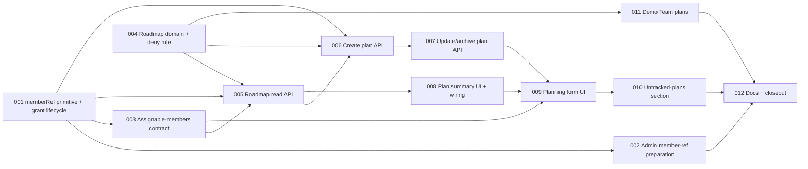

# Team Skill Planning (A) — Tasks

Specification: [SPEC.md](./SPEC.md) (Implemented; approved revision 3, decisions D1–D13 locked)

## Status
Ready: 0  In Progress: 0  Done: 12

Task-splitting ground rules (apply to **every** task):

- Do not redesign the feature. If implementation proves the SPEC contradictory
  or unsafe, **stop and report** the affected SPEC sections; do not invent a
  workaround.
- No Firebase access, migration, seed write or deploy while implementing
  (unit tests use injected `*Deps`; emulator tests are optional/separate).
- Do not change `authorizeTeamAccess`, `resolveTeamRole` (and give it no
  production caller), `removeTeamMember`, the F0 roster DTO, or the
  `skillProgress` / forum / survey / challenge behaviour (BR-5, BR-27, BR-38).
- Do not change `firestore.indexes.json`. If a query proves to need an index,
  stop and report the contradiction before changing the architecture.
- No UID, e-mail, membership document id, audit field (`createdBy`,
  `updatedBy`, `archivedBy`, `grantedBy`, `roleUpdatedBy`) or forum author tag
  in any member-facing response (BR-24).
- Follow `.claude/rules/**`; read the relevant `node_modules/next/dist/docs/`
  guide before writing route/UI code (AGENTS.md).
- Every task ends with `pnpm typecheck`, `pnpm lint`, `pnpm test` (and
  `pnpm build` where noted), then an inspection of `git diff`.

## Task graph

**Order rationale.** The security primitive (`memberRef`) comes first and
nothing that assigns owners is built before it (TASK-001 → 002/003 precede any
roadmap write). The pure roadmap domain (004) is independent of the member
foundation and could run in parallel with 002/003 (order-independent, not
simultaneous). Read (005) precedes writes because DTO/owner resolution/
tracking derivation are shared by the write responses. Create (006) and
update (007) are separate because they own different rule sets (target
integrity + uniqueness vs. status/archive/untracked-edit semantics). UI tasks
start only after the APIs they call exist (008 needs 005; 009 needs 006, 007,
003). TASK-011 (Demo Team) is optional per the SPEC ("not required for A to
be done") but is kept as a task; TASK-012 is last and covers docs for whatever
shipped. TASK-007's allowed combination of D13 rules is tested there, not
split off, because it cannot be reviewed apart from the update transaction.

## BR / decision coverage

| BR / Decision | Owner task(s) |
|---|---|
| BR-1, BR-2 (grant part), BR-6, D12 (grant half), BR-38 (grant tests) | TASK-001 |
| BR-2 (materialise), BR-3, BR-36, D12 (admin half) | TASK-002 |
| BR-4, BR-7, D5, D5b, BR-24/26 (selector) | TASK-003 |
| BR-9 (types), BR-12, BR-17, BR-20 (pure parts), D4, D6 (id rule), D7, D8, target-integrity pure rule, Firestore deny rule | TASK-004 |
| BR-8, BR-9, BR-10, BR-11, BR-12 (server order), BR-24, BR-26, D9, D13 (read side) | TASK-005 |
| BR-13, BR-15, BR-16, BR-19, BR-23, BR-25, BR-26, BR-27, D1, D2, D6, D13 (create) | TASK-006 |
| BR-14, BR-17, BR-18, BR-19, BR-20, BR-21, BR-22, BR-28, D7, D8, D13 (edit) | TASK-007 |
| BR-29, BR-30, BR-32, BR-33, BR-34, BR-35, D10 | TASK-008 |
| BR-31 (form), BR-33, BR-34, BR-35, D3 (copy) | TASK-009 |
| BR-29/31 untracked section, D13 (UI) | TASK-010 |
| Demo Team follow-up | TASK-011 |
| Documentation impact, invariants 23–30, D3 reconciliation | TASK-012 |
| BR-5, BR-27, BR-38 (regression) | TASK-001, 003, 005, 006, 007 (each re-asserts its boundary); final check TASK-012 |

Decision map: D1 → 006/007; D2 → 006/007 (+ 002 as the sole admin capability);
D3 → 006/009/012; D4 → 004/009; D5 → 003; D5b → 003; D6 → 004/006; D7 → 004/007;
D8 → 004/007/009; D9 → 005/009; D10 → 008; D11 → 005/006; D12 → 001/002;
D13 → 004/005/006/007/010.

## Tasks

### TASK-001 — memberRef primitive and grant-time lifecycle

**Status:** Done
**Covers:** BR-1, BR-2 (grant path), BR-5, BR-6, BR-38
**Depends on:** None

**Outcome**
Every membership created through `applyMembershipGrant` carries an opaque,
CSPRNG, team-scoped `memberRef`; an existing membership keeps its ref;
removing a membership destroys the ref; a rejoin gets a new one. Nothing
reads or exposes the ref yet and no authorization changes.

**Implementation notes**
- New `src/features/teams/domain/member-ref.ts`: generator (`crypto.randomBytes(16)`
  → 26-char Crockford base32 lowercase), `isMemberRef` guard (length + alphabet),
  and a pure `resolveMemberRef(memberships, teamId, ref)` that returns the single
  matching membership or `null` for zero **or ≥2** matches (fail closed). Resolver
  is a pure in-memory match over an already-read team membership list (SPEC
  "Resolution"; no two-field Firestore query).
- Extend the membership record/guard in `domain/team-membership.ts` with optional
  `memberRef` (invalid-but-present ref ⇒ document still valid as a membership but
  ref treated as absent; decide and document in tests). `membershipDocId`
  unchanged.
- `applyMembershipGrant` (in `server/grant-team-membership.ts`) writes the ref on
  the `set` only; existing doc ⇒ `already_member`, **no write**, F0 BR-21 semantics
  (no `role`) unchanged. No extra read at grant time.
- Update existing grant tests that assert the exact record
  (`toEqual(record())`) across invitation resolution, request approval and direct
  grant suites.
- Prove `setTeamMemberRole` does not clear/alter `memberRef` and `removeTeamMember`
  is unchanged (test only; no code change expected).

**Verification**
- Domain tests: length, alphabet, no input dependence (same inputs ⇒ different
  refs; statistical/uniqueness smoke), guard rejects malformed, resolver:
  exactly-one / zero / duplicate / cross-team ⇒ `null`.
- Grant tests via all three paths: new member gets valid ref, no `role`;
  existing ⇒ `already_member`, no write, ref preserved; remove → grant ⇒ **different** ref.
- `setTeamMemberRole` test: ref survives lead set/unset.
- F0 roster test still asserts exact keys `{displayName,isLead,isSelf}`.
- `pnpm typecheck`, `pnpm lint`, `pnpm test`.

**Security / privacy**
First client-addressable handle: never derived from uid/teamId/e-mail; grants
no authorization (SECURITY proposed inv. 24–27). Must not appear in roster or
admin list. No logging of refs.

**Documentation impact**
None in this task (closeout TASK-012 owns docs).

**Acceptance criteria**
- [x] 128-bit CSPRNG ref generated only inside `applyMembershipGrant`; never from any input
- [x] Existing membership ⇒ no write, ref preserved
- [x] Removal destroys ref; rejoin yields a new ref
- [x] `resolveMemberRef` fails closed on zero/duplicate matches and is team-scoped
- [x] F0 roster, `authorizeTeamAccess`, `removeTeamMember` unchanged; grant tests updated for the added field only
- [x] No GET path writes
- [x] Relevant tests pass
- [x] No conflict with `docs/SECURITY.md`

---

### TASK-002 — Admin member-ref preparation (`Klargjør medlemsvelger`)

**Status:** Done
**Covers:** BR-2 (materialise), BR-3, BR-5 (additive `hasMemberRef`), BR-36, BR-38
**Depends on:** TASK-001

**Outcome**
An app admin can run a one-time, idempotent, atomic preparation for a team
whose memberships predate refs, from `/admin/teams/[teamId]`. This is
infrastructure only; it grants no roadmap capability.

**Implementation notes**
- `src/features/teams/server/materialize-member-refs.ts` (`*Deps`): one
  transaction; read `teamMemberships.where("teamId","==",T).limit(501)`; process
  ≤500; `tx.update` (never `set`/create) only memberships lacking a valid ref;
  preserve existing refs; regenerate on in-team collision using the refs held in
  the transaction; `truncated:true` when >500. Team must exist with a valid status
  (`active` **or** `disabled` allowed; unknown/invalid ⇒ `team_not_found`).
  Result `{materialized, alreadyHad, truncated}`; failures ⇒ `persistence_failed`.
- `POST app/api/admin/teams/[teamId]/member-refs/route.ts`: `requireAppAdmin`;
  no body; 401/403/404/500 per BR-3; no uid in any response.
- Admin member list (`list-team-members`): **additive** `hasMemberRef: boolean`
  only; the ref value itself never appears.
- Admin gateway method + minimal control "Klargjør medlemsvelger" in
  `AdminTeamDetail`, shown only when any member has `hasMemberRef:false`;
  success refetches; own loading/error state; Norwegian copy in `teams/copy.ts`.
- Do not touch roadmap code; do not give members any call path.

**Verification**
- Server: admin-only; idempotent (second run all `alreadyHad`); ≥100 missing in a
  single transaction; never recreates a removed membership (membership deleted
  between read and write ⇒ no create); keeps valid refs; in-team collision
  regenerates; truncation at 500/501; disabled team OK; unknown team 404; failure
  ⇒ `persistence_failed` with no partial writes; response contains no uid.
- Route: bearer extraction, 401/403/404/500 mapping, no body accepted.
- Admin list: exact keys incl. `hasMemberRef`, no ref value.
- Component: control visibility rule, busy/error/success states, inert rendering.
- `pnpm typecheck`, `pnpm lint`, `pnpm test`, `pnpm build`.

**Security / privacy**
Only `memberRef` is written; admin-only; no GET write; no uid returned; not a
roadmap write capability (D2 distinction).

**Documentation impact**
None in this task (TASK-012).

**Acceptance criteria**
- [x] Non-admin and unauthenticated calls fail with no writes
- [x] One atomic, idempotent transaction; update-only; never creates a membership
- [x] Works for `disabled` teams; unknown team ⇒ `team_not_found`
- [x] Admin list change is additive (`hasMemberRef`) only
- [x] Control appears only when needed; no hidden GET-side writes
- [x] Relevant tests pass
- [x] No conflict with `docs/SECURITY.md`

---

### TASK-003 — Assignable-members contract and ordinal rule

**Status:** Done
**Covers:** BR-4, BR-5, BR-7, BR-24, BR-26, D5, D5b
**Depends on:** TASK-001

**Outcome**
`GET /api/teams/[teamId]/assignable-members` returns the dedicated
member-facing selector contract, completely separate from the F0 roster, with
presentation-only ordinals.

**Implementation notes**
- `src/features/teams/server/list-assignable-members.ts` (`*Deps`) + route.
  Read: `teamMemberships.where("teamId","==",T).limit(501)` + `userProfiles`
  `getAll` batches (≤100). Authorization = existing R (`authorizeTeamAccess`
  ∈ member/admin), unmodified. Strictly read-only.
- Response exactly `{members:[{memberRef,displayName,ordinal,isSelf}],unavailableCount,truncated}`.
  `displayName: string|null` (`null` ⇒ client shows "Medlem uten navn"); members
  without a ref omitted and counted in `unavailableCount`; app admin without a
  membership not listed; `isSelf` from the verified caller only.
- Pure ordinal/ordering function in `teams/domain` (e.g. `assignable-ordinals.ts`)
  reusable by TASK-005's owner DTO: duplicate group = same name after NFC + trim
  + case-insensitive; all unnamed form one group "Medlem uten navn"; only grouped
  members get `ordinal 1..n`, others `null`; rank by membership `createdAt`
  ascending (missing/invalid last), then internal `memberRef` ascending; overall
  order by normalised name (`nb` collator, unnamed last) then group rank. Ordinal
  is computed per response, never stored, never accepted as an identifier.
  `createdAt`, `memberRef`-derived values and join dates are never returned.
- Do **not** modify the roster DTO/route.

**Verification**
- Deep exact-key assertion on the response (no uid, e-mail, doc id, audit field,
  role/lead, join date); serialisation scan for uid/e-mail/doc-id substrings.
- Ordinal tests: named duplicates, all-unnamed, NFC/case-equal names,
  `createdAt`-then-ref tiebreak, `null` when unique, deterministic across calls.
- Named + unnamed members listed; missing-ref members counted; truncation;
  cross-team caller denied (403); removed member absent next call; admin non-member
  gets list but is not in it; disabled-team member can read.
- No write call is ever made (deps spy).
- Roster test still passes unchanged; forum `authorTag` inputs unreachable.
- `pnpm typecheck`, `pnpm lint`, `pnpm test`.

**Security / privacy**
Inv. 28/29: selector is a new contract; roster stays identifier-free. Only the
opaque `memberRef` is exposed beyond display data. No e-mail/uid fallback.

**Documentation impact**
None in this task (TASK-012).

**Acceptance criteria**
- [x] Exact keys per SPEC; no uid/e-mail/doc id/join date/role/audit
- [x] No GET write; no new index; query shape as specified
- [x] Ordinals presentation-only, deterministic, never exposing ranking inputs
- [x] Unnamed members assignable via `displayName:null`
- [x] F0 roster unchanged
- [x] Relevant tests pass
- [x] No conflict with `docs/SECURITY.md`

---

### TASK-004 — Roadmap domain model, derived indicators and deny rule

**Status:** Done
**Covers:** BR-9 (types), BR-12 (comparator), BR-17, BR-20 (pure parts), BR-23, D4, D6, D7, D8, D13 (pure rules)
**Depends on:** None

**Outcome**
The pure `roadmap` slice exists and is fully tested: stored-item model/guard,
enums, date validation, derived indicators, comparator, target validation,
document-id helper — plus the Firestore deny rule for `roadmapItems`. No route
or UI yet.

**Implementation notes**
- `src/features/roadmap/domain/`: types for stored item (fields per SPEC table:
  `teamId, treeId, targetNodeId, priority, status, startDate?, targetDate?,
  ownerRef?, completedAt?, archivedAt?/archivedBy? paired, createdAt/By,
  updatedAt/By`); no current stage, name, e-mail, uid-of-owner, label, free text.
  `status = planned|active|completed`; `priority = high|medium|low`; archive
  orthogonal; no paused/cancelled.
- `roadmapItemDocId(teamId, treeId)` = `{teamId}__{treeId}` for uniqueness only;
  `isRoadmapItemFor(doc, docId, teamId, treeId)` enforcing the fail-closed
  consistency rule (`doc.teamId`, `doc.treeId`, and `docId === roadmapItemDocId(...)`).
  **No code parses ids.** Guard treats invalid docs as absent; non-string
  `ownerRef` ⇒ treated as no owner at DTO time.
- Dates: `YYYY-MM-DD`, real calendar dates, 2020–2100, `startDate ≤ targetDate`
  validated on merged result.
- Derived: `targetReached` (current order ≥ target order; none when not tracked),
  `overdue` (`targetDate` < today in `Europe/Oslo` calendar date, status ≠
  `completed`; today injected, never client-supplied).
- `compareRoadmapPlans` per SPEC "Presentation sort" and the Kompetanseområder
  area ordering helper (plans first in that order, then unplanned by `nb` name,
  then `treeId`).
- Pure `validateTargetNode(tree, currentNodeId, targetNodeId)` implementing SPEC
  rules 3–4: membership test against `tree.nodes` (never shape), strictly ahead
  of current (`null` = below `node-0`), current non-null but not in tree ⇒
  fail closed. Returns typed error (`invalid_input` / `target_not_ahead` /
  `not_tracked`).
- Status-transition/`completedAt` pure helper: all transitions allowed; set on
  entering `completed`, removed on leaving.
- `firestore.rules`: standard deny block for `roadmapItems`; extend the existing
  rules/deployment-config test. `firestore.indexes.json` **unchanged** (assert).

**Verification**
- Unit tests for every item in the SPEC "Domain" test row: guard, dates (leap,
  bounds, `2026-02-30`, 2019, 2101, start>target), enums, comparator (all
  tiebreaks, nulls, archived), `targetReached`, `overdue` (Oslo date boundary),
  target validation (cross-tree well-formed id, stale, malformed, null current,
  equal, behind), consistency rule (id/field mismatch, `a__b`+`c` collision fails
  closed), transition helper.
- Rules test: client read/write of `roadmapItems` denied; indexes file unchanged.
- `pnpm typecheck`, `pnpm lint`, `pnpm test`.

**Security / privacy**
Doc id explicitly never authorization (inv. 23); no person data in the model
(inv. 30).

**Documentation impact**
None in this task (TASK-012).

**Acceptance criteria**
- [x] Model contains exactly the specified fields; no current stage duplicated
- [x] Target validated by actual tree membership and strictly ahead of current
- [x] Id/field/route consistency helper fails closed on any mismatch
- [x] Derived indicators are pure, never stored
- [x] Deny rule + test present; `firestore.indexes.json` untouched
- [x] Relevant tests pass
- [x] No conflict with `docs/SECURITY.md`

---

### TASK-005 — Roadmap read API with tracking-aware DTO

**Status:** Done
**Covers:** BR-8, BR-9, BR-10, BR-11, BR-12, BR-24, BR-26, BR-27, D9, D11, D13
**Depends on:** TASK-001, TASK-003, TASK-004

**Outcome**
`GET /api/teams/[teamId]/roadmap-items[?archived=true]` returns the team's
plans as safe DTOs with live current stage, tracking state, derived indicators,
resolved owner and server-derived `canEdit`.

**Implementation notes**
- `src/features/roadmap/server/list-roadmap-items.ts` (`*Deps`; own thin readers
  for skill progress/trees/memberships/profiles — no widening of `skill-trees`
  exports) + route. Authorization R via existing `authorizeTeamAccess`; `canEdit`
  = W re-derived from fresh genuine membership + `teams.status === "active"`
  (admin non-member ⇒ false; lead no different).
- Reads (exact shapes): `roadmapItems.where("teamId","==",T).limit(501)`;
  `skillProgress.where("teamId","==",T)` (existing shape); `skillTrees/{treeId}`
  gets; **only if any plan has an owner:** `teamMemberships.where("teamId","==",T).limit(501)`
  + profiles `getAll`. Archived filtered in memory. No ordering dependency;
  sort with `compareRoadmapPlans`. `truncated` when >500.
- DTO exactly BR-9: `tracking` discriminated union (`not_tracked` has no
  `currentNodeId`, no `targetReached`; `null` current ≠ not tracked); live
  `areaName: string|null` (`null` iff the tree cannot resolve; plan survives;
  null sorts after named areas)/`targetLabel`; unresolved tree/target ⇒
  `targetAvailable:false`, `targetLabel:null`, `targetReached` key omitted
  (present only as boolean when derivable; never `null`); `overdue` always
  present, date/status-derived, independent of target availability/tracking;
  `owner` ∈ `null` (no ownerRef **or non-string ownerRef**) `| current{memberRef,displayName,ordinal,isSelf} |
  unavailable` (string ref that cannot uniquely resolve) using TASK-003's ordinal function over the same member set (agrees
  with selector); resolver fails closed on duplicates; neutral unavailable state —
  no claim about why, no historical name/uid/e-mail.
- Invalid docs and id/field/route mismatches skipped. Read never writes.
- Error codes per API table (`unauthenticated`/`forbidden`/`read_failed`).

**Verification**
- Exact DTO keys deep-checked; serialisation scan for uid/e-mail/doc id/audit.
- Current from SkillProgress only; `not_tracked` union; `targetAvailable:false`;
  owner states (none/current/unavailable incl. removed and rejoined-new-ref,
  non-string `ownerRef`, other-team ref); archived default/param; corrupt and
  cross-team documents skipped; `canEdit` matrix (member active/disabled, admin
  non-member, lead = member); sort; truncation; no write ever (deps spy).
- Team X auth never yields team Y data.
- `pnpm typecheck`, `pnpm lint`, `pnpm test`.

**Security / privacy**
Inv. 23, 26–28. Owner reference grants nothing; deterministic id never used as
proof. No per-person aggregates/filtering by owner (BR-28).

Error body is `{error: code}`.

**Documentation impact**
None in this task (TASK-012).

**Acceptance criteria**
- [x] Exact DTO per BR-9; no uid/e-mail/doc id/audit
- [x] Untracked plans reported as `not_tracked`; plan not mutated
- [x] Owner `unavailable` copy-agnostic state; no cascade; rejoin does not resurrect
- [x] Query shapes exactly as specified; no new index
- [x] `canEdit` server-derived
- [x] No GET write
- [x] Relevant tests pass
- [x] No conflict with `docs/SECURITY.md`

---

### TASK-006 — Create plan (POST) with target and owner validation

**Status:** Done
**Covers:** BR-13, BR-15, BR-16, BR-19, BR-23, BR-25, BR-26, BR-27, D1, D2, D6, D13
**Depends on:** TASK-001, TASK-004, TASK-005

**Outcome**
A genuine member of an active team can create the single plan for a tracked
Kompetanseområde, with optional owner, in one transaction.

**Implementation notes**
- `src/features/roadmap/server/create-roadmap-item.ts` (`*Deps`) +
  `POST app/api/teams/[teamId]/roadmap-items/route.ts`. Body allow-list
  `{treeId,targetNodeId,priority?,status?,startDate?,targetDate?,ownerRef?}`;
  extra keys/non-object/bad JSON ⇒ 400 `invalid_request`; defaults `medium`,
  `planned`.
- One transaction: gets of `teams/T`, caller membership, `skillProgress/T__tree`,
  `skillTrees/tree`, `roadmapItems/T__tree`; membership query (`teamId ==`,
  limit 501) **only** when `ownerRef` given; then `tx.create`.
- W = genuine fresh membership + `active` team (else `forbidden` /
  `team_disabled`, invalid/missing team ⇒ `team_disabled`; zero writes). Lead
  and app admin non-member get nothing extra. `teamId` from route only; client
  uid/role/owner never trusted.
- Target rules 1–4 via TASK-004 helper: not tracked ⇒ `not_tracked` (404); tree
  missing/invalid ⇒ `tree_not_found` (404); cross-tree/stale/malformed ⇒
  `invalid_input`; not ahead ⇒ `target_not_ahead`. **Creation never starts
  tracking** and never writes progress.
- Existing doc ⇒ `already_planned` (409), archived ⇒ `plan_archived` (409),
  mismatching existing doc ⇒ `already_planned`, no write. Concurrent create:
  single winner by `tx.create`.
- `ownerRef` via TASK-001 resolver over the team's memberships: exactly one
  current match else `invalid_owner` (one code for unknown/stale/malformed/
  other-team/duplicate). Owner grants no capability.
- Server sets `createdAt/By`, `updatedAt/By`; response 201 `{item}` using the
  TASK-005 DTO mapper. No DELETE endpoint.

**Verification**
- Authz matrix incl. every create cell of the inactive-team matrix; lead =
  member; admin non-member denied; zero writes on every denial.
- Target rules incl. cross-tree nodeId, stale, malformed, null current, equal,
  behind, not tracked, tree missing.
- Owner: valid, other-team ref, removed member's stale ref, duplicate match,
  malformed.
- Concurrent double create = one winner; archived blocks with `plan_archived`;
  server-managed fields not client-settable; extra keys rejected.
- Response has exact DTO keys; no cross-feature writes (progress/memberships/
  profiles deps never written).
- Route tests: bearer, status mapping, no DELETE.
- `pnpm typecheck`, `pnpm lint`, `pnpm test`.

**Security / privacy**
Inv. 23, 25–27: deterministic id not authorization; ref not authorization;
fail closed on any mismatch.

**Documentation impact**
None in this task (TASK-012).

**Acceptance criteria**
- [x] Only W (active-team genuine member) can create; lead/admin-non-member/disabled denied
- [x] Target ∈ exact tree, strictly ahead of current, requires tracking; tracking never started
- [x] One plan per (team, tree); concurrent create has one winner
- [x] `invalid_owner` for every non-current-team ref
- [x] No cross-feature writes; no uid/e-mail in responses
- [x] Relevant tests pass
- [x] No conflict with `docs/SECURITY.md`

---

### TASK-007 — Update, status and archive/restore (PATCH) including untracked rules

**Status:** Done
**Covers:** BR-14, BR-17, BR-18, BR-19, BR-20, BR-21, BR-22, BR-25, BR-26, BR-27, BR-28, D1, D2, D7, D8, D13
**Depends on:** TASK-006

**Outcome**
Members can edit target, priority, dates, status and owner, and archive/restore,
by `treeId`; the exact D13 untracked editing rule holds.

**Implementation notes**
- `src/features/roadmap/server/update-roadmap-item.ts` (`*Deps`) +
  `PATCH app/api/teams/[teamId]/roadmap-items/[treeId]/route.ts`. Allow-list
  `{targetNodeId,priority,status,startDate,targetDate,ownerRef,archived}`; ≥1
  key; `archived` must be the only key when present; `null` clears dates/owner
  (`FieldValue.delete()`); `teamId`/`treeId` immutable.
- One transaction: gets of `teams/T`, caller membership, `roadmapItems/T__tree`;
  progress/tree gets **only if `targetNodeId` changes**; membership query **only
  if `ownerRef` set to a new value**; then `tx.update` (partial fields).
- Missing doc or doc failing the consistency rule ⇒ `not_found`. W as in TASK-006
  (**including clear-owner and archive/restore blocked on inactive teams**).
- Archived plan accepts only `{archived:false}` ⇒ else `archived` (409);
  idempotent no-ops for archive-on-archived / restore-on-unarchived (success,
  no write). Restore keeps status.
- Dates validated on the merged result. Status transitions all allowed;
  `completedAt` set/removed; `archivedAt/By`, `updatedAt/By` server-managed.
  Completing never writes SkillProgress; reaching target never completes.
- **D13:** a changed `targetNodeId` re-runs target rules 1–4 (⇒ `not_tracked`
  while untracked); an **unchanged** target is not a retarget and is never
  rejected for missing tracking; all other fields editable while untracked.
- Re-saving an unchanged unavailable `ownerRef` not re-validated; clearing always
  works when W holds; a new owner must resolve (`invalid_owner`).
- Concurrency: different fields merge, same field last-write-wins; no version
  precondition. No tracking/progress/membership/profile writes.

**Verification**
- Authz matrix incl. every edit/status/owner/archive cell of the inactive-team
  matrix; lead = member; admin non-member denied; zero writes on denial.
- Untracked matrix: retarget rejected `not_tracked`; unchanged target accepted;
  priority/dates/status/owner (set/change/clear)/archive/restore all succeed;
  restart of tracking reattaches without a plan write.
- Target change rules (cross-tree, stale, equal, behind); dates merged
  validation; status transitions + `completedAt`; archived edit ⇒ `archived`;
  archive/restore idempotency; owner (valid, removed stale, other-team,
  unchanged-unavailable, clear); archive-vs-edit race resolved in transaction;
  server-managed fields not settable; immutables; partial-field concurrency.
- Cross-feature: SkillProgress suites unchanged; `removeTeamMember` unchanged,
  no fan-out.
- Route: allow-list, status mapping, no DELETE.
- `pnpm typecheck`, `pnpm lint`, `pnpm test`.

**Security / privacy**
Inv. 23, 25–27; owner never a capability or sort/filter key; no "who edited".

**Documentation impact**
None in this task (TASK-012).

**Acceptance criteria**
- [x] Untracked rule exactly per D13; plan never mutated by tracking changes
- [x] Archived plan accepts only restore; idempotent no-ops write nothing
- [x] Inactive team blocks every write incl. clear owner/archive
- [x] No automatic completion; no cross-feature writes
- [x] Response DTO safe; no uid/e-mail
- [x] Relevant tests pass
- [x] No conflict with `docs/SECURITY.md`

---

### TASK-008 — Plan summary in Kompetanseområder (read-only UI wiring)

**Status:** Done
**Covers:** BR-29, BR-30, BR-32, BR-33, BR-34, BR-35, D10
**Depends on:** TASK-005

**Outcome**
Each tracked area row in `/teams/[teamId]` Kompetanseområder shows the plan
summary line (or "Ingen plan ennå"), with indicators and toggles. Read-only; no
edit controls yet.

**Implementation notes**
- `src/features/roadmap/client/` gateway for `GET roadmap-items`;
  `components/` (e.g. `RoadmapPlanSummary`, copy in `roadmap/copy.ts`).
  `TeamDetail` receives **wiring only** (one fetch + mapper, own loading/error
  state independent of other fetches); no substantial logic added to it.
- Area ordering per SPEC (areas with non-archived plan first, then by `nb` name,
  then `treeId`) applied only to this rendering; the existing
  `getTeamSkillProgress` contract is untouched.
- Plan line: `Målstadium`, `Prioritet` text, `Periode`, `Ansvarlig` ("Ikke
  tildelt" / name or "Medlem uten navn" + " (n)" + "Deg" / "Ansvarlig er ikke
  lenger tilgjengelig"), `Status`, text indicators "Målet er nådd" (hint to mark
  fullført) and "Måldato passert". Completed behind "Fullførte", archived behind
  "Vis arkiverte" (requests `?archived=true`). Names/labels as inert text; no
  colour-only state; wraps/stacks on small screens.
- No route, tab, nav entry, modal, timeline, history UI or challenge links.

**Verification**
- Component tests: empty, loading, error (does not blank other sections and vice
  versa), each owner label, indicators as text, toggles, `not_tracked` plans not
  shown here (handled by TASK-010), inert rendering of hostile names.
- `TeamDetail` test updated for the new independent fetch; existing tests pass.
- `pnpm typecheck`, `pnpm lint`, `pnpm test`, `pnpm build`.

**Security / privacy**
No identifiers in props/DOM beyond opaque `memberRef` kept out of rendered text;
no owner-based sort/filter/grouping.

**Documentation impact**
None in this task (TASK-012).

**Acceptance criteria**
- [x] Summary shown inside existing Kompetanseområder only; Norwegian copy
- [x] Independent failure; `TeamDetail` wiring only
- [x] Indicators are text; completed/archived behind toggles
- [x] No new route/tab/modal
- [x] Relevant tests pass
- [x] No conflict with `docs/SECURITY.md`

---

### TASK-009 — Inline planning form (create, edit, owner, archive/restore)

**Status:** Done
**Covers:** BR-31, BR-33, BR-34, BR-35, D3, D4, D7, D8, D9
**Depends on:** TASK-003, TASK-007, TASK-008

**Outcome**
When `canEdit` is true a member can plan, edit, assign an owner, change status,
archive and restore from the area row, using an inline expandable form.

**Implementation notes**
- Gateway methods for POST/PATCH and `GET assignable-members` (fetched on first
  form open, independent loading/error, admin hint when `unavailableCount>0`:
  "Be teammedlemmer sette visningsnavn under Min profil" / admin preparation hint
  per SPEC copy).
- Form: target `Select` (stages strictly above current only), priority `Select`,
  two `type=date` inputs, owner `Select` (value = `memberRef`, never rendered as
  text; label = name/"Medlem uten navn" + ordinal + "Deg"), status `Select` (edit),
  "Lagre", "Avbryt", "Arkiver"/"Gjenopprett". Create-over-archived error
  `plan_archived` ⇒ offer "Gjenopprett plan". No optimistic update: success
  refetches. Help text: "Ansvarlig er en planleggingsmarkering – ikke en vurdering
  av noen."
- Map API error codes to generic Norwegian messages; never echo submitted values.
- `canEdit:false` ⇒ controls absent (not disabled). Reuse `Button`/`Select`/`Card`;
  labelled, keyboard operable.

**Verification**
- Component/gateway tests: create, edit, status change, archive/restore, error
  mapping per code (`team_disabled`, `target_not_ahead`, `invalid_owner`,
  `already_planned`, `plan_archived`, `archived`, `not_tracked`), target options
  above current only, hidden controls when `canEdit:false`, owner select states,
  no ordinal/name sent to the API (only `memberRef`), refetch after success.
- `pnpm typecheck`, `pnpm lint`, `pnpm test`, `pnpm build`.

**Security / privacy**
Client never sends uid/role/team override; ordinals never used as identifiers;
inert rendering.

**Documentation impact**
None in this task (TASK-012).

**Acceptance criteria**
- [x] Full create/edit/archive/restore flow works against the APIs
- [x] Owner optional; selector read-only GET with its own loading/error
- [x] Controls absent when `canEdit:false`
- [x] Accessible, responsive, Norwegian; no modal
- [x] Relevant tests pass
- [x] No conflict with `docs/SECURITY.md`

---

### TASK-010 — Plans for areas the team no longer tracks

**Status:** Done
**Covers:** BR-29, BR-31 (untracked variant), D13
**Depends on:** TASK-009

**Outcome**
Plans with `tracking.state === "not_tracked"` appear in a compact section at
the bottom of Kompetanseområder ("Plan for område teamet ikke lenger følger")
and remain editable except for target.

**Implementation notes**
- List shows area name, target label (read-only), priority, status, dates, owner
  state; the same inline form **without the target select**, plus "Arkiver"/
  "Gjenopprett". No indicator for current stage/`targetReached`; `overdue` still
  derived from dates. If `targetAvailable:false`, show neutral text without label.
- No automatic tracking start, no deletion/archival, no new hidden writes; an
  attempted retarget through the API stays rejected (`not_tracked`) and is not
  offered by the UI.
- Section hidden when there are none; shares the TASK-008 fetch (no extra request).

**Verification**
- Component tests: section visibility, form without target select, save of each
  editable field, archive/restore, hostile-name inertness, tracked plans not
  duplicated here, tracking restart moves plan back to its area row after refetch.
- `pnpm typecheck`, `pnpm lint`, `pnpm test`, `pnpm build`.

**Security / privacy**
Same as TASK-009.

**Documentation impact**
None in this task (TASK-012).

**Acceptance criteria**
- [x] Untracked plans listed and editable per D13 (no target change)
- [x] No cross-feature writes or automatic tracking
- [x] Relevant tests pass
- [x] No conflict with `docs/SECURITY.md`

---

### TASK-011 — Demo Team: representative unassigned roadmap plans

**Status:** Done
**Covers:** SPEC "Demo Team" follow-up (optional; not required for A)
**Depends on:** TASK-004

**Outcome**
The Demo Team fixtures/plan/preflight include three unassigned roadmap plans
(testing: active, high, dated; observability: planned, medium, undated;
delivery: completed, low, target reached), using the existing create-only
seed model. **No real seed write is performed.**

**Implementation notes**
- Fixtures: `roadmapItems/demo-team__demo-skill-<x>` for the existing tracked
  areas, `createdBy: "demo-seed"`, **no `ownerRef`**, no synthetic members, no
  fixed `memberRef`.
- Manifest class `C` (create-only): missing → create, compatible existing →
  skip/preserve (presenter edits survive a reseed), incompatible → conflict;
  never silently overwritten (class `U` would `set` the fixture again and is
  not used). Preflight compat = valid shape + `teamId demo-team` +
  `createdBy demo-seed`; collection allow-list updated. Presenter membership
  classification unchanged (extra `memberRef` cannot create a CONFLICT).
- Update tests (plan/preflight/runner/adapters as needed) and the document
  count in `docs/DEVELOPMENT.md` Demo section (only if shipped).
- Do not run the seed tool against real Firebase.

**Verification**
- Plan/preflight tests for `roadmapItems` classification (create, existing
  compatible, conflicting); idempotency; presenter membership unaffected;
  fixtures pass `isRoadmapItem` guard and target-ahead/reached expectations.
- `pnpm typecheck`, `pnpm lint`, `pnpm test`.

**Security / privacy**
No synthetic identities; no uid/ref in fixtures.

**Documentation impact**
`docs/DEVELOPMENT.md` Demo section (counts) if shipped.

**Acceptance criteria**
- [x] Three unassigned plans in fixtures; create-only; idempotent
- [x] Preflight/manifest/allow-list tests updated
- [x] No synthetic member or fixed ref; no real seed write
- [x] Relevant tests pass
- [x] No conflict with `docs/SECURITY.md`

---

### TASK-012 — Documentation reconciliation and feature closeout

**Status:** Done
**Covers:** SPEC "Documentation impact", proposed invariants 23–30, D3 reconciliation
**Depends on:** TASK-002, TASK-010, TASK-011

**Outcome**
Durable docs match the delivered behaviour; the feature is ready for final
review. (TASK-011 is optional: if deliberately dropped, record that in this
task and remove its dependency.)

**Implementation notes**
- `docs/DATA-MODEL.md`: `RoadmapItem`; `TeamMembership.memberRef`.
- `docs/ARCHITECTURE.md`: member-reference + planning boundary; replace "no
  member reference exists" statements.
- `docs/SECURITY.md`: invariants 23–30; amend 20 ("No such reference exists
  yet"); checklist items.
- `docs/UI-UX.md`: reconcile the Skill Tree UX bullet that says no per-person
  assignment exists — state that A adds an **optional responsible member on a
  roadmap plan** (planning metadata only; not individual skill assessment or
  performance assignment; no authorization/visibility/lead capability); add plan
  block/form and untracked-plans section.
- `docs/features/team-skill-tree/SPEC.md`: dated pointer note on the non-goal and
  BR-30 only (no behavioural rewrite).
- `docs/features/member-identity-and-team-roles/SPEC.md`: one-line pointer that
  the member-reference constraint was resolved by A0.
- `docs/DEVELOPMENT.md`: Firestore rules/indexes section — query shapes and
  "no new index"; Demo section only if TASK-011 shipped.
- `docs/ROADMAP.md`: concise "Team & Personal Development initiative (F0 → A → B
  → C → D)" entry (F0, A delivered; B–D planned); `docs/PRODUCT.md`: one-line
  pointer + owner-policy nuance. Check the "no per-person data" lines in
  PRODUCT/ROADMAP and leave unchanged if still true for their scope. Do not
  rewrite historical docs otherwise.
- Feature SPEC status/closeout note and TASKS.md all `Done`. Re-verify
  `firestore.rules` doc/test, no index change.
- Final regression sweep (tests only): F0 roster keys, forum anonymity, deny
  rule, `resolveTeamRole` still without production caller.

**Verification**
- `pnpm typecheck`, `pnpm lint`, `pnpm test`, `pnpm build`; `git diff` shows only
  docs (plus justified test additions).
- Grep documentation for stale "no per-person assignment" / "no member reference"
  claims.

**Security / privacy**
Invariants 23–30 recorded verbatim in intent; no weakening of existing ones.

**Documentation impact**
This task.

**Acceptance criteria**
- [x] All documents in the SPEC impact list updated; D3 reconciliation explicit
- [x] F0 → A → B → C → D initiative documented in ROADMAP with only a PRODUCT pointer
- [x] No stale contradicting statements remain
- [x] All gates pass; `git diff` inspected
- [x] No conflict with `docs/SECURITY.md`
