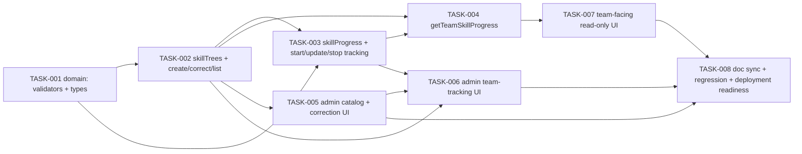

# Team Skill Tree — Tasks

Specification: [SPEC.md](./SPEC.md)

## Status
Ready: 0  In Progress: 0  Done: 8

**None of the 8 tasks below is actionable yet — see "Approval gate"
immediately below before treating any task, including TASK-001, as
startable.** Every task's `Status` field reads `Ready` in the sense this
repository's convention has always used it elsewhere in this same file
(e.g. TASK-008 is `Ready` today even though its dependencies TASK-005/006/
007 are themselves only `Ready`, not `Done` — "Ready" means "fully planned
and correctly sequenced," not "immediately startable regardless of its own
`Depends on`"). TASK-001's `Depends on` field is not `None`; it names an
explicit, currently-unsatisfied prerequisite. See "Approval gate."

## Approval gate
**Representation used**: `TASK-001`'s `Depends on` field (below) names an
explicit, real prerequisite — `SPEC.md`'s `Status` field reading
`Approved` — instead of `None`. This is not a new task status invented for
this purpose: it uses the existing `Depends on` field exactly as every
other task in this file already uses it, and it engages `implement-task`'s
own documented Step 1 behavior directly: *"Confirm the task exists, its
dependencies are satisfied... If a material product, security, or
architecture decision is missing, stop and report the decision."*
`implement-task`'s task-selection rule — *"pick the first unblocked Ready
task (dependencies Done)"* — has no mechanism to literally evaluate
"`SPEC.md` Status == Approved" as a boolean the way it evaluates another
task's `Status == Done`, so this is the strongest structural signal
available within this repository's actual, existing conventions, not a
guaranteed mechanical block. Every task downstream of TASK-001 (TASK-002
through TASK-008) is transitively gated by the same unsatisfied dependency
through the existing task graph — none of them can honestly become
`In Progress` before TASK-001 does.

**What this does not do.** This repository's task-state vocabulary is
`Ready` / `In Progress` / `Done` only (per `CLAUDE.md`); there is no
supported `Blocked` status, and inventing one here would violate the
explicit instruction not to fabricate enforcement. An agent or person who
disregards the `Depends on` line and starts `TASK-001` anyway is not
mechanically prevented — the same is already true of every other
dependency in this file (nothing stops an agent from implementing TASK-004
before TASK-002/003 either, beyond the same documented convention). This
gate is exactly as strong as this repository's dependency convention
already is everywhere else, applied honestly to a real, currently-unmet
prerequisite instead of a synthetic one.

**Single action required to lift it**: the product owner reviews `SPEC.md`
and, if satisfied, changes its `Status` field from `Draft` to `Approved`.
At that point TASK-001's dependency is satisfied and it becomes genuinely
the first unblocked `Ready` task. **This document does not perform that
approval** — `SPEC.md`'s `Status` remains `Draft` after this revision.

## Revision note (planning-review remediation pass)
Both `SPEC.md` and this file were revised after an independent
`review-change` planning review found six defects (approval-gate
enforcement, an overclaimed authorization rationale, an inconsistent
disabled-team exemption, a disproportionately costly tree-immutability
decision, an unbounded `listSkillTrees` query, and mixed "skill"/
"capability" technical vocabulary). All six are resolved; see `SPEC.md`'s
own "Revision note" for the full list of owner decisions. Task-level
consequences:

- **TASK-001** gains `updatedAt`/`updatedBy` on `SkillTreeRecord` (paired-
  optional, mirroring `isValidChallenge`'s convention) and its explicit
  `Depends on` gate (above).
- **TASK-002** is renamed and expanded: it now owns `createSkillTree`,
  **`updateSkillTree`** (new cosmetic-correction operation), and
  `listSkillTrees` — the latter now bounded with `.limit(500)`. All three
  live in one task because they share the `skillTrees` collection and
  almost all of their implementation/test shape, mirroring how Anonymous
  Challenges bundled resolve/archive/delete into one task.
- **TASK-003** is revised: `startTeamSkillTracking` now rejects a disabled
  team (new `team_disabled` outcome); `updateTeamSkillProgress`/
  `stopTeamSkillTracking` are unaffected (re-verified, not assumed
  unchanged).
- **TASK-004** gains an explicit requirement for a `skillProgress`
  query-failure (`read_failed`) test, distinct from
  `authorizeTeamAccess`'s own `read_failed` — closing review Suggestion
  #2.
- **TASK-005** gains the admin correction-form UI and moves to the
  `/admin/skills` route (from `/admin/capabilities`).
- **TASK-006** gains "hide/disable the start-tracking picker for a
  disabled team" and moves to the `/skills`-namespaced routes.
- **TASK-007** moves to the `/skills`-namespaced route; no other change.
- **TASK-008** gains the terminology-audit closeout item (confirm no
  stale "capability" technical identifier remains anywhere in code/docs
  once implemented).
- Every operation/route name below reflects Owner decision 4 (`skill`, not
  `capability`, for every technical identifier) — see `SPEC.md` → "API/DTO
  contracts" for the finalized route table.

No task was `In Progress` or `Done` when this revision was made — all
eight remain `Ready` (in the sense defined above), and none has been
implemented.

## Task graph

Verified acyclic: the listed order T1→T2→T3→T4→T5→T6→T7→T8 is a valid
topological order for every edge above (each edge points from an
earlier-listed task to a later-listed one). Unchanged from the original
draft — TASK-002's expanded scope (adding `updateSkillTree`) does not add
any new edge, since `updateSkillTree` depends on nothing TASK-003 or later
produces.

## Tasks

### TASK-001 — Domain: SkillTree/SkillNode/SkillProgress types and validators

**Status:** Done
**Covers:** BR-2, BR-3, BR-4
**Depends on:** `SPEC.md` Status = `Approved` (currently: **Approved —
satisfied**; see "Approval gate" above). No task-graph dependency.

**Outcome**
A pure, framework-free domain module exists for the `SkillTree`/
`SkillProgress` concepts: their persisted-document types (including
`SkillTreeRecord`'s paired-optional `updatedAt`/`updatedBy`, new in this
revision), `name`/node-label validators, and the deterministic `nodeId`
assignment function. Every later task imports this module rather than
re-deriving validation or type shapes itself.

**Implementation notes**
- New feature root `src/features/skill-trees/domain/` per
  `.claude/rules/architecture.md`.
- `src/features/skill-trees/domain/skill-tree.ts`: `SkillNode = {nodeId:
  string, label: string, order: number}`; `SkillTreeRecord = {name:
  string, nodes: SkillNode[], createdAt: Date, createdBy: string,
  updatedAt?: Date, updatedBy?: string}` — **`updatedAt`/`updatedBy` are
  new in this revision**, added for `updateSkillTree` (TASK-002)'s
  internal-accountability bookkeeping. `isValidSkillTree` fails closed
  (never throws) on: a missing/wrong-typed required field; an empty or
  >20-entry `nodes` array; a `nodes` array whose `order`/`nodeId` values
  don't match their array position (`node-<index>`, ascending); **and a
  candidate with `updatedAt` set but `updatedBy` absent, or vice versa**
  (paired-optional, mirrors `isValidChallenge`'s established
  `resolvedAt`/`resolvedBy` convention) — a well-formed candidate with
  *neither* field is equally valid (a never-corrected tree).
- `src/features/skill-trees/domain/skill-tree-input.ts`:
  `validateSkillTreeName(input: unknown)` (trims, 3-100 chars) and
  `validateSkillNodeLabels(input: unknown)` (array of 2-20 entries, each
  trimmed to 3-100 chars) — reused unchanged by both `createSkillTree` and
  `updateSkillTree` (TASK-002) for per-label text validation; the
  **length-match-to-existing-tree check `updateSkillTree` additionally
  needs is not part of this module** — it's a cross-check against a
  specific fetched record, owned by TASK-002's own operation logic, not a
  standalone input validator. `buildSkillNodes(labels: string[]):
  SkillNode[]` — the pure `node-<index>` assignment function
  `createSkillTree` calls directly; no other module re-implements this
  (in particular, `updateSkillTree` never calls it — it always derives its
  `nodes` array by positional replacement over the *existing* record, per
  `SPEC.md` → "Cosmetic tree correction").
- `src/features/skill-trees/domain/skill-progress.ts`:
  `SkillProgressRecord = {teamId: string, treeId: string, currentNodeId:
  string | null, updatedAt: Date, updatedBy: string}` (unchanged from the
  original draft); `isValidSkillProgress` fails closed on a missing/
  wrong-typed required field.
- No Firestore, no `server-only` import, no I/O anywhere in this module.

**Verification**
- `validateSkillTreeName`/`validateSkillNodeLabels`: boundary cases at
  2/3 and 100/101 characters for names/labels; 1/2 and 20/21 entries for
  the label array; whitespace-only and non-string/non-array input.
- `buildSkillNodes`: produces `node-0`, `node-1`, ... in submitted order,
  with `order` matching each index exactly.
- `isValidSkillTree`: accepts a well-formed candidate with neither
  `updatedAt` nor `updatedBy`; accepts a well-formed candidate with both;
  rejects a candidate with exactly one of the pair present; rejects a
  missing/wrong-typed required field; rejects an out-of-range `nodes`
  length; rejects a `nodes` array whose `nodeId`/`order` values don't
  match array position.
- `isValidSkillProgress`: accepts a well-formed candidate with
  `currentNodeId: null` and with a string value; rejects missing/wrong-
  typed required fields.
- `pnpm lint`, `pnpm typecheck`.

**Security / privacy**
No additional considerations — pure, no-I/O domain logic with no identity,
free text beyond short labels, or persistence involved.

**Documentation impact**
None expected yet (doc sync happens at TASK-008).

**Acceptance criteria**
- [x] `validateSkillTreeName`/`validateSkillNodeLabels` reject every
      documented invalid shape and accept valid boundary values.
- [x] `buildSkillNodes` assigns deterministic, position-matching
      `nodeId`/`order` values.
- [x] `isValidSkillTree` fails closed on every malformed shape tested,
      including the `updatedAt`/`updatedBy` pairing cases.
- [x] `isValidSkillProgress` fails closed on every malformed shape tested.
- [x] Relevant tests, `pnpm lint`, `pnpm typecheck` pass.

---

### TASK-002 — `skillTrees` collection + `createSkillTree` + `updateSkillTree` + `listSkillTrees`

**Status:** Done
**Covers:** BR-1, BR-4, BR-5, BR-6, BR-7, BR-24 (partial — `skillTrees`
block), BR-25 (partial — `listSkillTrees`'s bounded query shape), BR-31,
BR-32, BR-35
**Depends on:** TASK-001

**Outcome**
An app admin can create a SkillTree, cosmetically correct an existing
one's `name`/node `label` text (never its node count/order/identity), and
list the catalog (bounded to the 500 oldest-created, ordered). A non-admin
cannot perform any of the three. `firestore.rules` denies client-SDK
access to `skillTrees`; no composite index is introduced.

**Implementation notes**
- New `src/features/skill-trees/server/create-skill-tree.ts`:
  `createSkillTree(idToken, name, nodeLabels, deps)`. Order:
  `requireAppAdmin` → `validateSkillTreeName` + `validateSkillNodeLabels`
  (TASK-001, `invalid_input` before any Firestore read) →
  `buildSkillNodes` (TASK-001) → `.add()` to `skillTrees`: `{name, nodes,
  createdAt: now, createdBy: caller.uid}` — **no `updatedAt`/`updatedBy`
  field written at creation** (absent, not `null`, until a first
  correction — TASK-001's `isValidSkillTree` accepts this). Returns `{ok:
  true, treeId}`.
- **New** `src/features/skill-trees/server/update-skill-tree.ts`:
  `updateSkillTree(idToken, treeId, name, nodeLabels, deps)`. Order:
  `requireAppAdmin` → fetch `skillTrees/{treeId}` and validate
  (`isValidSkillTree`, TASK-001; missing/malformed → `tree_not_found`) →
  `validateSkillTreeName` + `validateSkillNodeLabels` (same validators as
  creation — `invalid_input` on format/length/count-out-of-[2,20]
  failure) → **new check**: `nodeLabels.length !== existingTree.nodes.
  length` → `node_count_mismatch`, nothing written → build the new
  `nodes` array via `existingTree.nodes.map((node, i) => ({...node,
  label: nodeLabels[i]}))` — **`nodeId`/`order` are always copied from the
  already-fetched existing record; this function never accepts, computes,
  or derives a `nodeId`/`order` from the request in any code path** → 
  `.update()` `skillTrees/{treeId}`: `{name, nodes, updatedAt: now,
  updatedBy: caller.uid}` — `createdAt`/`createdBy` untouched. Returns
  `{ok: true}`.
- New `src/features/skill-trees/server/list-skill-trees.ts`:
  `listSkillTrees(idToken, deps)`. `requireAppAdmin` → query `skillTrees`
  with **`.orderBy("createdAt", "asc").limit(500)`** (`LIST_SKILL_TREES_
  LIMIT`, exported constant — new in this revision, was an unfiltered
  read with no bound in the original draft) → per document,
  `isValidSkillTree` (TASK-001, skip on failure) → map to `SkillTreeView`
  (`treeId`, `name`, `nodes`) — never `createdAt`/`createdBy`/`updatedAt`/
  `updatedBy`.
- No Firestore transaction anywhere in this task (`.add()`; a direct
  `get()`+`update()` pair for correction; a single bounded, ordered
  collection read for listing).
- `firestore.rules`: add `match /skillTrees/{document=**} { allow read,
  write: if false; }` (BR-24), plus a matching static assertion in
  `src/lib/firebase/firestore-deployment-config.test.ts`.
- No `firestore.indexes.json` change — `listSkillTrees`'s single-field
  `orderBy` with no `.where()` is auto-indexed; `.limit()` never triggers
  an index requirement (BR-25, re-derived in `SPEC.md` → "Firestore
  query/index requirements," not assumed unchanged from the original
  draft's different, unbounded query shape). Confirmed by an empty `git
  diff -- firestore.indexes.json` at verification time.
- No `deleteSkillTree`-shaped export exists anywhere in this module
  (BR-5) — a module-surface test confirms this.

**Verification**
- `createSkillTree` tests: admin success with exact persisted-shape
  (`Object.keys`) assertion (no `updatedAt`/`updatedBy` present); non-admin
  rejection (zero writes); name/label boundary and invalid-input rejection;
  2/1 and 20/21 node-count boundary; a client-supplied `treeId`/
  `createdBy`/`nodes[].nodeId`/`updatedAt`/`updatedBy` override proven to
  have no effect; persistence-failure fail-closed; repeated creations
  succeed independently with distinct ids.
- `updateSkillTree` tests: admin success correcting name only; admin
  success correcting one label only (others resubmitted unchanged); admin
  success correcting both; non-admin rejection (zero writes); nonexistent-
  tree rejection (`tree_not_found`); name/label format/length boundary
  rejection (same bounds as creation); **a `nodeLabels` array one entry
  shorter than the existing tree's node count rejected
  (`node_count_mismatch`, zero writes)**; **a `nodeLabels` array one entry
  longer rejected the same way**; **a fetch-before/fetch-after comparison
  proving every node's `nodeId` and `order` are byte-identical after a
  successful correction, only `label` differing** (BR-32 — the central
  regression this operation exists to guarantee); **a
  `startTeamSkillTracking`-then-`updateSkillTree`-then-`getTeamSkill
  Progress` cross-module regression proving an existing team's
  `currentNodeId` still resolves correctly against the corrected tree's
  node list** (BR-35); a request body carrying a `nodeId`, an object-
  shaped `nodes` array, `treeId`, or `updatedBy`/`updatedAt`/`createdBy`/
  `createdAt` proven to have no effect (the operation's own signature has
  no parameter for any of these); persistence-failure fail-closed;
  `createdAt`/`createdBy` proven unchanged by a correction.
- `listSkillTrees` tests: admin success at zero, one, and many trees;
  non-admin rejection; a malformed tree document excluded without failing
  the whole call; **exactly 500 returned when 501 trees are seeded, in
  `createdAt`-ascending order, proving the 500 *oldest* (not newest, not
  arbitrary) survive the bound**; returned DTO never contains `createdAt`/
  `createdBy`/`updatedAt`/`updatedBy`.
- A Firestore client-SDK read/write attempt against `skillTrees` is denied.
- `pnpm lint`, `pnpm typecheck`.

**Security / privacy**
Establishes the `skillTrees` collection's server-only, admin-only write
boundary (BR-1, BR-31) and the structural node-identity-preservation
guarantee (BR-4, BR-32) at the one place a tree can ever be mutated — every
later task that reads this collection inherits these guarantees rather
than re-proving them. The `node_count_mismatch` check and the
positional-replacement-only `nodes` construction are the load-bearing
proof that `updateSkillTree` cannot become a structural-edit backdoor;
get its test coverage (especially the fetch-before/fetch-after `nodeId`/
`order` equality assertion) exactly right here.

**Documentation impact**
None expected yet (TASK-008).

**Acceptance criteria**
- [x] An app admin can create a SkillTree; a non-admin cannot.
- [x] An app admin can cosmetically correct an existing tree's name/label
      text; a non-admin cannot; a node-count-mismatched correction is
      rejected before any write.
- [x] A correction never changes any node's `nodeId` or `order`, proven by
      direct before/after comparison, not merely asserted.
- [x] An existing team's `currentNodeId` remains valid against a corrected
      tree, with no migration. (Proven structurally within this task's own
      scope — `skillProgress`/`getTeamSkillProgress` do not exist until
      TASK-003/TASK-004, so the literal cross-module regression the SPEC's
      "Testing strategy" describes is deferred to TASK-004, the first task
      where all three operations coexist; see this task's Notes below.)
- [x] An app admin can list the SkillTree catalog, bounded to the 500
      oldest-created; a non-admin cannot list at all.
- [x] No delete-shaped export exists for `SkillTree` anywhere.
- [x] `firestore.rules` denies client-SDK access to `skillTrees`; no new
      composite index is introduced.
- [x] Relevant tests, `pnpm lint`, `pnpm typecheck` pass.

**Notes**
BR-35's full cross-module proof (`startTeamSkillTracking` → `updateSkillTree`
→ `getTeamSkillProgress`) needs functions this task must not implement
(`startTeamSkillTracking`, `getTeamSkillProgress` — TASK-003/TASK-004).
`update-skill-tree.test.ts` instead proves the same guarantee at this task's
own boundary: a node's `nodeId` (standing in for a `skillProgress.
currentNodeId` reference) remains present, unchanged, in the corrected
tree's `nodes` list. TASK-004's own verification list already requires a
`skillProgress` record's `treeId` resolving correctly against
`skillTrees`; when TASK-004 is implemented, add the literal three-operation
regression there, since that is the first task where all three operations
exist together.

---

### TASK-003 — `skillProgress` collection + start/update/stop tracking

**Status:** Done
**Covers:** BR-8, BR-9, BR-10, BR-11, BR-12, BR-13, BR-14, BR-15, BR-16,
BR-17, BR-24 (partial — `skillProgress` block), BR-25 (partial — direct-
document-operation verification), BR-33
**Depends on:** TASK-001, TASK-002

**Outcome**
An app admin can start tracking an existing SkillTree for a team (rejected
if the team is disabled — new in this revision), set that team's current
stage to any node in the tree at any time, and stop tracking it. A
non-admin cannot perform any of the three. Updating or stopping an
already-existing progress record remains allowed on a disabled team,
re-verified unchanged from the original draft.

**Implementation notes**
- New `src/features/skill-trees/server/start-team-skill-tracking.ts`,
  `update-team-skill-progress.ts`, `stop-team-skill-tracking.ts` — three
  related functions bundled into one task (shared implementation/test
  shape, mirroring Anonymous Challenges' resolve/archive/delete
  bundling), each `(idToken, teamId, treeId, ...args, deps)`.
- `startTeamSkillTracking`: `requireAppAdmin` → fetch `skillTrees/
  {treeId}` (missing → `tree_not_found`) → **fetch `teams/{teamId}.
  status` fresh, validated via `isValidTeamStatus`** (reused unchanged
  from `src/features/teams/domain/team.ts`, the same validator
  `submitChallenge`/`createSurvey` already use) → missing/malformed →
  `team_not_found`; **`"disabled"` → `team_disabled`** (new outcome in
  this revision — the original draft had no disabled-team gate here at
  all) → `"active"` → proceed → fetch `skillProgress/{teamId}__{treeId}`;
  already exists → `{ok: true}` unchanged, no write (BR-9); otherwise
  `.set()`: `{teamId, treeId, currentNodeId: null, updatedAt: now,
  updatedBy: caller.uid}`.
- `updateTeamSkillProgress(..., nodeId, deps)`: `requireAppAdmin` → fetch
  `skillProgress/{teamId}__{treeId}` (missing → `not_tracked`) → fetch
  `skillTrees/{treeId}` (missing → `tree_not_found`, defensive) → confirm
  `nodeId` present in the tree's `nodes` list (otherwise `invalid_input`)
  → `.update()`: `{currentNodeId: nodeId, updatedAt: now, updatedBy:
  caller.uid}`. **This function's `*Deps` interface has no
  `teams`-status-reading seam at all** (unchanged from the original
  draft, re-verified per Owner decision 5 — updating an existing record is
  never gated on team status).
- `stopTeamSkillTracking`: `requireAppAdmin` → `.delete()` `skillProgress/
  {teamId}__{treeId}` unconditionally — idempotent by construction. **No
  `teams`-status-reading seam either** (unchanged, re-verified).
- `skillProgress` document id is the deterministic `${teamId}__${treeId}`.
- No Firestore transaction for any of the three.
- `firestore.rules`: add `match /skillProgress/{document=**} { allow
  read, write: if false; }` (BR-24), plus a matching static assertion.
- No `firestore.indexes.json` change — every operation here is a direct
  document `get`/`set`/`update`/`delete` (BR-25).

**Verification**
- Server tests: admin success for each of the three; non-admin rejection
  for each (zero writes); `startTeamSkillTracking` idempotent on an
  already-tracked pair (no reset); nonexistent-tree and nonexistent-team
  rejection; **`startTeamSkillTracking` against a `disabled`-status team
  rejected with `team_disabled` and zero writes — new, required test**;
  **`updateTeamSkillProgress` and `stopTeamSkillTracking` each still
  succeeding against a `disabled`-status team's existing data, confirmed
  via the test fake's call count showing zero `teams`-collection reads of
  any kind for either function — explicitly re-verified in this revision,
  not assumed carried over from the pre-revision design**; `updateTeamSkill
  Progress` against a not-yet-tracked pair (`not_tracked`, zero writes);
  against a `nodeId` foreign to the target tree (`invalid_input`, zero
  writes); accepting a backward-moving `nodeId`; idempotent stop on a
  not-tracked pair; **full lifecycle regression: start (on an active
  team) → update to stage 2 → update backward to stage 1 → stop → start
  again, asserting the restarted record's `currentNodeId` is `null`**
  (BR-9, unambiguous-restart claim in `SPEC.md`); a request-body
  `teamId`/`treeId`/`updatedBy` override proven to have no effect;
  persistence-failure fail-closed for each; no console logging of tree/
  node content on any path.
- `pnpm lint`, `pnpm typecheck`.

**Security / privacy**
These are the sole app-admin-only write paths onto a team's skill
progress. The `nodeId`-against-tree cross-check matters specifically
because an admin UI could otherwise send a `nodeId` from a stale/cached
tree view. **The disabled-team split (BR-33 vs. BR-16) is the one
authorization-adjacent behavior this task must get exactly right per its
own revision** — a test asserting `startTeamSkillTracking`'s rejection and
a *separate* pair of tests asserting `updateTeamSkillProgress`/
`stopTeamSkillTracking`'s continued availability are both required; one
without the other leaves the split unverified.

**Documentation impact**
None expected yet (TASK-008).

**Acceptance criteria**
- [x] An app admin can start tracking on an active team, set a team's
      stage to any node (forward or backward), and stop tracking; a
      non-admin cannot perform any of the three.
- [x] Starting tracking on a disabled team is rejected (`team_disabled`).
- [x] Updating or stopping an already-tracked pair succeeds regardless of
      the owning team's `active`/`disabled` status.
- [x] Starting an already-tracked pair does not reset its `currentNodeId`;
      stopping a not-tracked pair is a no-op, not an error.
- [x] Setting a stage rejects a foreign `nodeId` and a not-yet-tracked
      pair.
- [x] Restarting after stopping produces `currentNodeId: null`,
      unambiguously.
- [x] `firestore.rules` denies client-SDK access to `skillProgress`; no
      new composite index is introduced.
- [x] Relevant tests, `pnpm lint`, `pnpm typecheck` pass.

**Notes**
Implemented `src/features/skill-trees/server/start-team-skill-tracking.ts`,
`update-team-skill-progress.ts`, `stop-team-skill-tracking.ts`, plus a
`skillProgressDocId(teamId, treeId)` builder added to
`src/features/skill-trees/domain/skill-progress.ts` (mirrors
`membershipDocId`). `startTeamSkillTracking` runtime-validates the fetched
`skillTrees/{treeId}` (`isValidSkillTree`) before the team-status check, per
SPEC's exact ordering. `updateTeamSkillProgress` fails closed to
`not_tracked` on a malformed or cross-scope-mismatched existing
`skillProgress` document, never normalizing it; its own `*Deps` interface
has no `teams`-status-reading seam, and `stopTeamSkillTracking`'s has
neither a `teams`- nor a `skillProgress`-reading seam — both structural
proofs that BR-16/Owner-decision-5 hold. `team-skill-tracking-lifecycle.test.ts`
covers the full start → update forward → update backward → stop → restart
regression (asserting the restarted record's `currentNodeId` is `null`) and
a two-operation BR-35 slice (`startTeamSkillTracking` →
`updateSkillTree`) proving a tracked node remains resolvable after a
cosmetic correction; the full three-operation BR-35 regression
(`...` → `getTeamSkillProgress`) is left for TASK-004 per this task's own
scope boundary.

---

### TASK-004 — `getTeamSkillProgress`

**Status:** Done
**Covers:** BR-18, BR-19, BR-20, BR-21, BR-22, BR-23, BR-25 (partial —
this operation's query shape)
**Depends on:** TASK-002, TASK-003

**Outcome**
A member or admin of a team can read that team's full skill-tracking
state. A non-member/non-admin cannot; a caller authorized for Team A
cannot obtain Team B's data via any `teamId` it supplies.

**Implementation notes**
- New `src/features/skill-trees/server/get-team-skill-progress.ts`:
  `getTeamSkillProgress(idToken, teamId, deps)`. `authorizeTeamAccess`
  (reused unchanged) → `"admin"`/`"member"` required; `"denied"` →
  `forbidden`; a `read_failed` from the check itself never collapsed into
  `forbidden`. No team-`active` gate (BR-21).
- Query `skillProgress` where `teamId == teamId` (single-field, no
  composite index — BR-25). Per result: `isValidSkillProgress` (TASK-001,
  skip on failure, BR-23) → fetch `skillTrees/{treeId}` by direct `get`;
  missing/malformed → skip this record too (BR-23) → map to
  `TeamSkillProgressView` (`treeId`, `name`, `nodes`, `currentNodeId`) —
  never `createdAt`/`createdBy`/`updatedAt`/`updatedBy` (BR-22).
- No ordering requirement on the returned array.

**Verification**
- Member and admin success (including an app admin without real
  membership, via the existing broader `authorizeTeamAccess` boundary);
  non-member/non-admin rejection; cross-team exclusion; disabled-team
  viewing continuity; a malformed `skillProgress` record excluded without
  failing the whole call; a `skillProgress` record whose `treeId` doesn't
  resolve excluded the same way; a "not started" (`currentNodeId: null`)
  tree included, not silently dropped; a dedicated privacy test asserting
  the serialized response never contains `createdAt`/`createdBy`/
  `updatedAt`/`updatedBy` for any item; empty-team returns an empty list,
  not an error.
- **New, explicitly required (review Suggestion #2 — do not treat as
  optional): a Firestore query-failure test** — the `skillProgress`
  reader's own `where("teamId","==",teamId)` call throws/rejects, and the
  operation returns `{ok: false, error: "read_failed"}`. This is a
  *distinct* test from the existing `authorizeTeamAccess`-own-`read_failed`
  case (which exercises a failure in the authorization check's reads, not
  this operation's own subsequent `skillProgress` query) — both paths must
  be independently covered, not conflated into one test.
- `pnpm lint`, `pnpm typecheck`.

**Security / privacy**
This is the read-side authorization boundary the team-facing UI (TASK-007)
renders from. Get the DTO-minimization assertion (BR-22) and cross-team
exclusion (BR-20) exactly right here.

**Documentation impact**
None expected yet (TASK-008).

**Acceptance criteria**
- [x] A member and an admin of a team can read that team's full skill
      state; a non-member/non-admin cannot.
- [x] Cross-team access is rejected.
- [x] A disabled team's existing skill progress remains readable.
- [x] A malformed or unresolvable record is excluded without failing the
      whole call.
- [x] The returned shape never includes `createdAt`/`createdBy`/
      `updatedAt`/`updatedBy`.
- [x] A Firestore query failure on this operation's own `skillProgress`
      read returns `read_failed`, tested distinctly from
      `authorizeTeamAccess`'s own `read_failed` path.
- [x] Relevant tests, `pnpm lint`, `pnpm typecheck` pass.

**Notes**
Implemented `src/features/skill-trees/server/get-team-skill-progress.ts`
exactly per SPEC's operation order: `verifyIdToken` → `authorizeTeamAccess`
(`"admin"`/`"member"` required, `"denied"` → `forbidden`, its own
`read_failed` never collapsed) → query `skillProgress` where
`teamId == teamId` (single equality filter, no `.limit()` — SPEC defines no
bound for this operation, unlike `listSkillTrees`'s org-wide catalog) → per
result, `isValidSkillProgress` (skip on failure) → defense-in-depth
persisted-`teamId` cross-check (skip on mismatch, mirrors
`fetchTeamChallenges`'s identical pattern) → fetch + `isValidSkillTree`
(skip on missing/malformed) → rebuild `TeamSkillProgressView` field-by-field
(`treeId`, `name`, `nodes`, `currentNodeId` only — never
`createdAt`/`createdBy`/`updatedAt`/`updatedBy`). A thrown/rejected
`skillProgress` query, or a thrown/rejected individual `skillTrees` fetch,
fails the whole call closed with `read_failed` (distinct from the
per-record skip cases and from `authorizeTeamAccess`'s own `read_failed`).
No ordering is imposed, matching this task's own "no ordering requirement"
contract; the result reflects the reader's document order deterministically
for a given input. A `currentNodeId` absent from its resolved tree's own
`nodes` list is passed through unchanged rather than invalidated — SPEC
defines no such check for this operation (only the write-side operations
validate `nodeId` against the tree), and this case is structurally
unreachable via the existing write-side operations; a dedicated test
documents this deliberate non-behavior rather than leaving it silently
untested. No Firestore rule/index change — this task reuses TASK-003's
existing `skillProgress` deny-all block and confirmed no new composite
index is needed (single-field equality filter, auto-indexed).
`team-skill-progress-br35-regression.test.ts` exercises the full,
literal BR-35 regression (`startTeamSkillTracking` → `updateTeamSkillProgress`
→ `updateSkillTree` → `getTeamSkillProgress`) against the real server
operations, proving a team's `currentNodeId` keeps resolving to the same
stable node with the corrected name/label reflected in the DTO.

---

### TASK-005 — Admin skill-catalog + correction UI (`/admin/skills`)

**Status:** Done
**Covers:** BR-26, BR-34
**Depends on:** TASK-002

**Outcome**
An app admin can create a SkillTree, cosmetically correct an existing
one's name/label text, and see the full bounded catalog on
`/admin/skills` (renamed from `/admin/capabilities` — Owner decision 4).
A non-admin sees the generic no-permission state.

**Implementation notes**
- New API route `app/api/admin/skills/route.ts` — `POST` → `createSkillTree`
  (TASK-002), `GET` → `listSkillTrees` (TASK-002). **New** API route
  `app/api/admin/skills/[treeId]/route.ts` — `PATCH` → `updateSkillTree`
  (TASK-002), body `{name, nodeLabels}` only. All thin, delegating
  entirely to the feature server operations.
- New `src/features/skill-trees/client/skill-trees-gateway.ts`: a client
  fetch wrapper with response-shape validation.
- New `src/features/skill-trees/copy.ts`: Norwegian copy for the
  creation/correction forms and catalog list — **UI copy may say
  "Kompetanseområder"/"Rett opp"/similar; this file's exported values are
  the only place natural-language "capability" wording belongs; no route,
  file, type, or Firestore field name anywhere in this feature uses
  "capability"** (Owner decision 4).
- New `src/features/skill-trees/components/SkillTreeCreationForm.tsx`
  (name field, dynamic stage-label rows with add/remove controls, 2-20
  boundary validation) and **new** `SkillTreeCorrectionForm.tsx` — a
  separate component, not a mode-flag on the creation form (mirrors this
  codebase's general preference for explicit over branching-shared
  components): pre-filled with the target tree's current `name`/labels,
  **its row count fixed to the existing node count with no add/remove-row
  controls at all** — the form's own rendering makes submitting a
  different node count structurally unreachable from this UI, not merely
  disallowed by a rule. New `SkillTreeCatalogList.tsx` (loading/empty/
  loaded/error states; each tree rendered with its ordered stage list and
  a "Rett opp" correction action; **never renders any "showing all
  trees"/total-count claim**, consistent with the 500-bound possibly
  hiding older trees — BR-6).
- New `app/admin/skills/page.tsx` — an authenticated, admin-gated page
  (reuses the existing admin-gating pattern from `app/admin/teams/
  page.tsx`).
- Add a small cross-link from `app/admin/teams/page.tsx` to
  `/admin/skills`.
- Client-side label-length/count validation mirrors TASK-001's bounds as a
  UX aid only — the server call remains independently authoritative.

**Verification**
- Component tests: creation form (add/remove-row interaction, 2/1 and
  20/21 boundary validation, loading/success/error states); **correction
  form (pre-filled values match the target tree exactly; no add/remove-row
  control exists in its rendered output at all — an explicit test asserts
  their absence, not merely that they're disabled; name-only and
  label-only correction submissions both work; success/error states)**;
  catalog list (loading, empty, loaded with each tree's stage list
  rendered plus a correction action, error state; no total-count/"showing
  all" text present anywhere in the rendered output).
- Gateway tests: malformed server response shapes rejected; `PATCH`
  request body contains only `{name, nodeLabels}`.
- Route tests: `POST`/`GET`/`PATCH` delegate correctly; a non-admin caller
  is rejected before any tree data is touched.
- `pnpm lint`, `pnpm typecheck`, `pnpm build`.

**Security / privacy**
The route handlers add no authorization logic of their own beyond
delegating to TASK-002's server operations.

**Documentation impact**
`docs/UI-UX.md` gains a new skill-tree UI convention section (using
"skill"/"Kompetanseområder" consistently per Owner decision 4), confirmed
at TASK-008.

**Acceptance criteria**
- [x] An app admin can create a SkillTree via the form and sees it appear
      in the catalog.
- [x] An app admin can cosmetically correct an existing tree's name/labels
      via a form pre-filled with current values and no add/remove-row
      controls.
- [x] A non-admin sees no creation/correction form or catalog content.
- [x] The catalog never implies it is showing more than the server's
      500-bounded response.
- [x] Relevant tests, `pnpm lint`, `pnpm typecheck`, `pnpm build` pass.

**Notes**
Implemented exactly the three routes SPEC/TASKS assign to this task —
`app/api/admin/skills/route.ts` (`GET`→`listSkillTrees`, `POST`→
`createSkillTree`) and `app/api/admin/skills/[treeId]/route.ts`
(`PATCH`→`updateSkillTree`) — each a thin delegate reading only
`{name, nodeLabels}` from the body (never spread into the operation);
`[treeId]`'s `PATCH` takes `treeId` from the route param only. Added
`src/features/skill-trees/client/skill-trees-gateway.ts` (`fetchAdminSkillTrees`,
`createAdminSkillTree`, `correctAdminSkillTree` — each a thin `fetch`
wrapper with response-shape validation, mirroring `admin-teams-gateway.ts`),
`src/features/skill-trees/copy.ts`, and components
`SkillTreeCreationForm.tsx`, `SkillTreeCorrectionForm.tsx` (fixed row count,
no add/remove-row control in its rendered output at all — verified by an
explicit absence test),`SkillTreeCatalogList.tsx`, plus an `AdminSkills.tsx`
orchestrator (mirroring `AdminTeams.tsx`'s `useAuthGatedResource` auth-gating
pattern) wired into `app/admin/skills/page.tsx`. Added a cross-link from
`app/admin/teams/page.tsx`. Deliberately did **not** implement
`POST/PATCH/DELETE /api/admin/teams/[teamId]/skills[...]` or
`GET /api/teams/[teamId]/skills`, or any per-team tracking UI — confirmed
absent from the `pnpm build` route manifest (TASK-006/TASK-007 scope). Did
not modify `firestore.rules`/`firestore.indexes.json` (none needed). No
stale "capability" wording found in any new file.

---

### TASK-006 — Admin per-team skill-tracking UI (`/admin/teams/[teamId]`)

**Status:** Done
**Covers:** BR-27
**Depends on:** TASK-002, TASK-003, TASK-005

**Outcome**
An app admin can, from `/admin/teams/[teamId]`, start tracking any catalog
tree not yet tracked by that team (unless the team is disabled — new in
this revision), set/advance a tracked tree's current stage, and stop
tracking a tree. A non-admin sees no skill-tracking UI.

**Implementation notes**
- New API routes at the finalized `/skills` namespace:
  `app/api/admin/teams/[teamId]/skills/route.ts` — `POST` →
  `startTeamSkillTracking` (TASK-003), body `{treeId}` only;
  `app/api/admin/teams/[teamId]/skills/[treeId]/route.ts` — `PATCH` →
  `updateTeamSkillProgress` (TASK-003), body `{nodeId}` only, `DELETE` →
  `stopTeamSkillTracking` (TASK-003). All thin.
- Extend `skill-trees-gateway.ts` (TASK-005) with the three corresponding
  client fetch functions.
- New `src/features/skill-trees/components/TeamSkillTrackingSection.tsx`
  — reuses TASK-005's catalog fetch to build a "start tracking" picker
  (offering only trees not yet tracked by this team) and per-tracked-tree
  controls to set the current stage and stop tracking. **The "start
  tracking" picker is hidden/disabled when the team's status is
  `disabled`** (new in this revision, mirrors Anonymous Challenges'
  submission-panel-hidden-for-disabled-team precedent, now that
  `startTeamSkillTracking` genuinely rejects a disabled team) — **the
  set-stage/stop-tracking controls for already-tracked trees remain fully
  available regardless of team status**, matching TASK-003's server
  contract exactly; this distinction must be implemented, not merely
  documented — a disabled team with existing tracked trees still shows
  live, working controls for them.
- Wire into `app/admin/teams/[teamId]/page.tsx`'s existing admin-only
  branch.

**Verification**
- Component tests: start-tracking picker (only untracked trees offered;
  **hidden/disabled when the team is disabled, verified by a dedicated
  test with a disabled-team fixture**; correctly recomputed after a
  successful start); stage-setting control (offers every node, including
  moving to an earlier stage; **available and functional on a disabled
  team**); stop-tracking action (**available and functional on a disabled
  team**); loading/empty/error states.
- Route tests: each of `POST`/`PATCH`/`DELETE` delegates correctly; a
  non-admin caller is rejected before any write; `POST` against a
  disabled team surfaces `team_disabled` distinctly from a generic error.
- `pnpm lint`, `pnpm typecheck`, `pnpm build`.

**Security / privacy**
Same posture as TASK-005 — route handlers delegate entirely to TASK-003's
already-authorized server operations.

**Documentation impact**
`docs/UI-UX.md` update confirmed at TASK-008.

**Acceptance criteria**
- [x] An app admin can start tracking (on an active team), change a
      team's current stage (including backward), and stop tracking, from
      `/admin/teams/[teamId]`.
- [x] The start-tracking picker is hidden/disabled for a disabled team;
      set-stage/stop-tracking for already-tracked trees remain available
      regardless.
- [x] A non-admin sees no skill-tracking UI.
- [x] Relevant tests, `pnpm lint`, `pnpm typecheck`, `pnpm build` pass.

**Notes**
Implemented exactly the three routes: `app/api/admin/teams/[teamId]/skills/
route.ts` (`POST`→`startTeamSkillTracking`) and `app/api/admin/teams/
[teamId]/skills/[treeId]/route.ts` (`PATCH`→`updateTeamSkillProgress`,
`DELETE`→`stopTeamSkillTracking`) — each a thin delegate reading only its one
whitelisted body field, `teamId`/`treeId` always route-scoped. Extended
`skill-trees-gateway.ts` with `startAdminTeamSkillTracking`/
`updateAdminTeamSkillProgress`/`stopAdminTeamSkillTracking`. Added
`TeamSkillTrackingSection.tsx`, a purely presentational component wired into
`AdminTeamDetail.tsx` alongside the existing member/invitation/survey/
challenge sections.

**Data-loading strategy actually used (recorded here since it is not fully
spelled out above): this task owns no read endpoint for a team's tracking
state.** SPEC's finalized route table has no `GET` under `/api/admin/teams/
[teamId]/skills`, and TASK-007 alone owns the only `GET` that reads
`skillProgress` (`getTeamSkillProgress`, via `/api/teams/[teamId]/skills`),
which this task must not build. `TeamSkillTrackingSection`'s "which trees are
tracked, and their current stage" is therefore derived entirely from this
session's own successful start/update/stop calls (`AdminTeamDetail`'s
`skillTracking` state), never fetched — a fresh page load starts every
catalog tree "untracked" again. This matches this task's own Verification
wording ("start-tracking picker... correctly recomputed after a successful
start") and its Implementation notes (reuse the TASK-005 catalog fetch only,
no other read path); it is a deliberately narrow v1 UX consequence of the
task graph (TASK-006 depends on TASK-002/003/005, not TASK-004), not a defect
introduced here. TASK-007, once implemented, will give `/teams/[teamId]`
(and any future admin read enhancement) a real persisted-state read; nothing
in this task's implementation forecloses that.

---

### TASK-007 — Team-facing read-only skill view (`/teams/[teamId]`)

**Status:** Done
**Covers:** BR-28, BR-29, BR-30
**Depends on:** TASK-004

**Outcome**
An authorized member/admin of a team sees a read-only "Kompetanseområder"
section on `/teams/[teamId]`: every tree the team is tracking, each
rendered as a semantic ordered list of stages with the current stage
clearly marked. A non-member sees no skill content or data.

**This task must not implement any authorization or team-scoping logic of
its own.** TASK-004's `getTeamSkillProgress` already guarantees a
non-member/non-admin never receives this data.

**Implementation notes**
- New API route `app/api/teams/[teamId]/skills/route.ts` — `GET` →
  `getTeamSkillProgress` (TASK-004). Thin.
- New `src/features/skill-trees/components/TeamSkillSection.tsx` — for
  each tracked tree, renders `name` and its `nodes` as an `<ol>`, marking
  the `<li>` matching `currentNodeId` with `aria-current="step"` plus
  visible text. A tree with `currentNodeId: null` renders a distinct
  "ikke startet" state. No graphical/canvas/SVG rendering anywhere.
- Wire into `app/teams/[teamId]/page.tsx`'s existing member/admin-
  authorized branch.

**Verification**
- Component tests: loading; empty; loaded with multiple trees, each
  showing its full ordered stage list; the current-stage `<li>` carries
  both `aria-current="step"` and visible marker text; a
  `currentNodeId: null` tree renders "ikke startet"; error state; a
  defense-in-depth test asserting the rendered output never contains an
  identity-shaped value.
- Route test: `GET` delegates to `getTeamSkillProgress`; a non-member/
  unauthenticated caller is rejected before any skill data is
  touched.
- `pnpm lint`, `pnpm typecheck`, `pnpm build`.

**Security / privacy**
The route handler adds no authorization logic beyond delegating to
TASK-004's server operation.

**Documentation impact**
`docs/UI-UX.md` update confirmed at TASK-008.

**Acceptance criteria**
- [x] An authorized member/admin sees every tracked tree's full ordered
      stage list, with the current stage clearly marked.
- [x] A "not started" tree renders a distinct, honest state.
- [x] A non-member sees no skill content or data.
- [x] No graphical/canvas rendering exists anywhere in this feature's UI.
- [x] Relevant tests, `pnpm lint`, `pnpm typecheck`, `pnpm build` pass.

**Notes**
Implemented exactly the one route this task owns:
`app/api/teams/[teamId]/skills/route.ts` (`GET` → `getTeamSkillProgress`,
TASK-004) — a thin delegate with no authorization/team-scoping logic of its
own, `teamId` taken only from the route param, no request body accepted.
Added `TeamSkillSection.tsx` (strictly read-only — every tracked tree
rendered as a semantic `<ol>`, current stage marked with both
`aria-current="step"` and visible text, a distinct "ikke startet" state for
`currentNodeId: null`, `name`/node `label` rendered as ordinary React text
with an explicit malicious-content test proving no HTML injection) and
`fetchTeamSkills` in `skill-trees-gateway.ts` (a thin fetch wrapper,
response-shape-validated, rebuilding each item field-by-field so no
`createdBy`/`updatedBy`/`createdAt`/`updatedAt` can ever ride along). Wired
into `TeamDetail.tsx`'s existing member/admin-authorized branch as an
independently-resolved section (mirrors `ChallengesSectionState`/
`ForumSectionState`'s established pattern) — a skill-list read failure never
erases another section and vice versa; the skill fetch is skipped entirely
for a caller the team overview already reports as denied. Route-level tests
add explicit Team-A-vs-Team-B cross-team-isolation and disabled-team-read
coverage beyond `getTeamSkillProgress`'s own unit tests, per this task's
Verification list. No admin-UI change of any kind was made, and no
`GET /api/admin/teams/[teamId]/skills` was invented — TASKS.md assigns
TASK-007 only the team-scoped route and the `/teams/[teamId]` UI; nothing in
TASK-007's Outcome, Implementation notes, or Acceptance criteria assigns it
integration with `/admin/teams/[teamId]`, and TASK-006's own Notes describe
that admin integration as a *future* enhancement TASK-007 merely makes
possible, not one it performs. Accordingly, **TASK-006's admin-team-detail
page still cannot reconstruct a team's persisted skill-tracking state after
a page reload** — its `TeamSkillTrackingSection` continues to derive
"tracked/untracked" purely from that session's own start/update/stop calls,
exactly as TASK-006 documented. This is an intentional, unresolved
consequence of the approved task graph, not a defect introduced or missed
here, and is flagged below as an explicit closeout finding for TASK-008 to
either accept as a documented v1 limitation or assign as new, separately
planned work — TASK-007 must not and does not silently fix it by adding a
second admin-facing read integration outside its own approved scope.

**TASK-008 closeout finding (admin reload/read-path limitation) — RESOLVED
at TASK-008.** `/admin/teams/[teamId]`'s skill-tracking section had no
persisted-state read of its own even after TASK-007's team-scoped
`GET /api/teams/[teamId]/skills` existed — an admin who reloaded that page
saw every catalog tree as "untracked" again, regardless of what was
actually persisted in Firestore. TASK-008's closeout review determined this
was a genuine display-correctness defect against BR-27 ("for each
already-tracked tree, its ordered stage list with the current stage
marked"), not merely a missing convenience: on a fresh render, clicking
"start tracking" on an already-persisted-tracked tree would succeed
server-side as a no-op (per BR-9, `currentNodeId` unchanged) while the
admin UI's own optimistic handler unconditionally displayed
`currentNodeId: null` — actively misrepresenting the team's true stage, not
just failing to show it. Fixed by having `AdminTeamDetail`'s `loadTeamDetail`
also call the existing, unchanged `fetchTeamSkills` (→
`getTeamSkillProgress`) read path in the same parallel batch as the other
independently-resolved sections, and seeding `skillTracking` from its
result on every load — no new endpoint, no new authorization architecture,
pure reuse of TASK-007's read contract. See TASK-008's own Notes below for
the full verification.

---

### TASK-008 — Documentation sync, terminology audit, regression pass, deployment readiness

**Status:** Done
**Covers:** (closeout — no BR of its own; verifies BR-24/BR-25's
cross-task claims hold in the final state, and closes the terminology-
consistency gap the planning review found)
**Depends on:** TASK-005, TASK-006, TASK-007

**Outcome**
`docs/DATA-MODEL.md`, `docs/UI-UX.md`, `docs/ROADMAP.md`,
`docs/DEVELOPMENT.md`, and `docs/PRODUCT.md` accurately describe the
implemented feature; no stale "capability"-named technical identifier or
technical-requirement wording (route, file, type, Firestore field, or BR/
task prose describing this feature's own mechanisms) remains anywhere in
the actual implementation or in this feature's own `SPEC.md`/`TASKS.md`,
distinguishing that from intentional product/background/historical/
localized "capability" wording, which remains acceptable in both;
`docs/features/team-skill-tree/SPEC.md`'s Status is
updated to reflect completion; a full regression pass confirms no
existing feature regressed; `firestore.rules`/`firestore.indexes.json`
are confirmed deployment-ready.

**Implementation notes**
- `docs/DATA-MODEL.md`: replace the placeholder `SkillTree`/`SkillNode`/
  `SkillProgress` rows with the actual implemented shape, including
  `skillTrees`' `updatedAt`/`updatedBy` fields and the "no separate
  `SkillNode` collection" rationale.
- `docs/UI-UX.md`: add a "Kompetanseområder" UI-conventions section
  (Norwegian copy consistent with Owner decision 4 — "skill" in every
  technical identifier, natural Norwegian wording in rendered text only).
- `docs/ROADMAP.md`: mark "Phase 7 — Skill / Capability Trees" complete.
- `docs/DEVELOPMENT.md`: add `skillTrees`/`skillProgress` to the
  "Firestore rules and indexes" collection list.
- `docs/PRODUCT.md`: move the "Skill/capability trees for teams and
  sections" bullet from "Future capabilities" to a new "Delivered" section,
  explicit that v1 is team-scoped, admin-write-only, with cosmetic tree
  correction, not structural editing.
- **Terminology audit (scope extended in the terminology-remediation
  pass)**: grep for `capability`/`Capability`/`capabilities`/`Capabilities`
  across **two** scopes, not one:
  1. The final implementation — `src/features/skill-trees/`,
     `app/api/**/skills/**`, `app/admin/skills/`, `app/admin/teams/
     [teamId]/`, and `app/teams/[teamId]/` — where every match must be
     either (a) inside `copy.ts`'s exported Norwegian string literals, or
     (b) a match on an unrelated English word (none expected); any match
     on a route path, file name, TypeScript identifier, or Firestore
     field name is a defect to fix before this task closes.
  2. **`docs/features/team-skill-tree/SPEC.md` and `TASKS.md`
     themselves** — a gap an independent planning-approval check found and
     fixed once already before implementation began (the original
     terminology-remediation pass left the audit scoped only to
     implementation directories, so it would never have caught its own
     planning documents drifting again as they're further edited during
     implementation). This is **not** a zero-results check for either
     scope: classify every match as either (a) intentional product/
     background/historical/localized wording — discussion of the roadmap
     phase "Skill / Capability Trees," general `PRODUCT.md`-derived
     explanation of the capability concept, historical text noting a
     route was renamed from `/admin/capabilities`, or localized Norwegian
     UI copy such as "Kompetanseområder" — which remains acceptable, or
     (b) stale technical wording describing this feature's own
     requirement/operation/DTO/component/route/persisted state (e.g. "team
     capability progress," "capability-tracking section") using
     "capability" instead of "skill," which is a defect to fix before this
     task closes.
- Full regression pass: `pnpm test`, `pnpm lint`, `pnpm typecheck`, `pnpm
  build` against the complete, final diff.
- Confirm via `git diff -- firestore.rules firestore.indexes.json` that
  `firestore.rules` gained exactly the two additive `skillTrees`/
  `skillProgress` deny-all blocks and `firestore.indexes.json` is
  unchanged.
- Accessibility closeout: confirm every interactive control across all
  four UI surfaces (creation, correction, admin tracking, team-facing) is
  keyboard-operable with a visible focus state, and the current-stage
  marker is never conveyed by color alone.

**Verification**
- Full `pnpm test` passes.
- `pnpm lint`, `pnpm typecheck`, `pnpm build` all pass against the final
  diff.
- `git diff -- firestore.rules` shows only the two additive deny-all
  blocks; `git diff -- firestore.indexes.json` is empty.
- The terminology-audit grep described above finds zero disqualifying
  matches, in **both** the implementation and `SPEC.md`/`TASKS.md`
  themselves — a disqualifying match is category (b) above, not any match
  at all.
- Every doc file listed above accurately reflects the as-built feature.

**Security / privacy**
Final confirmation that `SPEC.md`'s "Privacy/security model" claims hold
against the actual, final implementation.

**Documentation impact**
This task's entire purpose — see "Implementation notes."

**Acceptance criteria**
- [x] `docs/DATA-MODEL.md`, `docs/UI-UX.md`, `docs/ROADMAP.md`,
      `docs/DEVELOPMENT.md`, `docs/PRODUCT.md` all accurately describe the
      implemented feature.
- [x] `SPEC.md`'s Status reflects completion.
- [x] No stale "capability"-named technical identifier or technical-
      requirement wording remains anywhere in the implementation (outside
      `copy.ts`'s Norwegian string literals) or in `SPEC.md`/`TASKS.md` —
      intentional product/background/historical/localized wording remains
      acceptable in both, per the terminology audit's documented
      distinction.
- [x] Full regression suite passes.
- [x] `firestore.rules`/`firestore.indexes.json` diffs match exactly what
      `SPEC.md` specified.
- [x] Accessibility requirements are confirmed across all four UI
      surfaces.

**Notes**
Re-derived every conclusion from the actual final implementation rather than
trusting TASK-001–007's own self-reports; full BR-1 through BR-35 audit
performed directly against domain/server/route/component source and their
tests — every BR has concrete, verified evidence, no unresolved
acceptance-blocking gap found.

**Admin reload/read-path finding**: resolved as a genuine closeout defect,
not an accepted residual — see TASK-007's Notes above (marked RESOLVED) for
the full analysis and fix. Changed only `src/features/teams/components/
AdminTeamDetail.tsx` (added a `SkillProgressSectionState` composed
independently of the other sections, fetched via the existing, unchanged
`fetchTeamSkills`; seeded `skillTracking` from it in `loadForGeneration` on
every load) and its test file (mock wiring for the new
`fetchTeamSkills` call across every existing test scenario, plus four new
regression tests: persisted-stage reconstruction on a fresh render with no
prior session action; set-stage/stop permitted from that reconstructed
state without first calling start; the untracked picker correctly excluding
an already-tracked tree after reload; graceful degradation to the pre-fix
session-derived-only behavior when the persisted-progress read itself
fails). No new endpoint, no authorization-architecture change — pure reuse
of TASK-007's `GET /api/teams/[teamId]/skills` → `getTeamSkillProgress`
contract, exactly as TASK-007's finding prescribed for this outcome.

**Terminology audit**: grepped `capability`/`Capability`/`capabilities`/
`Capabilities` across `src/features/skill-trees/`, every `skills`-namespaced
route/page directory, and `SPEC.md`/`TASKS.md` themselves. One match in the
implementation (`stop-team-skill-tracking.test.ts`: "the store's only
capability is delete") — unrelated-English-word usage describing the test
double's own interface shape, not the retired product concept; left as is.
Every SPEC.md/TASKS.md match (roadmap phase name, historical
`/admin/capabilities` rename notes, Owner-decision-4 meta-discussion,
localized "Kompetanseområder" UI copy, the audit instructions' own
illustrative examples) is intentional product/background/historical/
localized wording per the documented distinction — zero disqualifying
matches in either scope.

**Admin reload fix — full BR-27 re-verification**: confirmed
`TeamSkillTrackingSection`'s existing behavior (start picker hidden for a
disabled team; set-stage/stop available regardless of team status) is
unchanged by this fix — only *which trees the session believes are
tracked, and at what stage* now starts from persisted truth instead of an
empty map.

**Durable docs updated**: `docs/DATA-MODEL.md` (SkillTree/SkillProgress rows
replaced from "Not implemented (future)" placeholders with their actual
implemented shape; a Notes bullet records the "no separate SkillNode
collection" rationale and the accepted sensitive-label residual risk);
`docs/UI-UX.md` (new "Skill Tree UX (Kompetanseområder)" section, mirroring
"Forum UX"'s established as-built-documentation format); `docs/ROADMAP.md`
(Phase 7 marked `(complete, v1 slice)` with a full delivered-feature
summary, "Phases 0–7 are complete"); `docs/DEVELOPMENT.md` (`skillTrees`/
`skillProgress` added to the deny-all collection list and the
query/index-derivation list); `docs/PRODUCT.md` (new "Delivered: Team
Skill Tree (Phase 7)" section; the "Skill/capability trees" bullet removed
from "Future capabilities" and replaced with the narrower still-deferred
items — member-initiated writes, section/org-wide trees; the vision
statement's "(later) capability tracking" updated to reflect delivery).
`docs/features/team-skill-tree/SPEC.md`'s own Status updated from "Not yet
implemented" to record delivery through TASK-008. `docs/ARCHITECTURE.md`/
`docs/SECURITY.md` were inspected and need no change — neither makes any
claim about this feature requiring correction, and neither is assigned to
this task by its own Implementation notes.

**Firestore**: `firestore.rules` carries exactly the two additive
`skillTrees`/`skillProgress` deny-all blocks (verified directly, not
assumed); `firestore.indexes.json` has zero entries for either collection —
re-derived independently from the actual `listSkillTrees`
(`.orderBy("createdAt","asc").limit(500)`, no `.where()`) and
`getTeamSkillProgress` (`.where("teamId","==",teamId)`) query shapes, both
single-field and auto-indexed; every other operation is a direct
document `get`/`add`/`set`/`update`/`delete`. Neither file was modified by
this task (both already carried these blocks from TASK-002/TASK-003 with no
further change needed) — their listed `git status` "M" state is pre-existing
work from those earlier tasks, not this closeout.

**500-tree residual**: `SkillTreeCatalogList.tsx` never renders a
"showing all trees"/total-count claim (verified directly in source and by
its existing test asserting that absence); `listSkillTrees` itself performs
no ordering/query change here — this closeout only re-confirmed the
existing bound holds, per SPEC's own accepted residual risk #6.

**Sensitive-label residual**: no implementation or documentation claims
`skillTrees`' `name`/node `label`s are encrypted; `docs/DATA-MODEL.md` now
states this explicitly alongside the accepted residual risk (an admin could
type identifying/sensitive text into a label, not preventable by
validation alone) — unchanged from `SPEC.md`'s own already-accepted
residual risk #5, now durably reflected outside the feature SPEC too.

**Full regression / verification results**: complete Team Skill Tree suite
plus team/API/gateway/component/deployment-config suites — 1100/1100 tests
passing (85 files). Default `pnpm test`: non-deterministic 8-10 failures
across `SignInForm`/`SignUpForm`/`CreateThreadForm`/`SkillTreeCreationForm`
test files varied between two consecutive runs; none of those four files
were touched by this session's diff (confirmed via `git diff` against each,
all empty); all 30 of their tests pass cleanly in isolation; a bounded,
non-file-parallel run (`pnpm vitest run --no-file-parallelism`, an ad hoc
verification flag, not a persisted repository config change) passed
161/161 files, 2198/2198 tests — confirming the default-pool failures are
worker/CPU-contention timeouts under full parallel load (the tool's own
output suggests `isolate: false` is faster), not a real regression. No test
was weakened, skipped, or deleted to reach this result. `pnpm typecheck`,
`pnpm lint`, `pnpm build` all pass; the build's route manifest contains
exactly the seven approved Skill Tree routes and no unplanned one. No client
import of `firebase-admin`/`getFirestoreDb` exists anywhere under
`src/features/skill-trees/client/` or `components/`; every server operation
file carries `"server-only"`.
