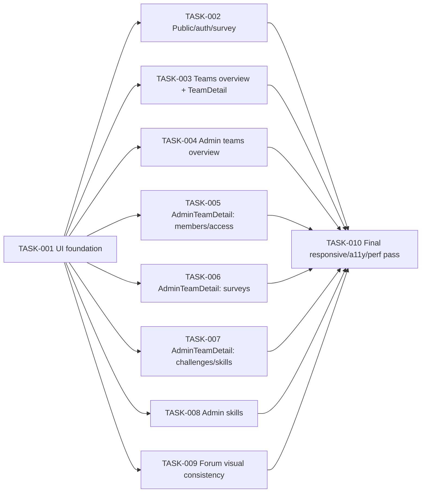

# DevPulse App-Wide UI/UX Refresh — Tasks

Specification: [SPEC.md](./SPEC.md)

## Status
Ready: 7  In Progress: 0  Done: 3

`SPEC.md`'s Status is `Approved` (see `SPEC.md` → "Status"/"Approval gate").
TASK-001 through TASK-003 are `Done`; TASK-004 through TASK-009 remain
unblocked (their only dependency, TASK-001, is satisfied) and independently
eligible for the next `implement-task` session to pick up, in any order.

## Task graph

TASK-002 through TASK-009 depend only on TASK-001 and are independently
reviewable/implementable in any order relative to each other (each owns a
disjoint set of files — see each task's "Expected file areas"). Per
`SPEC.md`'s Owner decision 5 / BR-20, `AdminTeamDetail.tsx`'s refresh is
deliberately split across TASK-005/006/007 rather than one task; **TASK-005
alone** flips `app/admin/teams/[teamId]/page.tsx`'s `PageShell` width to
`"wide"` (BR-5) — TASK-006/007 render inside whatever shell width already
exists when they run and must not also edit that `page.tsx`, so the three
tasks never touch the same line of the same file regardless of build order.

## BR coverage

| BR | Description (short) | Owning task(s) |
|---|---|---|
| BR-1 | Geist Sans becomes the actual rendered body font | TASK-001 |
| BR-2 | Geist Mono config preserved, unused | TASK-001 |
| BR-3 | `PageShell` gains `"wide"` token | TASK-001 |
| BR-4 | `SiteHeader` width matches `"wide"` | TASK-001 |
| BR-5 | `"wide"` applied to the 3 admin routes only | TASK-004, TASK-005, TASK-008 |
| BR-6 | Minimum compatible form-control primitive(s) | TASK-001 |
| BR-7 | `SurveyResponseForm` radio scale unchanged | TASK-002 |
| BR-8 | Migrated controls preserve validation/submit behavior | TASK-002 through TASK-009 (each for its own files) |
| BR-9 | `aria-invalid`/`aria-describedby` on migrated controls | TASK-002 through TASK-009 (each for its own files) |
| BR-10 | Badge primitive introduced; applied at confirmed sites only | TASK-001 (primitive), TASK-003, TASK-004, TASK-005, TASK-007, TASK-008 (usage) |
| BR-11 | Badge never applied to SkillTree stage list | TASK-003, TASK-007, TASK-008 |
| BR-12 | 3 named forms get progressive disclosure | TASK-004, TASK-006, TASK-008 |
| BR-13 | Every other form stays always-visible | TASK-003, TASK-005, TASK-009 |
| BR-14 | Toggle open/close: no extra request, no rule change | TASK-004, TASK-006, TASK-008 |
| BR-15 | `TeamDetail` two-zone visual grouping | TASK-003 |
| BR-16 | `TeamDetail` fetch/generation-guard/capability logic unchanged | TASK-003 |
| BR-17 | No capability-gated control ever revealed | TASK-003 |
| BR-18 | Forum visual consistency; flag/API/auth unchanged | TASK-009 |
| BR-19 | Admin summary only from already-loaded state | TASK-004, TASK-008 |
| BR-20 | `AdminTeamDetail` split into ≥3 tasks | TASK-005, TASK-006, TASK-007 (their existence together satisfies this) |
| BR-21 | `minimumResponses` hint `aria-describedby` | TASK-006 |
| BR-22 | Clipboard-copy failure feedback | TASK-006 |
| BR-23 | Loading/empty/error states + role semantics unchanged | TASK-002 through TASK-009 (each for its own files); TASK-010 (final confirmation) |
| BR-24 | Responsive at phone/tablet/desktop; no new page scroll | TASK-002 through TASK-009 (each for its own files); TASK-010 (final sweep) |
| BR-25 | `TrendChart` stays lazy; `recharts` never eager | TASK-003; TASK-010 (final confirmation) |
| BR-26 | No new dependency/API/Firestore/auth/env change | Every task (guardrail); TASK-010 (final confirmation) |

Every BR maps to at least one task. No task implements behavior outside
`SPEC.md`.

## Tasks

### TASK-001 — UI foundation

**Status:** Done
**Covers:** BR-1, BR-2, BR-3, BR-4, BR-6
**Depends on:** None

**Outcome**
Geist Sans is the application's actual rendered body typeface. `PageShell`
accepts a new `"wide"` width token, and `SiteHeader`'s own outer bound
matches it. A minimum set of shared form-control primitives/styles exists
for the standard text-input/textarea/simple-select pattern, and a Badge
primitive exists — neither is consumed by any feature surface yet (that's
TASK-002 through TASK-009's job); this task only introduces them and proves
them in isolation.

**Implementation notes**
- `app/globals.css`: remove the `body { font-family: Arial, Helvetica,
  sans-serif; }` override (or replace it with `font-family: var(--font-sans),
  ui-sans-serif, sans-serif;`) so the already-configured
  `--font-sans`→`--font-geist-sans` chain (`app/layout.tsx:7-15`,
  `app/globals.css`'s `@theme inline` block) actually drives body text.
  `--font-mono`/Geist Mono configuration in `app/layout.tsx`/`globals.css`
  is left exactly as-is (BR-2) — do not remove it merely because it's
  currently unused.
- `src/components/ui/PageShell.tsx`: extend `PageShellWidth` to
  `"sm" | "lg" | "2xl" | "3xl" | "wide"` and add a `wide` entry to
  `WIDTH_CLASSNAMES` using a Tailwind `max-w-*` token materially wider than
  `max-w-3xl` (e.g. `max-w-6xl` or `max-w-7xl` — pick one and record the
  choice in this task's own notes on completion; no numeric/pixel prop).
- `src/components/nav/SiteHeader.tsx`: change its hard-coded `max-w-3xl`
  (`SiteHeader.tsx:96`) to the same token `PageShell`'s `wide` entry uses —
  prefer importing/reusing `PageShell`'s own width-class constant over
  duplicating the literal string, if that can be done without a
  circular/awkward import (a local shared constant in
  `src/components/ui/` is an acceptable alternative). This must be one
  single value used by every route's header, never a per-route conditional
  (`SPEC.md` BR-4 — this widens an already-existing, already-shipped
  header-wider-than-page-content relationship, not a new one; no
  route-specific narrower-header variant is needed or wanted).
- New form-control primitive(s) under `src/components/ui/` (exact
  file/component names at implementer's discretion — e.g. `TextField.tsx`,
  `TextArea.tsx`, `Select.tsx`, or one `FormField.tsx` module covering all
  three): each takes a `label`, forwards native input props, and renders
  the shared focus-visible/border treatment currently duplicated across the
  12 files `SPEC.md` names. Each primitive accepts (and correctly forwards)
  `aria-invalid`/`aria-describedby` so BR-9 is satisfiable by every
  consuming task without each one re-deriving the wiring. Do not build a
  primitive for radio groups or number-with-constraint inputs — `SPEC.md`
  BR-7 explicitly excludes `SurveyResponseForm`'s radio scale, and no other
  file in scope has a comparable specialized control needing one.
- New `src/components/ui/Badge.tsx`: takes `children` (the status text,
  mandatory) and a small tone/variant set (e.g. `neutral`/`muted`, matching
  the existing `zinc`-only palette — no new accent color); never renders
  without visible text; never accepts a color-only mode.
- No feature file under `src/features/**/components/` is touched by this
  task — that migration is TASK-002 through TASK-009's job.

**Verification**
- `PageShell.test.tsx`: `"wide"` renders the new, wider `max-w-*` class;
  every existing width token's behavior is unchanged.
- `SiteHeader.test.tsx`: header's outer container uses the new wide bound
  on every auth state (existing tests re-run, plus one new assertion of the
  container's width class or an equivalent structural check that avoids a
  brittle full-class-string assertion — e.g. asserting it matches
  `PageShell`'s own `wide` class value via a shared exported constant).
- New primitive tests: label association (`getByLabelText`), `aria-invalid`/
  `aria-describedby` pass-through, visible focus ring class presence is
  *not* asserted as a literal string beyond what's needed to prove the
  shared treatment exists (prefer testing that the primitive renders the
  props it's given, not a hardcoded Tailwind string) — Badge renders its
  text content and never renders solely a colored element with no text.
- `pnpm lint`, `pnpm typecheck`.

**Security / privacy**
No additional considerations — pure presentation primitives, no data, no
auth, no network call of any kind.

**Documentation impact**
None yet (`TASK-010` performs the final `docs/UI-UX.md` sync once every
surface is actually migrated).

**Acceptance criteria**
- [x] `app/globals.css` no longer hardcodes Arial for `body`; Geist Sans
      renders (BR-1); Geist Mono config is untouched (BR-2).
- [x] `PageShell` accepts `width="wide"`; every existing width token is
      unaffected (BR-3).
- [x] `SiteHeader`'s own width bound equals the new wide token (BR-4).
- [x] A text-input/textarea/select primitive exists, forwards
      `aria-invalid`/`aria-describedby`, and is not yet consumed by any
      feature file (BR-6).
- [x] A `Badge` primitive exists, always renders text, has no color-only
      mode.
- [x] Relevant tests, `pnpm lint`, `pnpm typecheck` pass.

**Notes**
Implemented exactly as specified, with the following concrete choices:
- `app/globals.css`: `body`'s `font-family` changed from the hardcoded
  `Arial, Helvetica, sans-serif` to `var(--font-sans), ui-sans-serif,
  sans-serif` — resolves through the already-existing `@theme inline`
  mapping (`--font-sans: var(--font-geist-sans)`) to the Geist Sans already
  configured in `app/layout.tsx`. `app/layout.tsx`'s Geist Sans/Mono setup
  (`geistSans`/`geistMono`, both `variable` classes on `<html>`) is
  byte-for-byte unchanged — confirmed via `git diff`, this file was never
  touched.
- `src/components/ui/PageShell.tsx`: `"wide"` added to `PageShellWidth`,
  mapped to `max-w-6xl` (1152px — materially wider than `max-w-3xl`'s
  768px). `WIDTH_CLASSNAMES` is now exported (was previously module-private)
  specifically so `SiteHeader` can share the exact same class value as its
  single source of truth, per BR-4's "no duplicated literal string" intent.
- `src/components/nav/SiteHeader.tsx`: its previously hard-coded
  `max-w-3xl` now reads `WIDTH_CLASSNAMES.wide` from `PageShell` — one
  value, used identically on every route; no route-specific branching of
  any kind was introduced. No auth/nav behavior, link, copy, or client
  state changed.
- Form-control primitives: three separate files (matching this codebase's
  existing one-primitive-per-file convention —
  `Button.tsx`/`Card.tsx`/`Alert.tsx`, etc.) — `TextField.tsx`,
  `TextArea.tsx`, `Select.tsx`. Each requires an explicit `id`/`label`,
  accepts optional `description`/`error`, forwards every other native
  prop unchanged, and renders `error` through the existing `Alert`
  component (preserving `role="alert"`) rather than a bare paragraph — so
  a future migration never loses `Alert`'s existing role semantics by
  adopting the primitive. A tiny shared `describedByIds()` helper and a
  shared `FORM_CONTROL_CLASSNAME` constant were added to the existing
  `class-names.ts` (alongside `cx()`) rather than duplicated three times.
  No radio/rating abstraction, no form-state management, no schema
  validation, no `"use client"` directive (none of the three has any
  hook/state — each is a plain, presentational function component).
- `src/components/ui/Badge.tsx`: a single visual treatment, no `tone`/
  `variant` prop at all — every confirmed SPEC candidate call site
  (`AdminTeams.tsx`, `TeamsOverview.tsx`, `ChallengeList.tsx`,
  `TeamSkillTrackingSection.tsx`, `OrgSkillProgressOverview.tsx`) currently
  renders its status as plain, uncolored text, so no color-differentiated
  variant is justified yet; adding one speculatively would have been
  exactly the "variants merely because they might be useful someday" this
  task was told to avoid. `children` (the status text) is mandatory; there
  is no way to render the component without visible text content.
- Confirmed via `git diff`/`git status`: no file under `src/features/**`,
  `app/api/**`, or any `app/admin/**`/`app/**/page.tsx` was touched; no
  admin page was switched to `width="wide"` (that remains TASK-004/005/008's
  own job); `package.json`/`pnpm-lock.yaml` are unchanged (no new
  dependency); `app/layout.tsx` is unchanged.

Verification: focused suite (`src/components/ui`, `src/components/nav`) —
12 files / 68 tests passed. Full `pnpm test` — 173 files / 2440 tests
passed. `pnpm typecheck`, `pnpm lint`, `git diff --check` all passed.
`pnpm build` succeeded with an identical route manifest to before this
task (no new/removed route). Nothing was pushed or deployed.

---

### TASK-002 — Public/auth/survey surfaces

**Status:** Done
**Covers:** BR-7, BR-8, BR-9
**Depends on:** TASK-001

**Outcome**
`SignInForm`, `SignUpForm`, and `SurveyResponseForm` (where compatible)
adopt the new form-control primitive and gain correct `aria-invalid`/
`aria-describedby` wiring on validation error; Home needs no change (it has
no form). `SurveyResponseForm`'s radio scale is explicitly left as native
markup.

**Implementation notes**
- `src/features/auth/components/SignInForm.tsx`,
  `src/features/auth/components/SignUpForm.tsx`: migrate the email/password
  text inputs to the new primitive; wire `aria-invalid`/`aria-describedby`
  to each form's existing error `Alert` (currently absent — `SignInForm.tsx:
  65-91` confirmed to lack it). No change to `signIn`/`signUp` call
  signatures, validation timing, or success/error copy.
- `src/features/surveys/components/SurveyResponseForm.tsx`: leave the
  radio-scale `fieldset`/`legend`/`input[type=radio]` structure exactly as
  it is (BR-7) — this task's only touch here, if any, is a purely cosmetic
  one consistent with the new visual language (e.g. shared focus-ring
  treatment already present at `SurveyResponseForm.tsx:114`), never a
  structural change.
- `app/page.tsx` (Home): confirm no form exists to migrate; touch only if
  a typography-only change is needed once TASK-001 lands (likely none,
  since Home has no hand-rolled form control).

**Verification**
- `SignInForm.test.tsx`/`SignUpForm.test.tsx`: existing behavioral
  assertions (submit, error, success) continue to pass; new assertions for
  `aria-invalid`/`aria-describedby` presence on the invalid state, and
  `getByLabelText` still resolving each field through the new primitive.
- `SurveyResponseForm.test.tsx`: unchanged behaviorally; a regression
  assertion that the radio group's native structure/role is intact.
- `pnpm lint`, `pnpm typecheck`.

**Security / privacy**
No additional considerations.

**Documentation impact**
None expected yet (TASK-010).

**Acceptance criteria**
- [x] Sign-in/sign-up inputs use the shared primitive; behavior unchanged
      (BR-8).
- [x] Sign-in/sign-up inputs expose `aria-invalid`/`aria-describedby` on
      error (BR-9).
- [x] `SurveyResponseForm`'s radio scale is structurally unchanged (BR-7).
- [x] Relevant tests, `pnpm lint`, `pnpm typecheck` pass.

**Notes**
Implemented as specified, with one deliberate scope decision recorded here:
- `SignInForm.tsx`/`SignUpForm.tsx`: both email/password `<input>`s migrated
  to `TextField` (id/label/type/autoComplete/required/value/onChange all
  preserved exactly). The combined credential/sign-up error is not
  field-specific (Firebase Auth returns one message for the whole attempt,
  never "which field"), so rather than rendering `TextField`'s own `error`
  prop twice (which would have produced two `role="alert"` elements and
  broken the existing single-`findByRole("alert")` tests), both fields
  instead receive `aria-invalid`/`aria-describedby` directly as native props
  — supported without any `TextField` change, since it forwards every
  native ARIA attribute unchanged — pointing at the one existing `Alert`
  (now given a stable `id`), which continues to render exactly once. No
  `TextField`/`TextArea`/`Select`/`Badge` API change was needed or made.
- `SurveyResponseForm.tsx`, `SurveyParticipationView.tsx`, `app/page.tsx`:
  confirmed via inspection and left completely untouched. The radio scale's
  focus-visible class already matched the shared treatment (nothing to
  change); `SurveyParticipationView` already composes only existing shared
  primitives (`PageHeader`/`Alert`/`LoadingState`) with no hand-rolled
  control; Home has no form. Zero-diff confirmed via `git status` for all
  three — no churn was introduced merely because a file was in this task's
  named inventory.
- No `PageShell` width changed on any public/auth/survey page (BR-5,
  unaffected — none of these routes were ever assigned `"wide"`).
- Confirmed via `git diff --stat`: no file under `src/components/ui/`,
  `src/features/surveys/`, `src/features/teams/`, `src/features/challenges/`,
  `src/features/forum/`, `src/features/skill-trees/`, any `app/**/page.tsx`,
  `package.json`, or `pnpm-lock.yaml` was touched — only the two auth form
  components and their tests changed.

Verification: focused suite (`src/features/auth`, `src/features/surveys`) —
23 files / 385 tests passed (383 pre-existing + 2 new accessibility
assertions). Full `pnpm test` — 173 files / 2442 tests passed. `pnpm
typecheck`, `pnpm lint`, `git diff --check` all passed. `pnpm build`
succeeded with an identical route manifest. Nothing was pushed or deployed.

---

### TASK-003 — Teams overview + TeamDetail visual hierarchy

**Status:** Done
**Covers:** BR-8, BR-9, BR-10, BR-11, BR-13, BR-15, BR-16, BR-17, BR-25
**Depends on:** TASK-001

**Outcome**
`TeamsOverview` shows each team's relationship via the new Badge. `TeamDetail`
visually groups its already-rendered sections into "Resultater" and
"Teamaktivitet" zones, with zero change to fetch order, generation guards,
or any capability computation. The Challenge submission form stays
always-visible. `TeamSkillSection`'s stage list/current-stage marker is
untouched beyond incidental shared typography/spacing/Card treatment.

**Implementation notes**
- `src/features/teams/components/TeamsOverview.tsx`: replace the plain-text
  relationship label (`RELATIONSHIP_LABELS[team.relationship]`,
  `TeamsOverview.tsx:165-167`) with the new Badge primitive, text unchanged.
- `src/features/teams/components/TeamDetail.tsx`: introduce two visual
  groupings around the existing section order — "Resultater"
  (`CurrentSurveySection`, `PeriodSummary`, `TrendChartBoundary`/
  `LazyTrendChart`, `TrendTable`) and "Teamaktivitet" (`ChallengesSection`,
  `ForumSection` when rendered, `TeamSkillSection`) — via spacing/heading
  grouping, not new `Card`-in-`Card` nesting. Do **not** touch
  `loadTeamDetail`, `resolveViaResults`, `Promise.all` composition, any
  `useAuthGatedResource`/generation-guard code, or the `canSubmit`/
  `FEATURE_FORUM_ENABLED`/`canReportProgress` gating conditions themselves
  — only the JSX arrangement/wrapping around already-computed `result`
  data changes (BR-16, BR-17). The lazy `next/dynamic` import of
  `TrendChart` and its `catchError` boundary (`TeamDetail.tsx:65-93`) must
  remain byte-for-byte structurally unchanged (BR-25) — do not move the
  `dynamic()` call, do not import `TrendChart`/`recharts` anywhere else in
  this file.
- `ChallengesSection` (inline in `TeamDetail.tsx`): apply shared Badge/
  typography treatment to challenge status if touched via `ChallengeList`
  (see below); the submission panel (`ChallengeSubmissionPanel`) stays
  always-rendered when `canSubmit` is true — do not add a toggle here
  (BR-13).
- `src/features/challenges/components/ChallengeList.tsx`: replace the
  plain-text status label (`ChallengeList.tsx:54`) with the Badge
  primitive.
- `src/features/skill-trees/components/TeamSkillSection.tsx`: apply only
  incidental shared `Card`/typography/spacing consistent with the rest of
  this refresh — the `<ol>` stage list, the `TrackedSkillRow`'s
  current-stage inline marker, and the select/"Lagre" control (already
  gated by `canReportProgress`, untouched by this task) keep their existing
  visual model exactly (BR-11). Do not introduce a Badge here for the
  stage list itself; a Badge on this file, if used at all, is limited to
  a tree-level "not started" label if one already exists as text — verify
  against current source before adding one that doesn't already exist as a
  string to relabel.

**Verification**
- `TeamsOverview.test.tsx`: relationship label still resolves via
  `getByText`/role queries, now inside the Badge primitive.
- `TeamDetail.test.tsx`: existing tests continue to pass unmodified in
  intent (grouping is presentation-only); if any test currently asserts a
  literal DOM-order expectation incompatible with the new zone grouping,
  update the assertion to check content/role presence within the correct
  zone rather than raw sibling order. Add: zone headings are present and
  are real headings (`getByRole("heading", ...)`); `fetchTeamThreads`/
  `fetchTeamChallenges`/`fetchTeamSkills`/`fetchTeamResults`/
  `fetchCurrentTeamSurvey` call counts are unchanged from the current
  suite's existing assertions (BR-16 regression); a `canSubmit:false`/
  `canReportProgress:false`/`forumEnabled:false` fixture still hides its
  respective control (BR-17 regression, reusing this session's existing
  fixtures for those tests).
- A regression test confirming the `TrendChart` module is still loaded only
  via the existing lazy path (reuse the existing
  `trendChartModuleLoadedMock` pattern already in `TeamDetail.test.tsx`) —
  BR-25.
- `pnpm lint`, `pnpm typecheck`.

**Security / privacy**
This task is the highest-risk one for accidentally weakening BR-17 — get
the capability-gated regression tests exactly right; do not weaken or
remove any existing `canSubmit`/`canReportProgress`/`forumEnabled` test in
`TeamDetail.test.tsx`/`TeamSkillSection.test.tsx`/`ChallengeList`-related
tests while touching this file.

**Documentation impact**
None expected yet (TASK-010).

**Acceptance criteria**
- [x] `TeamsOverview` relationship label renders via Badge, text unchanged
      (BR-10).
- [x] `TeamDetail` visually groups into two zones with no Card-in-Card
      nesting (BR-15).
- [x] `TeamDetail`'s fetch order, generation guards, and every capability
      computation are unchanged (BR-16).
- [x] No capability-gated control is revealed where it wasn't before
      (BR-17).
- [x] Challenge submission panel remains always-visible when capable
      (BR-13).
- [x] `TeamSkillSection`'s stage list/current-stage presentation is
      unchanged beyond incidental shared styling (BR-11).
- [x] `TrendChart` remains lazy with its `catchError` boundary intact
      (BR-25).
- [x] Relevant tests, `pnpm lint`, `pnpm typecheck` pass.

**Notes**
Implemented exactly as specified:
- `TeamDetail.tsx`: added two presentation-only wrapper components,
  `ResultaterZone`/`TeamaktivitetZone` (plain `<section
  aria-labelledby>` + `<h2>` + `children`, no `Card`, no state, no fetch,
  no capability logic) and used them to visually regroup the `authorized`
  and `results_unavailable` branches' already-rendered sections in place.
  Confirmed via `git diff`: `loadTeamDetail`/`resolveViaResults`'s
  `Promise.all` composition, `useAuthGatedResource`/generation-guard code,
  and the `canSubmit`/`FEATURE_FORUM_ENABLED`/`canReportProgress` gating
  conditions are byte-for-byte unchanged — only the JSX arrangement around
  already-computed `result` data changed. The `denied` branch (no
  results/activity content today) is left unwrapped, per the instruction
  not to force a zone to render content that didn't previously exist
  there. `LazyTrendChart`'s `next/dynamic` call and `TrendChartBoundary`'s
  `catchError` wrapping are unmoved — only now nested one level deeper
  inside `ResultaterZone`, never re-declared or relocated (BR-25).
- `TeamsOverview.tsx` / `ChallengeList.tsx`: the relationship label and
  challenge status label now render via the existing `Badge` primitive
  (`src/components/ui/Badge.tsx`, from TASK-001) in place of the previous
  bare text — label text, submitted date, and surrounding
  navigation/capability logic unchanged.
- `TeamSkillSection.tsx`: left untouched. It already uses the shared
  `Card`/typography treatment from TASK-001, so no incidental styling was
  needed; its "ikke startet" text was deliberately not converted to Badge,
  consistent with BR-11's stage/progression exclusion and the same
  treatment TASK-008's own notes already record for the identical string
  in `OrgSkillProgressOverview.tsx`.
- `copy.ts`: added `resultaterHeading`/`teamaktivitetHeading` ("Resultater"
  / "Teamaktivitet") to `teamsCopy.detail`, per the existing copy-module
  convention.
- Tests added: `TeamDetail.test.tsx` — two new tests asserting the
  "Resultater"/"Teamaktivitet" headings are real headings and that each
  zone's `<section>` contains only its own content (results vs. activity),
  for both the `authorized` and `results_unavailable` branches.
  `TeamsOverview.test.tsx`/`ChallengeList.test.tsx` — one test each
  confirming the relevant status/relationship label now renders inside the
  Badge primitive (`tagName === "SPAN"`), not a bare paragraph. All
  pre-existing behavioral/regression tests (capability-gating, fetch call
  counts, `TrendChart` lazy-load/`catchError` isolation) were left
  unmodified and continue to pass — they already query by role/text, not
  DOM order, so the new zone wrapping required no assertion changes.

Verification: focused suite (`src/features/teams`, `src/features/challenges`,
`src/features/skill-trees`) and full `pnpm test` — 173 files / 2446 tests
passed (2442 pre-existing + 4 new). `pnpm typecheck`, `pnpm lint`, `git diff
--check` all passed. `pnpm build` succeeded with an identical route manifest
to before this task (no new/removed route). Nothing was pushed or deployed.

---

### TASK-004 — Admin teams overview

**Status:** Ready
**Covers:** BR-5, BR-8, BR-9, BR-10, BR-12, BR-14, BR-19
**Depends on:** TASK-001

**Outcome**
`/admin/teams` uses the wide `PageShell`, shows each team's status via
Badge, and moves team creation behind an explicit toggle; the list below
becomes the default-visible content. An optional active/disabled count
summary is added only if derivable from the already-loaded team list.

**Implementation notes**
- `app/admin/teams/page.tsx`: change `PageShell width="3xl"` to
  `width="wide"` (BR-5).
- `src/features/teams/components/AdminTeams.tsx`: replace the plain-text
  status line (`AdminTeams.tsx:255`) with Badge; wrap the creation form
  (`AdminTeams.tsx:201-228`) behind a toggle button with `aria-expanded`
  (BR-12) — the team list (`AdminTeams.tsx:230-281`) becomes the default
  view; migrate the name `<input>` (`AdminTeams.tsx:212-218`) to the new
  primitive, preserving `handleCreate`'s validation/submission exactly
  (BR-8); wire `aria-invalid`/`aria-describedby` on the create-error state
  (BR-9). Optionally add a small computed summary (e.g. "N aktive · M
  deaktiverte") derived purely from the already-fetched `teams` array
  already in this component's state — no new fetch (BR-19); omit entirely
  if it doesn't read as genuinely useful once implemented.
- Toggling the creation form open/closed triggers no fetch of any kind
  (BR-14); a successful creation closes the form back to the list (mirrors
  `SkillTreeCorrectionForm`'s existing `onSuccess` precedent), consistent
  with `handleCreate`'s existing `await loadForGeneration(...)` refresh.

**Verification**
- `AdminTeams.test.tsx`: existing create/status-toggle behavioral tests
  continue to pass; new tests: creation form is not present until the
  toggle is activated (`queryByLabelText` returns `null` beforehand);
  toggle button has `aria-expanded="false"`/`"true"` correctly; Cancel (if
  added) closes without submitting; successful creation collapses the form
  again; status renders via Badge (`getByText` for the status word, plus a
  structural check that it's inside the Badge component, not a bare
  `
`); if a summary count is added, it's asserted only against the
  already-provided fixture data (no new mock call).
- `pnpm lint`, `pnpm typecheck`.

**Security / privacy**
No additional considerations — `requireAppAdmin`/`createAdminTeam`/
`setAdminTeamStatus` call signatures and authorization are untouched.

**Documentation impact**
None expected yet (TASK-010).

**Acceptance criteria**
- [ ] `/admin/teams` renders at `width="wide"` (BR-5).
- [ ] Team status renders via Badge (BR-10).
- [ ] Creation form is hidden by default, toggled via an `aria-expanded`
      control, list is the default view (BR-12).
- [ ] Toggling adds no network request; successful creation collapses the
      form (BR-14).
- [ ] Any summary shown uses only already-loaded state (BR-19).
- [ ] Relevant tests, `pnpm lint`, `pnpm typecheck` pass.

---

### TASK-005 — `AdminTeamDetail`: members, invitations, access requests

**Status:** Ready
**Covers:** BR-5, BR-8, BR-9, BR-10, BR-13
**Depends on:** TASK-001

**Outcome**
`/admin/teams/[teamId]` renders at the wide `PageShell` width. The
member/invitation/access-request sections of `AdminTeamDetail.tsx` adopt
the shared form-control and Badge primitives for their invite-email input
and any status text; every action in this section stays always-visible
(no progressive disclosure here — these are small, single-field
interactions per BR-13).

**Implementation notes**
- `app/admin/teams/[teamId]/page.tsx`: change `PageShell width="3xl"` to
  `width="wide"` (BR-5) — **this is the only task of TASK-005/006/007 that
  touches this file**; TASK-006 and TASK-007 render inside whatever width
  is current when they run and must not also edit this page.
- `src/features/teams/components/AdminTeamDetail.tsx` (members/
  invitations/access-requests sections only — do not touch the surveys or
  challenges/skills sections owned by TASK-006/TASK-007): migrate the
  invite-email input to the new primitive, preserving its existing
  validation/submission; apply Badge to any member/invitation/request
  status text found in this section; do not add a toggle/collapse to the
  invite form or any access-request row action (BR-13).

**Verification**
- `AdminTeamDetail.test.tsx` (the subset of tests covering members/
  invitations/access-requests): existing behavioral tests continue to pass;
  new assertions for `aria-invalid`/`aria-describedby` on the invite-email
  field's error state; invite/approve/reject/remove actions remain
  reachable without any prior "expand" interaction (BR-13 regression).
- A `PageShell`-width assertion at the page level (or a structural
  equivalent) confirming `width="wide"` is applied.
- `pnpm lint`, `pnpm typecheck`.

**Security / privacy**
No additional considerations — invite/approve/reject/remove authorization
and gateway calls are untouched.

**Documentation impact**
None expected yet (TASK-010).

**Acceptance criteria**
- [ ] `/admin/teams/[teamId]` renders at `width="wide"` (BR-5).
- [ ] Invite-email field uses the shared primitive with
      `aria-invalid`/`aria-describedby` wired (BR-8, BR-9).
- [ ] Any status text in this section renders via Badge (BR-10).
- [ ] No member/invitation/access-request action gains a
      progressive-disclosure toggle (BR-13).
- [ ] Relevant tests, `pnpm lint`, `pnpm typecheck` pass.

---

### TASK-006 — `AdminTeamDetail`: surveys

**Status:** Ready
**Covers:** BR-8, BR-9, BR-12, BR-14, BR-21, BR-22
**Depends on:** TASK-001

**Outcome**
The survey-management section of `AdminTeamDetail.tsx` moves its creation
form behind an explicit toggle, adopts the shared form-control primitives
for its text/date/number fields, associates the `minimumResponses` hint
with its input, and gives the survey-link copy action visible failure
feedback.

**Implementation notes**
- `src/features/teams/components/AdminTeamDetail.tsx` (survey-management
  section only — do not touch `app/admin/teams/[teamId]/page.tsx`; TASK-005
  owns that file's `PageShell` width change): wrap the survey-creation form
  behind a toggle with `aria-expanded` (BR-12), matching TASK-004/TASK-008's
  identical pattern; the active/archived survey lists become the default
  view. Migrate compatible text/number inputs to the new primitive,
  preserving the access-mode `fieldset`/`legend` radio structure exactly
  (it is not one of the 12 files' hand-rolled *text* controls — its radios
  are already correctly labeled and are out of this task's migration
  scope, same reasoning as BR-7's `SurveyResponseForm` exemption, though
  not itself a numbered BR since `SPEC.md` didn't need to call this one out
  separately). Add `aria-describedby` linking the `minimumResponses` input
  to its existing hint text (BR-21). Give `handleCopySurveyLink`'s
  catch branch a visible, non-sensitive failure state (e.g. a transient
  `Alert`/status message reusing the existing transient-confirmation
  mechanism already used for the success case) instead of its current
  silent failure (BR-22).
- Toggling the creation form triggers no fetch; a successful creation
  collapses it back to the list, consistent with the form's existing
  post-create refresh behavior (BR-14).

**Verification**
- `AdminTeamDetail.test.tsx` (survey-section subset): existing create/open/
  close/archive/delete behavioral tests continue to pass; new tests: the
  creation form is hidden until toggled; `aria-expanded` state correctness;
  successful creation collapses the form; `minimumResponses` input has
  `aria-describedby` resolving to its hint text; a simulated
  `navigator.clipboard.writeText` rejection now surfaces a visible failure
  state (assert via role/text, not implementation detail).
- `pnpm lint`, `pnpm typecheck`.

**Security / privacy**
No additional considerations — survey creation/open/close/delete/archive
authorization and gateway calls are untouched.

**Documentation impact**
None expected yet (TASK-010).

**Acceptance criteria**
- [ ] Survey-creation form is hidden by default, toggled via
      `aria-expanded`, lists are the default view (BR-12).
- [ ] Toggling adds no request; successful creation collapses the form
      (BR-14).
- [ ] Migrated survey-form text/number inputs preserve behavior and gain
      `aria-invalid`/`aria-describedby` (BR-8, BR-9).
- [ ] `minimumResponses` hint is `aria-describedby`-linked (BR-21).
- [ ] A failed clipboard copy shows a visible failure state (BR-22).
- [ ] Relevant tests, `pnpm lint`, `pnpm typecheck` pass.

---

### TASK-007 — `AdminTeamDetail`: challenges and skill tracking

**Status:** Ready
**Covers:** BR-8, BR-9, BR-10, BR-11, BR-13
**Depends on:** TASK-001

**Outcome**
The challenge-management and skill-tracking sections of
`AdminTeamDetail.tsx` adopt shared Badge/form-control styling for status
text and the confirmation-delete flow's inputs (if any); the skill-tracking
stage list/current-stage presentation is unchanged beyond incidental shared
styling. No action in this section gains progressive disclosure.

**Implementation notes**
- `src/features/teams/components/AdminTeamDetail.tsx` (challenge-management
  and skill-tracking sections only — do not touch
  `app/admin/teams/[teamId]/page.tsx`, members/invitations/access-requests,
  or the surveys section): apply Badge to challenge status text where
  present; keep the existing `"confirming_deletion"` explicit-confirm step
  for challenge deletion unchanged in behavior, restyled only. For the
  admin skill-tracking section
  (`src/features/skill-trees/components/TeamSkillTrackingSection.tsx`):
  apply Badge to the "ikke startet"/disabled-team-hint text where it
  already exists as a distinct status string; leave the ordered stage
  `<ol>`, per-node presentation, and the set-stage `<select>`/stop-tracking
  controls exactly as they are (BR-11) — this is not the place for any
  stage-visualization change. No form in this section gains a
  progressive-disclosure toggle (BR-13).

**Verification**
- `AdminTeamDetail.test.tsx` (challenge-section subset) and
  `TeamSkillTrackingSection.test.tsx`: existing behavioral tests continue
  to pass; new assertions for Badge usage on status text; a regression
  assertion that the stage `<ol>`/current-stage marker structure is
  byte-for-byte unchanged (reuse this suite's existing structural
  assertions for the ordered list/`aria-current` marker).
- `pnpm lint`, `pnpm typecheck`.

**Security / privacy**
No additional considerations — challenge resolve/archive/delete and
`startTeamSkillTracking`/`updateTeamSkillProgress`/`stopTeamSkillTracking`
authorization/gateway calls are untouched.

**Documentation impact**
None expected yet (TASK-010).

**Acceptance criteria**
- [ ] Challenge/skill-tracking status text renders via Badge where
      applicable (BR-10).
- [ ] Skill-tracking stage list/current-stage presentation is unchanged
      (BR-11).
- [ ] No action in this section gains progressive disclosure (BR-13).
- [ ] Relevant tests, `pnpm lint`, `pnpm typecheck` pass.

---

### TASK-008 — Admin skills

**Status:** Ready
**Covers:** BR-5, BR-8, BR-9, BR-10, BR-11, BR-12, BR-14, BR-19
**Depends on:** TASK-001

**Outcome**
`/admin/skills` renders at the wide `PageShell` width. SkillTree creation
moves behind a toggle (the catalog becomes the default view); the catalog
and org-wide overview adopt shared form-control/Badge styling; the existing
per-tree correction disclosure (`SkillTreeCatalogList`'s `openTreeId`
toggle) is preserved unchanged as this feature's own precedent. No stage-
list/progression visual changes anywhere in this task.

**Implementation notes**
- `app/admin/skills/page.tsx`: change `PageShell width="3xl"` to
  `width="wide"` (BR-5).
- `src/features/skill-trees/components/SkillTreeCreationForm.tsx` and
  `AdminSkills.tsx`: wrap the creation form behind a toggle with
  `aria-expanded` (BR-12) — the catalog list becomes the default view;
  migrate the name/stage-label inputs to the new primitive, preserving
  `isClientValid`/`createAdminSkillTree`'s validation/submission exactly
  (BR-8, BR-9).
- `src/features/skill-trees/components/SkillTreeCorrectionForm.tsx`: no
  behavioral change — it already implements this feature's progressive-
  disclosure precedent (`SkillTreeCatalogList.tsx:68-87`'s `openTreeId`
  toggle); apply only the same shared form-control styling as every other
  migrated text input, without altering its fixed-row-count structural
  guarantee.
- `src/features/skill-trees/components/SkillTreeCatalogList.tsx`: no
  change to its open/close mechanism; apply Badge only if it already
  renders a status string beyond the stage list itself (verify against
  current source before adding any — do not invent a new label).
- `src/features/skill-trees/components/OrgSkillProgressOverview.tsx`:
  replace the "(Deaktivert)" plain-text suffix with Badge; per-tree stage
  labels ("Ikke startet" or a resolved node label) are left as plain text
  — this is presenting another team's *skill progress*, and BR-11
  excludes the SkillTree stage/progression presentation from Badge
  treatment even here.
- Optionally add a small computed summary (e.g. "N kompetanseområder") to
  `AdminSkills.tsx`, derived purely from the already-fetched catalog
  (`trees`) array — no new fetch (BR-19); omit if not genuinely useful.

**Verification**
- `AdminSkills.test.tsx`/`SkillTreeCreationForm.test.tsx`: existing
  create/list behavioral tests continue to pass; new tests: creation form
  hidden until toggled, `aria-expanded` correctness, successful creation
  collapses the form.
- `SkillTreeCorrectionForm.test.tsx`: unchanged behaviorally — a regression
  assertion that its existing fixed-row-count/no-add-remove-control
  guarantee still holds visually.
- `OrgSkillProgressOverview.test.tsx`: "Deaktivert" now renders via Badge;
  stage-label text is unchanged, still plain text.
- `pnpm lint`, `pnpm typecheck`.

**Security / privacy**
No additional considerations — `createSkillTree`/`updateSkillTree`/
`listSkillTrees`/`getOrgSkillProgressOverview` authorization and gateway
calls are untouched.

**Documentation impact**
None expected yet (TASK-010).

**Acceptance criteria**
- [ ] `/admin/skills` renders at `width="wide"` (BR-5).
- [ ] SkillTree creation form is hidden by default, toggled via
      `aria-expanded`, catalog is the default view (BR-12).
- [ ] Toggling adds no request; successful creation collapses the form
      (BR-14).
- [ ] `SkillTreeCorrectionForm`'s existing disclosure/fixed-row precedent
      is unchanged.
- [ ] "Deaktivert" renders via Badge; every stage/progression label stays
      plain text (BR-10, BR-11).
- [ ] Any summary shown uses only already-loaded state (BR-19).
- [ ] Relevant tests, `pnpm lint`, `pnpm typecheck` pass.

---

### TASK-009 — Forum visual consistency

**Status:** Ready
**Covers:** BR-8, BR-9, BR-13, BR-18
**Depends on:** TASK-001

**Outcome**
Forum UI (thread list, thread detail, thread/reply creation, delete
confirmation) visually matches the refreshed application shell wherever it
is already rendered — i.e., only when `FEATURE_FORUM_ENABLED === "true"`.
Thread/reply creation forms remain always-visible. No Forum flag, API,
route, or authorization file is touched.

**Implementation notes**
- `src/features/forum/components/ThreadList.tsx`,
  `ThreadDetail.tsx`, `CreateThreadForm.tsx`, `ReplyForm.tsx`,
  `DeleteConfirmation.tsx`: apply the shared form-control primitive to
  `CreateThreadForm`/`ReplyForm`'s title/body text inputs (preserving
  `isValidLength`/`createThread`/`createReply`'s validation/submission
  exactly, BR-8) with `aria-invalid`/`aria-describedby` wiring (BR-9,
  though these two forms already do this correctly per `SPEC.md`
  "Problem" — verify the migration doesn't regress it); apply consistent
  typography/spacing/Card treatment to thread/reply rows. Do **not** add a
  toggle to either creation form (BR-13). Do not touch
  `src/features/forum/server/is-forum-enabled.ts`, any
  `app/api/teams/[teamId]/forum/**/route.ts`, `app/teams/[teamId]/
  forum/[threadId]/page.tsx`'s `isForumEnabled()` gate, or
  `app/teams/[teamId]/page.tsx`'s `forumEnabled` prop plumbing.

**Verification**
- Existing `ThreadList.test.tsx`/`ThreadDetail.test.tsx`/
  `CreateThreadForm.test.tsx`/`ReplyForm.test.tsx`/
  `DeleteConfirmation.test.tsx`: all continue to pass unmodified in intent;
  new assertions only for the migrated primitive's label/aria wiring.
- A regression check (via `git diff` during this task's own review, not a
  new automated test) confirming `is-forum-enabled.ts`, every forum
  `route.ts`, and the two `forumEnabled`/`isForumEnabled()` gate call
  sites are byte-for-byte unchanged.
- `pnpm lint`, `pnpm typecheck`.

**Security / privacy**
This task must not touch the Forum feature flag, any Forum API route, or
Forum authorization/encryption/persistence/pseudonymization in any way —
verify via `git diff` against exactly the file list named above before
considering this task complete.

**Documentation impact**
None expected yet (TASK-010).

**Acceptance criteria**
- [ ] Forum components adopt shared styling; `createThread`/`createReply`
      validation/submission unchanged (BR-8).
- [ ] Thread/reply creation forms keep correct `aria-invalid`/
      `aria-describedby` wiring (BR-9).
- [ ] Neither creation form gains a progressive-disclosure toggle (BR-13).
- [ ] `is-forum-enabled.ts`, every forum API route, and both
      `forumEnabled`/`isForumEnabled()` gate sites are unchanged (BR-18).
- [ ] Relevant tests, `pnpm lint`, `pnpm typecheck` pass.

---

### TASK-010 — Final responsive/accessibility/performance pass

**Status:** Ready
**Covers:** BR-20 (confirmation), BR-23, BR-24, BR-25 (confirmation), BR-26
**Depends on:** TASK-002, TASK-003, TASK-004, TASK-005, TASK-006, TASK-007, TASK-008, TASK-009

**Outcome**
Every surface this feature touched is confirmed responsive, accessible,
and behaviorally unregressed; `docs/UI-UX.md` and
`docs/features/product-ux-shell/SPEC.md` are synchronized to describe the
refreshed primitives; the full test suite, typecheck, lint, and build all
pass; the feature is closed out.

**Implementation notes**
- Sweep every file touched by TASK-002 through TASK-009 for: remaining
  `aria-invalid`/`aria-describedby` gaps this SPEC identified but a prior
  task might have missed; any new page-level horizontal scroll at common
  phone/tablet widths (manual/code-level check, consistent with this
  feature's existing responsive-verification method — no new browser/
  visual-regression tooling is introduced); confirm no `grid-cols-*` fixed-
  column layout was introduced anywhere (this codebase's existing
  `flex-wrap`-based responsive convention, confirmed during planning,
  should still hold).
- Confirm, via `git diff` against the pre-feature baseline, that:
  `AdminTeamDetail.tsx`'s refresh is spread across TASK-005/006/007 (not
  one commit/task) — BR-20; `TeamDetail.tsx`'s `next/dynamic`/`ssr:false`/
  `catchError` `TrendChart` boundary is structurally unchanged and
  `recharts` is not imported anywhere else — BR-25; no `package.json`
  dependency was added; no file under `app/api/**`,
  `src/features/**/server/`, `src/features/**/domain/`, or
  `src/features/**/client/` (gateways) was touched by any task in this
  feature — BR-26.
- `docs/UI-UX.md`: add a note (following its existing "documents the
  as-built feature" convention, matching the Forum UX/Skill Tree UX
  sections' style) describing the refreshed primitives (form-control set,
  `Badge`, `PageShell` `wide` variant), the resolved Geist typography, and
  the three progressive-disclosure forms — without rewriting any existing
  historical section.
- `docs/features/product-ux-shell/SPEC.md`: add a short revision note
  pointing at this feature for the primitives it extends (BR-8 through
  BR-12's original set), per this repository's existing stable-numbering/
  revision-note convention — do not rewrite Phase 3's original recorded
  decisions.

**Verification**
- `pnpm typecheck`
- `pnpm lint`
- `git diff --check`
- `pnpm test` (full suite, run in isolation — not concurrently with
  `pnpm build`, per this repository's known resource-contention behavior
  under parallel heavyweight commands)
- `pnpm build` (run afterward, in isolation)
- If any command fails, investigate and re-run the specific failing
  command in isolation before concluding it is a genuine regression rather
  than resource contention (this repository's established pattern from
  prior sessions).

**Security / privacy**
Final confirmation pass only — re-verify (do not re-derive) that
`canSubmit`, `canReportProgress`, `FEATURE_FORUM_ENABLED`,
`verifyIdToken`, and every existing authorization boundary this feature's
tasks touched adjacent files to are unchanged, by reading the actual
current diff, not by trusting each task's own self-report.

**Documentation impact**
`docs/UI-UX.md`, `docs/features/product-ux-shell/SPEC.md` — as described
above.

**Acceptance criteria**
- [ ] `AdminTeamDetail.tsx`'s refresh spans TASK-005/006/007, confirmed via
      diff (BR-20).
- [ ] No existing loading/empty/error role semantics changed anywhere in
      the full diff (BR-23).
- [ ] No new page-level horizontal scroll exists on any touched surface
      (BR-24).
- [ ] `TrendChart` lazy-loading/`catchError` boundary confirmed
      structurally unchanged; `recharts` confirmed not eager (BR-25).
- [ ] No new dependency, API route, Firestore access, environment
      variable, or authorization change exists in the complete diff
      (BR-26).
- [ ] `docs/UI-UX.md` and `docs/features/product-ux-shell/SPEC.md` are
      synchronized.
- [ ] `pnpm typecheck`, `pnpm lint`, `git diff --check`, full `pnpm test`,
      and `pnpm build` all pass.
