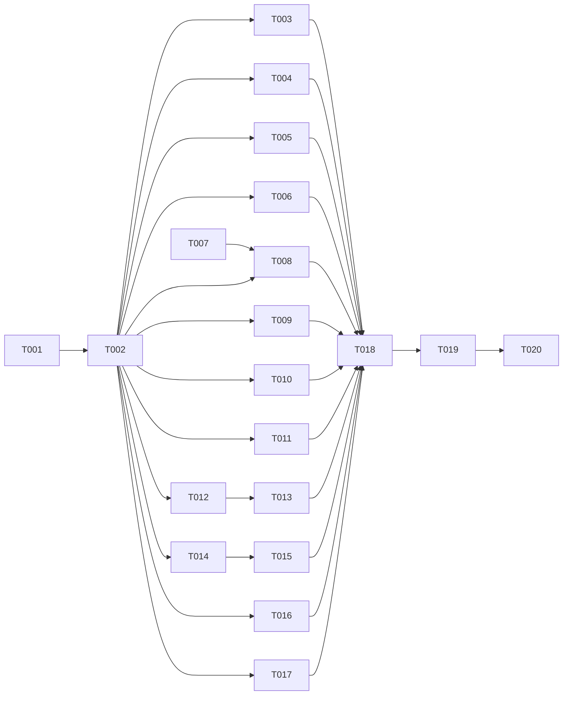

# Visual Redesign — Tasks

Specification: [SPEC.md](./SPEC.md)

## Status
Ready: 20  In Progress: 0  Done: 0

## Conventions
- Every task runs `pnpm typecheck`, `pnpm lint` and `pnpm test`. Any task that changes a route or layout also runs `pnpm build`.
- No task changes server code, route handlers, DTOs, Firestore rules, environment variables or any Account Erasure file (BR-38, BR-31).
- No task adds a persistence path, endpoint, DTO field, metric, permission, dependency or unique illustration asset (SPEC "Out of scope", BR-7).
- Browser-based visual verification is not claimed by any task. Each task records implementation completion only (BR-34). Browser evidence is the user's final manual step (BR-35).
- Existing feature-suite tests protect behaviour and copy. Tests that assert obsolete markup may be updated in the task that changes that markup. The team-overview section-order test is kept (SPEC "Approval decisions").

## Dependency graph

## Tasks

### TASK-001 — Application shell: top bar account menu and page header composition

**Status:** Ready
**Covers:** BR-1, BR-9, BR-33
**Depends on:** None

**Outcome**
Authenticated pages show the desktop sidebar with the five groups, the current route marked with `aria-current` and a non-colour indicator, a top bar with the notification control and an account menu (display name plus menu with Min profil and Logg ut), and a page header that places the single primary action top right. Account items stay in the sidebar Account group too (SPEC AD-8).

**Implementation notes**
- Extend the existing `AppShell`, `NavGroupList` and top bar. Do not add destinations or groups (BR-9).
- Account menu actions reuse the existing sign-out and profile routes.
- Navigation items are shown only where the viewer may open the route; the existing visibility logic is unchanged.

**Verification**
- Component tests: group order, `aria-current` on the exact path only, account menu opens and closes with keyboard, Escape closes, focus returns to the trigger.
- Existing `AppShell`, drawer and skip-link tests pass or are updated only for the changed markup.
- `pnpm build`.

**Security / privacy**
No change to visibility rules. Signed-out shell behaviour (fail closed) is unchanged.

**Documentation impact**
`docs/features/product-experience/SPEC.md` "Application shell" gains a pointer to this feature for the top-bar account menu only.

**Acceptance criteria**
- [ ] Groups and items match BR-9 exactly for admin and non-admin viewers.
- [ ] Account menu is keyboard operable with visible focus.
- [ ] Relevant tests pass
- [ ] No conflict with `docs/SECURITY.md`
- [ ] Relevant documentation is updated

---

### TASK-002 — Shared dashboard presentation primitives

**Status:** Ready
**Covers:** BR-4, BR-5, BR-6, BR-7, BR-29 (primitive-level), BR-32, BR-33
**Depends on:** TASK-001

**Outcome**
Reusable presentation primitives exist in `src/components/ui/` (or `src/components/layout/`) for the patterns the 14 references repeat, and pages can compose them. Each primitive is presentation only and accepts already-resolved values:
- `StatTile` (label, value text, optional tone badge, optional sparkline or bar, insufficient-data variant)
- `SummaryPanel` (titled card with optional action link and content region)
- `LevelBar` (labelled bar with text value and status text)
- `ActionListItem` (icon, title, description, chevron link, row border)
- `PanelHeader` with an optional tab row slot
- `IdentityArt` wrapper that places one of the three approved illustration assets with a given position, crop, scale and background (SPEC BR-7, AD-4)
- `Initials` avatar (neutral tone, derived from an existing display name)
- `InsufficientData` state (text, never zero)

**Implementation notes**
- Only create a primitive when at least two pages in this feature will use it (SPEC AD-3). Reuse `Card`, `StatusBadge`, `Button`, `Tabs`, `EmptyState`, `Skeleton`, `ChartFrame` and `Icon` where they exist.
- The three illustration assets are the existing approved assets (sidebar band, sign-in/public hero art, survey/empty-state art). Locate them in the repository; do not draw new ones.
- Use semantic tokens only (BR-3). Add no palette value outside the token file.

**Verification**
- Unit tests per primitive: renders text and tone label, never colour alone (BR-29); `Icon` and illustrations are `aria-hidden`; `InsufficientData` renders text and no numeric zero.
- Static guard: no new raw palette values; no new icon import outside `Icon`.
- `pnpm typecheck`, `pnpm lint`, `pnpm test`.

**Security / privacy**
`InsufficientData` must never render a zero for a suppressed value (SPEC BR-14, product-experience BR-9). `Initials` uses only an existing display name.

**Documentation impact**
None expected beyond a short component list in `docs/features/visual-redesign/VERIFICATION.md`.

**Acceptance criteria**
- [ ] Each primitive has tests for its states, including insufficient data.
- [ ] No primitive contains domain logic or data fetching.
- [ ] Relevant tests pass
- [ ] No conflict with `docs/SECURITY.md`
- [ ] Relevant documentation is updated

---

### TASK-003 — Signed-out home composition (reference 01)

**Status:** Ready
**Covers:** BR-10, BR-37, BR-30
**Depends on:** TASK-002

**Outcome**
`/` for signed-out visitors shows the two-column hero (headline, value sentence, "Opprett konto" and "Logg inn"), a product preview built from original SVG/CSS with no invented figures, a value strip of short statements that describe existing features, and a trust band carrying the locked class A line verbatim. Excluded reference items are not rendered; their visual role is taken by the value strip and the preview (SPEC BR-37).

**Implementation notes**
- Keep the existing `app/page.copy.ts` as the copy source. Do not edit locked copy (`product-experience` TASK-014 test).
- The preview is a styled, non-interactive representation of the dashboard. It contains no real or sample names, figures or percentages.
- The trust band uses the existing dark surface token pair.

**Verification**
- Route test: locked privacy line appears verbatim; "anonym" absent; no "gratis", "Priser", "Produkt", "Sikkerhet og personvern" or "Se hvordan det fungerer" text.
- Route test: the two actions are present and keyboard reachable; one `h1`.
- `pnpm test`, `pnpm build`.

**Security / privacy**
The class A line is the only privacy claim on the page. No outcome or certification claim is introduced (SPEC BR-10).

**Documentation impact**
None expected.

**Acceptance criteria**
- [ ] Hero, value strip, preview and trust band are present in that order.
- [ ] Locked privacy line verbatim (test).
- [ ] No excluded copy (test).
- [ ] Relevant tests pass
- [ ] No conflict with `docs/SECURITY.md`
- [ ] Relevant documentation is updated

---

### TASK-004 — Sign-in split layout (reference 02)

**Status:** Ready
**Covers:** BR-11, BR-30, BR-29
**Depends on:** TASK-002

**Outcome**
`/sign-in` is a split layout on desktop: headline and up to three value points with existing copy on the left, a single form card on the right with the existing email and password form, labelled fields, the existing error and success states and the existing "Opprett konto" link. Below desktop the card stacks under the value points. Excluded items (Google, "Husk meg", "Glemt passord?") are not rendered. The illustration asset appears as a background treatment only.

**Implementation notes**
- The redirect gate and safe `continue` allow-list are unchanged (product-experience sign-in redirect tests must still pass).
- Auth client code is not changed.

**Verification**
- Route test: value points render; no Google, "Husk meg" or "Glemt passord" text; form labels, submit and error association unchanged.
- Existing sign-in redirect tests pass unchanged.
- `pnpm test`, `pnpm build`.

**Security / privacy**
No change to authentication. Error messages stay generic (SPEC Security and privacy).

**Documentation impact**
None expected.

**Acceptance criteria**
- [ ] Split layout on desktop, stacked below desktop.
- [ ] No excluded control or link.
- [ ] Redirect and form behaviour tests pass unchanged.
- [ ] Relevant tests pass
- [ ] No conflict with `docs/SECURITY.md`
- [ ] Relevant documentation is updated

---

### TASK-005 — Authenticated home composition (reference 03)

**Status:** Ready
**Covers:** BR-12, BR-26, BR-27, BR-32, BR-37
**Depends on:** TASK-002

**Outcome**
Signed-in `/` shows the greeting band with the display name and identity art, four status tiles, and the panels: team entry, goals (owner-only read, title, status, target date, no percentages), next conversation (owner-only read), role panel ("Ingen rolle valgt" with action, or the selected role), team development chart from the existing team results read with the same thresholds and suppression, and recommended next steps as links to existing pages. Excluded counters and calendar items are replaced by the alternatives in SPEC BR-37.

**Implementation notes**
- Use only reads the viewer may already make. Add no new server call, endpoint or field.
- The team development chart reuses the existing results DTO and the existing `ChartFrame` with its text alternative. Its range control appears only if the existing read supports the range.
- Each panel loads and fails independently (BR-32).
- Greeting uses the existing display name; no time-of-day logic is added.

**Verification**
- Component/route tests with mocked reads: each panel renders its loaded state, its empty state and its failure state independently.
- Test: suppressed team values show the insufficient-data state, never zero.
- Test: no "pågående tiltak", calendar or invented delta text.
- `pnpm test`, `pnpm build`.

**Security / privacy**
Goals and conversations remain owner-only; the home shows only what the owner's existing reads return (SPEC BR-27). Team results use the same thresholds as the team overview.

**Documentation impact**
None expected.

**Acceptance criteria**
- [ ] Each panel maps to an existing read; no new call.
- [ ] Suppressed values are never shown as zero.
- [ ] Each panel's failure is isolated.
- [ ] Relevant tests pass
- [ ] No conflict with `docs/SECURITY.md`
- [ ] Relevant documentation is updated

---

### TASK-006 — Team directory card composition (reference 04)

**Status:** Ready
**Covers:** BR-13, BR-37, BR-32
**Depends on:** TASK-002

**Outcome**
`/teams` shows a responsive card grid. Each card has identity art derived from the team id, the team name, the description when present, the relationship badge and the existing action. The page header carries the title and purpose. Empty and error states follow BR-32. No metric, count, filter, search or "Nytt team" control is shown.

**Implementation notes**
- Reuse `TeamIdentity` and `TeamsOverview` from the Phase B working tree. Restyle; do not change the list read.
- Grid columns: one on phone, two at tablet, three at desktop.

**Verification**
- Component tests: card content, relationship badge text, action present per relationship, empty state, error state.
- Test: no search field, filter, tab or "Nytt team" control; no metric text.
- `pnpm test`, `pnpm build`.

**Security / privacy**
Team list stays name and relationship only (SPEC BR-13).

**Documentation impact**
None expected.

**Acceptance criteria**
- [ ] Card grid at three breakpoints (tests cover the class or structure per breakpoint).
- [ ] No excluded control.
- [ ] Relevant tests pass
- [ ] No conflict with `docs/SECURITY.md`
- [ ] Relevant documentation is updated

---

### TASK-007 — Duplicate React key `"2"`: investigation and fix

**Status:** Ready
**Covers:** BR-15
**Depends on:** None

**Outcome**
The duplicate-key warning on `/teams/[teamId]` is either proven absent by a regression test that renders the team overview with duplicate-prone data and asserts no duplicate-key error is logged, or traced to its source and fixed there with a regression test that fails before the fix. The static findings and the test evidence are recorded in `VERIFICATION.md`.

**Implementation notes**
- Static investigation first: list every array-based `key` on the team overview render path (`TrendChart`, `ResultsSummaryStrip`, `TrendTable`, `TeamRosterSection`, `TeamSkillSection`, `TeamSkillNeedsSection`, roadmap planning list). Identify which source data can produce a duplicate.
- `key={generation}` on direct children is not an array sibling and is not the cause by itself.
- A `key` change that does not remove a proven collision does not satisfy BR-15.
- Browser reproduction with a seeded team is a remaining verification item if the test cannot reproduce. Do not run `pnpm seed:demo-team` against a non-emulator project.

**Verification**
- Test that fails before a fix (if a collision is found) and passes after.
- Test rendering team overview with duplicate-prone data asserts no `console.error` containing "same key".
- `pnpm test`, `pnpm typecheck`, `pnpm lint`.

**Security / privacy**
No change to data. Keys derive from existing identifiers only; no personal data in keys.

**Documentation impact**
`VERIFICATION.md` records the investigation, findings and any remaining browser item. `product-experience` plan §10.3 is not edited by this task.

**Acceptance criteria**
- [ ] Investigation record exists with the static findings.
- [ ] Regression test exists and its result before/after is recorded (if a fix was made).
- [ ] The issue is not reported as resolved unless evidence exists; otherwise the browser item is listed.
- [ ] Relevant tests pass
- [ ] No conflict with `docs/SECURITY.md`
- [ ] Relevant documentation is updated

---

### TASK-008 — Team overview dashboard composition (reference 05)

**Status:** Ready
**Covers:** BR-14, BR-37, BR-32, BR-26
**Depends on:** TASK-002, TASK-007

**Outcome**
`/teams/[teamId]` shows the header band (identity art, name, status badge only if the team has a status, description, existing summary values), the tab row of existing team routes, a summary row of existing values (pulse, coverage, ongoing initiatives), and a dashboard grid: competency needs and coverage beside the team development chart, roadmap next steps and calendar-free upcoming items in a side column, challenges and members below. Members are initials. The DOM order is the tested section order; the grid areas are set with CSS. Excluded items use BR-37 alternatives.

**Implementation notes**
- Keep `TeamDetail` as the owner of data and states. Presentation changes go to the zone components and `TeamHeading`, `TeamRouteNav`, `TeamSummaryStrip`.
- Keep the section-order test (`Kompetansebehov og dekning` after `Kompetanseområder`, before the roster). Update only the assertion text if a heading is renamed.
- Keep per-section loading, error and empty states (BR-32).
- Keep the results-unavailable branch rendering with the same header and tabs.

**Verification**
- Existing `TeamDetail` tests pass, including the section-order test.
- New tests: header shows team name once; tab items are the existing routes only; members render initials without image elements; insufficient data is shown as text, not zero.
- `pnpm test`, `pnpm build`.

**Security / privacy**
Aggregation and thresholds unchanged. No individual response shown. Members are initials derived from existing display names.

**Documentation impact**
None expected.

**Acceptance criteria**
- [ ] Section-order test passes.
- [ ] Header, tabs, summary and grid are present; no excluded element.
- [ ] Insufficient data never shows zero.
- [ ] Relevant tests pass
- [ ] No conflict with `docs/SECURITY.md`
- [ ] Relevant documentation is updated

---

### TASK-009 — Team roadmap quarter-column board (reference 06)

**Status:** Ready
**Covers:** BR-16, BR-17, BR-37, BR-32, BR-26
**Depends on:** TASK-002

**Outcome**
`/teams/[teamId]/roadmap` shows the team header and tabs, a page header with the view switch (Tidslinje, Liste), a status tile row from existing derived states, and a quarter-column board: one column per quarter, plan cards in the column of their target quarter, an "Uten måldato" group for undated plans, and a detail panel for the selected plan. The Phase B `RoadmapGantt` spanning bars and Gantt legend are removed (SPEC AD-5). Below `md` the grouped list replaces the board.

**Implementation notes**
- Replace `src/features/roadmap/components/RoadmapGantt.tsx` with a quarter-column component, or rewrite it in place. Remove the `ganttLegend` copy and its tests. Do not change the roadmap read or DTOs.
- Quarter grouping uses the existing `targetDate` quarter logic (team-roadmap BR-9a/timeline). Reuse existing grouping helpers if present.
- Status tiles: planned, active, completed, overdue (existing derived copy), and archived only through the existing "Vis arkiverte" control.
- Detail panel shows only existing fields. No progress percentage.
- The board scrolls internally on narrow widths, never the page (BR-17).

**Verification**
- Tests: a plan with start and target in different quarters appears only in its target-quarter column; no element has a span across two quarter columns; no Gantt legend text; undated plans appear under "Uten måldato" and not on the axis.
- Tests: view switch URL state `?view=timeline` and `view=list` unchanged.
- Tests: list view at narrow width carries the same plan text.
- `pnpm test`, `pnpm build`.

**Security / privacy**
Roadmap read unchanged; owner and status shown only where the existing DTO returns them.

**Documentation impact**
`docs/features/team-roadmap/SPEC.md` is not changed (it already says no Gantt). `docs/ARCHITECTURE.md` "Team Roadmap" section mentions the timeline only if it describes spanning bars; update the sentence in that case.

**Acceptance criteria**
- [ ] No spanning bars and no Gantt legend remain (test and grep).
- [ ] Target-quarter placement and "Uten måldato" grouping tested.
- [ ] Relevant tests pass
- [ ] No conflict with `docs/SECURITY.md`
- [ ] Relevant documentation is updated

---

### TASK-010 — My skills composition (reference 07)

**Status:** Ready
**Covers:** BR-18, BR-37, BR-27, BR-32
**Depends on:** TASK-002

**Outcome**
`/me/skills` shows the page header, a summary row of existing counts, a competency area list with level bars and text status labels, a role comparison panel with all four role states, and up to three next-step links. Class A notices appear verbatim in a compact block before the list. The radar is replaced by the level bars (BR-37). Averages and the "Fortsett utviklingen din" banner are not shown.

**Implementation notes**
- Keep the existing self-assessment, role comparison and counts logic. Re-present only.
- Level labels use the existing wording.

**Verification**
- Existing skill-profile and role-profile suites pass (updated only for markup).
- New tests: class A notices verbatim; role states (none selected, no roles, selected, archived or unavailable); no average text; no radar.
- `pnpm test`, `pnpm build`.

**Security / privacy**
Self-assessments stay person-owned. No team or admin view is added. No ranking or score wording (SPEC BR-18).

**Documentation impact**
None expected.

**Acceptance criteria**
- [ ] All four role states render text, not colour alone.
- [ ] Class A notices verbatim.
- [ ] No average or banner.
- [ ] Relevant tests pass
- [ ] No conflict with `docs/SECURITY.md`
- [ ] Relevant documentation is updated

---

### TASK-011 — My goals composition (reference 08)

**Status:** Ready
**Covers:** BR-19, BR-37, BR-27, BR-32
**Depends on:** TASK-002

**Outcome**
`/me/goals` shows the header with the existing "Nytt mål" action, a summary strip of counts (active, completed) with a status-coloured stat tile in place of the progress ring, status tabs Aktive, Fullførte and Alle with counts, and goal cards with title, linked skill area, target date, status badge, completion control and edit control. The side panel shows linked skill areas only. No progress bar, ring or percentage.

**Implementation notes**
- Goals have no progress value (`docs/PRODUCT.md`, Mål). Do not compute one.
- Keep the existing editor as disclosure or dialog.

**Verification**
- Existing personal-goals suites pass (updated only for markup).
- New tests: no progress element; tabs filter; counts match the list; completion and edit controls keep their accessible names.
- `pnpm test`, `pnpm build`.

**Security / privacy**
Goal ownership and visibility unchanged (owner-only). No teammate or admin path.

**Documentation impact**
None expected.

**Acceptance criteria**
- [ ] No progress indicator on any goal.
- [ ] Tabs and counts correct.
- [ ] Relevant tests pass
- [ ] No conflict with `docs/SECURITY.md`
- [ ] Relevant documentation is updated

---

### TASK-012 — Conversations list composition (reference 09)

**Status:** Ready
**Covers:** BR-20, BR-27, BR-32
**Depends on:** TASK-002

**Outcome**
`/me/conversations` shows the header with the existing "Ny samtale" action, a list pane and, on desktop, the selected conversation beside it. Filter chips show the existing statuses (open, completed) and the existing created-by-me and participating distinction. Items show title, counterpart display name with initials, status badge and the existing date. On phones only the list shows.

**Implementation notes**
- Domain statuses are `open` and `completed` (`conversation-status.ts`). The reference's "Planlagt" and "Aktiv" chips are not used.
- Search is added only if the existing list supports it.

**Verification**
- Existing conversation suites pass (updated only for markup and the form placement change).
- New tests: filter chips reflect domain statuses only; participants shown as initials; list-only layout at phone width (class or structure).
- `pnpm test`, `pnpm build`.

**Security / privacy**
Participant-only access unchanged. Counterpart names only for participants. No preview of conversation contents in the list.

**Documentation impact**
None expected.

**Acceptance criteria**
- [ ] Only domain statuses appear as chips.
- [ ] Participants only; initials.
- [ ] Relevant tests pass
- [ ] No conflict with `docs/SECURITY.md`
- [ ] Relevant documentation is updated

---

### TASK-013 — Conversation detail composition (reference 10)

**Status:** Ready
**Covers:** BR-21, BR-37, BR-27, BR-32
**Depends on:** TASK-012

**Outcome**
`/me/conversations/[conversationId]` shows the header (title, status badge, start date, participants), the existing structured sections as tabs (for example notes, goals, follow-up), a focused content column and an aside with the next meeting and related goals where stored. The chat-like composition of the reference is replaced by a structured notes and follow-up layout with the same tabbed header and summary panels (SPEC BR-37). No composer, attachments, emoji, read receipts or message history.

**Implementation notes**
- Use the existing section components and save actions; only the layout and visual treatment change.
- Save actions keep their existing labels.

**Verification**
- Existing development-conversation suites pass (updated only for markup).
- New tests: no composer, no attachment control, no message bubble class or role; existing save actions present.
- `pnpm test`, `pnpm build`.

**Security / privacy**
Participant-only access and encryption paths unchanged. No new field stored.

**Documentation impact**
None expected.

**Acceptance criteria**
- [ ] No chat-like control or text.
- [ ] Existing save actions and labels unchanged.
- [ ] Relevant tests pass
- [ ] No conflict with `docs/SECURITY.md`
- [ ] Relevant documentation is updated

---

### TASK-014 — Admin teams composition (reference 11)

**Status:** Ready
**Covers:** BR-23, BR-14 (admin scope marker per product-experience BR-14), BR-32
**Depends on:** TASK-002

**Outcome**
`/admin/teams` shows the admin scope marker, the header with the existing "Opprett team" action, the existing admin tabs only, a card grid of teams with identity art, name, existing status badge and existing counts, and pagination only if the page already paginates. The same family is applied to `/admin/teams/[teamId]` header and tabs.

**Implementation notes**
- Team status badge uses only statuses the product already has.
- Grid/list toggle, search and status filters are not added unless they already exist.

**Verification**
- Existing admin team suites pass (updated only for markup).
- New tests: admin scope marker present; tabs are existing routes; no "Medlemmer", "Tilganger" or "Innstillinger" tab unless those routes exist; no invented count.
- `pnpm test`, `pnpm build`.

**Security / privacy**
No new admin capability (SPEC BR-23). Admin-only routes keep their guards.

**Documentation impact**
None expected.

**Acceptance criteria**
- [ ] Scope marker visible on both admin team routes.
- [ ] No invented tab, status or count.
- [ ] Relevant tests pass
- [ ] No conflict with `docs/SECURITY.md`
- [ ] Relevant documentation is updated

---

### TASK-015 — Admin roles split view (reference 12)

**Status:** Ready
**Covers:** BR-24, BR-37, BR-32
**Depends on:** TASK-014

**Outcome**
`/admin/roles` shows a split view on desktop: role list on the left (name, description, expectation count, archived state) and the selected role on the right (name, description, expected competency levels and areas, archived state, existing edit and archive actions). Below desktop the selected role opens as a view. The permission-toggle composition is replaced by a competency-expectation panel (SPEC BR-37).

**Implementation notes**
- Role profiles are competency expectations. Do not add access wording, toggles, "Rettigheter" or member assignment.
- Keep existing role create, edit and archive flows.

**Verification**
- Existing role-profile admin suites pass (updated only for markup).
- New tests: split layout structure; no toggle, switch or "Rettigheter" text; archived state shown as text.
- `pnpm test`, `pnpm build`.

**Security / privacy**
Role profiles remain separate from security roles (SPEC BR-24). No new permission surface.

**Documentation impact**
None expected.

**Acceptance criteria**
- [ ] No permission toggle or access wording.
- [ ] Split view on desktop; selected-role view below desktop.
- [ ] Relevant tests pass
- [ ] No conflict with `docs/SECURITY.md`
- [ ] Relevant documentation is updated

---

### TASK-016 — My profile composition (reference 13)

**Status:** Ready
**Covers:** BR-22, BR-37, BR-27
**Depends on:** TASK-002

**Outcome**
`/me/profile` shows a header band with the display name (existing editable field), team membership from existing data, the existing account actions, and the Account Erasure entry unchanged. The primary action "Rediger profil" opens the existing display-name form. Panels for bio, contact, location, job title, skill percentages and goal summaries are not shown. The page uses the header band and a two-column composition (display name form and account actions in the main column, team membership and privacy boundary note in the aside), with no new data.

**Implementation notes**
- The Account Erasure component and its files are not modified (BR-38).
- The privacy boundary note reuses existing copy; no new claim.

**Verification**
- Existing profile suites pass (updated only for markup). Account Erasure suites pass unchanged.
- New tests: no bio, contact, location, job-title, skill or goal panel text; display-name form present; erasure entry present with its existing safeguard text.
- `pnpm test`, `pnpm build`.

**Security / privacy**
No new profile field (SPEC BR-22). Account Erasure safeguards unchanged. Deployment remains HELD and is not affected by this task.

**Documentation impact**
None expected.

**Acceptance criteria**
- [ ] Only existing fields appear.
- [ ] Account Erasure files unchanged (git diff check).
- [ ] Relevant tests pass
- [ ] No conflict with `docs/SECURITY.md`
- [ ] Relevant documentation is updated

---

### TASK-017 — Pulse survey phone composition (reference 14)

**Status:** Ready
**Covers:** BR-25, BR-37, BR-27
**Depends on:** TASK-002

**Outcome**
`/survey/[surveyId]` follows the reference composition with the existing behaviour: a single column at every width, a header with survey title, team name and the progress text "Spørsmål N av 3" with a bar, one question per screen with five labelled options at least 44 × 44 px, selected state by border, text weight and tint, Forrige and Neste in a bottom bar on phones (under the card on desktop), Neste disabled with the existing text until answered, intro with the locked notice and collapsed disclosure, completion with the existing copy. The survey illustration appears on the intro only.

**Implementation notes**
- Survey behaviour, payload, answer handling in memory and no-persistence rule are unchanged (`product-experience` TASK-020 to TASK-023).
- No time estimate and no percentage text.

**Verification**
- Existing survey suites pass (updated only for markup).
- New tests: no "ca. 3 minutter" or percentage text; progress text uses the real question count; bottom action bar structure at phone width; survey route has no navigation landmark.
- `pnpm test`, `pnpm build`.

**Security / privacy**
Locked notice and disclosure verbatim. No storage API added (product-experience BR-S3). Payload identical (BR-S6).

**Documentation impact**
None expected.

**Acceptance criteria**
- [ ] Locked notice verbatim on the intro before the first question.
- [ ] Five options, each at least 44 × 44 px (test on the class or measured style value).
- [ ] No storage API added (grep check).
- [ ] Relevant tests pass
- [ ] No conflict with `docs/SECURITY.md`
- [ ] Relevant documentation is updated

---

### TASK-018 — Cross-page responsive, dark theme and reduced-motion sweep

**Status:** Ready
**Covers:** BR-2, BR-8, BR-28, BR-30
**Depends on:** TASK-003, TASK-004, TASK-005, TASK-006, TASK-008, TASK-009, TASK-010, TASK-011, TASK-013, TASK-015, TASK-016, TASK-017

**Outcome**
Every composition from the tasks above is checked for, and corrected where needed to satisfy: no unintended horizontal page scroll at 320, 360, 768 and 1280 px (static CSS and structure tests where possible); dark theme uses only dark tokens (no hard-coded light surface); transitions are disabled or reduced under `prefers-reduced-motion`; charts scroll internally or switch to text.

**Implementation notes**
- Work from a list of the 14 routes. Fix only defects found by the checks; do not restyle further.
- Browser measurement is not performed here. Record what static checks cover.

**Verification**
- Static: a test scans the changed feature components for raw palette values and for transitions not covered by the reduced-motion rule.
- Tests: charts have a text or table alternative for each route using them.
- `pnpm typecheck`, `pnpm lint`, `pnpm test`, `pnpm build`.

**Security / privacy**
No change to data or access.

**Documentation impact**
`VERIFICATION.md` records the static coverage and the browser items left for the user.

**Acceptance criteria**
- [ ] Static checks pass and are recorded.
- [ ] No raw palette value outside the token file.
- [ ] Relevant tests pass
- [ ] No conflict with `docs/SECURITY.md`
- [ ] Relevant documentation is updated

---

### TASK-019 — Contrast record and accessibility static checks for new pairs

**Status:** Ready
**Covers:** BR-29, BR-3
**Depends on:** TASK-018

**Outcome**
Every text and UI token pair used by the new compositions (status tiles, level bars, identity art labels, dark panels, quarter column headers, insufficient-data text) is measured from the implemented token file in both themes and recorded. Any pair below threshold is fixed in the token file. Static accessibility checks cover: one `h1` per route, heading order, accessible names for icon-only controls, `aria-current` on navigation.

**Implementation notes**
- Extend the existing contrast test and record in `docs/features/product-experience/VERIFICATION.md` or in this feature's `VERIFICATION.md` (choose one and link it).
- No WCAG conformance claim is made.

**Verification**
- Contrast guard test updated with the new pairs; test passes.
- Static heading and landmark test per route.
- `pnpm test`, `pnpm lint`.

**Security / privacy**
No change.

**Documentation impact**
Contrast record updated.

**Acceptance criteria**
- [ ] Every new pair measured in both themes and recorded.
- [ ] No pair below threshold remains.
- [ ] Relevant tests pass
- [ ] No conflict with `docs/SECURITY.md`
- [ ] Relevant documentation is updated

---

### TASK-020 — Visual verification record, deviations and closeout

**Status:** Ready
**Covers:** BR-34, BR-35, BR-36, BR-31, BR-38
**Depends on:** TASK-019

**Outcome**
`docs/features/visual-redesign/VERIFICATION.md` exists and records, per reference (01 to 14): the route and tasks; implementation status (completed, or the open items); visual status set to "not visually verified" with the browser checklist the user will run (BR-35 viewports, zoom, themes, keyboard, screen reader, axe scan, screenshot paths); the BR-37 alternatives used and any omitted alternative; intentional deviations with classification and reason (BR-36). It also records: the duplicate-key investigation result from TASK-007; the Account Erasure files unchanged (git diff check); the TASK-045 identifier not used for the gate.

**Implementation notes**
- No browser screenshots are claimed. The file lists them as pending for the user.
- Status line of `SPEC.md` stays Approved; the TASKS status counts are updated by the implementation runs.
- Do not change `product-experience` TASKS or SPEC.

**Verification**
- Full gate: `pnpm typecheck`, `pnpm lint`, `pnpm test`, `pnpm build` (results recorded with their actual output).
- `git diff --stat` shows no changes under Account Erasure paths or server/DTO/rules paths.

**Security / privacy**
Record the security-review requirement: the survey and the team overview changed presentation and should be reviewed by `security-review` before closeout (product-experience TASK-023 practice).

**Documentation impact**
`VERIFICATION.md` created; `docs/UI-UX.md` not changed.

**Acceptance criteria**
- [ ] `VERIFICATION.md` has all 14 reference sections.
- [ ] Full gate results recorded, with real output.
- [ ] Account Erasure and server paths unchanged (diff check recorded).
- [ ] Relevant tests pass
- [ ] No conflict with `docs/SECURITY.md`
- [ ] Relevant documentation is updated
